# Frontend QA report: revision questions

Test plan: `3. frontend_qa.md`. Result: every test and layout record passed. No bugs were found and nothing was fixed.

## Methodology

Screenshots were collected into `screenshots/` beside this report. Every image referenced below exists there. Tests ran at desktop, mobile (375px) and tablet (768px) viewports. Mobile and tablet covered the plan's responsive checks: Tests 2.4, 3, 4, 5 and 6.4. The other tests ran at desktop only.

## Diff scoping

Class: `FULL`. The changed files that triggered it were the `learner_interface` templates and static files, `freedom_ls/revision/*`, `freedom_ls/form_engine/*` and `freedom_ls/content_engine/*`. Nothing was skipped.

## Smoke gate

Outcome: **pass**. Pages loaded: `/` and `/courses/qa-revision-course/revision/`.

## Design check

No design states tested. The plan has no `-design` tests.

## Test results

| Test | Viewport | Result | Screenshot | Notes |
| --- | --- | --- | --- | --- |
| 1 Course details page untouched | desktop | pass | 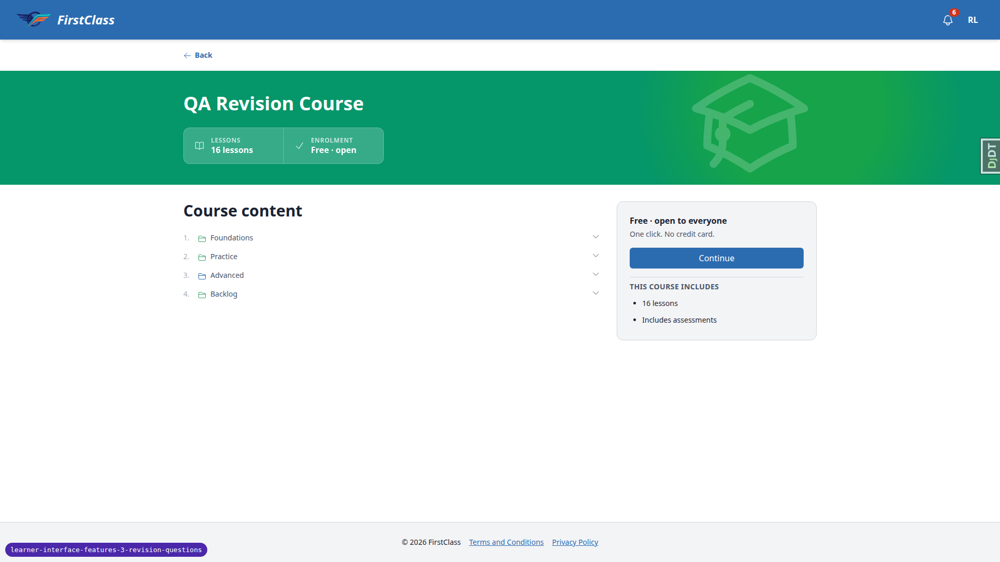 | Learner A sees hero, Continue, "This course includes" and course content. There is no Revision card and no due count. The anonymous view shows the same page with "Enrol for free" and nothing about revision: 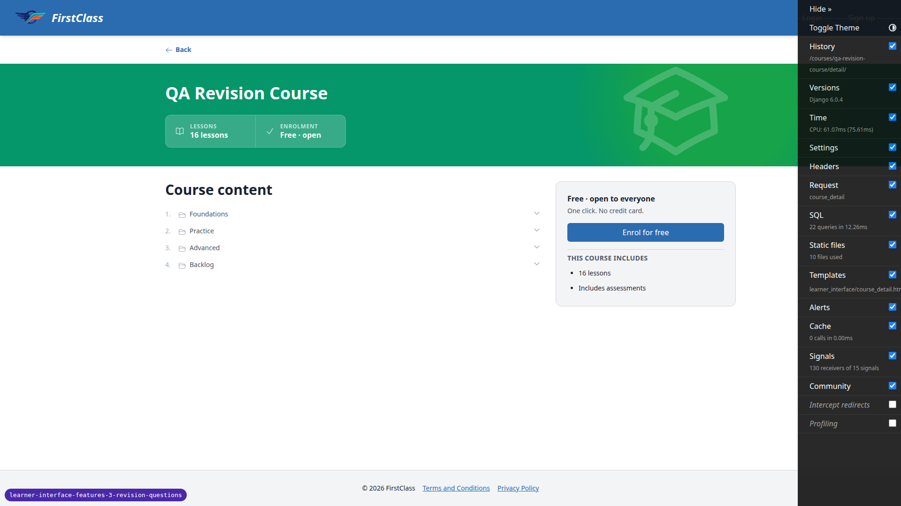. |
| 2 Revision entry in outline | desktop | pass |  | The REVISION eyebrow sits under the outline with no divider or icon. The "40+ due" pill is at the right and nothing appears under the progress bar. Clicking the entry opens `/revision/` inside the player with the entry highlighted. The entry persists across Previous and Next. |
| 2.5 / 3.4 Learner B, empty bank | desktop | pass | 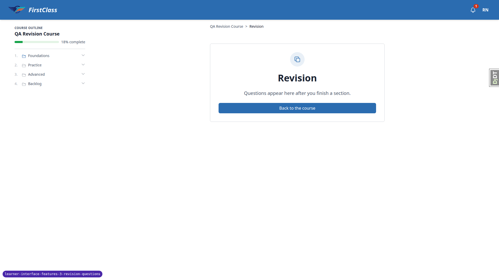 | There is no Revision entry in the outline. `/revision/` returns 200 with "Questions appear here after you finish a section." and "Back to the course". The outline's 18% complete is a stale cached `CourseProgress` value left by the data reset. It is not a product fault. |
| 2.4 outline on small screens | mobile | pass | 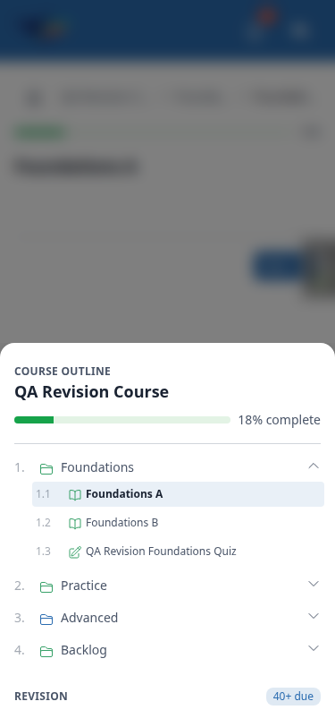 | The sheet ends with REVISION and the "40+ due" pill. There is no horizontal scroll. |
| 2.4 outline on small screens | tablet | pass | 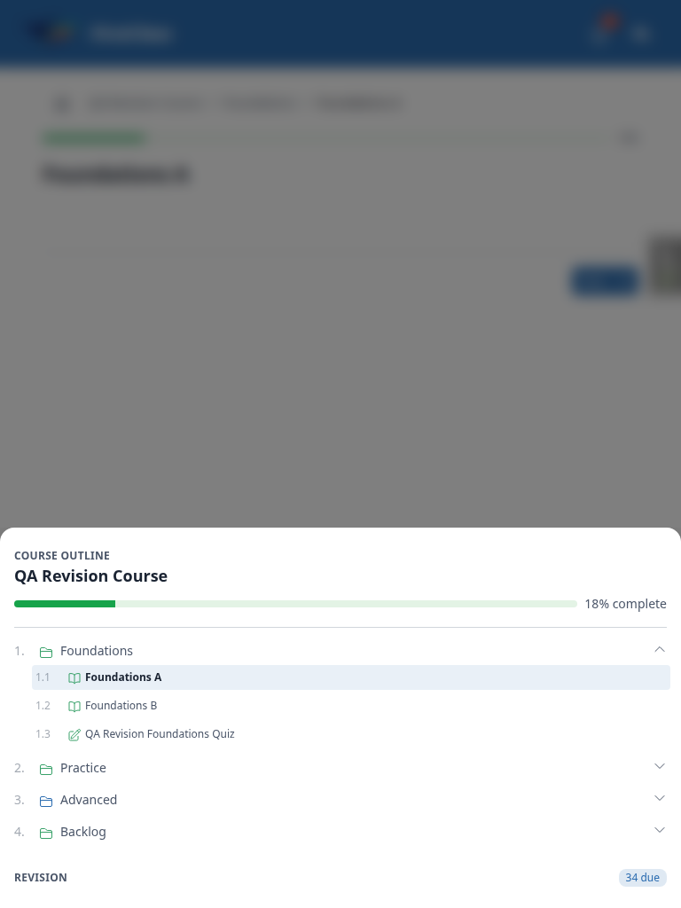 | REVISION with "34 due" at the bottom of the sheet. scrollWidth is 768. |
| 3 Dashboard | desktop | pass | 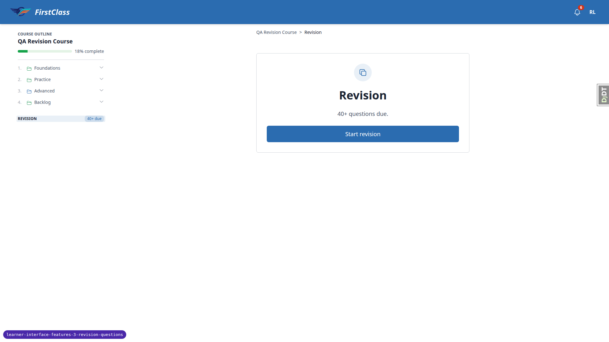 | The card has the icon, heading, "40+ questions due." and a full-width Start revision button. Start leads to "1 of 15". GET on `/revision/start/` and `/revision/next/` returns 405. |
| 3 Dashboard | mobile | pass | 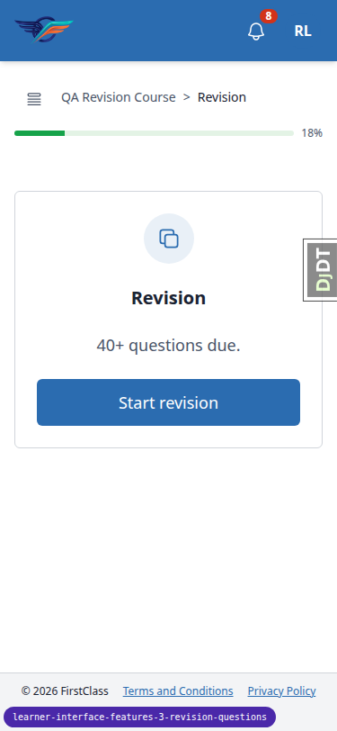 | The card sits inside the player. scrollWidth is 375. |
| 4 Wrong answer | desktop | pass |  | An empty submit returns 422 "Choose an answer." with no browser bubble: 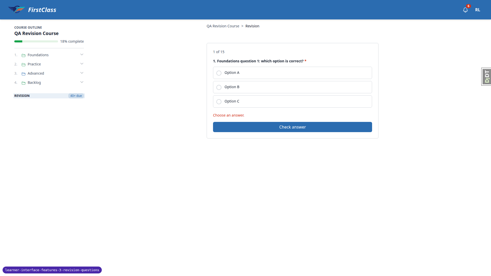. The red/green rows, callout, Revisit link and Next all matched the plan. Focus lands on the feedback and reload keeps it. |
| 4 Wrong answer | tablet | pass | 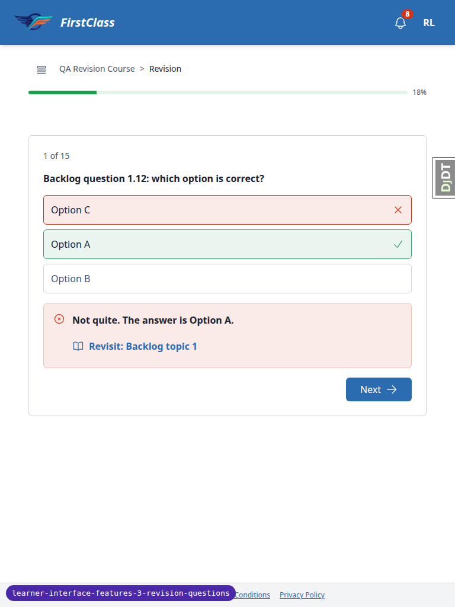 | A wrong answer on a backlog question with no explanation. |
| 5 Right answer and "I guessed" | desktop | pass |  | The toggle cycles pressed, unpressed, pressed (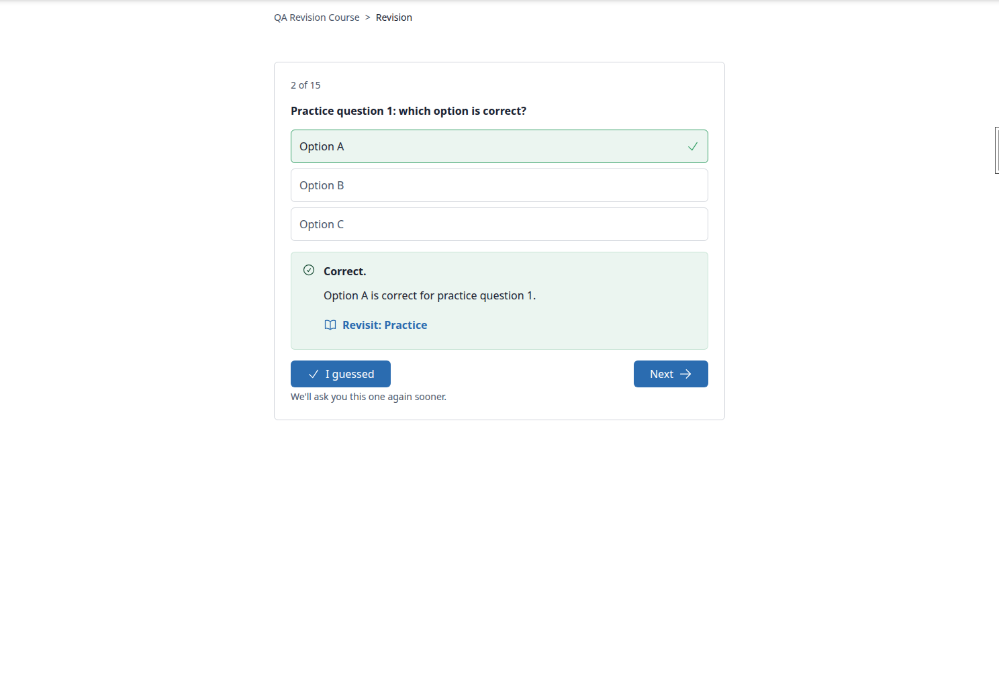) and survives reload. In the admin, the Revision models are read-only: no add link, the add view returns 403, and there are no actions. |
| 5 Right answer and "I guessed" | mobile | pass | 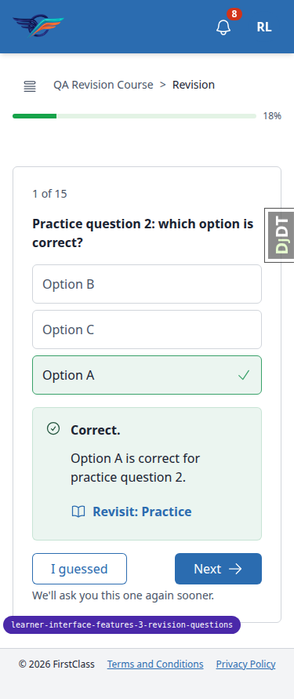 | Feedback fits 375px. "I guessed" and Next share one row. |
| 6 "Revision done" | desktop | pass | 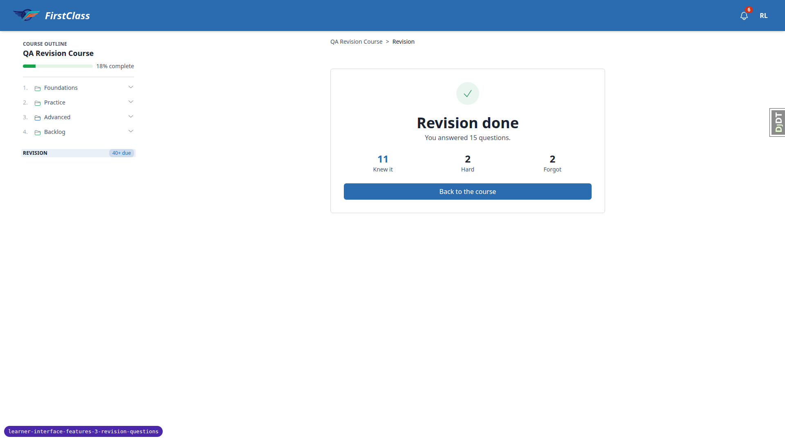 | Of 15 answers, 11 were Knew it, 2 Hard and 2 Forgot. Back to the course leads to the same item as Continue. The due count dropped from 40+ to 36. The session resumed after the tab was closed. The dropped, 30-day and Advanced questions never appeared. |
| 6.4 "Revision done" | mobile | pass | 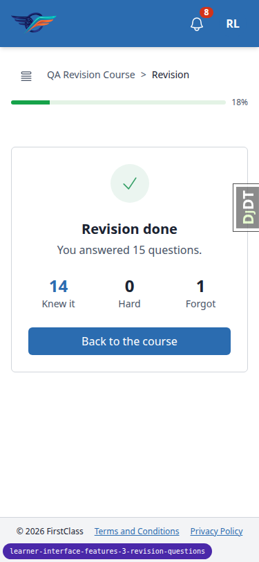 | Knew it 14, Hard 0, Forgot 1 sit side by side. Each column is 87px with no clipped labels. |
| 7 Nothing due | desktop | pass |  | The badge reads "0 due" and the dashboard shows the nothing-due line. The session ran 10 right and 5 wrong, and the counts matched. |
| 8 Turned away | desktop | pass | none | Anonymous users go to login. An unregistered course redirects to its detail page. Paused and access-ended learners see their notices. A missing course returns 404. |
| 9 Quiz pages unchanged | desktop | pass | 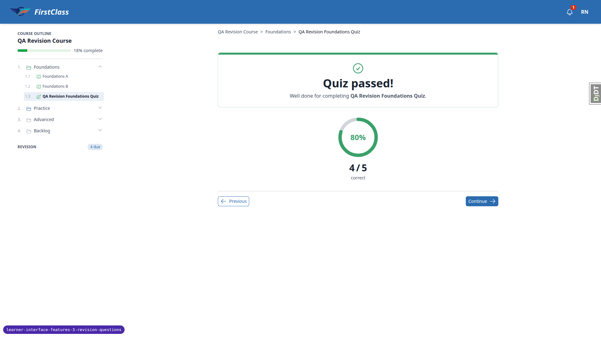 | Learner B took the quiz because Learner A could not start a new sitting. The results show "Quiz passed!" at 80%. The educator preview shows "Correct answer" marks: 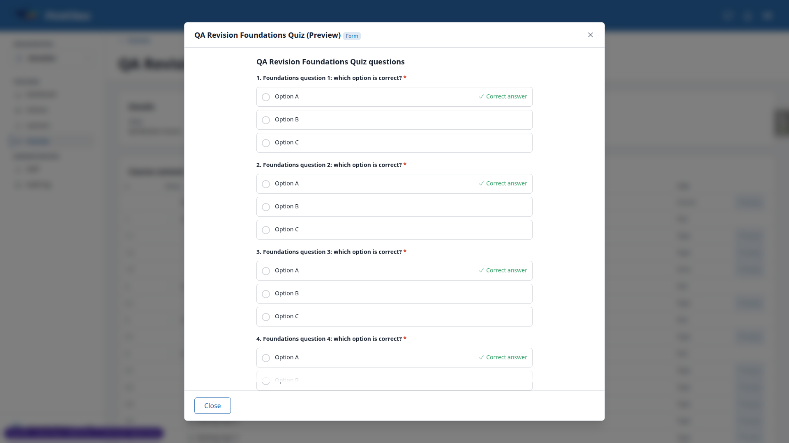. Learner A's attempt count is unchanged. |
| 10 Dropped question and edited explanation | desktop | pass | 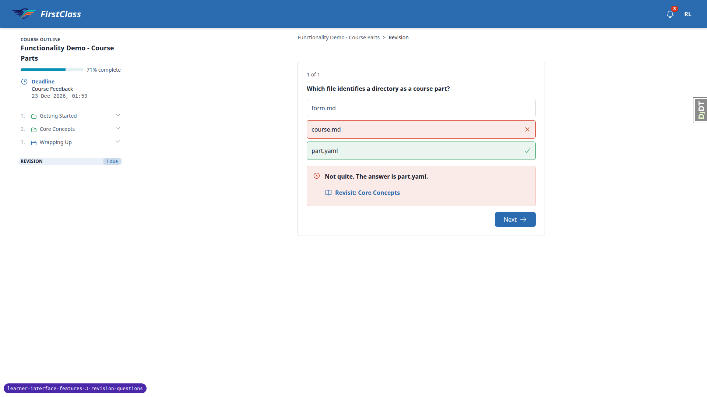 | The session mixed knowledge-check and bank-form questions, with the locked option last. The dropped question disappeared and its review row was removed. `content_validate` warned and exited 0. The feedback had no explanation text. |

## Layout probe

| Test | Viewport | URL | Screenshot | Result |
| --- | --- | --- | --- | --- |
| 1 | desktop | `/courses/qa-revision-course/detail/` |  | clean |
| 2 | desktop | `/courses/qa-revision-course/1/` |  | clean |
| 3 | desktop | `/courses/qa-revision-course/revision/` |  | clean |
| 4 | desktop | `/courses/qa-revision-course/revision/` |  | clean |
| 4 | desktop | `/courses/qa-revision-course/revision/` |  | clean |
| 5 | desktop | `/courses/qa-revision-course/revision/` |  | clean |
| 6 | desktop | `/courses/qa-revision-course/revision/` |  | clean |
| 3.4 | desktop | `/courses/qa-revision-course/revision/` |  | clean |
| 9 | desktop | `/courses/qa-revision-course/3/complete` |  | clean |
| 9 | desktop | `/educator/organisations/demodev/courses/<qa-revision-course>` |  | clean |
| 10 | desktop | `/courses/functionality-demo-course-parts/revision/` |  | clean |
| 7 | desktop | `/courses/qa-revision-course/revision/` |  | clean |
| 2.4 | mobile | `/courses/qa-revision-course/1/` |  | pass, with two flags. Both are "stacked" flags: sidebar ink spans y=383..812, outside the content's y=264..313, and spans x=0..375, over half the viewport. They measure the intentionally open bottom-sheet overlay, so this is expected. |
| 3 | mobile | `/courses/qa-revision-course/revision/` |  | clean |
| 5 | mobile | `/courses/qa-revision-course/revision/` |  | clean |
| 6.4 | mobile | `/courses/qa-revision-course/revision/` |  | clean |
| 2.4 | tablet | `/courses/qa-revision-course/1/` |  | pass, with two flags. Both are "stacked" flags: sidebar ink spans y=595..1024, outside the content's y=284..333, and spans x=0..768, over half the viewport. They measure the intentionally open bottom-sheet overlay, so this is expected. |
| 4 | tablet | `/courses/qa-revision-course/revision/` |  | clean |
| capture-check | desktop | `/courses/qa-revision-course/detail/` |  | clean. The debug toolbar partly covers the screenshot (see General notes). |

## Data changes

| What changed | Made by | Files written |
| --- | --- | --- |
| The DemoDev Site domain had been pinned to `127.0.0.1:8235` by an earlier run, so requests on other ports returned 500 (`Site.DoesNotExist`). Set it to `127.0.0.1`. | `manage.py shell` | none |
| Learner A showed 36 due. Deleted the three QA revision learners' `RevisionSchedule` and `RevisionReview` rows, stripped `revision_session` keys from sessions and re-ran the seeder. | `manage.py shell` + `qa_create_revision_scenario` | none |
| Learner B had finished Foundations in an earlier run (2 topic progress rows and a completed quiz `FormProgress`). Deleted that progress. | `manage.py shell` | none |
| Test 7.1: Learner C's schedules all due +10 days, plus 47 new schedules due +10 days, giving 0 due and a bank of 54. | `manage.py shell` (`.claude/agent-memory/sdd-qa-data-helper/qa_revision_nothing_due_script.py`) | none |
| Test 8.4: added a `LearnerCourseRegistrationDeadlineConfig` (end_course_access on) and a `LearnerDeadlineOverride` with time limit 2026-11-14 for Learner A to end access. Both rows were deleted afterwards. | `sdd:qa-data-helper` | none |
| Test 8.3: paused and resumed Learner A via `deadlines.actions`. Also ran a registration deactivate/reactivate probe. Cleared Learner B's Test 9 Foundations progress again. | `manage.py shell` | none |
| Test 10.8: set Learner A's schedule for knowledge-check question 1b756173 ("Which file identifies a directory as a course part?") due now. | `manage.py shell` | none |
| Test 10: saved a scratch copy of `demo_content` with one bank question and one explanation removed, then re-saved the real `demo_content` to restore it. | `content_save` | none |

## Bug status

| Bug | Status |
| --- | --- |
| none | no bug records |

## General notes

- No test or layout record failed, so there are no per-bug sections.
- Test 8 has no screenshot. It checked redirects, notices and status codes only.
- Observation: the Revision reviews admin changelist has no ordering, so the latest review is not at the top.
- Observation: the capture-check screenshot (`page-2026-11-24T14-49-47-757Z.png`) is partly covered by the debug toolbar. The first prep check used `offsetParent`, which is always null for fixed elements, so the toolbar was not collapsed. Every later shot collapses it. That session had also dropped, so the capture shows the anonymous view, which was used as Test 1 step 3 evidence.
- Observation: the scratch content directory for Test 10 was left in the session scratchpad. A recursive delete is outside what QA may run, so plan step 9 was not done. The harness clears the scratchpad.
- Test 9: Learner A could not start a new Foundations quiz sitting and had no results link, so Learner B took the quiz. This form does not show incorrect answers, so the results page had no "Correct answer" marks to check. The educator preview covered those instead.

status: ok · reason: report rendered, 0 bugs documented
