# Frontend QA report: revision questions

Spec: `learner-interface-features-3-revision-questions`. Plan: `3. frontend_qa.md`.

## Methodology

Screenshots were collected into `screenshots/` beside this report, and every image linked below exists there. Tests ran against a QA server on port 8235 with the seeded learners A, B and C and the admin. Tests ran at desktop, mobile (375px) and tablet (768px) viewports. Two screenshots in that folder (`page-2026-11-23T04-27-13-821Z.png`, `page-2026-11-23T04-34-55-569Z.png`) were taken with the debug toolbar open. They are broken and no record references them, so they are not linked.

Pre-step note (rebase): rebased 33 commits onto main. Conflicts were resolved in `pyproject.toml`/`uv.lock` (kept dulwich and fsrs), and in the content_engine `test_validate.py` and `test_content_save.py` (kept both sides' tests). The lost-change check passed. The full suite had one failure: the educator quiz preview test counted the correct-answer mark's new inner span twice. That was fixed in the test, committed and pushed. The front-end check was folded into this QA run (same pages and viewports). The upstream-change review found nothing changed.

## Diff scoping

Class: **FULL**. Skipped: nothing. Everything ran (desktop, mobile and tablet passes included).

Changed files that triggered the class (front-end subset, from the `scoping` record):
- `freedom_ls/form_engine/templates/cotton/correct-answer-mark.html`
- `freedom_ls/learner_interface/static/learner_interface/js/alpine-components.js`
- `freedom_ls/learner_interface/templates/learner_interface/_course_base.html`
- `.../course_revision.html`
- `.../partials/course_toc_revision.html`
- `.../partials/revision_card.html`
- `.../partials/revision_dashboard.html`
- `.../partials/revision_end.html`
- `.../partials/revision_feedback.html`
- and 109 non-front-end files

## Smoke gate

Status: **pass**. Pages loaded: `/` and `/courses/qa-revision-course/revision/`. The run was not aborted.

## Design check

No design records exist: this plan has no design screenshots, so no design states tested.

## Results summary

| Test | Viewport | Result |
| --- | --- | --- |
| 1.2, 1.3 course detail untouched (Test 1) | desktop | pass |
| 2.2, 2.3, 2.5, 2.6 outline entry (Test 2) | desktop | pass |
| 2.4 outline entry on small screens | mobile, tablet | pass |
| 3.2, 3.3, 3.4, 3.5 dashboard (Test 3) | desktop | pass |
| 3.2 dashboard | mobile | pass |
| 4.1 to 4.10 wrong answer (Test 4) | desktop | pass |
| 4.5 wrong-answer feedback | mobile | pass |
| 5.1, 5.3 to 5.7 right answer and I guessed (Test 5) | desktop | pass |
| 5.3 right answer, toggle and Next on one row | tablet | pass |
| 5.3 right answer, toggle and Next on one row | mobile | **fail** (B2) |
| 6.2 done card (Test 6) | desktop | pass |
| 6.2-brand done card brand checklist | desktop | **fail** (B1) |
| 6.2 done card | tablet | pass |
| 6.4 done card at 375px | mobile | pass |
| 6.3, 6.5, 6.6, 6.7, 6.8 | desktop | pass |
| 6.7-early-submit | desktop | **fail** (B3) |
| 7.2, 7.3, 7.4 nothing due (Test 7) | desktop | pass |
| 8.1, 8.2, 8.3, 8.4, 8.5 turned away (Test 8) | desktop | pass |
| 9.1, 9.2, 9.4, 9.5 quiz pages (Test 9) | desktop | pass |
| 9.3 results page incorrect-answers block | desktop | skip |
| 10.1, 10.3, 10.6 to 10.9 dropped question and explanation (Test 10) | desktop | pass |

## Bugs

### B1: Revision done count tiles are bordered boxes inside the bordered card

Manifestations:
- `6.2-brand`, desktop

Expected: brand visual checklist says items are separated by space, with no box inside a box. The three count tiles (Knew it, Hard, Forgot) should not each be a bordered box inside the bordered revision card.

Actual: `revision_end.html` gives each tile `rounded-md border border-border bg-surface-2`, so three bordered tinted boxes sit inside the bordered card at every viewport. The spec says "count tiles" but does not describe borders.

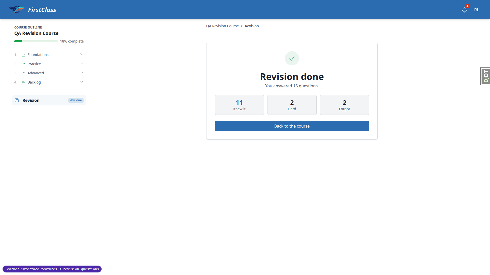
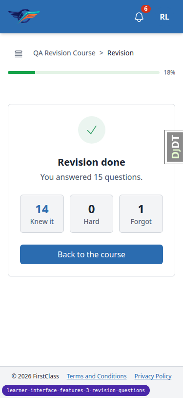
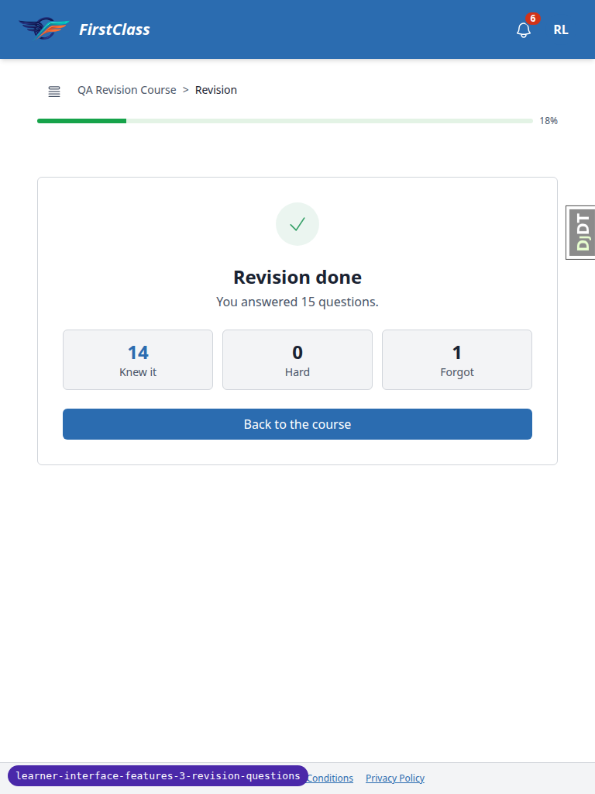

### B2: I guessed and Next do not share a row at 375px

Manifestations:
- `5.3`, mobile

Expected: plan 5.3 says the "I guessed" toggle sits at the left with its help line, and "Next" at the right of the same row.

Actual: at 375px the toggle's group (button plus the help line "We'll ask you this one again sooner.") is too wide, so Next wraps onto its own line below. At 768 and 1920 they share a row. The buttons themselves fit and keep one-line labels.

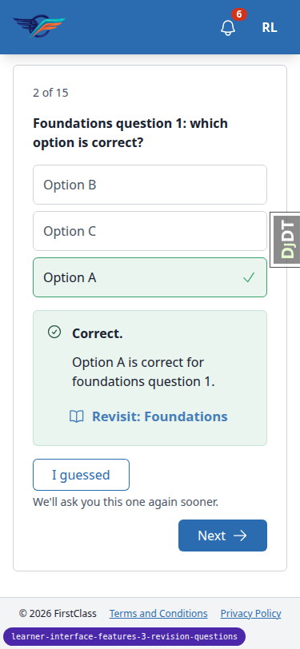

### B3: Answer form submits as a native GET before the page finishes loading

Manifestations:
- `6.7-early-submit`, desktop

Expected: "Check answer" always submits the answer to `course_revision_answer` (POST) and shows feedback.

Actual: the answer form in `partials/revision_card.html` has `hx-post` but no method or action fallback. Clicked after the page is parsed but before DOMContentLoaded (deferred scripts still loading), it submits natively as GET to the revision page. The answer goes into the URL query string (`?question_<uuid>=<option uuid>`), nothing is recorded, and the unanswered question re-renders. Minor: reproducible by automation, plausible on a slow network. No screenshot (the failure is in the URL and the network behaviour).

## Layout probe

| Test | Viewport | URL | Screenshot | Result |
| --- | --- | --- | --- | --- |
| 1.2 | desktop | `/courses/qa-revision-course/detail/` |  | clean |
| 2.2 | desktop | `/courses/qa-revision-course/1/` | 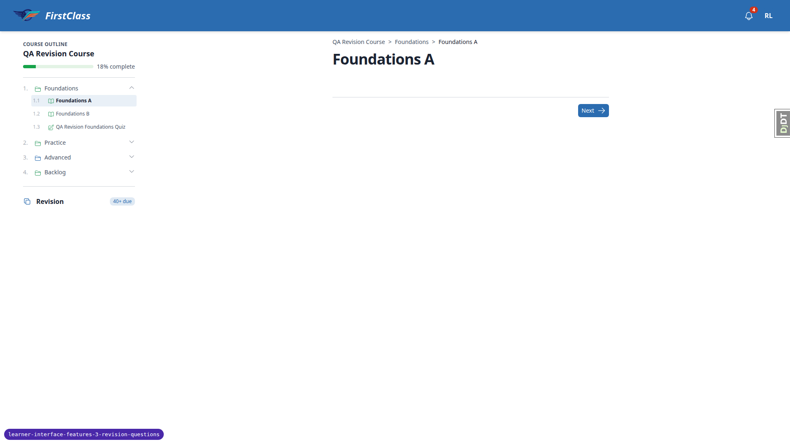 | clean |
| 3.2 | desktop | `/courses/qa-revision-course/revision/` |  | clean |
| 3.3 | desktop | `/courses/qa-revision-course/revision/` | 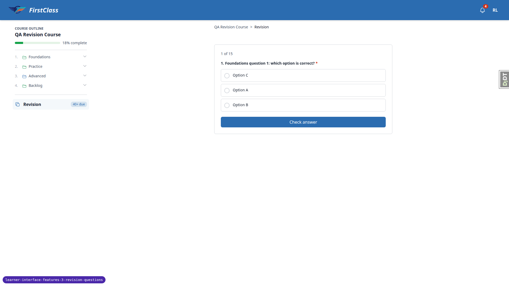 | clean |
| 4.5 | desktop | `/courses/qa-revision-course/revision/` | 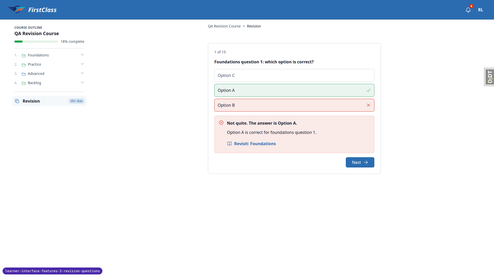 | clean |
| 5.3 | desktop | `/courses/qa-revision-course/revision/` | 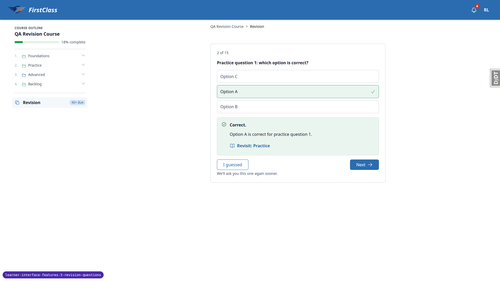 | clean |
| 6.2 | desktop | `/courses/qa-revision-course/revision/` |  | clean |
| 7.3 | desktop | `/courses/qa-revision-course/revision/` | 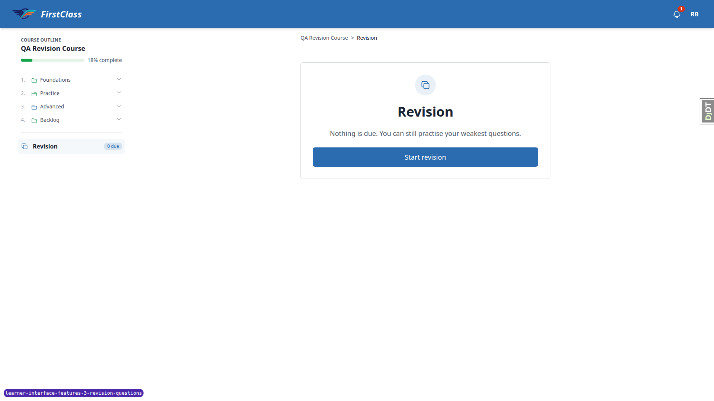 | clean |
| 10.8 | desktop | `/courses/functionality-demo-course-parts/revision/` | 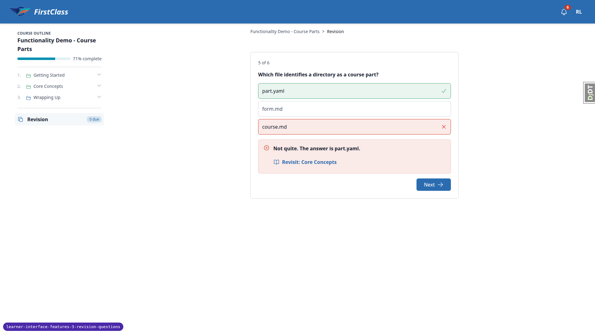 | clean |
| 2.4 | mobile | `/courses/qa-revision-course/1/` | 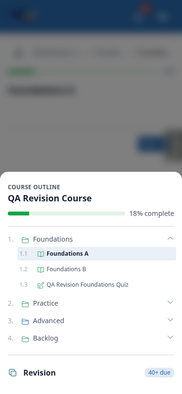 | flags: "stacked: sidebar ink spans y=354..812, outside the content's y=264..313"; "stacked: sidebar ink spans x=0..375, more than half of the 375px viewport". Recorded note: the flags come from the outline sheet that the test opens deliberately; below 1024px the outline is a sheet behind the toggle, as the plan states. |
| 3.2 | mobile | `/courses/qa-revision-course/revision/` |  | clean |
| 4.5 | mobile | `/courses/qa-revision-course/revision/` | 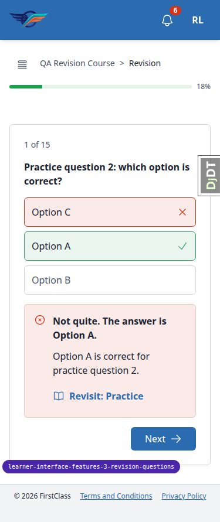 | clean |
| 5.3 | mobile | `/courses/qa-revision-course/revision/` |  | clean (the probe found nothing; the Next wrap is B2) |
| 6.4 | mobile | `/courses/qa-revision-course/revision/` |  | clean |
| 2.4 | tablet | `/courses/qa-revision-course/revision/` | 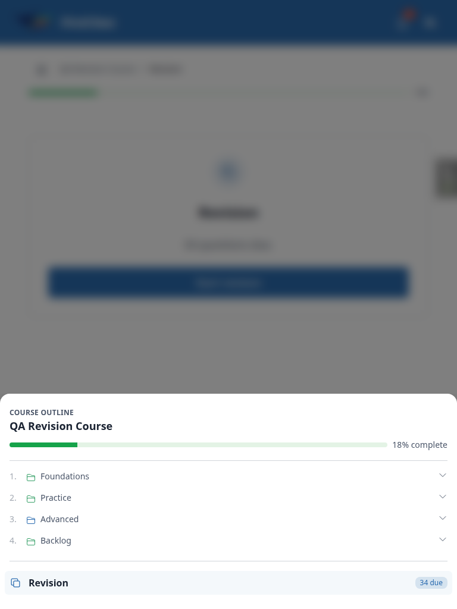 | flags: "stacked: sidebar ink spans y=662..1024, outside the content's y=228..534"; "stacked: sidebar ink spans x=0..768, more than half of the 768px viewport". Recorded note: the flags come from the outline sheet the test opens deliberately. |
| 5.3 | tablet | `/courses/qa-revision-course/revision/` | 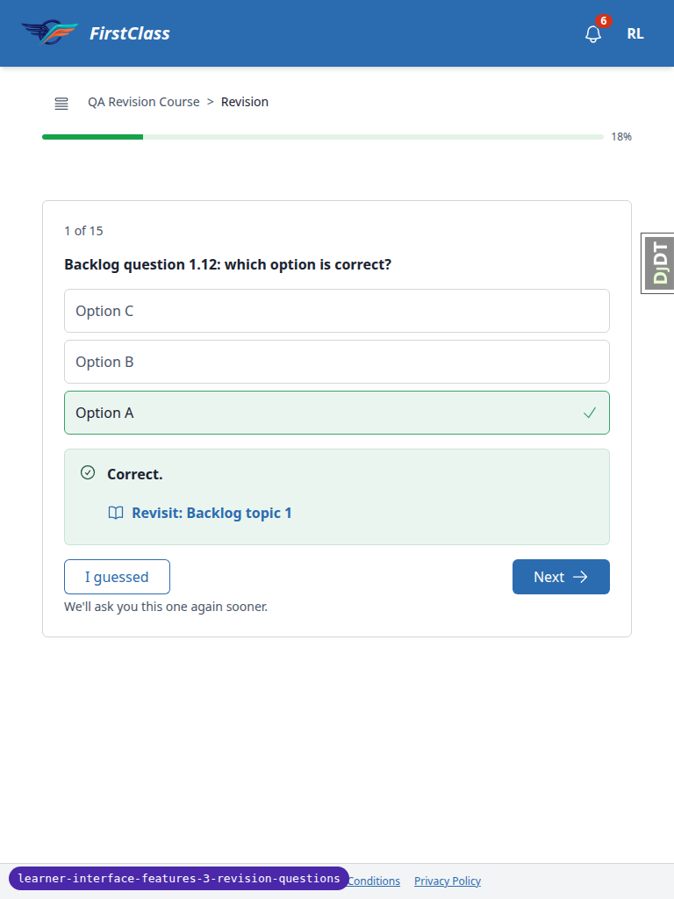 | clean |
| 6.2 | tablet | `/courses/qa-revision-course/revision/` |  | clean |

## Data changes

| What changed | Made by | Files written |
| --- | --- | --- |
| DemoDev Site pk=2 domain `127.0.0.1:8662` changed to `127.0.0.1:8235` so the QA server on 8235 resolves its site (the login page returned a 500) | `sdd:qa-data-helper` | none |
| Deleted RevisionSchedule (98) and RevisionReview (84) rows and `revision_session:*` session keys for the three QA revision learners (left by earlier QA runs), then re-ran `qa_create_revision_scenario`: Learner A back to 51 ready | `sdd:qa-data-helper` | none |
| Learner C (`qa-revision-back`) nothing due: 7 RevisionSchedule.due moved 10 days ahead, 47 schedules created 10 days ahead for unscheduled bank questions | `sdd:qa-data-helper` | none |
| Paused QA Revision Course for Learner A via `deadlines.actions.pause_course` (CoursePause 1b2132b1), then resumed via `resume_course` | `sdd:qa-data-helper` | none |
| Ended Learner A's access to QA Revision Course with a LearnerCourseRegistrationDeadlineConfig (`end_course_access=on`) and a past whole-course LearnerDeadlineOverride (`deactivate_registration` would show not-registered, not access-ended), then deleted both rows to restore access | `sdd:qa-data-helper` | none |

## Bug status

- **UNRESOLVED**: B1, revision done count tiles are bordered boxes inside the bordered card (reason: the brand rule forbids a box inside a box, and the spec says only "count tiles". Choosing the tiles' new look, such as tint only or plain figures with no box, is a design decision.)
- **FIXED** (commit: 2b846d5e0): B2, I guessed and Next do not share a row at 375px. Re-verified at 375px (same row, help line under it, 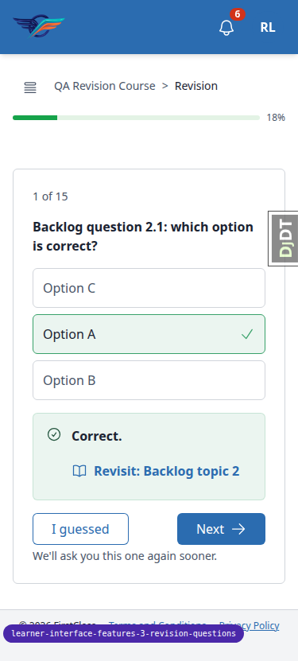) and at 768px (unchanged).
- **FIXED** (commit: 2ce55b3f8): B3, the answer form submits as a native GET before the page finishes loading. Re-verified with JavaScript off: Check answer now posts, records the answer and redirects to the feedback. With htmx on, the flow is unchanged: 422 "Choose an answer.", a 200 swap, focus on the feedback and no navigation. Remaining gap, which loses no data: "Next" and "I guessed" are `hx-post` buttons with no form, so before htmx loads they do nothing.

## General notes

- **8.3 viewport caveat.** The paused-course screenshot (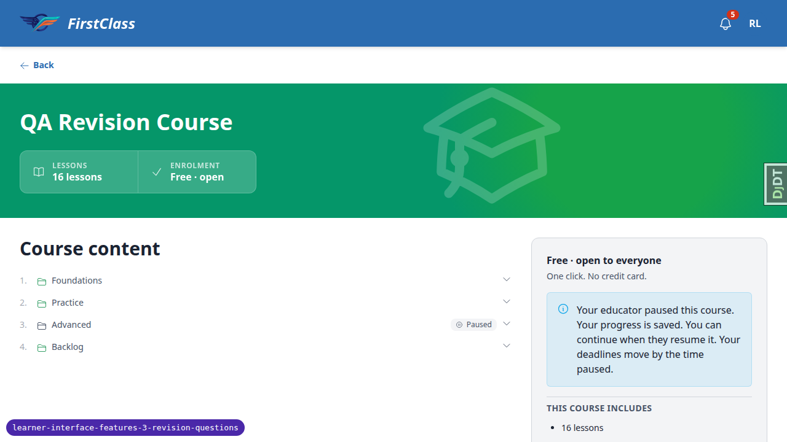) was taken at 1280x720: the reopened tab lost the desktop viewport. The behaviour itself passed: `/revision/` redirects to the course detail page with the "Your educator paused this course..." notice. The 8.4 access-ended result is at 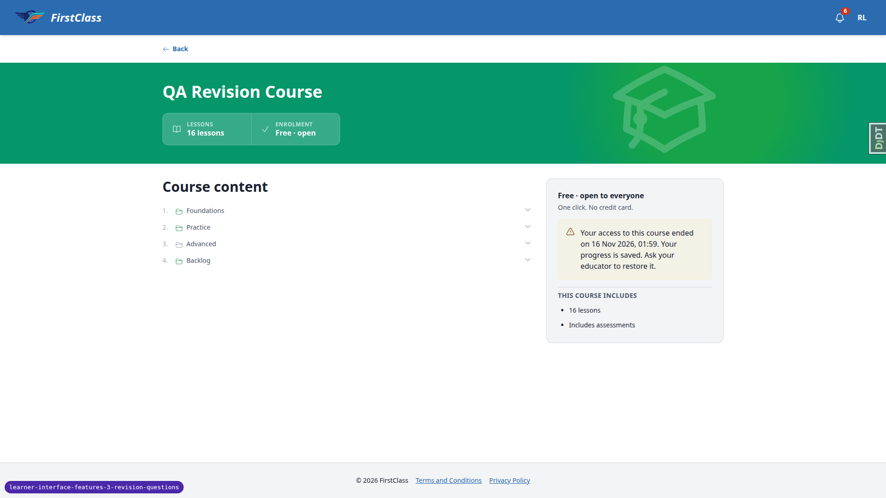.
- **3.4 screenshot discarded** (debug toolbar open in the fresh context). Learner B's page passed on the text checks and a clean layout probe.
- **9.3 skipped.** Results pages show the score (Knowledge Check 100% 3/3, QA Foundations 80% 4/5), see 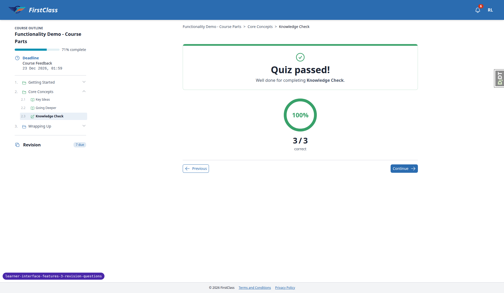. The incorrect-answers block did not render: the QA quiz has `quiz_show_incorrect` off, and Learner A's latest Knowledge Check attempt is 100% with no retake allowed. That block (`course_form_complete.html`) has its own "Correct answer" markup, does not use the shared correct-answer-mark component and is not changed on this branch. The shared mark is covered by 9.4.
- **9.1.** Learner A's Foundations quiz allows no new sitting, so the quiz was taken fresh as Learner B after walking items 1.1 and 1.2 to unlock it. Quiz page: 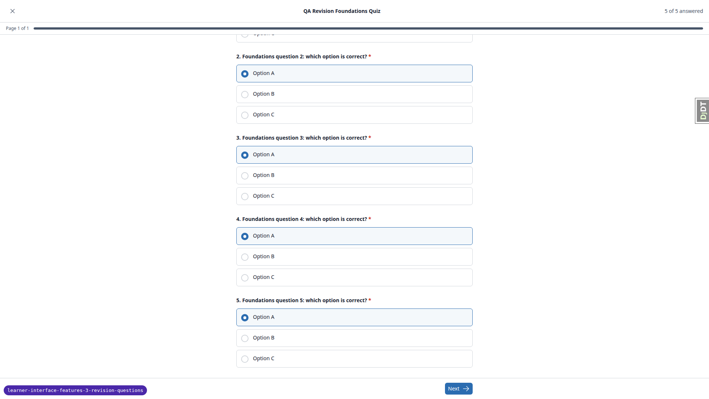. Educator preview (9.4): .
- **Screenshots for passing tests** are linked in the layout probe table above, plus these not repeated there: 4.3 , 5.5 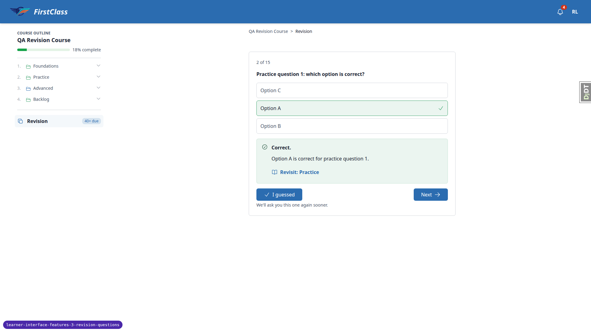, 7.2 and 7.3 .
- **Admin observation (5.7).** The Revision reviews changelist has no default ordering, so the latest review is not first until you sort by Reviewed at. No action attached.
- **Test 10.1 observation.** `content_save` on main now refuses content outside a committed git repo, so the scratch copy was git-initialised and committed first.
- **Test 10.7 observation.** The shipped `demo_content` already raises 21 explanation warnings from `content_validate` (shuffled quiz and others), unrelated to this branch.
- **Test 10.9 cleanup.** The real `demo_content` was re-saved (dropped question restored, marker cleared). The scratch copy was left in the session scratchpad because recursive deletes are blocked by the security hook.
- **Test 10.8** feedback: .

status: ok · reason: 3 bugs — 2 fixed, 1 unresolved; report rendered, screenshots verified
