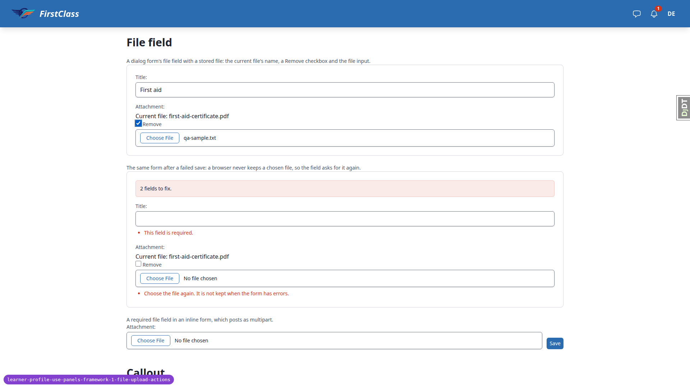
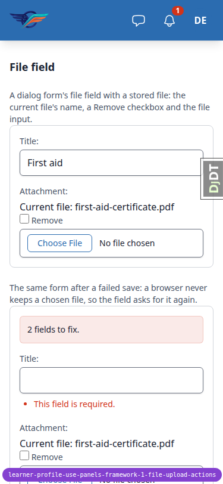
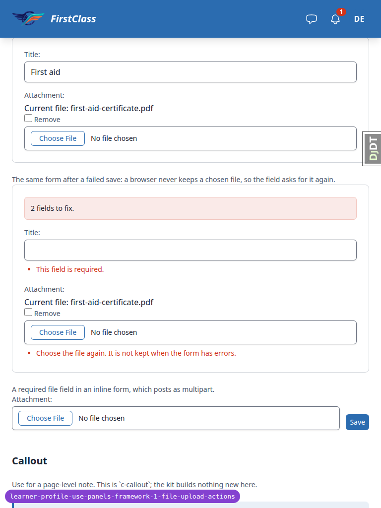
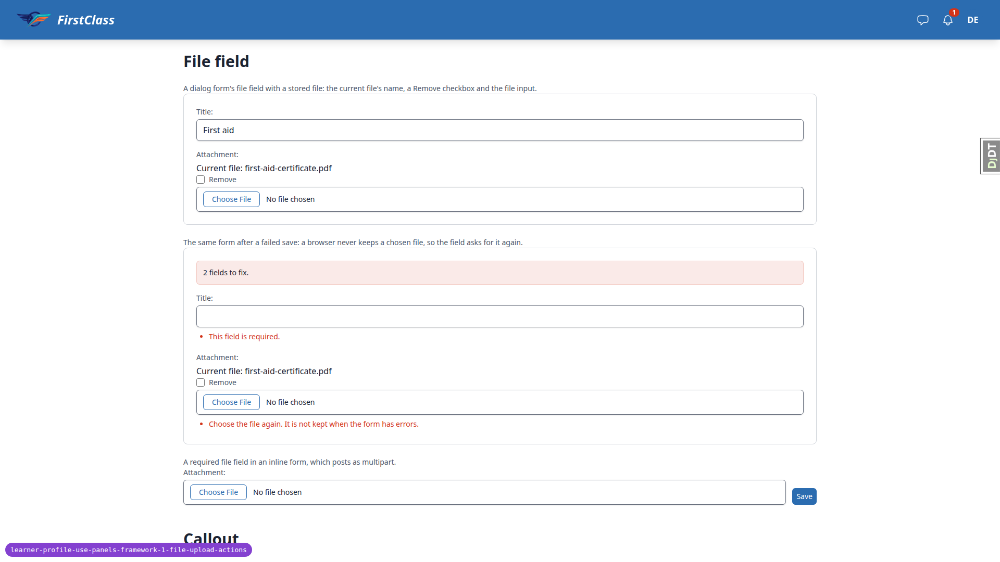

# Frontend QA report: learner-profile-use-panels-framework-1-file-upload-actions

## Methodology

Playwright MCP run at 1920x1080 (desktop), 375x812 (mobile) and 768x1024 (tablet) against a dev server on port 8569. Screenshots were collected into `screenshots/` beside this report, and every referenced image exists there. Accessibility snapshot (.yml) and console log files were moved out of the spec dir and are not committed.

## Diff scoping

Class: **FULL**.

Changed front-end files that triggered it:

- `freedom_ls/base/templates/cotton/button.html`
- `freedom_ls/panel_framework/static/panel_framework/js/alpine-components.js`
- `freedom_ls/panel_framework/templates/panel_framework/modal/form.html`
- `freedom_ls/panel_framework/templates/panel_framework/partials/inline_record_form.html`
- `freedom_ls/panel_framework/templates/panel_framework/reference/_examples.html`
- `freedom_ls/panel_framework/templates/panel_framework/widgets/clearable_file_input.html`
- `freedom_ls/educator_interface/templates/educator_interface/partials/inline_record_form.html`
- `freedom_ls/panel_framework/actions.py`
- `freedom_ls/panel_framework/widgets.py`
- `freedom_ls/panel_framework/reference.py`
- `freedom_ls/educator_interface/forms.py`

Desktop, mobile and tablet all ran. Nothing was skipped.

## Smoke gate

Outcome: **pass**. Pages loaded: `/` and `/panel-framework/components/`.

## Design check

No design states tested.

## Results

| Test | Viewport | Status | Screenshot | Note |
|---|---|---|---|---|
| 1.1-1.5 | desktop | pass | [shot](screenshots/page-2026-11-18T12-48-43-279Z.png) | Three wrappers present. Current file first-aid-certificate.pdf, no directory, no link. Attachment label opens file chooser. Error example shows "2 fields to fix." summary, "Choose the file again..." under field, input empty, current file still shown. Inline: file input + Save at row end, no Remove/Current file. |
| 1.6 | desktop | pass | [shot](screenshots/page-2026-11-18T12-48-43-279Z.png) | Current file line is 16px (dialog base). Remove label is 14px, same as field labels in the real Create cohort dialog (Name: 14px). |
| 1.3-visual | desktop | fail | [shot](screenshots/page-2026-11-18T12-49-16-582Z.png) | Remove checkbox flush against the word Remove, slightly above baseline. See B1. |
| 1.8 | desktop | pass | [shot](screenshots/page-2026-11-18T12-49-53-694Z.png) | No console errors/warnings. Notice (above) and Callout (below) render normally. |
| 1.9 | desktop | pass | [shot](screenshots/page-2026-11-18T12-49-16-582Z.png) | Ticked Remove then chose qa-sample.txt: nothing broke, no navigation, no console error. |
| 1.10 | desktop | pass | — | getByRole('checkbox', name 'Remove first-aid-certificate.pdf') matches (dialog and error examples). |
| 2.1-2.2 | desktop | pass | [shot](screenshots/page-learner-name-saving-1795006224269.png) | Name panel one row First/Last + Save. During save: button disabled, "Saving…". After: heading "Alicia Adeyemi", focus back on id_first_name. |
| 2.3 | desktop | pass | [shot](screenshots/page-2026-11-18T12-50-46-860Z.png) | Used a 210-char name: one-line error under row, no box, no summary, aria-invalid=true. Console shows only the browser's 422 log. |
| 2.4-2.5 | desktop | pass | [shot](screenshots/page-2026-11-18T12-50-46-860Z.png) | No enctype/hx-encoding. data-request-error element hidden, height 0, no visible gap. |
| 6.1-6.2 | desktop | pass | [shot](screenshots/page-inline-request-error-1795006258811.png) | 500: "Your changes could not be saved. Try again." under the row, 14px error colour, role=alert, name kept, Save enabled, no error page. After unroute + Save: message hidden, name saved. |
| 7.1 | desktop | pass | — | POST answering 404 text/plain reloads the page; no request error message. |
| 8.1, 8.3 | desktop | pass | [shot](screenshots/page-confirm-loading-1795006286431.png) | Deactivate confirm: during request disabled, spinner, "Deactivating…". data-loading-label equals visible text. Request delayed then aborted so learner stayed active. |
| 3 | desktop | pass | [shot](screenshots/page-cohort-name-error-1795006330782.png) | Cohort Name panel: one row + Save; "Saving…" disabled during request; heading updated; focus back to id_name; no enctype/hx-encoding; hidden request-error takes 0 height. Server "This field is required." shows as one unboxed line, aria-invalid=true, no summary. Name restored to "QA cohort A". |
| 4.1-4.5 | desktop | pass | [shot](screenshots/page-2026-11-18T12-52-39-031Z.png) | Create cohort dialog: header, Name field, footer (Cancel, Save and add another, Save); focus in id_name. No enctype/hx-encoding. Empty submit: "1 field to fix." summary focused, field error, no "Choose the file again". Esc with typed name: "Discard changes?"; Keep editing keeps draft. Cleared + Esc closes with no prompt. |
| 4.6, 5.4-5.5 | desktop | pass | [shot](screenshots/page-dialog-saving-1795006412301.png) | After removing the route, Save: request-error hidden as request starts, button disabled "Saving…" (never Uploading…), cohort "QA cohort created" created once and dialog closed. Reopened dialog has no leftover message. |
| 5.1-5.3, 5.6 | desktop | pass | [shot](screenshots/page-dialog-request-error-413-1795006390785.png) | 500: dialog stays open, message in error colour in body, focus on message, name kept, Save enabled reads Save. 413: "The file may be too large to upload. Choose a smaller file.", one message only. Abort: generic message. |
| 7.2 | desktop | pass | [shot](screenshots/page-create-cohort-422-1795006368482.png) | Empty create-cohort submit: 422 summary only, request-error element stays hidden. |
| 7.3 | desktop | pass | [shot](screenshots/page-add-to-cohort-refresh-500-1795006446233.png) | Add to cohort dialog: select hx-get refresh routed to 500; dialog stays as is, no request error message, nothing broke. |
| 7.4 | desktop | pass | [shot](screenshots/page-quick-view-500-1795006457683.png) | Quick view GET answered 500: drawer shows its own "Something went wrong loading this." with Retry. |
| 7.5 | desktop | skip | — | No educator action answers a 4xx/5xx with a toast; skipped as the plan allows. |
| 8.2 | desktop | pass | [shot](screenshots/page-learner-activity-1795006528753.png) | Learner form runner buttons are plain .btn (full-page POST) without the c-button loading span; unaffected. Next moved to page 2 normally. |
| 1.7 | mobile | pass | [shot](screenshots/page-2026-11-18T12-55-44-103Z.png) | scrollWidth 375, nothing in the three file-field wrappers overflows. Inline example wraps Save under the input. |
| 2.6, 6.1 | mobile | pass | [shot](screenshots/page-2026-11-18T12-56-03-932Z.png) | Learner Settings at 375: no sideways scroll; fields stack, Save below; 500 request error wraps under the row. |
| 4.7, 5.7 | mobile | pass | [shot](screenshots/page-2026-11-18T12-56-22-761Z.png) | Create cohort is a bottom sheet; 500 message wraps inside; scrollWidth within viewport. |
| 1.3-visual | mobile | fail | [shot](screenshots/page-2026-11-18T12-55-44-103Z.png) | Remove checkbox flush against its text at 375. See B1. |
| 1.3-visual | tablet | fail | [shot](screenshots/page-2026-11-18T12-56-40-713Z.png) | Remove checkbox flush against its text at 768. See B1. |
| 1.7 | tablet | pass | [shot](screenshots/page-2026-11-18T12-56-40-713Z.png) | scrollWidth 768, nothing overflows; inline Save stays at row end. |
| 3, 6.1 (413) | tablet | pass | [shot](screenshots/page-2026-11-18T12-56-52-725Z.png) | Cohort Name panel one row with Save; 413 shows "The file may be too large to upload. Choose a smaller file." under the row; no sideways scroll. |
| 5.3 | tablet | pass | [shot](screenshots/page-2026-11-18T12-57-04-997Z.png) | Create cohort dialog centred (512px wide); aborted request shows generic message in body; no sideways scroll. |

## Bugs

### B1: Remove checkbox sits flush against its label text

Manifestations:

- 1.3-visual, desktop
- 1.3-visual, mobile
- 1.3-visual, tablet

**Expected:** The checkbox and the word Remove read as one control with a small gap between them, vertically centred, like other checkbox-plus-label pairs.

**Actual:** The label inside the file widget gets the generic block field-label style (display:block, 14px, margin-bottom 4px); the checkbox has 0px margin and touches the "R" of Remove, sitting slightly above the text.

## Layout probe

Header/sidebar regions reported "missing" on pages outside the educator shell (reference page, dashboard, dialogs over the list) are expected and are not flags.

| Test | Viewport | URL | Screenshot | Result |
|---|---|---|---|---|
| smoke | desktop | `/` | [shot](screenshots/page-2026-11-18T12-48-27-534Z.png) | clean |
| 1 | desktop | `/panel-framework/components/` | [shot](screenshots/page-2026-11-18T12-48-43-279Z.png) | clean |
| 2 | desktop | `/educator/organisations/demodev/learners/<pk>/__tabs/settings` | [shot](screenshots/page-2026-11-18T12-50-46-860Z.png) | clean |
| 3 | desktop | `/educator/organisations/demodev/cohorts/<pk>/__tabs/settings` | [shot](screenshots/page-cohort-name-error-1795006330782.png) | clean |
| 4 | desktop | `/educator/organisations/demodev/cohorts` | [shot](screenshots/page-2026-11-18T12-52-39-031Z.png) | clean |
| 1 | mobile | `/panel-framework/components/` | [shot](screenshots/page-2026-11-18T12-55-44-103Z.png) | clean |
| 1 | mobile | `/panel-framework/components/` | [shot](screenshots/page-2026-11-18T12-55-51-232Z.png) | clean |
| 2 | mobile | `/educator/organisations/demodev/learners/<pk>/__tabs/settings` | [shot](screenshots/page-2026-11-18T12-56-03-932Z.png) | clean |
| 5 | mobile | `/educator/organisations/demodev/cohorts` | [shot](screenshots/page-2026-11-18T12-56-22-761Z.png) | clean |
| 1 | tablet | `/panel-framework/components/` | [shot](screenshots/page-2026-11-18T12-56-40-713Z.png) | clean |
| 3 | tablet | `/educator/organisations/demodev/cohorts/<pk>/__tabs/settings` | [shot](screenshots/page-2026-11-18T12-56-52-725Z.png) | clean |
| 5 | tablet | `/educator/organisations/demodev/cohorts` | [shot](screenshots/page-2026-11-18T12-57-04-997Z.png) | clean |

## Data changes

| Via | What |
|---|---|
| sdd:qa-data-helper | Dev DB had only example.com site (every page 500). Ran create_demo_data --yes, content_save ./demo_content DemoDev, qa_create_dev_org_baseline, qa_register_org_course (demodev@email.com on functionality-demo-show-end-with-quiz). Org slug demodev; QA cohort A with Alice Adeyemi et al. |

## Bug status

- **FIXED** (commit: 41c87ea2f) — Remove checkbox sits flush against its label text

  Re-verified at 1920: the label is now `flex items-center gap-2`; 8px between checkbox and text, centres level.

  

## General notes

- The dev DB was empty (only example.com site) at the start, so every page 500'd until the QA data helper re-seeded it.
- The learner Name panel's first name is optional, so clearing it saves (heading became "Adeyemi"); 2.3 used a 210-character name instead. Name was restored to Alice.
- The cohort Name input has the HTML `required` attribute, so an empty submit is blocked by the browser; the attribute was removed in devtools to reach the server's 422.
- Console errors seen during the run were only the browser's/htmx's own logs of the induced 422/500/413/aborted requests; no JavaScript or Alpine errors.
- After a failed inline save, the previous field error (from the 210-char attempt) stays visible under the new request-error message, because the failed request swaps nothing. Observation only.
- The Deactivate confirm dialog shows no message when its request fails at the network level (it has no request-error element); out of this spec's scope, observation only.
- A 413 on a form with no file field still says "The file may be too large to upload"; this matches the spec's wording rule (413 always gets that message).
- Test 7.5 skipped: no educator action answers a 4xx/5xx with a toast.
- Test 8.2: the learner form runner uses plain `.btn` buttons with a full-page POST, not the c-button loading span, so it is unaffected.
- Data created by the run: cohort "QA cohort created" (and failed attempts created nothing else).

status: ok · reason: 1 bug — 1 fixed, 0 unresolved; report rendered, screenshots verified
