# Frontend QA report: learner-profile-use-panels-framework-1-file-upload-actions

All tests pass except one bug, B1: the hidden request-error element in the inline Name form adds 12px of empty space under the field row on the learner and cohort Settings tabs (Tests 2.5 and 3.5, also visible in 2.6 and 3.1). Test 7.5 was skipped because no educator action answers an error with a toast. The file field widget, the inline and dialog save states, the request-error message, the 413 message, the refresh and quick-view error paths and the loading labels all behave as the plan describes. The layout probe was clean on every screenshot.

## Methodology

- Playwright MCP drove a real browser against the dev server.
- Viewports: desktop 1920x1080, mobile 375x812, tablet 768x1024.
- A layout probe ran after each screenshot.
- Screenshots were collected into `screenshots/` beside this report, and every image referenced here exists.
- Requests were failed with `page.route`, as the plan describes (500, 404, 413 and aborted requests, plus delayed responses for the loading states).
- The console errors seen were only the browser and htmx logs of the expected 422 responses and the simulated 4xx/5xx/aborted requests. There were no JS or Alpine errors.

## Diff scoping

Class: FULL. The changed files include templates and static paths (for example `button.html`, `alpine-components.js`, `modal/form.html`, `partials/inline_record_form.html`, `widgets/clearable_file_input.html`, `reference/_examples.html`), plus `widgets.py`, `actions.py` and `educator_interface/forms.py`. Nothing was skipped.

## Smoke gate

Pass. Pages checked: `/` and `/panel-framework/components/`.

## Design check

No design states tested.

## Results

| Test | Viewport | Status | Note | Screenshot |
|---|---|---|---|---|
| 1.1-1.5 | desktop | pass | Three wrappers present. Current file shown as text with no link or storage path. Remove checkbox sits before the file input. Error example shows the summary and "Choose the file again" message, with aria attributes set. Inline example has no Remove or Current file. | 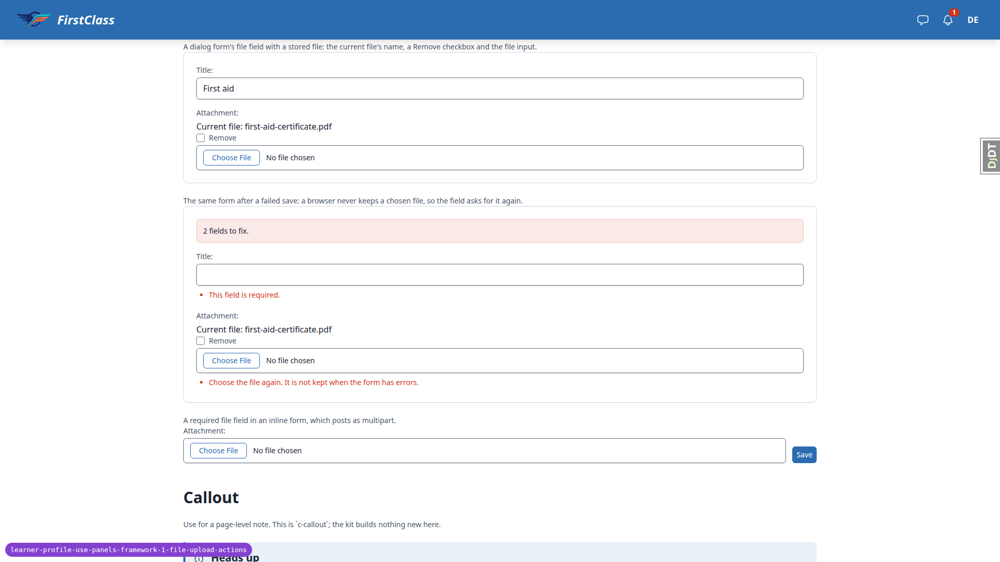 |
| 1.7-1.8 | desktop | pass | No sideways scroll at 1920. No console errors. Notice and Callout render either side of File field. |  |
| 1.9-1.10 | desktop | pass | Ticking Remove then choosing a file causes no request or console error. Checkbox accessible name is "Remove first-aid-certificate.pdf". | none |
| 2.1-2.4 | desktop | pass | Learner Name panel: fields in one row with Save. Delayed save shows a disabled "Saving…", the heading updates and focus returns to the first name field. A 205-char name shows one plain error line with aria-invalid and aria-describedby. No enctype or hx-encoding. | 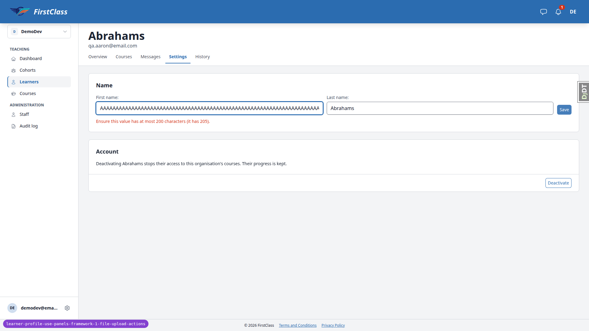 |
| 2.5 | desktop | **fail** | The hidden request-error div is the form's last child, so the field row gets 12px margin-bottom and the Name card gains 12px of empty space (B1). | 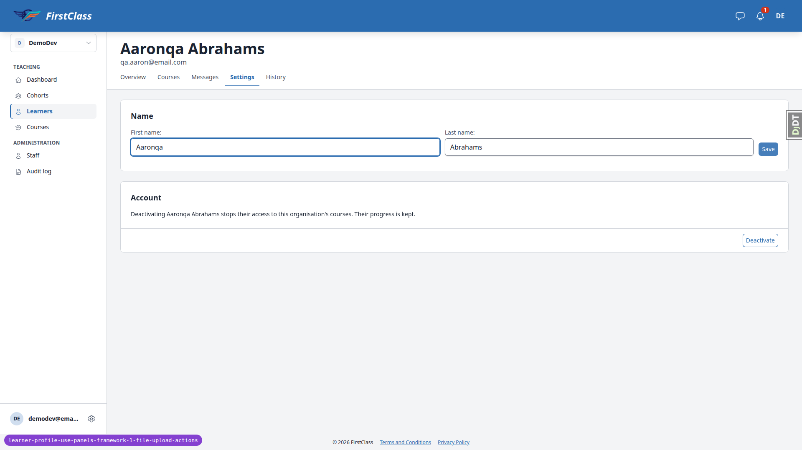 |
| 3.1-3.4 | desktop | pass | Cohort Name panel: Name and Save in one row. Delayed save shows a disabled "Saving…", the heading updates and focus returns. A 205-char name shows "Ensure this value has at most 150 characters". Name restored. | 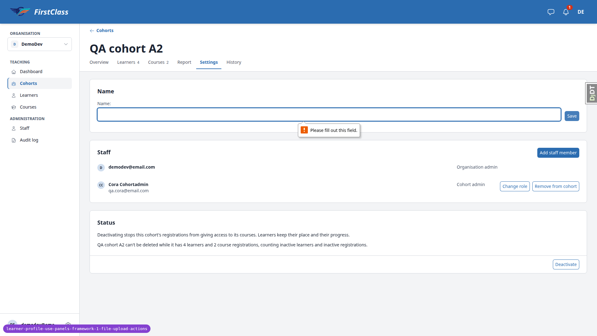 |
| 3.5 | desktop | **fail** | Same cause as 2.5: the Name card has more bottom space than the Staff and Status cards (B1). |  |
| 1.6 | desktop | pass | The widget has no text-sm. "Current file:" renders at 16px on the reference page, labels and Remove at 14px. |  |
| 4.1-4.3 | desktop | pass | Create cohort dialog opens with focus in the Name field and no enctype. An empty submit shows the "1 field to fix." summary, a field error and aria-invalid, with no "Choose the file again". The hidden request-error div adds no space in the modal body. | 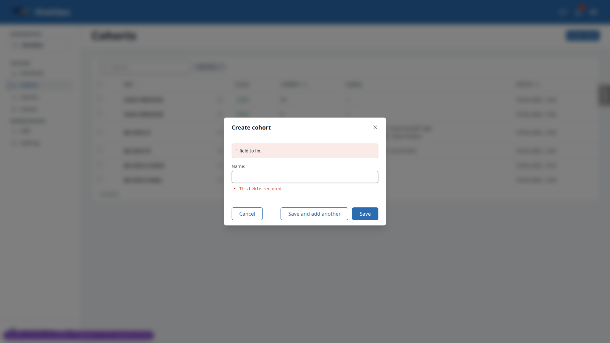 |
| 4.4-4.6 | desktop | pass | Typed name then Esc shows "Discard changes?", and Keep editing returns to the typed name. Cleared then Esc closes with no prompt. Valid save with a 2s delay shows a disabled "Saving…" (never "Uploading…"), creates the cohort and navigates to it. | 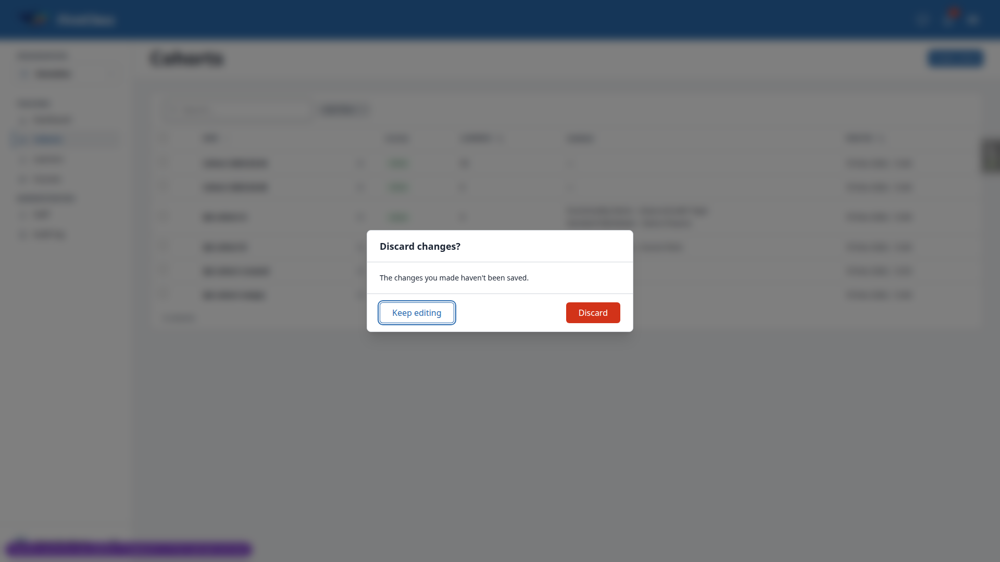 |
| 5.1-5.3 | desktop | pass | 500: the dialog stays open and shows "Your changes could not be saved. Try again." in the error colour, focus is in the message, the typed name is kept and Save is enabled. 413: the message becomes "The file may be too large to upload. Choose a smaller file." (one message). Abort: the generic message. | 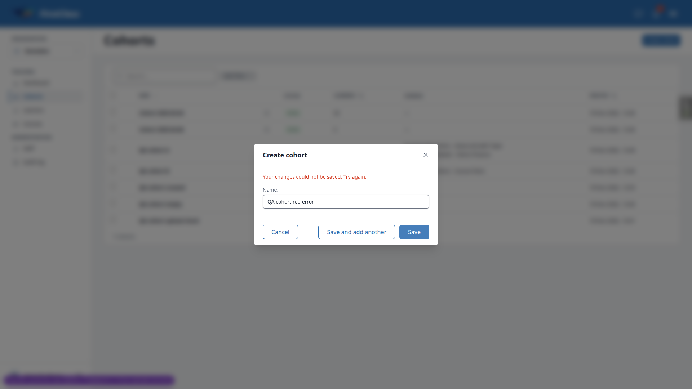 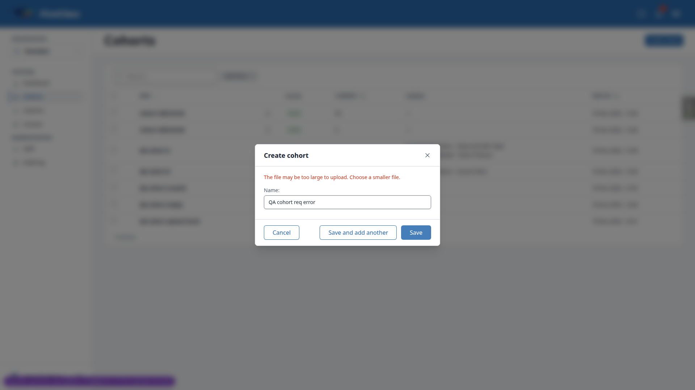 |
| 5.4-5.6 | desktop | pass | With the route removed, the message hides when the request starts, the cohort is created and the dialog closes. Reopening shows no leftover message, including after fail, Cancel and reopen. The message is a role=alert element. |  |
| 6.1-6.2 | desktop | pass | Learner Name inline form, 500: the message shows under the field row at 14px in the error colour with role=alert. The changed name is kept, Save is enabled and the panel is not replaced. With the route removed, the message hides and the name saves. Name restored. | 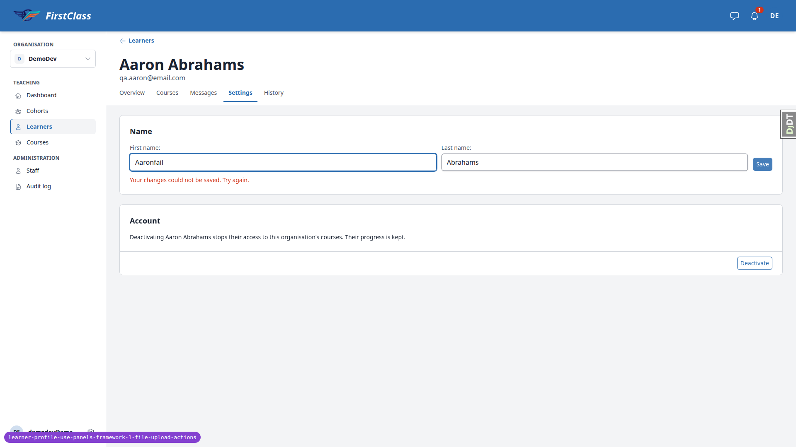 |
| 7.1-7.2 | desktop | pass | Name form POST routed to a 404 plain body: the page reloaded, no request-error message and the name is unchanged. The create-cohort 422 showed only the summary, with the request-error element hidden. | none |
| 7.3 | desktop | pass | Add to cohort dialog with the select's hx-get refresh routed to 500: no request-error message, and the dialog stays open and usable. | 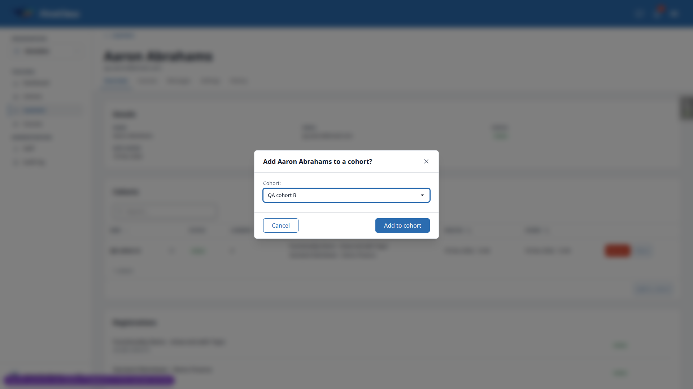 |
| 7.4 | desktop | pass | Learners list quick view GET routed to 500: the drawer shows its own "Something went wrong loading this." block with Retry, and no request-error message appears. | 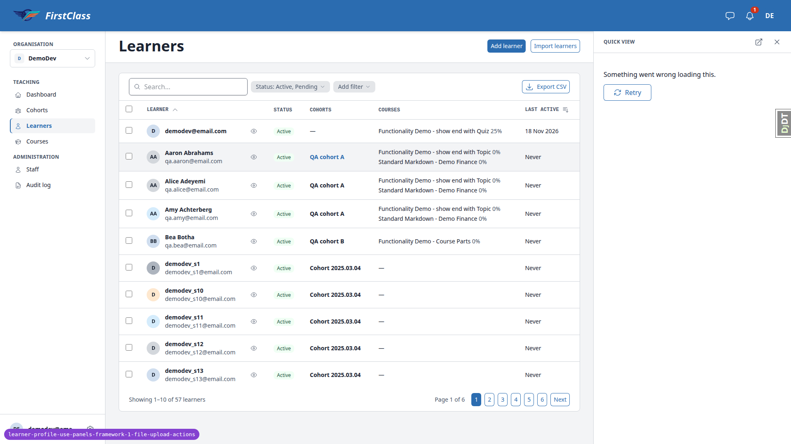 |
| 7.5 | desktop | skip | No educator action answers a 4xx/5xx with a toast. HX-Trigger is only set on success paths. Skipped, as the plan allows. | none |
| 8.1, 8.3 | desktop | pass | Deactivate confirm with the POST delayed then aborted: the button is disabled and shows a spinner and "Deactivating…". The loading span's data-loading-label matches the visible text. Create-cohort and Name Save spans carry "Saving…". | 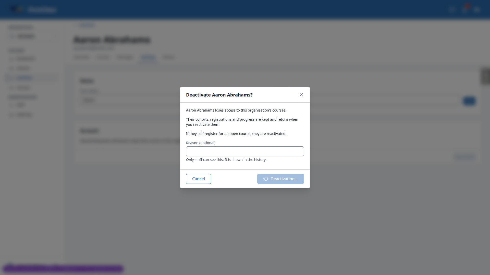 |
| 8.2 | desktop | pass | Quiz "Next" and "Leave and submit" are plain submit buttons with no loading state, unchanged by this branch. Answering page 1 and pressing Next moved to page 2 with no console errors. | none |
| 1.7 | mobile (375) | pass | scrollWidth 375 and no element extends past its wrapper. The inline example wraps Save under the file input. | 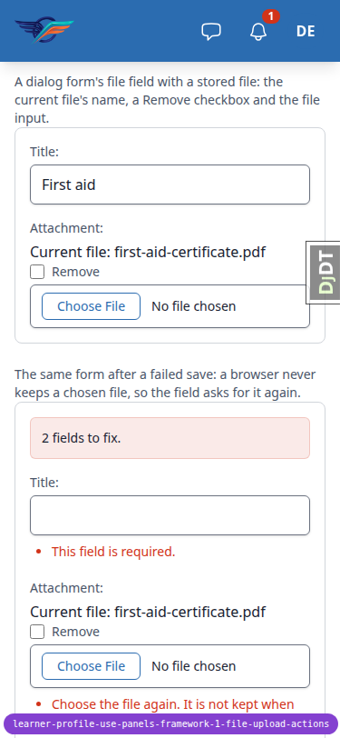 |
| 2.6 | mobile (375) | pass | No sideways scroll. Fields stack with Save under them. The extra space under Save in the Name card (B1) is visible. | 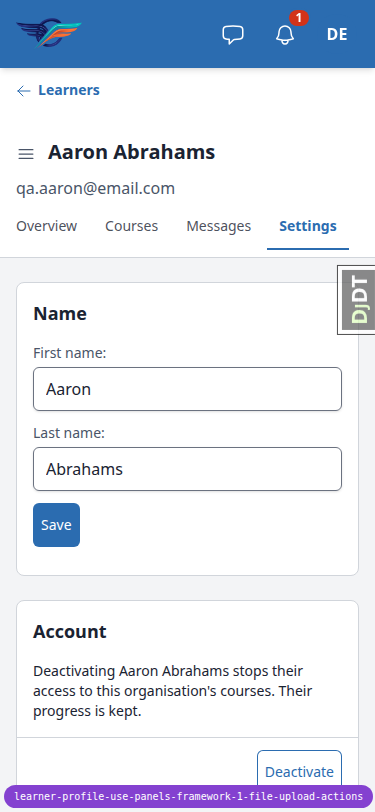 |
| 4.7, 5.7 | mobile (375) | pass | Create cohort is a bottom sheet. The 500 message sits inside the sheet on one line with no sideways scroll. | 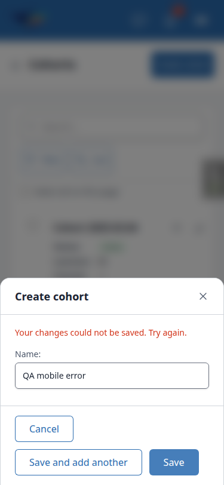 |
| 1.7 | tablet (768) | pass | No sideways scroll. The inline example keeps Save at the end of the row. | 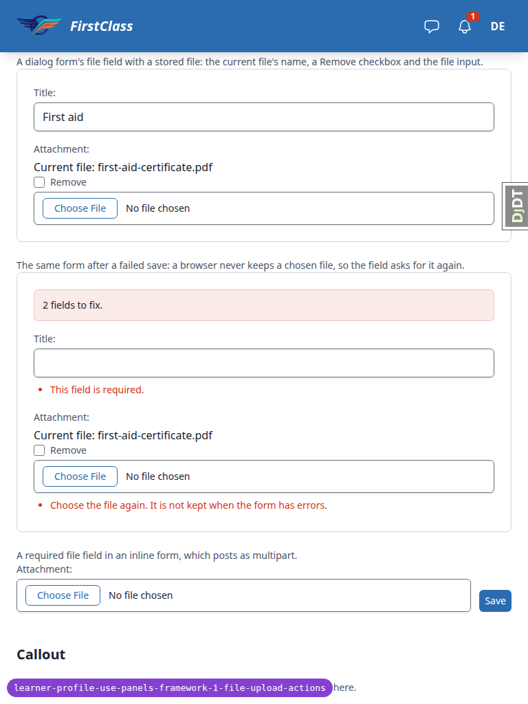 |
| 3.1 | tablet (768) | pass | Cohort Settings: Name and Save in one row, no sideways scroll. The B1 extra space under the Name card is visible. | 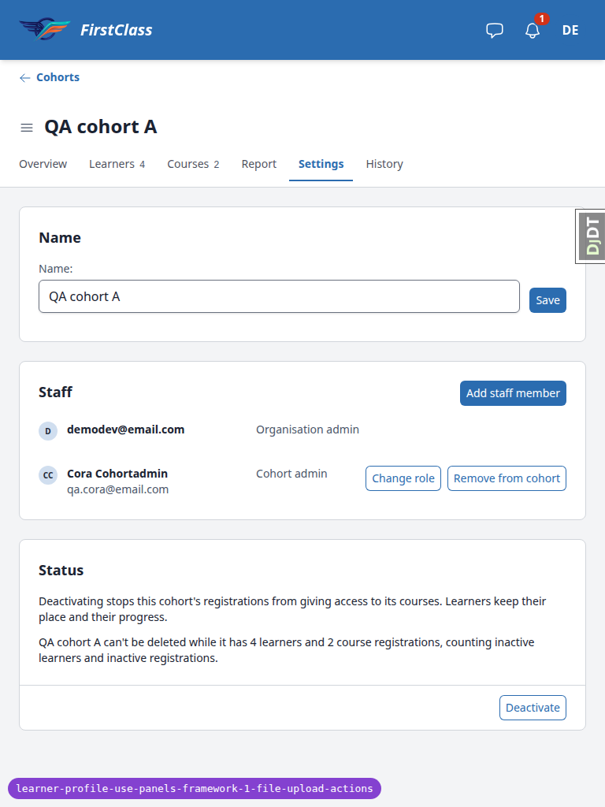 |
| 5.2 | tablet (768) | pass | Create cohort is a centred dialog. The 413 message shows inside the body with no sideways scroll. | 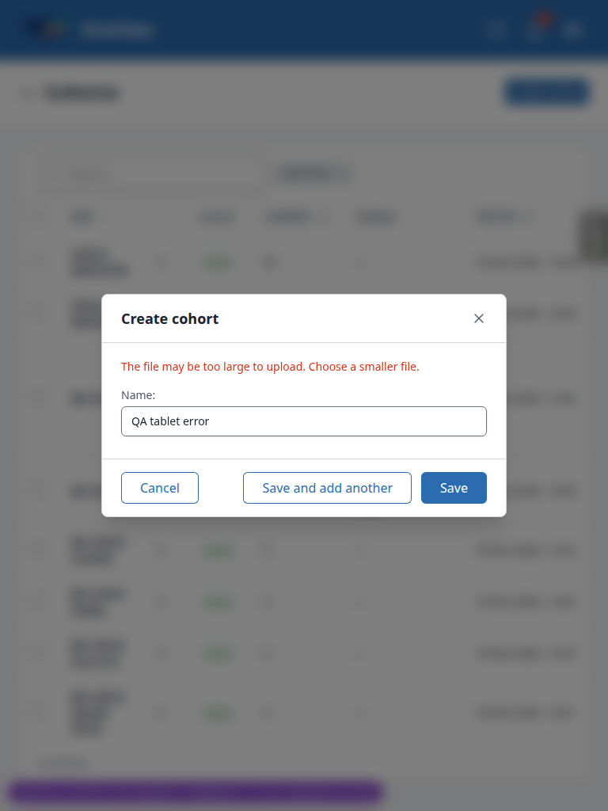 |

## Bugs

### B1: Hidden request-error element adds 12px of space under the inline Name form

Manifestations:

- Test 2.5, desktop (learner Name panel)
- Test 3.5, desktop (cohort Name panel)
- Test 2.6, mobile (visible in the learner Settings screenshot)
- Test 3.1, tablet (visible in the cohort Settings screenshot)

Screenshots:

Expected: The hidden `[data-request-error]` element takes no space. The inline form's height and the panel's bottom spacing are as on main, with the field row as the last visible child and no margin under it.

Actual: In `panel_framework/partials/inline_record_form.html` the hidden div is the form's last child. Tailwind's `space-y-3` puts a margin on every child but the last, so the field row gets `margin-bottom: 12px`. The margin collapses out of the form. The Name card on the learner and cohort Settings tabs now has 12px more space under the row than before (36px from input bottom to card bottom, against 24px of padding).

## Layout probe

| Test | Viewport | URL | Screenshot | Result |
|---|---|---|---|---|
| 1.1 | desktop | /panel-framework/components/ |  | clean |
| 2.3 | desktop | /educator/organisations/demodev/learners/&lt;id&gt;/__tabs/settings |  | clean |
| 3.1 | desktop | /educator/organisations/demodev/cohorts/&lt;id&gt;/__tabs/settings |  | clean |
| 4.1 | desktop | /educator/organisations/demodev/cohorts/ | 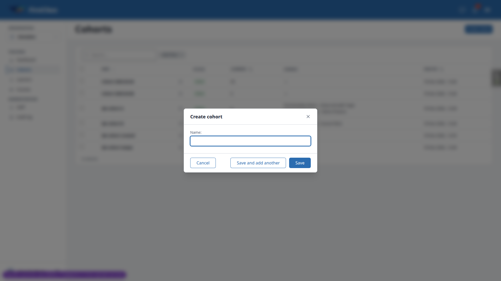 | clean |
| 6.1 | desktop | /educator/organisations/demodev/learners/&lt;id&gt;/__tabs/settings |  | clean |
| 7.4 | desktop | /educator/organisations/demodev/learners/ |  | clean |
| 1.7 | mobile | /panel-framework/components/ |  | clean |
| 1.7b | mobile | /panel-framework/components/ | 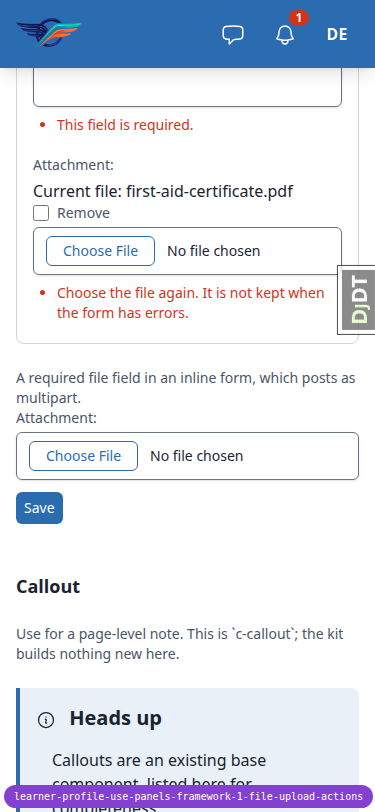 | clean |
| 2.6 | mobile | /educator/organisations/demodev/learners/&lt;id&gt;/__tabs/settings |  | clean |
| 5.7 | mobile | /educator/organisations/demodev/cohorts/ |  | clean |
| 1.7 | tablet | /panel-framework/components/ |  | clean |
| 3.1 | tablet | /educator/organisations/demodev/cohorts/&lt;id&gt;/__tabs/settings |  | clean |
| 5.2 | tablet | /educator/organisations/demodev/cohorts/ |  | clean |

## Data changes

No data changes were made via the data helper or dev-data commands. Residue from driving the UI:

- Cohorts "QA cohort upload check" and "QA cohort req error" were created through the create dialog (Tests 4.6, 5.4).
- Learner Aaron's and QA cohort A's names were changed and restored.
- One quiz page of "Mid course Quiz" was answered as the QA user (Test 8.2).

## Bug status

| Bug | Status |
|---|---|
| B1 | **UNRESOLVED** — Hidden request-error element adds 12px of space under the inline Name form (reason: the auto-fix, 456fa222b, swapped the form's `space-y-3` for `flex flex-col gap-3`. Re-verification in the browser found that the base `form { @apply space-y-2 }` rule in `tailwind.components.css`, which `space-y-3` used to override, then applied. The row got an 8px margin that no longer collapses, so the form was 74px tall around a 66px row. The fix was reverted in 494c1202f. A correct fix must also neutralise the base form spacing, for example by placing the hidden holder so it is never the last child, or with `space-y-0` alongside the flex gap. Its regression test should measure the rendered layout in a browser, not only the markup.) |

## General notes

- (a) The reference page's dialog examples are not wrapped in `<c-modal-body>` (text-sm), so "Current file:" shows at 16px there, while a real dialog body is 14px. The widget itself has no text-sm, as the spec requires.
- (b) A blank learner first name is accepted by the server. This is pre-existing and not from this branch. The cohort name is blocked by the browser's required check, so Test 3.3 used a 205-char name.
- (c) Both "Save" and "Save and add another" show "Saving…" during a create-cohort request. This is pre-existing.
- (d) The footer Cancel closes without a discard prompt, as the panel-framework skill documents.
- (e) Test 7.5 was skipped: no educator action answers an error with a toast.

status: ok · reason: 1 bug — 0 fixed, 1 unresolved (auto-fix failed browser re-verification and was reverted); report rendered, screenshots verified
