# Frontend QA report

## Methodology

Walked by hand with the Playwright MCP against the branch's dev server (port 8342), logged in as the QA admin. Screenshots were collected into `screenshots/` beside this report, and every referenced image exists there. Failed requests were simulated by routing `**/__actions/**` as the plan describes (500, 404, 413, aborted request, and a 500 carrying an OOB toast fragment).

## Diff scoping

- Class: **FULL**
- Changed files:
  - `freedom_ls/base/static/base/js/alpine-components.js`
  - `freedom_ls/base/templates/cotton/button.html`
  - `freedom_ls/educator_interface/forms.py`
  - `freedom_ls/educator_interface/templates/educator_interface/partials/inline_record_form.html`
  - `freedom_ls/panel_framework/actions.py`
  - `freedom_ls/panel_framework/reference.py`
  - `freedom_ls/panel_framework/static/panel_framework/js/alpine-components.js`
  - `freedom_ls/panel_framework/templates/panel_framework/modal/form.html`
  - `freedom_ls/panel_framework/templates/panel_framework/partials/inline_record_form.html`
  - `freedom_ls/panel_framework/templates/panel_framework/reference/_examples.html`
  - `freedom_ls/panel_framework/templates/panel_framework/widgets/clearable_file_input.html`
  - `freedom_ls/panel_framework/widgets.py`
  - plus panel_framework and base tests
- Skipped: nothing. Desktop, tablet and mobile all ran. Tablet and mobile focused on layout, as the plan lists.

## Smoke gate

**pass**. Pages checked: `/`, `/panel-framework/components/`. No failure URL or reason.

## Results

| Test | Viewport | Status | Notes | Screenshot |
|---|---|---|---|---|
| 1.1-1.5 | desktop | pass | Three wrapper ids present. "Current file: first-aid-certificate.pdf", no `certificates/2026/` anywhere, no link. Remove checkbox then native file input. Label "Attachment:" is for the file input. Error example shows "2 fields to fix.", required error, CHOOSE_AGAIN message, empty file input and Current file line. Inline example has file input + Save, multipart, no Remove, no Current file. | 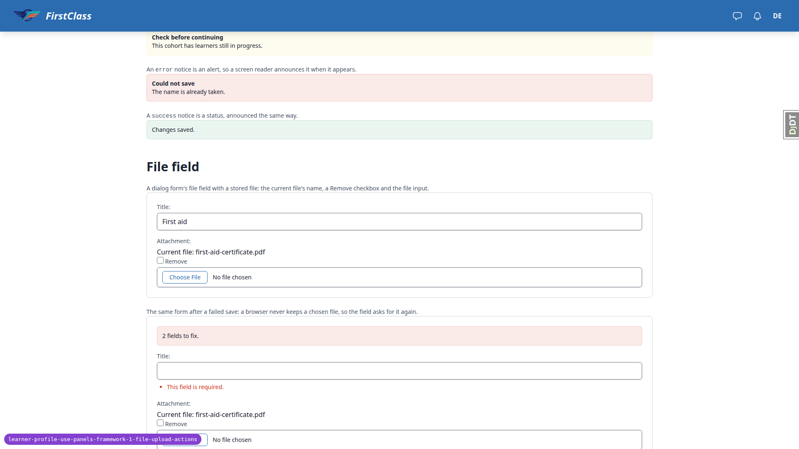 |
| 1.6 | desktop | pass | Current file line is base size. Field labels and the Remove label are the existing smaller label style shared with every form. |  |
| 1.7 | desktop | pass | No sideways scroll. Examples do not overflow at 1920/768/375. |  |
| 1.7 | tablet | pass | No sideways scroll, no overflow. | 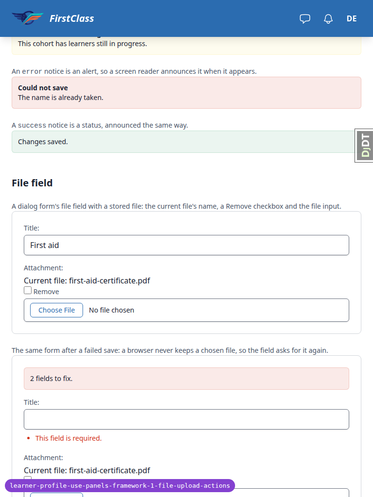 |
| 1.7 | mobile | pass | No sideways scroll, no overflow. | 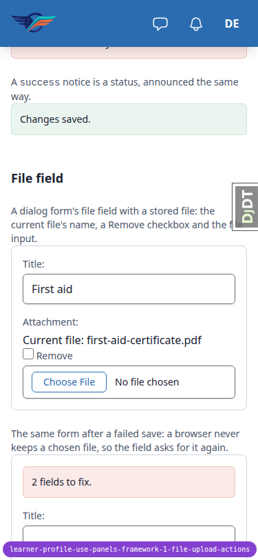 |
| 1.8 | desktop | **fail** | Console error on every load of the reference page: Alpine "Undefined variable: refocusAfterRequest" (see B2). Notice and Callout render as before. |  |
| 1.9 | desktop | **fail** | Inline example is live: choosing a file and pressing Save posts to the reference page and swaps a whole copy of the page into `#file-field-inline`, duplicating ids (see B1). | none |
| 1.10 | desktop | pass | Checkbox accessible name is "Remove first-aid-certificate.pdf". | none |
| 2.1-2.4 | desktop | pass | Name panel: First/Last name in one row, Save at end. Save disabled and reads "Saving…" (single ellipsis) while held. Name saved, heading updated, focus back on first_name. Over 200 chars gives one red line "Ensure this value…" with role=alert under the row, no box, no summary, aria-invalid=true, aria-describedby=id_first_name_error. Form has no enctype/hx-encoding. | 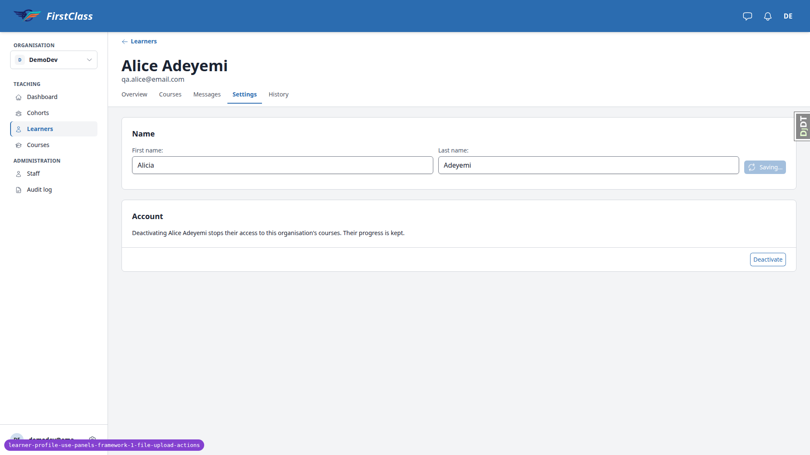 |
| 2.3 | desktop | pass | Field error one line, no box, input marked invalid. | 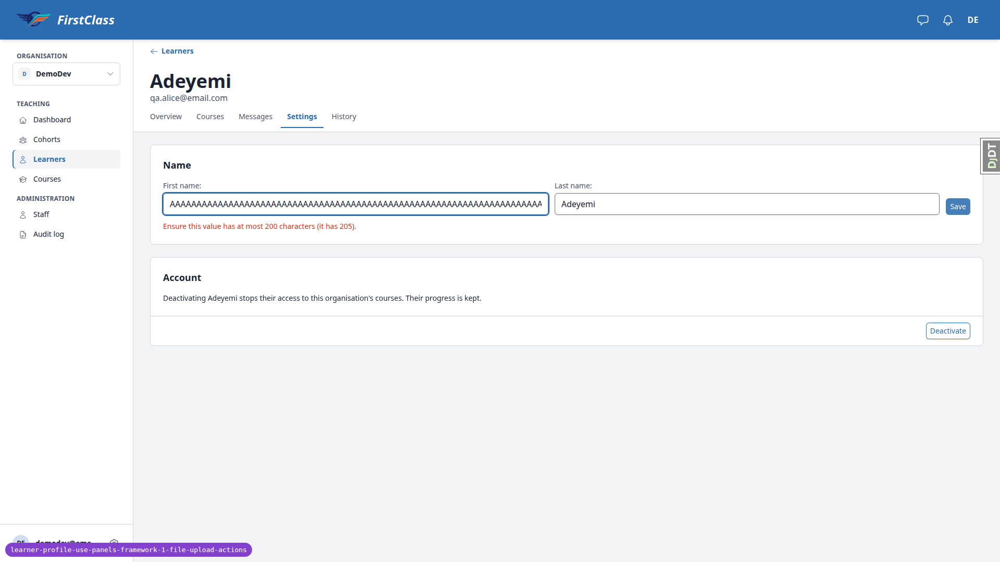 |
| 2.5 | desktop | pass | Hidden request-error holder has height 0; no gap in the panel. |  |
| 2.6 | mobile | pass | No sideways scroll at 375; fields stack, Save below. | 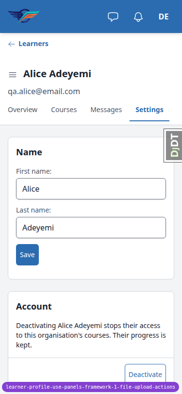 |
| 6.1 | desktop | **fail** | Routed 500: "Your changes could not be saved. Try again." appears under the row with role=alert at 14px like a field error. Changed name kept; Save enabled and reads Save; panel not replaced. FAIL: message drawn in body text colour, not error colour (see B3). | 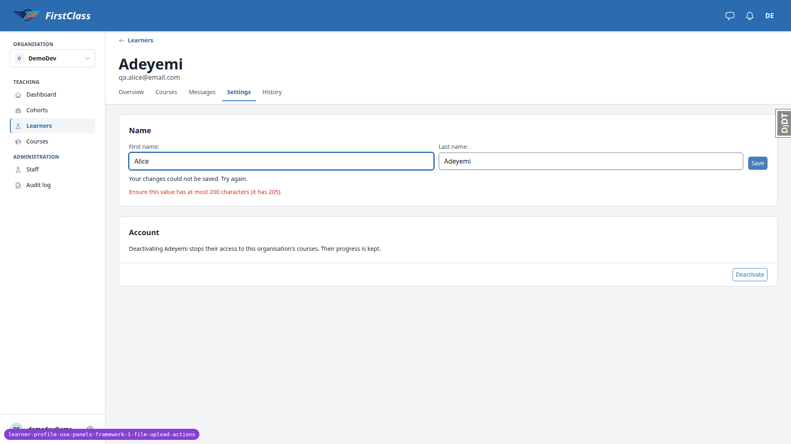 |
| 6.2 | desktop | pass | Route removed, Save: message hidden, name saved. | none |
| 7.1 | desktop | pass | Routed 404 on the Name form: page reloaded, no request error message. | none |
| 3 | desktop | pass | Cohort Name panel: field + Save in one row. Save disabled and "Saving…" while held. Heading updated, focus back on name. Over 150 chars gives one-line role=alert error, no box/summary, aria-invalid=true. No enctype/hx-encoding. Hidden holder takes no space. Name restored. | 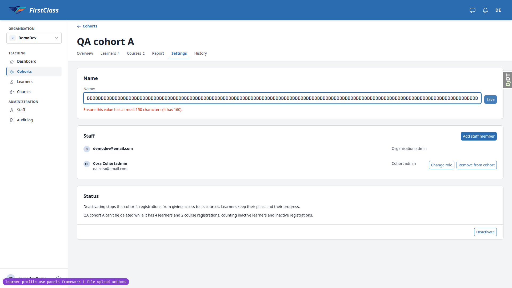 |
| 4.1-4.3 | desktop | pass | Create cohort dialog: header, Name field, footer; focus in Name; no enctype/hx-encoding. Empty submit gives "1 field to fix." summary with focus on it and "This field is required."; no "Choose the file again". | 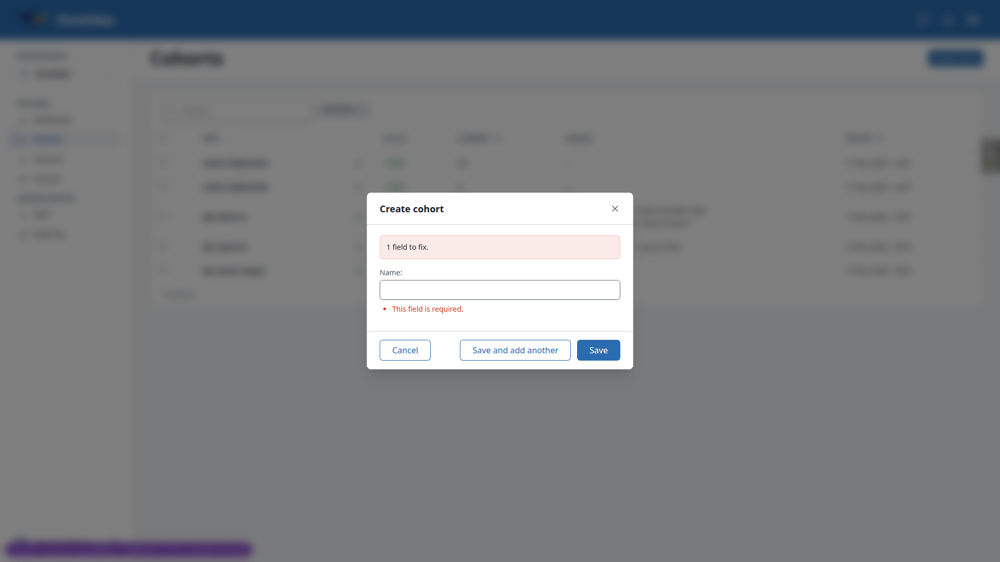 |
| 4.4-4.5 | desktop | pass | Typed name + Esc shows "Discard changes?". Keep editing keeps the name. Cleared + Esc closes with no prompt. |  |
| 4.6 | desktop | pass | Save and Save and add another disabled and read "Saving…" while held, never "Uploading…". Cohort created (dialog navigated to the new cohort). | 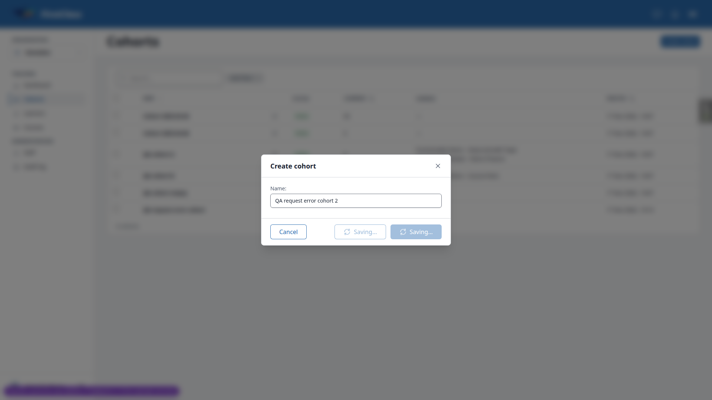 |
| 4.7 | mobile | pass | Dialog is a bottom sheet at 375 (0..375 wide, anchored to the bottom), no sideways scroll. | 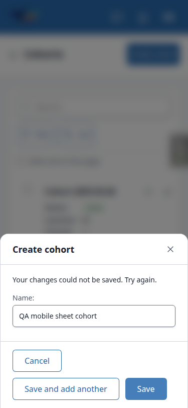 |
| 5.1 | desktop | **fail** | Routed 500: dialog stays open, message inside the modal body above the field, holder focused, typed name kept, Save enabled and reads Save, no server error page. FAIL: message in body text colour, not error colour (see B3). | 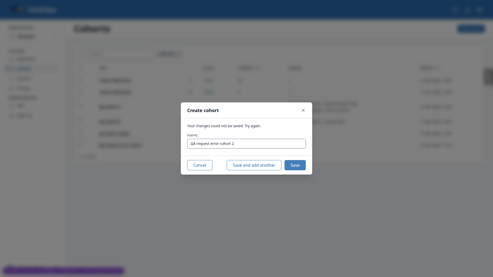 |
| 5.2 | desktop | pass | 413: message reads "The file may be too large to upload. Choose a smaller file."; only one message. | none |
| 5.3 | desktop | pass | `route.abort()`: "Your changes could not be saved. Try again." | none |
| 5.4 | desktop | pass | Route removed: message hidden as the request starts, cohort created, dialog closed (navigated to the new cohort). |  |
| 5.5 | desktop | pass | Reopened create dialog has no leftover message. | none |
| 5.6 | desktop | pass | Message element is a `
`. | none |
| 5.7 | mobile | pass | Message wraps inside the sheet, no sideways scroll (colour issue as 5.1). |  |
| 7.2 | desktop | pass | Empty create-cohort submit: 422 summary only, request-error holder stays hidden. |  |
| 7.3 | desktop | pass | Add to cohort dialog, cohort select refreshes on change: GET routed to 500, no request error message in the form, dialog stays usable. | 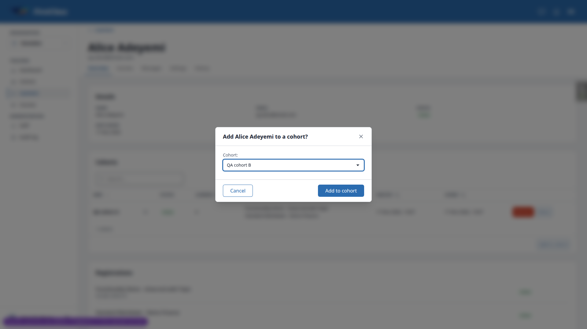 |
| 7.4 | desktop | pass | Quick view GET routed to 500: drawer shows "Something went wrong loading this." with Retry; no request error message. | 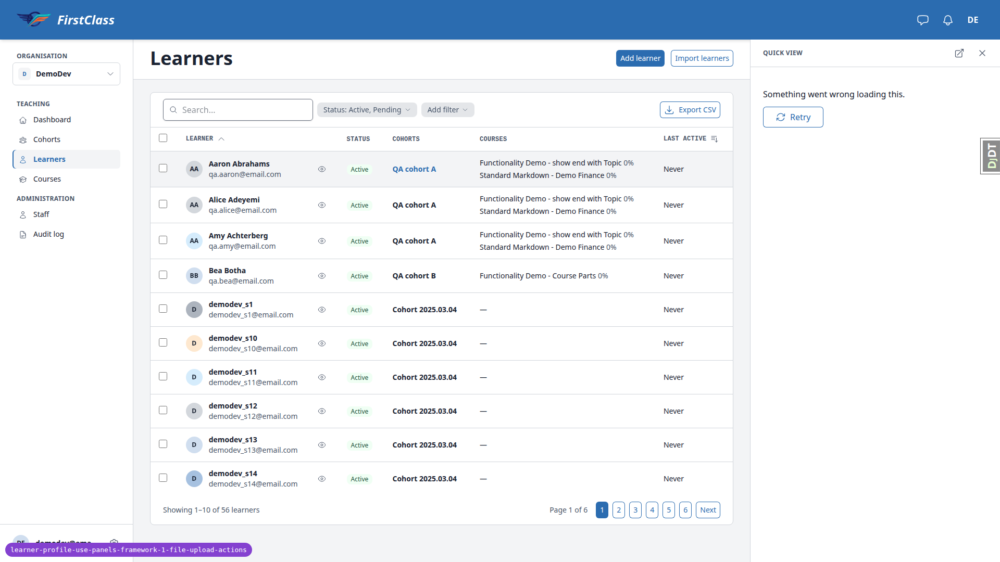 |
| 7.5 | desktop | pass | No real educator action answers an error with a toast, so a 500 carrying an OOB toast fragment was routed to the create-cohort POST: the toast shows and the form adds no request error message. | 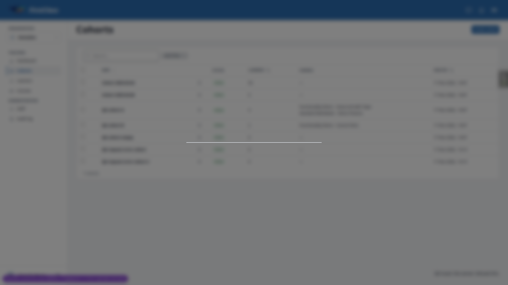 |
| 8.1 | desktop | pass | Deactivate confirm dialog: button disabled with spinner and "Deactivating…" while held (request then aborted, learner unchanged). | 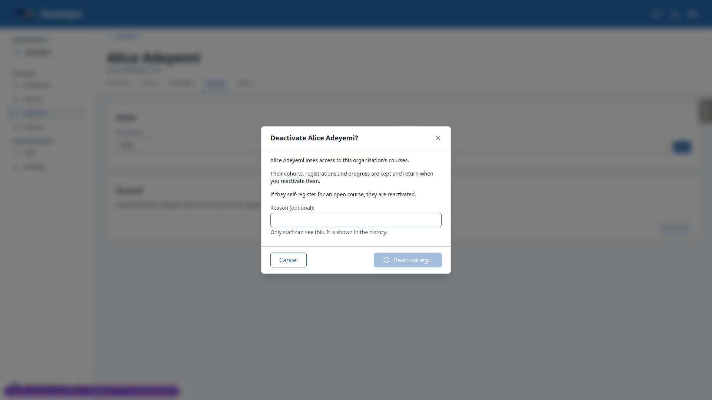 |
| 8.2 | desktop | pass | Logged in as learner qa.alice, opened the course and its first item: no console errors. No learner-side template uses the button's loading state (only educator/panel templates and claim_link_notice do), so learner submit buttons are unaffected. | 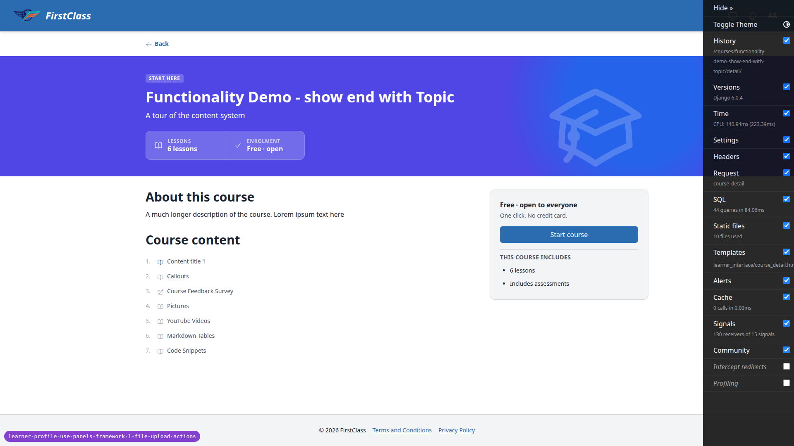 |
| 8.3 | desktop | pass | Deactivate button's loading span carries `data-loading-label="Deactivating…"`, equal to its visible loading text. | none |

## Design check

no design states tested

## B1: Reference page inline file example posts for real and nests a copy of the page

Manifestations:
- Test 1.9 (desktop)

Screenshots: none captured for this bug.

**Expected:** The inline example on `/panel-framework/components/` is static: its wrapper `#file-field-inline` carries `hx-disable`, so pressing its Save posts nothing.

**Actual:** `#file-field-inline` has no `hx-disable`. Choosing a file and pressing Save posts multipart to the reference page URL and swaps the whole page (header, every section) into the example, duplicating ids such as `file-field-dialog`.

## B2: Reference page logs an Alpine error: refocusAfterRequest is undefined

Manifestations:
- Test 1.8 (desktop)

**Expected:** No console error on `/panel-framework/components/`.

**Actual:** Every load logs "Alpine Expression Error: Undefined variable: refocusAfterRequest" and an uncaught error. The File field inline example includes `panel_framework/partials/inline_record_form.html` (`x-data=refocusAfterRequest`), registered in `panel_framework/static/panel_framework/js/alpine-components.js`, which `component_reference.html` (extends `_base.html`) does not load.

## B3: Request error message is drawn in body text colour, not error colour

Manifestations:
- Test 5.1 (desktop)
- Test 5.7 (mobile)
- Test 6.1 (desktop)

**Expected:** "Your changes could not be saved. Try again." (and the 413 message) shows in error colour, like a field error, in both the dialog and the inline form.

**Actual:** The `[data-request-error]` holder has `text-error` (computed rgb(210,51,25)) but the `
` the script inserts computes rgb(26,35,50), the body text colour, so the message reads as ordinary text.

## Layout probe

| Test | Viewport | URL | Screenshot | Result |
|---|---|---|---|---|
| 1 | desktop | /panel-framework/components/ |  | clean |
| 1 | tablet | /panel-framework/components/ |  | clean |
| 1 | mobile | /panel-framework/components/ |  | clean |
| 2 | desktop | /educator/organisations/demodev/learners/&lt;pk&gt;/__tabs/settings |  | clean |
| 2 | mobile | /educator/organisations/demodev/learners/&lt;pk&gt;/__tabs/settings |  | clean |
| 2 | tablet | /educator/organisations/demodev/learners/&lt;pk&gt;/__tabs/settings | 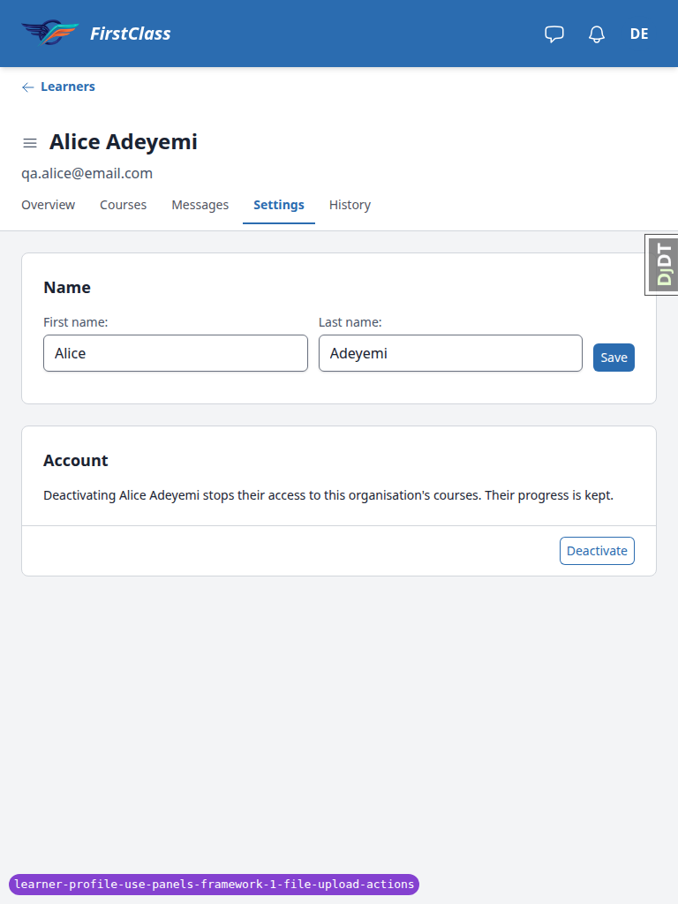 | clean |
| 3 | desktop | /educator/organisations/demodev/cohorts/&lt;pk&gt;/__tabs/settings |  | clean |
| 5 | mobile | /educator/organisations/demodev/cohorts |  | clean |
| 5 | tablet | /educator/organisations/demodev/cohorts | 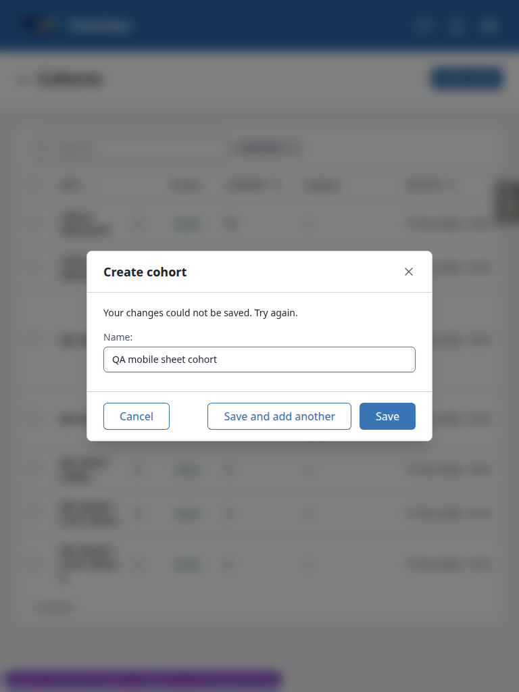 | clean |

## Data changes

| Via | What |
|---|---|
| sdd:qa-data-helper | Empty branch dev DB seeded: `create_demo_data --yes`, `content_save demo_content DemoDev`, `qa_create_dev_org_baseline --site-name DemoDev` (DemoDev site, demodev org, QA cohort A/B/empty/inactive, named QA learners) |

## Bug status

| Bug | Status |
|---|---|
| B1 | **FIXED** (commit: 8f6876c6d) — Reference page inline file example posts for real and nests a copy of the page |
| B2 | **FIXED** (commit: c45f18a25) — Reference page logs an Alpine error: refocusAfterRequest is undefined |
| B3 | **FIXED** (commit: 0dac2d6af) — Request error message is drawn in body text colour, not error colour |

Re-verified in the browser after each fix:

- B1: `#file-field-inline` carries `hx-disable`; choosing a file and pressing Save sends no POST and nests nothing. The example's plain `<form>` now submits natively as a GET, reloading the reference page with `?attachment=inline.pdf`; harmless, and the page renders once.
- B2: the reference page loads `panel_framework/js/alpine-components.js`; no console error or warning on load, and ticking Remove plus choosing a file in the dialog example sends nothing.
- B3: the message's computed colour now equals the holder's error colour (rgb(210,51,25)) in the create-cohort dialog and the learner Name inline form.

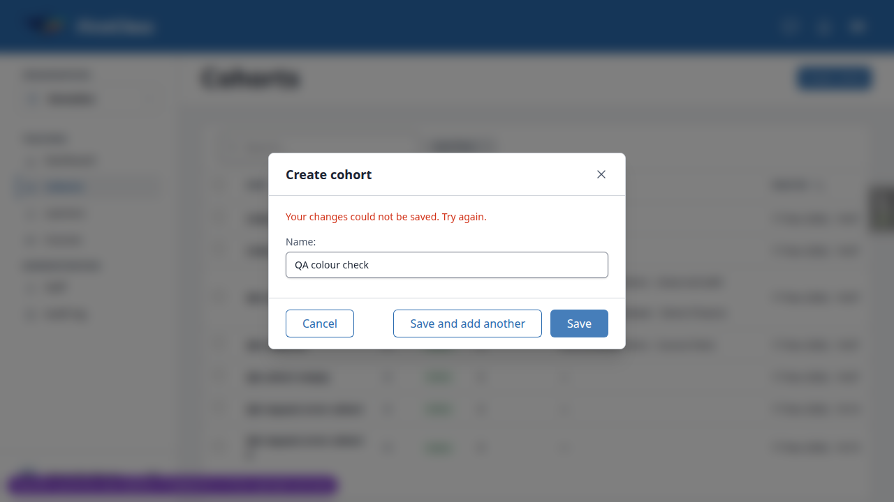
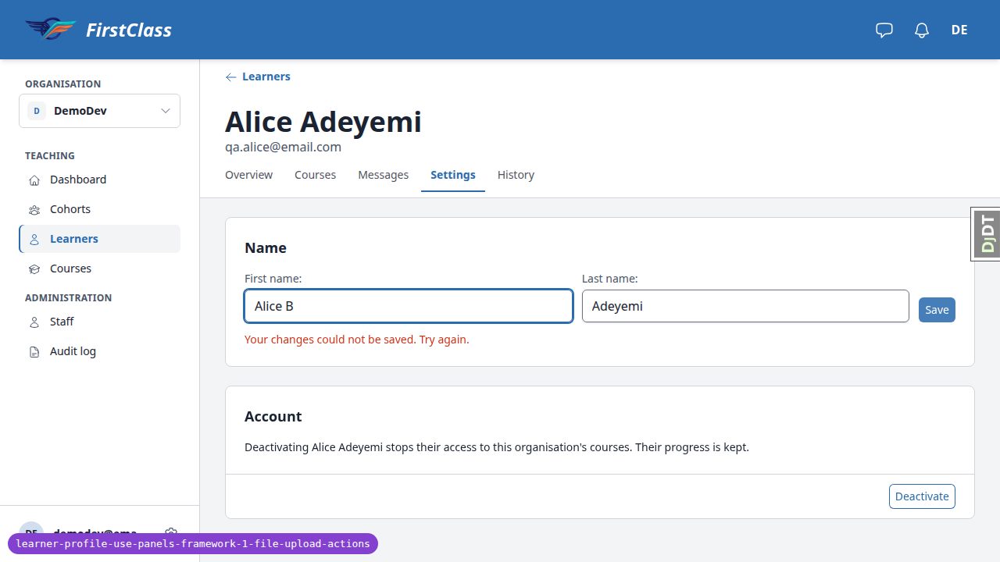

## General notes

- The empty dev database was seeded by the QA data helper before testing.
- Test 2.3 / 3: the learner first name accepts an empty value and the cohort name input is browser-required, so the over-length case was used for the field error.
- Test 6.1: after a 422 left a field error, a following failed request shows the request error message above the stale field error; both stay until the next swap.
- Test 7.5: a 4xx/5xx carrying an OOB toast swaps the response's (empty) main content into the form's target, so the dialog body empties while the toast shows. That swap lives in the pre-existing base `htmx:beforeSwap` listener, not this branch's code; no real educator action answers an error with a toast today.
- Confirm dialogs (e.g. Deactivate) do not use `modal/form.html`, so a failed confirm request shows no request error message; outside this change's scope.
- The reference page's dialog examples render field labels and the Remove label in the existing smaller label style shared with every form.

status: ok · reason: 3 bugs — 3 fixed, 0 unresolved; report rendered, screenshots verified
