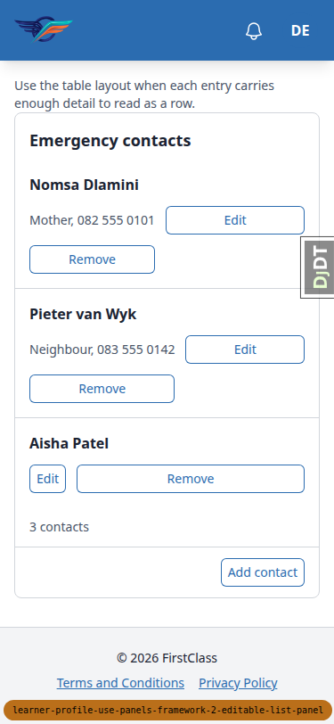
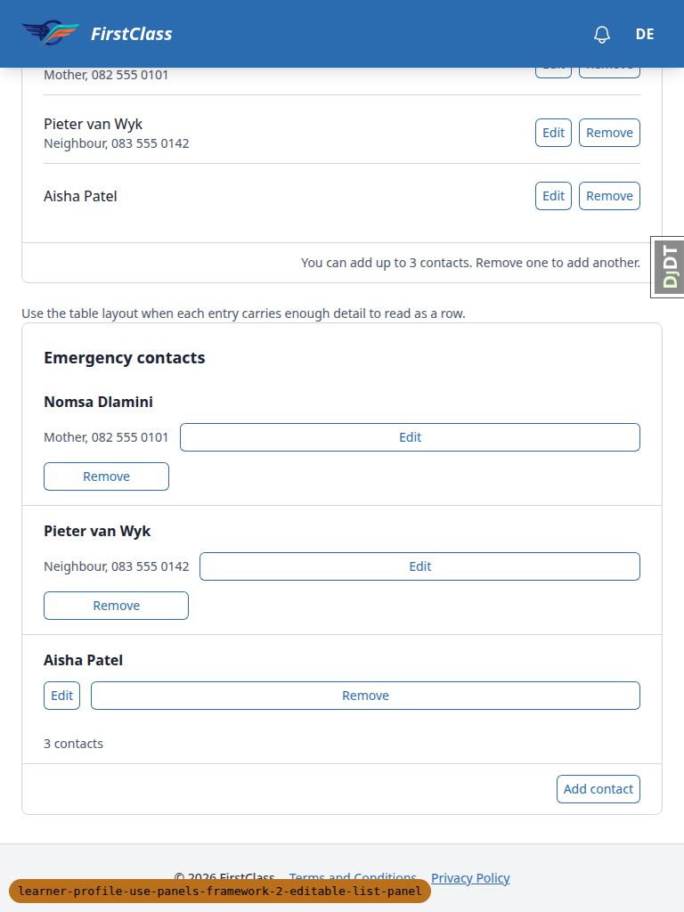
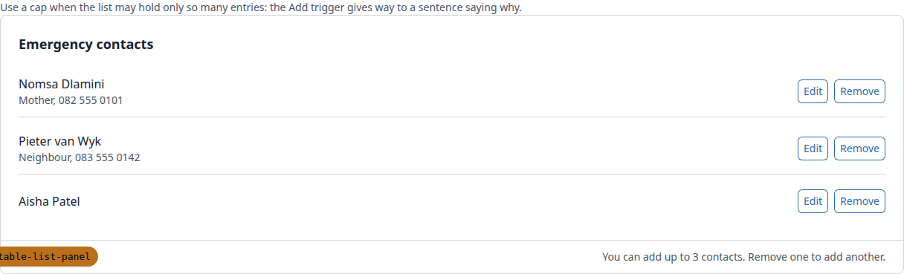
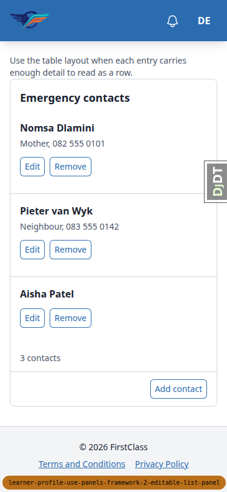
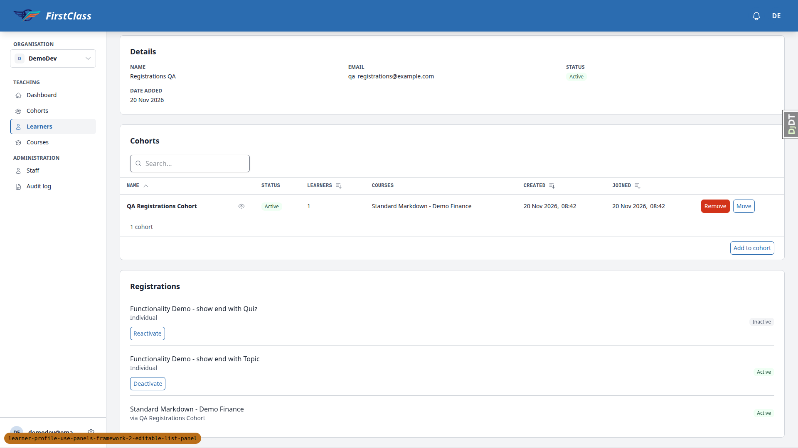
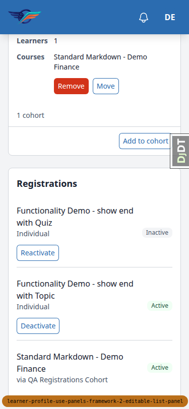
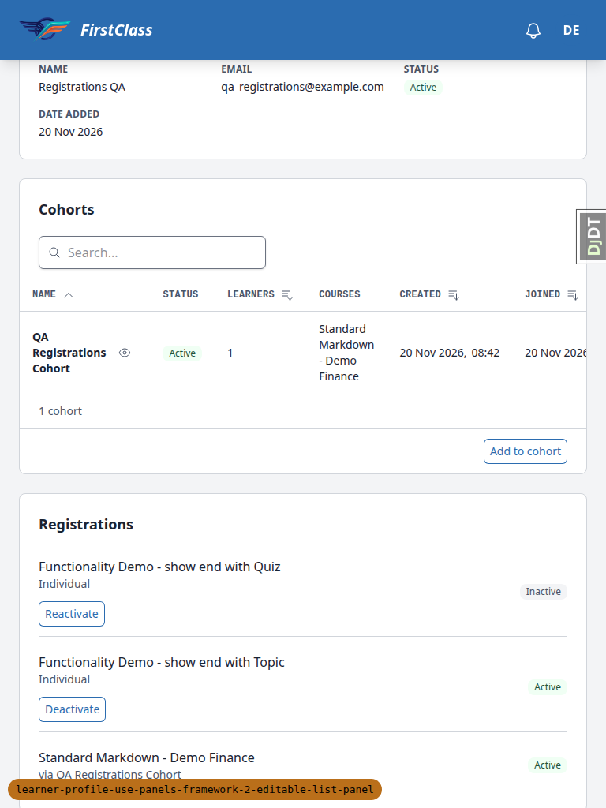

# QA report: `EditableListPanel`

Test plan: `3. frontend_qa.md`.

## Methodology

Screenshots were collected into `screenshots/` beside this report. Every image referenced below exists in that folder. The smoke gate passed, so all six tests ran. Results are per test and viewport; a failing test is documented once in a per-bug section.

## Diff scoping

Class: `FULL`. Changed files that triggered it: `freedom_ls/panel_framework/**` (actions, panels, checks, reference, templates, alpine-components.js) and `freedom_ls/educator_interface/tests/**`. Skipped: nothing. Everything ran, including the mobile and tablet passes.

## Smoke gate

Pass. Pages loaded: `/` and `/panel-framework/components/`. No failure URL or reason.

## Results summary

| Test | Viewport | Result | Notes |
|---|---|---|---|
| 1.2 default example | desktop | pass | Three entries, Edit and Remove per row with named buttons, one footer Add. |
| 1.3 empty example | desktop | pass | One sentence, one centred Add, no footer Add. |
| 1.4 cap example | desktop | fail | See B2. |
| 1.5 table example | desktop | pass | Table, buttons together in the last cell, count line, footer Add. |
| 1.5 table example | mobile | fail | See B1. |
| 1.5 table example | tablet | fail | See B1. |
| 1.6 no horizontal scroll, no wrapped labels | desktop, mobile, tablet | pass | scrollWidth equals clientWidth at 1920, 375 and 768. |
| 1.7 console | desktop | pass | No errors. |
| 2.1 to 2.5 cohort dialog | desktop | pass | Focus in Name; footer is Cancel, "Add and add another", "Add"; notice "Added QA Editable Alpha."; Enter acted as Add; each new cohort listed once. |
| 2.6 cohort dialog footer | mobile | pass | All three buttons inside 375x812, none clipped. |
| 3.1 to 3.5 failure paths | desktop | pass | Required check blocks empty submit; duplicate name shows 422 error; one cohort for the double click; Esc shows "Discard changes?" and "Keep editing" keeps the name; button reads "Adding…" in flight. |
| 4.1 to 4.3 Add learner dialog | desktop | pass | Outcome sentence above the empty form; learner confirmed in the database (list is paginated, row not on page 1). |
| 5.1 to 5.3 other form dialogs | desktop | pass | See general notes: tested "Add to cohort" instead of an Edit dialog. |
| 6.1, 6.2 delete confirmation | desktop | pass | Readable sentence, nothing deleted. |

## Design check

No design states tested.

## B1: Editable list table layout: card view splits the Edit and Remove buttons across grid cells

Manifestations:

- 1.5, mobile
- 1.5, tablet

Expected: each card shows the title, then the detail line, then the Edit and Remove buttons together at their natural width.

Actual: `<c-panel-table-card>` wraps its content in a two-column `<dl>` grid with `[&>div]:contents`, which dissolves the `<c-data-table-actions>` wrapper. Edit lands beside the detail in column 2 and stretches, and Remove wraps to column 1 of the next row, at different widths per card.

## B2: Component reference cap example shows a different sentence from the panel's real cap line

Manifestation:

- 1.4, desktop

Expected: "You can have up to 3. Remove one to add another.", the sentence `EditableListPanel` renders (spec: "You can have up to <max_entries>. Remove one to add another.").

Actual: `reference.py` hard-codes "You can add up to 3 contacts. Remove one to add another." The panel's real line comes from `get_cap_line` in `panels.py`.

## Layout probe

| Test id | Viewport | URL | Screenshot | Result |
|---|---|---|---|---|
| 1 | desktop | /panel-framework/components/ | [element-2026-11-20T00-34-06-314Z.png](screenshots/element-2026-11-20T00-34-06-314Z.png) | clean |
| 1 | mobile | /panel-framework/components/ | [page-2026-11-20T00-34-47-727Z.png](screenshots/page-2026-11-20T00-34-47-727Z.png) | clean |
| 1 | tablet | /panel-framework/components/ | [page-2026-11-20T00-35-03-722Z.png](screenshots/page-2026-11-20T00-35-03-722Z.png) | clean |
| 2 | mobile | /educator/organisations/demodev/cohorts | [page-2026-11-20T00-35-58-114Z.png](screenshots/page-2026-11-20T00-35-58-114Z.png) | clean |

The probe flags nothing for test 1 at mobile and tablet, but those same screenshots show the B1 card fault. The probe checks overflow and clipping, not button grouping.

## Data changes

The scratch records do not name the agent call or command that made each change, and none lists files written.

| What changed | Agent call or command | Files written |
|---|---|---|
| Created cohorts "QA Editable Alpha" and "QA Editable Beta" (demodev) | Not recorded (browser dialog, test 2) | none |
| Created cohort "QA Editable Gamma" (demodev) | Not recorded (browser dialog, test 3) | none |
| Created learner qa.editable.learner@example.com (demodev) | Not recorded (browser dialog, test 4) | none |
| Learner demodev_s1 added to cohort "QA Editable Beta" | Not recorded (browser dialog, test 5) | none |

## Bug status

- **FIXED** (commit: c75fecb66) — Editable list table layout: card view splits the Edit and Remove buttons across grid cells. `<c-panel-table-card>` gained a `content` slot rendered under the title and outside the label/value grid; re-checked at 375: title, detail, then Edit and Remove together on one row. The data-table cards example and the cohorts list cards are unchanged. 
- **FIXED** (commit: 12ddce5a7) — Component reference cap example shows a different sentence from the panel's real cap line. The panel and the reference now share `editable_list_cap_line`; the example reads "You can have up to 3. Remove one to add another."
- **FIXED** (commit: 77a4ade6a) — Learner Registrations panel: Deactivate/Reactivate sat in the row's trailing slot. It now sits in the row's item footer under the course title and detail; the badge stays alone at the right and a cohort row has no footer. — after the fix:   
- **FIXED** (commit: e580ec962) — `test_saving_one_entry_twice_announces_both_saves` raced the announcer's 50 ms refill under load; it now waits for all three recorded changes before asserting.

## General notes

- Test 1.5 at 768: the example shows cards, not a table. The reference content column is narrower than the plan's `@min-[58rem]` container switch, so cards are what the plan specifies. The QA plan's "table at 768" expectation predates that choice and should be updated.
- Test 1.5 at 1920: the panel title and count line sit 8px right of the table's cell text (16px cell padding in a flush table against 24px panel padding). Observation only.
- Test 5.1: neither the cohort page (inline Name form, Staff, Status) nor the learner page offers an Edit dialog. The "Add to cohort" form dialog was tested instead. The Cancel and "Save" footer and the clear-a-required-field-and-save steps of the plan were therefore not exercised on a Save dialog.
- Test 6.1: the cohort page's own pre-check hid the Delete button and showed "QA Editable Beta can't be deleted while it has 1 learner, counting inactive learners and inactive registrations." The shared protected-dependents sentence in `DeleteAction`'s refusal is not reachable from the dev site with the demo data. Unit tests cover it.
- Test 3.2: the browser logs the 422 for a duplicate name as a failed resource load. This is expected.
- `EditableListPanel`'s add, edit, remove, cap and focus behaviour is only covered by the pytest-Playwright flow, as the plan says. No dev page uses it yet.
- Screenshots in the folder that no record references: `page-2026-11-20T00-34-42-380Z.png`, `page-2026-11-20T00-34-56-321Z.png` and `element-2026-11-20T00-36-24-380Z.png`.

status: ok · reason: 4 bugs — 4 fixed, 0 unresolved; report rendered, screenshots verified
