# Frontend QA report: `EditableListPanel`

## Methodology

Screenshots were collected into `spec_dd/2. in progress/learner-profile-use-panels-framework-2-editable-list-panel/screenshots/`. Every image referenced below exists beside this report. The run followed `3. frontend_qa.md` at desktop (1920x1080), mobile (375x812) and tablet (768x1024). The blocking Edit/Remove check (test 1.6) was measured with `browser_evaluate`, not by eye.

## Diff scoping

Class: FULL. The changed files that triggered it include `freedom_ls/panel_framework/` templates, cotton components (`modal-trigger`, `panel-list-row`, `panel-table`, `panel-table-card`), `panels.py`, `actions.py`, `alpine-components.js`, `freedom_ls/educator_interface/views.py` and the `learner_registrations.html` panel template. Nothing was skipped: all three viewports ran for tests 1 and 2, and desktop ran for tests 3 to 6, as the plan specifies.

## Smoke gate

Pass. Pages loaded: `/` and `/panel-framework/components/`.

## Design check

No design states tested. This plan has no design screenshots and no design checklist tests, so none ran.

## Per-bug sections

### B1: Dialog footer's wrapped action row sits at the left on a phone

Pre-existing: `cotton/modal-footer.html` is not changed on this branch.

Manifestations:
- `2.6-footer-alignment`, mobile (375x812)

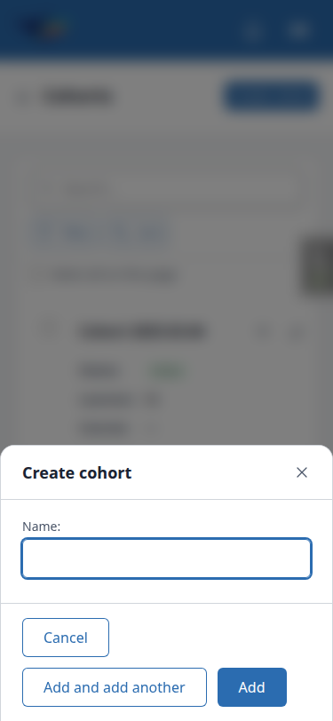

Expected: below `sm`, when `<c-modal-footer>`'s action group wraps onto its own row, the group stays right-aligned. The primary "Add" ends at the body's right edge (x=350 at 375px), lined up with the field and the close control. The panel-framework SKILL and the component's own comment both say this.

Actual: the wrapped group sits at the left. "Add and add another" starts at x=25 under Cancel, and "Add" ends at x=323, 27px short of the body's right edge.

## Layout probe

| Test id | Viewport | URL | Screenshot | Result |
|---|---|---|---|---|
| 1 | desktop | `/panel-framework/components/` | [page-2026-11-20T12-34-07-230Z.png](screenshots/page-2026-11-20T12-34-07-230Z.png) | clean |
| 2 | desktop | `/educator/organisations/demodev/cohorts` | [page-2026-11-20T12-34-59-391Z.png](screenshots/page-2026-11-20T12-34-59-391Z.png) | clean |
| 1 | mobile | `/panel-framework/components/` | [page-2026-11-20T12-39-20-758Z.png](screenshots/page-2026-11-20T12-39-20-758Z.png) | clean |
| 2.6 | mobile | `/educator/organisations/demodev/cohorts` | [page-2026-11-20T12-39-37-009Z.png](screenshots/page-2026-11-20T12-39-37-009Z.png) | clean |
| 1 | tablet | `/panel-framework/components/` | [page-2026-11-20T12-40-28-231Z.png](screenshots/page-2026-11-20T12-40-28-231Z.png) | clean |
| 2 | tablet | `/educator/organisations/demodev/cohorts` | [page-2026-11-20T12-40-41-064Z.png](screenshots/page-2026-11-20T12-40-41-064Z.png) | clean |

## Test results

| Test | Viewport | Result | Notes |
|---|---|---|---|
| 1.2 | desktop | pass | 3 entries; titles weight 500, muted detail. Edit (41px) and Remove (69px) share a top inside `[data-item-footer]`. Edit's left edge equals the title's left (377), 12-13px under the text. Button names include the entry, such as "Edit Nomsa Dlamini, Mother, 082 555 0101". No bare Edit or Remove. One "Add contact" in the panel footer. 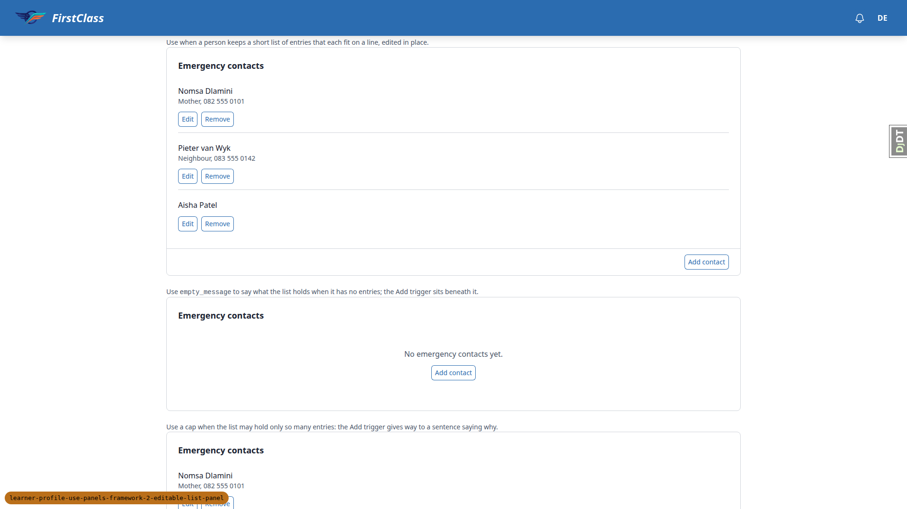 |
| 1.3 | desktop | pass | "No emergency contacts yet." and one centred "Add contact"; no footer Add. |
| 1.4 | desktop | pass | Same item footer; muted line "You can have up to 3. Remove one to add another."; no Add button. 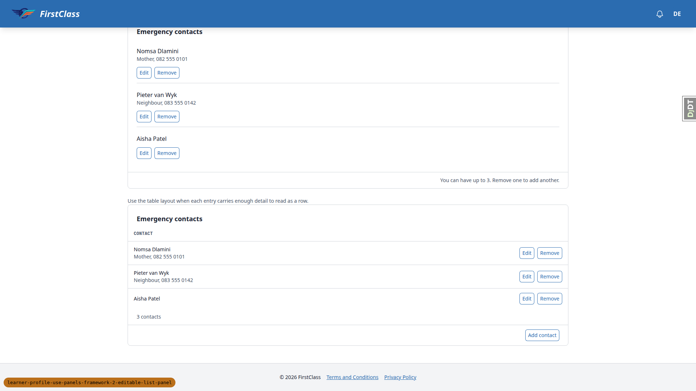 |
| 1.5 | desktop | pass | Table, one row per entry; Edit and Remove share a top in the last cell (41px/69px); footer "3 contacts". Observation: the row text starts 8px left of the panel title and count line (16px cell padding against 24px panel padding). This is pre-existing and also appears in the learner page's Cohorts panel table. |
| 1.6 | desktop | pass | In all three table rows both buttons share `getBoundingClientRect().top` in the last cell. |
| 1.7 | desktop | pass | Every list entry's buttons start at x=377, 12-13px under the text. |
| 1.8 | desktop | pass | No horizontal scroll; no label wraps or is cut off. |
| 1.9 | desktop | pass | Console: 0 errors. |
| 2.1-2.2 | desktop | pass | Dialog opens with focus in Name. Footer: Cancel, "Add and add another", "Add"; no "Save". 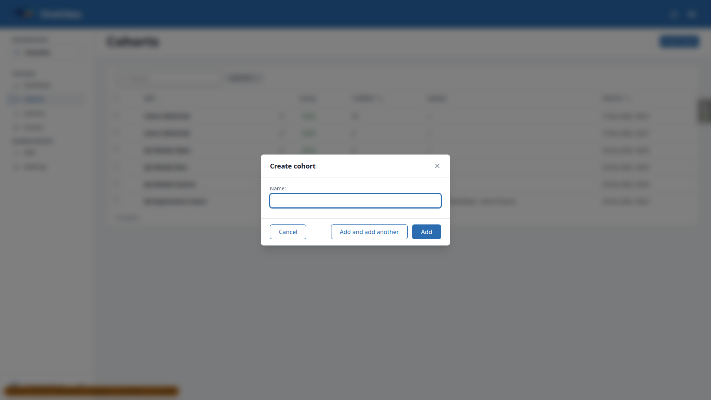 |
| 2.3 | desktop | pass | "QA Alpha 1120" + Add and add another: dialog stays open, empty focused field, callout "Added QA Alpha 1120.", new row behind. 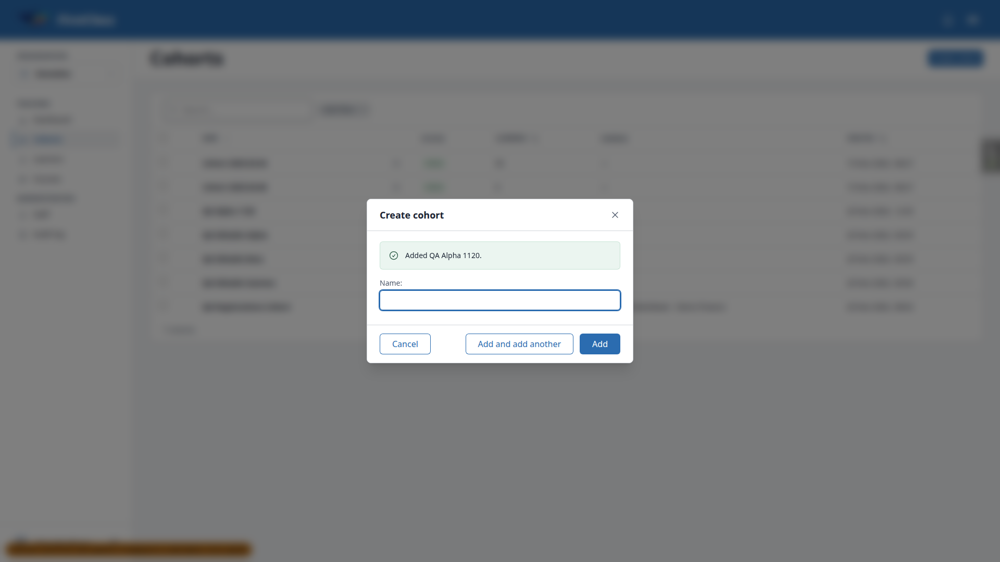 |
| 2.4-2.5 | desktop | pass | "QA Beta 1120" + Enter: dialog closed and the page moved to the new cohort. Back on the list, each name appears once. |
| 3.1 | desktop | pass | The browser's required check blocks the empty submit; dialog stays open; row count unchanged. |
| 3.2 | desktop | pass | Existing name + Add: dialog stays open with "1 field to fix." and "Another cohort already has this name." The 422 appears in the console as a failed resource load, which is expected for HTMX validation. |
| 3.3 | desktop | pass | "QA Gamma 1120" + Add and add another clicked twice at once: one cohort created; the second click met an empty required field. |
| 3.4 | desktop | pass | Esc with a typed name shows "Discard changes?"; "Keep editing" returns to the form with "QA Unsaved 1120" intact. 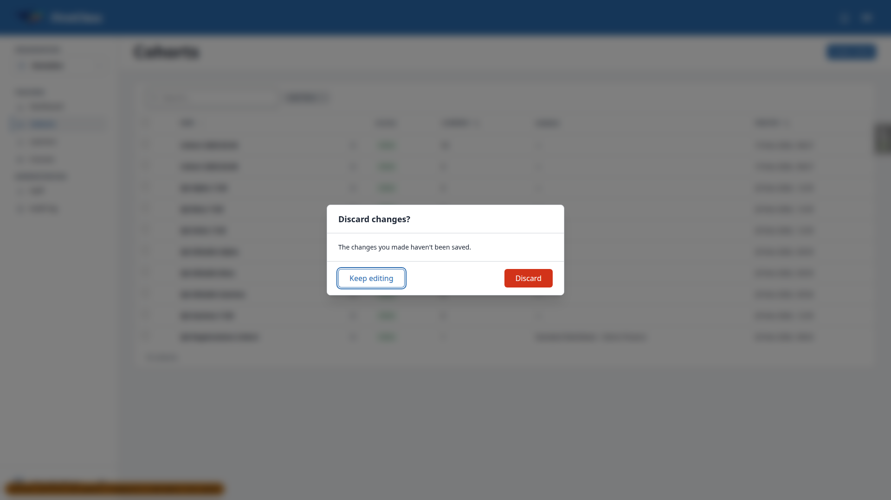 |
| 3.5 | desktop | pass | With the action route delayed 2.5s, the clicked Add reads "Adding…" and is disabled. Both submit buttons read "Adding…" in flight, because both carry that loading text and `hx-disabled-elt` covers every submit button. |
| 4.1-4.3 | desktop | pass | Footer Cancel, "Add and add another", "Add". With qa.learner.1120@example.com: empty form and outcome sentence "qa.learner.1120@example.com: Account created and setup email sent." Search finds the learner after closing. 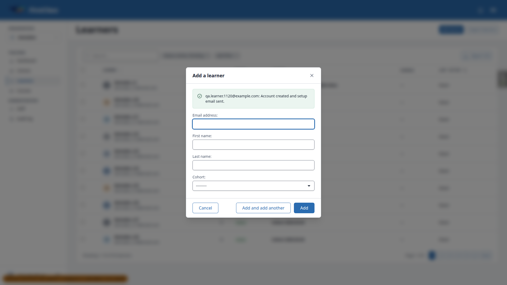 |
| 5.1-5.3 | desktop | pass (partial) | See general notes: no Edit dialog is reachable, so the learner page's "Add to cohort" form dialog was tested instead. 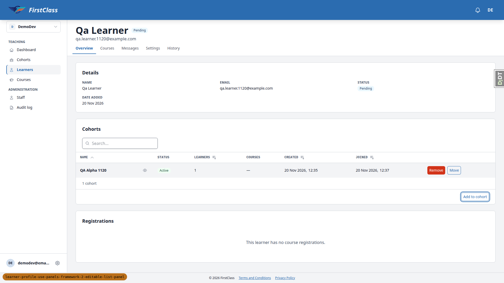 |
| 6.1-6.2 | desktop | pass | QA Alpha 1120 (1 learner): Settings shows "QA Alpha 1120 can't be deleted while it has 1 learner, counting inactive learners and inactive registrations." and no Delete button. On empty QA Gamma 1120 the Delete dialog reads "Delete QA Gamma 1120? Deleting this cohort cannot be undone." with an optional reason; Cancel left the cohort in place. |
| 1.2-1.4 | mobile | pass | Default, empty and cap examples at 375: same entry footers, cap line shown, Add contact in the default panel footer only. 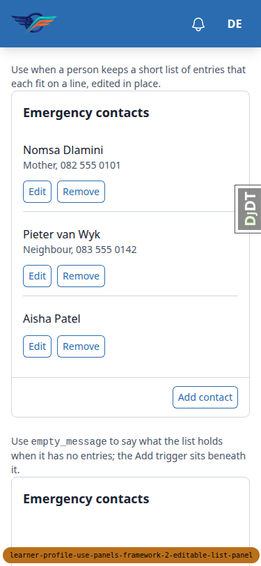 |
| 1.5 | mobile | pass | Table shows as cards: title, detail on its own line, footer with Edit and Remove side by side at the title's left edge; 3 visible Edit and 3 Remove; table hidden; "3 contacts" and Add contact below. 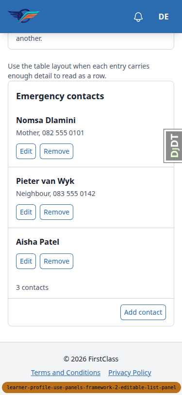 |
| 1.6 | mobile | pass (blocking check) | Measured in default, cap and table (9 entries): both buttons share a top, both inside `[data-item-footer]`, widths 41px and 69px against entry widths 309px (list) and 341px (cards), all under a quarter; top 12-13px below the detail line's bottom; none wraps. 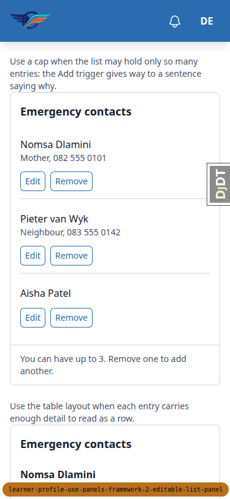 |
| 1.7-1.9 | mobile | pass | Every Edit at x=33 (= title left), Remove at x=82. No horizontal scroll; no wrapped or cut labels; console 0 errors. |
| 2.6 | mobile | pass | Bottom sheet at 375x812: Cancel (25-123, top 696) on the first row, "Add and add another" (25-233) and "Add" (245-323) on the second, bottom 796 < 812; all 44px tall, none clipped, no horizontal scroll. |
| 2.6-footer-alignment | mobile | FAIL (B1) | See bug section B1. |
| 1.2-1.5 | tablet | pass | At 768: default, empty and cap as at desktop; table shows as cards, one set of buttons per entry, "3 contacts" and Add contact below. 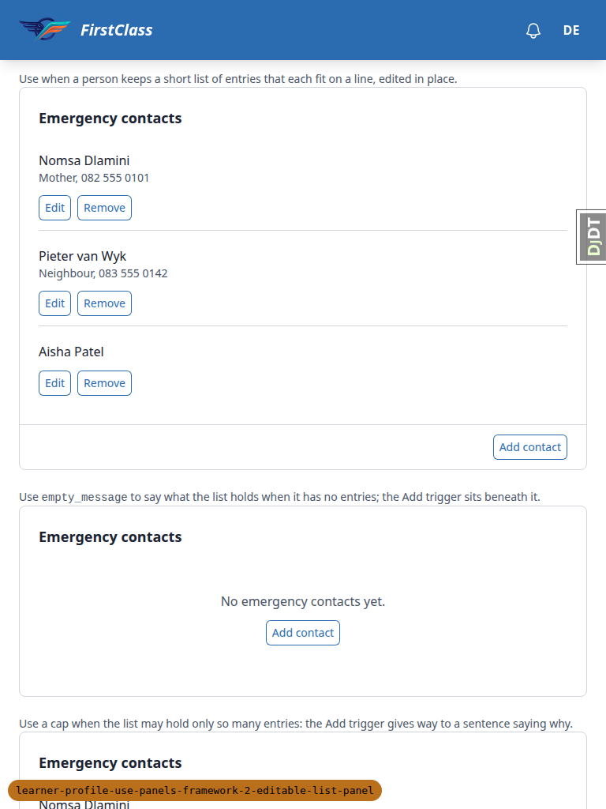 |
| 1.6 | tablet | pass (blocking check) | Measured in default, cap and table (9 entries): shared top, inside `[data-item-footer]`, 41px and 69px against entries 670px (list) and 718px (cards), all under a quarter; 12-13px below the detail line; none wraps. |
| 1.7-1.9 | tablet | pass | Every Edit at x=49 = title left. No horizontal scroll; no wrapped or cut labels; console 0 errors. |
| 2.1-2.2 | tablet | pass | Dialog at 768: focus in Name; Cancel (153-251), "Add and add another" (318-525), "Add" (537-615) on one row, Add's right edge on the field's right edge (615). No horizontal scroll. |

## Data changes

No data changes were made by the QA run itself (no seed commands or direct edits). The flows created ordinary test data: cohorts QA Alpha/Beta/Gamma/Delta 1120 and the learner qa.learner.1120@example.com. This is residue, not a deliberate change.

## Bug status

| Bug | Title | Status |
|---|---|---|
| B1 | Dialog footer's wrapped action row sits at the left on a phone | **FIXED** (commit: c80b7f2ee) — `ml-auto` on `<c-modal-footer>`'s action slot. Re-verified at 375: "Add" ends at x=350 on the field's right edge in the Create cohort and Add learner dialogs; 1920 footer unchanged (Add ends on the field's right edge, 1191); buttons stay 44px on the phone; no horizontal scroll. 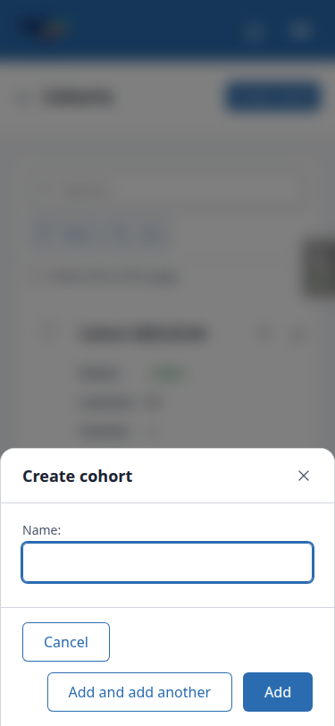 |

## General notes

- Before QA, the branch was rebased onto main (44 commits replayed). Conflicts were resolved in `test_component_reference_flow.py` (section count 19), in `test_reference.py` (kept both sides' tests) and in the panel-framework SKILL.md (kept `<c-panel-callout>` plus the `hidden_fields` wording). The full suite passed (17071 passed, 1 skipped), pre-commit was clean, and the branch was force-pushed. The upstream-change review found nothing changed. The rebase's front-end check pages are this plan's pages, so this run covers them at all three viewports.
- Test 5 was not run as written. Neither the cohort page nor the learner page offers an Edit dialog, because Name is an inline Settings form on both. The learner page's "Add to cohort" dialog (`modal/form.html`) was tested instead: footer Cancel + "Add to cohort", no hidden inputs in its form, an empty submit (native validation off) shows "1 field to fix.", and choosing QA Alpha 1120 closed the dialog and added the row to the Cohorts panel without a full reload (a window marker survived). The Cancel + "Save" footer and the clear-a-required-field steps were not exercised on a Save dialog.
- Test 6: the shared protected-dependents sentence in DeleteAction's refusal is not reachable from the dev site. Unit tests cover it.
- No page on the dev site uses `EditableListPanel`. Its add, edit, remove, cap and focus behaviour is covered only by the pytest-Playwright flow, as the plan states.
- Observation with no action attached: in the table example the row text sits 8px left of the panel title (cell padding 16px against panel padding 24px). It is pre-existing and also shows on the learner Cohorts panel table.

status: ok · reason: 1 bug — 1 fixed, 0 unresolved; report rendered, screenshots verified
