# Frontend QA report: account area on panels

Test plan: `3. frontend_qa.md`. Dev server on port 8099. Run class FULL (desktop 1920x1080, mobile 375x812, tablet 768x1024).

## Methodology

Screenshots were collected into `screenshots/` beside this report. Every image linked below exists there. The run did not abort at the smoke gate, so every step ran. Results come from the structured records in `.sdd-work/qa_scratch.jsonl`.

## Diff scoping

Class: FULL. Changed files that triggered it: `freedom_ls/accounts/**`, `freedom_ls/base/templates/**`, `freedom_ls/panel_framework/**`, `freedom_ls/educator_interface/templates/**`, `config/urls.py`, and docs and spec files. Skipped: nothing. Desktop, mobile and tablet passes all ran.

## Smoke gate

Status: pass. Pages loaded: `/` and `/accounts/profile/personal-details`. No failure.

## Design check

No design states tested. The plan had no design-comparison tests.

## Results summary

| Test | Desktop | Mobile | Tablet | Notes |
|---|---|---|---|---|
| 1 Account area loads | pass | pass (1-nav pass) | pass | |
| 2 Inline name change | pass | | | |
| 3 Picture upload | pass | pass | pass | |
| 4 Remove picture | pass | pass | | |
| 5 Email and Password panels | pass | pass | pass | |
| 5-align (Forgot password? alignment) | fail | fail | fail | Bug B1 |
| 5.6 No-password user | pass | | | |
| 5.7 `/accounts/password/set/` | pass | pass | | Layout probe flags, bug B2 |
| 6 Entrance layout pages | pass | | | |
| 6.3 Reauthenticate | pass | | | |
| 7 Roles (7.3 included) | pass | | | 7.4 not applicable |
| 8 Educator name form | pass | | | |
| 9 Panels, footers, heading row | pass | pass | pass | |

## Bug B1: Forgot password? link indented 8px from the Password card's field edge

Manifestations:
- `5-align`, desktop
- `5-align`, tablet
- `5-align`, mobile

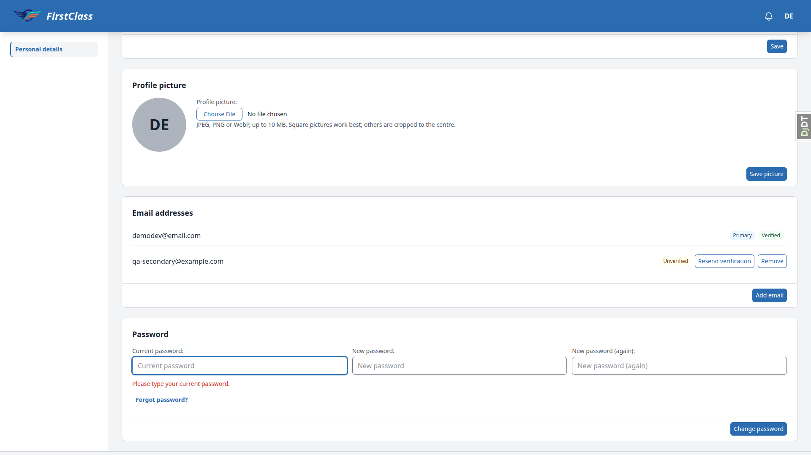
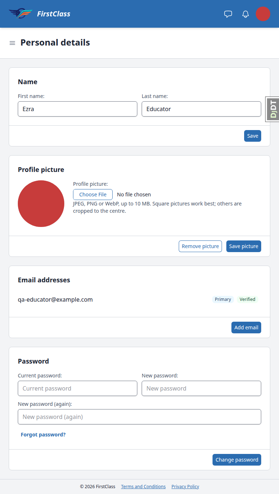
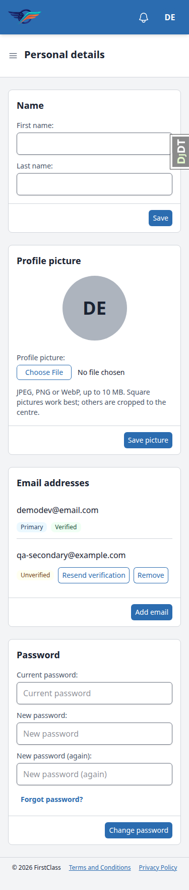

Expected: the link's text starts at the same left edge as the Password card's labels and inputs.

Actual: the link is rendered as `btn btn-link btn-sm`, whose 8px horizontal padding puts its text 8px right of the field edge at every viewport (desktop x=321 vs 313, tablet x=57 vs 49, mobile x=41 vs 33).

## Bug B2: Layout probe flags /accounts/password/set/: header band ink starts at the column edge, content at the card

Manifestations:
- `5.7`, desktop (header ink x=256, content x=288, 32px)
- `5.7`, mobile (header ink x=0, content x=16, 16px)

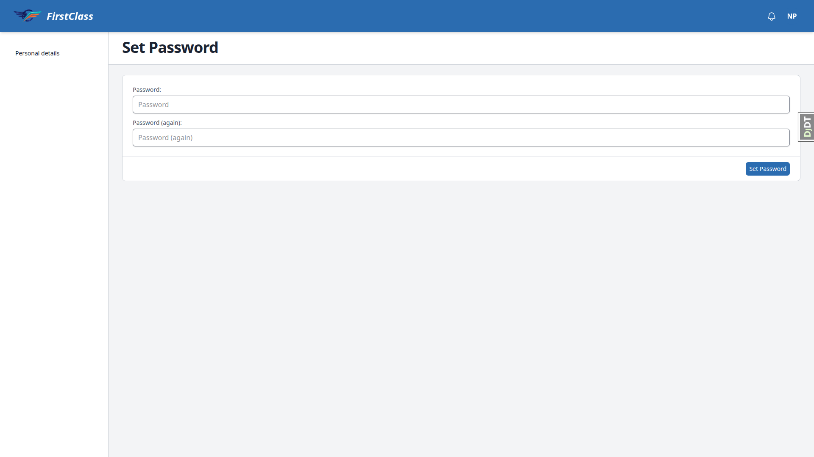
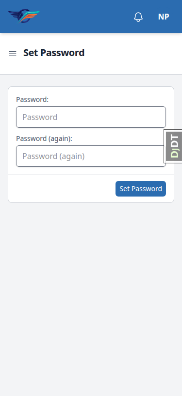

Expected: probe regions line up as on the educator panel pages, where the grey canvas is its own full-width element.

Actual: on the allauth set-password page the grey canvas is painted by an ancestor, so the probe reads the card (x=288 desktop, x=16 mobile) as content against the band at x=256/0. Visually the heading text and the card share a left edge, as on Personal details and the educator pages.

## Layout probe

| Test id | Viewport | URL | Screenshot | Result |
|---|---|---|---|---|
| 1 | desktop | `/accounts/profile/personal-details` | 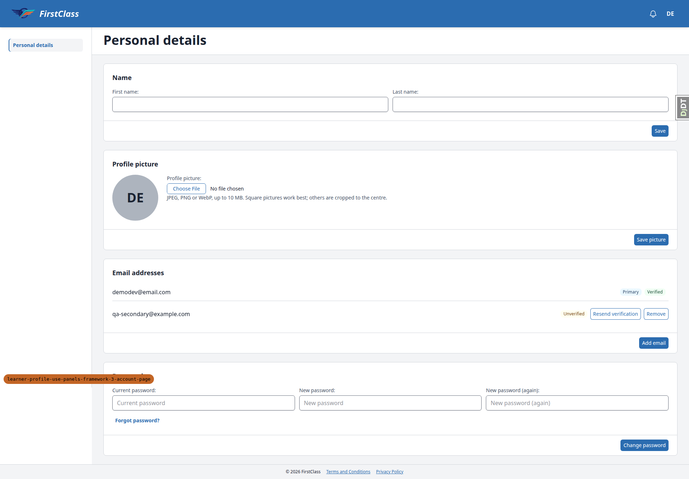 | clean |
| 3 | desktop | `/accounts/profile/personal-details` | 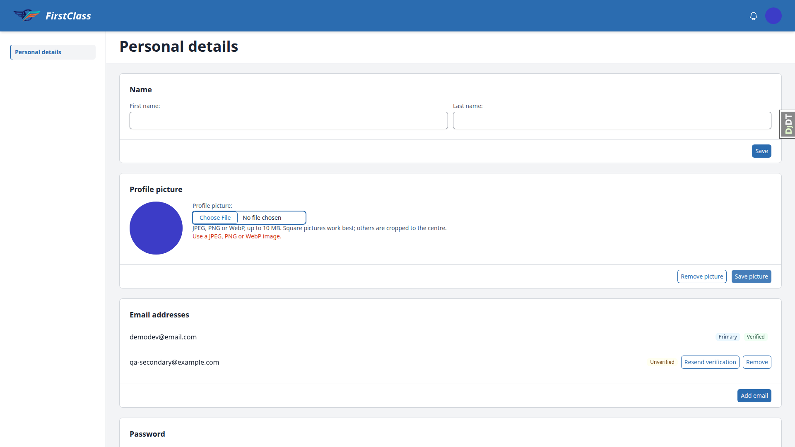 | clean |
| 5 | desktop | `/accounts/profile/personal-details` |  | clean |
| 6.3 | desktop | `/accounts/reauthenticate/` | 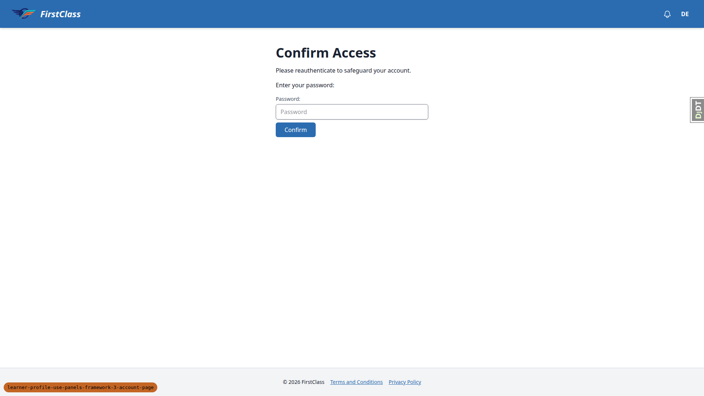 | clean |
| 8 | desktop | `/educator/organisations/demodev/cohorts/<id>/__tabs/settings` | 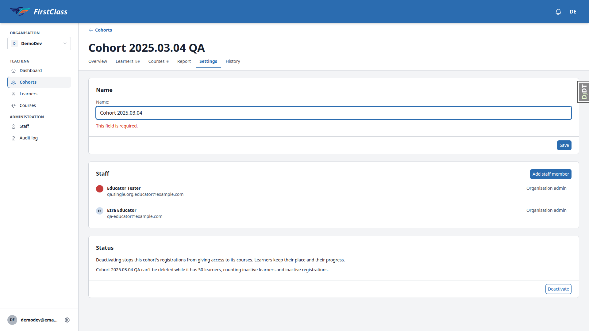 | clean |
| 1 | mobile | `/accounts/profile/personal-details` |  | clean |
| 9 | mobile | `/educator/organisations/demodev/learners/<id>/__tabs/settings` | 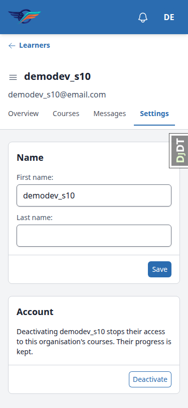 | clean |
| 5.7 | desktop | `/accounts/password/set/` |  | fail: misaligned: header ink starts at x=256, content at x=288 (32px) |
| 5.7 | mobile | `/accounts/password/set/` |  | fail: misaligned: header ink starts at x=0, content at x=16 (16px) |
| 1 | tablet | `/accounts/profile/personal-details` |  | clean |
| 9 | tablet | `/educator/organisations/demodev/cohorts/<id>/__tabs/settings` | 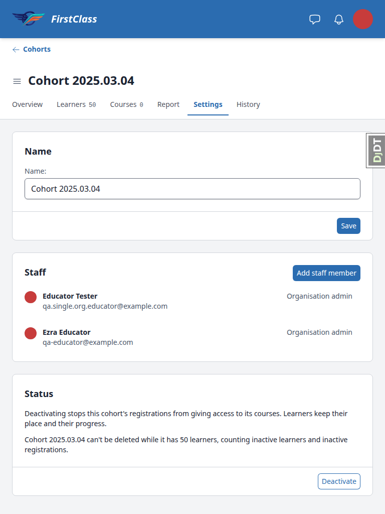 | clean |

## Data changes

| What changed | Made by | Files written |
|---|---|---|
| Created qa-learner@example.com (pk 73, learner, testpass123), qa-educator@example.com (pk 75, organisation_admin on DemoDev, testpass123) and qa-nopassword@example.com (pk 74, unusable password) on the DemoDev site, each with a verified primary email and legal consents; added qa_login_session to mint a session cookie for the no-password user. | `sdd:qa-data-helper` | `freedom_ls/qa_helpers/management/commands/qa_create_account_page_users.py`, `freedom_ls/qa_helpers/management/commands/qa_login_session.py` |

## Bug status

- **FIXED** (commit: 422ace948) — Forgot password? link indented 8px from the Password card's field edge. Re-verified: link text and labels now share x=49 at tablet.
- **UNRESOLVED** — Layout probe flags /accounts/password/set/ (reason: no visible misalignment, since the heading text and the card share a left edge at every viewport. The probe reads the card as content because this allauth page's grey canvas comes from an ancestor, not from its own full-width element as on the educator panel pages. Someone needs to decide whether to restructure the page so the probe passes, or accept the flag.)
- **UNRESOLVED** — targeted run after the fixes left tests failing (reason: freedom_ls/base/tests/invariants/test_app_templates_use_app_components.py::test_app_templates_use_no_content_widget_or_callout_level[accounts/templates/accounts/partials/profile_picture_form.html]: the template uses `c-panel-notice` where the invariant expects `<c-callout>`. The B1 fix did not touch this file. 15443 passed, 1 failed, 1 skipped.)

## General notes

- Test 7.4 was not applicable: the DemoDev signup policy has no extra registration forms.
- No connections, MFA or sessions pages are enabled, so Test 9 covered Personal details, `/accounts/password/set/` and the learner and cohort Settings tabs only. Connections, MFA and sessions URLs return 404, matching the sidebar.
- Tests 2, 4, 6, 7 and 8 ran at desktop only, as the plan marks only Tests 1, 3, 5 and 9 for viewports. Test 4 was also re-checked at mobile and Test 5.7 at mobile.
- Records for tests 2 (in part), 6, 7, 5.6 and 7.3 have no screenshot (`screenshot_path` null).
- The plan's Test 5.6 and 5.7 used the no-password user created by the QA data helper.

status: ok · reason: 2 bugs — 1 fixed, 1 unresolved; targeted run after the fix has 1 failing invariant test; report rendered, screenshots verified
