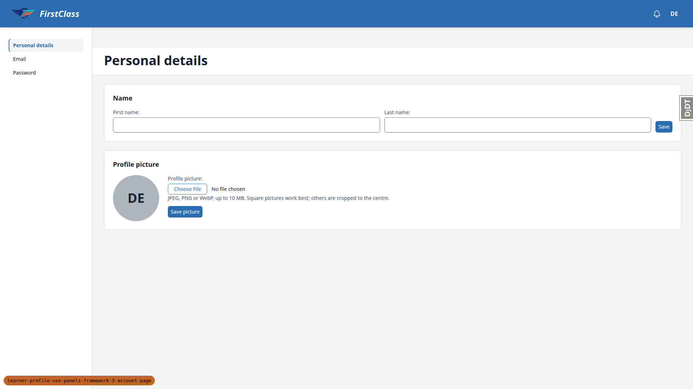
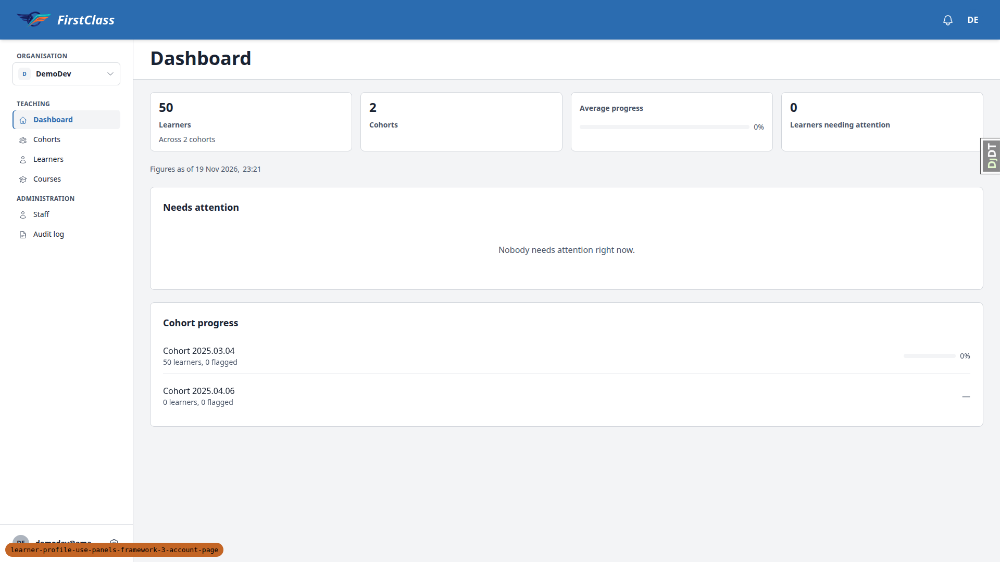
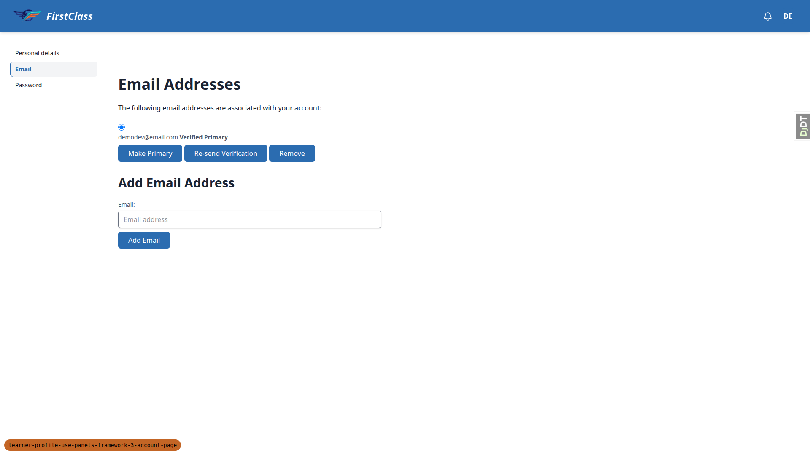
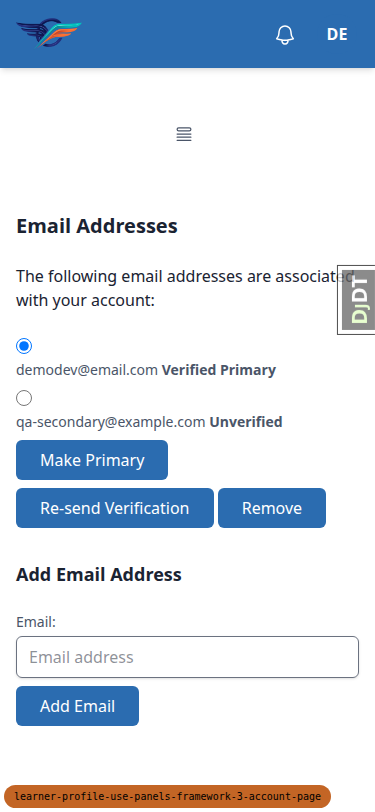
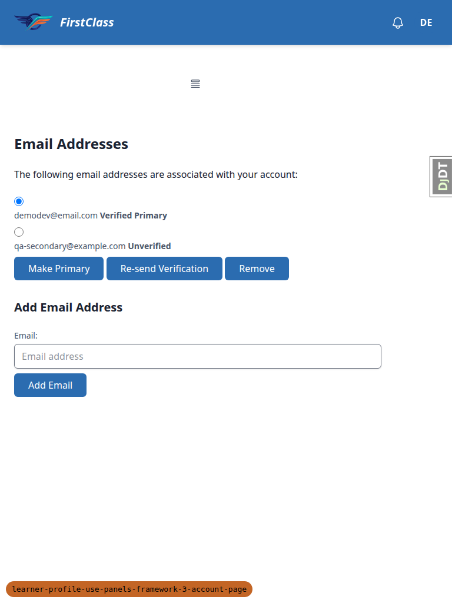
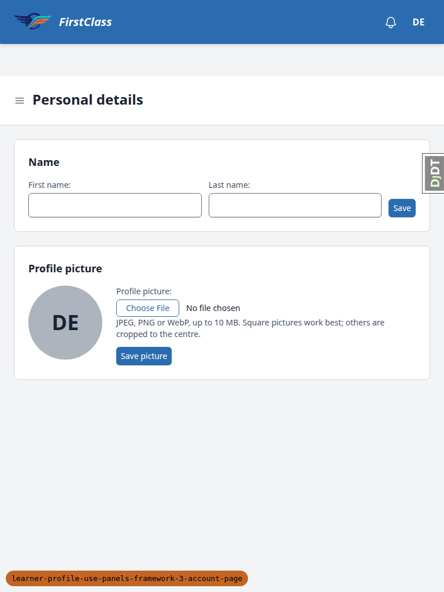
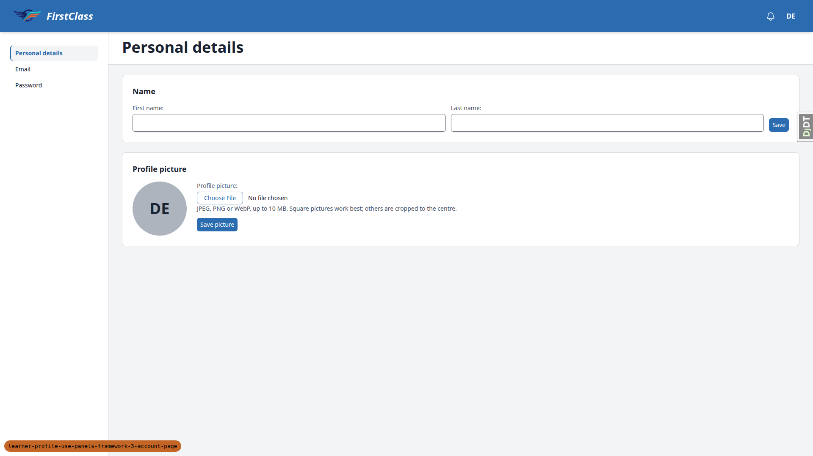
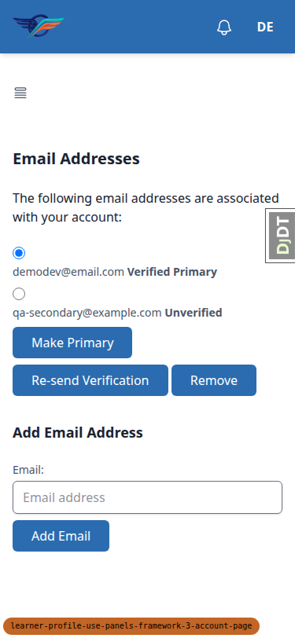

# Frontend QA report: account area on panels

## Methodology

The plan in `3. frontend_qa.md` was run in a browser against the dev server. Desktop (1920x1080) covered every test. Mobile (375x812) and tablet (768x1024) re-ran the tests the plan marks as viewports. Screenshots were collected into `screenshots/` beside this report, and every image linked below exists there. The folder also holds accessibility snapshots (`.yml`) and console logs that no record links to. The smoke gate passed, so no steps were skipped.

## Diff scoping

Class: **FULL**. Changed files that triggered it: `freedom_ls/accounts/**`, `freedom_ls/base/templates/**`, `freedom_ls/panel_framework/templates/panel_framework/partials/inline_record_form.html`, `freedom_ls/educator_interface/tests/playwright/test_learner_page_flow.py`, `freedom_ls/tests/playwright_helpers.py`, `docs/app_structure.md`, `test_organisation/*`.

Skipped: nothing. Everything ran: desktop, mobile and tablet.

## Smoke gate

Outcome: **pass**. Pages loaded: `/` and `/accounts/profile/personal-details`. No failure URL or reason.

## Results summary

Passed: tests 1.1, 1.2-1.5 (functional), 2.1-2.5, 3.1-3.5, 4.1-4.5, 5.2-5.5, 6.1-6.3, 7.1-7.4, 8.1-8.3, mobile 1.4, 3.5 and 4.2.

Failed: six shell layout checks, all from one root cause, bug B1:

- 1.3-shell desktop
- 5.1 desktop
- 1.4 mobile (recorded as a pass; the band is noted in its notes)
- 1.3/3.5 tablet
- 5.6 mobile
- 5.1 tablet

Notes on deviations that are not bugs:

- Test 3.1 (upload): the button reads "Uploading…" rather than the plan's "Saving…". This is the panel-framework rule for a form that sends a file, and the plan's wording predates that rule.
- Test 2.4 (201 characters): the input has `maxlength=200`, so typing is cut at 200 and saved. The 422 path was checked by removing `maxlength`: one red line, `aria-invalid=true`, no toast, header unchanged.
- Test 1.4 (mobile): with the navigation sheet open the layout probe reports stacked/overlap. That is the open modal sheet, drawn the same way in the educator interface.

## Bug B1: Account shell renders an empty content-header band above the page

Manifestations:

- 1.3-shell, desktop
- 1.4, mobile
- 1.3/3.5, tablet
- 5.1, desktop
- 5.6, mobile
- 5.1, tablet

Screenshots:

Personal details, desktop (empty 56px band y 76-132):

Educator panel page for comparison (h1 at y=92 against 168 here):

Email, desktop (h1 at y=180, about 70px below the sidebar's first entry at y=108):

Email, mobile (toggle centred at x=162, h1 at x=16):

Email, tablet (toggle centred at x=310, h1 at x=24):

Personal details, tablet:

**Expected:** Personal details starts its page header band directly under the top bar, like the educator panel pages. The spec says the shell's content_header toggle renders only on pages with no `main_template_name` (allauth pages). allauth pages show the navigation toggle left-aligned with the content below `lg`, and no empty band at desktop where the toggle is hidden.

**Actual:** `accounts/_account_shell.html` keeps `_base_interface.html`'s content_header: a `max-w-7xl mx-auto` wrapper, a header with `pt-4 pb-8 sm:pb-10`, an `lg:hidden` toggle and an empty `#page-title`.

- On Personal details, `account_page.html` only empties `panel_toggle`. That leaves a 56px empty grey band above the header at every width.
- On allauth pages, `manage.html` sets `main_class` to a flex-col. The wrapper shrinks and centres, so the toggle sits centred (x=162 at 375px, x=310 at 768px) above a left-aligned h1. At desktop a 56px empty band pushes the h1 about 70px below the sidebar's first entry.

Functionally the pages work: navigation, aria-current, one toggle, no horizontal scroll.

## Layout probe

| Test id | Viewport | URL | Screenshot | Result |
|---|---|---|---|---|
| 1.1 | desktop | / | [link](screenshots/page-2026-11-19T23-17-45-118Z.png) | clean |
| 1.3 | desktop | /accounts/profile/personal-details | [link](screenshots/page-2026-11-19T23-17-56-359Z.png) | clean |
| 2.2 | desktop | /accounts/profile/personal-details | [link](screenshots/page-2026-11-19T23-18-26-852Z.png) | clean |
| 2.4 | desktop | /accounts/profile/personal-details | [link](screenshots/page-2026-11-19T23-18-56-730Z.png) | clean |
| 3.1 | desktop | /accounts/profile/personal-details | [link](screenshots/page-2026-11-19T23-19-38-375Z.png) | clean |
| 3.3 | desktop | /accounts/profile/personal-details | [link](screenshots/page-2026-11-19T23-19-54-701Z.png) | clean |
| 4.2 | desktop | /accounts/profile/personal-details | [link](screenshots/page-2026-11-19T23-20-24-772Z.png) | clean |
| 4.4 | desktop | /accounts/profile/personal-details | [link](screenshots/page-2026-11-19T23-20-50-012Z.png) | clean |
| 5.1 | desktop | /accounts/email/ | [link](screenshots/page-2026-11-19T23-21-02-566Z.png) | clean (the probe passed, but the empty header band is recorded as B1) |
| 5.3 | desktop | /accounts/password/change/ | [link](screenshots/page-2026-11-19T23-22-12-107Z.png) | clean (same empty band above the h1, B1) |
| 6.3 | desktop | /accounts/reauthenticate/ | [link](screenshots/page-2026-11-19T23-23-07-454Z.png) | clean |
| 8.1 | desktop | /educator/organisations/demodev/learners/&lt;pk&gt;/__tabs/settings | [link](screenshots/page-2026-11-19T23-24-37-213Z.png) | clean |
| 1.4 | mobile | /accounts/profile/personal-details | [link](screenshots/page-2026-11-19T23-25-09-051Z.png) | clean |
| 3.5 | mobile | /accounts/profile/personal-details | [link](screenshots/page-2026-11-19T23-25-45-563Z.png) | clean |
| 4.2 | mobile | /accounts/profile/personal-details | [link](screenshots/page-2026-11-19T23-25-59-582Z.png) | clean |
| 5.6 | mobile | /accounts/email/ | [link](screenshots/page-2026-11-19T23-26-14-833Z.png) | misaligned: header ink starts at x=162, content at x=16 (-146px) (B1) |
| 1.3 | tablet | /accounts/profile/personal-details | [link](screenshots/page-2026-11-19T23-26-33-222Z.png) | clean (probe passed; empty band recorded as B1) |
| 5.1 | tablet | /accounts/email/ | [link](screenshots/page-2026-11-19T23-26-40-787Z.png) | misaligned: header ink starts at x=310, content at x=24 (-286px) (B1) |

## Design check

No design states tested.

## Data changes

| What changed | Agent call or command | Files written |
|---|---|---|
| Re-seeded the emptied dev database (demo sites, cohorts and accounts) | `create_demo_data --yes` | none |
| Created educator `qa.single.org.educator@example.com` / `testpass123` (organisation_admin on DemoDev) | `qa_create_single_org_educator` | none |
| Gave learner `demodev_s2@email.com` an unusable password, for the set-password page | database edit (no command recorded) | none |
| Created learner `demodev_incomplete_reg@email.com` (password = email), then set DemoDev's `SiteSignupPolicy.additional_registration_forms` back to `[]` so other learners are not gated | `qa_create_incomplete_registration_learner` | none |

QA-created state also left behind, recorded in test notes: the secondary address `qa-secondary@example.com` on the QA login (test 5.2). The QA name and picture were restored to their original (blank) state in tests 2.5 and 4.4, and the learner name was restored to `demodev_s10` in 8.3.

## Bug status

| Bug | Title | Status |
|---|---|---|
| B1 | Account shell renders an empty content-header band above the page | **FIXED** (commit: 61b70d7af) |

Re-verified in the browser after the fix: Personal details' header band starts under the top bar (h1 at y=92, as on the educator panel pages) at 1920, 768 and 375 wide. On the Email and Password pages the allauth h1 starts at y=124 at desktop (was 180), and below lg the toggle's icon shares the content's left edge (x=16 at 375, x=24 at 768). The probe still reports a 12px "misaligned" flag there: it measures the toggle's transparent button box (x=4), whose `-ms-3` offsets the padding so the icon lines up.  

## General notes

- No design states, so no design comparison ran.
- The plan's "Saving…" wording for the picture upload (3.1) is out of date. The button says "Uploading…" for file forms under the panel-framework rule. The plan could be updated.
- The 201-character test needs `maxlength` removed in devtools, because the browser blocks that input. The server-side 422 path is the part under test.
- Test 4.5 (side effect: remove from tab one, confirm in tab two) answered 200 with no error page and the picture stayed removed.
- Screenshot `page-2026-11-19T23-25-00-000Z.png` (test 8.3) has no layout record. It is linked from the test record only.

status: ok · reason: 1 bug — 1 fixed, 0 unresolved; report rendered, screenshots verified
