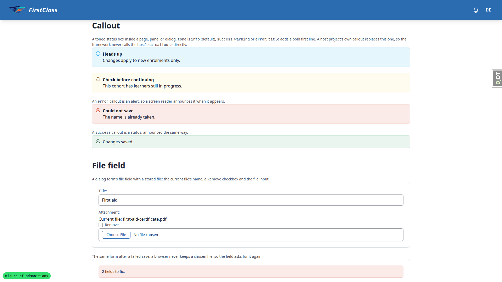
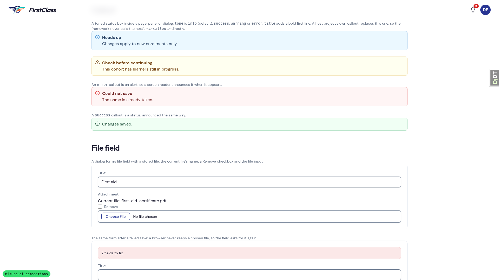
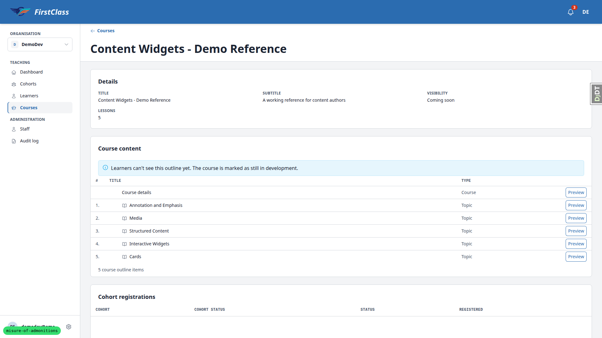

# QA report: misure-of-admonitions

## Methodology

Manual Playwright MCP run against a dev server on port 8383, using the default theme. Test 9 used a rebuild with `FLS_THEME=first_class`. Screenshots were collected into `screenshots/` beside this report, and every image referenced below exists there. The QA plan is `3. frontend_qa.md`.

## Diff scoping

- Class: FULL.
- Triggering files: `templates/*.html` across base, course_applications, educator_interface, form_engine, learner_interface and panel_framework; `tailwind.components.css`; `themes/*/theme.css`.
- Nothing was skipped by scoping.
- Mobile and tablet were checked by measurement on a subset of pages (Tests 1, 3.3, 4.2, 7.3 and 8), not for every test.

## Smoke gate

Status: pass. Pages checked: `/` and `/panel-framework/components/`. No failure URL or reason.

## Design check

No design states tested.

## B1: Reference page: explanatory line touches the callout below it

Manifestations:
- Test 8, desktop
- Test 9, desktop (first_class theme)

- Expected: visible space between each callout and its neighbours (QA checklist). The short explanatory line above the info, error and success examples sits clear of the box.
- Actual: in `panel_framework/reference/_examples.html`, each `#callout-<tone>` wrapper div stacks a `
` directly on the callout with no spacing class. The line and the box touch (0px gap) for info, error and success.

## B2: Course content panel: in-development callout touches the outline table

Manifestations:
- Test 5, desktop

- Expected: the "Learners can't see this outline yet" info callout sits inside the panel's padding with space below it (QA plan Test 5).
- Actual: `educator_interface/panels/course_content.html` wraps the callout in `px-4 pt-4 sm:px-6` with no bottom padding. The callout's bottom edge meets the data table's header row (0px gap: callout bottom 562px, table top 562px).

## Layout probe

| Test | Viewport | URL | Screenshot | Result |
|---|---|---|---|---|
| 1 | desktop | /accounts/login/ | [shot](screenshots/page-2026-11-19T14-13-13-326Z.png) | clean |
| 1 | mobile | /accounts/login/ | [shot](screenshots/page-2026-11-19T14-13-28-269Z.png) | clean |
| 1 | tablet | /accounts/login/ | measured only | clean |
| 8 | desktop | /panel-framework/components/ | [shot](screenshots/page-2026-11-19T14-14-00-868Z.png) | clean |
| 8 | mobile | /panel-framework/components/ | measured only | clean |
| 8 | tablet | /panel-framework/components/ | [shot](screenshots/page-2026-11-19T14-14-21-380Z.png) | clean |
| 7.2 | desktop | /educator/organisations/demodev/learners/import/ | [shot](screenshots/page-2026-11-19T14-15-30-910Z.png) | clean |
| 7.3 | desktop | /educator/organisations/demodev/learners/import/<id>/ | [shot](screenshots/page-2026-11-19T14-15-48-214Z.png) | clean |
| 7.3 | tablet | /educator/organisations/demodev/learners/import/<id>/ | [shot](screenshots/page-2026-11-19T14-15-58-146Z.png) | clean |
| 7.3 | mobile | /educator/organisations/demodev/learners/import/<id>/ | measured only | clean |
| 2 | desktop | /applications/application/<id>/page/1/ | [shot](screenshots/page-2026-11-19T14-16-36-053Z.png) | clean |
| 3.4 | desktop | /applications/application/<id>/page/1/ | [shot](screenshots/page-2026-11-19T14-18-25-855Z.png) | clean |
| 3.3 | mobile | /applications/application/<id>/check-your-answers/ | [shot](screenshots/page-2026-11-19T14-18-34-012Z.png) | clean |
| 3.1 | desktop | /applications/apply/functionality-demo-application-gated-course/your-details/ | [shot](screenshots/page-anon-details-1795097947130.png) | clean |
| 5 | desktop | /educator/organisations/demodev/courses/8bc127c1-edf1-4997-b7fc-35fdf8604f30 | [shot](screenshots/page-2026-11-19T14-21-19-120Z.png) | clean |
| 10.1 | desktop | .../courses/8bc127c1-.../__panels/content/__actions/preview_content | [shot](screenshots/page-2026-11-19T14-21-00-043Z.png) | clean |
| 10.2 | desktop | /accounts/profile/ | [shot](screenshots/page-2026-11-19T14-22-22-197Z.png) | clean |
| 6.7 | desktop | /educator/organisations/demodev/learners (Add learner dialog) | [shot](screenshots/page-2026-11-19T14-23-00-196Z.png) | clean |
| 4.1 | desktop | /courses/functionality-demo-course-parts/detail/ | [shot](screenshots/page-2026-11-19T14-23-26-601Z.png) | clean |
| 4.2 | mobile | /courses/functionality-demo-show-end-with-topic/detail/ | [shot](screenshots/page-2026-11-19T14-23-35-089Z.png) | clean |
| 7.4 | desktop | /educator/organisations/qa-solo-org/staff | [shot](screenshots/page-2026-11-19T14-23-52-194Z.png) | clean |
| 6.2 | desktop | /educator/organisations/qa-solo-org/staff (Deactivate role dialog) | [shot](screenshots/page-2026-11-19T14-24-37-346Z.png) | clean |
| 6.3 | desktop | /educator/organisations/demodev/cohorts/<QA Delete Cascade>/__tabs/settings (Delete dialog) | [shot](screenshots/page-2026-11-19T14-25-54-993Z.png) | clean |
| 6.4 | desktop | Delete dialog for Cohort 2025.03.04 (50 learners) | [shot](screenshots/page-2026-11-19T14-26-17-198Z.png) | clean |
| 9 | desktop | /panel-framework/components/ (first_class theme) | [shot](screenshots/page-2026-11-19T14-29-22-311Z.png) | clean |

## Data changes

| What | Via | Files |
|---|---|---|
| Set `table_of_contents_in_development=True` on "Content Widgets - Demo Reference" (and further scenarios, see the helper's report) | sdd:qa-data-helper | none |
| New idempotent command `qa_create_admonition_scenarios`: Content Widgets course marked in development; demodev made a DemoDev learner with a paused course (Course Parts), an ended access (show end with Topic) and a quiz course; org "QA Solo Org" with demodev as only staff/admin; cohorts QA Delete Cascade/Blocked; learner Morgan Mover with QA Move Source/Destination cohorts | sdd:qa-data-helper | `freedom_ls/qa_helpers/management/commands/qa_create_admonition_scenarios.py`, `freedom_ls/qa_helpers/tests/management/commands/test_qa_create_admonition_scenarios.py` |
| Added learner qa-callout-add-1795098174531@example.com to DemoDev; imported nothing (Test 7.3 preview was not confirmed) | manual (Add learner dialog during Test 6.7) | none |

## Test results

| Test | Viewport | Status | Notes | Screenshot |
|---|---|---|---|---|
| 1 | desktop | pass | Info callout "New here?" with icon, bold 16px title, 16px on-surface body, 1px border, 6px radius, button inside, 12px gap below the error sentence. | [shot](screenshots/page-2026-11-19T14-13-13-326Z.png) |
| 1 | mobile | pass | Callout 343px wide in a 375px viewport, no sideways scroll. | [shot](screenshots/page-2026-11-19T14-13-28-269Z.png) |
| 1 | tablet | pass | Measured only: callout 416px, document scrollWidth equals viewport. | measured only |
| 8 | desktop | fail | Info, warning, error and success in order, each with its own icon and role (error=alert, success=status). No Notice section. The `<c-callout>` in the intro is intentional escaped sample text. FAIL: the explanatory line above the info, error and success examples touches the callout (0px gap). See B1. | [shot](screenshots/page-2026-11-19T14-14-00-868Z.png) |
| 8 | tablet | pass | Callouts span the container (24-744px), no sideways scroll. Mobile measured 16-359px, no sideways scroll. | [shot](screenshots/page-2026-11-19T14-14-21-380Z.png) |
| 7.2 | desktop | pass | Empty file upload: error callout "The file could not be uploaded." role=alert, focused on load, bulleted list indented inside the box, 16px text. The only console entry is the expected 422 resource line. | [shot](screenshots/page-2026-11-19T14-15-30-910Z.png) |
| 7.3 | desktop | pass | CSV with 3 bad rows: warning callout "3 rows with errors will not be added." above the row errors. Buttons and table are inside the box. | [shot](screenshots/page-2026-11-19T14-15-48-214Z.png) |
| 7.3 | tablet | pass | Callout spans the container, no sideways scroll. Mobile measured 16-359px, scrollWidth 375. | [shot](screenshots/page-2026-11-19T14-15-58-146Z.png) |
| 2 | desktop | pass | Exercised on the application form (same form_engine answer_errors partial). "Missing answers" error callout has role=alert on the callout itself (data-testid required-answers-error) and is the only visible alert region. 24px space above and below. "Invalid answers" callout appears for an invalid email. Valid answers clear the callouts. | [shot](screenshots/page-2026-11-19T14-16-36-053Z.png) |
| 3.4 | desktop | pass | Submitted application's form page shows an info callout "This application has been submitted and can no longer be changed.", 24px spacing. | [shot](screenshots/page-2026-11-19T14-18-25-855Z.png) |
| 3.3 | desktop | pass | Check-your-answers after submit: success callout role=status, dark green icon, then the "Your application" button 24px below. | none |
| 3.3 | mobile | pass | Success callout 16-359px, no sideways scroll. Tablet measured 24-744px, clean probe. | [shot](screenshots/page-2026-11-19T14-18-34-012Z.png) |
| 3.1 | desktop | pass | Anonymous applicant, honeypot filled to force a form-level error: error callout "We couldn't use those details", role=alert and data-testid=details-errors on the callout itself, the only visible alert region. | [shot](screenshots/page-anon-details-1795097947130.png) |
| 5 | desktop | fail | Info callout "Learners can't see this outline yet..." renders inside the panel padding, 16px below the "Course content" header. Its bottom edge touches the data table header row (0px gap). The wrapper has no bottom padding. See B2. | [shot](screenshots/page-2026-11-19T14-21-19-120Z.png) |
| 5.3 | desktop | pass | The nine other DemoDev courses (not in development) show no callout on their educator course page. | none |
| 10.1 | desktop | pass | Admonitions in the Interactive Widgets preview keep the content-engine component (role=note, rounded-lg tinted box, no .callout class). content_engine is unchanged by this branch. See General notes. | [shot](screenshots/page-2026-11-19T14-21-00-043Z.png) |
| 10.2 | desktop | pass | Saving the profile shows the "Profile saved" toast in a position:fixed region, bottom right, with a dismiss button. It is not a callout. | [shot](screenshots/page-2026-11-19T14-22-22-197Z.png) |
| 10.3 | desktop | skip | Not driven in the browser: no demo content contains `<c-callout>`, and authoring content is outside this QA run. Markdown sanitising is covered by the content_engine tests. | none |
| 6.7 | desktop | pass | "Add and add another" shows a success callout (role=status) above the fields, 14px text matching the dialog's labels, 16px gap to the fields. | [shot](screenshots/page-2026-11-19T14-23-00-196Z.png) |
| 4.1 | desktop | pass | Paused registration: info callout "Your educator paused this course. It resumes on 3 Dec 2026..." in the enrolment card, 16px above and below. | [shot](screenshots/page-2026-11-19T14-23-26-601Z.png) |
| 4.2 | desktop | pass | Ended access: warning callout "Your access to this course ended on ...", dark amber icon, 16px above and below. | none |
| 4.2 | mobile | pass | Warning callout fits the card (41-334px), no sideways scroll. | [shot](screenshots/page-2026-11-19T14-23-35-089Z.png) |
| 4.3 | desktop | pass | Price: fixed course detail shows no callout. | none |
| 4.4 | desktop | pass | Closed-topic notice covered by `test_the_closed_notice_is_not_a_callout`. The demo has no closed topic, so the browser step was skipped as the plan allows. | none |
| 7.4 | desktop | pass | Only staff member: info callout above the staff table, 24px below the page header and clear of the table. | [shot](screenshots/page-2026-11-19T14-23-52-194Z.png) |
| 6.2 | desktop | pass | Only-admin warning callout in the Deactivate role dialog, 14px text, dark amber icon, 16px above and below. Dialog cancelled. | [shot](screenshots/page-2026-11-19T14-24-37-346Z.png) |
| 6.3 | desktop | pass | Cascade delete: error callout titled "This will also delete:" with a disc list indented inside the box, 14px dialog text. Cancelled. | [shot](screenshots/page-2026-11-19T14-25-54-993Z.png) |
| 6.4 | desktop | pass | Blocked delete opened in the real modal by pointing a Delete trigger at the 50-learner cohort's delete action (the app hides Delete on non-empty cohorts). Error callout role=alert holds the reason, data-error-summary and tabindex=-1 kept, no confirm button. On this GET open focus starts on Cancel. The focus-on-callout behaviour belongs to the 422 race path, whose attributes are unchanged from main and were not driven. | [shot](screenshots/page-2026-11-19T14-26-17-198Z.png) |
| 6.5 | desktop | skip | The refused move needs a two-tab race. A second-tab move hit the "no longer in QA Move Source" branch instead of the refusal callout. The move_confirmation template only swapped c-panel-notice for c-callout with attributes unchanged. | none |
| 6.6 | desktop | skip | Bulk Deactivate of 2 and of all 53 learners showed no warning: the warning callout needs a "notice" the demo data does not produce. | none |
| 6.1 | desktop | skip | Change role with an invalid choice needs a forged POST. | none |
| 6.8 | desktop | skip | Inline record forms only raise field errors with demo data, so no form-level error is reachable. | none |
| 7.1 | desktop | pass | DemoDev dashboard shows no excluded-data or too-large region, so no callout is expected and none renders. | none |
| 9 | desktop | pass | FLS_THEME=first_class build: every tone, warning included, takes first_class's light tint and darker tone text (info rgb(235,248,255)/rgb(42,67,101), warning rgb(255,255,240)/rgb(116,66,16), error rgb(255,245,245)/rgb(116,42,42), success rgb(240,255,244)/rgb(34,84,61)). All readable, none unstyled. Only the reference page was revisited; the B1 spacing bug shows here too. | [shot](screenshots/page-2026-11-19T14-29-22-311Z.png) |

## Bug status

| Bug | Status |
|---|---|
| B1 | **FIXED** (commit: a22b1b302) — Reference page: explanatory line touches the callout below it. Re-verified in the browser: 8px between each line and its callout ([screenshot](screenshots/page-2026-11-19T14-44-35-159Z.png)) |
| — | **FIXED** (commit: 75d3e9a9e) — full run after the fixes left tests failing: `test_quick_view_flow.py::test_unsent_draft_asks_before_the_drawer_is_left` was flaky. It read the discard prompt's heading and body edges in two separate calls while the drawer slid in; both are now read in one script run. 8 consecutive isolated passes after the fix |
| B2 | **FIXED** (commit: a4f361c91) — Course content panel: in-development callout touches the outline table. Re-verified in the browser: 16px between the callout and the table ([screenshot](screenshots/page-2026-11-19T14-55-54-176Z.png)) |

## General notes

- Skipped tests: 6.1 (needs a forged POST), 6.5 (needs a two-tab race), 6.6 (demo data produces no bulk-confirmation notice), 6.8 (no form-level error reachable with demo data), 10.3 (no demo content contains `<c-callout>`; sanitising is covered by content_engine tests).
- Test 10.1: the QA plan's "left stripe and larger title" wording for admonitions is out of date versus main. content_engine is unchanged on this branch (git diff empty), so this is not a regression.
- The only console errors were expected 422 resource lines from validation responses.
- The qa-data-helper also added `reference_admonition_scenarios_command.md` under `.claude/agent-memory/sdd-qa-data-helper/` and indexed it in that folder's `MEMORY.md`. The folder is tracked in the repo and already holds earlier QA runs' entries, so these are committed with the QA artifacts.

status: ok · reason: 2 bugs and 1 test failure — 3 fixed, 0 unresolved; report rendered, screenshots verified
