# QA report: admin CSV exports for users and course applications

## Methodology

Run on 2026-10-28 against a dev server on port 8121 on branch `more_lead_admin_exports`, rebased onto main first; the full pytest tier passed (9872 tests). Playwright MCP was driven by hand. CSV files were read either as real browser downloads (the two "Export selected" actions) or by fetching the export URL with the signed-in session's cookies. Screenshots were collected into `screenshots/` beside this report and every referenced image exists there. Seed data: demo content, `create_demo_data`, `qa_create_application_review_accounts`, `qa_create_application_docs_scenario`, three qa-data-helper commands (edge users, second form course, forty bulk applications), and three applications created through the UI (submitted, draft, anonymous).

## Diff scoping

Class: FULL. Reason: rule 4, the diff also carries spec_dd markdown files, so no narrower class matched. Nothing was skipped: desktop, mobile and tablet all ran. The code change itself is admin-only Python, so the mobile and tablet passes cover the admin changelists at those widths.

Changed code files (plus the spec_dd documents):

- `freedom_ls/accounts/admin.py`
- `freedom_ls/accounts/resources.py`
- `freedom_ls/accounts/tests/test_admin.py`
- `freedom_ls/accounts/tests/test_resources.py`
- `freedom_ls/course_applications/admin.py`
- `freedom_ls/course_applications/models.py`
- `freedom_ls/course_applications/resources.py`
- `freedom_ls/course_applications/tests/test_admin.py`
- `freedom_ls/course_applications/tests/test_models.py`
- `freedom_ls/course_applications/tests/test_resources.py`
- `freedom_ls/form_engine/enums.py`
- `freedom_ls/form_engine/exports.py`
- `freedom_ls/form_engine/queries.py`
- `freedom_ls/form_engine/tests/test_exports.py`
- `freedom_ls/form_engine/tests/test_queries.py`
- `freedom_ls/site_aware_models/admin_exports.py`
- `freedom_ls/site_aware_models/tests/test_admin_exports.py`

## Smoke gate

Status: pass. Pages checked: `http://127.0.0.1:8121/` and `http://127.0.0.1:8121/admin/freedom_ls_accounts/user/`. No failure.

## Results by section

### §1 The Users export

| Test | Viewport | Status | Screenshot | Notes |
|---|---|---|---|---|
| 1.1 | desktop | pass | 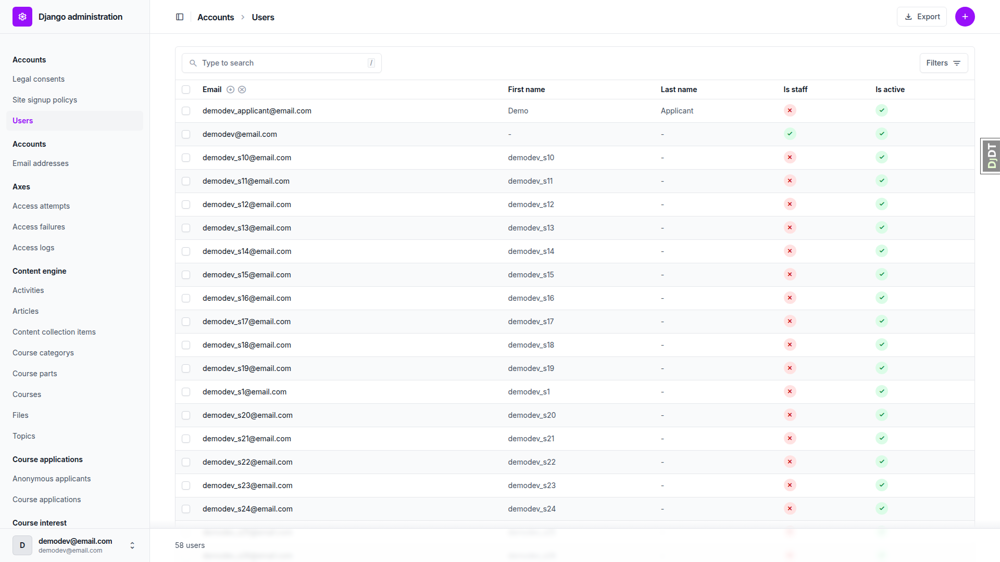 | Users changelist shows the Export button (links to /export/?) and the 'Export selected users' action beside 'Delete selected users'; columns Email, First name, Last name, Is staff, Is active; filters by is staff / is superuser / is active; the Add (+) link still present. Change page 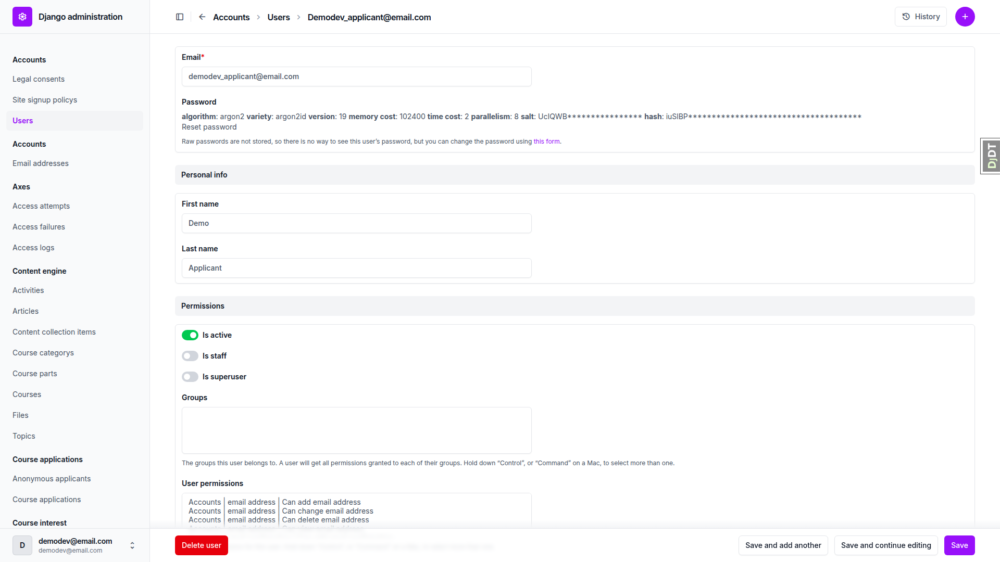 has no export control and keeps the fieldsets Email/password, Personal info, Permissions, Important dates and the Legal consents inline. |
| 1.2 | desktop | pass | — | GET /admin/freedom_ls_accounts/user/export/ returns 200 text/csv, attachment User-2026-10-28.csv, UTF-8 BOM present. Header exactly `id,email,first_name,last_name,is_active,is_staff,email_verified,created_at,last_login`. 58 rows = 58 users on the changelist. is_active/is_staff only TRUE/FALSE. created_at/last_login ISO 8601 with +00:00 offset; last_login empty for qa_nobody (never signed in). email_verified TRUE for demodev@email.com and Mixed.Case@example.com, FALSE for unverified@example.com. No hit for password, pbkdf2, argon2, is_superuser, groups or site. |
| 1.3 | desktop | pass | 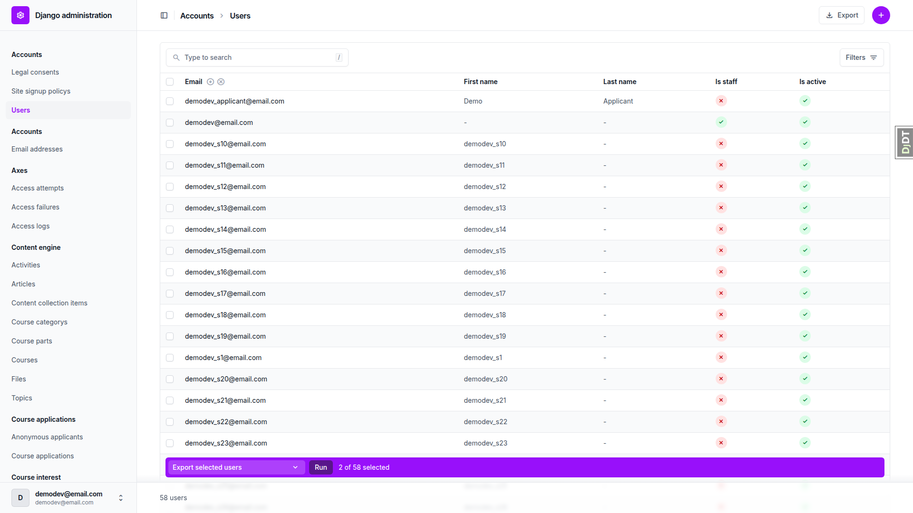 | Staff filter: Export href carries ?is_staff__exact=1 and the file holds only demodev@email.com, qa_nobody@email.com, qa_reviewer@email.com 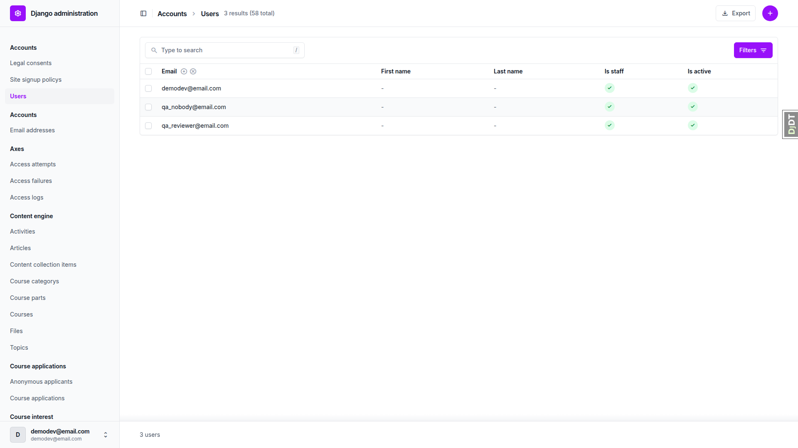. Ticking qa_applicant and qa_bystander, choosing 'Export selected users' and pressing Run downloaded User-2026-10-28.csv with exactly those two rows. Search q=qa_applicant: Export href carries the q and the file has one row. |
| 1.1 | mobile | pass | 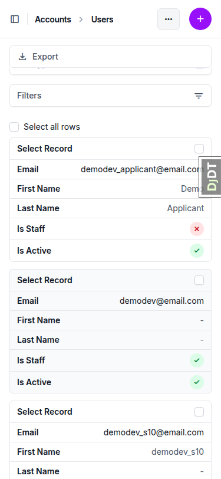 | At 375px the Users changelist stacks each row as a card, no horizontal scroll (scrollWidth 375). The toolbar collapses into a '...' menu; opening it shows the full-width Export link (341x36 px). Ticking a row reveals the sticky action bar at the bottom with 'Select action' 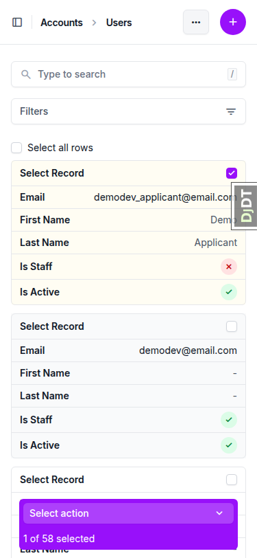. No console errors. |
| 1.1 | tablet | pass | 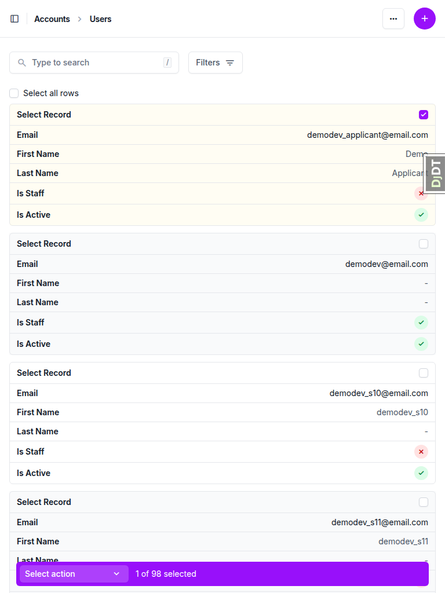 | At 768px the sidebar is collapsed behind the dock icon, the Users list still renders as stacked cards within the 768px width (no horizontal scroll), the search box and Filters button sit side by side, and the sticky action bar appears on selection. No console errors. |

### §2 The Course applications export

| Test | Viewport | Status | Screenshot | Notes |
|---|---|---|---|---|
| 2.1 | desktop | pass |  | Course applications changelist shows the Export button and the single action 'Export selected course applications'; no Add link and no 'Delete selected' action. The submitted application's change page (full page) 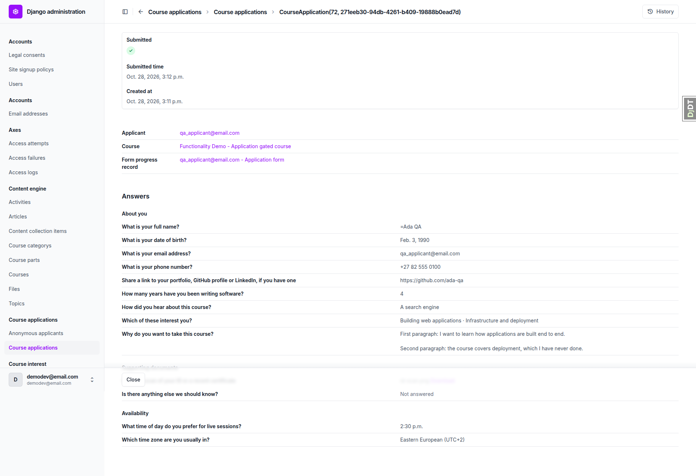 opens in view mode with the Answers document: page headings About you, Supporting documents, Availability, each question with its answer and one 'Not answered'; no export control, no save buttons. Submitted time column shows a time for the submitted and anonymous rows, '-' for the draft, and the created time for the no-form row. |
| 2.2 | desktop | pass | — | Whole-list export: 200 text/csv, BOM present. Header = 8 fixed columns in the exact order, then the 13 demo-form question texts in form order (9 About you, 2 Supporting documents, 2 Availability); 21 columns, nothing else. 4 data rows. Submitted row: TRUE/TRUE, course title, ISO submitted_time, full name `'=Ada QA`, DOB 1990-02-03, years 4, 'A search engine', 'Building web applications; Infrastructure and deployment', the two-paragraph answer inside one quoted cell with its line break, id-scan.png, empty 'anything else', 14:30, 'Eastern European (UTC+2)'. Draft row: FALSE, empty submitted_time, 'Bea Draft', every other answer empty. Anonymous row: Cass Anon, is_email_verified FALSE, is_submitted TRUE. No-form row: submitted_time equals created_at, all answers empty. No user_uploads, form_answers, .jpg, .jpeg or site; 'http' only in the portfolio URL; no storage key. Deviations from the plan's data, not the code: the anonymous row carries 8 answers rather than 2 because the form refuses to submit with required questions unanswered, so id-scan.png appears twice (one per upload). Observation: the phone answer '+27 82 555 0100' is exported as `'+27 82 555 0100` since a leading + is formula-escaped like =. |
| 2.3 | desktop | pass |  | submitted=draft: Export href carries the filter, file has only qa_bystander. submitted=submitted: anon, qa_applicant, demodev_applicant. course filter on the no-form course (course__id__exact): only demodev_applicant and the header stops at the 8 fixed columns (no answer columns). email_verified=unverified: only the anonymous row. Ticking the submitted and draft rows and running 'Export selected course applications' 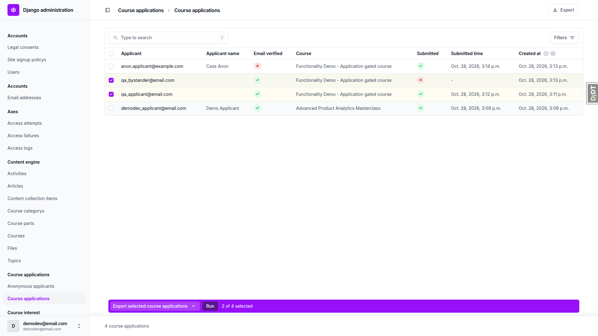 downloaded CourseApplication-2026-10-28.csv with exactly those two rows, BOM present. |
| 2.4 | desktop | pass | 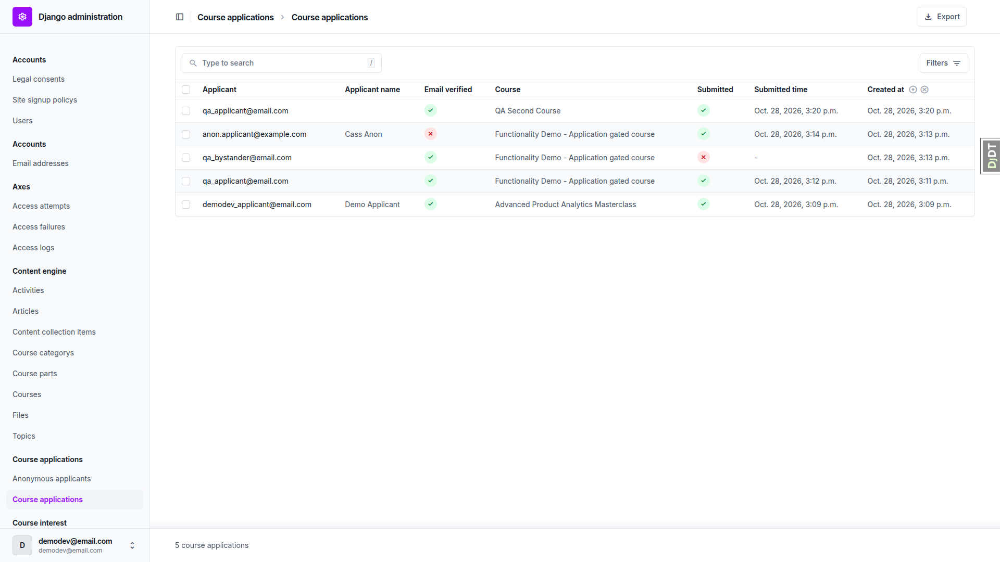 | After seeding 'QA Second Course' with the one-page 'Second form' (What is your full name?, Favourite colour) and a submitted application by qa_applicant answering Ada Again / Teal: the export has 23 columns, the 13 demo-form columns first, then the two second-form columns. The duplicated question text is disambiguated as 'What is your full name? (Application form)' (column 9) and 'What is your full name? (Second form)' (column 22); 'Favourite colour' keeps its bare header. The new row is empty under every demo-form column and reads Ada Again / Teal under the second form; the four earlier rows are empty under both second-form columns. |
| 2.1 | mobile | pass | 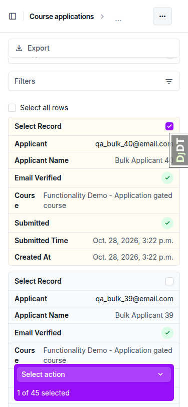 | At 375px the Course applications changelist stacks rows as cards with the Submitted / Submitted time / Created at fields readable 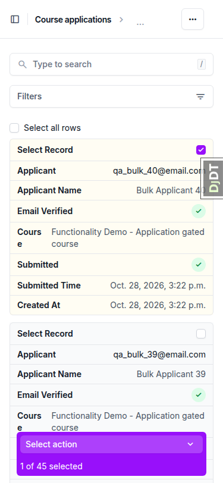; the '...' menu exposes Export; the action bar offers only 'Export selected course applications'. No horizontal overflow, no console errors. |
| 2.1 | tablet | pass | 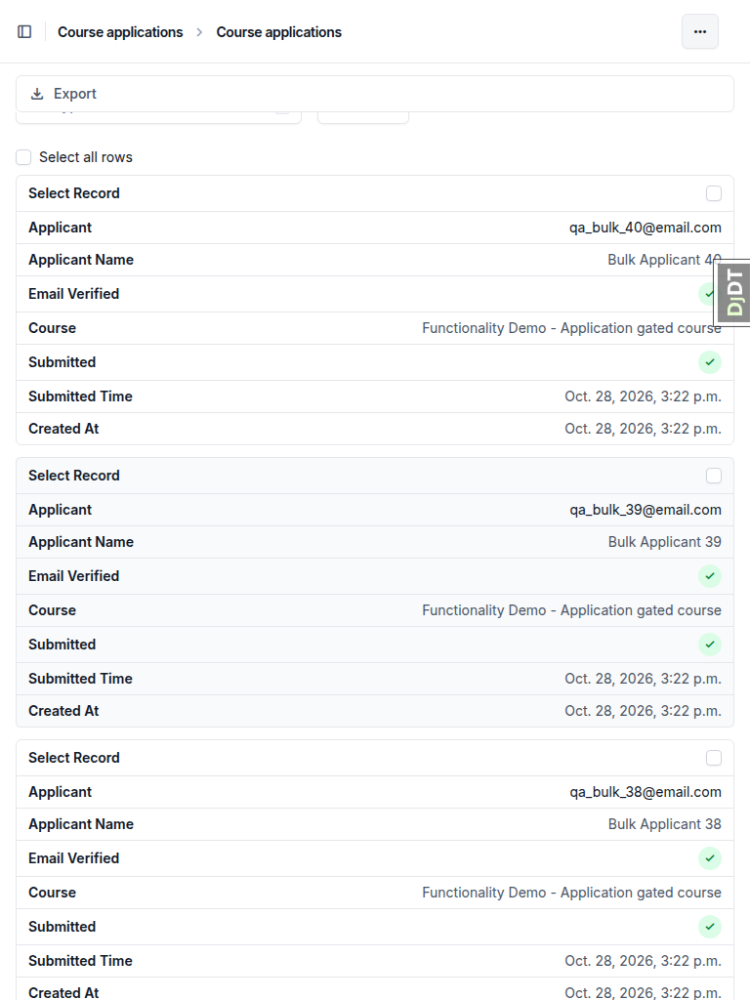 | At 768px the Course applications list 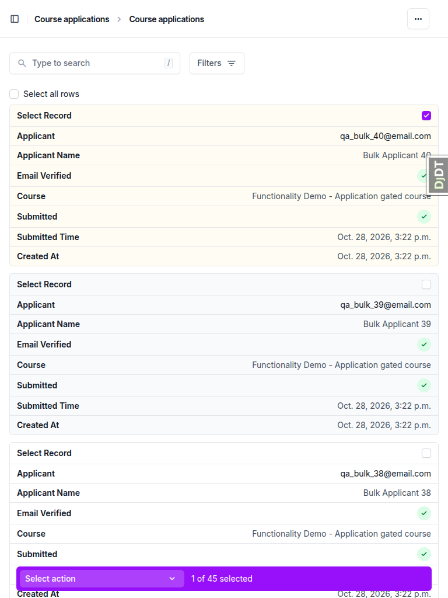 and its '...' menu with the full-width Export link render without overflow; the application change page 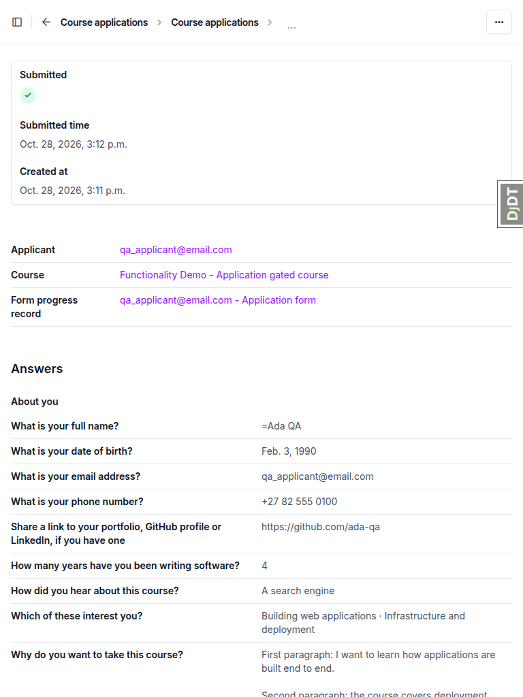 keeps the Answers document with its three page headings and 'Not answered'. No console errors. |

### §3 Permissions

| Test | Viewport | Status | Screenshot | Notes |
|---|---|---|---|---|
| 3.1 | desktop | pass |  | qa_reviewer's admin index  lists Course applications, Form progress records, Question answers and Question answer files, and no Users. The applications changelist shows the Export button and the action; the export downloads the same shape as 2.2 with the answer columns (by then 23 columns: 8 fixed + 13 demo form + 2 second form). GET users export: 403 . GET users changelist: 403. |
| 3.2 | desktop | pass |  | qa_nobody (staff, no permissions) sees 'You don't have permission to view or edit anything' on the admin index. Users export: 403. Course applications export: 403. Users export with ?is_staff__exact=1: 403. |
| 3.3 | desktop | pass |  | Signed out, the users export URL redirects to /admin/login/?next=/admin/freedom_ls_accounts/user/export/ and renders the login form, not a file. |

### §4 Side effects elsewhere

| Test | Viewport | Status | Screenshot | Notes |
|---|---|---|---|---|
| 4.1 | desktop | pass | 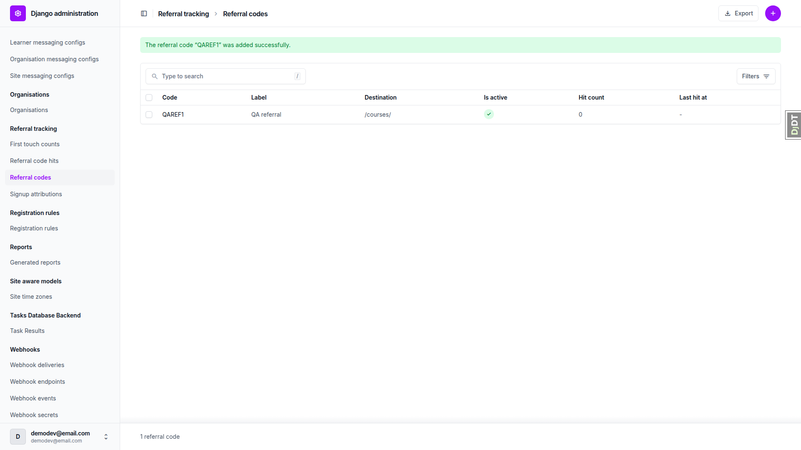 | Referral code list was empty; created QAREF1 through the admin add page. Export returns the same header as before (`id,code,label,notes,destination,inactive_destination,is_active,hit_count,last_hit_at,created_at`) and is_active reads 1, not TRUE: the referral resource is untouched by the new boolean widget. |
| 4.2 | desktop | pass |  | As qa_applicant the application status page 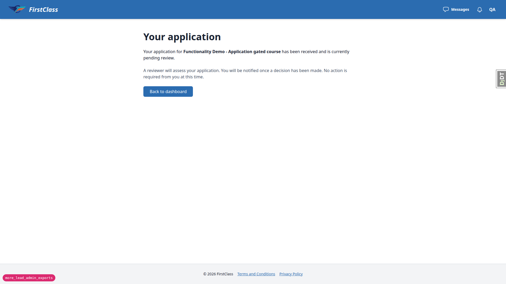 renders 'Your application … pending review' as before, and Check your answers is still reachable and lists all thirteen answers in page order with the same values the export carries (=Ada QA, Feb. 3, 1990, …, 'Not answered' for the blank one, 2:30 p.m., Eastern European (UTC+2)). |
| 4.3 | desktop | pass |  | Anonymous applicants changelist lists Cass Anon once, has no Export button and only the 'Delete selected anonymous applicants' action. Anonymous applicants are not exported a second time. |
| 4.4 | desktop | pass | 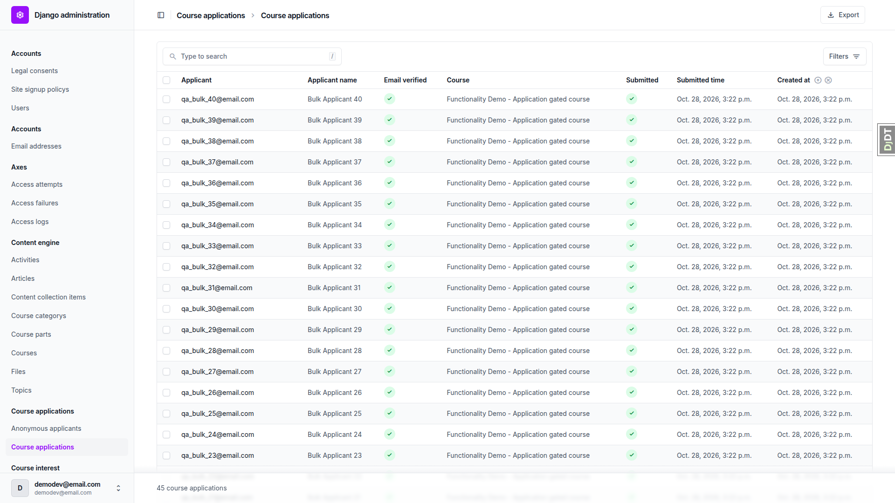 | After seeding forty bulk applicants (qa_bulk_01..40, each answering full name and date of birth) the changelist shows 45 course applications and the whole-list export returns 45 rows with the same 23-column header as 2.4, every row with 23 cells, all forty bulk rows is_submitted TRUE with only the name and DOB cells filled. The download took about 145 ms (11.8 KB). |

## Design check

no design states tested

## Bugs

No test failed and no bug records were raised.

## Bug status

No bugs. Every test passed.

## General notes

- The anonymous application carries 8 answers, not 2, because the apply flow refuses to submit with required questions blank. This is a test-data limitation, not a defect, so `id-scan.png` appears twice in the file.
- The phone answer is exported with a leading apostrophe (`'+27 82 555 0100`) because a leading `+` is formula-escaped like `=`. This is expected CSV-safety behaviour, noted for anyone reading the sheet.
- The time question on the demo form has a 17:00 maximum, so 14:30 was used.
- The "Applicant name" column is blank for QA users who have no first/last name, as expected.
- On phone and tablet widths Unfold collapses the changelist toolbar into a "..." menu that holds the Export link, and shows the action bar only once a row is ticked. This is Unfold's standard behaviour.
- The three qa-data-helper management commands written this run (`qa_create_export_edge_users`, `qa_create_second_application_form_course`, `qa_create_bulk_applications`) are left untracked in `freedom_ls/qa_helpers/management/commands/` for the human to keep or drop.
- A referral code `QAREF1` was created in the dev DB for §4.1.

status: ok
reason: report rendered, 0 bugs documented, 33 screenshots verified
