# QA report: admin CSV exports for users and course applications

## Methodology

- Run on 2026-10-29 against a dev server on port 8009, on branch `more_lead_admin_exports`, rebased onto main first. Main had only gained spec files, targeted test selection said no tests needed running, and pre-commit was clean.
- Playwright MCP driven by hand at 1920x1080 (desktop), 375x812 (mobile) and 768x1024 (tablet).
- CSV files were read either as real browser downloads (the two "Export selected" actions) or by fetching the export URL inside the signed-in browser session and reading the body. BOMs were checked on raw bytes.
- Seed data: the dev database was content-reset first (the previous run's 45 applications would have broken the plan's exact row counts), then demo content, `qa_create_application_review_accounts`, `qa_create_export_edge_users`, `qa_create_application_docs_scenario`, and three applications created through the UI (submitted, draft, anonymous). `qa_create_second_application_form_course` ran before §2.4 and `qa_create_bulk_applications` before §4.4.
- Screenshots were collected into `screenshots/` beside this report, and every referenced image exists there.
- Nothing aborted; every step ran.

## Diff scoping

- Class: **FULL**.
- Reason: rule 4. The diff also carries spec_dd markdown and PNG files, so no narrower class matched.
- Changed code files:
  - `docs/product/admin-interface.md`
  - `freedom_ls/accounts/admin.py`
  - `freedom_ls/accounts/resources.py`
  - `freedom_ls/accounts/tests/test_admin.py`
  - `freedom_ls/accounts/tests/test_resources.py`
  - `freedom_ls/course_applications/admin.py`
  - `freedom_ls/course_applications/models.py`
  - `freedom_ls/course_applications/resources.py`
  - `freedom_ls/course_applications/tests/test_admin.py`
  - `freedom_ls/course_applications/tests/test_models.py`
  - `freedom_ls/course_applications/tests/test_resources.py`
  - `freedom_ls/form_engine/enums.py`
  - `freedom_ls/form_engine/exports.py`
  - `freedom_ls/form_engine/paging.py`
  - `freedom_ls/form_engine/queries.py`
  - `freedom_ls/form_engine/tests/test_exports.py`
  - `freedom_ls/form_engine/tests/test_queries.py`
  - `freedom_ls/qa_helpers/management/commands/qa_create_bulk_applications.py`
  - `freedom_ls/qa_helpers/management/commands/qa_create_export_edge_users.py`
  - `freedom_ls/qa_helpers/management/commands/qa_create_second_application_form_course.py`
  - `freedom_ls/referral_tracking/tests/test_resources.py`
  - `freedom_ls/site_aware_models/admin_exports.py`
  - `freedom_ls/site_aware_models/tests/test_admin_exports.py`
  - `spec_dd/2. in progress/more_lead_admin_exports/*` (markdown, screenshots)
- Skipped: nothing. Desktop, mobile and tablet all ran.

## Smoke gate

Status: **pass**.

- Pages checked: `http://127.0.0.1:8009/` and `http://127.0.0.1:8009/admin/freedom_ls_accounts/user/`.
- Both pages render with navigation and main content, signed in as demodev@email.com.
- The only console error is a `favicon.ico` 404.

## Results by section

### §1 The Users export

| Test | Viewport | Status | Screenshot | Notes |
|---|---|---|---|---|
| 1.1 The controls are there | desktop | pass | 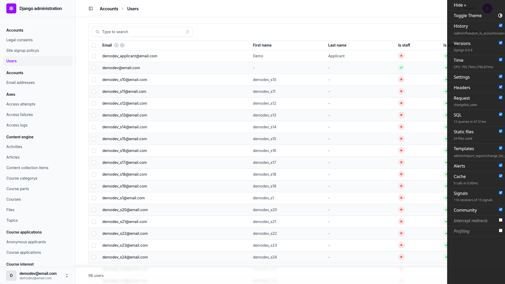 | Users changelist shows the Export button (href `/admin/freedom_ls_accounts/user/export/?`) and, once rows are ticked, the actions dropdown holds "Delete selected users" and "Export selected users" 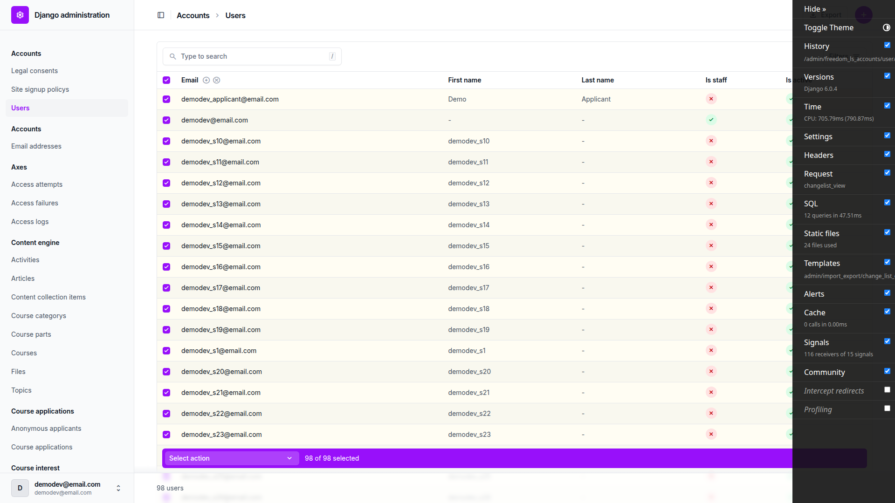. Columns Email, First name, Last name, Is staff, Is active; filters panel holds By is staff / By is superuser / By is active 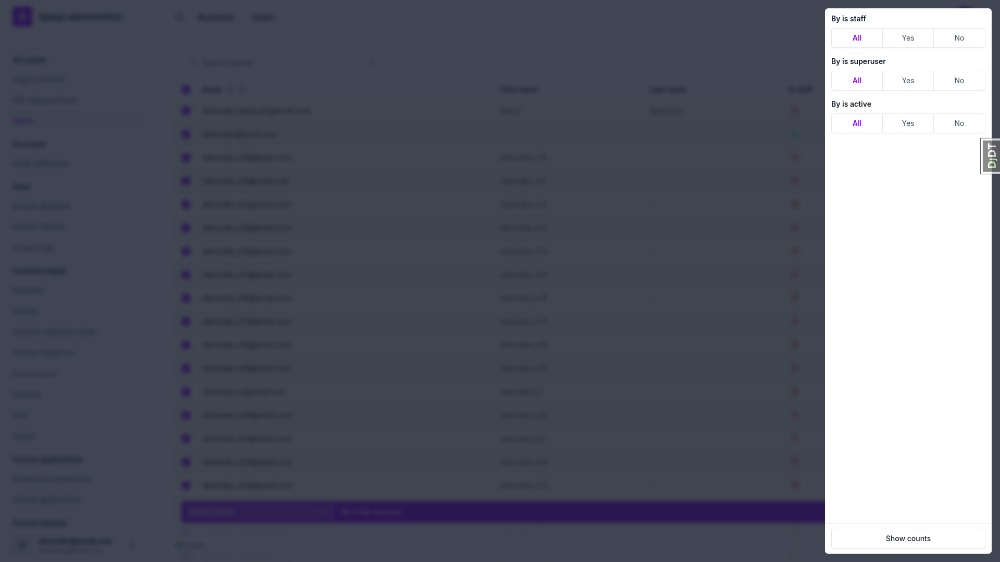; the Add link is still present. The demodev change page 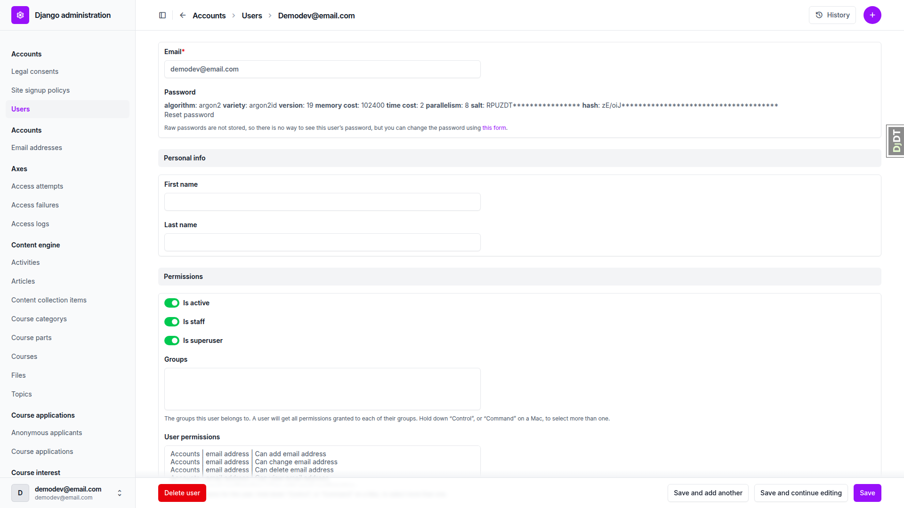 has no export control and keeps the unnamed email/password fieldset, Personal info, Permissions, Important dates and the Legal consents inline. |
| 1.2 The whole list | desktop | pass | — | GET `/admin/freedom_ls_accounts/user/export/` as demodev: 200 text/csv, attachment `User-2026-10-29.csv`, UTF-8 BOM bytes EF BB BF present. Header exactly `id,email,first_name,last_name,is_active,is_staff,email_verified,created_at,last_login`. 98 data rows = the 98 users the changelist counts; ids unique. is_active/is_staff only TRUE/FALSE. created_at and last_login ISO 8601 with +00:00 offset; last_login empty for qa_nobody@email.com (never signed in). email_verified TRUE for demodev@email.com and Mixed.Case@example.com, FALSE for unverified@example.com. Zero hits for password, pbkdf2, argon2, is_superuser, groups and site. |
| 1.3 Filters and selection narrow the file | desktop | pass |  | Staff filter: Export href becomes `/export/?is_staff__exact=1` and the file holds only demodev@email.com, qa_nobody@email.com, qa_reviewer@email.com (3 rows). Ticking qa_applicant and qa_bystander (ids 72, 73), choosing "Export selected users" and pressing Run 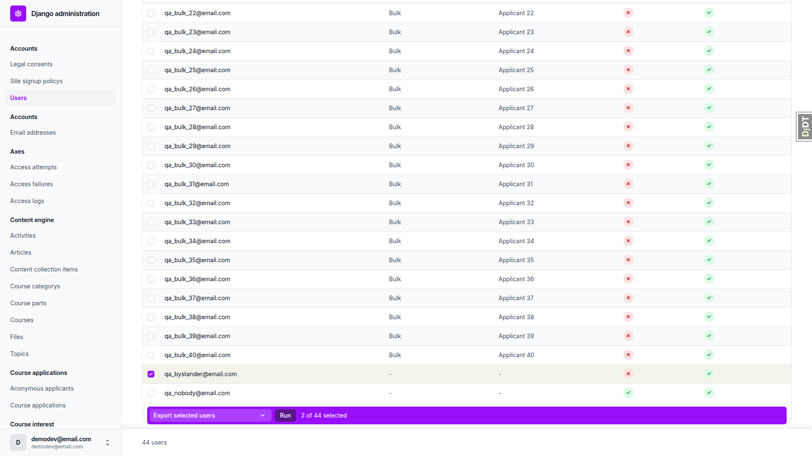 made the browser download `User-2026-10-29.csv` with a BOM and exactly those two rows. Search q=qa_applicant: Export href carries `?q=qa_applicant` and the file has one row. |
| 1.1 The controls are there | mobile | pass | 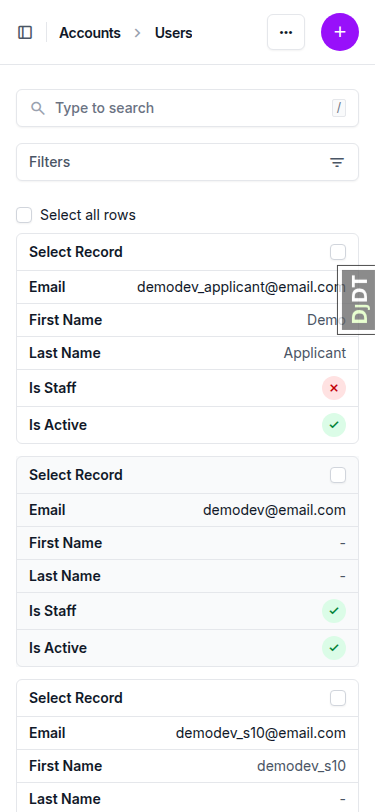 | At 375x812 the Users changelist has no horizontal scroll (scrollWidth 375) and rows stack as cards. The toolbar collapses into a more_horiz menu; opening it shows the Export link full-width at 341x36 px . Ticking a row reveals the sticky action bar with a 307x30 "Select action" control offering Delete selected users / Export selected users 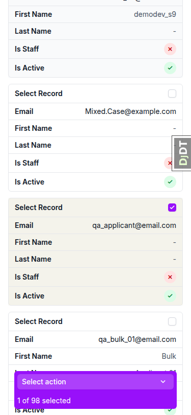. No console errors. |
| 1.1 The controls are there | tablet | pass | 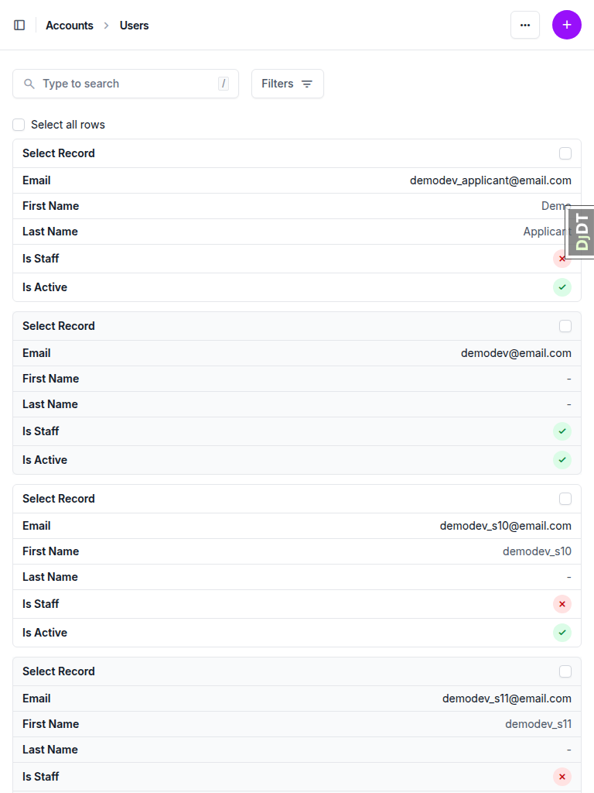 | At 768x1024 the sidebar collapses behind the dock icon, the Users list renders within 768px (scrollWidth 768), the search box sits in the toolbar and the toolbar actions sit behind a more_horiz menu; opening it shows the Export link full-width at 734x36 px 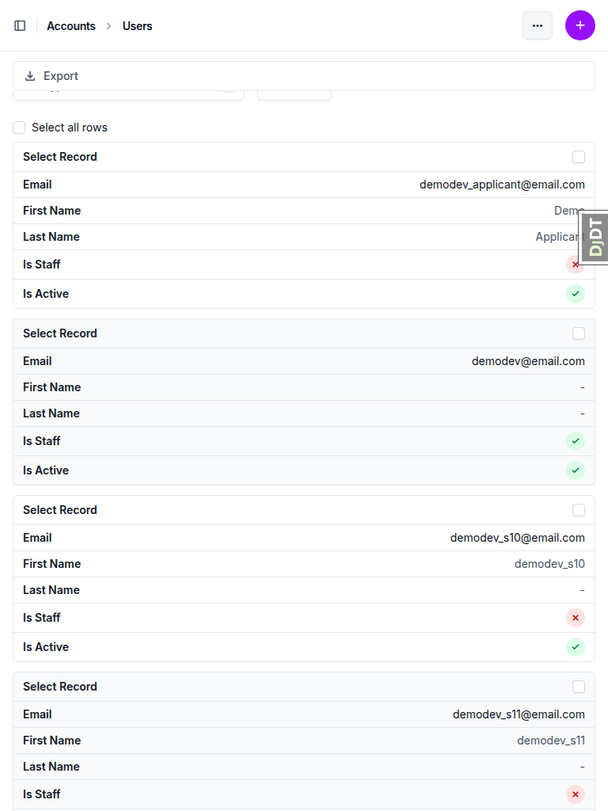. No console errors. |

### §2 The Course applications export

| Test | Viewport | Status | Screenshot | Notes |
|---|---|---|---|---|
| 2.1 The controls are there and the admin is still read-only | desktop | pass | 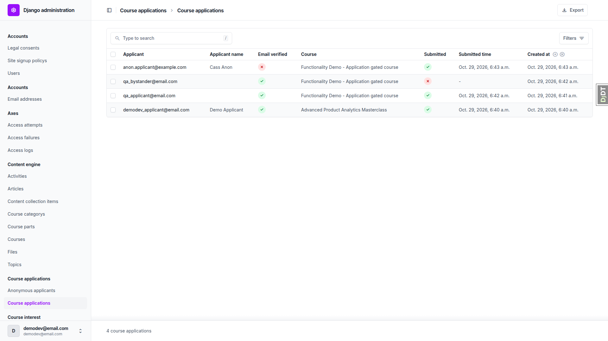 | Course applications changelist (4 rows) shows the Export button (href `.../courseapplication/export/?`) and the actions dropdown holds only "Export selected course applications"; no Add link and no "Delete selected" action. Filters: By submitted, By email verified, By created at, and a course autocomplete. The submitted application's change page  (full page) opens in view mode ("View course application", no save buttons, no Export text) with the Answers document: page headings About you, Supporting documents, Availability; the 13 questions in form order; "Not answered" once (anything else). Submitted time column: a time for the submitted and anonymous rows, "-" for the draft, and the created time for the no-form row. |
| 2.2 The whole list | desktop | pass | — | GET `.../courseapplication/export/`: 200 text/csv, attachment `CourseApplication-2026-10-29.csv`, BOM present. Header = `id,applicant_email,applicant_name,is_email_verified,course,is_submitted,submitted_time,created_at` then the 13 demo-form question texts in form order (9 About you, 2 Supporting documents, 2 Availability); 21 columns. 4 data rows. Submitted row: qa_applicant@email.com, name empty (user has no first/last name), is_email_verified TRUE, course = title, is_submitted TRUE, ISO submitted_time; full name `'=Ada QA`, DOB 1990-02-03, years 4, "A search engine", "Building web applications; Infrastructure and deployment", the two-paragraph answer with its blank line inside one quoted cell, id-scan.png, "anything else" empty, 14:30, "Eastern European (UTC+2)". Draft row: qa_bystander, is_submitted FALSE, submitted_time empty, only "Bea Draft". Anonymous row: Cass Anon, is_email_verified FALSE, is_submitted TRUE. No-form row: demodev_applicant, submitted_time equals created_at, every answer empty. No user_uploads, form_answers, .jpg, .jpeg or site; "http" only in the portfolio URL; no storage key. Data deviation from the plan, not a defect: the anonymous application carries 8 answers rather than 2 because the apply flow refuses to submit with required questions blank, so id-scan.png appears twice (one per upload). |
| 2.3 Filters and selection narrow the file | desktop | pass | 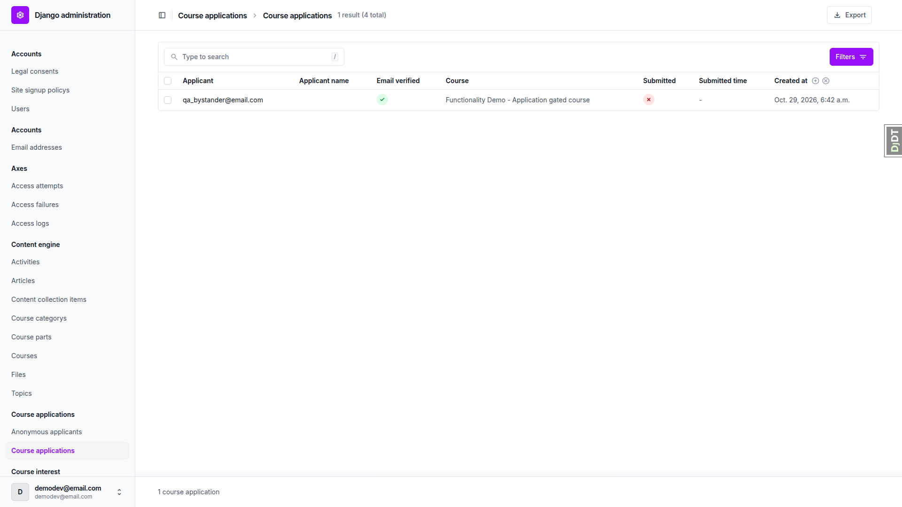 | submitted=draft: the changelist's Export href carries `?submitted=draft` and the file holds only qa_bystander. submitted=submitted: anon, qa_applicant, demodev_applicant. Course filter on the no-form course (`course__id__exact=478486c4-...`) 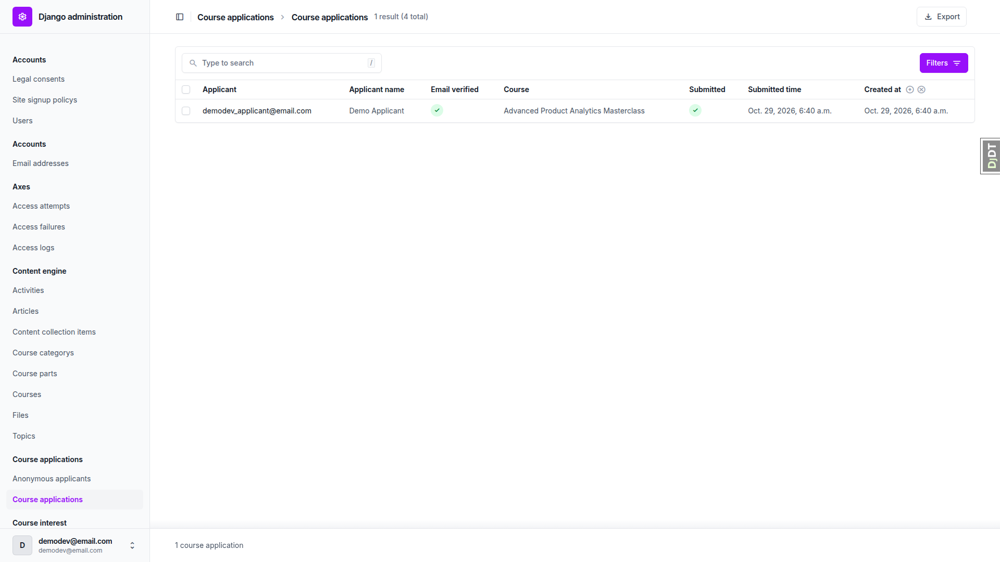: only demodev_applicant and the header stops at the 8 fixed columns with no answer columns. email_verified=unverified: only the anonymous row. Ticking the submitted and draft rows, choosing "Export selected course applications" and pressing Run 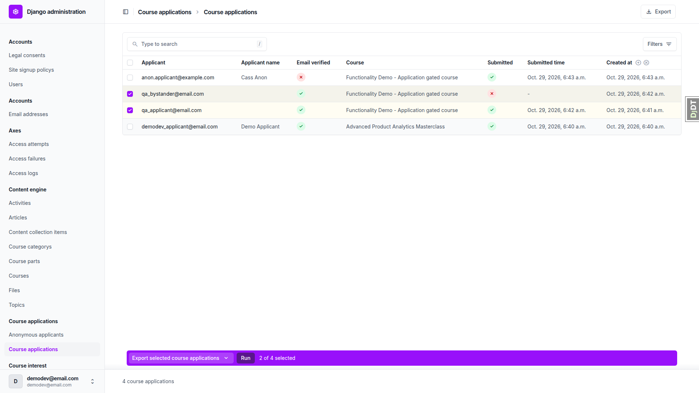 downloaded `CourseApplication-2026-10-29.csv` with a BOM, 21 columns and exactly those two rows. |
| 2.4 A second form in the same file | desktop | pass | 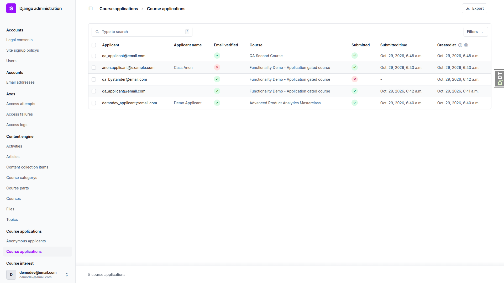 | After seeding "QA Second Course" with the one-page "Second form" (What is your full name?, Favourite colour) and a submitted application by qa_applicant answering Ada Again / Teal: the whole-list export has 23 columns and 5 rows; the 13 demo-form columns come first, then the two second-form columns. The duplicated question text is disambiguated as "What is your full name? (Application form)" (column 9) and "What is your full name? (Second form)" (column 22); "Favourite colour" keeps its bare header. The new row is empty under every demo-form column and reads Ada Again / Teal under the second form; the four earlier rows are empty under both second-form columns. |
| 2.1 The controls are there and the admin is still read-only | mobile | pass | 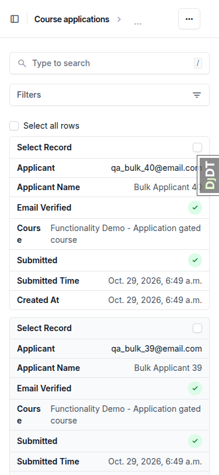 | At 375px the Course applications changelist (45 rows) stacks each row as a card with applicant, name, verified, course, submitted and times readable, no horizontal overflow; the more_horiz menu carries the Export link and ticking a row shows the action bar with only "Export selected course applications" 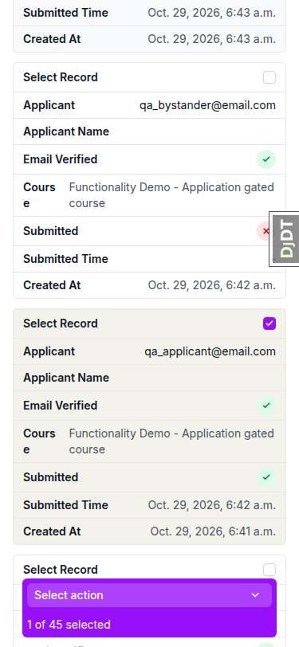. The application change page 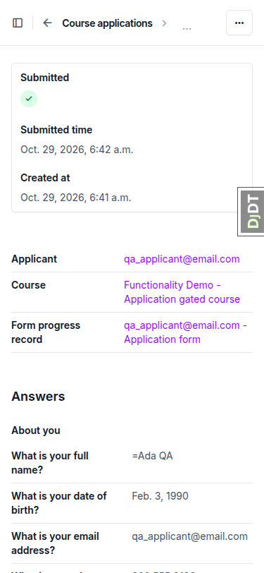 keeps the Answers document and its single "Not answered" within 375px. No console errors. |
| 2.1 The controls are there and the admin is still read-only | tablet | pass |  | At 768px the Course applications list (45 rows) and its more_horiz menu with the full-width Export link render without overflow; ticking a row shows the action bar with only "Export selected course applications" 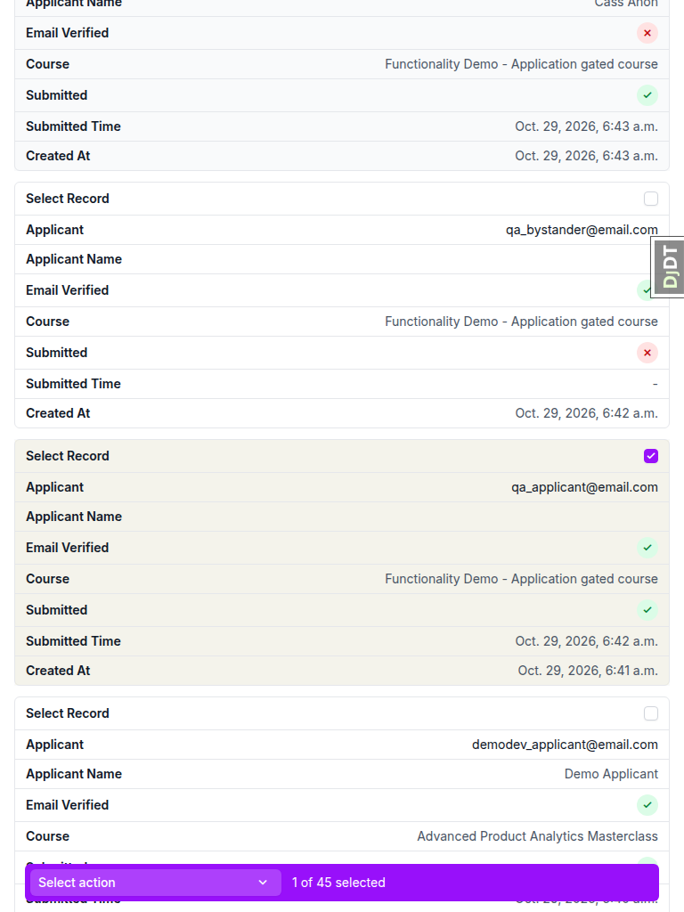; the application change page  keeps the Answers document with its About you / Supporting documents / Availability headings and one "Not answered". No console errors. |

### §3 Permissions

| Test | Viewport | Status | Screenshot | Notes |
|---|---|---|---|---|
| 3.1 The reviewer: applications yes, users no | desktop | pass | 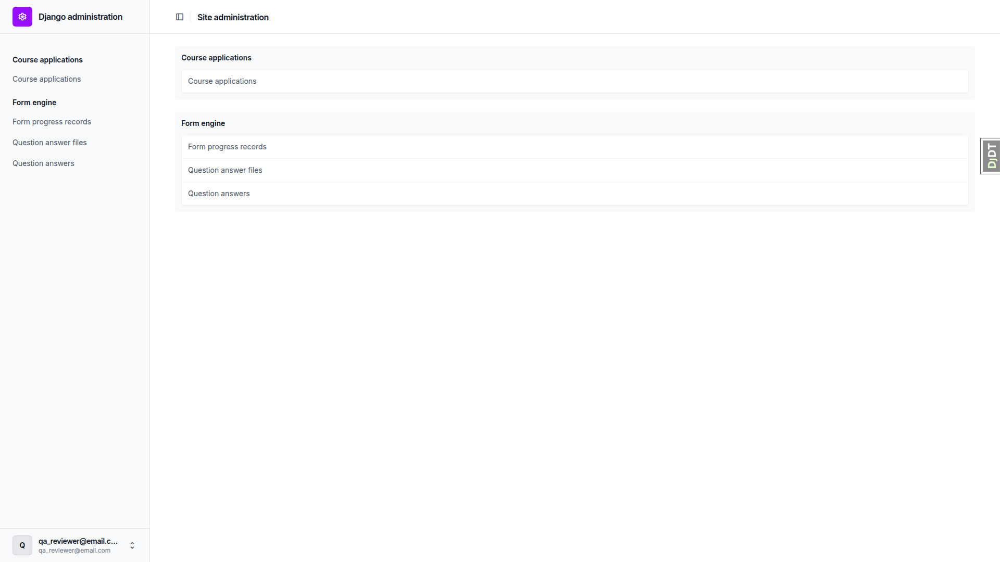 | Signed in as qa_reviewer@email.com: `/admin/` lists Course applications and no Users link. The applications changelist 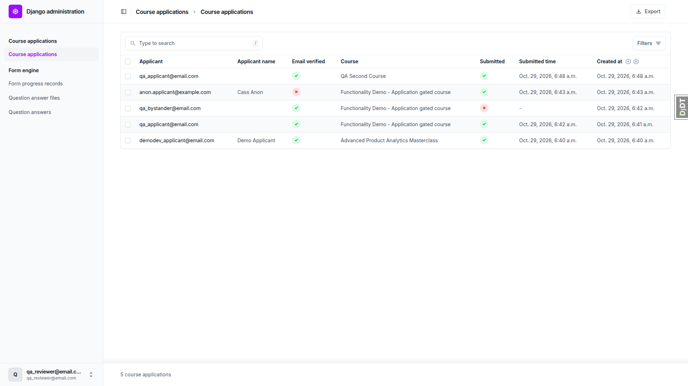 shows the Export button and the "Export selected course applications" action; GET `.../courseapplication/export/` returns 200 text/csv with the same 23-column shape as §2.4 (8 fixed + 15 answer columns, 5 rows). GET `/admin/freedom_ls_accounts/user/export/` returns 403 "You do not have access to this page"  and `/admin/freedom_ls_accounts/user/` is 403 too. |
| 3.2 The bystander staff: nothing | desktop | pass | 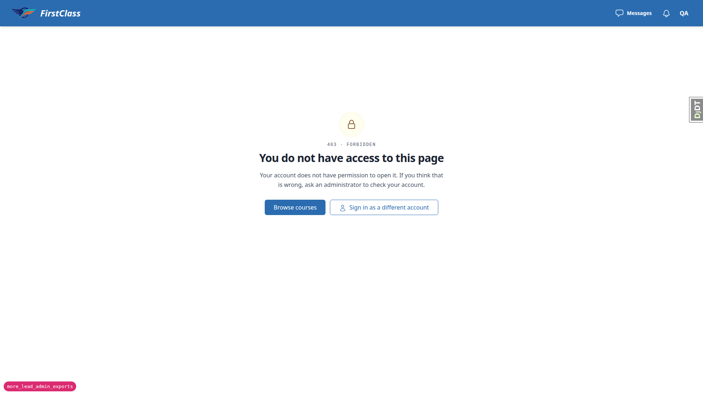 | Signed in as the bystander staff qa_nobody@email.com (is_staff, no permissions): `/admin/freedom_ls_accounts/user/export/`, `/admin/freedom_ls_course_applications/courseapplication/export/` and `/admin/freedom_ls_accounts/user/export/?is_staff__exact=1` all return 403 (navigation and fetch alike); `/admin/` itself renders (200) as expected for staff. |
| 3.3 Signed out | desktop | pass | 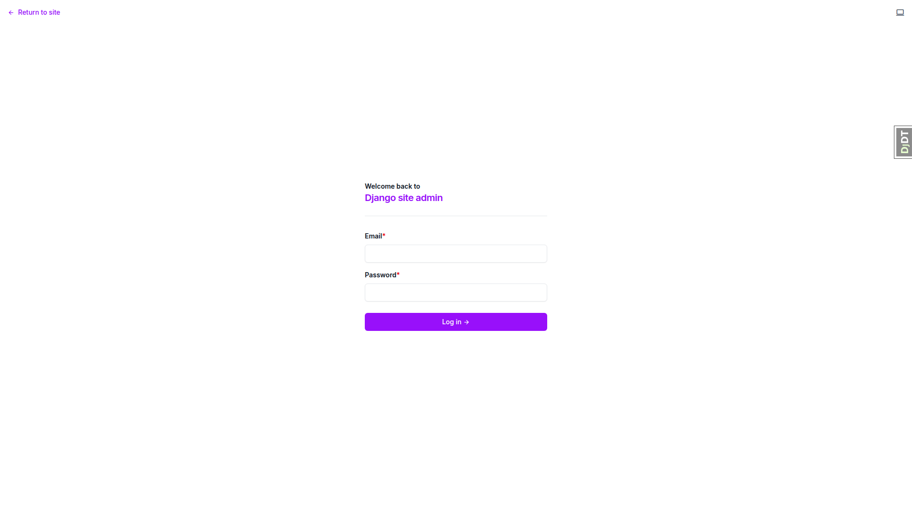 | Signed out, `/admin/freedom_ls_accounts/user/export/` redirects to `/admin/login/?next=/admin/freedom_ls_accounts/user/export/` (fetch sees an opaque redirect, no file body). Tangential: the admin login page's `<title>` reads "Log in \| None". |

### §4 Side effects

| Test | Viewport | Status | Screenshot | Notes |
|---|---|---|---|---|
| 4.1 The referral exports are unchanged | desktop | fail | 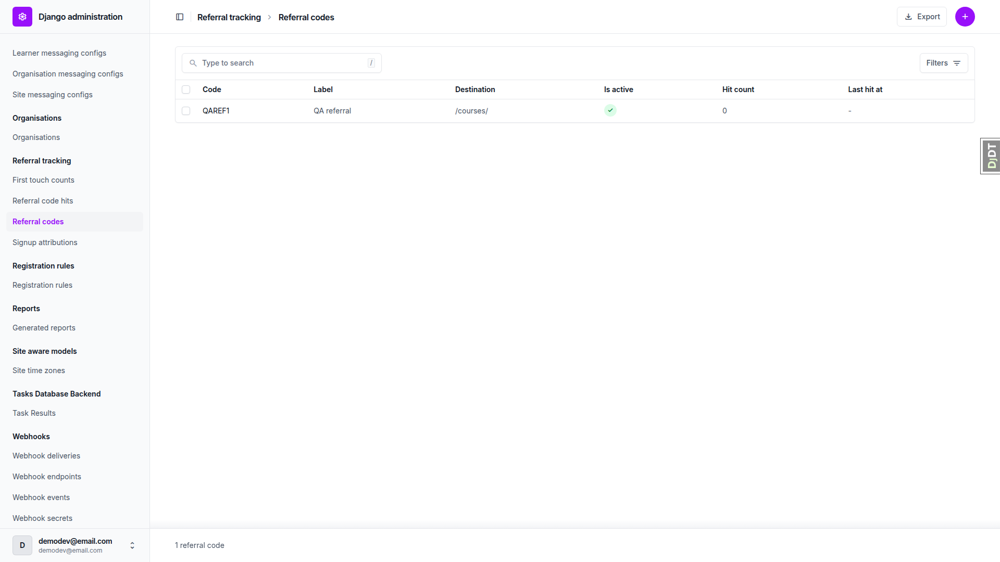 | Referral codes changelist still has its Export button (href `.../referralcode/export/?`) and the export returns 200 text/csv `ReferralCode-2026-10-29.csv` with a BOM and the unchanged header `id,code,label,notes,destination,inactive_destination,is_active,hit_count,last_hit_at,created_at`. But is_active reads TRUE, not 1: the file is `daae6b5c-...,QAREF1,QA referral,,/courses/,,TRUE,0,,2026-10-28T15:19:34.169863+00:00`. The plan (and spec line 66, plan line 108) say the referral exports keep 1/0; the branch's code-review fix-up commit 73dfcc590 moved the TRUE/FALSE widget into the shared SiteAwareModelResource base "so every export agrees" and added `test_referral_code_export_writes_is_active_as_a_spreadsheet_boolean` asserting TRUE/FALSE. Code, tests and docs disagree with the spec: a product decision. See B1. |
| 4.2 The learner's own pages still render answers | desktop | pass | 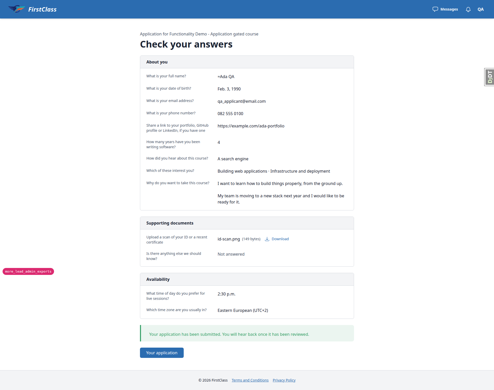 | Signed in as qa_applicant: the status page `/applications/status/588fcc7c-.../` renders "Your application ... pending review" with a Back to dashboard link ; it does not list answers, by design. The Check your answers page is still reachable at `/applications/application/588fcc7c-.../check-your-answers/` and shows the three page headings and all 13 answers in page order, including `=Ada QA`, "Building web applications · Infrastructure and deployment", the two-paragraph answer, id-scan.png with a Download link, "Not answered" for the blank question, 2:30 p.m. and Eastern European (UTC+2). |
| 4.3 Anonymous applicants are not double counted | desktop | pass | 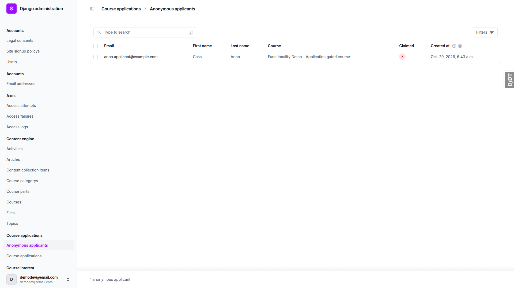 | As demodev, the Anonymous applicants changelist (1 row) has no Export button, no link to an `/export/` URL, the word Export nowhere on the page, and the actions dropdown holds only "Delete selected anonymous applicants". |
| 4.4 A large selection | desktop | pass |  | After seeding forty more submitted applications (qa_bulk_01..40, each answering only full name and date of birth), the changelist counts 45 course applications and the whole-list export returns 45 rows with the same 23-column header as §2.4 in 128 ms (11.7 KB). Each bulk row is TRUE for is_submitted, carries its "Bulk Applicant NN" name and date of birth, and every other answer cell is empty. |

## Design check

No design states tested: the plan names no design screenshots.

## Bugs

### B1: Referral code export now writes is_active as TRUE/FALSE, contradicting the spec's 1/0 promise

Manifestations:

- 4.1 (desktop)

**Expected**: Per the test plan §4.1, spec line 66 and plan line 108, the referral exports are unchanged by this branch: `ReferralCode-<date>.csv` keeps its headers and its is_active column reads 1 or 0.

**Actual**: The referral export keeps its headers but is_active reads TRUE (file: `daae6b5c-...,QAREF1,QA referral,,/courses/,,TRUE,0,,2026-10-28T15:19:34.169863+00:00`). The branch's code-review fix-up commit 73dfcc590 moved SpreadsheetBooleanWidget into the shared SiteAwareModelResource base "so every export agrees" and added `test_referral_code_export_writes_is_active_as_a_spreadsheet_boolean` asserting TRUE/FALSE. The previous QA run (2026-10-28, before that commit) saw 1. Code and tests now disagree with the spec, the plan and the QA plan; the upgrade notes do not mention the referral change. Which behaviour is intended is a product decision.

## Bug status

- **RESOLVED BY DECISION** (keep TRUE/FALSE in every export; spec, plan, QA plan and upgrade notes updated to match). Was: Referral code export now writes is_active as TRUE/FALSE, contradicting the spec's 1/0 promise (reason: red lane, no fix attempted. The spec, the plan and the QA plan say the referral exports keep `1`/`0`; the code-review fix-up commit 73dfcc590 deliberately made every export agree on `TRUE`/`FALSE` and tests that. Choosing which is intended is a product decision: either keep the shared-base behaviour and update spec line 66, plan line 108 and the upgrade notes, or move `SpreadsheetBooleanWidget` back to the two new resources and drop the referral test.)

## General notes

- The anonymous application carries 8 answers, not the plan's 2, because the apply flow refuses to submit with required questions blank; a test-data limitation, not a defect, and the reason `id-scan.png` appears twice in the file.
- The draft application's single answer was saved by submitting page 1 with the browser's own `required` validation disabled; the server accepted the partial page (422 with the name persisted), which is how a draft with one answer comes to exist.
- The "Applicant name" column is blank for QA users with no first/last name, as expected.
- On phone and tablet widths django-unfold collapses the changelist toolbar into a "..." menu that holds the Export link, and shows the action bar only once a row is ticked; standard Unfold behaviour.
- The admin login page's `<title>` reads "Log in | None" when signed out (seen in §3.3); unrelated to this feature.
- The uploaded `id-scan.png` (10,362 bytes on disk) is shown as "149 bytes" on the form and check-your-answers pages after upload, so the stored file appears to be re-encoded or the displayed size is wrong; unrelated to this feature, observation only.
- The previous run's referral code `QAREF1` survived the content reset and was reused for §4.1.
- Tangential: the referral boolean change (B1) is not mentioned in `upgrade_notes.md`.

status: ok · reason: 1 bug — 0 fixed, 1 unresolved (product decision); report rendered, screenshots verified
