# Frontend QA report: Application review states

Run date: 2026-11-21. Server on port 8444, on branch `multi-step-course-applications-1-review-states` (branch badge confirmed). Test plan: `3. frontend_qa.md`.

## Summary

- Tests recorded: all of plan Tests 1 to 8 at desktop; mobile and tablet passes on the key pages.
- Result: every plan test passed. One extra visual check failed (bug B1, pending triage).

## Methodology

Screenshots were collected into `screenshots/` beside this report. Every image referenced here exists in that directory. The smoke gate passed, so no steps were skipped because of it.

The run also covered pre-step work, from the `note` record:

- Rebase onto origin/main: 38 commits replayed, one conflict (`docs/product/learner-experience.md` Last-updated date; the branch's 2026-11-21 was kept). The lost-change check found only context drift.
- Targeted tests (course_applications, form_engine, application qa_helpers, learner_interface form runner, course detail and listing): 3816 passed. The full suite was not run; the user asked for targeted tests only.
- Upstream-change review: unchanged.
- Front-end check folded into this run: the upstream change to `form_engine/question.html` renders on the application form pages visited here (checked in 2.3 mobile, no overflow, no console errors).

## Diff scoping

Class: FULL. Changed files: `freedom_ls/course_applications/templates/...`, `freedom_ls/course_applications/static/...` and many `.py` files. Nothing was skipped: desktop, mobile and tablet passes all ran.

## Smoke gate

Passed. Pages loaded: `/` and `/applications/status/41a16a1a-4de0-4c63-bad1-503fa997889e/`.

## Design check

No design states tested.

## Bug B1: Used or invalid claim-link page lacks the blocked-page treatment

Manifestations:

- `5.4-visual`, desktop
- `5.4`, mobile (the page itself works; it shows the same layout)

Screenshots:

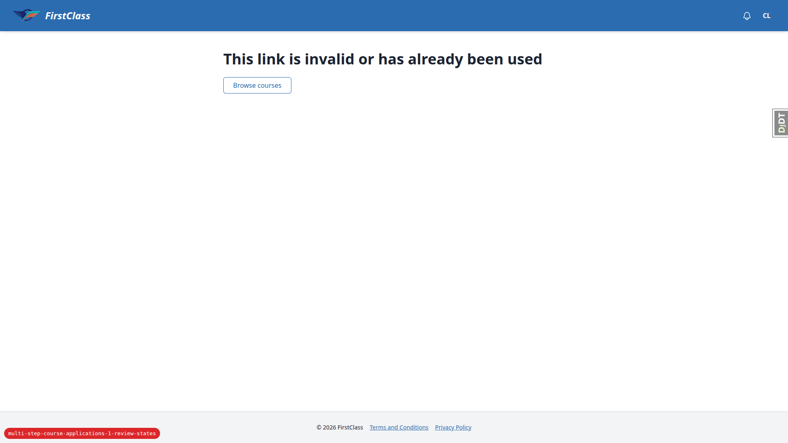
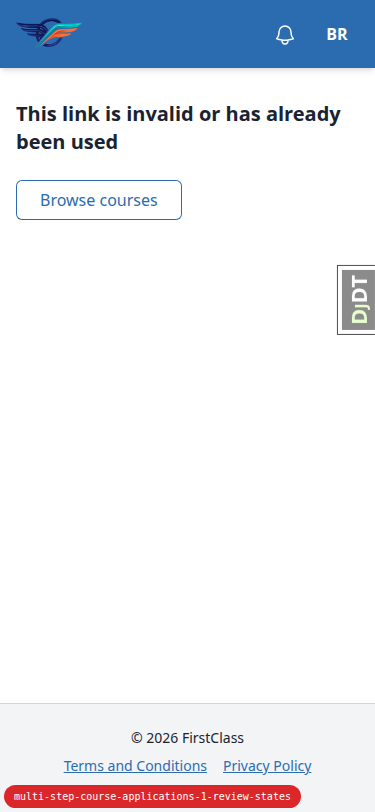

Expected: per `.claude/skills/brand-guidelines/visual.md`, a page a person cannot use shows a large centred `<c-icon>` (size-12) with the explanation as plain text under it, never a callout. The outlined "Browse courses" button stays (plan 5.4).

Actual: a left-aligned heading "This link is invalid or has already been used" and a "Browse courses" button. There is no icon and no explanatory text. The layout (`claim.html`, else-branch) predates the branch; the branch only restyled the button.

## Layout probe

| Test id | Viewport | URL | Screenshot | Result |
|---|---|---|---|---|
| 1.1 | desktop | `/` | 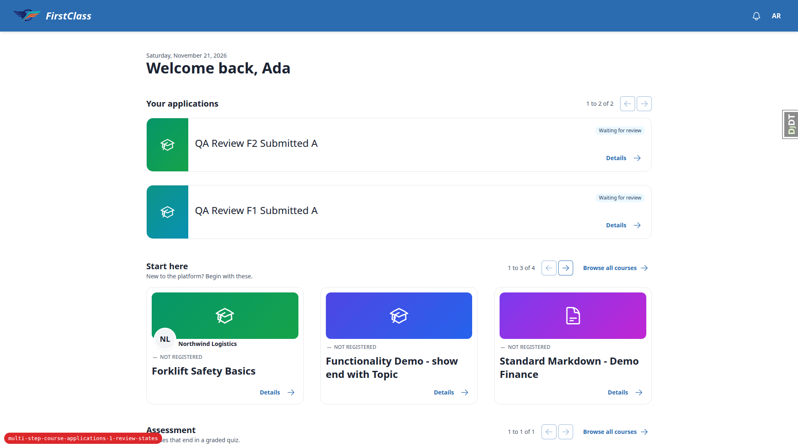 | clean |
| 1.2 | desktop | `/applications/status/<F1>/` | 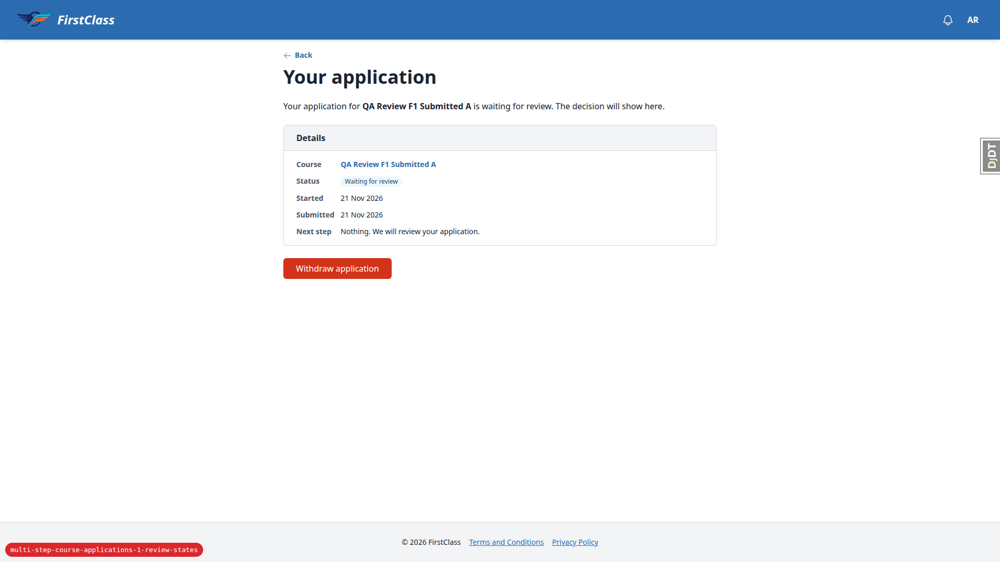 | clean |
| 1.11 | desktop | `/applications/application/<old F1>/page/1/` | 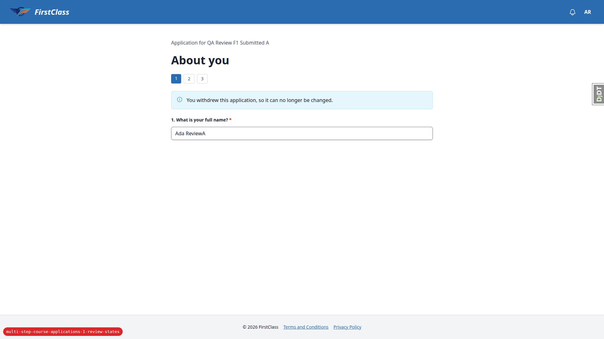 | clean |
| 2.1 | desktop | `/` | 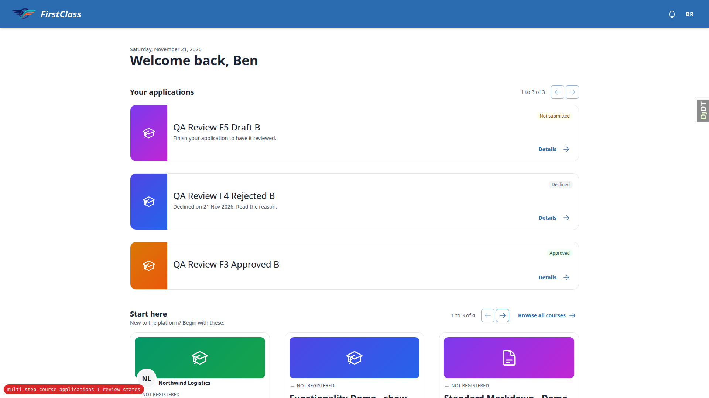 | clean |
| 2.2 | desktop | `/applications/status/<F5>/` | 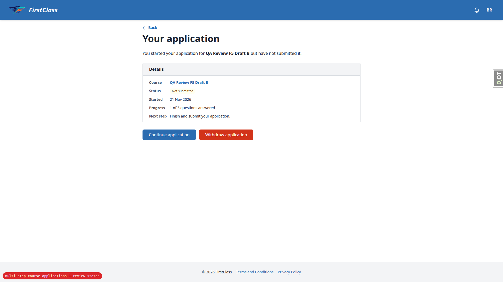 | clean |
| 2.5 | desktop | `/applications/application/<F5>/check-your-answers/` | 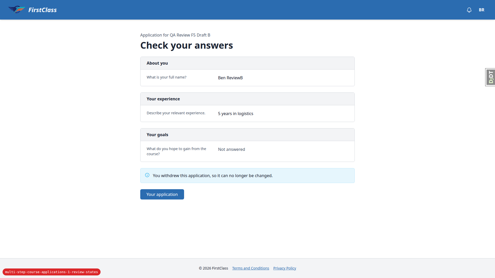 | clean |
| 3.3 | desktop | `/applications/status/<F4>/` | 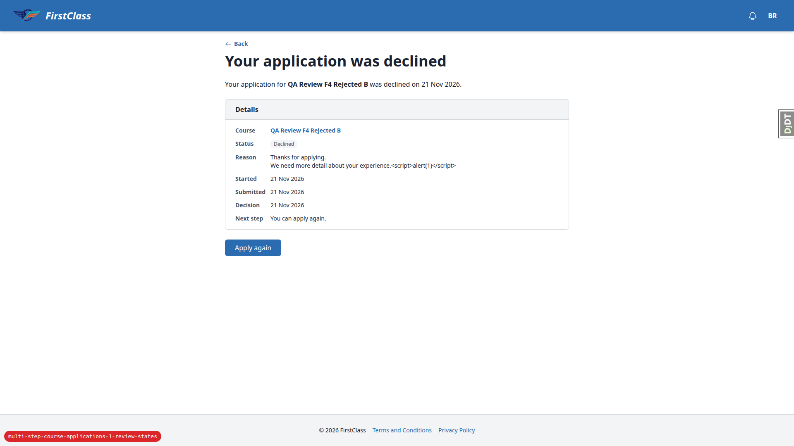 | clean |
| 5.1 | desktop | `/applications/status/<anon G>/` | 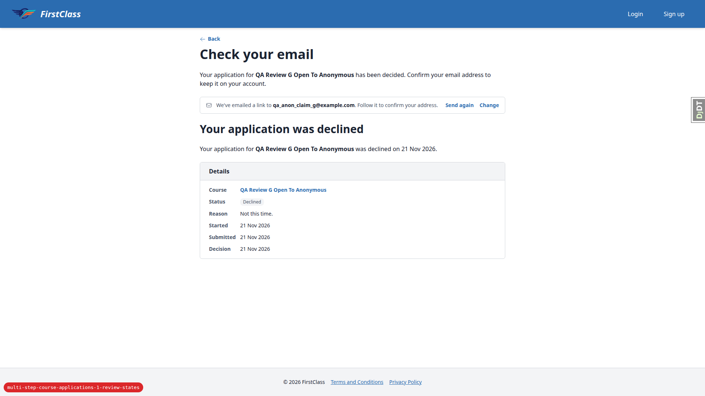 | clean |
| 5.4 | desktop | `/applications/claim/<token>/` |  | clean |
| 8.1 | desktop | `/admin/freedom_ls_course_applications/courseapplication/?state__exact=withdrawn` | 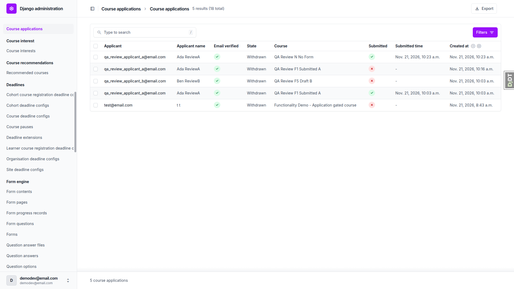 | clean |
| 1.1 | mobile | `/` | 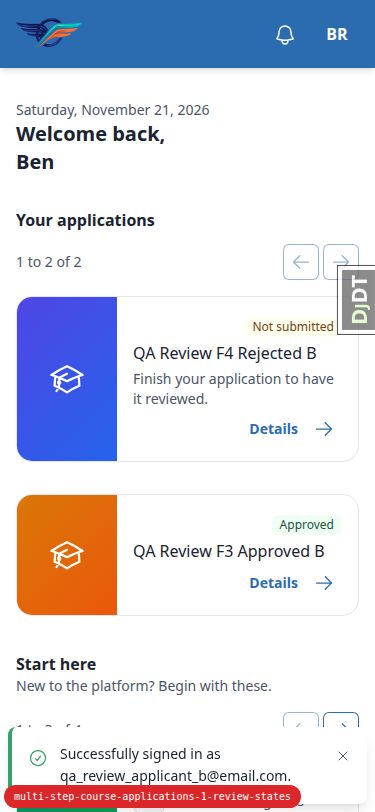 | clean |
| 3.3 | mobile | `/applications/status/<F4 declined>/` | 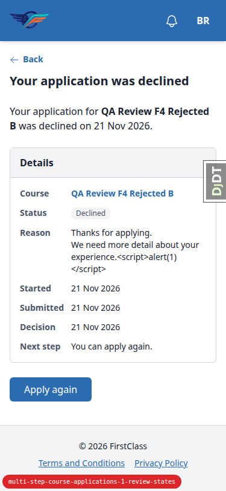 | clean |
| 2.2 | mobile | `/applications/status/<F4 draft>/` | 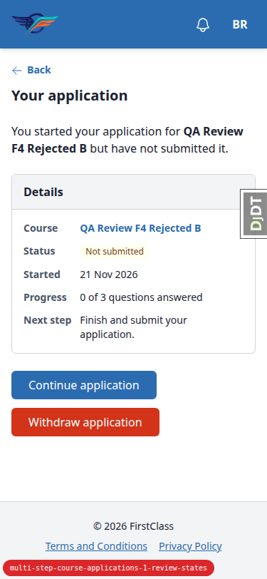 | clean |
| 2.5 | mobile | `/applications/application/<F5>/check-your-answers/` | 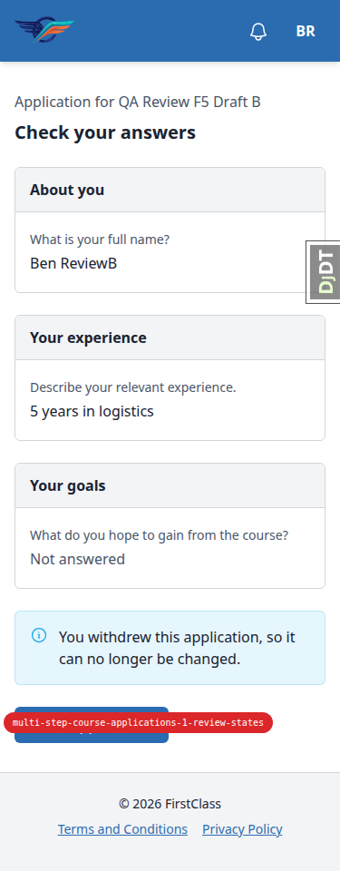 | clean |
| 2.3 | mobile | `/applications/application/<F4 draft>/page/1/` | 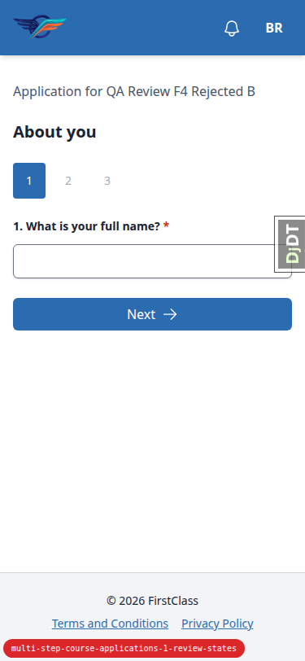 | clean |
| 1.1 | tablet | `/` | 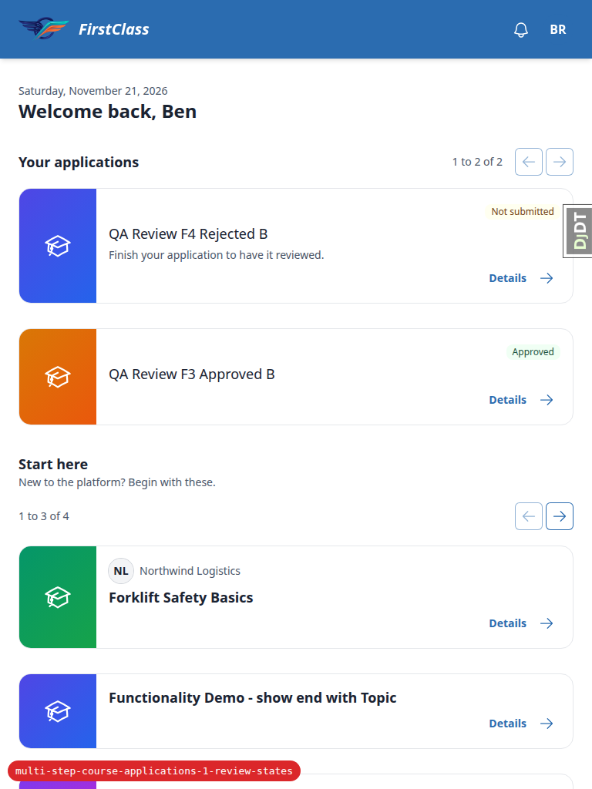 | clean |
| 2.2 | tablet | `/applications/status/<F4 draft>/` | 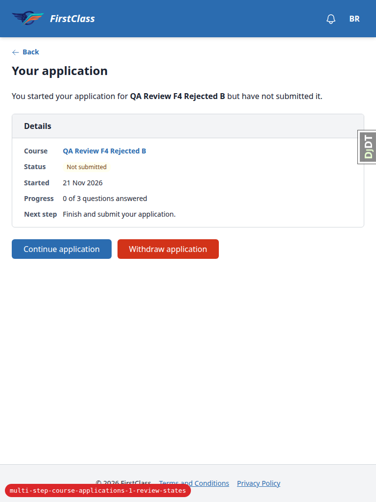 | clean |

The layout probe flags nothing: the B1 miss is a brand rule, not a layout flag.

## Data changes

| What changed | Made by | Files written |
|---|---|---|
| Reset applicants A and B and courses F1 to F5, G and N to the plan's Data section. The command was extended for the `furthest_page` FK, a 3-page form, and `--reject-pk` and `--message`. | `sdd:qa-data-helper` via `qa_create_application_review_states` | `freedom_ls/qa_helpers/management/commands/qa_create_application_review_states.py` |
| Rejected anonymous application a667ad46 on course G with message "Not this time." through `reject_application`. | `sdd:qa-data-helper` (`qa_create_application_review_states --reject-pk`) | none |

## Bug status

| Bug | Title | Status |
|---|---|---|
| B1 | Used or invalid claim-link page lacks the blocked-page treatment | **FIXED** (commit: eafd1baea) |

Re-verified on the live server: centred lock icon, the explanation "Each link works once. If you need another, start your application again." and the outlined "Browse courses" button, with no horizontal scroll at 1920px or 375px.

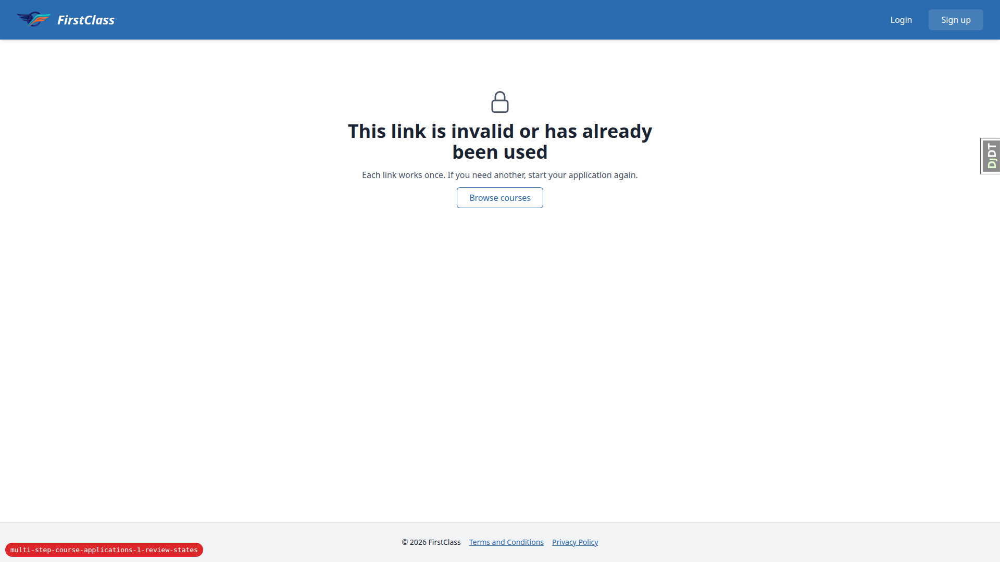
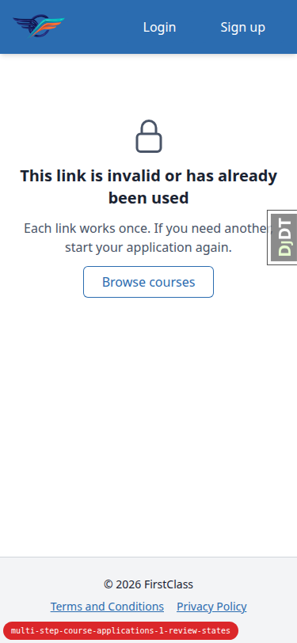

## General notes

- Plan 1.8: browser Back re-fetches the withdrawn page rather than showing a stale copy, so the repeat POST was replayed by a form submit. The result matched: "This application can no longer be withdrawn."
- Plan 5.3: the claim link was computed by the data helper because the sent email payload is scrubbed.
- Plan 1.4 on mobile: the dialog buttons stack full width with Withdraw (red) above Keep. No rule file sets the mobile stacking order, so this is recorded without a verdict.
- Plan 2.5 on mobile: the fixed branch badge overlays the button in the full-page capture only. This is dev tooling, not the product.
- Plan 6.1: the unchanged `apply.html` confirm copy still says "you will be notified of the outcome". The file predates this branch. No action attached.
- Plan 8.1: the admin keeps a boolean "Submitted" column (true for rows withdrawn after submission). The plan does not cover it. The console showed Django admin's own RelatedObjectLookups "unload" permissions-policy message.
- Full-page captures `page-2026-11-21T10-15-00-534Z.png` and `page-2026-11-21T10-25-35-345Z.png` are in the screenshots directory but are not referenced by any record, so they are not linked here. The `fb-*` and `fb2-*` files came from an earlier feedback session, not this run; they are not committed with this report.

status: ok · reason: 1 bug — 1 fixed, 0 unresolved; report rendered, screenshots verified
