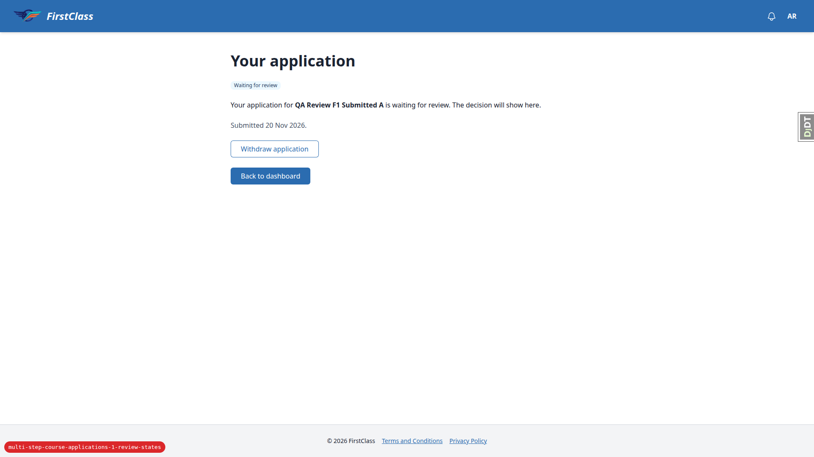
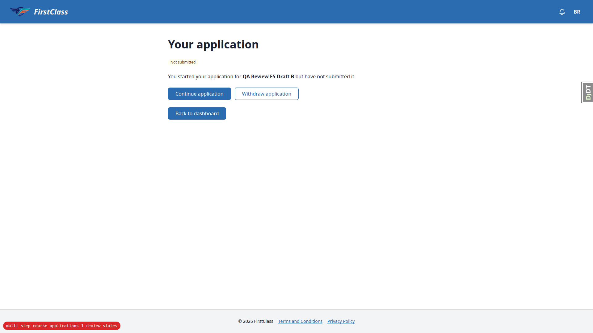
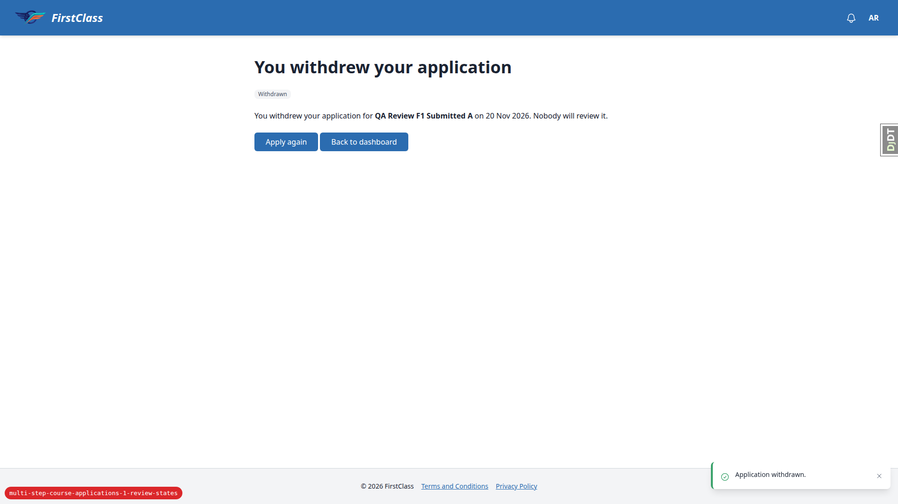
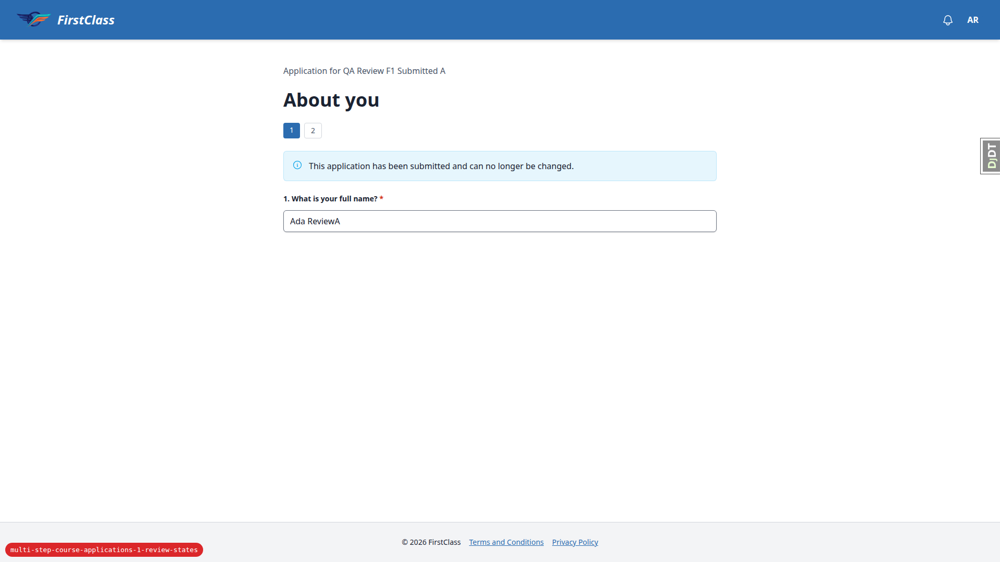
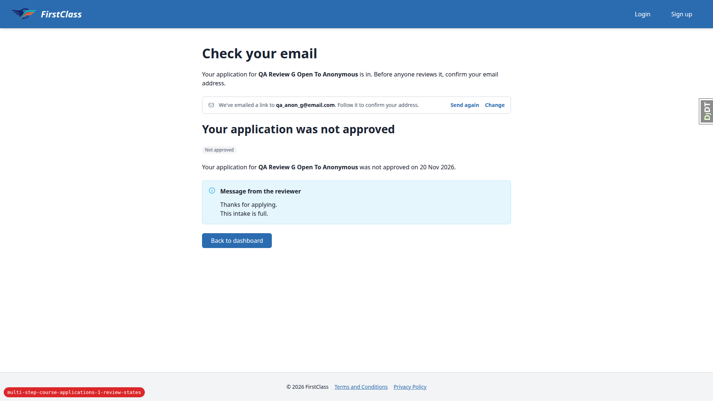
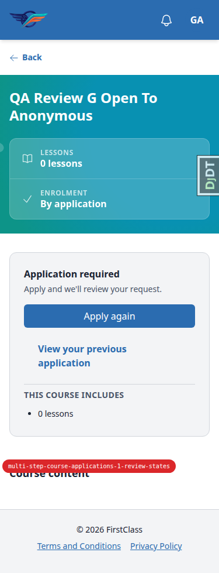
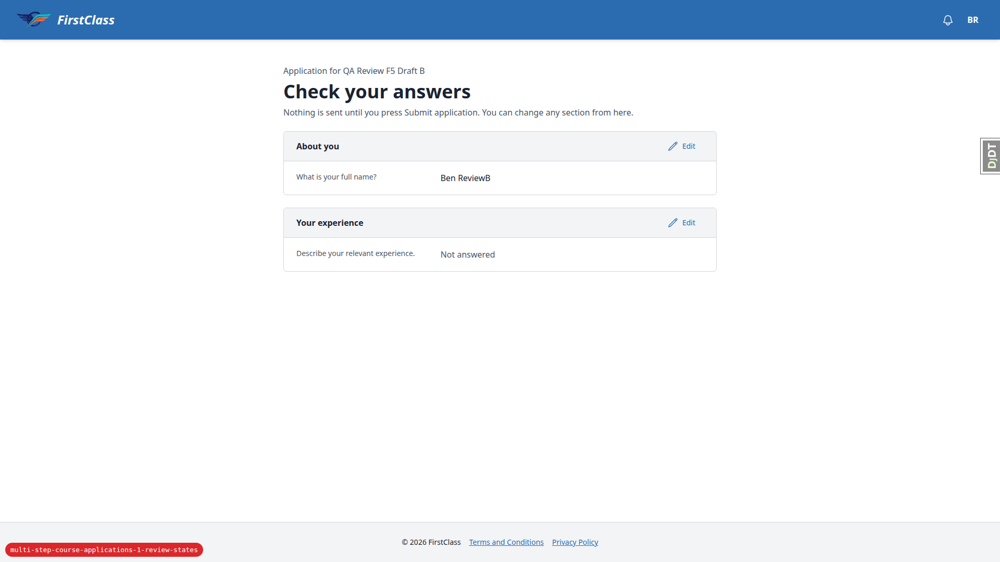
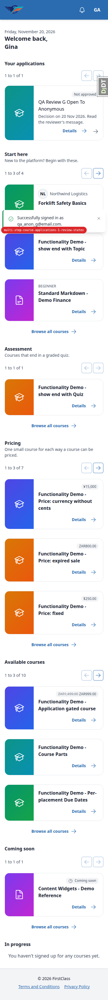

# QA report: multi-step-course-applications-1-review-states

## Methodology

Screenshots were collected into `screenshots/` beside this report. Every image referenced below was checked and exists in that directory. The smoke gate passed, so no steps were skipped by an abort. The run covered desktop, mobile (375px) and tablet passes.

## Diff scoping

Class: **FULL**. The changed files include models, migrations, views, templates, JS, admin, API, audit-log actions and playwright tests across `course_applications`, `learner_interface`, `audit_log`, `course_access` and `educator_interface`, plus the spec files. Skipped: nothing. Everything ran, including the mobile and tablet passes.

## Smoke gate

Outcome: **pass**. Pages loaded: `/` and `/applications/status/8b27b907-8722-45a9-a8ab-d2dde1ad65d0/`. No failure URL or reason.

## Design check

no design states tested

## Bug 1 (B1): Status page actions are laid out differently per state

Manifestations:
- `1.2-actions` (desktop)
- `2.2` (desktop)
- `t-status` (tablet)

Screenshots:

Expected: every state of the application status page places its actions the same way, in one action row holding the state's actions and 'Back to dashboard'.

Actual: in the draft and submitted states the withdraw form is its own block, so 'Back to dashboard' drops to a second row under it. The withdrawn, approved and rejected states show their actions in one row.

## Bug 2 (B2): Read-only application form page says 'submitted' for a withdrawn or rejected application

Manifestations:
- `1.10-copy` (desktop)
- `2.5-copy` (desktop)

Screenshots:

Expected: the read-only notice on a form page describes the application's actual state (for example withdrawn, or not approved). It never says 'submitted' for an application that was never submitted.

Actual: `form_page.html` always shows 'This application has been submitted and can no longer be changed.' when the page is read-only, including for a withdrawn draft.

## Bug 3 (B3): Unclaimed decided application still reads as awaiting review in the claim notice and claim page

Manifestations:
- `5.1-copy` (desktop)

Screenshots:

Expected: for an unclaimed application that has already been decided, the 'Check your email' notice and the claim confirm page do not say the application is yet to be reviewed or unfinished.

Actual: the status page notice says 'Your application for <course> is in. Before anyone reviews it, confirm your email address.' above 'Your application was not approved'. The claim confirm page heading says 'Finish your application for <course>'.

## Bug 4 (B4): 'View your previous application' wraps onto two lines at 375px

Manifestations:
- `m-course-cta` (mobile)

Screenshots:

Expected: every button label sits on one line at 375px, 768px and 1280px (brand visual checklist).

Actual: the course detail CTA's secondary link-button 'View your previous application' wraps to two lines in the sidebar card at 375px.

## Bug 5 (B5): Withdrawn or rejected application's check-your-answers page still invites edits and submission

Manifestations:
- `2.5-copy` (desktop)

Screenshots:

Expected: decided with the user. A todo item is already filed in `todo.md`. The open question is whether a decided application's check-your-answers page hides its Edit links and the 'Nothing is sent until…' intro.

Actual: the intro says 'Nothing is sent until you press Submit application. You can change any section from here.' and Edit links show, but there is no Submit button and edits are refused.

## Bug 6 (B6): Rejected dashboard row has no 'Apply again' below the sm breakpoint

Manifestations:
- `m-dashboard` (mobile)

Screenshots:

Expected: the spec says the rejected row offers a secondary 'Apply again'. Whether it should show below the sm breakpoint is a product decision already filed in `todo.md`.

Actual: 'Apply again' is hidden below sm, like 'View my application'. Phone users reach it from the status page.

## Layout probe

| Test id | Viewport | URL | Screenshot | Result |
|---|---|---|---|---|
| 1.1 | desktop | `/` | [page-2026-11-20T18-47-07-338Z.png](screenshots/page-2026-11-20T18-47-07-338Z.png) | clean |
| 1.2 | desktop | `/applications/status/<pk>/` | [page-2026-11-20T18-47-11-881Z.png](screenshots/page-2026-11-20T18-47-11-881Z.png) | clean |
| 1.9 | desktop | `/courses/qa-review-f1/detail/` | [page-2026-11-20T18-48-13-392Z.png](screenshots/page-2026-11-20T18-48-13-392Z.png) | clean |
| 2.1 | desktop | `/` | [page-2026-11-20T18-48-53-792Z.png](screenshots/page-2026-11-20T18-48-53-792Z.png) | clean |
| 5.1 | desktop | `/applications/status/<pk>/` | [page-2026-11-20T18-50-08-456Z.png](screenshots/page-2026-11-20T18-50-08-456Z.png) | clean |
| 3.3 | desktop | `/applications/status/<pk>/` | [page-2026-11-20T18-50-54-490Z.png](screenshots/page-2026-11-20T18-50-54-490Z.png) | clean |
| m-dashboard | mobile | `/` | [page-2026-11-20T18-53-25-787Z.png](screenshots/page-2026-11-20T18-53-25-787Z.png) | clean |
| m-rejected-status | mobile | `/applications/status/<pk>/` | [page-2026-11-20T18-53-34-269Z.png](screenshots/page-2026-11-20T18-53-34-269Z.png) | clean |
| m-course-cta | mobile | `/courses/qa-review-g/detail/` | [page-2026-11-20T18-53-36-208Z.png](screenshots/page-2026-11-20T18-53-36-208Z.png) | clean |
| t-status | tablet | `/applications/status/<pk>/` | [page-2026-11-20T18-53-56-755Z.png](screenshots/page-2026-11-20T18-53-56-755Z.png) | clean |
| t-dashboard | tablet | `/` | [page-2026-11-20T18-54-02-339Z.png](screenshots/page-2026-11-20T18-54-02-339Z.png) | clean |

The layout probe flags no overflow. The visual defects it did not flag (B1, B4, B6) were found by the functional tests and are documented above.

## Data changes

| What changed | Call or command | Files written |
|---|---|---|
| Base dev data was missing, so it was created with `create_demo_data --yes` and `content_save demo_content DemoDev`. A new command then created applicants A (`qa_review_applicant_a@email.com`) and B (`qa_review_applicant_b@email.com`) and courses F1-F5, G and N. | `create_demo_data --yes`, `content_save demo_content DemoDev`, then `qa_create_application_review_states` | `freedom_ls/qa_helpers/management/commands/qa_create_application_review_states.py` (new, untracked) |

## Bug status

| Bug | Title | Verdict |
|---|---|---|
| B1 | Status page actions are laid out differently per state | **FIXED** (commit: f60f738da) |
| B2 | Read-only application form page says 'submitted' for a withdrawn or rejected application | **FIXED** (commit: 23e354ea5) |
| B3 | Unclaimed decided application still reads as awaiting review in the claim notice and claim page | **FIXED** (commit: 01dba4815) |
| B4 | 'View your previous application' wraps onto two lines at 375px | **FIXED** (commit: 1df2c5126) |
| B5 | Withdrawn or rejected application's check-your-answers page still invites edits and submission | UNRESOLVED (red lane, product decision filed in `todo.md`) |
| B6 | Rejected dashboard row has no 'Apply again' below the sm breakpoint | UNRESOLVED (red lane, product decision filed in `todo.md`) |

## General notes

- Passing test records with screenshots: 1.1, 1.2, 1.3, 1.6, 1.9, 2.1, 2.2, 2.5, 3.1 to 3.4, 5.1, 5.3 and 8.1-8.2. The remaining passes had no screenshot (1.4, 1.5, 1.7, 1.8, 1.10, 2.3, 2.4, 2.6, 3.5, 4.1-4.4, 5.2, 6.1-6.2, 7.1-7.3).
- Pre-existing observation, no action attached: the no-form course confirm page (6.1-6.2) still says 'you will be notified of the outcome'. This branch removed that sentence from the status page, so the two pages now differ.
- Extra screenshots not referenced by a record row above, kept as supporting evidence: `page-2026-11-20T18-46-59-482Z.png`, `page-2026-11-20T18-47-20-593Z.png` (withdraw dialog), `page-2026-11-20T18-48-22-683Z.png`, `page-2026-11-20T18-50-32-871Z.png`, `page-2026-11-20T18-50-48-666Z.png`, `page-2026-11-20T18-51-09-691Z.png`, `page-2026-11-20T18-52-30-660Z.png`, `page-2026-11-20T18-53-11-920Z.png` and `page-2026-11-20T18-53-50-568Z.png`.
- No tests were skipped.

status: ok · reason: 6 bugs — 4 fixed, 2 unresolved (product decisions); report rendered, screenshots verified
