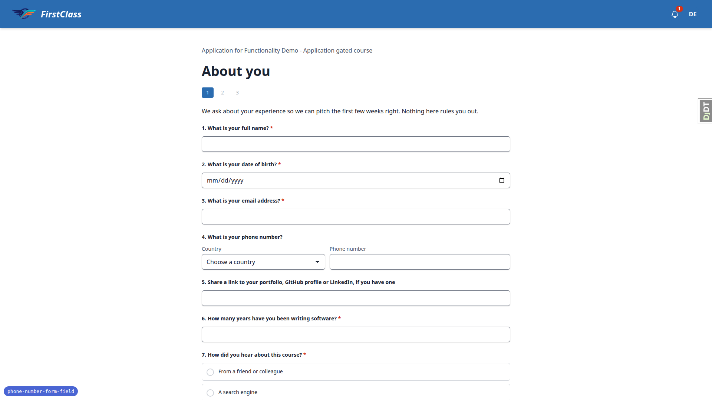
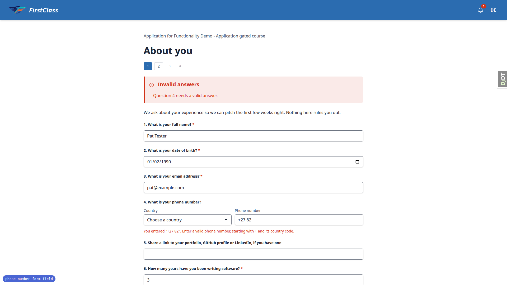
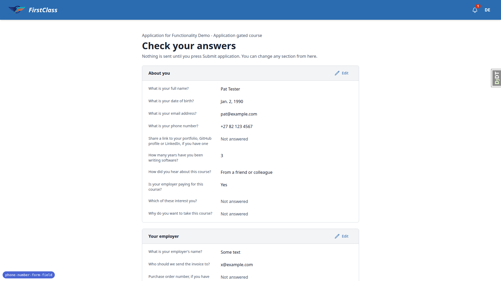
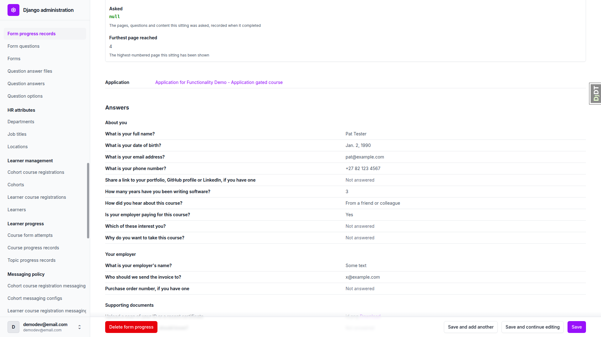
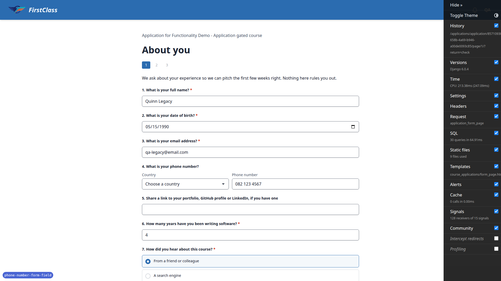
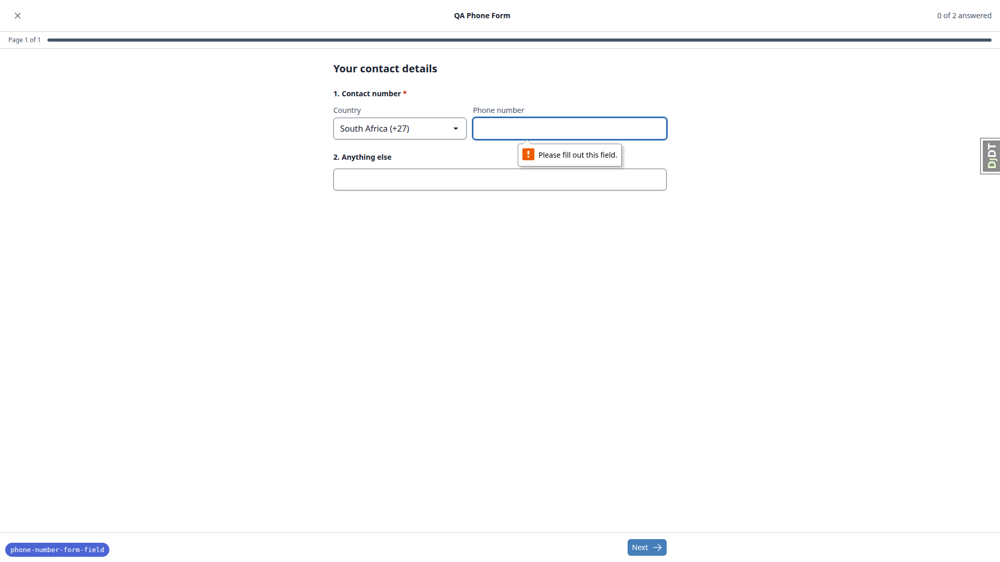
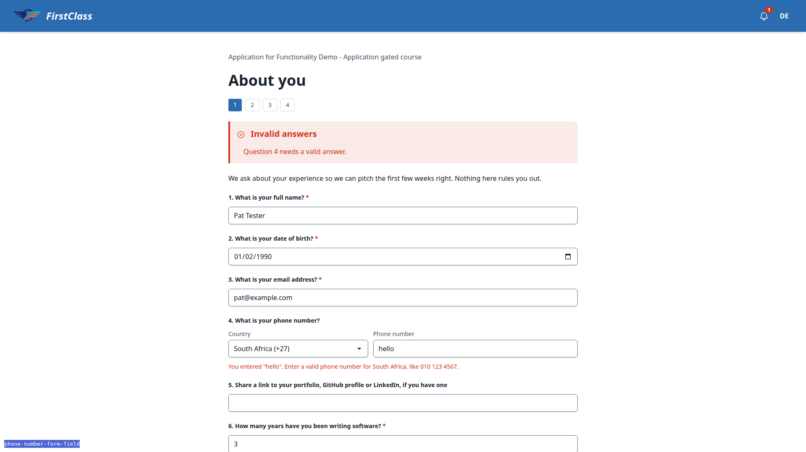
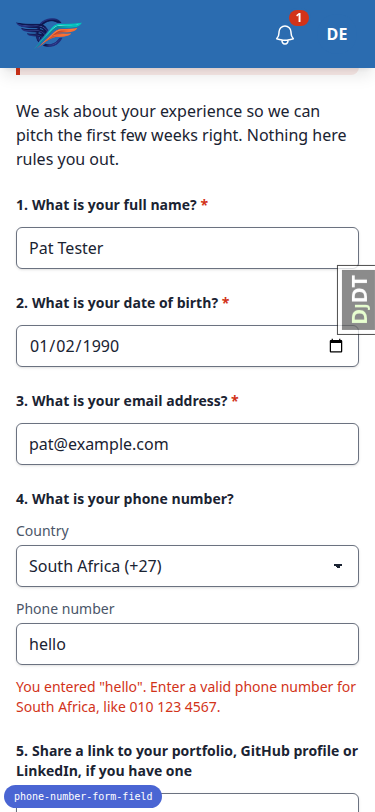
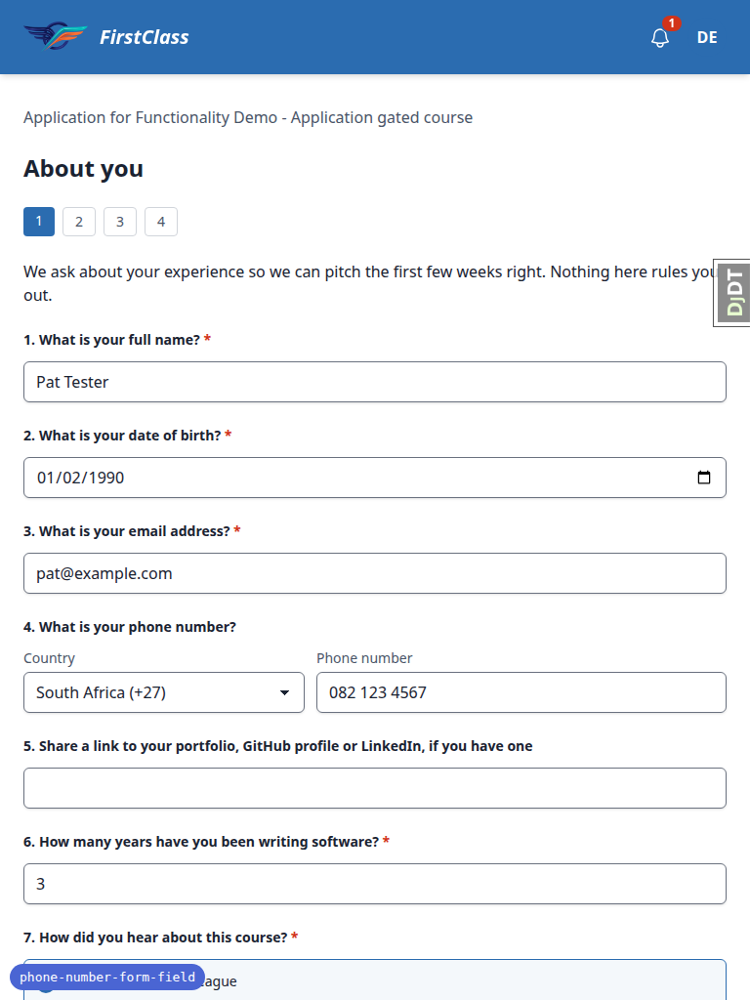

# Frontend QA report: phone number form field

Test plan: `3. frontend_qa.md`.

## Methodology

Playwright MCP driven by hand at three viewports: 1920x1080 (desktop), 375x812 (mobile) and 768x1024 (tablet). Screenshots were collected into `screenshots/` beside this report, and every referenced image exists there. The branch dev DB was empty at the start and was seeded by the data helper (see Data changes).

## Diff scoping

- Class: FULL
- Changed files:
  - `freedom_ls/form_engine/templates/form_engine/inputs/phone_input.html`
  - `freedom_ls/form_engine/templates/form_engine/question.html`
  - `freedom_ls/form_engine/phone_numbers.py`
  - `freedom_ls/form_engine/models.py`
  - `freedom_ls/form_engine/submissions.py`
  - `freedom_ls/form_engine/typed_answers.py`
  - `freedom_ls/form_engine/templatetags/form_engine_tags.py`
  - `pyproject.toml`
  - `uv.lock`
  - `tests`
- Skipped: nothing. All three viewports ran.

## Smoke gate

Outcome: pass. Pages checked: `/` and `/applications/application/<id>/page/1/`. No failure URL or reason.

## Design check

No design states tested.

## Results

| Test | Viewport | Status | Notes | Screenshot |
|---|---|---|---|---|
| 1 | desktop | pass | Country select + Phone number input with visible labels side by side; first option "Choose a country"; 245 countries alphabetical with calling codes, Åland Islands at index 2 between Afghanistan and Albania; select/tel input border 1px, radius 6px, padding 12px same as email input; Tab moves Country -> Phone number; autocomplete=tel inputmode=tel; select name `phone_country_<id>` outside the `question_` prefix; no sideways scroll |  |
| 2 | desktop | pass | en-ZA->South Africa (+27); en-GB,en;q=0.9->United Kingdom (+44); fr-FR;q=0.5, de-DE;q=0.9->Germany (+49); es-419->Choose a country; *->Choose a country, 200; html lang stays en and country names stay English | none |
| 11.6 | desktop | pass | Accept-Language of 2000 junk chars: 200, Choose a country | none |
| 4.1-4.3,4.5-4.7 | desktop | pass | no country+national, ZA hello, ZA 0800 FLOWERS, ZA ext. 12, no country +27 82: each 422 with Invalid answers callout naming question 4, exact spec message under the controls in error colour rgb(210,51,25), number and country kept, other answers kept, aria-invalid=true and aria-describedby=question_<id>_error |  |
| 4.4 | desktop | fail | ZA + '082 123' is ACCEPTED and stored as +2782123 (page advanced). phonenumbers 9.0.43 is_valid_number(+2782123) is True (ZA metadata treats 82 short numbers as valid MOBILE; +27821234..+2782123456 all valid). Code follows the spec's "validate strictly with is_valid_number"; the QA plan expects refusal. See B1 | none |
| 4.6 | desktop | fail | No country + '+27 82 123' is ACCEPTED (stored +2782123), same library cause as 4.4. A shorter '+27 82' is refused with the + message as expected. See B1 | none |
| 4.8 | desktop | pass | ZA + (082) 123-4567 accepted; check-your-answers shows +27 82 123 4567 |  |
| 4.9 | desktop | pass | after a stored valid answer, submitting hello is refused; leaving and opening check-your-answers still shows +27 82 123 4567 | none |
| 3 | desktop | pass | en-ZA: ZA preselected, 082 123 4567 + Next -> page 2; Previous -> ZA + 082 123 4567; check-your-answers +27 82 123 4567; Edit -> ZA + 082 123 4567; admin form progress answers show +27 82 123 4567 |  |
| 5 | desktop | pass | en-GB: United Kingdom preselected; +27 82 123 4567 accepted; check-your-answers +27 82 123 4567; Edit shows South Africa + 082 123 4567 | none |
| 6 | desktop | pass | legacy sitting (qa-legacy, separate context): check-your-answers and admin show 082 123 4567 as stored; form page under en-ZA shows 082 123 4567 with Choose a country; Save gives the Choose a country message; picking South Africa saves and shows +27 82 123 4567 |  |
| 7.1-7.2 | desktop | pass | optional phone empty with ZA preselected is accepted, check-your-answers "Not answered"; clearing a stored number (country left) is accepted and the answer is gone | none |
| 7.3 | desktop | pass | course form, required Contact number empty: browser "Please fill out this field." on the tel input, nothing submitted, no dialog |  |
| 8.1-8.4 | desktop | pass | ZA preselected, tally 0 of 2; change country still 0 of 2; type number 1 of 2; clear 0 of 2; valid number + Next -> Ready to submit dialog Answered 1 / Total 2; Submit -> complete page |  |
| 8.5 | desktop | skip | course offers no read-only view of the completed form (complete page has only Continue); plan step is conditional | none |
| 9 | desktop | pass | admin Export selected course applications CSV: phone column holds '+27821234567 for the Test 3 sitting. The legacy sitting's cell was also '+27821234567 because Test 6.3 had already converted that row; the raw-legacy cell could not be observed after that (test order), covered by unit tests | none |
| 10 | desktop | pass | JS disabled context (login works): both controls render, select changes, hello + Next -> error message, number and country kept; 082 123 4567 + Next -> page 2. Preselection here came from the stored answer; header preselection is server-side and verified in Test 2 |  |
| 11.1 | desktop | pass | application pages 2-4 (no phone question, incl. file upload, time and select) render and submit as before | none |
| 11.2 | desktop | pass | malformed email and phone hello in one submission: both messages, each under its own question | none |
| 11.3 | desktop | pass | after repeated saves the admin QuestionAnswer list has one phone row per sitting | none |
| 11.4 | desktop | pass | select value hand-set to ZZ + 082 123 4567: 422 with the Choose a country message, select back on Choose a country, no server error | none |
| 11.5 | desktop | pass | `` quoted as text in the South Africa message; no dialog, no injected script | none |
| 1,4 | mobile | pass | 375: Country stacks above Phone number, full width; error message wraps under the controls; scrollWidth 375; check-your-answers scrollWidth 375 |  |
| 1,3 | tablet | pass | 768: Country and Phone number side by side, ZA + 082 123 4567 refill; scrollWidth 768 |  |

## Bugs

### B1: Short South African mobile-range numbers are accepted as valid

Manifestations:
- Test 4.4, desktop
- Test 4.6, desktop

Screenshots: none.

Expected: QA plan: ZA + `082 123` and no country + `+27 82 123` are refused with the South Africa / + message.

Actual: Both accepted and stored as +2782123. phonenumbers 9.0.43 metadata marks +2782123 .. +2782123456 as valid MOBILE for ZA, and the spec decided to validate with is_valid_number. Code matches the spec; the QA plan's expectation contradicts the library. Needs a product decision: accept the library's verdict (and correct the QA plan), or add a stricter rule such as requiring the country's example-number length or rejecting numbers whose type is not FIXED_LINE/MOBILE of full length.

## Layout probe

| Test | Viewport | URL | Screenshot | Result |
|---|---|---|---|---|
| 1 | desktop | `/applications/application/<id>/page/1/` |  | clean |
| 7.3 | desktop | `/courses/qa-phone-course/1/fill_form/1` |  | clean |
| 1,4 | mobile | `/applications/application/<id>/page/1/` |  | clean |
| 1,3 | tablet | `/applications/application/<id>/page/1/` |  | clean |

## Data changes

| Via | What |
|---|---|
| sdd:qa-data-helper | Seeded empty branch dev DB: `create_demo_data --yes`, `content_save demo_content DemoDev` (DemoDev site, demodev QA admin, demo courses) |
| sdd:qa-data-helper | QA Phone Course (slug `qa-phone-course`) with QA Phone Form: required phone "Contact number" + optional short_text "Anything else"; demodev registered |
| sdd:qa-data-helper | Learner `qa-legacy@email.com` with unsubmitted application 85710930 on the gated course; phone answer `text_answer='082 123 4567'` written directly |

## Bug status

| Bug | Title | Status |
|---|---|---|
| B1 | Short South African mobile-range numbers are accepted as valid | **RESOLVED** (decision: keep the library's verdict, as the spec says. No stricter rule: one generic enough for every country would refuse real numbers in variable-length countries such as Austria and Germany. Test 4 steps 4 and 6 now use `82 12` and `+27 82 12`, which the library refuses.) |

## General notes

- Test 8.5 skipped: the course offers no read-only view of the completed form.
- Test 9's legacy cell could not be observed because Test 6.3 had converted the legacy row first.
- The DjDT collapsed tab is visible at the right edge in screenshots (dev tooling only).
- The data helper also left an uncommitted reusable command `freedom_ls/qa_helpers/management/commands/qa_create_phone_question_scenario.py` and agent-memory files under `.claude/agent-memory/sdd-qa-data-helper/` that are not part of this feature.

status: ok · reason: 1 bug: 0 fixed, 1 unresolved (red lane, product decision); report rendered, screenshots verified
