# Frontend QA report: phone number form field

Test plan: `3. frontend_qa.md`.

## Methodology

Playwright MCP, driven by hand at 1920x1080 (desktop), 375x812 (mobile) and 768x1024 (tablet). Screenshots were collected into `screenshots/` beside this report, and every image referenced here exists there.

Pre-step rebase: the branch was rebased onto origin/main before QA (25 commits, 24 replayed). One modify/delete conflict: main's "cleaned up specs" commit deleted `spec_dd/2. in progress/downstream_bugs_oct_29/learner-ux-polish-from-mega-qa/idea.md`, so the branch commit that added a "superseded" note to it was dropped. The lost-change check reviewed clean. Full tier: 13049 passed, 2 failed under parallel load (`test_bulk_add_then_remove_cohort_for_every_matching_learner`, `test_generating_a_report_by_keyboard_keeps_focus_inside_the_downloads_card`, both educator_interface Playwright tests the branch does not touch); both passed on re-run. Pre-commit clean. Upstream-change review: direction unchanged. The rebase's separate front-end smoke pass was folded into this QA run, which visits the same pages at all three viewports.

## Diff scoping

Class: FULL.

Changed files that triggered it:

- `freedom_ls/form_engine/templates/form_engine/inputs/phone_input.html`
- `freedom_ls/form_engine/templates/form_engine/question.html`
- `freedom_ls/form_engine/static/form_engine/js/alpine-components.js`
- `freedom_ls/learner_interface/templates/learner_interface/_exam_runner_base.html`
- `freedom_ls/form_engine/phone_numbers.py`
- `freedom_ls/form_engine/models.py`
- `freedom_ls/form_engine/submissions.py`
- `freedom_ls/form_engine/typed_answers.py`
- `freedom_ls/form_engine/templatetags/form_engine_tags.py`
- `freedom_ls/base/csv_safety.py`
- `pyproject.toml`
- `uv.lock`
- tests, docs and spec files

Not run: nothing was skipped, so everything ran (except the conditional Test 8.5, see General notes).

## Smoke gate

Outcome: pass. Pages loaded: `/` and `/applications/application/4683d2a8-d272-4528-8828-818ad0392127/page/1/`.

## Design check

No design states tested.

## Results

| Test | Viewport | Status | Notes | Screenshot |
|---|---|---|---|---|
| 1 | desktop | pass | Accept-Language en. Select labelled Country and tel input labelled Phone number, side by side (select 333px at x=544, input 487px at x=889, same row). Shows Choose a country; 246 options: Choose a country first, then alphabetical with calling codes, e.g. South Africa (+27); Aland Islands is 2nd country, between Afghanistan and Albania. Border 1px, radius 6px, padding 8px 12px, 42px high and the same focus ring as the email and text inputs. Tab goes Country -> Phone number. No hint with no country; South Africa -> 'For example: 71 123 4567'; United Kingdom -> 'For example: 7400 123456'; back to Choose a country -> hint hidden. Hint in muted 14px. Other questions unchanged. scrollWidth 1920. Screenshot taken with South Africa chosen to show the hint. | 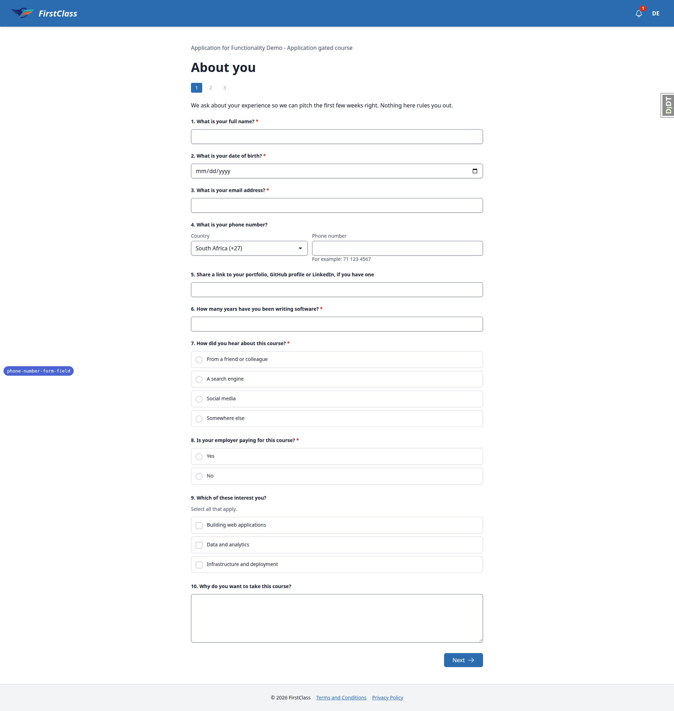 |
| 2 | desktop | pass | en-ZA -> South Africa (+27) with hint 71 123 4567; en-GB,en;q=0.9 -> United Kingdom (+44); fr-FR;q=0.5, de-DE;q=0.9 -> Germany (+49); es-419 -> Choose a country, no hint; * -> Choose a country, HTTP 200. html lang stays en and country names stay English in every step. | none |
| 4.1-4.7 | desktop | pass | Accept-Language en. Each case re-rendered with HTTP 422, the Invalid answers callout ('Question 4 needs a valid answer.'), the exact message under the two controls in the error colour rgb(210,51,25), the typed number kept, the country kept, the other answers kept. No country + 082 123 4567 -> Choose a country message, select still Choose a country. ZA + hello, ZA + 0800 FLOWERS, ZA + 82 12 -> 'Enter a valid phone number for South Africa, like 71 123 4567.' ZA + '82 123 4567 ext. 12' -> extension message. No country + '+27 82 12' -> 'Enter a valid phone number, starting with + and its country code.' ZA + 082 123 4567 -> 'Leave out the 0 at the start, like 71 123 4567.'; 27821234567 -> names 27; 0027 82 123 4567 -> names 0027. The example in the messages matches the hint. | 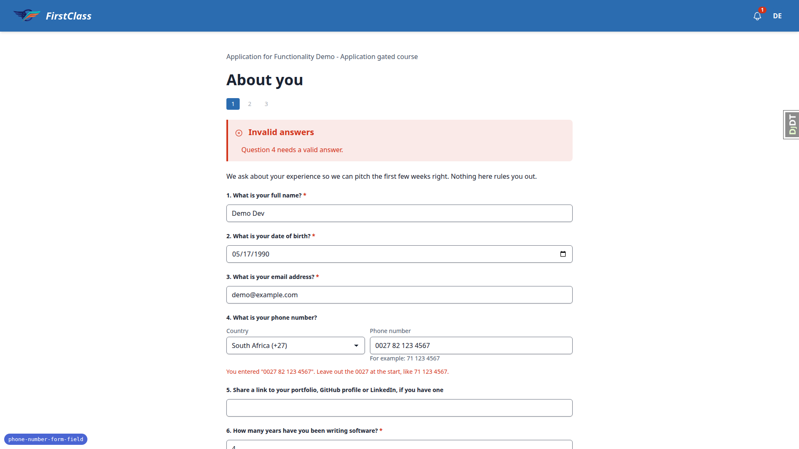 |
| 4.8 | desktop | pass | When rejected, the number input has aria-invalid=true and aria-describedby naming both question_<id>_hint and question_<id>_error; unrejected it names the hint only. Checked through the DOM/accessibility attributes. | none |
| 4.9 | desktop | pass | ZA + (82) 123-4567 accepted (302); check-your-answers shows +27 82 123 4567. | 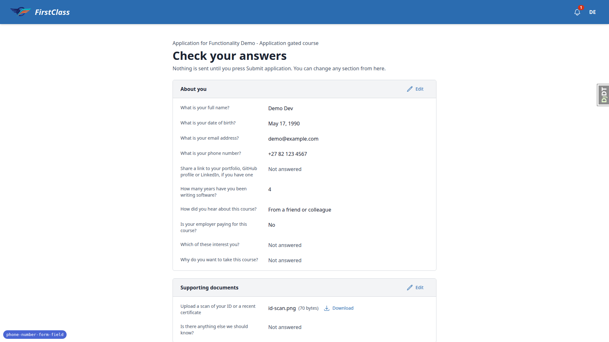 |
| 4.10 | desktop | pass | After the valid answer, Edit -> hello -> refused with 422 and the South Africa message; leaving the page and opening check-your-answers still shows +27 82 123 4567. | none |
| 3.1-3.5 | desktop | pass | en-ZA, no stored answer: South Africa preselected with hint. 82 123 4567 + Next -> next page, no error. Previous -> South Africa and 82 123 4567. Check-your-answers reads +27 82 123 4567. Edit -> South Africa and 82 123 4567; Next unchanged -> accepted, back to check-your-answers. | none |
| 7.1-7.2 | desktop | pass | en-ZA. 7.2: with a stored number, cleared the number and left South Africa selected -> accepted, check-your-answers shows 'Not answered'. 7.1: number empty with South Africa preselected -> accepted, phone 'Not answered'. | none |
| 5 | desktop | pass | en-GB with no stored answer: United Kingdom (+44) preselected. '+27 82 123 4567' + Next accepted. Check-your-answers shows +27 82 123 4567. Edit shows South Africa (+27) and 82 123 4567. | none |
| 3.6 | desktop | pass | Admin form progress record for demodev's application lists 'What is your phone number? +27 82 123 4567'; the QuestionAnswer changelist shows the same. | none |
| 9 | desktop | pass | Admin action 'Export selected course applications' on all four applications downloads CourseApplication-2026-11-12.csv. Column 'What is your phone number?' holds +27821234567 for demodev's sitting (no leading apostrophe) and 082 123 4567 for both legacy sittings (exported before Test 6 converted one). The downloaded CSV was removed from the screenshot directory so it is not committed. | none |
| 6 | desktop | pass | qa-legacy@email.com in a separate browser context, en-ZA. Check-your-answers and the admin answers list show 082 123 4567 as stored. Form page: input holds 082 123 4567, select on Choose a country despite en-ZA, no hint. Next unchanged -> Choose a country message. South Africa + Next -> 'Leave out the 0 at the start, like 71 123 4567.' Changed to 82 123 4567 + Next -> accepted; check-your-answers reads +27 82 123 4567 and the refill is South Africa + 82 123 4567. | 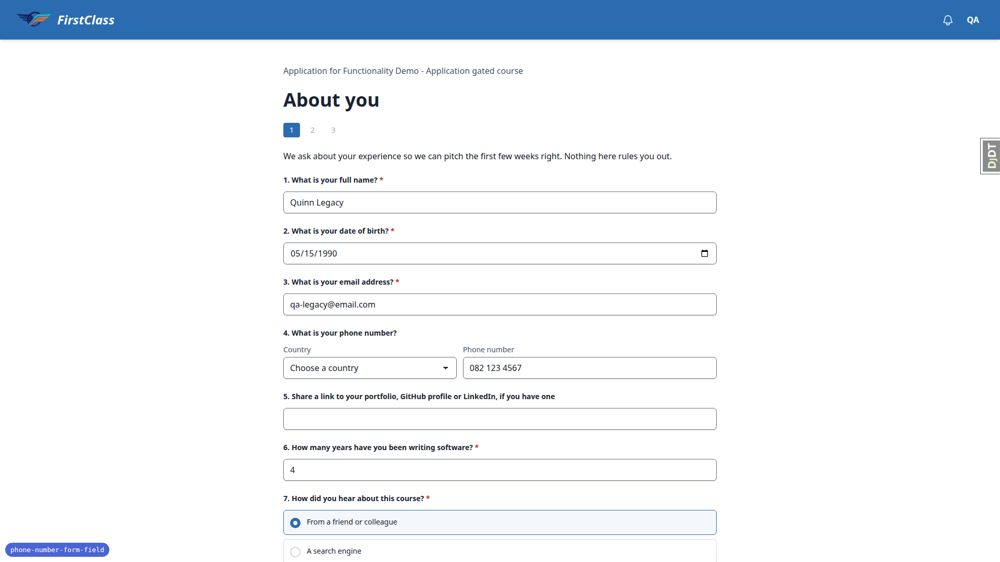 |
| 11.2 | desktop | pass | One submission with date '31/31/2020', email 'not-an-email' and phone 'hello' (native input types bypassed): callout 'Questions 2, 3 and 4 need valid answers.' and each message under its own question: 'Enter a date in the format YYYY-MM-DD.', 'Enter a valid email address.', and the South Africa phone message. | none |
| 11.3 | desktop | pass | Next, Previous, Next with the same valid phone answer: check-your-answers shows one value and the admin QuestionAnswer list has a single phone row for demodev's sitting. | none |
| 11.4 | desktop | pass | Select value hand-set to ZZ with 082 123 4567: HTTP 422 with the Choose a country message, select back on Choose a country, no server error. | none |
| 11.5 | desktop | pass | `` as the number: message quotes it as text, no dialog fired, no script element injected. | none |
| 11.6 | desktop | pass | Accept-Language of 2,000 junk characters: page renders with HTTP 200. With no stored answer (1,914-character junk header during Test 2) the select shows Choose a country; with a stored answer the stored country shows, as the spec's precedence says. | none |
| 7.3 | desktop | pass | QA Phone Course form, en-ZA, required Contact number empty with South Africa preselected: pressing Next sends no request, focus lands on the number input with the browser's 'Please fill out this field.' prompt, no submit dialog opens. The select itself is not required. | none |
| 8.1-8.4 | desktop | pass | South Africa preselected, tally '0 of 2 answered'. Country changed to United Kingdom: still 0 of 2. Number typed: 1 of 2. Cleared: 0 of 2. Valid number + Next: 'Ready to submit?' dialog shows 1 Answered, 2 Total questions. Submit -> 'Form complete!' page, course 100%. | 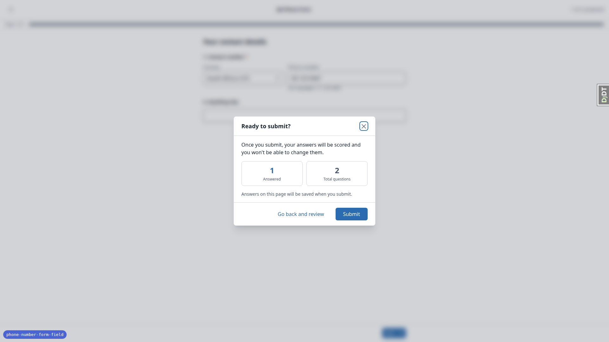 |
| 8.5 | desktop | skip | The course offers no read-only view of the completed form: the complete page has only Continue, and the form URL redirects to the start page listing 'Previous attempts' with no link. The plan step is conditional ('if the course offers one'). Disabled rendering is covered by the template tests. | none |
| 10 | desktop | pass | JavaScript disabled context, en-ZA, no stored answer: both controls render, South Africa (+27) preselected from the header, hint 'For example: 71 123 4567' visible. The select changes to United Kingdom and the hint stays on the South African example, as expected. 'hello' + Next -> 422 with the Invalid answers callout and the South Africa message, number and country kept. '82 123 4567' + Next -> next page. With no country the server renders the hint with display:none, so nothing depends on script. | 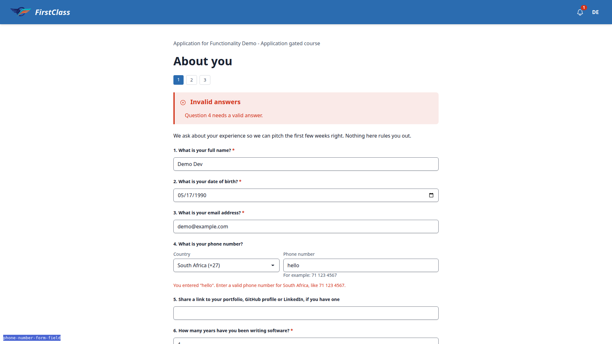 |
| 11.1 | desktop | pass | Application pages with no phone question (Supporting documents with a file upload; Availability with a time and a select) render and submit as before, through to check-your-answers. | none |
| exam-runner-title | desktop | fail | Outside the plan, seen during Test 8: the exam runner page /courses/qa-phone-course/1/fill_form/1 renders an empty `<title>` element (whitespace only), so the browser tab and screen readers get no page title. Sibling pages have one, e.g. the form start page 'QA Phone Form — QA Phone Course — DemoDev'. Pre-existing: this branch only added a script tag to `_exam_runner_base.html`; `course_form_page.html` sets no title. See B1. | 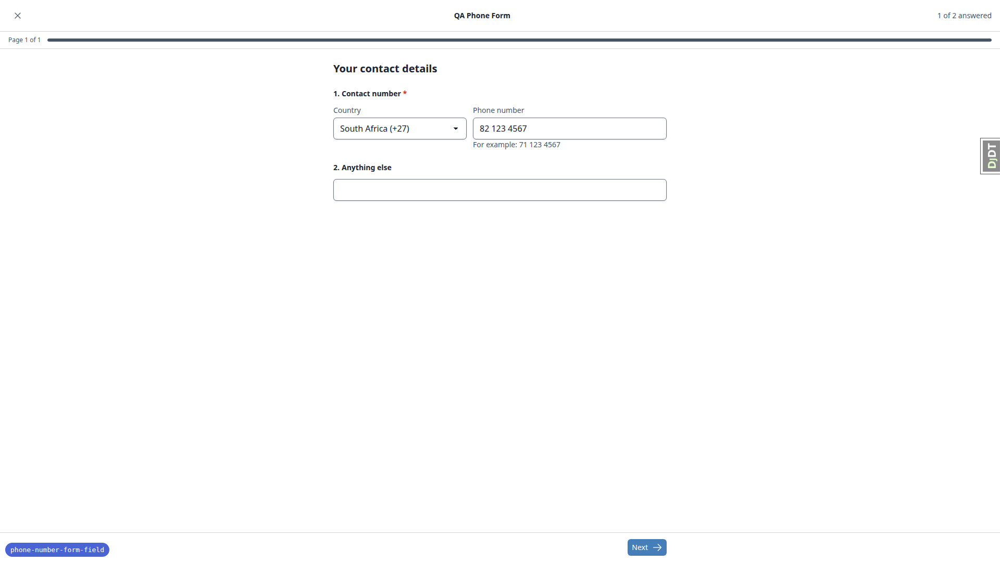 |
| 1,4 | mobile | pass | 375: Country stacks above Phone number, both full width (343px) like the email input; the hint sits under the number input; the Choose a country error wraps to two lines under the controls with number and country kept; header shows logo, notifications and user menu at 44px targets; Next is full width. scrollWidth 375. | 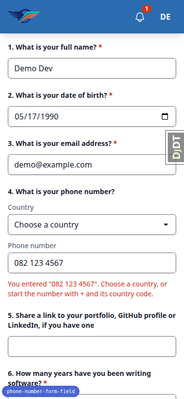 |
| 3.4 | mobile | pass | 375: check-your-answers shows +27 82 123 4567 under its question, stacked label over value; scrollWidth 375. | 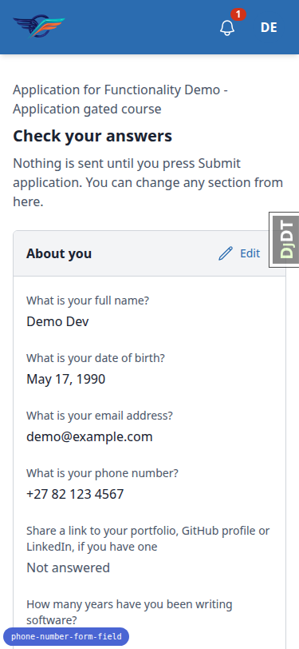 |
| 1,3 | tablet | pass | 768: Country (288px) and Phone number (420px) side by side on one row, spanning the same width as the other inputs; refill South Africa + 82 123 4567 with the hint under the number; desktop-style header. scrollWidth 768. | 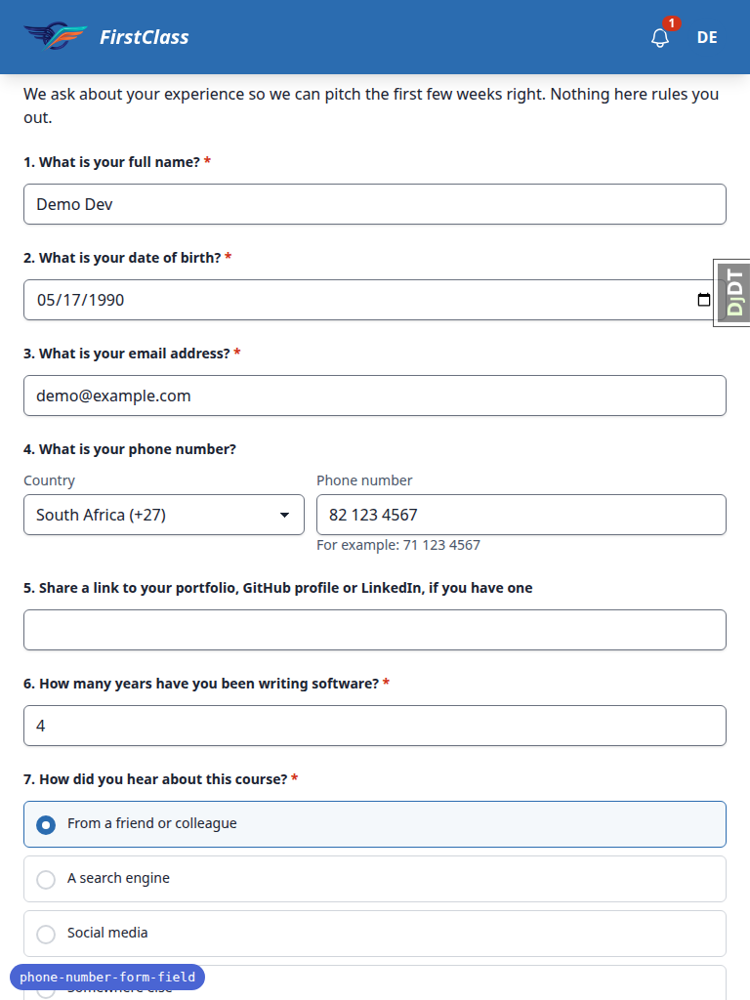 |
| 8 | tablet | pass | 768, exam runner: Country and Phone number side by side inside the same column as the 'Anything else' input, hint under the number, tally '1 of 2 answered' in the runner bar, Next in the sticky footer. scrollWidth 768. | 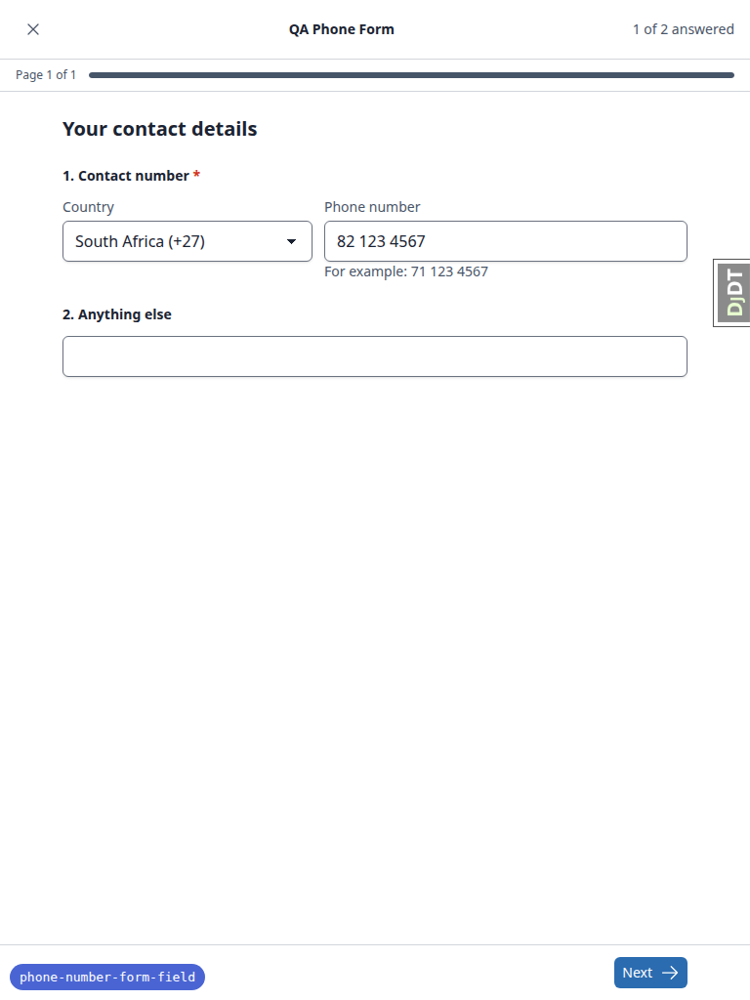 |
| 8 | mobile | pass | 375, exam runner: Country stacked above Phone number, both full width like the other input; hint under the number; tally '1 of 2 answered'; full-width Next in the sticky footer. scrollWidth 375. Reloading with an unsaved answer raises the runner's leave-page warning, as designed. | 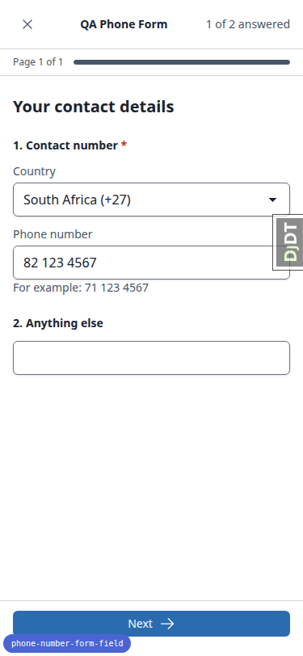 |
| 8.4 | mobile | pass | 375: 'Ready to submit?' dialog fits the viewport (343px wide, 16px gutters) with title, close button, 1 Answered / 2 Total questions, and full-width Submit and 'Go back and review' buttons. | 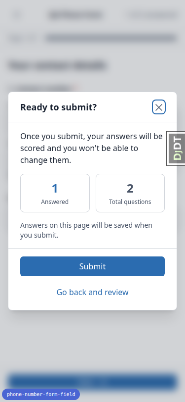 |

## Bugs

### B1: Exam runner form page has an empty page title

Manifestations:

- `exam-runner-title`, desktop

Expected: The form page in the exam runner (`/courses/<slug>/<n>/fill_form/<page>`) has a non-empty `<title>` naming the form, like its sibling pages (start page: 'QA Phone Form — QA Phone Course — DemoDev').

Actual: The `<title>` element holds only whitespace, so the browser tab and assistive technology get no page title. Pre-existing and unrelated to the phone question: `learner_interface/course_form_page.html` sets no title.

## Layout probe

| Test | Viewport | URL | Screenshot | Result |
|---|---|---|---|---|
| smoke | desktop | `/` | [page-2026-11-12T12-12-12-570Z.png](screenshots/page-2026-11-12T12-12-12-570Z.png) | clean |
| 1 | desktop | `/applications/application/<id>/page/1/` | [page-2026-11-12T12-15-08-656Z.png](screenshots/page-2026-11-12T12-15-08-656Z.png) | clean |
| 4.1-4.7 | desktop | `/applications/application/<id>/page/1/` (422 re-render) | [page-2026-11-12T12-16-57-201Z.png](screenshots/page-2026-11-12T12-16-57-201Z.png) | clean |
| 4.9 | desktop | `/applications/application/<id>/check-your-answers/` | [page-2026-11-12T12-17-30-919Z.png](screenshots/page-2026-11-12T12-17-30-919Z.png) | clean |
| 8.1-8.3 | desktop | `/courses/qa-phone-course/1/fill_form/1` | [page-2026-11-12T12-21-56-057Z.png](screenshots/page-2026-11-12T12-21-56-057Z.png) | clean |
| 1,4 | mobile | `/applications/application/<id>/page/1/` (422 re-render) | [page-2026-11-12T12-24-25-977Z.png](screenshots/page-2026-11-12T12-24-25-977Z.png) | clean |
| 3.4 | mobile | `/applications/application/<id>/check-your-answers/` | [page-2026-11-12T12-24-39-906Z.png](screenshots/page-2026-11-12T12-24-39-906Z.png) | clean |
| 1,3 | tablet | `/applications/application/<id>/page/1/` | [page-2026-11-12T12-24-51-409Z.png](screenshots/page-2026-11-12T12-24-51-409Z.png) | clean |
| 8 | tablet | `/courses/qa-phone-course/1/fill_form/1` | [page-2026-11-12T12-26-15-491Z.png](screenshots/page-2026-11-12T12-26-15-491Z.png) | clean |
| 8 | mobile | `/courses/qa-phone-course/1/fill_form/1` | [page-2026-11-12T12-26-35-200Z.png](screenshots/page-2026-11-12T12-26-35-200Z.png) | clean |

## Data changes

| What changed | Via |
|---|---|
| demodev's application 4683d2a8 on the gated course: deleted its 12 answers (incl. stored phone +27821234567), 3 selected options and 1 uploaded file; furthest page reset to 0; still unsubmitted | sdd:qa-data-helper |
| QA Phone Course: deleted demodev's completed form progress (1 answer, 1 attempt) and the 100% course progress record; registration kept; form blank again | sdd:qa-data-helper |
| Legacy learners qa-legacy@email.com (reset, application 85710930) and qa-legacy2@email.com (new, application c34b81a0): unsubmitted gated-course applications with phone text_answer '082 123 4567' written directly; other required page-1 answers filled | sdd:qa-data-helper |
| After the desktop pass submitted it: deleted demodev's completed QA Phone Form progress (1 answer, 1 attempt) and course progress again, so the exam runner could be checked at tablet and mobile | sdd:qa-data-helper |

## Bug status

- **FIXED** (commit: 3d749ca02) — Exam runner form page has an empty page title. Re-verified in the browser: `/courses/qa-phone-course/1/fill_form/1` now has the title "QA Phone Form — QA Phone Course — DemoDev", matching the form's start page.

## General notes

- Test 8.5 was skipped: the course offers no read-only view of the completed form (the complete page has only Continue, and the form URL redirects to the start page listing 'Previous attempts' with no link). The plan step is conditional, and disabled rendering is covered by the template tests.
- Rebase note: see Methodology. The branch was rebased onto origin/main before QA; one superseded-note commit was dropped because main deleted its target file.
- Data helper residue: the data helper saved a reset script at `.claude/agent-memory/sdd-qa-data-helper/qa_phone_course_demodev_reset_script.py` (untracked). It is not part of the QA artifacts and was not committed by this run.
- The collapsed DjDT tab at the right edge of the screenshots is dev tooling, not part of the product.
- The screenshot compression step found nothing over the size limit.
- The full test run after the B1 fix did not finish: the machine ran critically low on memory and the run was stopped before pytest printed a summary, so it was not restarted. What did pass: the full suite straight after the rebase (before the fix), and the fixer's targeted run for the fix (1058 passed). The fix touches one template and adds one test. CI on the pushed branch runs the whole suite.

status: ok · reason: 1 bug — 1 fixed, 0 unresolved; report rendered, screenshots verified
