# Frontend QA report: Profile picture on id-only rows

Run 2026-11-20, base URL http://127.0.0.1:8408. Result: all tests passed, no bugs.

## Methodology

Screenshots were collected into `spec_dd/2. in progress/profile-picture-on-id-rows/screenshots/` and every image referenced below exists beside this report. Tests ran in a browser at desktop (1920), tablet (768) and mobile (375), inspecting the DOM for `img[data-profile-picture]`, `panel-avatar-N` classes, sideways scroll and `src="None"`.

## Diff scoping

Class: **FULL**. Changed files that triggered it: `freedom_ls/educator_interface/templates/...`, `freedom_ls/panel_framework/templates/cotton/panel-attention-row.html`, `freedom_ls/educator_interface/views.py`, `freedom_ls/educator_interface/reporting.py`, `freedom_ls/educator_interface/avatars.py`, `freedom_ls/audit_log/models.py`, `freedom_ls/educator_interface/templatetags/educator_tags.py`. Nothing was skipped: all viewports and all tests ran.

## Smoke gate

Pass. Pages loaded: `/` and `/educator/organisations/demodev/dashboard`.

## Design check

No design states tested.

## Layout probe

| Test | Viewport | URL | Screenshot | Result |
|---|---|---|---|---|
| 1 | desktop | /educator/organisations/demodev/dashboard | 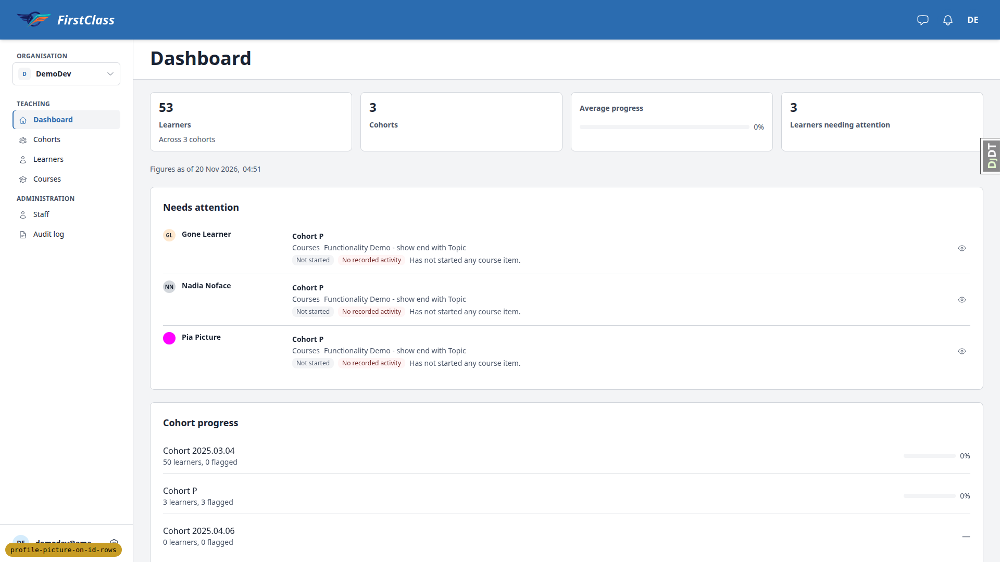 | clean |
| 3 | desktop | /educator/organisations/demodev/cohorts/<cohort-p> | 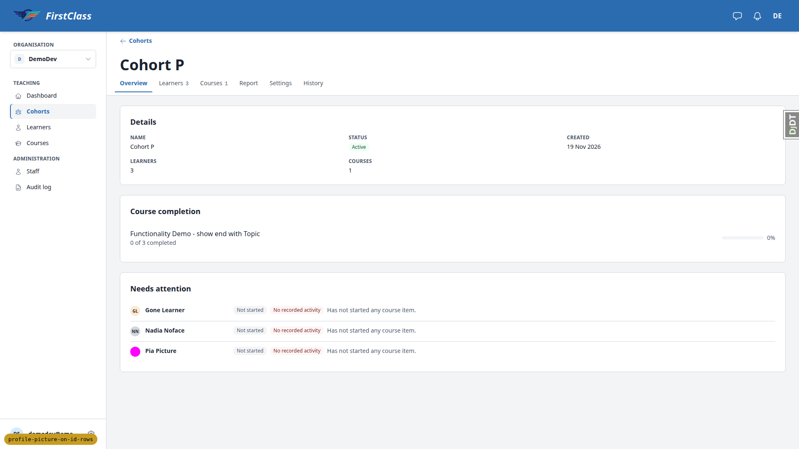 | clean |
| 4 | desktop | /educator/organisations/demodev/cohorts/<cohort-p>/__tabs/report | 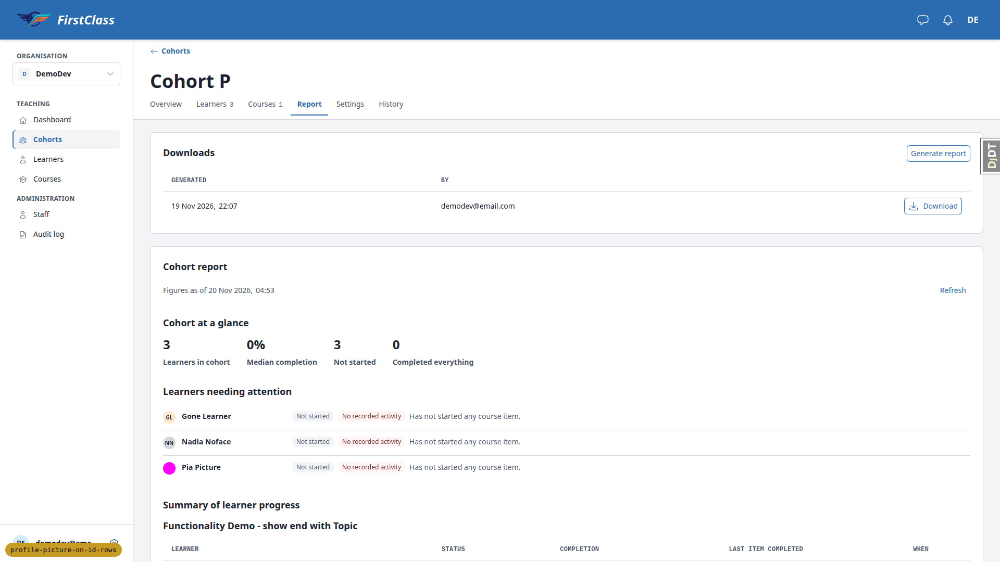 | clean |
| 5 | desktop | /educator/organisations/demodev/audit-log |  | clean |
| 1 | mobile | /educator/organisations/demodev/dashboard | 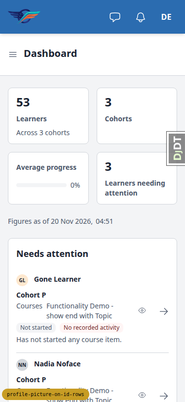 | clean |
| 3 | mobile | /educator/organisations/demodev/cohorts/<cohort-p> | 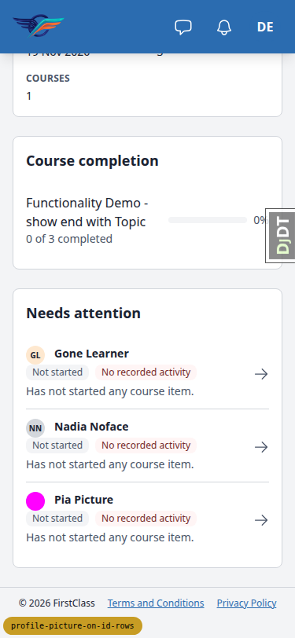 | clean |
| 4 | mobile | /educator/organisations/demodev/cohorts/<cohort-p>/__tabs/report | 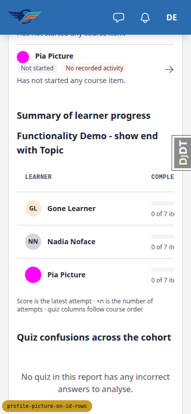 | clean |
| 5 | mobile | /educator/organisations/demodev/audit-log | 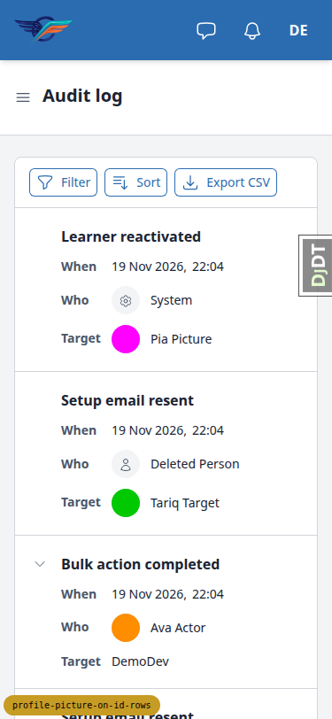 | clean |
| 4 | tablet | /educator/organisations/demodev/cohorts/<cohort-p>/__tabs/report | 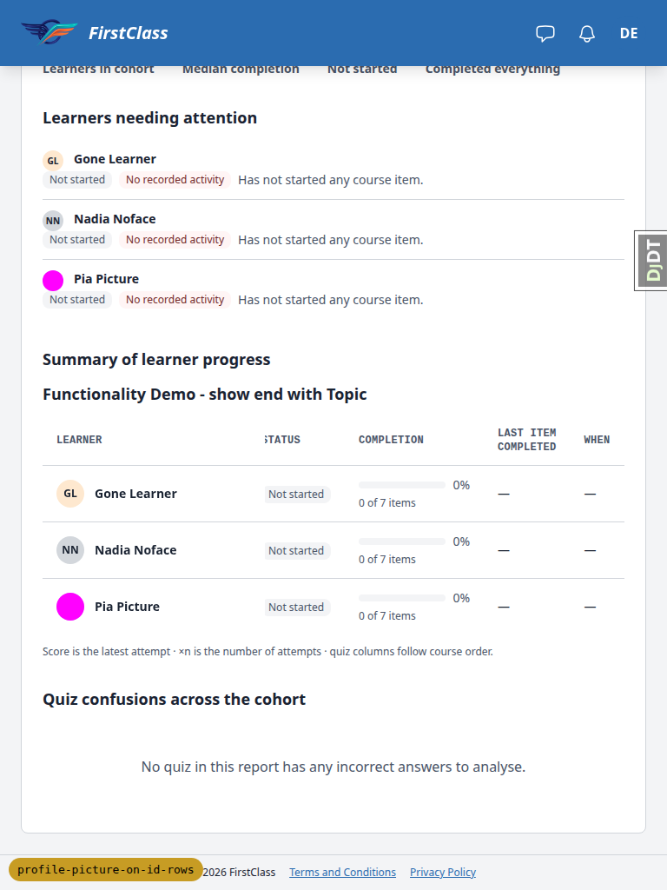 | clean |
| 1 | tablet | /educator/organisations/demodev/dashboard | 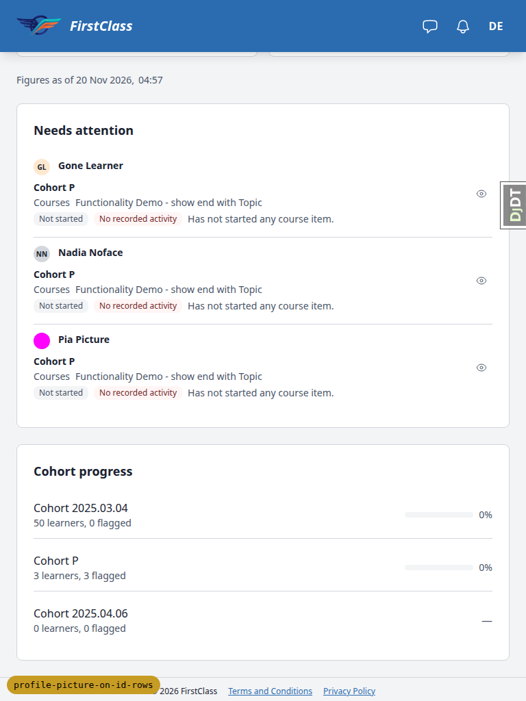 | clean |

## Test results

| Test | Viewport | Result | Notes |
|---|---|---|---|
| 1 | desktop | pass | Pia shows the picture (alt="", loaded); Nadia and Gone show initials. Links and quick view work. Pictures persist after reload.  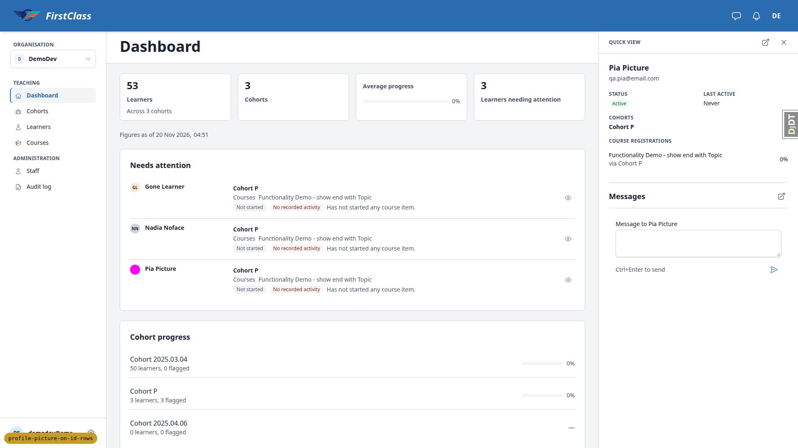 |
| 2, 2.4 | desktop | pass | `panel-avatar-N` classes match the learners table (Nadia 2, Gone 3, Pia 4). |
| 3 | desktop | pass | Cohort P Needs attention shows the picture and initials; avatar top-aligned with the name.  |
| 4 | desktop | pass | Report tab shows pictures in both tables and after Refresh. The new PDF has no images (pdfimages).  |
| 5 | desktop | pass | Table, bulk run detail, sort/filter, Deleted Person, System and the learner and cohort History tabs all correct.  |
| 7 | desktop | pass | A 404 src removes the img and the initials show. 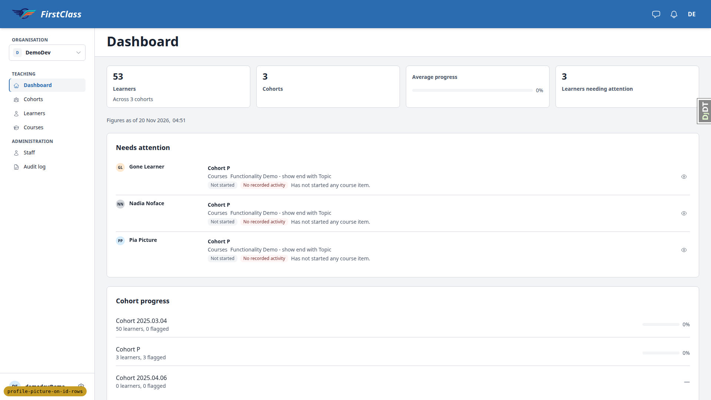 |
| 1.5 | mobile | pass | Whole row is the tap target; picture not clipped.  |
| 3.3 | mobile | pass |  |
| 4.4 | mobile | pass | Sticky Learner column holds; picture stays in its cell.  |
| 5.8 | mobile | pass | Cards carry the same pictures and chips.  |
| 4.4 | tablet | pass |  |
| 1-5 | tablet | pass | No sideways scroll anywhere; avatars aligned.  |
| 6.2 | desktop | pass | Tariq shows TT initials after his picture is cleared.  |
| 6.4 | desktop | pass | Pages render fully after Gone Learner was deleted. 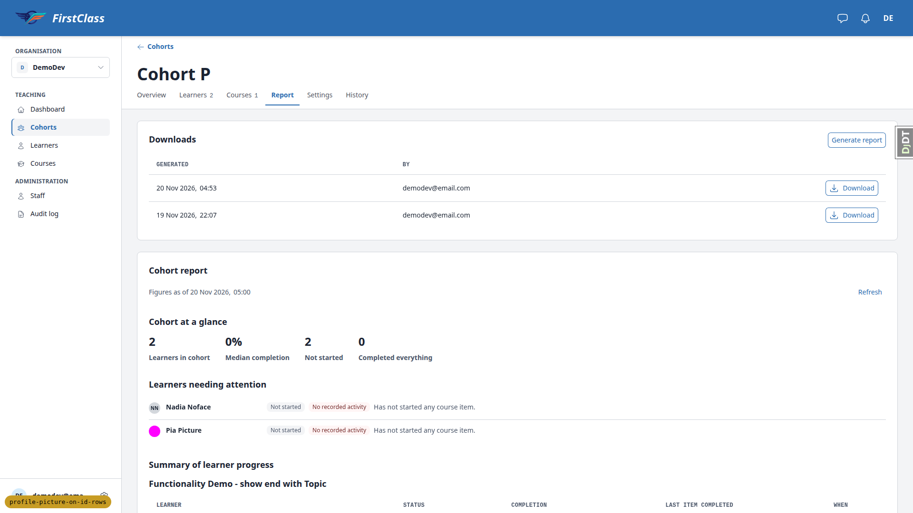 |

## Data changes

| What changed | Made by | Files written |
|---|---|---|
| Restored Tariq Target (user 75) green profile picture, cleared by the previous QA run Test 6 | sdd:qa-data-helper | none |
| Test 6: cleared Tariq Target (user 75) profile picture via ProfilePictureForm remove; deleted Gone Learner's CourseProgress efb2ba71 (PROTECT FK blocked the Learner delete), then Learner fc1c44ac (cascaded 1 CohortMembership). User 74 kept. No cache cleared. | sdd:qa-data-helper | `.claude/agent-memory/sdd-qa-data-helper/reference_profile_picture_id_rows_command.md` |

## Bug status

| Bug | Status |
|---|---|
| none | no bugs recorded |

## General notes

- Test 6.4: the report figures were regathered (as of 05:00), so Gone Learner no longer appears. The cached-row chip path (initials chip for a deleted learner) could not be observed. The plan allows this ("if still listed").
- The learner History table has no Target column, because the learner is the page subject. Ava's picture shows as Who.
- Test 7's only console error was the expected 404 for the test URL.
- The scratch records hold no separate record for Test 2 step 3 beyond the class match, and Test 4's quiz-column continuation table was not distinguished from the single summary table (one table).
- Stray files in `screenshots/` (`.yml` snapshots and `.log` console logs) are not referenced.

status: ok · reason: report rendered, 0 bugs documented
