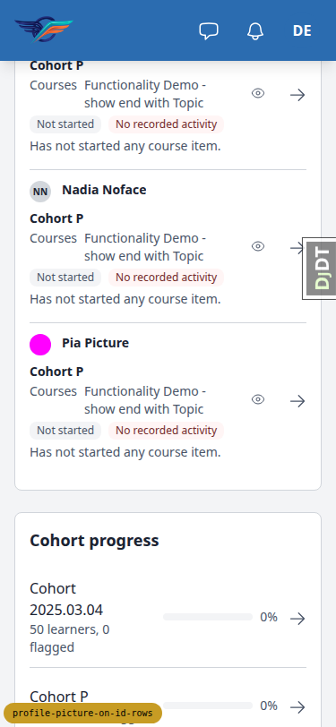
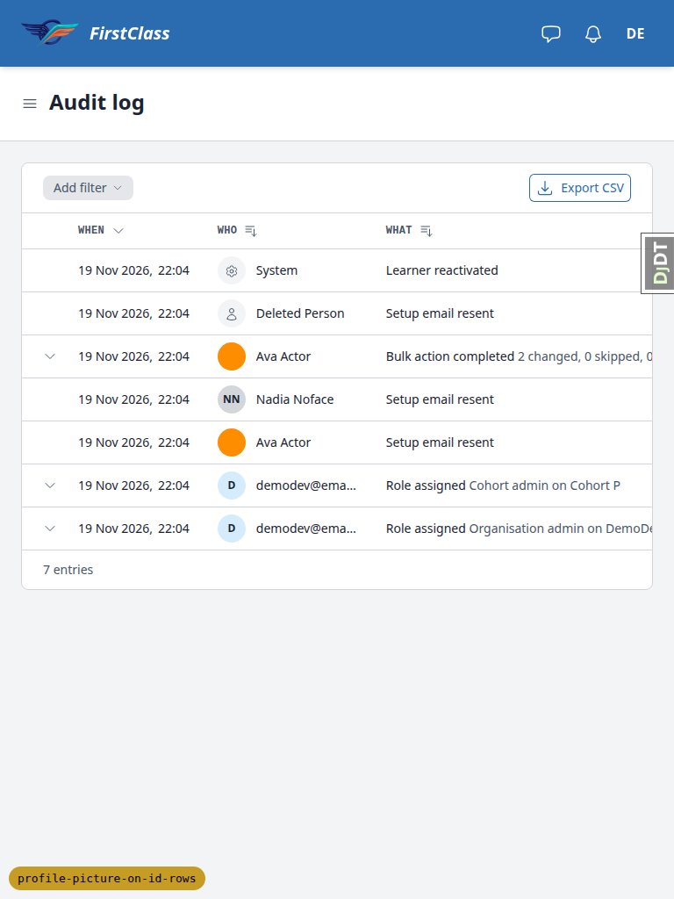
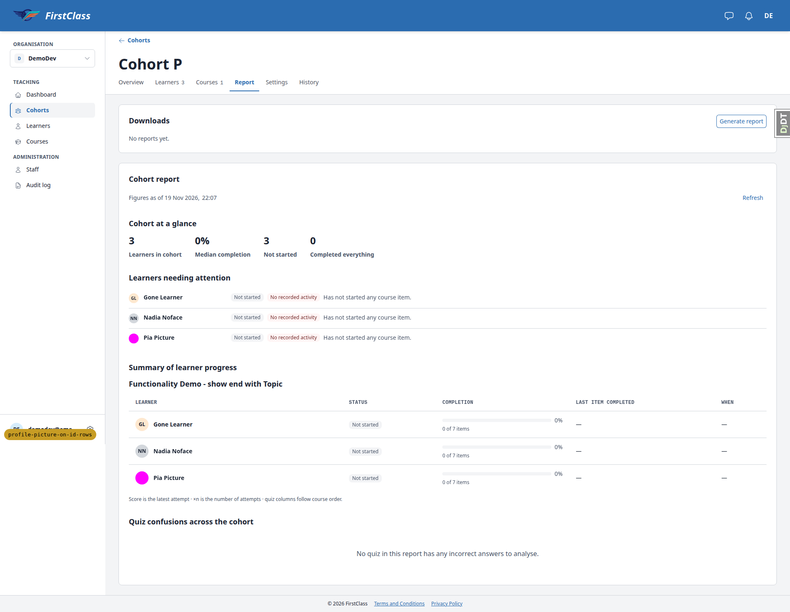
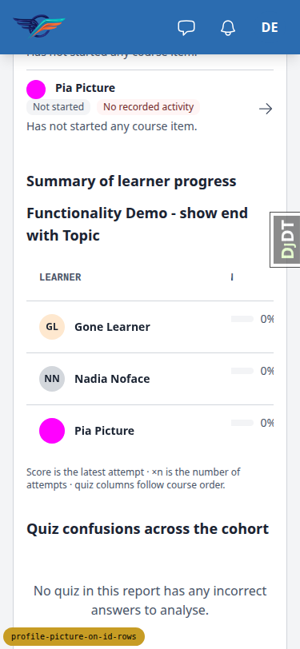
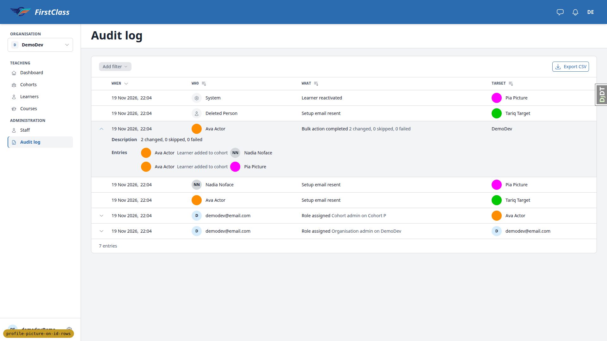
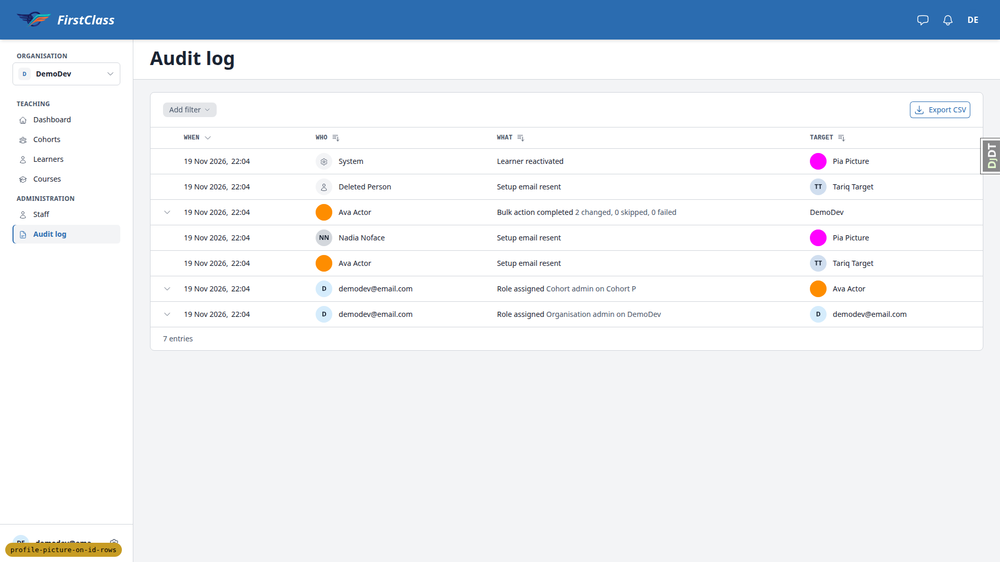
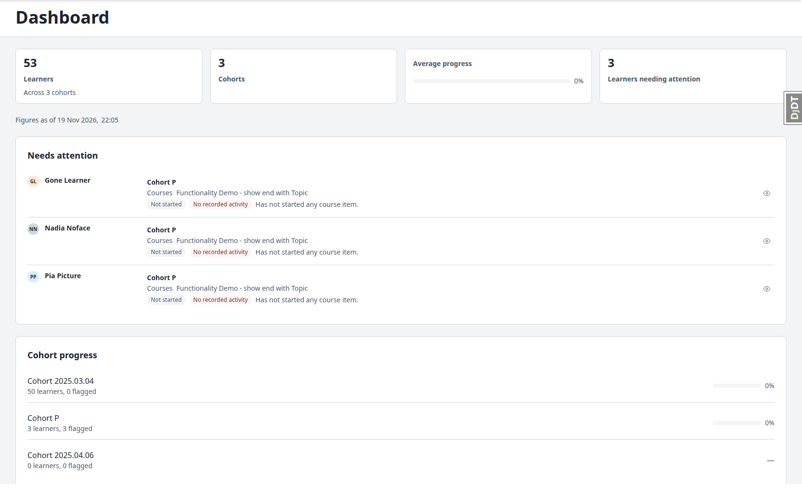
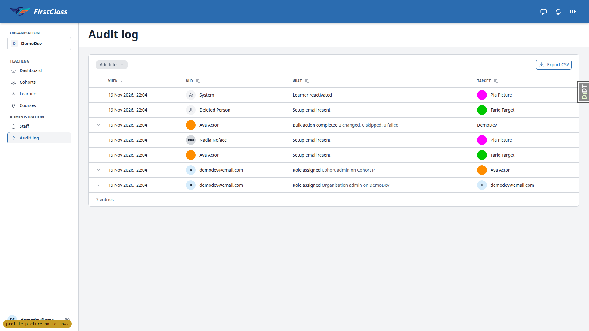

# QA report: Profile picture on id-only rows

## Methodology

Screenshots were collected into `spec_dd/2. in progress/profile-picture-on-id-rows/screenshots/` and every image referenced below sits there, beside this report. The run followed `3. frontend_qa.md` in a browser at desktop (1920), tablet (768) and mobile (375). The smoke gate passed, so no steps were skipped because of it.

## Diff scoping

Class: **FULL**. Changed files that triggered it include `freedom_ls/audit_log/models.py`, `freedom_ls/educator_interface/avatars.py`, `reporting.py`, `views.py`, `templatetags/educator_tags.py`, the audit, dashboard and cohort-report templates, `freedom_ls/panel_framework/templates/cotton/panel-attention-row.html`, their tests, and the spec files in `spec_dd/2. in progress/profile-picture-on-id-rows/`. Nothing was skipped because of scoping: every pass ran (desktop, tablet, mobile).

## Smoke gate

Outcome: **pass**. Pages loaded: `/` and `/educator/organisations/demodev/dashboard`. The first load of `/` returned 500 because the branch dev DB was empty (no DemoDev site). The data helper bootstrapped demo data, after which both pages loaded.

## Results

| Test | Title | Viewport | Result | Screenshot |
|---|---|---|---|---|
| 1 | Dashboard attention list | desktop | PASS |  |
| 1 | Dashboard attention list | mobile | PASS |  |
| 1-5 | Dashboard, cohort overview, report and audit log | tablet | PASS |  |
| 2 | Avatar colour matches the learners table | desktop | PASS | none |
| 3 | Cohort Needs attention card | desktop | PASS |  |
| 4 | On-screen cohort report | desktop | PASS |  |
| 4 | On-screen cohort report | mobile | PASS |  |
| 5 | Audit log | desktop | PASS |  |
| 5 | Audit log | mobile | PASS |  |
| 6.1-6.2 | Pictures follow the live user (picture cleared) | desktop | PASS |  |
| 6.3-6.4 | Pictures follow the live user (Learner row deleted) | desktop | **PARTIAL** (skipped) | none |
| 7 | A picture that fails to load | desktop | PASS |  |

Notes per test:

- **Test 1 (desktop):** Pia shows `img[data-profile-picture]` with `alt=""` (24x24, loaded). Nadia and Gone Learner show initials alone. The avatar sits on the name's first line. The per-cohort detail and quick-view trigger are unchanged. The name link opens Pia's learner page, the quick view opens, and a reload keeps the picture. No `src=None`.
- **Test 1 (mobile):** at 375 the picture is 24x24 with `object-fit: cover`, the trailing next icon shows, and there is no sideways scroll.
- **Test 1-5 (tablet):** at 768 the dashboard, cohort overview, report (sticky Learner column holds at 49px when scrolled) and audit log table all show the right pictures. There is no `src=None`, no page sideways scroll and no probe flags. The audit table scrolls sideways inside its card at 768, which was already the case before this change.
- **Test 2:** the `panel-avatar` slot matches the learners table: Nadia `panel-avatar-2`, Gone Learner `panel-avatar-3`, Pia `panel-avatar-4`. This held on the dashboard, the cohort Needs attention card and the learners table.
- **Test 3:** Pia shows a picture, and Nadia and Gone Learner show initials. Badges are unchanged and there is no sideways scroll.
- **Test 4 (desktop):** "Learners needing attention" and "Summary of learner progress" both show Pia's picture and initials for the others. After Refresh the pictures still show (2 imgs). The generated PDF was downloaded and `pdfimages` lists no images, so learners are named only.
- **Test 4 (mobile):** at 375 the Learner column stays sticky when the summary table scrolls sideways (left stays 33px). The picture does not overlap the next column, and there is no page sideways scroll. The cohort overview at 375 also has no sideways scroll.
- **Test 5 (desktop):** Ava to Tariq shows both pictures. Nadia to Pia shows Nadia's initials and Pia's picture. "Deleted Person" shows a neutral circle with a person icon. The System chip shows the settings icon. The bulk run detail shows Ava's picture on both run entries, with Pia's picture and Nadia's initials as targets. Sorting by Who and Target and filtering Who=Ava keep the pictures with the right people. Cohort P's History shows the same rules. Tariq's learner History tab has no Target column, because a learner's own history omits it by design. So step 5.9's "Tariq as Target" cannot apply there, and Ava's picture shows as Who.
- **Test 5 (mobile):** the audit log cards at 375 show the same pictures and the same System and Deleted Person chips as the table. There is no sideways scroll.
- **Test 6.1-6.2:** after Tariq's picture was cleared, the audit log shows him with TT initials on both entries naming him. There is no broken image and no `src=None`.
- **Test 6.3-6.4 (PARTIAL):** not run. Deleting Gone Learner's `Learner` row needs its PROTECTed `CourseProgress` row deleted first, and the permission system blocked that delete in the data helper. A content reset or full wipe would destroy the scenario rather than create it. The data helper also found that deleting the Learner cascades its `CohortMembership`, whose signal clears the cohort's cached figures. So the row would normally drop rather than render from cache. The missing-Learner fallback is covered by unit tests that stub the resolver to return no avatar.
- **Test 7:** pointing Pia's img at a 404 removes the img and leaves the PP initials in the circle. The only console error is that 404.

## Design check

No design records: this plan has no design tests, so no design states tested.

## Bug sections

No `bug` records, so there are no per-bug sections.

## Layout probe

| Test id | Viewport | URL | Screenshot | Result |
|---|---|---|---|---|
| 1 | desktop | /educator/organisations/demodev/dashboard |  | clean |
| 3 | desktop | /educator/organisations/demodev/cohorts/2c6cdaac-f885-4547-8b82-c56c2acd698a |  | clean |
| 4 | desktop | /educator/organisations/demodev/cohorts/2c6cdaac-f885-4547-8b82-c56c2acd698a/__tabs/report |  | clean |
| 5 | desktop | /educator/organisations/demodev/audit-log |  | clean |
| 1 | mobile | /educator/organisations/demodev/dashboard |  | clean |
| 4 | mobile | /educator/organisations/demodev/cohorts/2c6cdaac-f885-4547-8b82-c56c2acd698a/__tabs/report |  | clean |
| 5 | mobile | /educator/organisations/demodev/audit-log |  | clean |
| 5 | tablet | /educator/organisations/demodev/audit-log |  | clean |

## Data changes

| What changed | Made by | Files |
|---|---|---|
| Empty branch dev DB bootstrapped with `create_demo_data` and `content_save demo_content DemoDev`. Then Cohort P (3 unstarted learners: Pia Picture with picture, Nadia Noface, Gone Learner), Tariq Target (learner, picture), Ava Actor (staff, picture) and five audit-entry shapes (person target, no-picture actor, bulk run, deleted actor, system) in organisation demodev. | sdd:qa-data-helper | `freedom_ls/qa_helpers/management/commands/qa_create_profile_picture_id_rows_scenario.py` |
| Cleared Tariq Target's profile picture (user pk 75) through the `ProfilePictureForm` remove, deleting the stored file. | sdd:qa-data-helper | none |

## Bug status

No `bug` records, so there are no bugs to track.

## General notes

- Test 6.3-6.4 is PARTIAL, as explained above. It is covered only by unit tests, not exercised in the browser.
- The first load of `/` returned 500 on an empty branch dev DB. This is environmental: the DB needed demo data bootstrapped. It is not a defect in the change.
- Tariq's learner History tab has no Target column, so the spec step 5.9 wording ("Tariq as Target") does not apply to a learner's own history page. The test plan could be amended.
- The audit table scrolls sideways inside its card at 768. This was already the case before this change.
- Test 2 and Test 7 have no per-viewport layout records. Test 2 has no screenshot.

status: ok · reason: report rendered, 0 bugs documented, 6.3-6.4 PARTIAL
