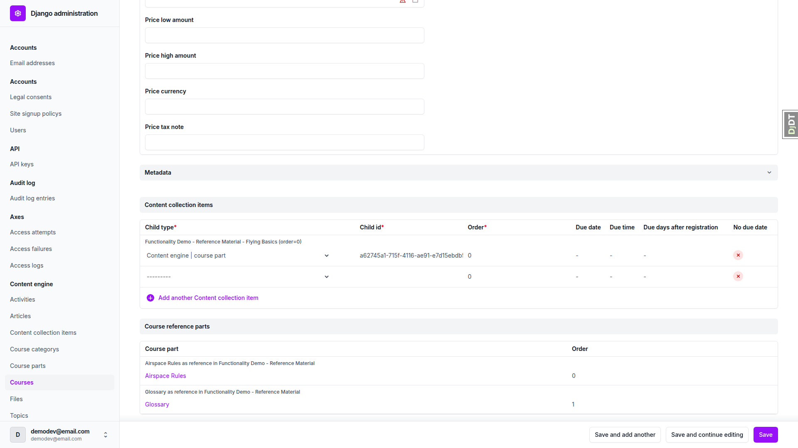
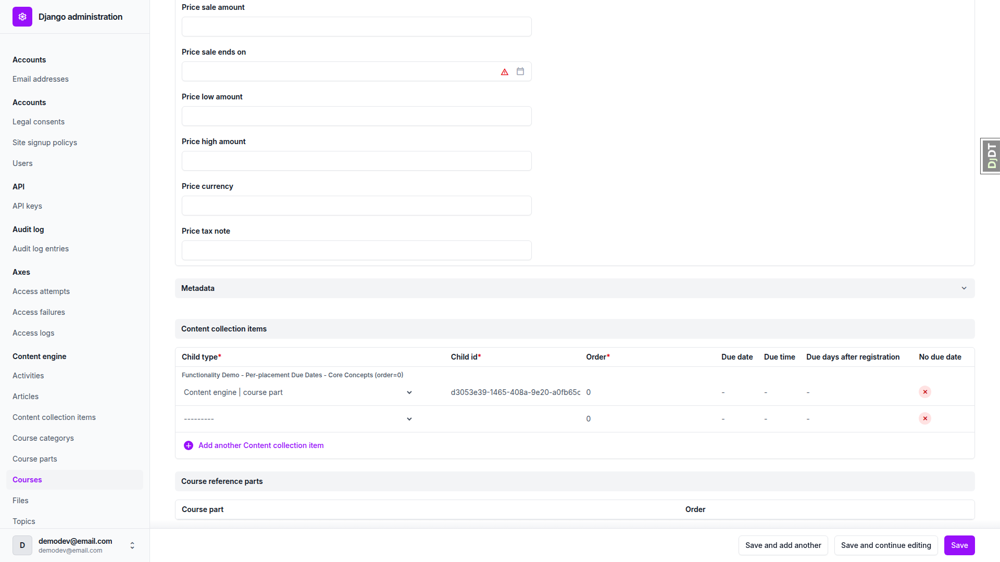
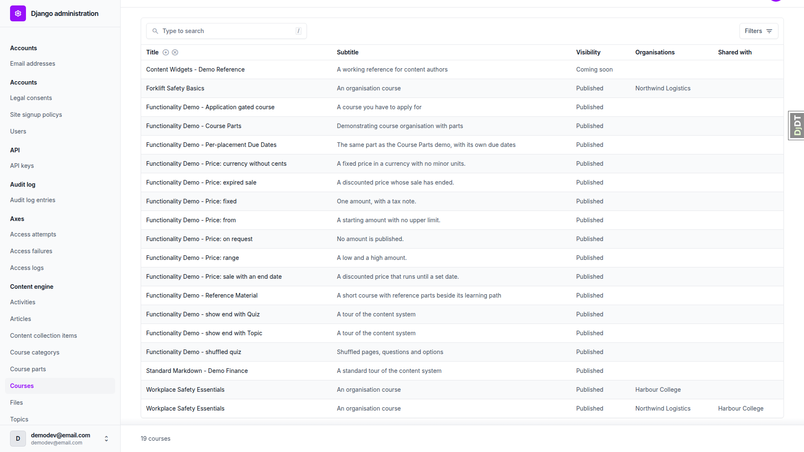
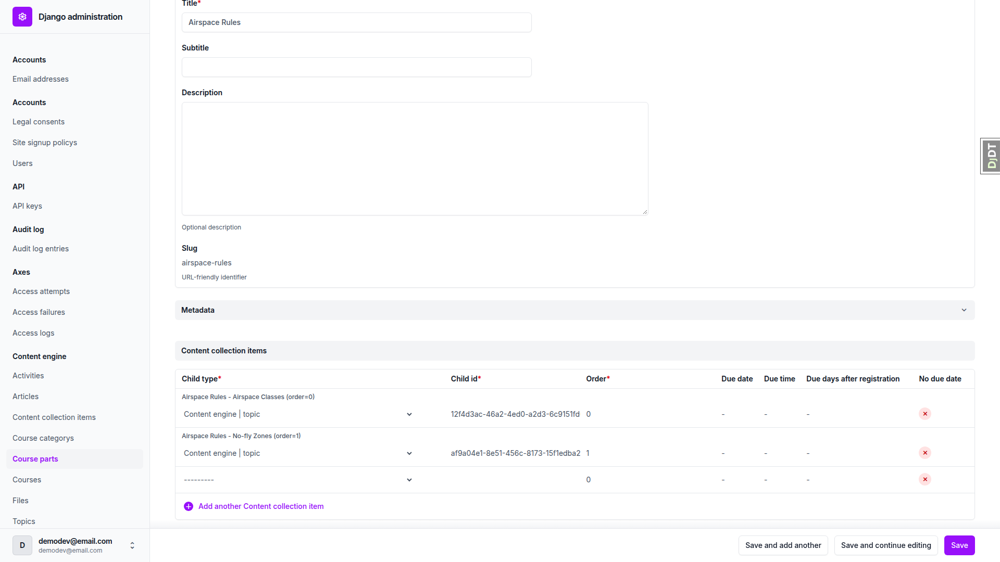
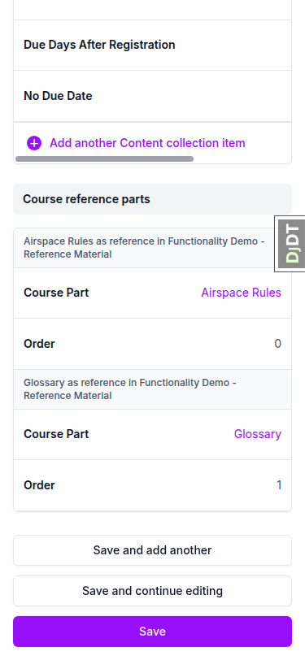
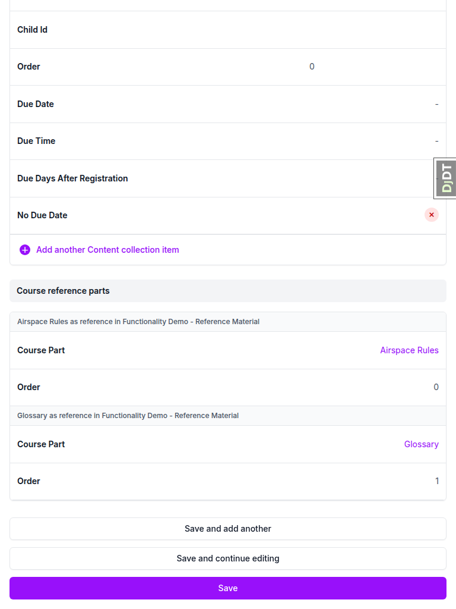

# Frontend QA report: Reference material, authoring

Branch: reference-material-content-1-authoring. The branch badge confirmed the branch. The server ran on port 8682. Viewports: desktop 1920x1080, mobile 375x812, tablet 768x1024.

Result: all tests passed. No bugs.

## Methodology

Screenshots were collected into `spec_dd/2. in progress/reference-material-content-1-authoring/screenshots/`. Every image linked below exists beside this report. Screenshot compression ran and found no PNG over 1024KB, so nothing was compressed. The Setup step `content_save ./demo_content DemoDev` ran before testing, and Test 5 ran it again.

## Diff scoping

Class: FULL. Markdown, yaml and txt changes make the class FULL (Rule 4), though the plan says only the Django admin course page changes. The changed files include the `fls-content` plugin skills and validator, the demo content, the product docs, `content_base/schema.py`, `content_engine` (admin, models, schema, validate, `content_save`, migration 0016, tests), the deadlines and learner_progress invariant tests, `danger_content_delete`, and the spec files.

Nothing was skipped. Desktop, mobile and tablet all ran.

## Smoke gate

Pass. Pages loaded:

- http://127.0.0.1:8682/
- http://127.0.0.1:8682/admin/freedom_ls_content_engine/course/?q=Reference+Material

## Test results

| Test | Viewport | Screenshot | Result | Notes |
|---|---|---|---|---|
| 1 | desktop |  | pass | Collection items lists Flying Basics (0). Reference parts lists Airspace Rules (0), then Glossary (1). Neither is in collection items. Columns are Course part and Order only, with no site. |
| 2 | desktop |  | pass | No Add another link, no delete control, no inputs or selects. Saving with no changes succeeded and the rows were unchanged on reopening. |
| 3 | desktop |  | pass | Per-placement Due Dates course loads. Reference parts inline shows only its header row. Collection items still lists Core Concepts. |
| 4.1 | desktop |  | pass | Course list loads with 19 courses. The new demo course shows its title and subtitle. |
| 4.2 | desktop |  | pass | Airspace Rules part page lists Airspace Classes (0) and No-fly Zones (1). No reference parts inline. |
| 5 | desktop |  | pass | Second `content_save` exited 0 with the success line and no `Removed part placement` lines. The reloaded page shows the same two reference rows and the single collection item. |
| 1 | mobile |  | pass | Inline stacks into cards, rows in order, no horizontal scroll (scrollWidth 375). |
| 1 | tablet |  | pass | Same stacked layout, no overflow (scrollWidth 768), read-only. |

## Design check

None apply. This plan has no design tests, so no design states were tested.

## Layout probe

The probe flagged nothing at any viewport. The probe's regions were all `missing` because the Django admin (Unfold) is outside the FLS shell the selectors name. That is not a flag.

| Test | Viewport | URL | Screenshot | Result |
|---|---|---|---|---|
| 1 | desktop | /admin/freedom_ls_content_engine/course/<id>/change/ |  | clean |
| 2 | desktop | /admin/freedom_ls_content_engine/course/<id>/change/ |  | clean |
| 3 | desktop | /admin/freedom_ls_content_engine/course/<id>/change/ |  | clean |
| 4.1 | desktop | /admin/freedom_ls_content_engine/course/ |  | clean |
| 4.2 | desktop | /admin/freedom_ls_content_engine/coursepart/<id>/change/ |  | clean |
| 5 | desktop | /admin/freedom_ls_content_engine/course/<id>/change/ |  | clean |
| 1 | mobile | /admin/freedom_ls_content_engine/course/<id>/change/ |  | clean |
| 1 | tablet | /admin/freedom_ls_content_engine/course/<id>/change/ |  | clean |

## Data changes

None. The only data load was the plan's Setup step `content_save ./demo_content DemoDev`, which the plan requires. No dev data was otherwise changed.

## Bug status

No bugs.

## General notes

- Console noise on every admin page: Django admin's `RelatedObjectLookups.js` 'unload' permissions-policy violation, and a `favicon.ico` 404 on the admin login page. Both are pre-existing and unrelated to this work. They are observations, not bugs.
- Plan wording, Test 5: the `content_save` output has an `Images: 8 seen (1 optimised, 7 passthrough).` line after the success line. It is printed on main too, so it is not a regression. The plan's "ends with" wording could be loosened.
- Nothing was left untested.

status: ok · reason: report rendered, 0 bugs documented
