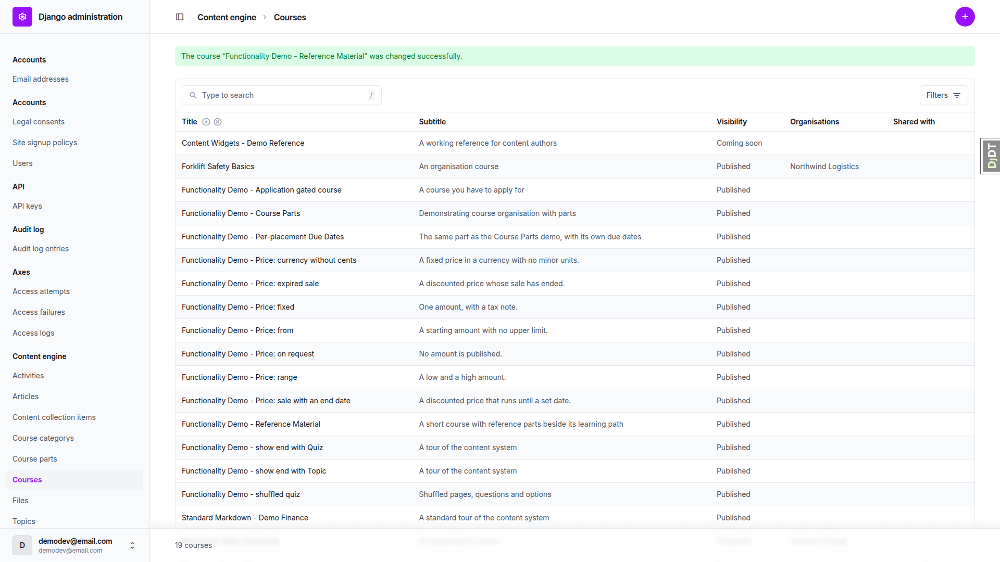
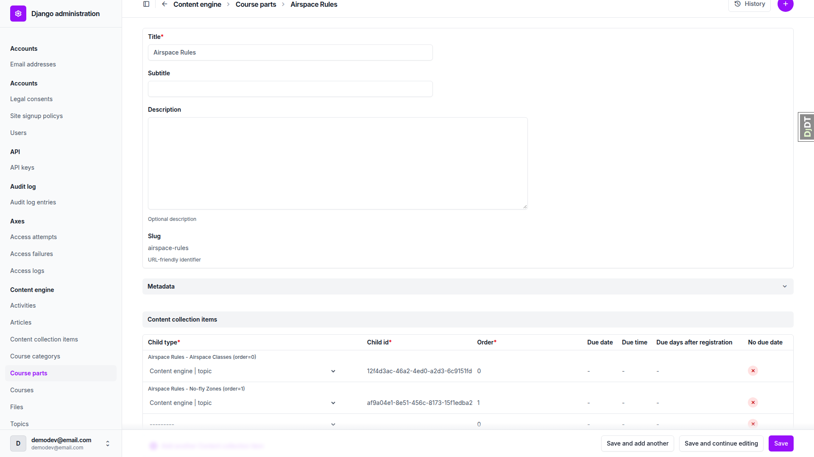
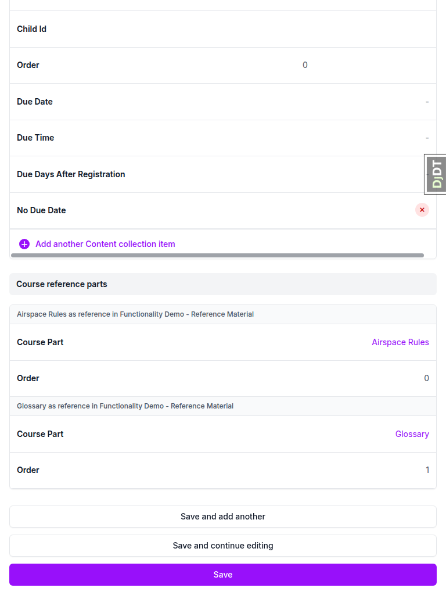

# Frontend QA report: Reference material, authoring

## Methodology

Screenshots were collected into `spec_dd/2. in progress/reference-material-content-1-authoring/screenshots/`, and every image referenced below exists beside this report. The run followed `3. frontend_qa.md`: tests 1 to 5 on desktop, then test 1 on mobile (375px) and tablet (768px). Nothing aborted.

## Diff scoping

Class: **FULL**. Changed files that triggered it: `freedom_ls/content_engine/admin.py`, `freedom_ls/content_engine/management/commands/content_save.py`, `freedom_ls/content_engine/validate.py`, `freedom_ls/content_engine/models/courses.py`, `demo_content/functionality_demo_reference_material/**`, `demo_content/shared_reference_material/**`, `claude_plugins/fls-content/validate/**`, plus tests and schema.

Nothing was skipped. The only page changed is the admin course change page, so the mobile and tablet passes cover that page only.

## Smoke gate

Pass. Pages loaded: `/` and `/admin/freedom_ls_content_engine/course/1144be70-d209-4fde-98f8-3fb2459fdccb/change/`.

## Test results

| Test | Viewport | Result | Screenshot | Notes |
|---|---|---|---|---|
| 1 | desktop | pass |  | Collection items inline has one row, Flying Basics. Course reference parts inline lists Airspace Rules (order 0), then Glossary (order 1). Neither is in the collection items. Columns are Course part and Order only, with no site column. The console shows only Django admin's `RelatedObjectLookups.js` unload permissions-policy error, which is pre-existing and unrelated. |
| 2a | desktop | pass |  | The reference parts inline has no Add another link, no delete checkbox, and no inputs or selects. The course part is a read-only link and the order is plain text. |
| 2b | desktop | pass |  | Saving with no changes gave a "changed successfully" message and no error. On reopening, the reference rows were still Airspace Rules 0 and Glossary 1, and collection items were still only Flying Basics. |
| 3 | desktop | pass |  | The Per-placement Due Dates course loads with no error. The reference parts inline shows its header with no rows and no add link. Collection items still lists Core Concepts. |
| 4 | desktop | pass |  | The course list loads and shows the new course with its title and subtitle. The Airspace Rules part page loads, and collection items lists Airspace Classes (0) and No-fly Zones (1). There is no reference parts inline on the part page. |
| 5 | desktop | pass | none (terminal check) | The second `content_save ./demo_content DemoDev` exited 0 and printed the "✓ Successfully saved all content for site: DemoDev" line, followed only by the image-optimisation summary line. There was no "Removed part placement" line. After reload the course page showed the same two reference rows, and collection items were still only Flying Basics. |
| 1 | mobile | pass |  | The reference parts inline stacks into label/value cards (Course Part, Order) within the 375px viewport. There is no horizontal page scroll, and the Save buttons stack full width. |
| 1 | tablet | pass |  | The reference parts inline stacks into label/value cards within the 768px viewport. There is no horizontal page scroll. |

## Design check

No design states tested.

## Layout probe

| Test id | Viewport | URL | Screenshot | Result |
|---|---|---|---|---|
| 1 | desktop | `/admin/freedom_ls_content_engine/course/1144be70-d209-4fde-98f8-3fb2459fdccb/change/` |  | clean |
| 2b | desktop | `/admin/freedom_ls_content_engine/course/` |  | clean |
| 3 | desktop | `/admin/freedom_ls_content_engine/course/4d63a96b-feff-4a38-8aac-44742a5da6bd/change/` |  | clean |
| 4 | desktop | `/admin/freedom_ls_content_engine/coursepart/20f5f898-69d9-4f08-9d97-af7a224e09fe/change/` |  | clean |
| 1 | mobile | `/admin/freedom_ls_content_engine/course/1144be70-d209-4fde-98f8-3fb2459fdccb/change/` |  | clean |
| 1 | tablet | `/admin/freedom_ls_content_engine/course/1144be70-d209-4fde-98f8-3fb2459fdccb/change/` |  | clean |

## Data changes

| What changed | Made by | Files written |
|---|---|---|
| The dev DB had no demo sites. `create_demo_data --yes` was run, then `content_save ./demo_content DemoDev`, which succeeded. | QA plan setup | none (no tracked files changed) |

## Bug status

No bugs in this run.

## General notes

- Test 5 is a terminal check, so it has no screenshot.
- The only console message seen was Django admin's own `RelatedObjectLookups.js` unload permissions-policy error. It is pre-existing and unrelated to this work.
- Learner and educator pages are unchanged by this work, so they were not tested.

status: ok · reason: report rendered, 0 bugs documented
