# Frontend QA report: learner reference

## Methodology

Screenshots were collected into `spec_dd/2. in progress/reference-material-content-2-learner-reference/screenshots/`, beside this report. Every image linked below exists there. One file in the folder (`page-2026-11-23T05-55-55-328Z.png`) has no scratch record, so this report does not link it.

The plan is `3. frontend_qa.md`. Desktop was 1920x1080, mobile 375x812 and tablet 768x1024. Console errors were checked at every width. The only ones seen were the four expected 404 resource errors from the 8.1-8.4 fetches.

Results by plan test:

| Test | Viewport | Result | Notes |
|---|---|---|---|
| 1 | desktop | pass | Reference link (book icon) sits under the outline rows and is not current. The Pre-flight Checks row is the current row. The header and rows are intact and there is one `#course-toc-region` nav. Step 3 (Next) was not applicable: the demo course's learning path has one item, so its footer shows Finish Course. The boosted swap was exercised on reference topics in 3.2. |
| 2.1 | desktop | pass | URL `/reference/`. Crumb course > Reference, with Reference as a span. h1 "Reference". Sections Airspace Rules then Glossary, topics are links, no progress marks. The sidebar Reference link has `aria-current=page` and the highlight, and no outline row is current. Title is correct. |
| 2.1-spacing | desktop | FAIL | See bug B1. |
| 2.2 | desktop | pass | The `#glossary` and `#airspace-rules` anchors land with the heading visible below the header (`scroll-mt-24`). The demo listing is short enough that every heading is in view at all three widths. |
| 3.1 | desktop | pass | "Back to reference" is above the heading. Crumbs course > Reference > Airspace Rules are all links. The h1 is at reading width, aligned with a learning-path topic. The footer has only Next on the right. There is no Mark complete, Finish, Home or post form. |
| 3.2 | desktop | pass | Next swapped without a reload (a window marker survived). No-fly Zones has Previous on the left and no Next. The sidebar Reference link is still current. |
| 3.3-3.5 | desktop | pass | Previous returned to Airspace Classes. Browser Back restored No-fly Zones with a matching URL (the htmx history restore settles a moment after popstate). The Airspace Rules crumb opens `/reference/#airspace-rules` with the section in view. |
| 3.6-3.8 | desktop | pass | The shared Glossary topic "Terms" renders its word list. Its footer has no Previous or Next. Back to reference goes to the listing. The course crumb lands on the learning-path item `/1/`. |
| 4 | desktop | pass | The outline header stayed at 0% across all three reference topics. Learning-path row status did not change. The detail CTA is still "Start course". |
| 5.1 | mobile | pass | The bottom sheet shows the Reference link under the rows. |
| 5.2 | mobile | pass (B1 seen) | The listing is readable at 375px and `scrollWidth` is 375. The current crumb "Reference" truncates to "Refer..." like other player crumbs at this width. B1 also shows here. |
| 5.3-5.4 | mobile | pass | Airspace Classes > Next > No-fly Zones. The reopened sheet shows Reference with `aria-current=page` and the highlight. The course crumb returns to `/1/`. |
| 5-tablet | tablet | pass (B1 seen) | The sheet shows the Reference link and the listing layout holds (`scrollWidth` 768). B1 also shows here. |
| 6.1 | desktop | pass | Anonymous: the Reference material section follows Course content, with the line "Available to registered learners." and Airspace Rules then Glossary. There are 0 links in the section. |
| 6.2 | desktop | pass | The logged-in unregistered learner sees the same section, with the titles as plain list items. |
| 6.3 | desktop | pass | The Per-placement Due Dates detail page has only "Course content" and no Reference material section. |
| 7.1 | desktop | pass | Per-placement Due Dates item: no Reference link and one outline nav. The current row is Key Ideas. Next moves to Going Deeper and the highlight follows. |
| 7.2 | desktop | pass | The empty listing shows a centred `size-12` reference icon with "No reference material yet". There is no section and no callout. |
| 8.1-8.4 | desktop | pass | `not-a-topic`, a learning-path part slug, a topic from another part, and an unknown course all return 404. |
| 8.5 | desktop | pass | Logged out, the listing redirects to `/accounts/login/?next=...reference/`. After login it lands back on the listing. |
| 8.6 | desktop | pass | The unregistered learner `qa-ref-unregistered` is redirected to `/detail/` from both the listing and a topic URL. The detail page shows the Reference material titles. |
| 8.7 | desktop | partial | See General notes. |
| 9 | desktop | pass | Per-placement course: Next (mark complete) on Going Deeper moves to the Knowledge Check form start page, progress 67%, the highlight moves, one outline nav, no Reference link. Reference course: Finish Course completes it, and the finish page shows the outline, 100% and the Reference link (not current). The per-placement finish page shows the outline without a Reference link. The detail page's Course content is unchanged. |
| 9-finish | desktop | pass | The reference course finish page shows the Reference link under the outline. |
| console | desktop | pass | No console errors except the four expected 404s above. |

### Screenshots

Test 6.2, unregistered learner on the detail page:

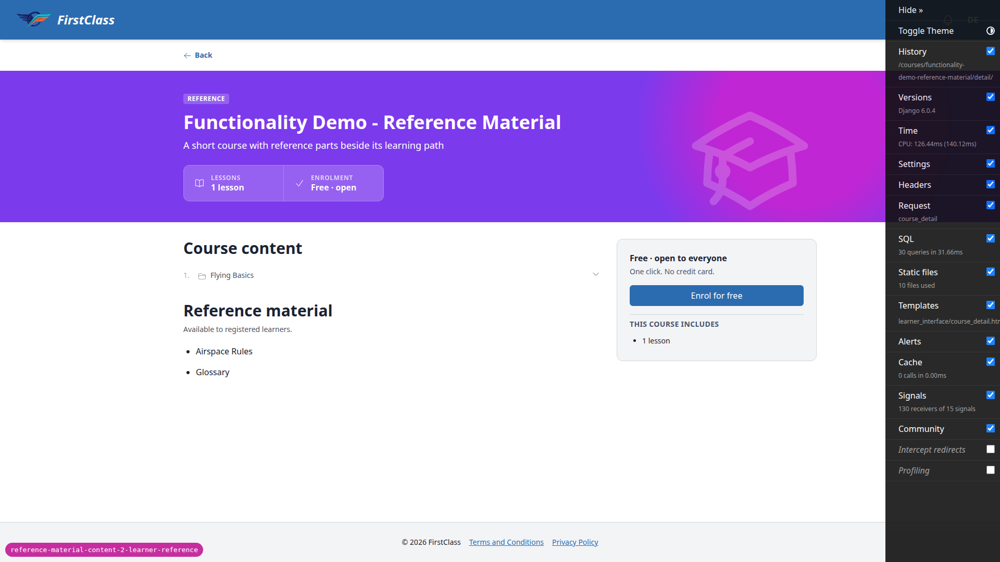

Test 1, Reference link in the sidebar:

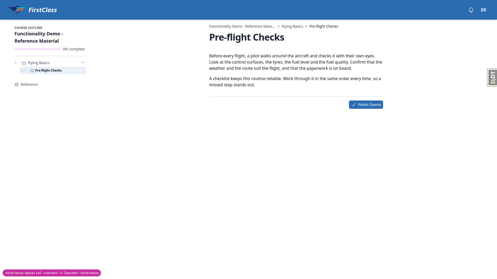

Test 2.1, the reference listing (desktop):

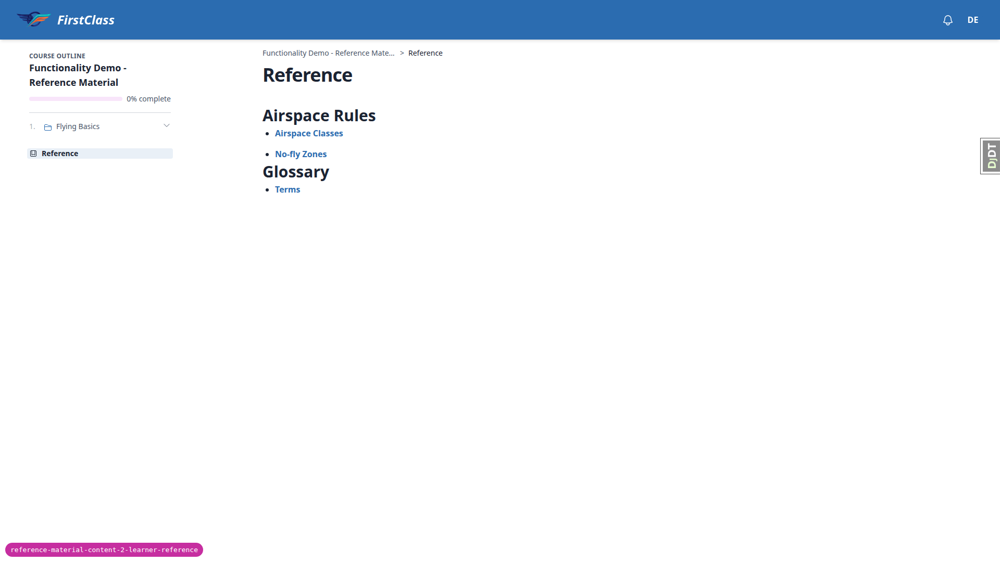

Test 3.1, reference topic "Airspace Classes":

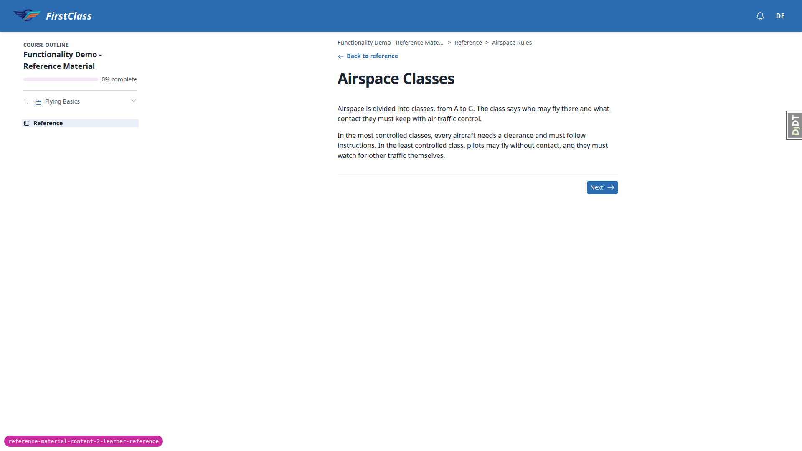

Test 3.6-3.8, shared Glossary "Terms":

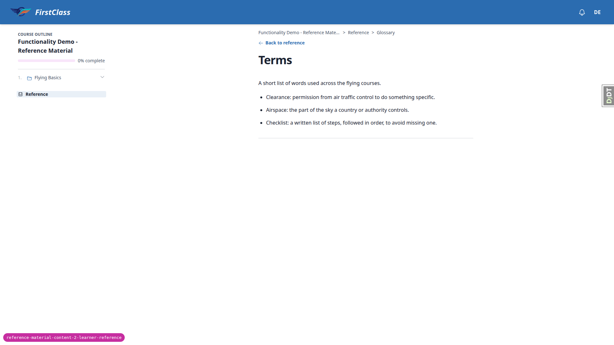

Test 5.1, mobile outline sheet:

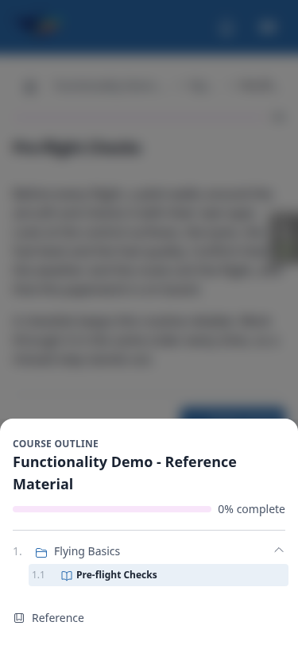

Test 5.2, mobile listing:

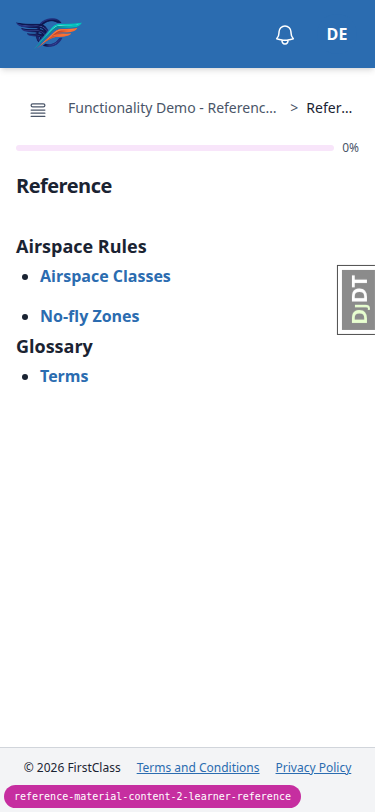

Test 5.3-5.4, mobile No-fly Zones with the sheet reopened:

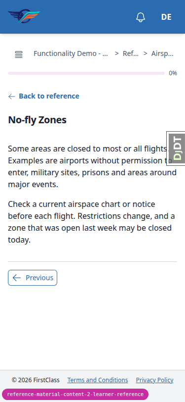

Test 5-tablet, tablet listing:

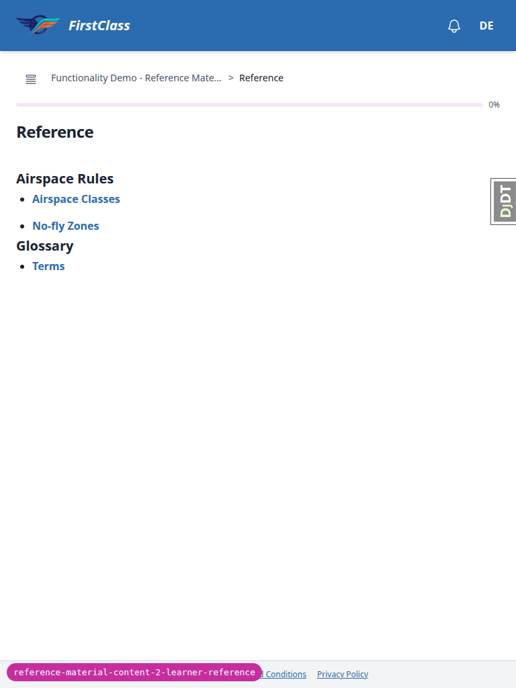

Test 7.1, per-placement item without a Reference link:

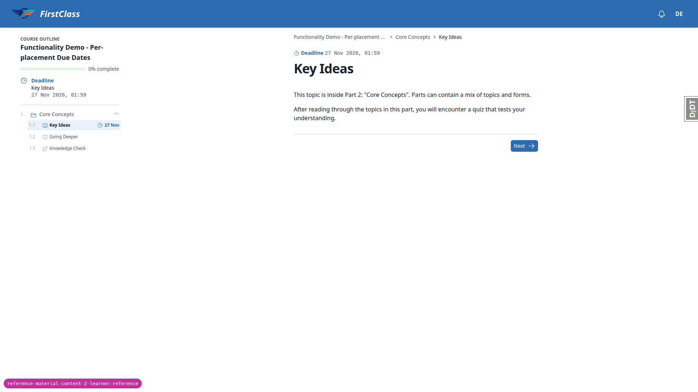

Test 7.2, empty listing:

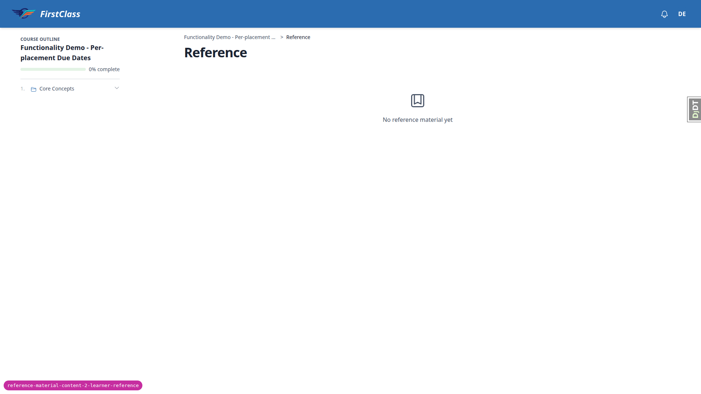

Test 9, per-placement form start page:

Test 9-finish, reference course finish page:

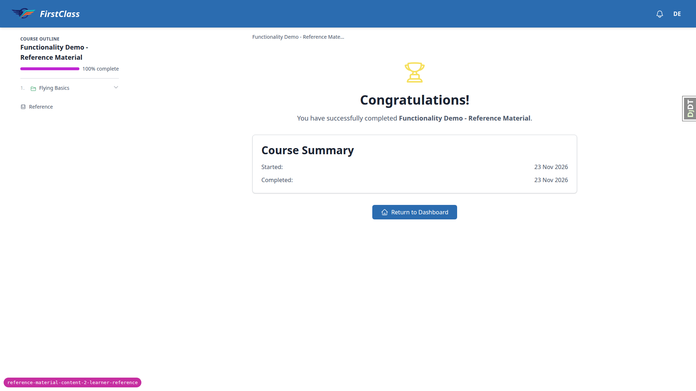

## Diff scoping

Class: FULL. The changed files that triggered it:

- `freedom_ls/learner_interface/templates/learner_interface/_course_base.html`
- `freedom_ls/learner_interface/templates/learner_interface/course_detail.html`
- `freedom_ls/learner_interface/templates/learner_interface/course_reference.html`
- `freedom_ls/learner_interface/templates/learner_interface/course_reference_topic.html`
- `freedom_ls/learner_interface/templates/learner_interface/partials/reference_breadcrumbs.html`
- `freedom_ls/learner_interface/templates/learner_interface/partials/reference_link.html`
- `freedom_ls/learner_interface/templatetags/course_reference_tags.py`
- `freedom_ls/learner_interface/urls.py`
- `freedom_ls/learner_interface/utils.py`
- `freedom_ls/learner_interface/views.py`
- `freedom_ls/icons/*`

Nothing was skipped. Desktop, mobile and tablet passes all ran.

## Smoke gate

Pass. The pages loaded were `/` and `/courses/functionality-demo-reference-material/detail/`. No run was aborted.

## Design check

No design states tested. The plan has no design checklist, so there are no `design` records.

## Bug B1: Reference listing sections have no vertical spacing between parts

Manifestations:

- `2.1-spacing` on desktop
- `5.2` on mobile
- `5-tablet` on tablet

Expected: each part section on the reference listing is visibly separated from the previous one. There is more space between parts than between the topics inside a part, so topics group under their part heading.

Actual: the next part's h2 ("Glossary") sits directly under the previous part's last topic link. Topic list items within a part are about 40px apart, so the gap between parts is smaller than the gap between topics. The grouping reads wrong.

## Layout probe

| Test | Viewport | URL | Screenshot | Result |
|---|---|---|---|---|
| 1 | desktop | `/courses/functionality-demo-reference-material/1/` |  | clean |
| 2.1 | desktop | `/courses/functionality-demo-reference-material/reference/` |  | clean |
| 3.1 | desktop | `/courses/functionality-demo-reference-material/reference/airspace-rules/airspace-classes/` |  | clean |
| 3.6 | desktop | `/courses/functionality-demo-reference-material/reference/glossary/terms/` |  | clean |
| 5.1 | mobile | `/courses/functionality-demo-reference-material/1/` |  | clean. The probe flagged stacked/overlap elements, but they come from the open modal bottom sheet, which covers the page by design. That is not a layout fault. |
| 5.2 | mobile | `/courses/functionality-demo-reference-material/reference/` |  | clean |
| 5-tablet | tablet | `/courses/functionality-demo-reference-material/reference/` |  | clean |
| 7.2 | desktop | `/courses/functionality-demo-per-placement-due-dates/reference/` |  | clean. The probe flagged "misaligned: header ink x=504, content x=1048". The empty state is centred on purpose (the brand visual rule is a centred icon with text), so per Rule 5 this is the decided design. |
| 9 | desktop | `/courses/functionality-demo-per-placement-due-dates/3/` |  | clean |
| 9-finish | desktop | `/courses/functionality-demo-reference-material/finish/` |  | clean |

## Data changes

| What changed | Made by | Files written |
|---|---|---|
| The dev DB had no DemoDev site. Demo data was created and the demo content was loaded. | `create_demo_data --yes`, then `content_save ./demo_content DemoDev` | none |
| The QA data helper created the verified learner `qa-ref-unregistered@example.com` / `testpass123` (pk 71) on DemoDev, not registered for `functionality-demo-reference-material`. It also created an open `CoursePause` (`23c3a77a-136c-4a39-a051-8fb042d160cc`) on demodev's `CourseProgress` for that course. The pause was ended (`ended_at` set) after testing. `demodev` was registered for Functionality Demo - Reference Material and Per-placement Due Dates, and completed the reference course via Finish Course during QA. | qa-data-helper agent | none |

## Bug status

| Bug | Title | Status |
|---|---|---|
| B1 | Reference listing sections have no vertical spacing between parts | **FIXED** (commit: 39ee44c99). Parts now sit in a `space-y-8` stack: re-driven at 1920x1080, the part gap is 32px against an 8px topic gap. A Playwright layout test at three viewports guards it. 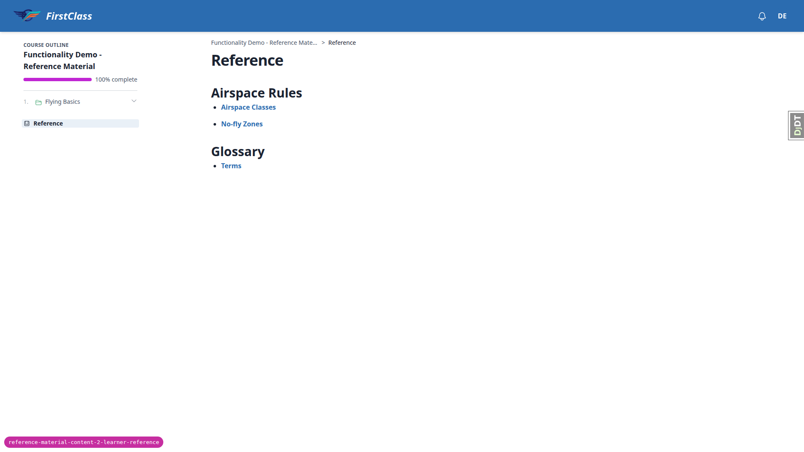 |

## General notes

- **Test 8.7 is partial.** With `demodev` paused and the course not completed, the listing and topic URLs redirect to `/detail/`, which still shows the section. The learning-path item `/1/` also redirects. The sub-check for a completed learning-path topic while paused cannot be built in this demo course. Its only learning-path topic is also its last, so completing it completes the course. The access backend ignores pauses on a completed course record: `DeadlineEnforcingBackend` returns the inner decision when `completed_time` is set. The reference listing therefore opens after completion, which is consistent with the rest of the player and not a bug. The case of the sidebar on a paused, completed topic is covered by the view test in `test_course_reference.py`.
- **Test 1 step 3 is not applicable** in the demo course, because its learning path has one item and so no Next. The boosted swap was checked on reference topics in 3.2 instead.
- **Mobile crumb truncation.** The current crumb "Reference" truncates to "Refer..." at 375px. This matches other player crumbs at this width, and no fix was proposed.
- **Unreferenced screenshot.** `page-2026-11-23T05-55-55-328Z.png` is in `screenshots/` but has no scratch record.
- **State left behind.** `demodev` finished the reference course during QA, so its progress on that course is now complete. Re-running the plan from Test 1 will show Finish Course states and 100% progress rather than a fresh start.

status: ok · reason: 1 bug — 1 fixed, 0 unresolved; report rendered, screenshots verified
