# Frontend QA report: learner reference

Spec: `reference-material-content-2-learner-reference`. Plan: `3. frontend_qa.md`.

## Methodology

Screenshots were collected into `spec_dd/2. in progress/reference-material-content-2-learner-reference/screenshots/`. Every image referenced below exists beside the report. All nine tests were run at desktop (1920x1080); tests 5 and 6 also ran at mobile (375x812) and tablet (768x1024), and tests 2 and 7 were also checked at tablet or mobile as noted. Several screenshots were taken in a fresh browser context where the debug toolbar was expanded at the right edge; the content columns are unobstructed.

Pre-QA context:

- The branch was rebased onto main before QA (65 upstream commits, one doc conflict in `docs/product/content-editing-workflow.md` resolved by combining both sides). The targeted test tier (16451 tests) passed and pre-commit was clean.
- The force-push of the rebased branch was refused by the permission system, so the remote branch is behind the local one.
- The pre-step front-end check was folded into this full QA run, which covers the same pages at all three viewports.
- Screenshot compression ran and found nothing over the limit.

## Diff scoping

Class: **FULL**. Nothing was skipped; every viewport and test ran.

Changed files that triggered it include `freedom_ls/learner_interface/views.py`, `urls.py`, `utils.py`, the templates `_course_base.html`, `course_detail.html`, `course_reference.html`, `course_reference_topic.html`, the partials `course_minimal_toc.html`, `reference_breadcrumbs.html`, `reference_outline.html`, the template tags `course_reference_tags.py` and `course_storage_keys.py`, `alpine-components.js`, the icon data and mappings under `freedom_ls/icons/`, plus tests and docs (`docs/product/learner-experience.md`, `docs/product/content-editing-workflow.md`, `.claude/skills/brand-guidelines/visual.md`).

## Smoke gate

Outcome: **pass**. Pages loaded: `/` and `/courses/functionality-demo-reference-material/detail/`.

## Design check

No design states tested (the plan has no `design` tests, so there are no `design` records).

## Test results

| Test | Viewport | Result | Notes |
|---|---|---|---|
| 1 | desktop | pass | Reference eyebrow matches the Course outline eyebrow. Part rows match Flying Basics (16px, folder icon column, chevron, no numbers). Opening Airspace Rules shows its two topics, and Flying Basics is unaffected. Open state survives reload and Glossary stays closed. No reference row is highlighted. Sidebar: 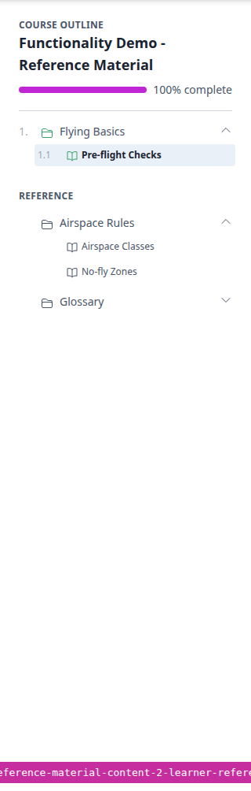 |
| 1.3 | desktop | skip | The demo course has a single learning-path item, so its footer has no Next button. The HTMX swap is covered by the reference topic Next/Previous swaps in Test 3. |
| 2 | desktop | pass | URL, breadcrumb, heading, tab title, open parts, no numbers, no progress marks, chevron in a 672px column, part collapse and the `#glossary` anchor all behave as planned. |
| 2-layout | desktop, tablet | fail | See B1. |
| 3 | desktop | pass | Topic URL, Back to reference, three link crumbs, reading-width heading, Next only footer, tab title and sidebar highlight are correct. Next swaps without a full reload, and Previous and browser Back work. The part crumb lands on `/reference/#airspace-rules`. Terms has no Previous or Next, and the course crumb lands on `/1/`. |
| 4 | desktop | pass | Progress stayed 100%, Flying Basics stayed Completed, the CTA stayed "Review course", and no TopicProgress rows exist for the reference topics. The user had already completed the course in earlier QA. |
| 5 | mobile | pass | Bottom sheet shows the Reference eyebrow and part rows in the outline style. Navigation and highlight work, and the listing has no horizontal scroll (scrollWidth 375). The layout probe flags on the sheet shot come from the open modal sheet over the content, which is designed behaviour. |
| 5 | tablet | pass | At 768 the outline is a bottom sheet, consistent with the existing player. The listing has no horizontal scroll. |
| 6 | desktop | pass | Visitor: one large heading, 12px uppercase eyebrow, no registration note, part rows aligned with Flying Basics, topic titles plain text. Registered: topic titles are links styled like Pre-flight Checks. No Reference sub-section on the other course. |
| 6 | tablet | pass | Sign-up panel, then Course content with Flying Basics, then the Reference sub-section; links present; scrollWidth 768. |
| 7 | desktop | pass | No Reference heading in the sidebar, and the empty-state listing shows the icon and "No reference material yet". The heading sits off-centre, which is B1. |
| 8.1-8.5 | desktop | pass | All 404 cases return 404. The anonymous redirect to login returns to the listing after login. |
| 8.6 | desktop | pass | The unregistered learner is redirected to course detail, which shows plain-text topic titles. |
| 8.7 | desktop | fail | See B2. |
| 9 | desktop | pass | Per-placement course Next navigation, form start page and finish page work, and the outline renders without Reference there. The course detail rows are unchanged. Mark complete was not exercised because the visited topics were already complete. |

Visitor and paused-learner screenshots: 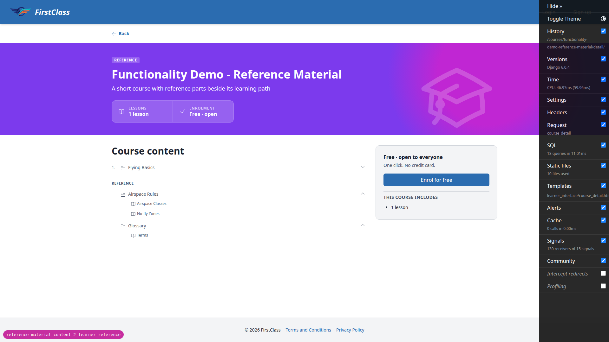 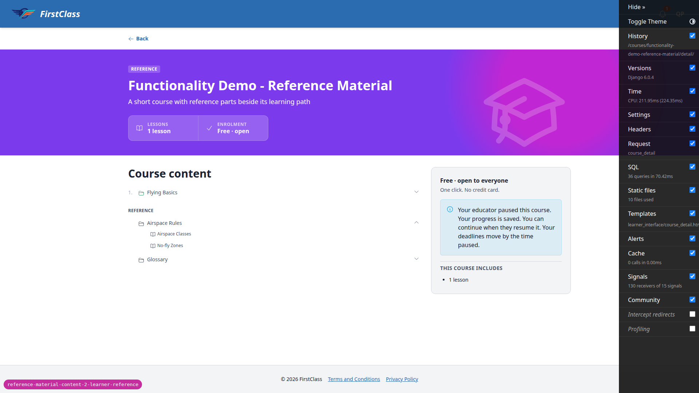

## B1: Reference listing column sits left of the player's centred reading column

Manifestations: `2-layout` (desktop), `2-layout` (tablet), `7` (desktop).

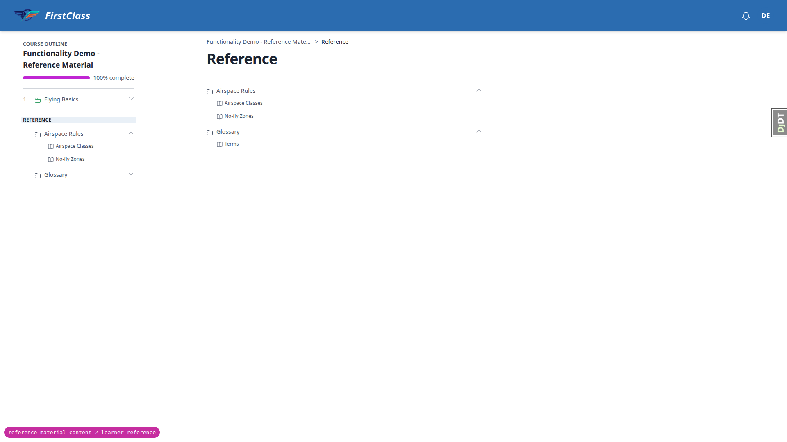
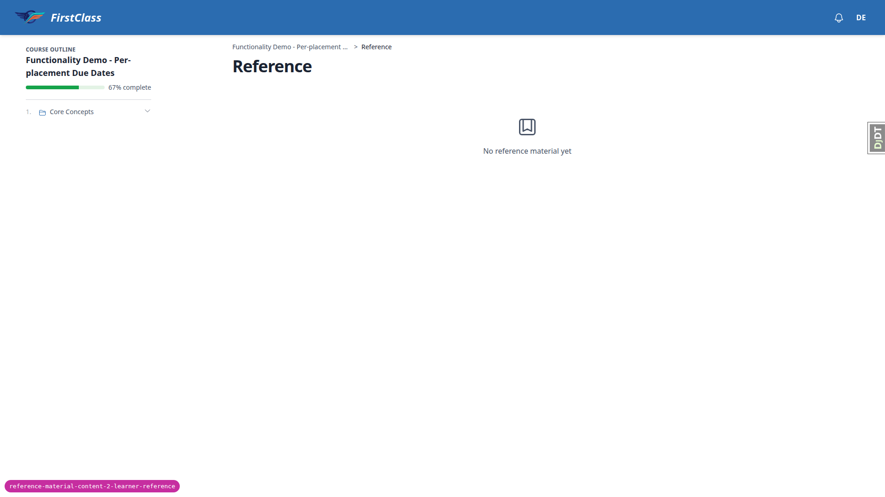
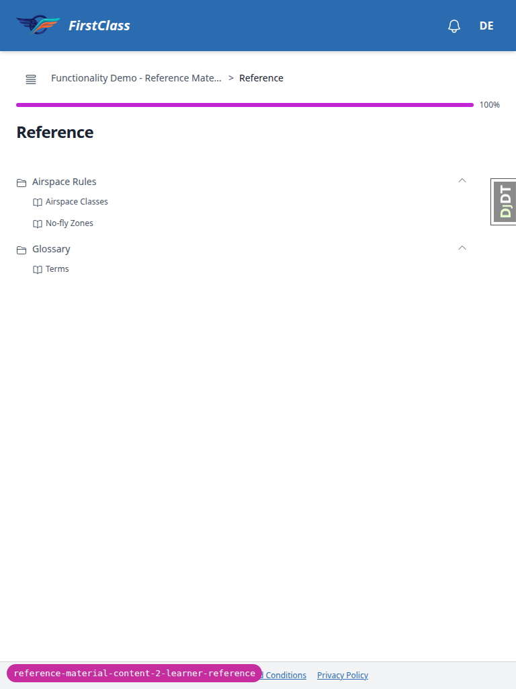

- **Expected:** like every other player page (lesson, reference topic, form start, finish), the listing's breadcrumb, heading and outline sit in the centred reading column (x=808-1480 at 1920, x=48-720 at 768).
- **Actual:** they start at x=504 at 1920 (x=24 at 768), so the heading jumps about 300px between the listing and a reference topic. The empty-state listing has its heading at 504 and its icon centred across the full width. `course_reference.html` sets no `header_width` and its `max-w-reading` wrapper has no `mx-auto`.

## B2: Paused learner's sidebar shows reference topics as plain text, the spec says links

Manifestations: `8.7` (desktop).

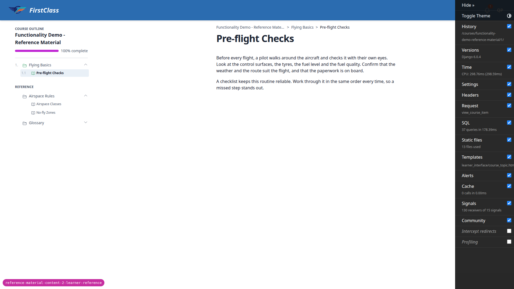

- **Expected:** per the spec and QA plan, on a paused learner's read-only page the sidebar reference parts expand to topic links, and following one redirects to course detail.
- **Actual:** topic rows are plain text for any learner who cannot read reference pages (`reference_linked=decision.can_access_content`, added in 83261f54b during code review). The heading stays a link and redirects to course detail. This is spec drift and needs a decision on which is the intended design. The code matches the course-detail rule that titles link only for a learner who can open them.

## Layout probe

| Test id | Viewport | URL | Screenshot | Result |
|---|---|---|---|---|
| 1 | desktop | `/courses/functionality-demo-reference-material/1/` | 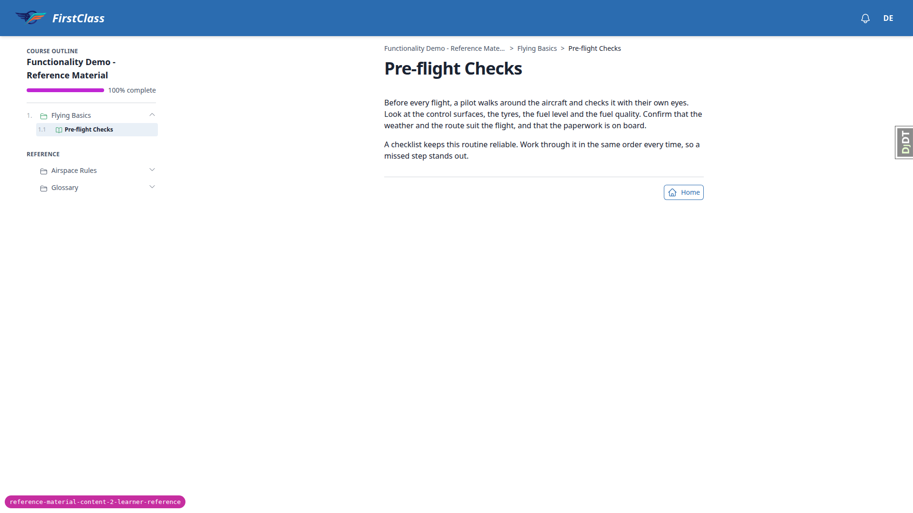 | clean |
| 2 | desktop | `/courses/functionality-demo-reference-material/reference/` |  | clean (probe; the column misplacement is B1, found by manual measurement) |
| 3 | desktop | `/courses/functionality-demo-reference-material/reference/airspace-rules/airspace-classes/` | 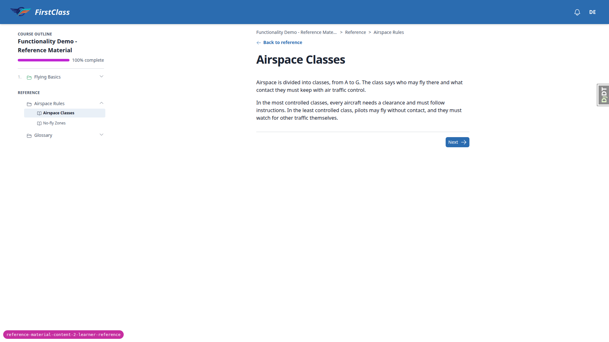 | clean |
| 3.6 | desktop | `/courses/functionality-demo-reference-material/reference/glossary/terms/` | 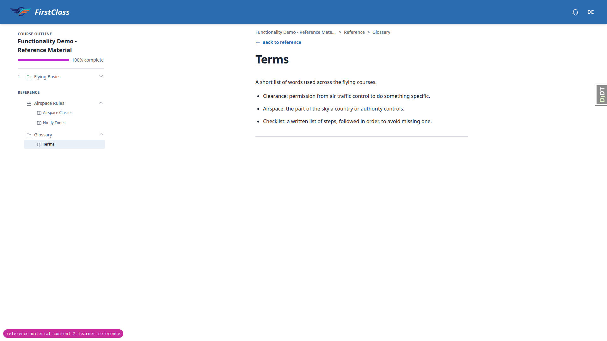 | clean |
| 6 | desktop | `/courses/functionality-demo-reference-material/detail/` | 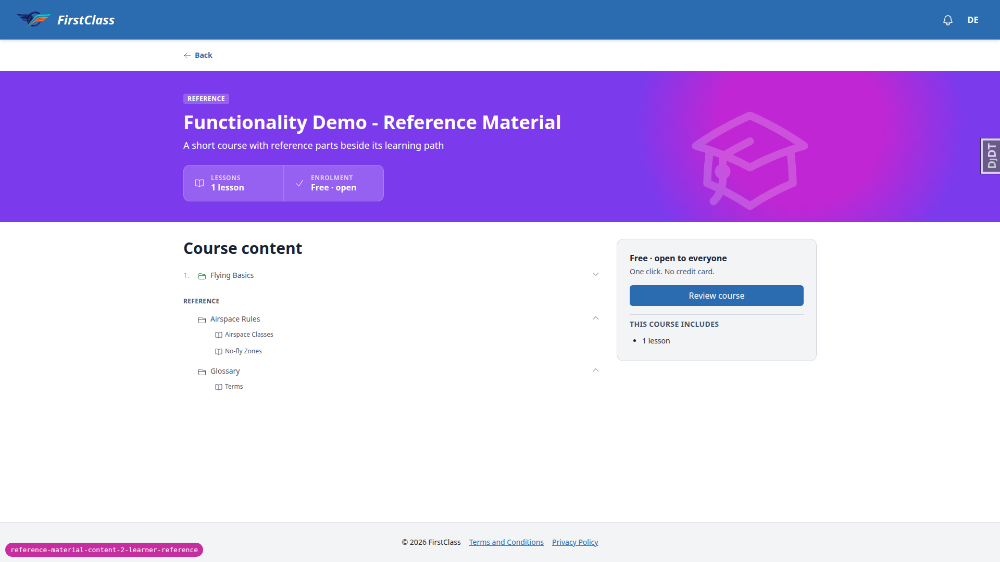 | clean |
| 7 | desktop | `/courses/functionality-demo-per-placement-due-dates/reference/` |  | clean (probe; off-centre heading is B1) |
| 9 | desktop | `/courses/functionality-demo-per-placement-due-dates/3/` | 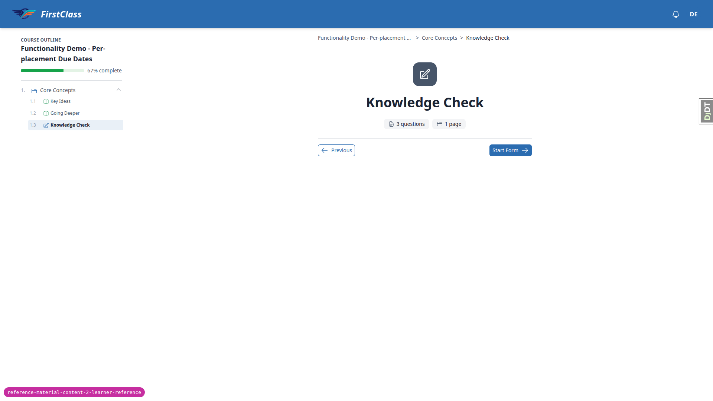 | clean |
| 5 | mobile | `/courses/functionality-demo-reference-material/1/` | 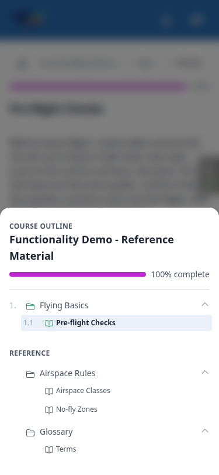 | clean (stacked/overlap flags came from the open modal bottom sheet, designed behaviour) |
| 5.4 | mobile | `/courses/functionality-demo-reference-material/reference/` | 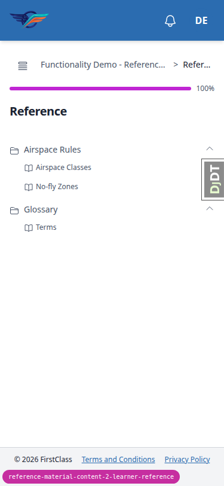 | clean |
| 5.3 | mobile | `/courses/functionality-demo-reference-material/reference/airspace-rules/airspace-classes/` | 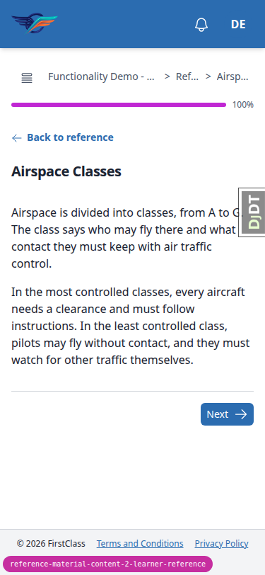 | clean |
| 5 | tablet | `/courses/functionality-demo-reference-material/1/` | 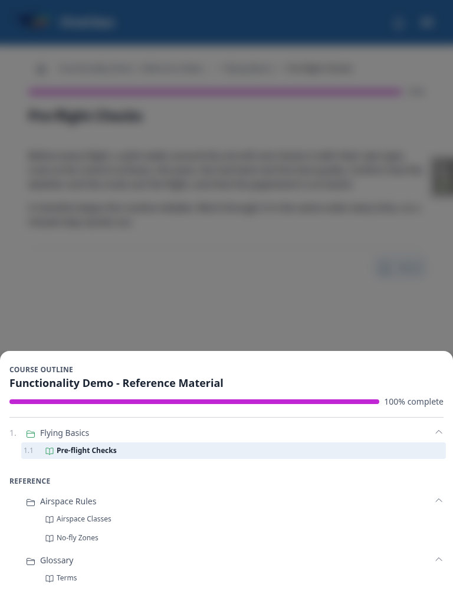 | clean |
| 2 | tablet | `/courses/functionality-demo-reference-material/reference/` |  | clean (probe; column misplacement is B1) |
| 6 | tablet | `/courses/functionality-demo-reference-material/detail/` | 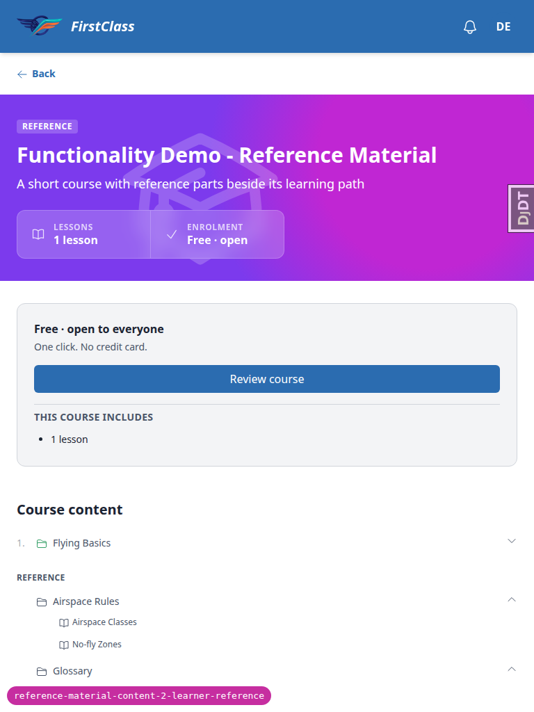 | clean |

## Data changes

| What changed | Made by | Files written |
|---|---|---|
| Created unregistered learner `qa-unregistered@email.com` (User pk 73, verified EmailAddress pk 69) on DemoDev, and an open CoursePause e5defc94 on demodev's completed CourseProgress for the reference course (to be removed) | `sdd:qa-data-helper` | none |
| Deleted demodev's open CoursePause e5defc94. Created paused learner `qa-paused@email.com` (User pk 74, EmailAddress pk 70, Learner c1d6a044, LearnerCourseRegistration a6ae1d5d, CourseProgress a9e0daa7 not completed, TopicProgress b22db957 for Pre-flight Checks complete, open CoursePause 27daacde) | `sdd:qa-data-helper` | none |

Note: the QA paused learner's open CoursePause 27daacde and the two QA learners remain in the dev database.

## Bug status

- **FIXED** (commit: 557af2b9e) — Reference listing column sits left of the player's centred reading column. Re-verified at 1920, 768 and 375: the listing's breadcrumb, heading and outline now share the reference topic page's centred column (808–1480 at 1920, 48–720 at 768), with chevrons at the column's right edge 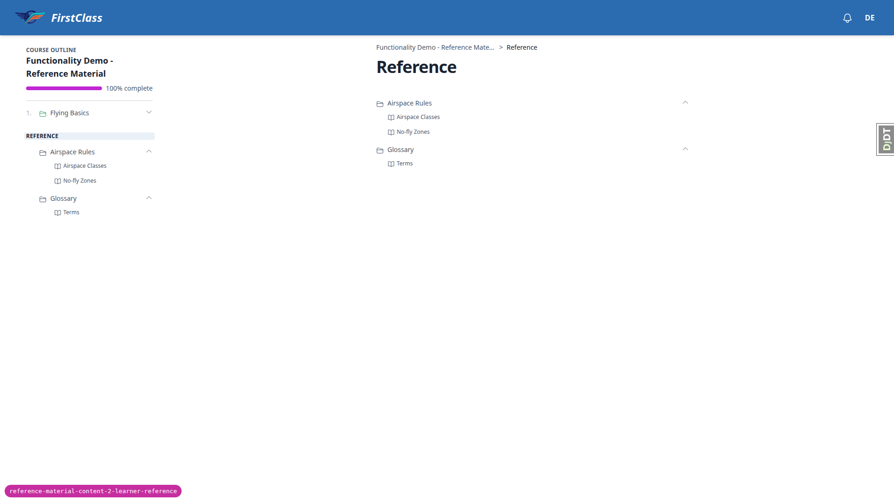. The empty state centres its icon in that column, as the brand rule asks.
- **UNRESOLVED** — Paused learner's sidebar shows reference topics as plain text, the spec says links (reason: the spec and QA plan say a paused learner's sidebar expands to topic links that redirect to course detail, but code review deliberately unlinked them in 83261f54b, to match the course-detail rule that titles link only for a learner who can open them; choosing which is the design is a product decision)

## General notes

- Test 1.3 was skipped (single-item learning path in the demo course, so no Next button). The swap behaviour is covered by Test 3.
- Test 9 did not exercise Mark complete because the visited topics were already complete.
- Test 4 started from a course already 100% complete, so "CTA unchanged" was verified as "Review course" rather than the Start course to Continue switch.
- The first paused-learner attempt used demodev, whose CourseProgress is completed. The access backend ignores pauses on a finished course by design, so a new in-progress learner was created.
- The remote branch is behind the local one because the force-push after rebase was refused.

status: ok · reason: 2 bugs — 1 fixed, 1 unresolved; report rendered, screenshots verified
