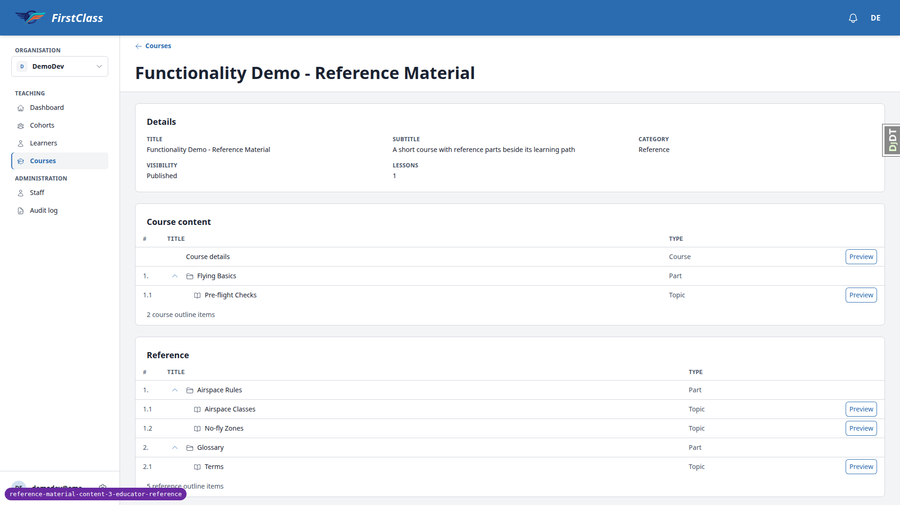
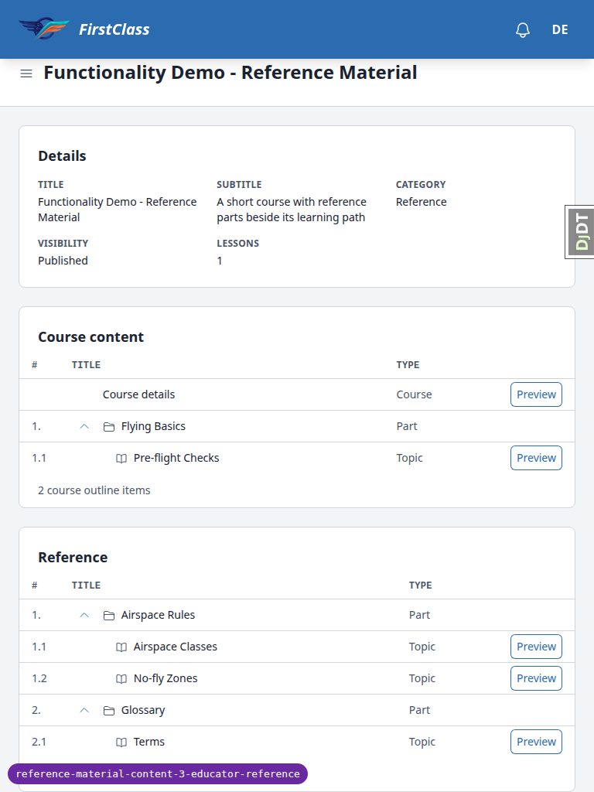

# QA report: educator reference panel and reference topic preview

## Methodology

Screenshots were collected into `screenshots/` beside this report, and every image referenced here exists there. The run followed `3. frontend_qa.md` at desktop, tablet (768) and mobile viewports. Tests 4 and 6 had no screenshots because they were request and console checks. The smoke gate passed, so no steps were skipped because of it.

## Diff scoping

Class: FULL. Changed files that triggered it:

- `freedom_ls/educator_interface/panels/course/content_preview.py`
- `freedom_ls/educator_interface/panels/course/instance_view.py`
- `freedom_ls/educator_interface/templates/educator_interface/panels/course_reference.html`
- `freedom_ls/educator_interface/templates/educator_interface/partials/course_outline_actions.html`
- tests (5 files)

Nothing was skipped. Everything ran.

## Smoke gate

Pass. Pages loaded:

- `/`
- `/educator/organisations/demodev/courses/1144be70-d209-4fde-98f8-3fb2459fdccb`

## Design check

No design states tested.

## Bug B1: Course content and Reference outline tables do not share column positions

Manifestations:

- `1-columns`, desktop
- `1-columns`, tablet

Expected: two stacked outline tables on one course page line their TYPE and action columns up ("Content lines up ... items of one kind share a column").

Actual: each table auto-sizes its columns. TYPE sits at 1411px in Course content and 1453px in Reference at 1920 (512px vs 529px at 768). On a course with an empty Reference panel it was at 1168px.

## Bug B2: Outline tables stay tables at 768 instead of cards (pre-existing)

Manifestations:

- `1-cards-at-768`, tablet

Expected: the panel-framework visual checklist says "A table with action columns is cards at 768".

Actual: at 768 both the Course content and Reference outlines are tables with a Preview column. All columns fit, with no sideways scroll. The same is true of Course content on main.

## Test results

| Test | Viewport | Result | Notes |
|---|---|---|---|
| 1 | desktop | pass | Panel order is details, content, reference, cohorts, learners. Reference lists 1. Airspace Rules (1.1 Airspace Classes, 1.2 No-fly Zones) and 2. Glossary (2.1 Terms). It has no Course details row, no callout and no header button. The footer reads "5 reference outline items". Course content is unchanged (footer "2 course outline items"). Chevron collapse and expand works. |
| 1-columns | desktop | fail | See B1. |
| 1 | mobile | pass | Five cards, numbering 1./1.1/1.2/2./2.1, footer count shown, no horizontal overflow. |
| 1 | tablet | pass | Parts and topics in order, no overflow. |
| 1-cards-at-768 | tablet | fail | See B2. |
| 2 | desktop | pass | "Airspace Classes (Preview)" with Topic chip, no form and no Mark complete. Escape returns focus. The glossary topic and the learning-path topic also preview. The keyboard path works. |
| 2 | mobile | pass | Bottom sheet, fits the viewport. |
| 2 | tablet | pass | "Terms (Preview)" fits. |
| 3 | desktop | pass | Empty-state row "No reference material in this course yet.", no numbers and no count. Course content unchanged. |
| 4 | desktop | pass | Cross-panel URLs, a bad UUID and a request without HX-Request all return 404. The reference URL returns 200. The 4 console errors are these deliberate 404 fetches. |
| 5 | desktop | pass | harbour-college shows "Content preview isn't shared with your organisation." in both panels, with no rows or Preview buttons. The preview URL returns 404. |
| 6 | desktop | pass | No Reference panel on the cohort or learner pages. The cohorts and learners panels load on the course page. No console errors on the course page or while previewing. |

## Layout probe

| Test id | Viewport | URL | Screenshot | Result |
|---|---|---|---|---|
| 1 | desktop | /educator/organisations/demodev/courses/1144be70-d209-4fde-98f8-3fb2459fdccb | [screenshot](screenshots/page-2026-11-23T04-30-51-872Z.png) | clean |
| 2 | desktop | /educator/organisations/demodev/courses/1144be70-d209-4fde-98f8-3fb2459fdccb | [screenshot](screenshots/page-2026-11-23T04-31-22-321Z.png) | clean |
| 3 | desktop | /educator/organisations/demodev/courses/531adc02-f240-4c7b-87f7-956a804c1e22 | [screenshot](screenshots/page-2026-11-23T04-31-49-615Z.png) | clean |
| 1 | mobile | /educator/organisations/demodev/courses/1144be70-d209-4fde-98f8-3fb2459fdccb | [screenshot](screenshots/page-2026-11-23T04-32-19-275Z.png) | clean |
| 2 | mobile | /educator/organisations/demodev/courses/1144be70-d209-4fde-98f8-3fb2459fdccb | [screenshot](screenshots/page-2026-11-23T04-32-28-285Z.png) | clean |
| 1 | tablet | /educator/organisations/demodev/courses/1144be70-d209-4fde-98f8-3fb2459fdccb | [screenshot](screenshots/page-2026-11-23T04-32-37-288Z.png) | clean |
| 2 | tablet | /educator/organisations/demodev/courses/1144be70-d209-4fde-98f8-3fb2459fdccb | [screenshot](screenshots/page-2026-11-23T04-33-31-253Z.png) | clean |
| 5 | desktop | /educator/organisations/harbour-college/courses/1144be70-d209-4fde-98f8-3fb2459fdccb | [screenshot](screenshots/page-2026-11-23T04-33-47-214Z.png) | clean |

## Data changes

| What changed | Made by | Files written |
|---|---|---|
| Seeded the empty dev DB with `create_demo_data --yes` and `content_save ./demo_content DemoDev`. Added organisation demodev as owner of "Functionality Demo - Reference Material" (it had no owner, so every organisation could preview it). Created cohort "QA Reference Registration Cohort" in harbour-college (DemoDev) with an active cohort course registration on that course. Re-running content_save will likely drop the demodev ownership. | `sdd:qa-data-helper` | none |

## Bug status

| Bug | Title | Lane | Verdict | Reason |
|---|---|---|---|---|
| B1 | Course content and Reference outline tables do not share column positions | red | UNRESOLVED | Needs a design decision: whether separate outline panels must share fixed column widths (a change to the shared outline table that the spec and rule files do not describe). |
| B2 | Outline tables stay tables at 768 instead of cards (pre-existing) | red | UNRESOLVED | The rule files disagree: the panel-framework rule says a table switches to cards only when its columns do not fit its container (cards_when_narrow), while the visual checklist line says cards at 768. Choosing between them is a product decision. |

## General notes

- Pagination of the cohorts and learners panels could not be exercised because both are empty on this course.
- The header bar seen mid-page in the mobile full-page screenshot is the sticky header.
- The demo DB had to be seeded, and the data helper changed ownership of the reference demo course (see Data changes).
- B2 is pre-existing: Course content on main behaves the same way.

status: ok · reason: report rendered, 2 bugs documented
