# QA report: educator reference panel and reference topic preview

## Methodology

Screenshots were collected into `spec_dd/2. in progress/reference-material-content-3-educator-reference/screenshots/`. Every image referenced below exists beside this report. The run followed `3. frontend_qa.md` (Tests 1 to 6) at desktop (1920), tablet (768) and mobile (375) viewports. The smoke gate passed, so no steps were skipped.

## Diff scoping

Class: **FULL**. Changed files that triggered it:

- `freedom_ls/educator_interface/templates/educator_interface/panels/course_reference.html`
- `freedom_ls/educator_interface/templates/educator_interface/partials/course_outline_actions.html`
- `freedom_ls/educator_interface/panels/course/content_preview.py`
- `freedom_ls/educator_interface/panels/course/instance_view.py`

Nothing was skipped; everything ran.

## Smoke gate

Passed. Pages loaded: `/` and `/educator/organisations/demodev/courses/1144be70-d209-4fde-98f8-3fb2459fdccb`.

## Design check

No design states tested.

## Results summary

| Test | Viewport | Result | Notes |
|---|---|---|---|
| 1 | desktop | pass | Order: Details, Course content, Reference, Cohort registrations, Direct registrations. Reference has 1. Airspace Rules (1.1, 1.2) and 2. Glossary (2.1), both open, no details row, no callout, no header button, footer "5 reference outline items". Course content has Course details, 1. Flying Basics, 1.1 Pre-flight Checks, footer "2 course outline items". Column headers line up at x=289/385/1631/1774 in both panels. 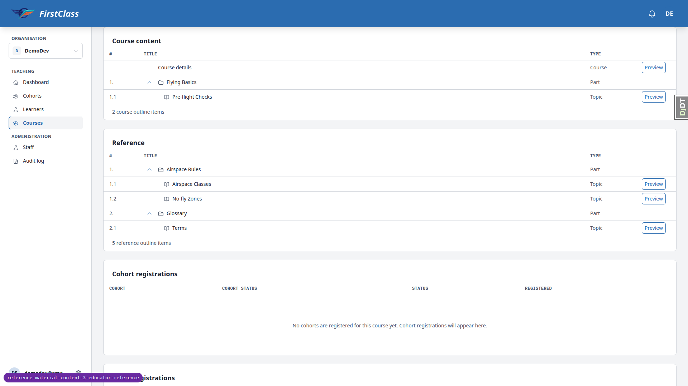 |
| 1.7 | desktop | pass | Chevron collapses and re-expands 1.1/1.2. 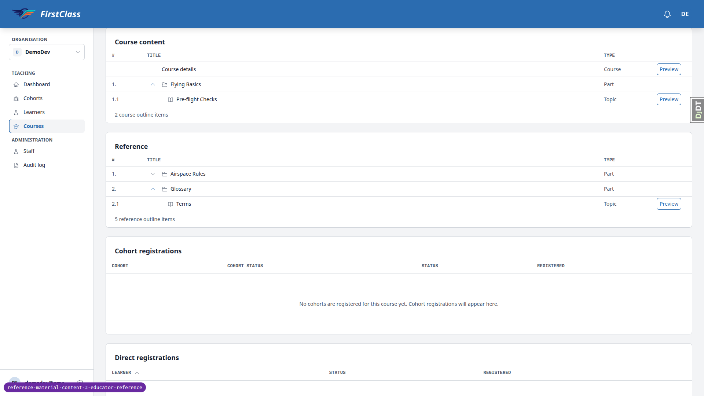 |
| 1.8 | mobile | pass | Cards, footer "5 reference outline items", scrollWidth 375. 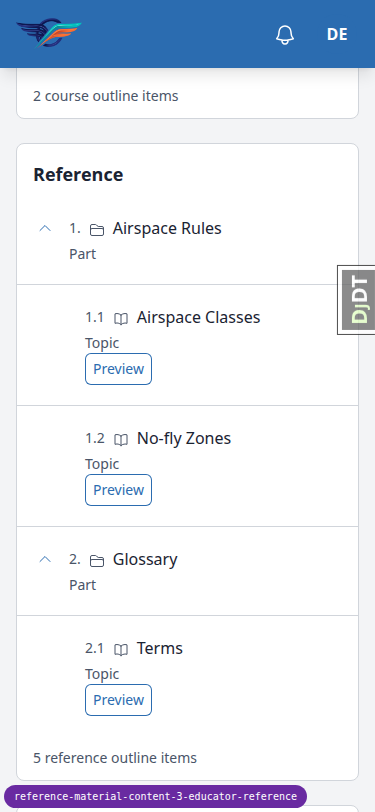 |
| 1.8 | tablet | pass | Both panels as cards, scrollWidth 768. 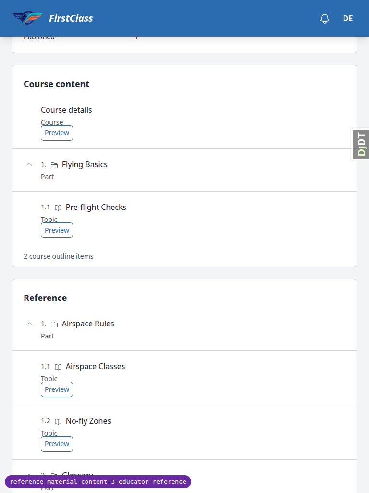 |
| 2 | desktop | pass | "Airspace Classes (Preview)" with Topic chip, read-only, no Mark complete. Escape returns focus to the Preview button. Glossary preview works ([screenshot](screenshots/page-2026-11-23T09-51-53-936Z.png)). Learning-path preview unaffected. Keyboard Enter lands focus on the dialog title. 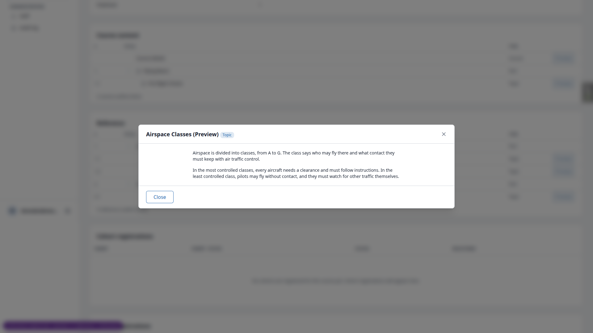 |
| 2 | mobile | pass | Bottom sheet, title and Topic chip, Close 44px. 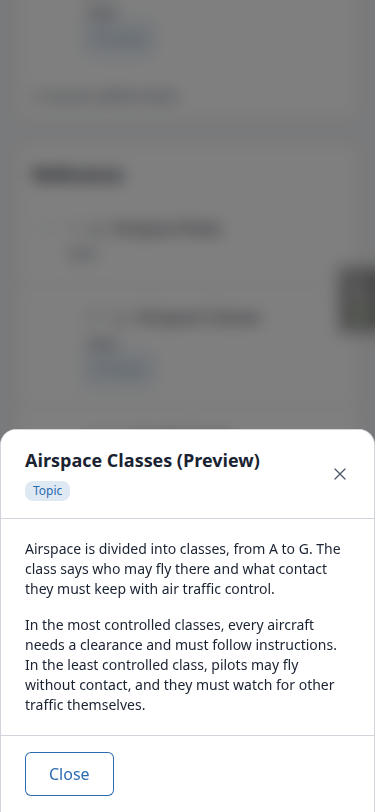 |
| 2 | tablet | pass | "Terms (Preview)" fits 768. 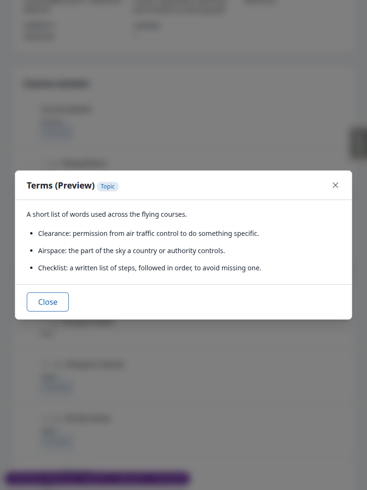 |
| 3 | desktop | pass (functional) / fail (layout, see B1) | Empty state text shown, no numbers, no footer count, Course content unchanged (10 items). 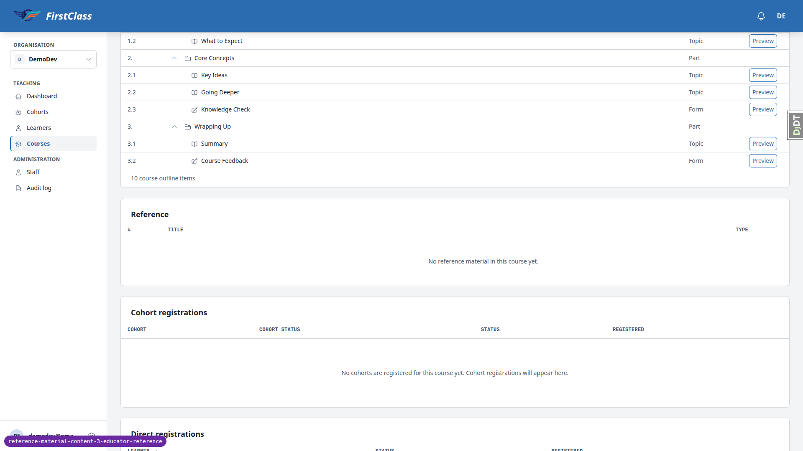 |
| 3 | mobile | pass | Empty card shows the empty state; scrollWidth 375. 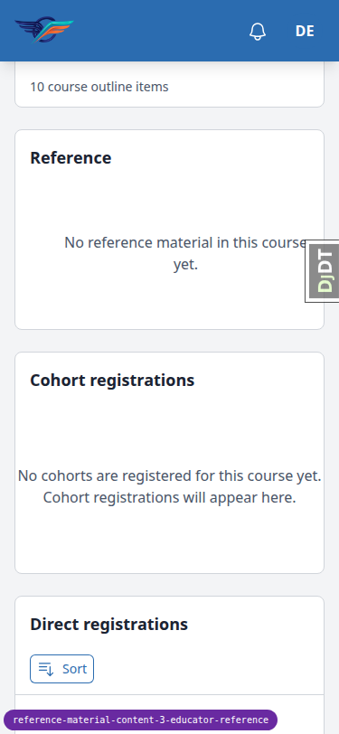 |
| 4 | desktop | pass | With HX-Request: reference preview 200; reference item under content panel 404; content item under reference panel 404; `item=not-a-uuid` 404; reference URL without HX-Request 404. No screenshot. |
| 5 | desktop | pass (see caveat) | Under harbour-college both panels show "Content preview isn't shared with your organisation.", no rows, no Preview buttons; reference preview URL under that org returns 404. 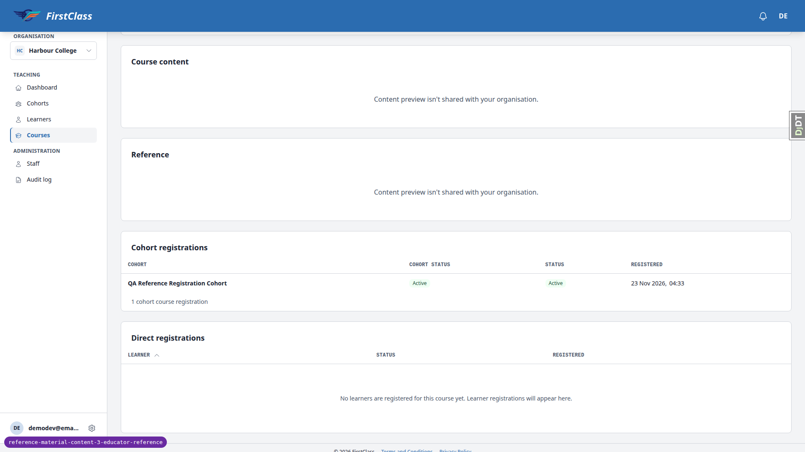 |
| 6.1 | desktop | pass | No Reference panel on cohort or learner pages. No screenshot. |
| 6.2 | desktop | pass | Cohort registrations loads; Direct registrations "Showing 1–10 of 15", Next gives "Showing 11–15 of 15"; outlines unaffected. 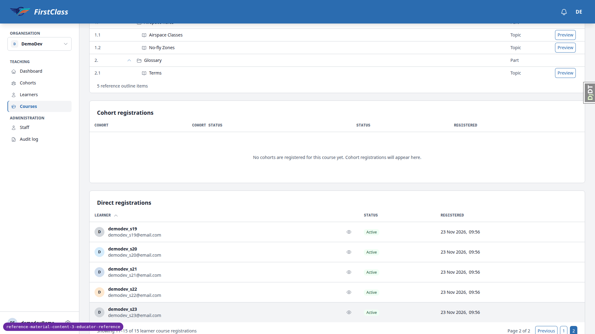 |
| 6.3 | desktop | pass | No console errors on the course page or during previews, apart from the deliberate Test 4 404 probes. No screenshot. |

## Bug B1: Empty outline table: sr-only Actions header misaligns Type and overflows the page at desktop

Manifestations:

- `3-layout` (desktop)
- `3` (desktop)

**Expected:** On a course with no reference parts, the empty Reference table's #, Type and Actions columns start at the same x as Course content's (educator-interface visual checklist: stacked outline tables line up), and the page has no horizontal scroll at 1920px.

**Actual:** The TYPE header sits at x≈1759 instead of 1631, and the document is 1998px wide in a 1920px viewport. The Actions column's `header_class` `w-28 min-w-28 max-w-28 sr-only` (`freedom_ls/educator_interface/panels/course/content_preview.py:299`) makes the `<th>` position:absolute. With no body rows nothing holds the column, so Type stretches to the right edge and the 112px absolute `<th>` spills past the viewport. Mobile and tablet card mode is unaffected (scrollWidth 375).

## Layout probe

| Test id | Viewport | URL | Screenshot | Result |
|---|---|---|---|---|
| 1 | desktop | /educator/organisations/demodev/courses/1144be70-d209-4fde-98f8-3fb2459fdccb |  | clean |
| 1.7 | desktop | same |  | clean |
| 2 | desktop | same |  | clean |
| 2.4 | desktop | same | 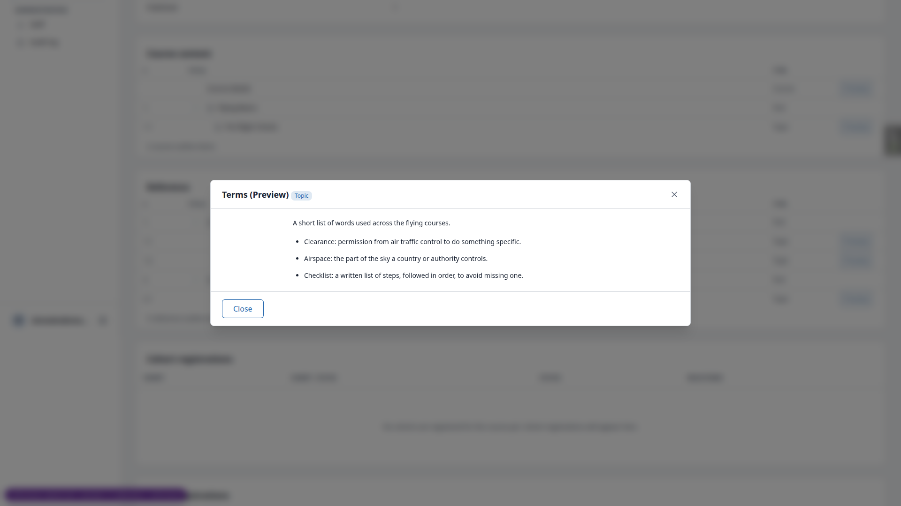 | clean |
| 3 | desktop | /educator/organisations/demodev/courses/531adc02-f240-4c7b-87f7-956a804c1e22 |  | overflow: document is 1998px wide in a 1920px viewport (B1) |
| 1.8 | mobile | /educator/organisations/demodev/courses/1144be70-d209-4fde-98f8-3fb2459fdccb |  | clean |
| 2 | mobile | same |  | clean |
| 3 | mobile | /educator/organisations/demodev/courses/531adc02-f240-4c7b-87f7-956a804c1e22 |  | clean |
| 1.8 | tablet | /educator/organisations/demodev/courses/1144be70-d209-4fde-98f8-3fb2459fdccb |  | clean |
| 2 | tablet | same |  | clean |
| 5 | desktop | /educator/organisations/harbour-college/courses/1144be70-d209-4fde-98f8-3fb2459fdccb |  | clean |
| 6.2 | desktop | /educator/organisations/demodev/courses/1144be70-d209-4fde-98f8-3fb2459fdccb?learner_registrations-page=2 |  | clean |

## Data changes

| What changed | Made by | Files written |
|---|---|---|
| Granted demodev@email.com an organisation_admin role on harbour-college (reused org with no ownership/share of the reference course and an existing cohort registration "QA Reference Registration Cohort" on it). | `sdd:qa-data-helper` | none |
| Created 15 active direct LearnerCourseRegistrations on "Functionality Demo - Reference Material" for existing demodev learners (demodev_s1, demodev_s10 to s23) so the Direct registrations panel paginates (page size 10). | `sdd:qa-data-helper` | none |

## Bug status

| Bug | Title | Status |
|---|---|---|
| B1 | Empty outline table: sr-only Actions header misaligns Type and overflows the page at desktop | **FIXED** (commit: 69e0bfb5d) |

Re-verified at 1920x1080 on the Course Parts course: the empty Reference table's #, Title, Type and Actions headers now sit at x=289/385/1631/1775, the same as Course content, and the document is 1920px wide with no probe flags. The fix adds `Column.header_hidden` to the shared panel framework, so I spot-checked the reference course page, a cohort page, a learner page and the courses list: no overflow, no absolutely positioned headers, no errors.

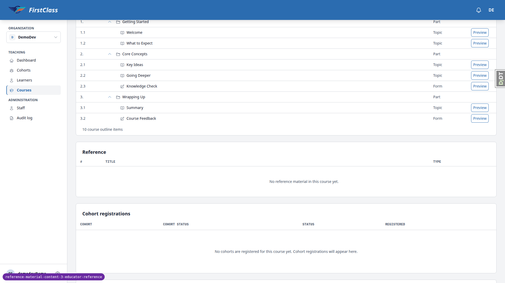

## General notes

- Test 5 caveat: demodev@email.com is a superuser. The test confirms the withheld-preview behaviour for an organisation with only a registration, but it does not confirm that a non-superuser organisation admin gets in through the role alone. That path is untested.
- Test 4 and 6.1 and 6.3 have no screenshots by nature (HTTP probes, absence checks, console checks).
- The second data change (15 extra direct registrations) remains in the dev database; the first (harbour-college organisation_admin role for demodev) also remains.

status: ok · reason: 1 bug — 1 fixed, 0 unresolved; report rendered, screenshots verified
