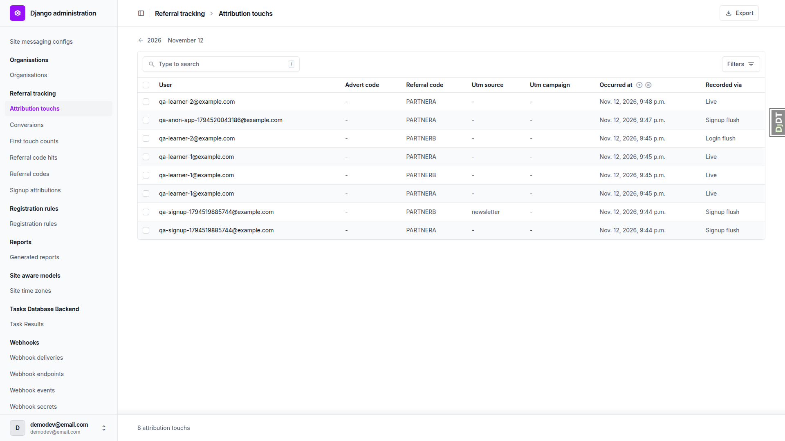
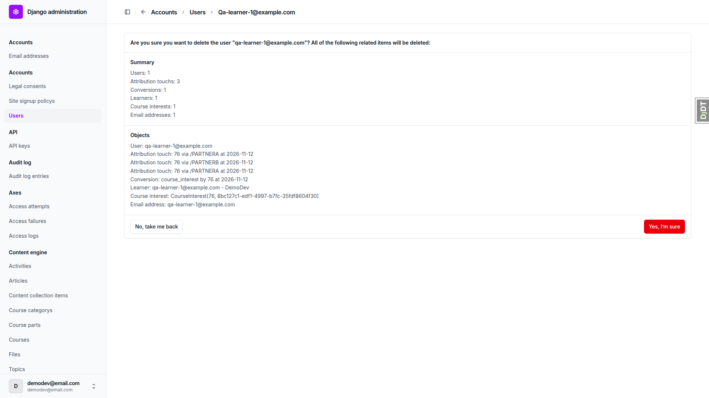
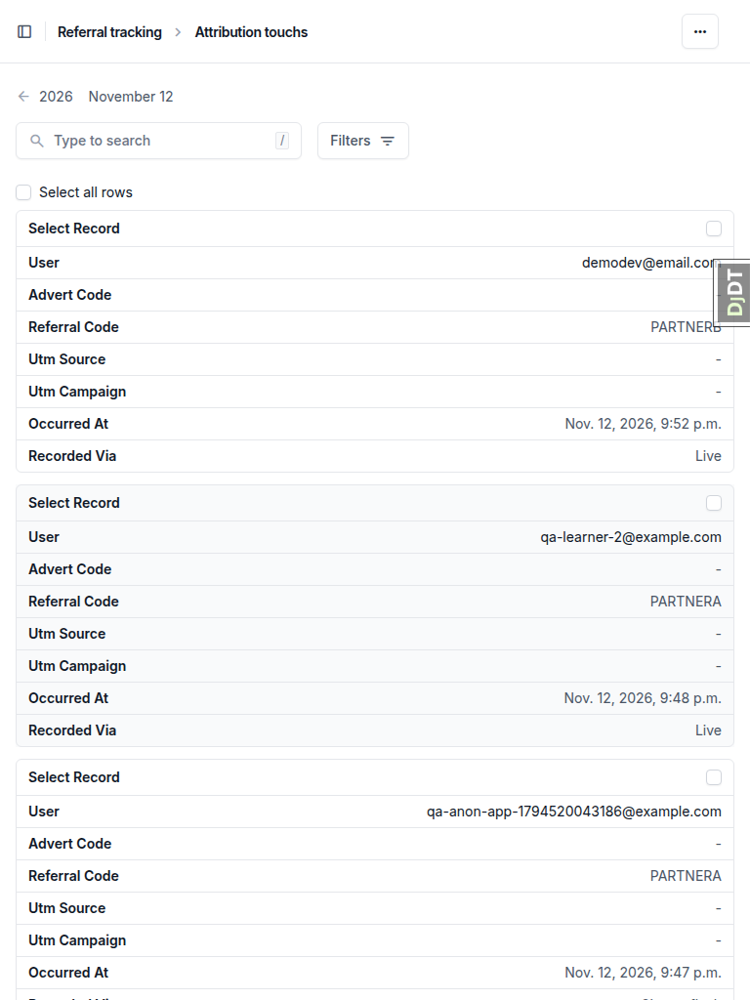

# Frontend QA report: referral-attribution-over-time

## Methodology

The test plan (`3. frontend_qa.md`) was walked by hand through Playwright MCP against a dev server running on its own port. Screenshots were collected into `screenshots/` beside this report. Data was seeded per the records listed under Data changes.

## Diff scoping

- Class: FULL
- Triggering files: `docs/app_structure.md`, `test_organisation/import_contracts.toml`, `spec_dd/**` (markdown), `freedom_ls/**` (python only, no templates or static). Non-.py paths force FULL under rule 4. Nothing was skipped.
- Everything ran at desktop, mobile and tablet. Mobile and tablet focused on the only changed UI, the two admin changelists (attribution touches and conversions).

## Smoke gate

Status: pass. Pages checked: `/`, `/admin/freedom_ls_referral_tracking/conversion/`. No failure URL or reason.

## Results

| Test id | Viewport | Status | Notes |
|---|---|---|---|
| 1.1-1.4 | desktop | pass | Cookie minted on `?ref=PARTNERA`. Repeat visit and `?gclid` leave it byte-identical. `?ref=PARTNERB&utm_source` appends, with Cache-Control private, no-store and Vary Cookie. |
| 1.5-1.9 | desktop | pass | Signup 302 deletes `fls_attribution`. Admin shows two signup_flush touches (PARTNERA, PARTNERB with utm newsletter), none for gclid. One account_signup conversion, first A last B, label "Account signup". One SignupAttribution first touch PARTNERA. |
| 1.10 | desktop | pass | After email verification the new account started an application on "Functionality Demo - Application gated course". Admin shows a course_application conversion with the course title, first PARTNERA last PARTNERB. |
| 2.1-2.6 | desktop | pass | Signed-in qa-learner-1: `?ref=PARTNERA` sets no cookie. "I'm interested" on the coming-soon course writes one course_interest conversion A/A labelled with the course title. Page then shows the interested state with no button (no second conversion). Repeat A skipped, then B, A gives three live touches A, B, A. |
| 3.1-3.4 | desktop | pass | Anonymous `?ref=PARTNERB` then login as qa-learner-2 writes one login_flush touch PARTNERB and the cookie is gone. A second login with no landing writes nothing and errors nothing. |
| 4.1-4.4 | desktop | pass | Anonymous `?ref=PARTNERA`, anonymous application with a fresh email, claim link from Mailpit opened in the same browser. Confirm POST deletes `fls_attribution`. Admin shows a signup_flush PARTNERA touch, a course_application conversion (course title, A/A) and an account_signup conversion. Reopening the used link shows "This link is invalid or has already been used" and no second conversion. occurred_at could not be distinguished from claim time at admin minute precision (unit tests cover it). |
| 5.1-5.4 | desktop | pass | Signed-in qa-learner-2 visits `?ref=PARTNERA` then Enrol for free: lands in the course player. One course_registration conversion, first PARTNERB (earlier login_flush, in window), last PARTNERA. Revisiting `/access/` writes nothing. After unticking is_active in admin, Enrol for free reactivates the registration with still only one conversion. |
| 6.1 | desktop | fail | Columns, recorded-via filter, occurred_at date drill-down and no Add button all present. The plural reads "Attribution touchs" in heading, breadcrumb, sidebar and user-delete summary (see B1). |
| 6.2 | desktop | pass | Touch view page: all 13 fields read-only, no Save/Delete, only Close and History. A hand-built POST to the change URL returns 403 and persists nothing. |
| 6.3-6.5 | desktop | pass | Conversions changelist columns present; kind filter and code-in-play text filter work. "partnerb" (lower case) returns exactly the 3 conversions with PARTNERB first or last. Export downloads a CSV with exactly the 3 filtered rows and the expected columns (id, user, kind, target_label, occurred_at, first_referral_code, first_touch__occurred_at, last_referral_code, last_touch__occurred_at, window_days). |
| 6.6 | desktop | pass | qa-staff-noperm sees no referral tracking links and gets 403 on both changelists and both export URLs. |
| 6.7 | desktop | pass | Deleting qa-learner-1 lists 3 attribution touches and 1 conversion in the confirmation; confirming succeeds and both are gone. |
| 7.1-7.4 | desktop | pass | `/go/PARTNERA` 302s to the destination with `?ref` and sets no cookie. Untracked `/` sets no cookie. Signup with no landing writes a direct/none SignupAttribution and an account_signup conversion with blank codes. Admin user (no touches) self-registers, expresses interest and starts an application with no error, each giving a conversion with blank codes. |
| 6.1-6.3 | mobile | pass | Both changelists switch to unfold's stacked card rows, no horizontal scroll (scrollWidth 375), filters and search usable. The collapsed debug-toolbar tab overlaps the card edge (dev tooling only). |
| 6.1-6.3 | tablet | pass | Both changelists render as stacked cards at 768, no overflow. The "Attribution touchs" plural is visible in the breadcrumb here too (same bug as B1). |

## Design check

no design states tested

## B1: AttributionTouch admin reads "Attribution touchs"

Manifestations:
- Test 6.1, desktop
- Test 6.7, desktop
- Test 6.1-6.3, tablet

- Expected: the model's plural name reads "Attribution touches" in the admin sidebar, breadcrumb, page heading and the user-delete summary.
- Actual: Django's default plural "Attribution touchs", because `AttributionTouch.Meta` sets no `verbose_name_plural`.

## Layout probe

| Test id | Viewport | URL | Screenshot | Result |
|---|---|---|---|---|
| 6.1 | desktop | `/admin/freedom_ls_referral_tracking/attributiontouch/` | [screenshot](screenshots/page-2026-11-12T21-49-40-072Z.png) | clean |
| 6.2 | desktop | `/admin/freedom_ls_referral_tracking/attributiontouch/<id>/change/` | [screenshot](screenshots/page-2026-11-12T21-50-03-257Z.png) | clean |
| 6.3-6.4 | desktop | `/admin/freedom_ls_referral_tracking/conversion/?code_in_play=partnerb` | [screenshot](screenshots/page-2026-11-12T21-51-19-925Z.png) | clean |
| 6.7 | desktop | `/admin/freedom_ls_accounts/user/76/delete/` | [screenshot](screenshots/page-2026-11-12T21-51-46-037Z.png) | clean |
| 6.3 | mobile | `/admin/freedom_ls_referral_tracking/conversion/` | [screenshot](screenshots/page-2026-11-12T21-53-00-048Z.png) | clean |
| 6.1 | mobile | `/admin/freedom_ls_referral_tracking/attributiontouch/` | [screenshot](screenshots/page-2026-11-12T21-53-07-593Z.png) | clean |
| 6.1 | tablet | `/admin/freedom_ls_referral_tracking/attributiontouch/` | [screenshot](screenshots/page-2026-11-12T21-53-08-453Z.png) | clean |
| 6.3 | tablet | `/admin/freedom_ls_referral_tracking/conversion/` | [screenshot](screenshots/page-2026-11-12T21-53-12-025Z.png) | clean |

## Data changes

| # | Via | What |
|---|---|---|
| 1 | sdd:qa-data-helper | `create_demo_data --yes` and `content_save demo_content DemoDev` (DemoDev site, 16 courses, demo users) |
| 2 | sdd:qa-data-helper | New `qa_create_referral_attribution_scenario` command: PARTNERA/PARTNERB codes, qa-learner-1/2 and qa-staff-noperm users |
| 3 | sdd:qa-data-helper | Marked qa-signup-1794519885744@example.com EmailAddress verified so the new account could log in (Test 1 step 10) |

## Bug status

| Bug | Title | Status |
|---|---|---|
| B1 | AttributionTouch admin reads "Attribution touchs" | **FIXED** (commit: 1c4d37b5e) |

## General notes

- Test 4: occurred_at could not be distinguished from claim time at the admin's minute precision. Unit tests cover it.
- CSV formula escaping was not driven in the browser (no way to land a `=` code through `?ref`); covered by test_resources.
- Test 5: the first code PARTNERB is correct, because an earlier login flush fell inside the window.
- A signed-in `/go/` landing records the destination path, not `/go/`.
- The admin `__str__` for touches reads like `77 via /PARTNERA at …` (user pk, utm_source/code), mirroring SignupAttribution's existing style.

status: ok · reason: 1 bug — 1 fixed, 0 unresolved; report rendered, screenshots verified
