# Frontend QA report: referral-attribution-over-time

All planned frontend QA tests passed on desktop, mobile and tablet. The smoke gate passed. No bugs were found. The report notes three observations that are not failures: removing interest and expressing it again records a second course interest conversion, `/go/<code>` suppresses capture on the redirect itself, and some admin object labels show the user pk.

## Methodology

- Playwright MCP against a dev server on port 8796 for branch `referral-attribution-over-time`, logged in as the QA admin.
- Anonymous visitors used fresh browser contexts, so each started with no cookies.
- Email links (email confirmation, application claim) were read from Mailpit.
- Screenshots were collected into `screenshots/` beside this report. Every image linked below was confirmed to exist there.

## Diff scoping

- Class: **FULL**.
- Why: the diff touches non-`.py`, non-front-end paths (docs/*.md, test_organisation/import_contracts.toml and others). Under Rule 4 these make the class FULL. No templates or static files changed.
- Changed files include `freedom_ls/referral_tracking/*.py`, the touched course_applications, course_interest, learner_interface and learner_management views, the referral_tracking and accounts admin tests, and docs.
- Skipped: nothing. Desktop, mobile and tablet all ran.

## Smoke gate

Status: **pass**. Pages checked:

- `/`
- `/admin/freedom_ls_referral_tracking/`
- `/admin/freedom_ls_referral_tracking/conversion/`

No failure URL or reason.

## Results

| Test | Viewport | Status | Notes | Screenshot |
|---|---|---|---|---|
| 1.1-1.4 | desktop | pass | Fresh context: `?ref=PARTNERA` set HttpOnly `fls_attribution` (Cache-Control private, no-store). Repeat PARTNERA and gclid left the value unchanged and sent no Set-Cookie. PARTNERB+utm_source grew the cookie (163 to 277 chars) with private, no-store. | none |
| 1.5-1.6 | desktop | pass | Signup qa-t1-1115@example.com: 302 response carries `fls_attribution=""; Max-Age=0`; cookie gone afterwards. | none |
| 1.7 | desktop | pass | Two touches, both Signup flush, PARTNERA and PARTNERB (utm_source newsletter), occurred 6:01 (landing times); no gclid row. | 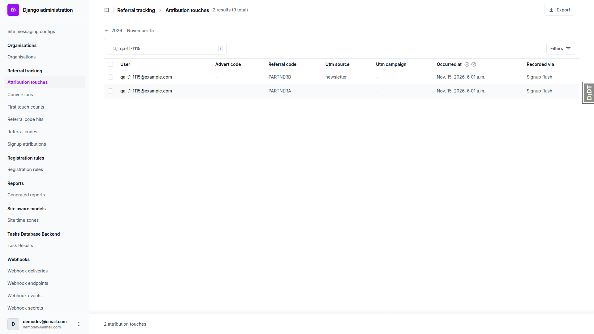 |
| 1.8-1.9 | desktop | pass | One Account signup conversion, label "Account signup", first PARTNERA, last PARTNERB. Signup attributions: exactly one row, referral code PARTNERA. | none |
| 1.10 | desktop | pass | After email confirm (via Mailpit) and starting the application on "Functionality Demo - Application gated course", a Course application conversion appears with that title, first PARTNERA, last PARTNERB. | 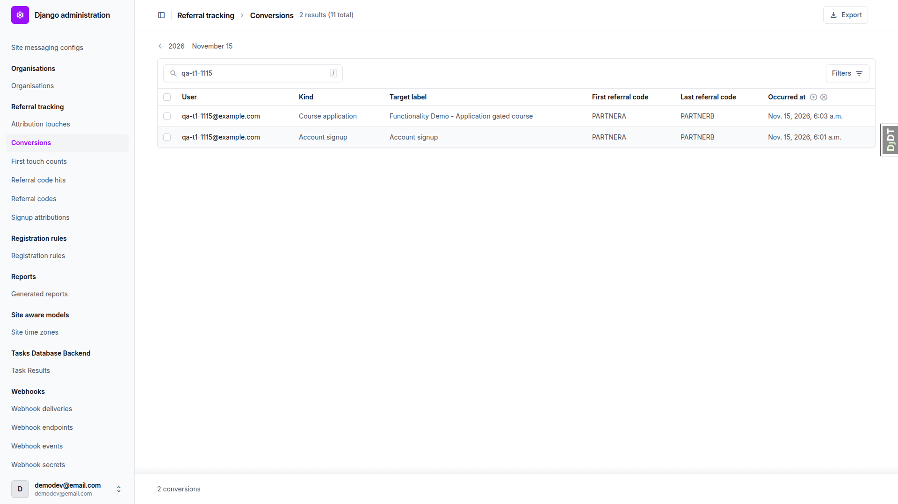 |
| 2.1-2.2 | desktop | pass | qa.live logged in; `/?ref=PARTNERA` set no `fls_attribution` cookie (only csrftoken). | none |
| 2.3-2.4 | desktop | pass | Clicked "I'm interested" on the coming-soon course; card shows Interested / Remove interest. Admin: one Live touch PARTNERA, one Course interest conversion labelled "Content Widgets - Demo Reference", first and last PARTNERA. |  |
| 2.5 | desktop | pass | Reloading in the interested state and a hand POST to express-interest while already interested added no conversion. See General notes for the remove-then-re-express case. | none |
| 2.6 | desktop | pass | Repeat `/?ref=PARTNERA` while signed in added no touch (still 1); then PARTNERB and PARTNERA gave three Live touches A, B, A. No cookie set throughout. | none |
| 3.1-3.4 | desktop | pass | Fresh context `/?ref=PARTNERB` set the cookie; logging in as qa.login returned a 302 deleting `fls_attribution`; admin shows one Login flush touch PARTNERB. Logout and second login with no new landing: no Set-Cookie for fls_, no new touch (still 1), Dashboard loads with no error. | none |
| 4.1-4.3 | desktop | pass | Fresh context `/?ref=PARTNERA`, anonymous apply as qa-t4-anon-1115@example.com (06:08:18). Claim link from Mailpit opened in the same browser 30s later; Confirm returned a 302 deleting `fls_attribution`; set password; back on the application. Admin: Signup flush PARTNERA touch; course_application conversion occurred_at 06:08:18 (application start) first/last PARTNERA, and account_signup at 06:08:56 beside it. | 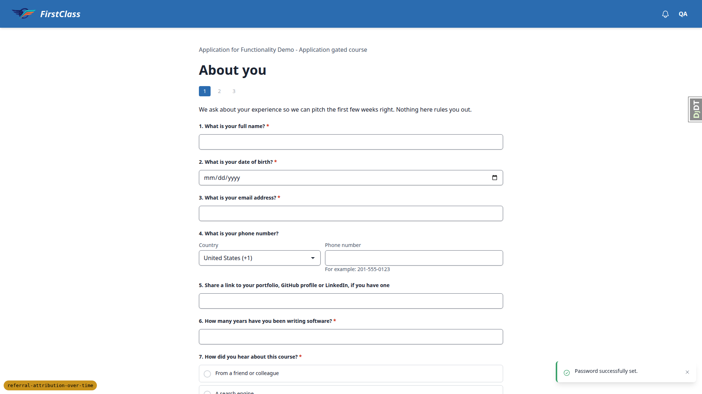 |
| 4.4 | desktop | pass | Reloading the claim link shows "This link is invalid or has already been used"; still exactly one course_application conversion. | none |
| 5.1-5.3 | desktop | pass | qa.selfreg signed in, `/?ref=PARTNERA`, "Enrol for free" on "Functionality Demo - show end with Topic" lands in the course player (Content title 1). One course_registration conversion, first/last PARTNERA. Visiting `/access/` again: no second conversion. |  |
| 5.4 | desktop | pass | Unticked Is active on the registration in admin (shows inactive), learner hit `/access/` again and landed in the player; registration active again, still one course_registration conversion. | none |
| 6.1 | desktop | pass | Touches changelist: columns user, advert code, referral code, UTM source, UTM campaign, occurred at, recorded via; "By recorded via" filter; occurred_at date drill-down; no Add link. |  |
| 6.2 | desktop | pass | Touch view page: every field read-only, only Close and History, no Save/Delete. Hand POST to change URL (referral_code=HACKED) and to delete URL both 403; values unchanged on reload. | 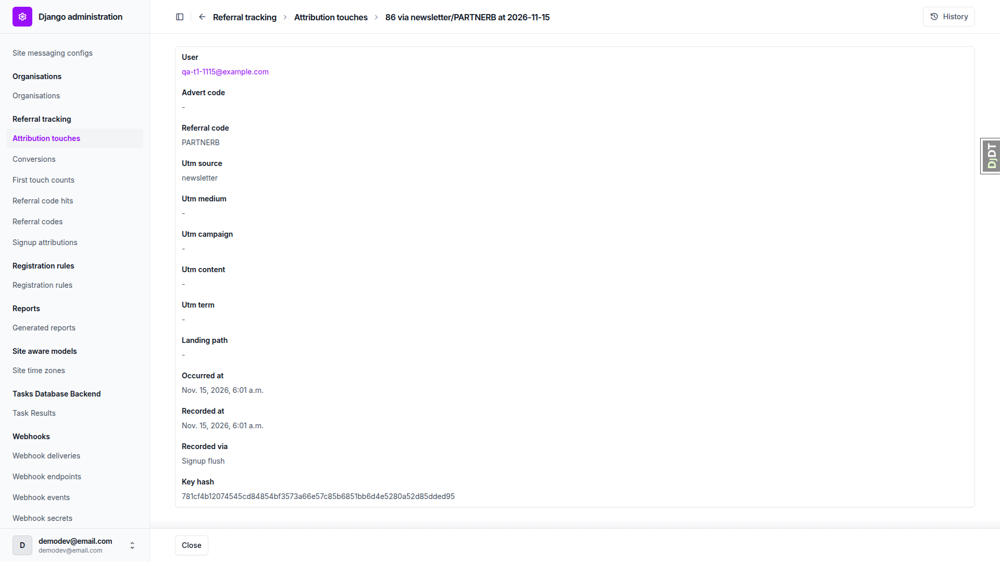 |
| 6.3 | desktop | pass | Conversions changelist: user, kind, target label, first and last referral code, occurred at; filters By kind and By code in play; no Add. | 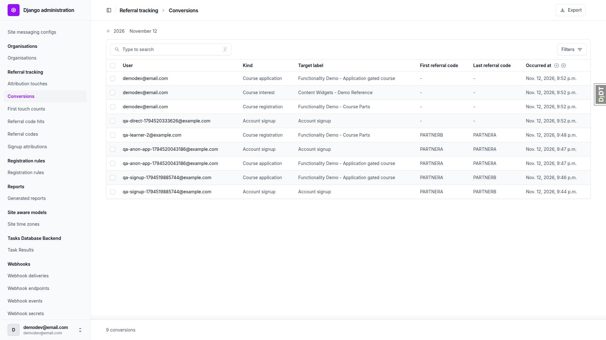 |
| 6.4 | desktop | pass | "partnera" in code in play: 7 of 12 conversions, exactly those whose first or last code is PARTNERA. | 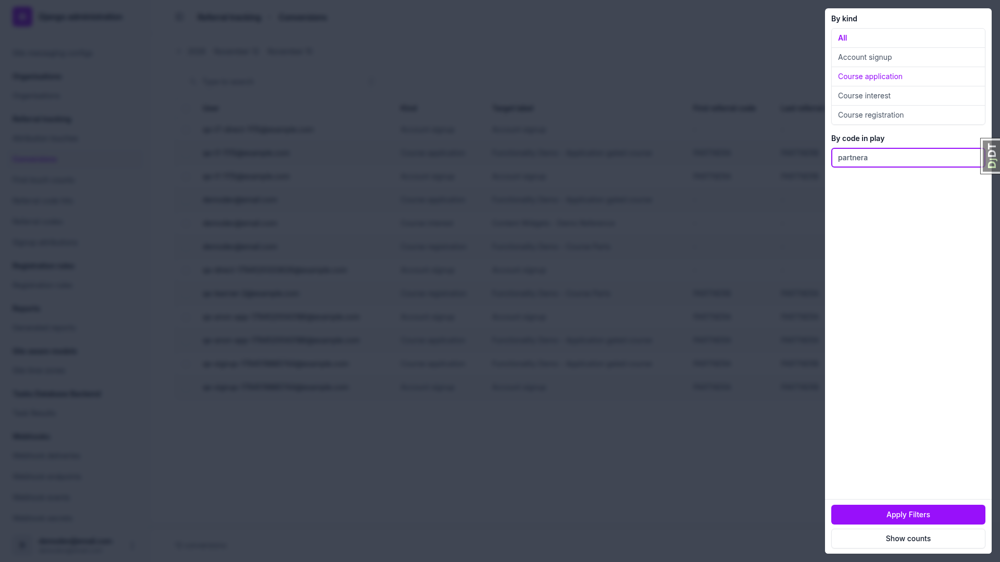 |
| 6.5a | desktop | pass | Export with the filter applied downloaded a CSV holding the same 7 rows and the columns id, user, kind, target_label, occurred_at, first_referral_code, first_touch__occurred_at, last_referral_code, last_touch__occurred_at, window_days. Touch times 06:01:21/06:01:28 match the Test 1 landings. | none |
| 6.5b | desktop | pass | qa.login self-registered on the formula-titled course; export of that conversion writes the target_label cell as `'=HYPERLINK(...)` (leading apostrophe), so the formula is escaped. | none |
| 6.6 | desktop | pass | qa.staffnoperm (is_staff, no permissions): `/admin/` says "You don't have permission to view or edit anything", no Referral tracking links; touches and conversions changelists, both export URLs and a touch change URL all 403. | none |
| 6.7 | desktop | pass | Deleting qa.live: confirmation summary lists Attribution touches: 3 and Conversions: 2 with each object; confirming returns to the user list and both changelists show 0 rows for qa.live. | 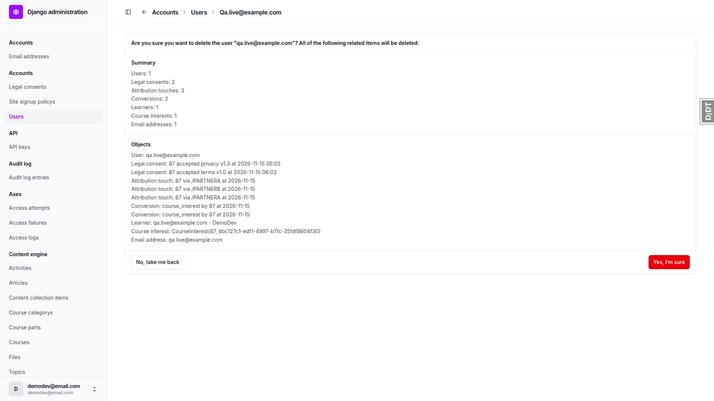 |
| 7.1 | desktop | pass | `/go/PARTNERA` returns 302 with no Set-Cookie (capture suppressed on the redirect view, as the spec says); its destination carries `?ref=PARTNERA`, which is an ordinary tracked landing and sets the cookie there. | none |
| 7.2 | desktop | pass | Anonymous GET `/` with no tracking params: 200, no `fls_attribution` cookie, no Cache-Control override. | none |
| 7.3 | desktop | pass | Fresh-context signup qa-t7-direct-1115@example.com: Signup attribution utm_source direct / medium none, Account signup conversion with both codes blank, no touches. | none |
| 7.4 | desktop | pass | qa-t7-direct (no code landings) started an application, expressed interest and self-registered with no error page; three conversions with blank first/last codes beside its blank account_signup. | none |
| 6.4 | mobile | pass | Filtered conversions render as stacked record cards; Filters is a full-width button; scrollWidth 375, no horizontal scroll. Export moves into the ... menu. | 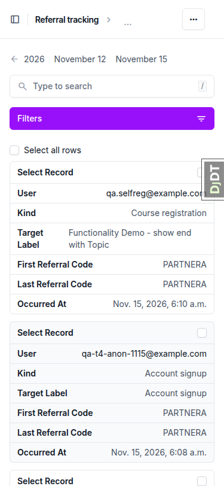 |
| 6.2 | mobile | pass | Read-only touch view fits 375px; labels and values stack, no overflow. | 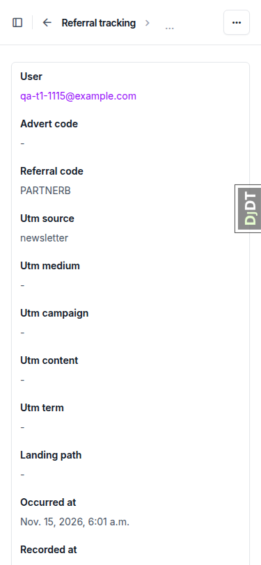 |
| 6.1 | tablet | pass | Touches changelist as record cards with all columns, date drill-down and Filters visible; scrollWidth 768. | 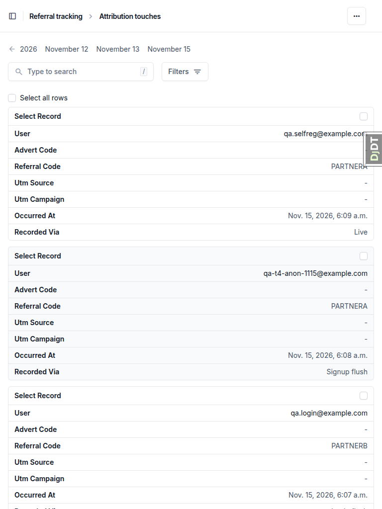 |
| 6.4 | tablet | pass | Filtered conversions (10 results of 19) as record cards, Filters button highlighted as active; no overflow. | 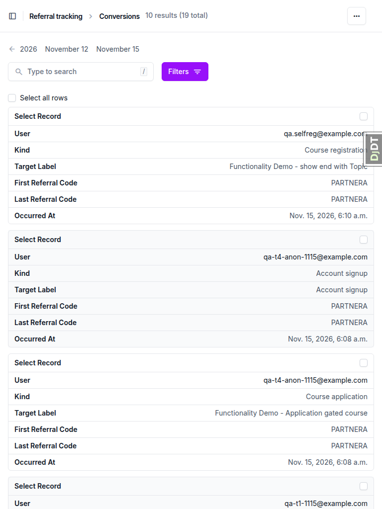 |

## Design check

No design states tested.

## Bugs

No bugs found.

## Layout probe

| Test | Viewport | URL | Screenshot | Result |
|---|---|---|---|---|
| 6.3 | desktop | `/admin/freedom_ls_referral_tracking/conversion/` |  | clean |
| 1.7 | desktop | `/admin/freedom_ls_referral_tracking/attributiontouch/?q=qa-t1-1115` |  | clean |
| 1.10 | desktop | `/admin/freedom_ls_referral_tracking/conversion/?q=qa-t1-1115` |  | clean |
| 6.2 | desktop | `/admin/freedom_ls_referral_tracking/attributiontouch/<pk>/change/` |  | clean |
| 6.4 | desktop | `/admin/freedom_ls_referral_tracking/conversion/` (filter sheet open) |  | clean |
| 2.3 | desktop | `/courses/content-widgets-demo-reference/detail/` |  | clean |
| 4.2 | desktop | `/applications/application/<pk>/page/1/` (after claim) |  | clean |
| 5.2 | desktop | `/courses/functionality-demo-show-end-with-topic/1/` |  | clean |
| 6.7 | desktop | `/admin/freedom_ls_accounts/user/87/delete/` |  | clean |
| 6.4 | mobile | `/admin/freedom_ls_referral_tracking/conversion/?code_in_play=partnera` |  | clean |
| 6.2 | mobile | `/admin/freedom_ls_referral_tracking/attributiontouch/<pk>/change/` |  | clean |
| 6.1 | tablet | `/admin/freedom_ls_referral_tracking/attributiontouch/` |  | clean |
| 6.4 | tablet | `/admin/freedom_ls_referral_tracking/conversion/?code_in_play=partnera` |  | clean |

## Data changes

| Via | What |
|---|---|
| sdd:qa-data-helper | Created learners qa.live@example.com (87), qa.login@example.com (88), qa.selfreg@example.com (89) and staff qa.staffnoperm@example.com (90, no permissions). Reused existing courses (show end with Topic = self-registration, Application gated course, Content Widgets coming soon) and codes PARTNERA/PARTNERB. Added management command `qa_create_referral_attribution_scenario`. |
| sdd:qa-data-helper | Created free self-registration course titled `=HYPERLINK("http://example.com","QA formula course")` (slug `qa-formula-course`) with one topic, plus command `qa_create_formula_title_course`. |

## Bug status

No bugs recorded.

## General notes

- Remove interest then "I'm interested" again records a second course_interest conversion. This is by design: removal deletes the CourseInterest row, and the spec records one conversion per target on created.
- `/go/PARTNERA` suppresses capture on the redirect itself. The destination URL carries `?ref=PARTNERA` and is captured there as an ordinary landing.
- Cosmetic, not a test failure: admin object labels use the user pk, for example "Attribution touch: 87 via /PARTNERA at 2026-11-15" (an empty utm_source leaves a leading slash) and "Conversion: course_interest by 87 at ...". The plan does not specify these labels.
- Fresh-cookie visitors used extra Playwright contexts. Screenshots of those pages were taken through the same Playwright MCP server into the same directory.
- Email links were read from Mailpit (localhost:8025), where the dev SMTP backend delivers.
- No screenshot compression was needed: no PNG is over 1024KB.

status: ok · reason: report rendered, 0 bugs documented
