# Frontend QA Report: referral-attribution-over-time

All planned tests passed at desktop, mobile and tablet. The smoke gate passed. No bugs were found.

## Methodology

- Playwright MCP against a dev server on port 8578 for branch `referral-attribution-over-time`, logged in as the QA admin.
- Fresh browser contexts were used for anonymous visitors and learners. Their screenshots were written by `page.screenshot` into the same screenshots directory (named `page-t2-*`, `page-t4-*`, `page-t5-*`, `page-mobile-*`, `page-tablet-*`). The layout probe was loaded into each context.
- Email links (email confirmation, application claim) were read from Mailpit's API at localhost:8025.
- Screenshots were collected into `screenshots/` beside this report. Before writing, Glob confirmed that every linked image exists there.
- Pre-step rebase: the branch was rebased onto origin/main (36 commits replayed). One conflict, in the generated `docs/app_structure.md`, was resolved by keeping main's deadlines row and the branch's deployment->referral_tracking edge. The lost-change check was reviewed and all branch changes are intact. `makemigrations --check` was clean, `migrate` applied main's deadlines 0004-0007, and pre-commit was clean.
- Front-end check: the post-rebase front-end check hook was folded into this QA run. Its pages are this plan's pages, which this run visited at all three viewports. The branch's own diff has no template or static change. Main brought shared changes (`cotton/date.html`, learner_interface course partials, `course_detail.html`) that render on the course detail pages checked here.

## Diff scoping

Class: FULL. The branch changes many Python files across referral_tracking, course_applications, course_interest, learner_interface, learner_management, deployment and qa_helpers. The rest are docs and agent-memory files. No templates or static files changed on the branch, but the shared changes brought by main (above) affect pages in the plan. Nothing was skipped: desktop, mobile and tablet all ran. The only paths not exercised are non-.py, non-front-end ones such as `docs/*.md` and `test_organisation/import_contracts.toml`.

## Smoke gate

Status: pass.

Pages checked:
- `/`
- `/admin/freedom_ls_referral_tracking/`
- `/admin/freedom_ls_referral_tracking/conversion/`
- `/admin/freedom_ls_referral_tracking/attributiontouch/`

## Results

| Test | Viewport | Status | Notes | Screenshot |
|---|---|---|---|---|
| 1.7-capture-check | desktop-1280 | pass | Per-run capture check shot: file landed in qa-screenshots/, no bytes returned. Taken before the 1920 resize and with the Django debug toolbar still expanded (the prep check used offsetParent, which is null for a fixed element). Retaken below; this shot is not used to judge layout. | 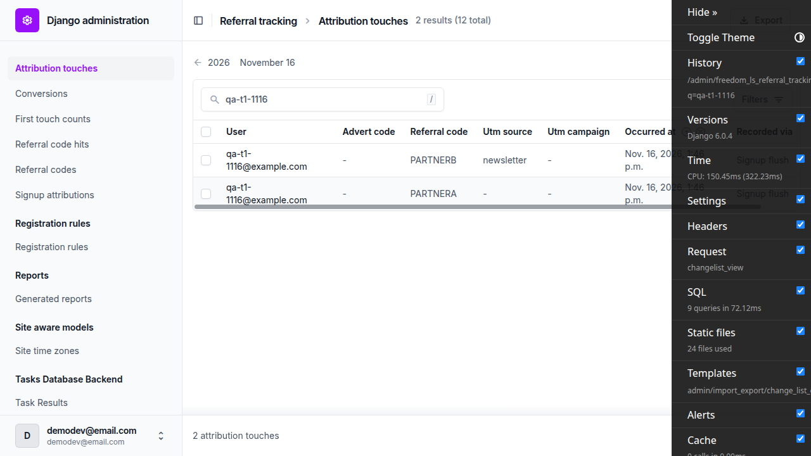 |
| 1.1-1.4 | desktop | pass | Fresh context: `?ref=PARTNERA` set HttpOnly `fls_attribution` (163 chars) with Cache-Control private, no-store. Repeat PARTNERA and `?gclid=abc123` sent no Set-Cookie, value unchanged. `?ref=PARTNERB&utm_source=newsletter` grew it to 277 chars, Cache-Control private, no-store. | none |
| 1.5-1.6 | desktop | pass | Signup qa-t1-1116@example.com: 302 to confirm-email carrying `fls_attribution=""; Max-Age=0`; cookie gone from the store afterwards. | none |
| 1.7 | desktop | pass | Two touches, both Signup flush: PARTNERA and PARTNERB (utm_source newsletter), occurred 1:46 p.m. UTC = landing times 13:46:44 / 13:46:53. No gclid row. Columns user, advert code, referral code, utm source, utm campaign, occurred at, recorded via; date drill-down shown; no Add. | 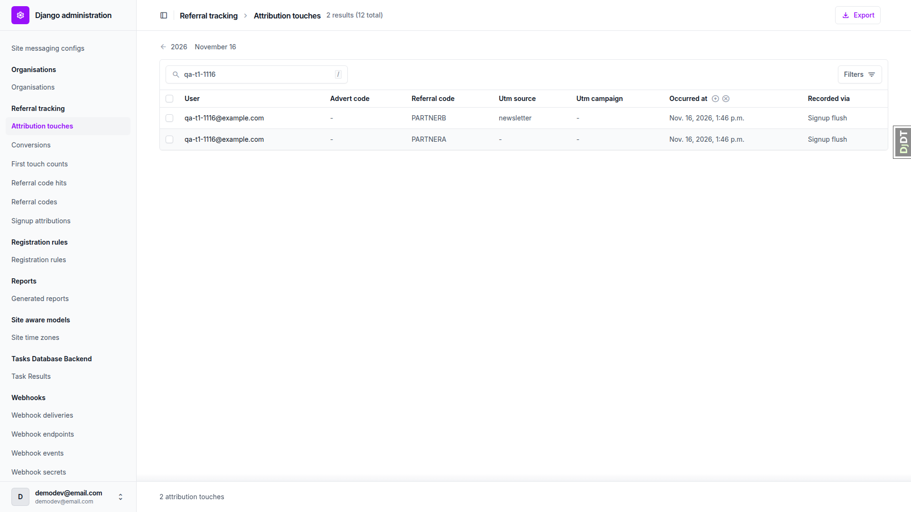 |
| 1.8-1.9 | desktop | pass | One Account signup conversion, target label 'Account signup', first PARTNERA, last PARTNERB. Signup attributions: exactly one row, referral code PARTNERA, first seen 1:46, signed up 1:47. | none |
| 1.10 | desktop | pass | Email confirmed via Mailpit link; Apply now on 'Functionality Demo - Application gated course' opened application page 1. Admin: Course application conversion labelled with the course title, first PARTNERA, last PARTNERB. |  |
| 2.1-2.4 | desktop | pass | qa.live logged in; `/?ref=PARTNERA` set no `fls_attribution` (only csrftoken). I'm interested on 'Content Widgets - Demo Reference' -> Interested / Remove interest. Admin: one Live touch PARTNERA, one Course interest conversion labelled with the course title, first and last PARTNERA. | 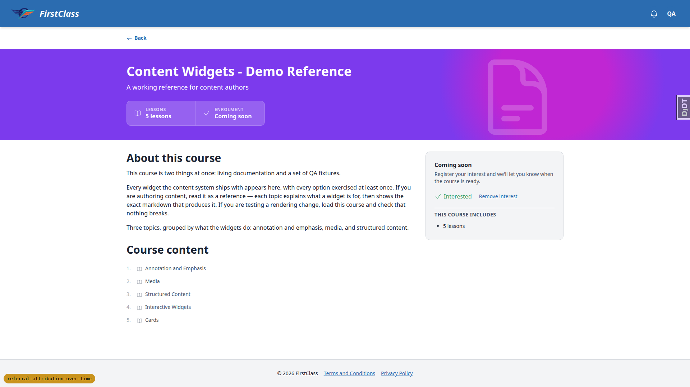 |
| 2.1-2.4 (first shot) | desktop | pass | Broken screenshot: taken in a fresh browser context before the debug toolbar was collapsed, which covers the header's right edge. Retaken as `page-t2-interest-1794836951465.png`; not used to judge layout. | 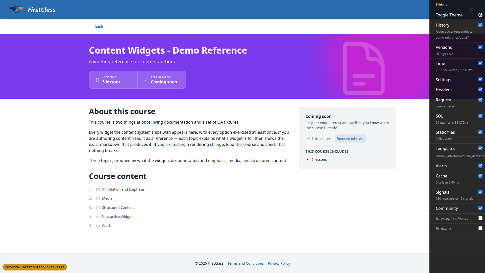 |
| 2.5 | desktop | pass | Reloading the course page in its interested state left exactly one Course interest conversion. | none |
| 2.6 | desktop | pass | Repeat `/?ref=PARTNERA` while signed in added no touch; then PARTNERB and PARTNERA added two Live touches (A, B, A = three). No `fls_` cookie set at any point. | none |
| 3.1-3.4 | desktop | pass | Fresh context `/?ref=PARTNERB` set the cookie; login as qa.login returned 302 with `fls_attribution` Max-Age=0, cookie gone. Admin: one Login flush touch PARTNERB. Logout and second login with no new landing: no `fls_` Set-Cookie, still one touch, dashboard shows 'Successfully signed in', no error. | none |
| 4.1-4.3 | desktop | pass | Fresh context `/?ref=PARTNERA`, anonymous apply as qa-t4-anon-1116@example.com at 13:50:20. Claim link from Mailpit opened in the same browser at 13:51; Confirm returned 302 deleting `fls_attribution`; set password; back on the application page 1. Admin: Signup flush PARTNERA touch; course_application conversion occurred 1:50 (application start), recorded 1:51 (claim), first/last PARTNERA; account_signup conversion beside it. | 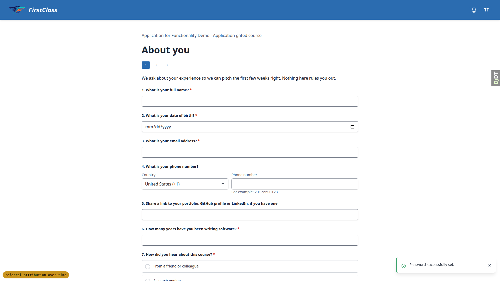 |
| 4.4 | desktop | pass | Reloading the claim link shows 'This link is invalid or has already been used'; still exactly one course_application conversion. | none |
| 4.5 | desktop | pass | qa.draft (verified, no application) signed in, `/?ref=PARTNERA`, Apply now created draft application c578e8d2 at 13:52:09. Admin: one course_application conversion, first and last PARTNERA. | none |
| 4.6 | desktop | pass | Logged out; fresh context `/?ref=PARTNERB`, anonymous apply with qa.draft@example.com at 13:52:25 (application cca5b0df). Claim page says the claim replaces the unfinished application; Confirm at 13:53 returned 302 deleting `fls_attribution` and signed the learner in on cca5b0df page 1. | none |
| 4.7 | desktop | pass | Admin: qa.draft holds exactly one course_application conversion, object cca5b0df (the claimed application); CSV export gives occurred_at 13:52:25.76 = anonymous start (not the draft's 13:52:09), first PARTNERA (touch 13:52:05), last PARTNERB (touch 13:52:21), recorded 1:53. Draft's conversion gone. Touches: Live PARTNERA + Login flush PARTNERB. No account_signup conversion. Course page shows 'View my application' -> `/applications/status/cca5b0df/`; the old draft URL 404s. | 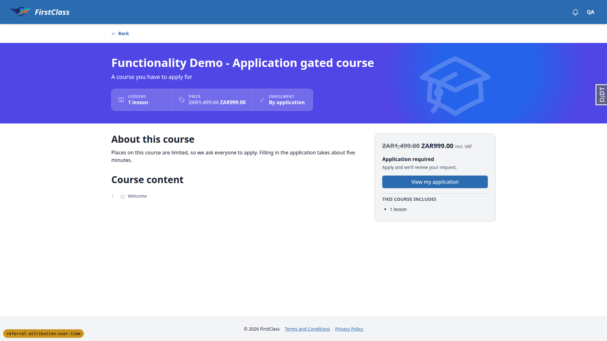 |
| 5.1-5.2 | desktop | pass | qa.selfreg signed in, `/?ref=PARTNERA`, Enrol for free on 'Functionality Demo - show end with Topic' landed in the player (Content title 1). Admin: one Course registration conversion, first and last PARTNERA. | 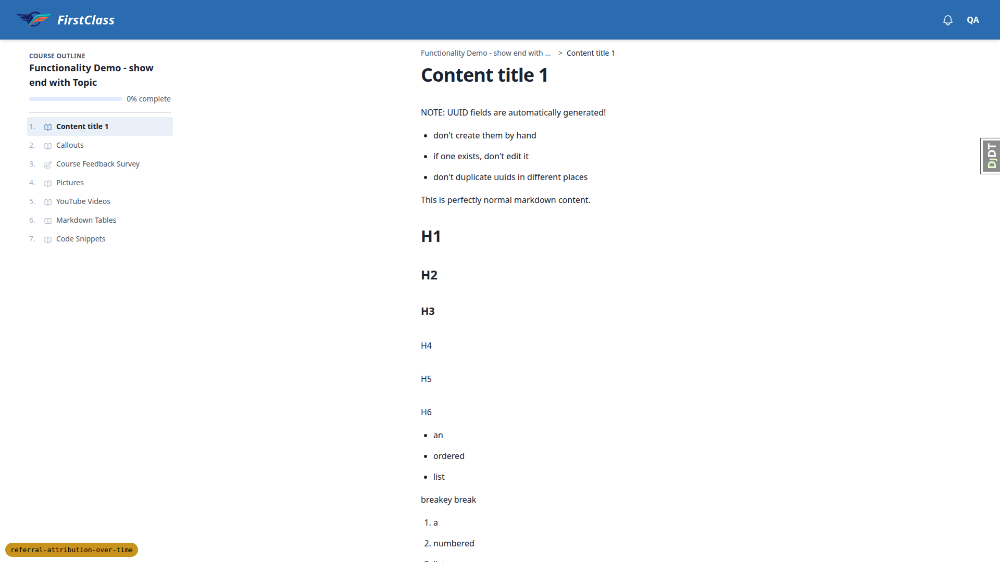 |
| 5.3 | desktop | pass | Visiting `/access/` again went straight to the player; still one course_registration conversion. | none |
| 5.4 | desktop | pass | Unticked Is active on the learner course registration in admin (saved, inactive on reload); the course page then offered Enrol for free; `/access/` landed in the player; registration active again; still exactly one course_registration conversion. | none |
| 6.1 | desktop | pass | Touches changelist: columns user, advert code, referral code, utm source, utm campaign, occurred at, recorded via; Recorded via filter in the Filters sheet; occurred_at date drill-down links; no Add link. |  |
| 6.2 | desktop | pass | Touch view page: every field read-only (no inputs), only Close and History, no Save or Delete. Hand POST to the change URL (referral_code/utm_source=HACKED) and to the delete URL both 403; values unchanged on reload. | 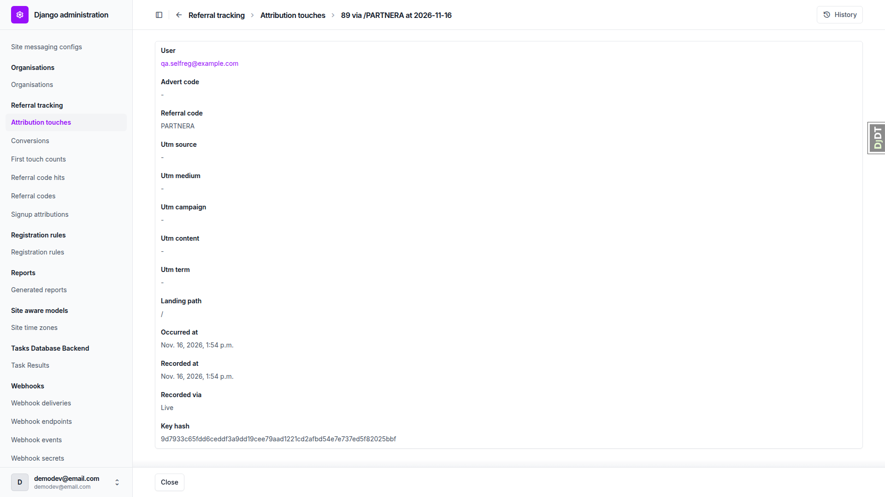 |
| 6.3-6.4 | desktop | pass | Conversions changelist: user, kind, target label, first and last referral code, occurred at; Filters sheet has By kind and By code in play; no Add. 'partnera' in code in play -> 16 results of 24, exactly the 16 whose first or last code is PARTNERA (counted from the unfiltered list), none other. 'Course application' highlighted in the sheet is cursor hover, not selection. | 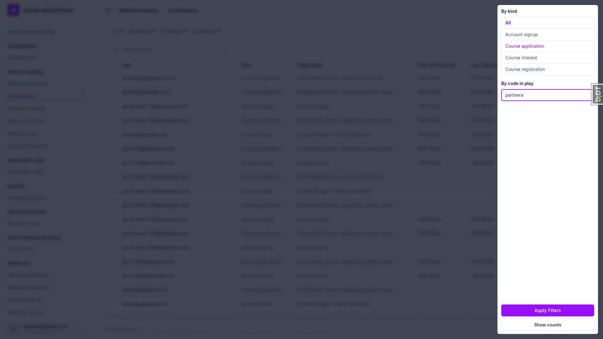 |
| 6.5 | desktop | pass | Export with code_in_play=partnera downloaded a CSV of exactly the 16 filtered rows, columns id, user (email), kind, target_label, occurred_at, first_referral_code, first_touch__occurred_at, last_referral_code, last_touch__occurred_at, window_days. qa.login self-registered on the formula-titled course: export writes target_label as `'=HYPERLINK(...` with a leading apostrophe, so the formula is escaped. | none |
| 6.6 | desktop | pass | qa.staffnoperm: `/admin/` 200 with 'You don't have permission to view or edit anything', no Referral tracking section; touches and conversions changelists, both export URLs and a touch change URL all 403. | none |
| 6.7 | desktop | pass | Deleting qa.live (pk 95): confirmation summary lists Attribution touches: 3 and Conversions: 1 with each object; confirming returned to the user list with 'deleted successfully'; both changelists show 0 rows for qa.live. |  |
| 7.1 | desktop | pass | `/go/PARTNERA` returns 302 to `/courses/functionality-demo-course-parts/detail/?ref=PARTNERA` with no Set-Cookie; no `fls_attribution` cookie after the redirect response. | none |
| 7.2 | desktop | pass | Anonymous GET `/` with no tracking params: 200, no `fls_attribution` cookie, no Cache-Control override. | none |
| 7.3 | desktop | pass | Fresh-context signup qa-t7-direct-1116@example.com: Signup attribution utm_source direct / medium none; Account signup conversion with both codes blank; no touches. | none |
| 7.4 | desktop | pass | Same learner (no code landings) started an application, expressed interest (Interested shown) and self-registered (landed in the player) with no error page; three conversions with blank first/last codes beside its account_signup. | none |
| 6.4 | mobile | pass | Filtered conversions render as stacked record cards; full-width Filters button; Export moves into the ... menu; scrollWidth 375. | 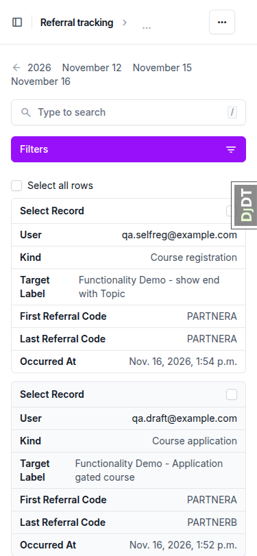 |
| 6.2 | mobile | pass | Read-only touch view fits 375px; labels and values stack; no overflow. |  |
| 2.3 | mobile | pass | Coming-soon course in interested state: hero, Interested / Remove interest card stack in one column; scrollWidth 375. | 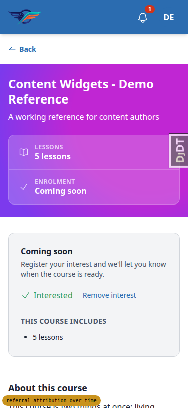 |
| 4.7 | mobile | pass | Gated course detail with View my application button full width; no overflow. | 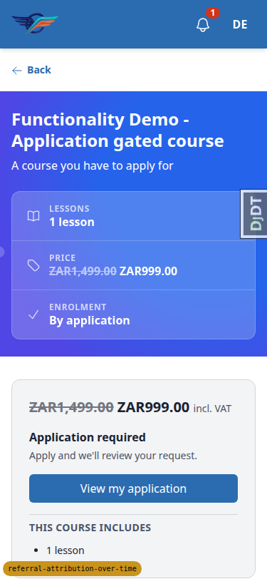 |
| 6.1 | tablet | pass | Touches changelist as record cards with every column, date drill-down, search and Filters; scrollWidth 768. | 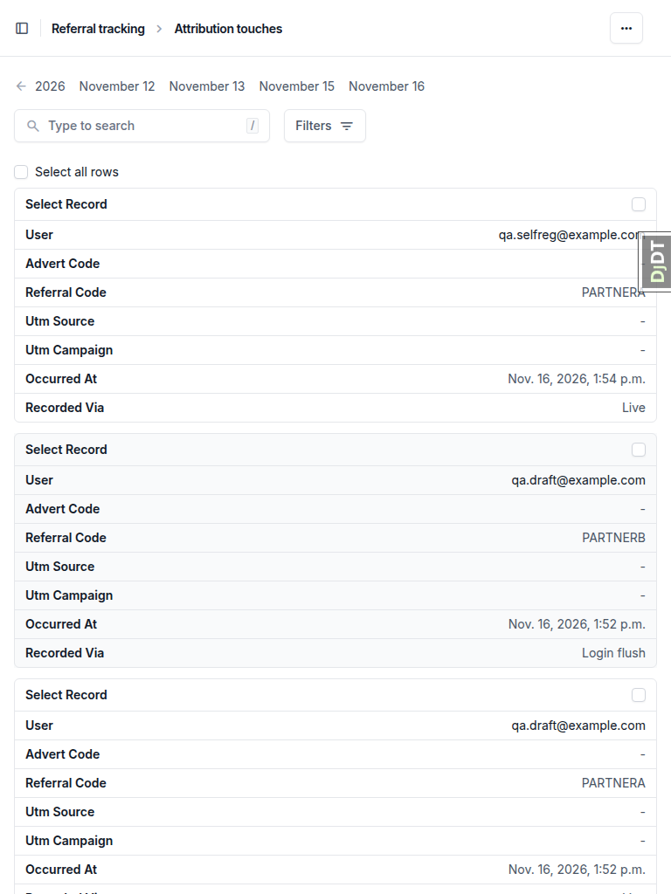 |
| 6.4 | tablet | pass | Filtered conversions (15 of 28 after later test data) as record cards; Filters button highlighted as active; no overflow. | 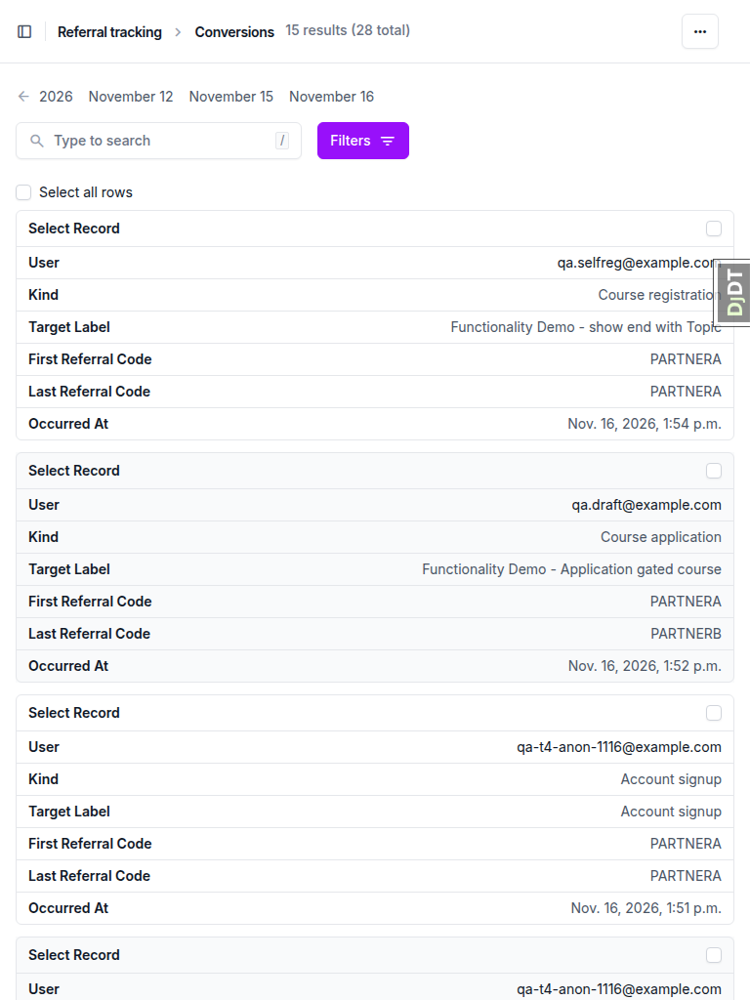 |
| 2.3 | tablet | pass | Coming-soon course detail in interested state at 768: single column, card above About; no overflow. | 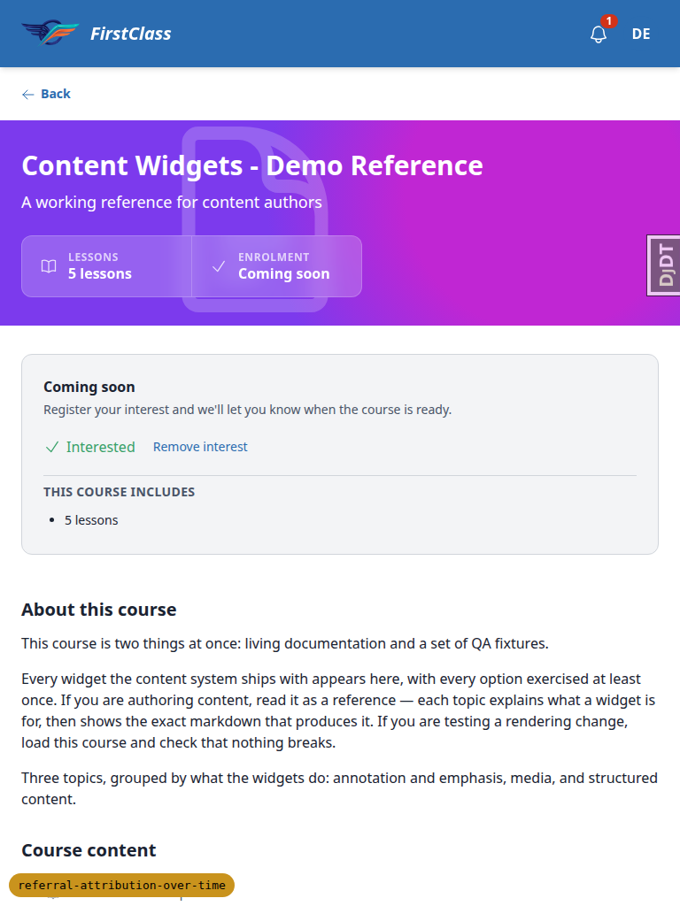 |

## Design check

No design states tested.

## Bugs

No bugs found.

## Layout probe

The admin pages and learner pages sit outside the shell that the configured region selectors name. `missing` regions on those pages are therefore not flags. No layout record carried any flag.

| Test | Viewport | URL | Screenshot | Result |
|---|---|---|---|---|
| 1.7 | desktop-1280 (capture check) | `/admin/freedom_ls_referral_tracking/attributiontouch/?q=qa-t1-1116` |  | clean |
| 1.7 | desktop | `/admin/freedom_ls_referral_tracking/attributiontouch/?q=qa-t1-1116` |  | clean |
| 1.10 | desktop | `/admin/freedom_ls_referral_tracking/conversion/?q=qa-t1-1116` |  | clean |
| 2.3 | desktop | `/courses/content-widgets-demo-reference/detail/` |  | clean |
| 4.2 | desktop | `/applications/application/<pk>/page/1/` (after claim) |  | clean |
| 4.7 | desktop | `/courses/functionality-demo-application-gated-course/detail/` |  | clean |
| 5.2 | desktop | `/courses/functionality-demo-show-end-with-topic/1/` |  | clean |
| 6.2 | desktop | `/admin/freedom_ls_referral_tracking/attributiontouch/<pk>/change/` |  | clean |
| 6.4 | desktop | `/admin/freedom_ls_referral_tracking/conversion/` (filter sheet open) |  | clean |
| 6.7 | desktop | `/admin/freedom_ls_accounts/user/95/delete/` |  | clean |
| 6.4 | mobile | `/admin/freedom_ls_referral_tracking/conversion/?code_in_play=partnera` |  | clean |
| 6.2 | mobile | `/admin/freedom_ls_referral_tracking/attributiontouch/<pk>/change/` |  | clean |
| 2.3 | mobile | `/courses/content-widgets-demo-reference/detail/` |  | clean |
| 4.7 | mobile | `/courses/functionality-demo-application-gated-course/detail/` |  | clean |
| 6.1 | tablet | `/admin/freedom_ls_referral_tracking/attributiontouch/` |  | clean |
| 6.4 | tablet | `/admin/freedom_ls_referral_tracking/conversion/?code_in_play=partnera` |  | clean |
| 2.3 | tablet | `/courses/content-widgets-demo-reference/detail/` |  | clean |

## Data changes

| Via | What |
|---|---|
| sdd:qa-data-helper | Re-ran `qa_create_referral_attribution_scenario` (qa.live recreated as pk 95; qa.login 88 and qa.selfreg 89 reset, deleting their earlier registrations, progress, conversions and touches). Added qa.draft@example.com (pk 96, verified, no applications) to the seed command LEARNER_EMAILS for Test 4.5-4.7. |
| browser (plan step 6.7) | Deleted qa.live@example.com (pk 95) through the admin as Test 6.7 requires; the seed command recreates it. |

## Bug status

No bugs recorded.

## General notes

- Contexts: fresh anonymous visitors and learners used extra Playwright browser contexts. Their screenshots went into the same qa-screenshots directory, with the layout probe loaded into each context.
- Mailpit: email links (email confirmation, application claim) were read from Mailpit's API at localhost:8025.
- Test 4.7 seconds check: the draft (13:52:09) and the anonymous application (13:52:25) started in the same minute, so the admin's minute-resolution display could not tell them apart. The CSV export gave 13:52:25.76, matching the anonymous start.
- Two broken screenshots are kept for the record but not used to judge layout: `page-2026-11-16T13-47-24-153Z.png` (capture-check shot, 1280 wide, debug toolbar expanded) and `page-t2-interest-1794836938003.png` (debug toolbar expanded in a fresh context). Each was retaken.
- Not failures: in qa.login's formula-course registration the first code is PARTNERB, from its Test 3 login_flush touch inside the 90-day window. Admin object labels use the user pk (e.g. 'Attribution touch: 95 via /PARTNERA at 2026-11-16'), as noted last run; the plan does not specify these labels.

status: ok · reason: report rendered, 0 bugs documented
