# QA report: remove unnecessary admin panel functionality

## Methodology

Tests from `3. frontend_qa.md` were run against this branch's dev server in the Django admin (unfold theme) and the educator interface. Screenshots were collected into `screenshots/` beside this report, and every image referenced below exists there. Desktop was run for all tests 1 to 11. Mobile (375px) and tablet (768px) were run on a representative subset: Tests 3, 5 and 11.

## Diff scoping

Class: FULL. Changed files that triggered it:
- `freedom_ls/deadlines/templates/admin/deadlines/*` (deleted). Rule 1 fired on the deleted admin templates.
- `admin.py` and tests across 14 apps
- `test_organisation/*`
- `docs/app_structure.md`
- `.claude/agent-memory/sdd-qa-data-helper/*`

Nothing was skipped on scoping grounds. All passes ran, though mobile and tablet were run only on the subset above (see General notes).

## Smoke gate

Outcome: pass. Pages loaded: `/` and `/admin/`. The run was not aborted.

## Design check

No design states tested.

## Test results summary

| Test | Viewport | Result | Screenshot |
|---|---|---|---|
| 1 Admin index | desktop | pass | 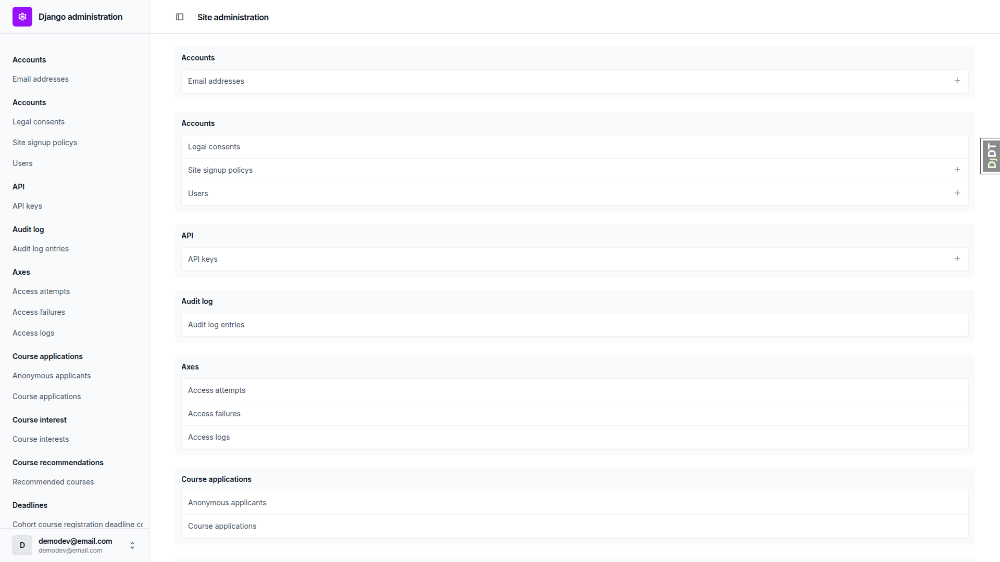 |
| 2 Removed URLs | desktop | pass (all seven return 404) | none |
| 3 Form progress view-only | desktop | pass | 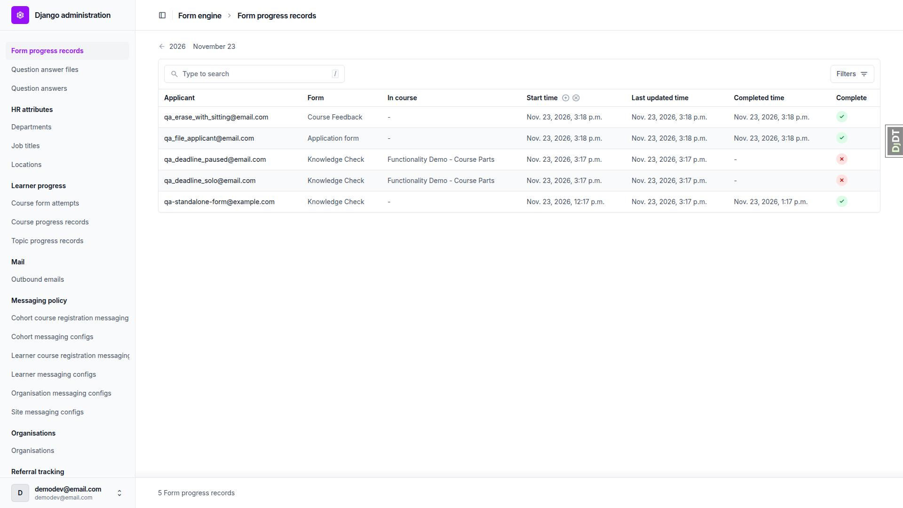  |
| 4 Answers and answer files | desktop | pass | 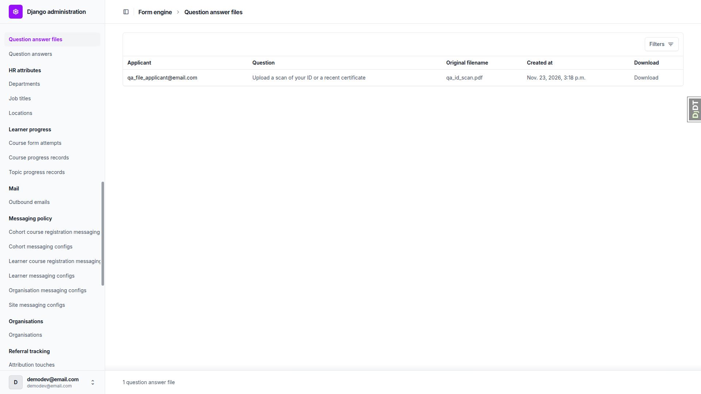 |
| 5 Learner progress | desktop | pass (see observation on `/pause/`) | 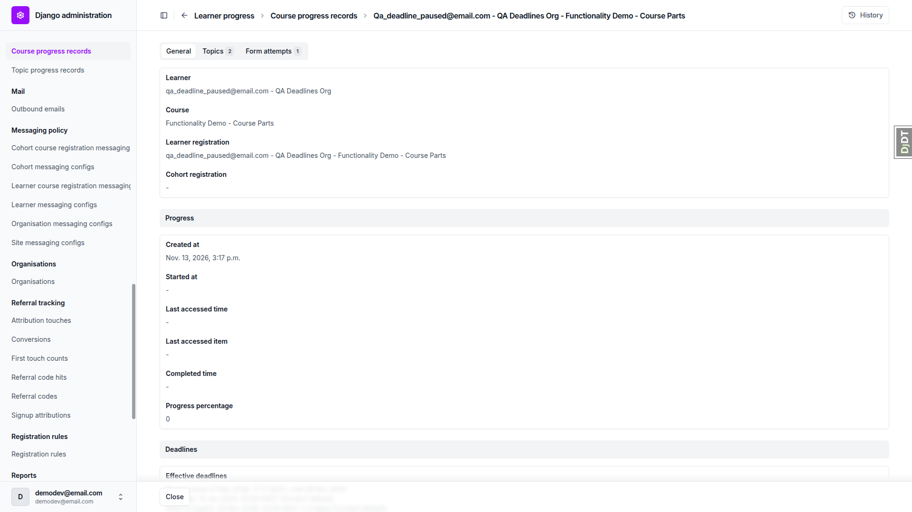 |
| 6 Pause and extension admins | desktop | pass | none |
| 7 Config pickers | desktop | pass | 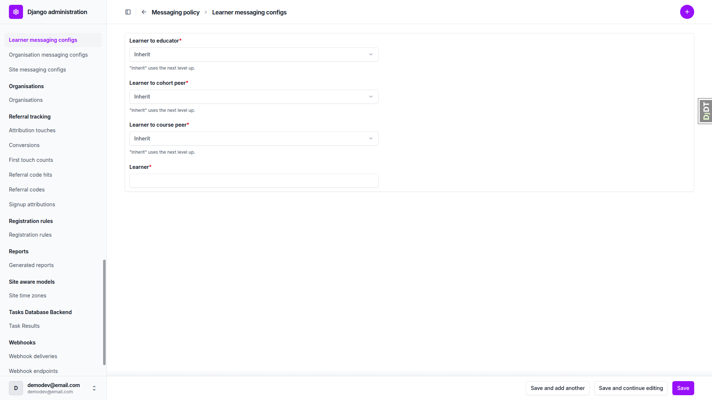 |
| 8 Course applications | desktop | pass | 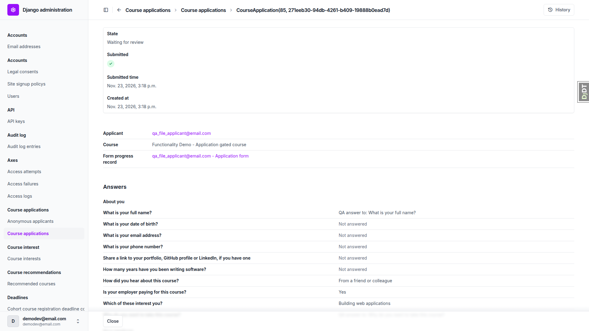 |
| 9 Organisation page | desktop | pass | 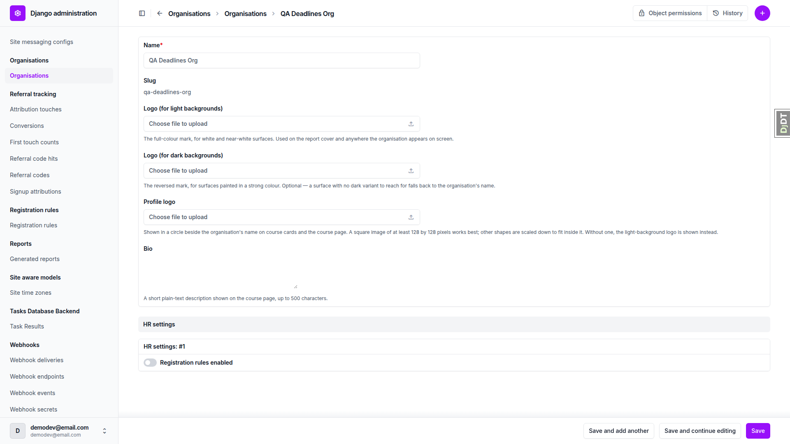  |
| 10 Erasing a user | desktop | pass | 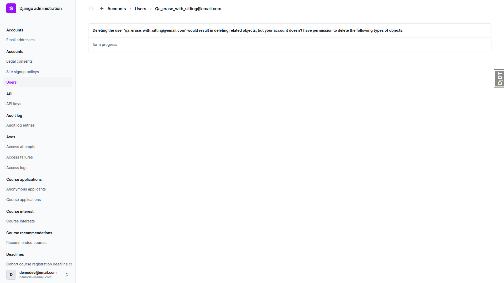 |
| 11 Educator interface | desktop | pass |   |
| 5 Course progress changelist | mobile | fail (B1) | 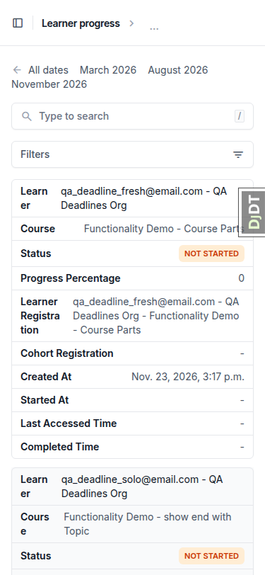 |
| 5 Course progress filters | mobile | pass | 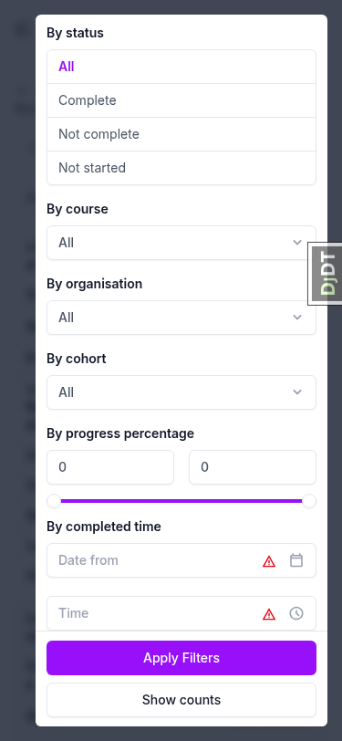 |
| 3 Form progress change page | mobile | pass | 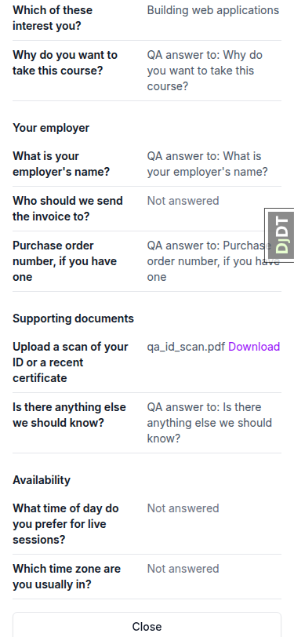 |
| 11 Educator cohort page | mobile | pass | 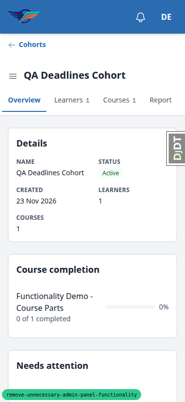 |
| 5 Course progress change page | tablet | pass | 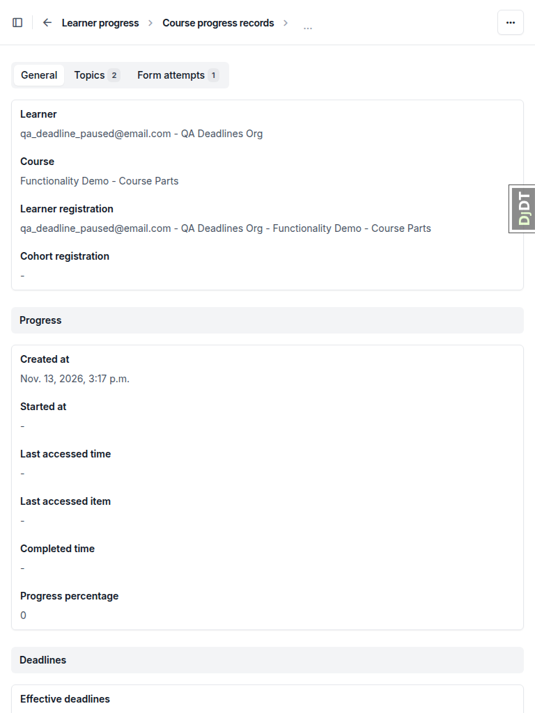 |
| 3 Form progress changelist | tablet | pass | 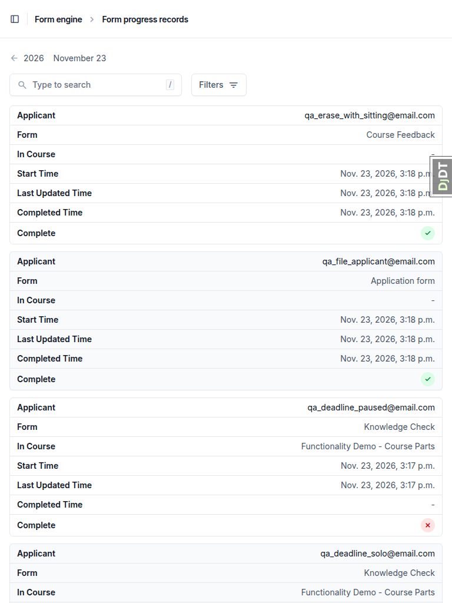 |

## B1: Admin changelist cards at 375px break field labels mid-word

Manifestations:
- Test 5, mobile

Expected: each card label ('Learner', 'Course') sits on one line or wraps between words.

Actual: the label column is too narrow. 'Learner' renders as 'Learn / er' and 'Course' as 'Cours / e'. This is pre-existing: `list_display` is unchanged on this branch, and the layout is unfold's mobile changelist card.

## Layout probe

| Test | Viewport | URL | Screenshot | Result |
|---|---|---|---|---|
| 1 | desktop | `/admin/` |  | clean |
| 3 | desktop | `/admin/freedom_ls_form_engine/formprogress/` |  | clean |
| 3 | desktop | `/admin/freedom_ls_form_engine/formprogress/<pk>/change/` |  | clean |
| 4 | desktop | `/admin/freedom_ls_form_engine/questionanswerfile/` |  | clean |
| 5 | desktop | `/admin/freedom_ls_learner_progress/courseprogress/<pk>/change/` |  | clean |
| 7 | desktop | `/admin/freedom_ls_messaging_policy/learnermessagingconfig/add/` |  | clean |
| 8 | desktop | `/admin/freedom_ls_course_applications/courseapplication/<pk>/change/` |  | clean |
| 9 | desktop | `/admin/freedom_ls_organisations/organisation/<pk>/change/` |  | clean |
| 9 | desktop | `/admin/freedom_ls_organisations/organisation/<pk>/permissions/` |  | clean |
| 10 | desktop | `/admin/freedom_ls_accounts/user/86/delete/` |  | clean |
| 11 | desktop | `/educator/organisations/qa-deadlines-org/cohorts/<pk>` |  | clean |
| 11 | desktop | `/educator/organisations/qa-deadlines-org/learners` |  | clean |
| 5 | mobile | `/admin/freedom_ls_learner_progress/courseprogress/` |  | clean (flags: none recorded; the mid-word label wrap is documented as B1) |
| 5 | mobile | `/admin/freedom_ls_learner_progress/courseprogress/` (filters open) |  | clean |
| 3 | mobile | `/admin/freedom_ls_form_engine/formprogress/<pk>/change/` |  | clean |
| 11 | mobile | `/educator/organisations/qa-deadlines-org/cohorts/<pk>` |  | clean |
| 5 | tablet | `/admin/freedom_ls_learner_progress/courseprogress/<pk>/change/` |  | clean |
| 3 | tablet | `/admin/freedom_ls_form_engine/formprogress/` |  | clean |

## Data changes

| What changed | Made by | Files written |
|---|---|---|
| Created the DemoDev site and demo data (fresh dev DB). Created `qa_file_applicant@email.com` with FormProgress 25f82be8 holding QuestionAnswerFile `qa_id_scan.pdf` and CourseApplication 32bca83e. Created throwaway users `qa_erase_with_sitting@email.com` (pk 86, one FormProgress) and `qa_erase_clean@email.com` (pk 87). | `create_demo_data --yes`, `content_save demo_content DemoDev`, `qa_create_deadlines_seed`, `qa_create_standalone_form_sitting --form-slug knowledge-check` (the default slug `qa-form-first-form` does not exist on DemoDev), `qa_create_application_review_accounts`, plus a qa-data-helper shell script | none |
| Created a CourseDeadlineConfig for Forklift Safety Basics (mark_overdue On). Created a LearnerCourseRegistrationDeadlineConfig for qa_deadline_fresh's Course Parts registration d45adc99 (mark_overdue On). | Test 7 through the admin | none |
| Created JobTitle 'QA Admin Removal Check' on QA Deadlines Org. Deleted user `qa_erase_clean@email.com` (pk 87). Toggled QA Deadlines Org HR settings and restored them. | Tests 9 and 10 through the admin | none |

## Bug status

| Bug | Title | Status | Reason |
|---|---|---|---|
| B1 | Admin changelist cards at 375px break field labels mid-word | **FIXED** (commits: 44492eb9a, b48bca910) — Admin changelist cards at 375px break field labels mid-word — after the fix:  | The cause was the project's own `#result_list td, #result_list th { overflow-wrap: anywhere }` in `site_aware_models/css/admin.css`, inherited by the `::before` card label. Labels now reset to `overflow-wrap: normal` on both `td` and `th` cells (the first fix missed the `th` link column), so they break only between words. |

## General notes

Observations, not bugs:

- **Test 5 expectation is wrong.** The plan expects a 404 for `/admin/freedom_ls_learner_progress/courseprogress/<pk>/pause/`. Django's admin catch-all instead redirects an unknown object sub-path to the admin index with a "course progress record with ID .../pause doesn't exist" message. The pause view is gone, which is the intended outcome. The plan's expectation should be corrected to "redirects to the admin index with a doesn't-exist message".
- **`@claude` comment on `OrganisationAdmin`.** It asks a human to confirm the guardian object-permissions page under unfold. This run saw it render correctly: header, breadcrumbs, and User and Group permission panels with Manage buttons, aligned with the shell (). A human confirmed it, and the comment was removed (commit: c9d385778).
- Test 3's full-page shot shows the sticky Close bar mid-page. This is an artefact of full-page capture, since the bar is fixed to the viewport bottom.
- Test 2: the add URLs for formprogress, questionanswer, questionanswerfile, courseprogress, topicprogress and courseformattempt return 403, as the plan expects for add pages.
- Mobile and tablet were run on Tests 3, 5 and 11 only. The other tests were checked on desktop only.

status: ok · reason: 1 bug — 1 fixed, 0 unresolved; report rendered, screenshots verified
