# Frontend QA report: remove unnecessary admin panel functionality

## Run context

- Dev server on port 8224; the branch badge matched this branch.
- The branch was rebased onto main before the run (29 commits replayed, no conflicts, targeted tests passed).
- Scoping class FULL, so all three viewports (desktop, tablet, mobile) ran.
- The plan's Test 5 `/pause/` expectation was corrected in the plan. Django's admin fallback redirects `<pk>/pause/` to the admin index with a "doesn't exist" message instead of returning a 404.

## Methodology

Screenshots were collected into `spec_dd/2. in progress/remove-unnecessary-admin-panel-functionality/screenshots/`. Every image referenced below exists beside this report. Tests were run in the order of the plan (`3. frontend_qa.md`). Desktop ran every test. Tablet and mobile ran probe sweeps plus targeted checks of the pages most likely to differ (admin index, course progress cards and change page, organisation change page).

## Diff scoping

Class: **FULL**. Changed files that triggered it: `freedom_ls/*/admin.py` (11 apps), the deleted `freedom_ls/deadlines/templates/admin/deadlines/*`, `freedom_ls/site_aware_models/static/site_aware_models/css/admin.css`, `freedom_ls/content_base/admin_filters.py`, `docs/*` and tests. Nothing was skipped: desktop, tablet and mobile all ran.

## Smoke gate

Outcome: **pass**. Pages loaded: `/` and `/admin/`.

## Test results

| Test | Viewport | Result | Screenshot | Notes |
|---|---|---|---|---|
| 1 Admin index | desktop | pass | 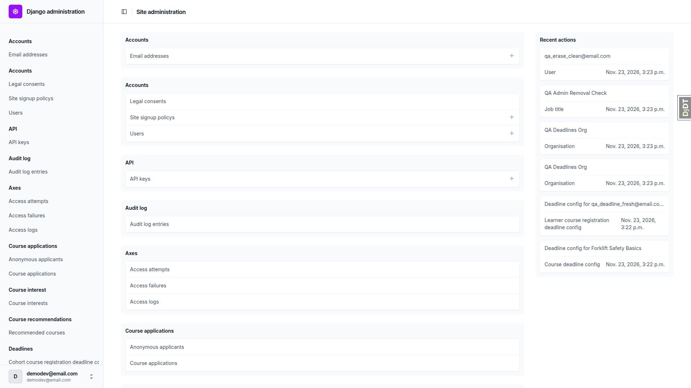 | No Content engine or Learner management section. Form engine lists only Form progress, Question answer and Question answer file. All surviving sections present and the sidebar matches the index. |
| 1 Admin index | mobile | pass | 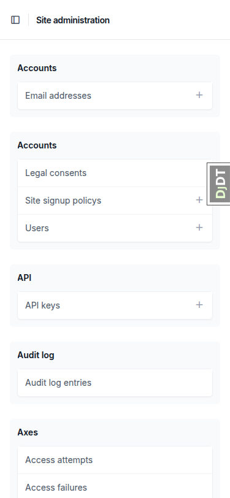 | Stacks cleanly; sidebar behind toggle. |
| 2 Removed URLs | desktop | pass | 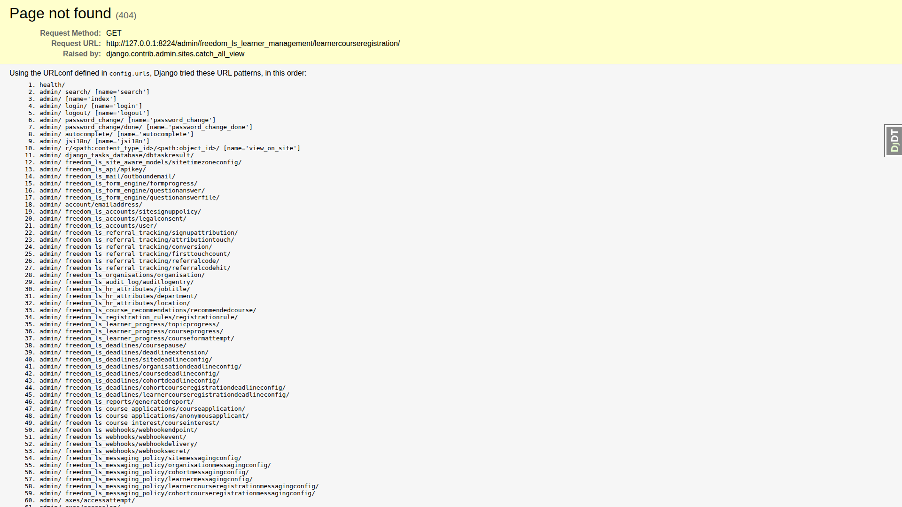 | All 7 URLs return 404. |
| 3 Form progress changelist | desktop | pass | 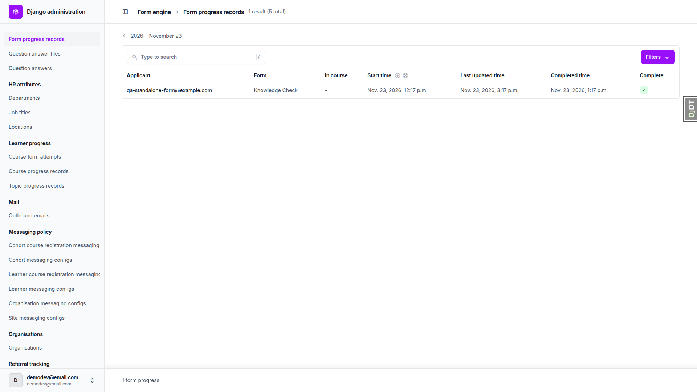 | No Add, no actions. Form dropdown filter narrows 5 to 3, and 1 with completion=complete. |
| 3 Form progress change page | desktop | pass | 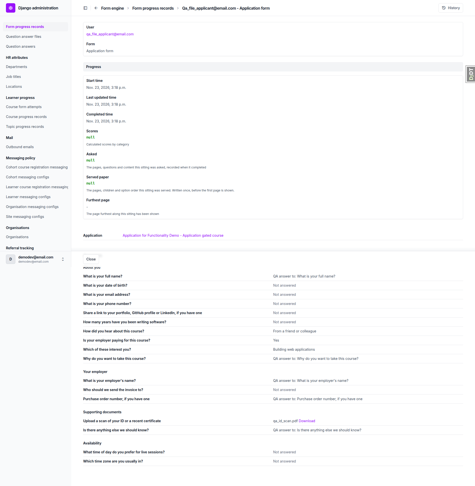 | Answers document renders; Close only; no inputs; file download returns 200 attachment; Application row links to the course application. |
| 3 Adversarial | desktop | pass | none | `add/` 403; `<pk>/delete/` 403 and the row remains. |
| 4 Answers and answer files (superuser) | desktop | pass |  | 12 answers and 1 answer file; no Add, no actions, Close only; Download works; `add/` and `delete/` 403. |
| 4 Reviewer (`qa_reviewer`) | desktop | pass | 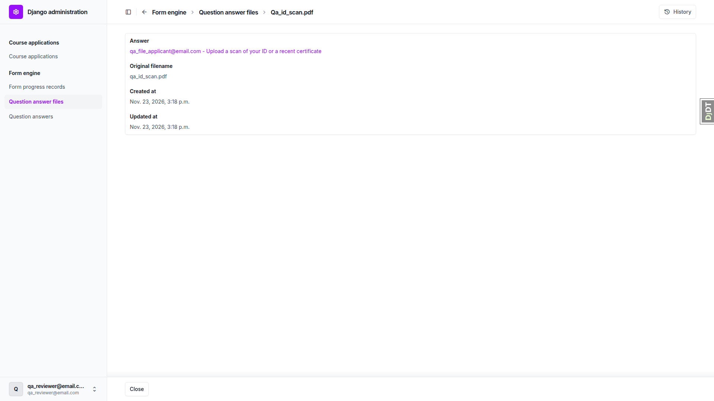 | All three changelists and change pages 200, read-only; download works. |
| 5 Course progress | desktop | pass | 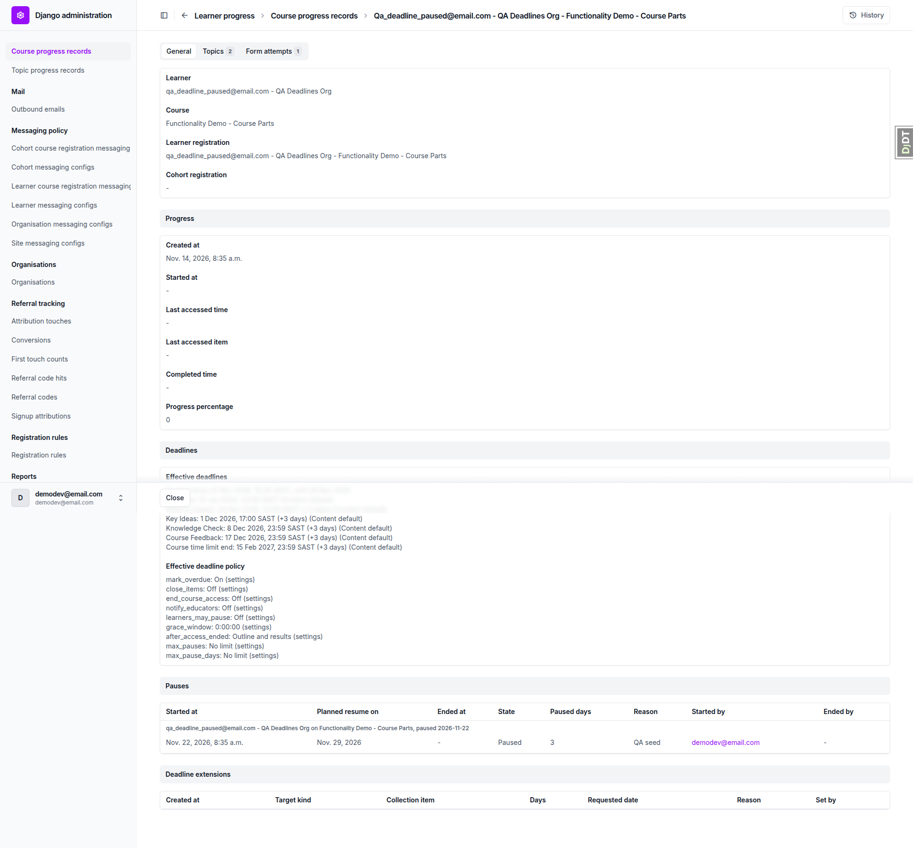 | No Add or actions; Course, Organisation, Cohort dropdowns, no Learner filter; Course filter narrows 9 to 8; search finds 1. Change page read-only with no Pause, Resume or Extend; Deadlines section present; pauses and extensions inlines read-only; no override inline; Topics and Form attempts tab links open read-only pages. |
| 5 Adversarial | desktop | pass | none | `add/` 403. `<pk>/pause/` redirects to the admin index with a "doesn't exist" message (plan corrected). |
| 5 Topic progress and course form attempt | desktop | pass | 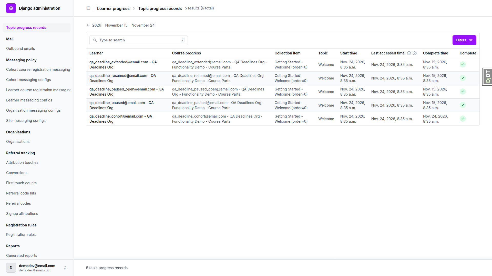 | No Add or actions; dropdown filters, no Learner filter; Welcome narrows 6 to 5; Knowledge Check narrows without error; change pages read-only. |
| 5 Course progress cards | mobile | pass | 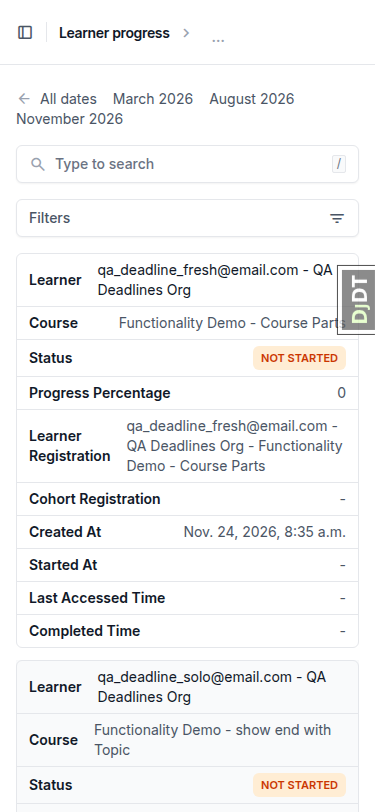 | Each row is a card; labels wrap only at spaces; no overflow; document 375px. |
| 5 Course progress change | mobile | pass | 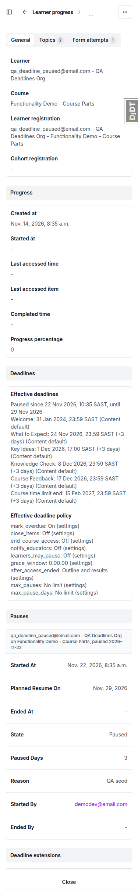 | Stacks; pause inline renders as a card; full-width Close. |
| 5 Course progress list | tablet | pass | 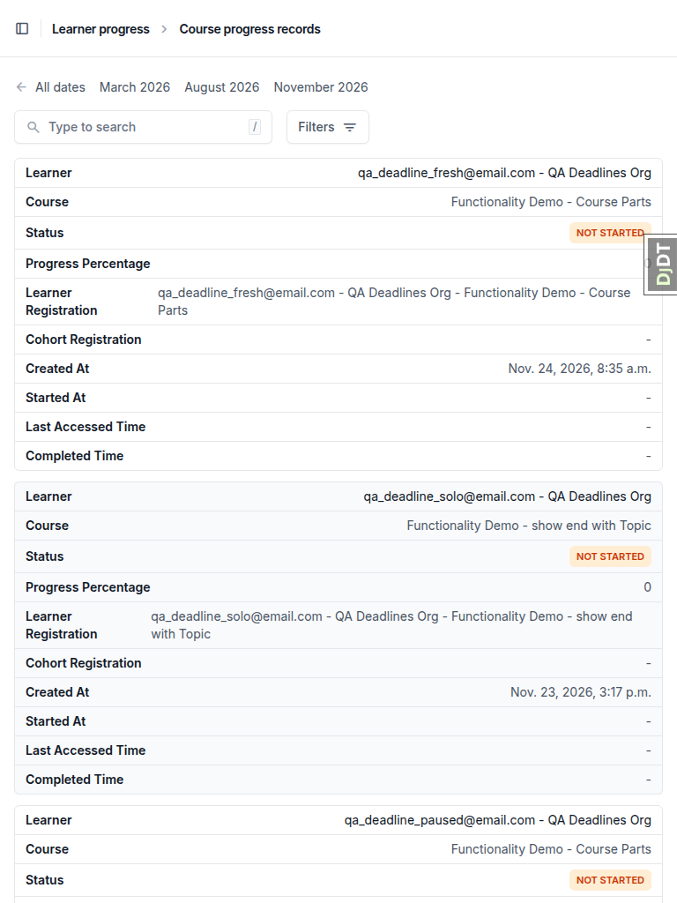 | Cards with label/value rows; no overflow. |
| 6 Pause and extension admins | desktop | pass | none | Both changelists render (3 rows each); course filter is a dropdown; no Add; change pages Close only. |
| 7 Pickers on config admins | desktop | pass | 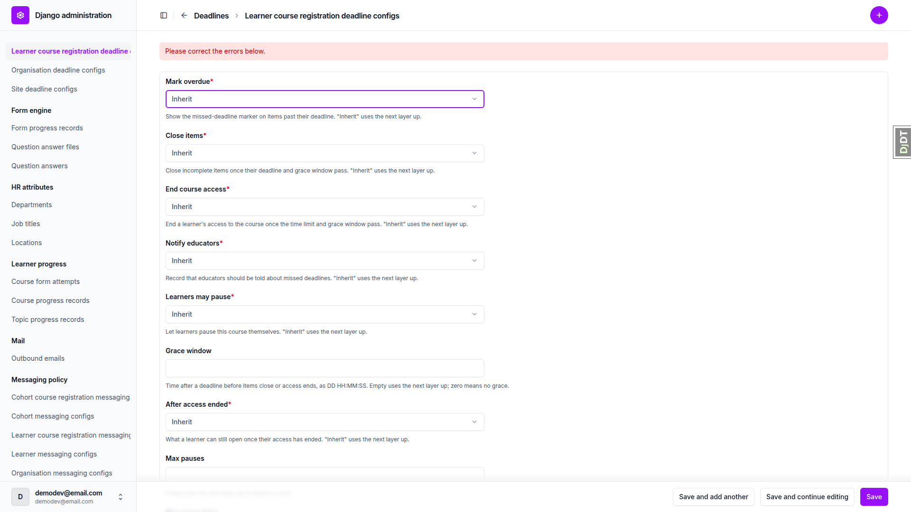 | All 10 add pages 200 with the listed pickers; raw-id has no lookup icon. Saved a course deadline config and a learner-registration deadline config, both listed, then deleted. Nonexistent or invalid raw-id values give "Select a valid choice", no 500. |
| 8 Course applications | desktop | pass |  | Course dropdown filter on both changelists; narrows 1 to 1 and 1 to 0. Course is plain text on the change page; Applicant and Form progress are links; Answers render with Download. |
| 9 Organisation page | desktop | pass | 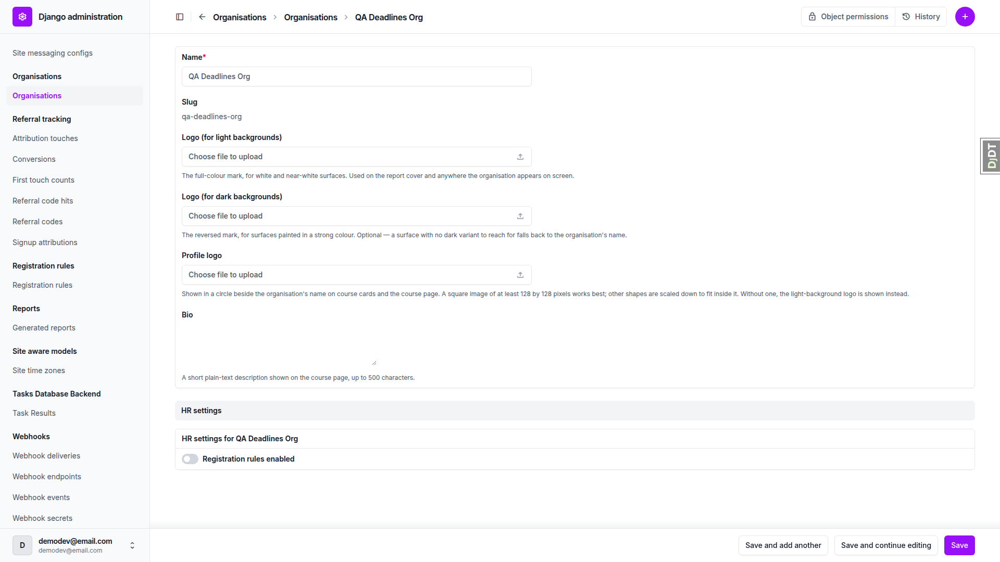 | No Cohorts or Learners inline, no learners link, no empty summaries row. HR settings inline toggled and restored. Object permissions page opens under unfold. Job titles list and add work. |
| 9 Organisation page | mobile | **fail** | 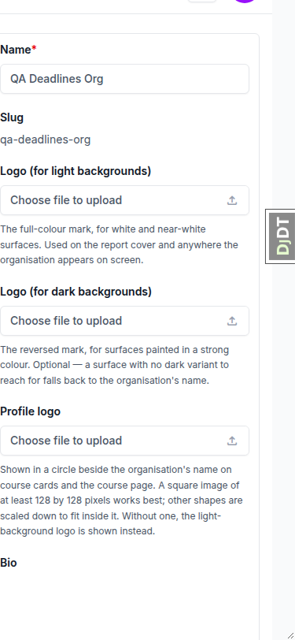 | See B1. |
| 10 Erasing a user | desktop | pass |  | User 86 (with sitting): "Cannot delete user" lists form progress, no confirm button, user remains. User 92 (no records): confirm offered and deletion worked. User changelist, change page and email address admin all 200. |
| 11 Educator interface | desktop | pass | 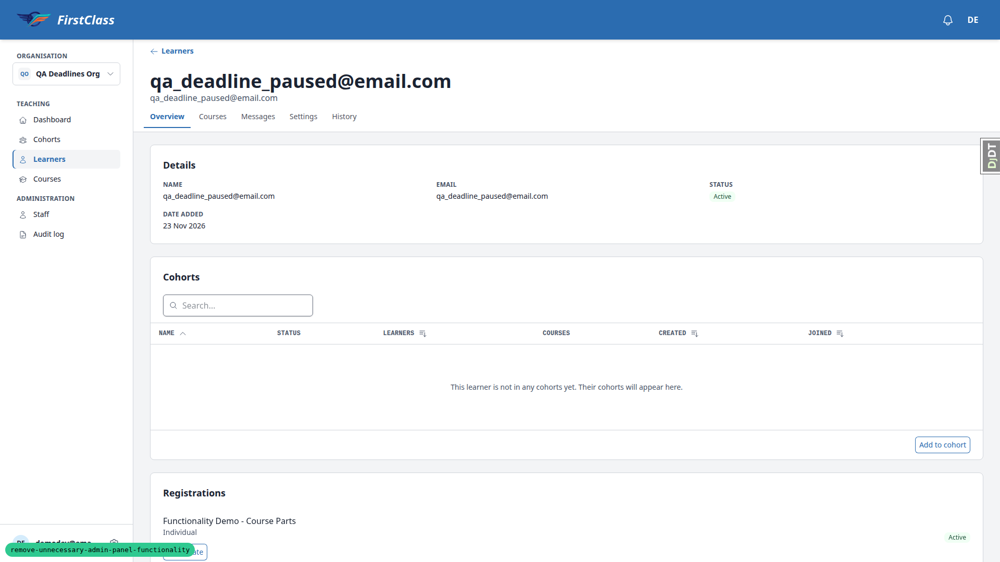 | Cohort list, cohort page, learner page and "Add learner" form all work. No link points at `/admin/freedom_ls_learner_management/` or `/admin/freedom_ls_content_engine/`. |
| 3-11 sweep | mobile | pass | none | Probe sweep of 12 pages: all 200, no flags, document 375px. |
| 1-11 sweep | tablet | pass | none | Probe sweep of 15 pages: all 200, no flags. |

## Design check

No design-comparison tests (`-design`) were part of this run, so no design states were tested.

## B1: Organisation Bio textarea is unstyled and overflows the page at 375px

Manifestations:
- Test 9, mobile

Screenshots:

**Expected:** The Bio field on the organisation admin change page uses the admin theme's textarea styling (bordered, full width of its column) like every other field, and the page fits a 375px viewport with no sideways scroll.

**Actual:** `#id_bio` renders with no class. `LineBreakNormalisingTextarea` in `freedom_ls/organisations/forms.py` subclasses plain `forms.Textarea`, which bypasses unfold's styled textarea widget. The box has no border on desktop. On mobile it is 375px wide, so the document is 404px wide, the page scrolls sideways and the form's left edge is cut off. This is pre-existing on main and not introduced by this branch.

## Layout probe

| Test | Viewport | URL | Screenshot | Result |
|---|---|---|---|---|
| 1 | desktop | `/admin/` |  | clean |
| 2 | desktop | `/admin/freedom_ls_learner_management/learnercourseregistration/` |  | clean (probe reported a 3919px document on Django's DEBUG technical 404 page, caused by its long URL-pattern list; not project UI and not served with DEBUG off) |
| 3.changelist | desktop | `/admin/freedom_ls_form_engine/formprogress/` | 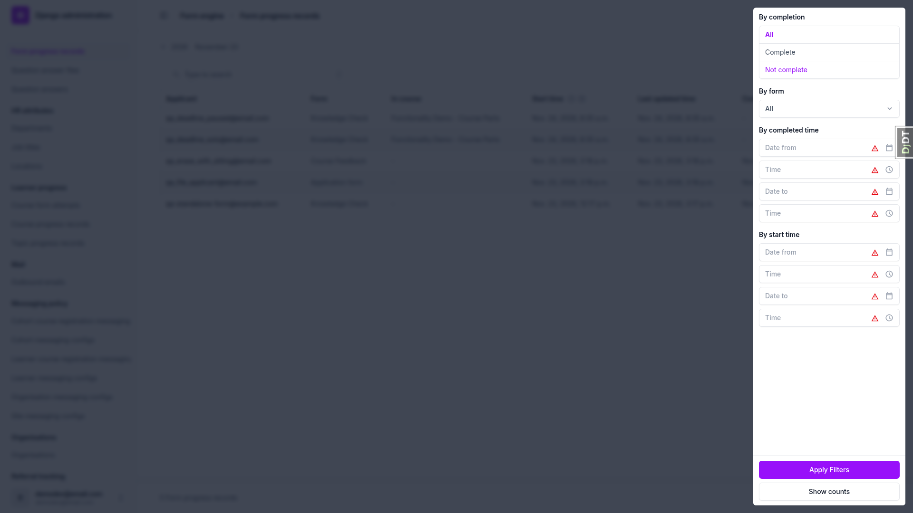 | clean |
| 3.changelist | desktop | `/admin/freedom_ls_form_engine/formprogress/?form__id__exact=...&completion=complete` |  | clean |
| 3.change | desktop | `/admin/freedom_ls_form_engine/formprogress/<pk>/change/` |  | clean |
| 4.superuser | desktop | `/admin/freedom_ls_form_engine/questionanswerfile/` |  | clean |
| 4.reviewer | desktop | `/admin/freedom_ls_form_engine/questionanswerfile/<pk>/change/` |  | clean |
| 5.courseprogress | desktop | `/admin/freedom_ls_learner_progress/courseprogress/<pk>/change/` |  | clean |
| 5.topic_attempt | desktop | `/admin/freedom_ls_learner_progress/topicprogress/?topic__id__exact=...` |  | clean |
| 7 | desktop | `/admin/freedom_ls_deadlines/learnercourseregistrationdeadlineconfig/add/` | 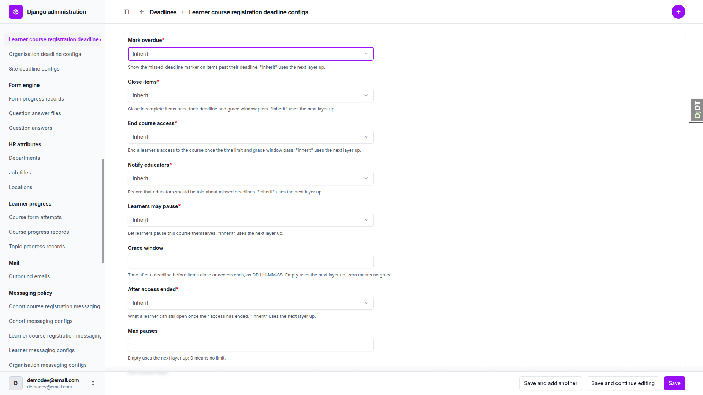 | clean |
| 7 | desktop | same URL, with form errors |  | clean |
| 8 | desktop | `/admin/freedom_ls_course_applications/courseapplication/<pk>/change/` |  | clean |
| 9 | desktop | `/admin/freedom_ls_organisations/organisation/<pk>/change/` |  | clean |
| 9 | desktop | `/admin/freedom_ls_organisations/organisation/<pk>/permissions/` | 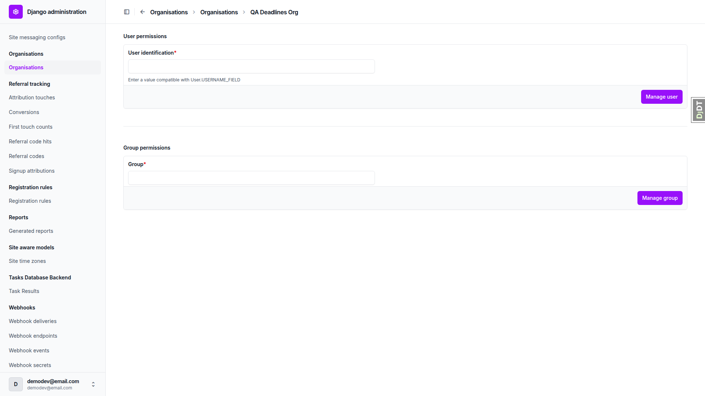 | clean |
| 10 | desktop | `/admin/freedom_ls_accounts/user/86/delete/` |  | clean |
| 11 | desktop | `/educator/organisations/qa-deadlines-org/cohorts/<pk>` | 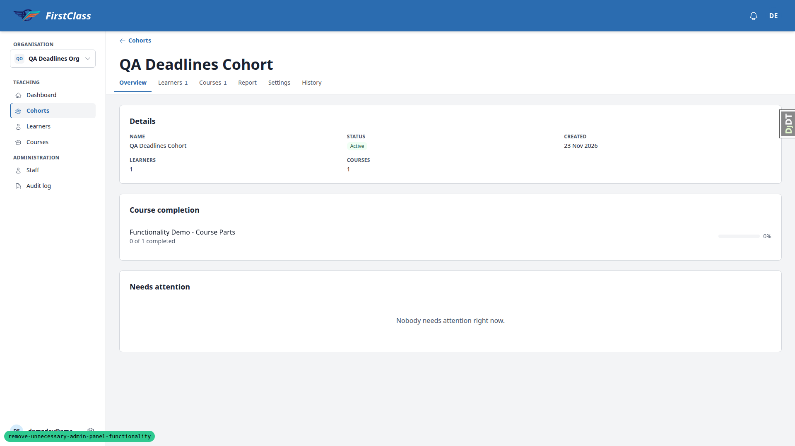 | clean |
| 11 | desktop | `/educator/organisations/qa-deadlines-org/learners` | 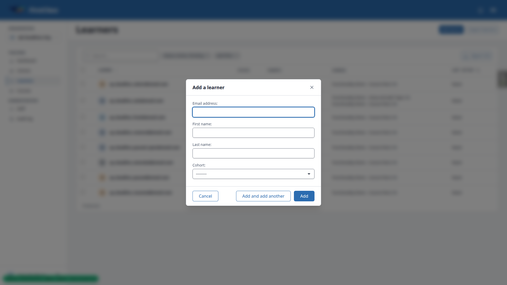 | clean |
| 11 | desktop | `/educator/organisations/qa-deadlines-org/learners/<pk>` |  | clean |
| 1 | mobile | `/admin/` |  | clean |
| 5.mobile-cards | mobile | `/admin/freedom_ls_learner_progress/courseprogress/` |  | clean |
| 5.courseprogress | mobile | `/admin/freedom_ls_learner_progress/courseprogress/<pk>/change/` |  | clean |
| 3-11.sweep | mobile | formprogress list and change, questionanswerfile, courseprogress change, topicprogress, coursepause, learner registration deadline config add, course application change, organisation permissions, educator cohort and learner | none (sweep) | clean (all 200, document 375px) |
| 9 | mobile | `/admin/freedom_ls_organisations/organisation/<pk>/change/` |  | **flagged: overflow, document is 404px wide in a 375px viewport** (B1) |
| 1-11.sweep | tablet | 15 pages: admin index, form progress list and change, answer files, course progress list and change, topic progress, course pauses, deadline config add, course application change, organisation change and permissions, user delete, educator cohort and learner | none (sweep) | clean (all 200) |
| 5.courseprogress | tablet | `/admin/freedom_ls_learner_progress/courseprogress/` |  | clean |

## Data changes

| What changed | Call or command | Files written |
|---|---|---|
| Ran the plan's seed commands. `qa_create_standalone_form_sitting` errored (form `qa-form-first-form` not found on site DemoDev). Existing data already held 5 form sittings, including a completed standalone sitting and a sitting with a file answer and a linked course application, so no helper was needed. | plan seed commands | none |
| Ensured `qa_erase_with_sitting@email.com` (pk 86, reused, completed FormProgress b54e2e6f) and created `qa_erase_clean@email.com` (pk 92, no records) on DemoDev for Test 10. User 92 was then deleted by the test itself. | `sdd:qa-data-helper` | none |

In-test changes (made through the admin UI and reverted): a course deadline config and a learner-registration deadline config were saved then deleted (Test 7); the HR settings inline was toggled and restored (Test 9); a job title "QA picker check title" was added then deleted (Test 9).

## Bug status

| Bug | Title | Status |
|---|---|---|
| B1 | Organisation Bio textarea is unstyled and overflows the page at 375px | **FIXED** (commit: 60275967d) |

- **FIXED** (commit: 60275967d) — Organisation Bio textarea is unstyled and overflows the page at 375px. `LineBreakNormalisingTextarea` now subclasses unfold's `UnfoldAdminTextareaWidget`. Re-verified at 375px: document 375px wide, probe clean, Bio bordered and 317px wide; a two-line Bio saved and kept its line break, then was restored to empty.

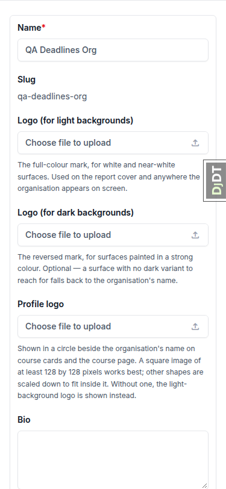

## General notes

- Everything in the plan was exercised. The only failure is B1, which is pre-existing on main (the widget is in `freedom_ls/organisations/forms.py`, untouched by this branch).
- The admin index shows two "Accounts" sections (allauth and FLS accounts). This pre-dates the branch.
- The Topic dropdown on the topic progress filter repeats titles (2x Welcome, 7x About this price) because `Topic.__str__` is its title. The old autocomplete showed the same labels.
- The course application breadcrumb and title read `CourseApplication(85, <uuid>)`. The model `__str__` was not changed by this branch.
- Test 6: all seeded pauses and extensions belong to the parts course, so picking that course narrowed 3 to 3. The filter works but did not exclude anything.
- Test 7: the plan's seed command `qa_create_standalone_form_sitting` failed, but existing data covered the need.

status: ok · reason: 1 bug — 1 fixed, 0 unresolved; report rendered, screenshots verified
