# Frontend QA report: remove unnecessary admin panel functionality

Result: all 11 tests passed at desktop, with mobile and tablet passes on the tests that carry responsive checks. No bugs found.

## Methodology

Screenshots were collected into `screenshots/` beside this report, and every image linked below exists there. The tests followed `3. frontend_qa.md` against this branch's server, with the Django admin (unfold theme) as the surface.

Before QA the branch was rebased onto main, which replayed 37 commits.
- Two conflicts were resolved.
  - `test_organisation/import_contracts.toml`: kept main's added `freedom_ls.revision` and the branch's removal of the deleted `test_admin_filters` ignore.
  - `.claude/agent-memory/sdd-qa-data-helper/MEMORY.md`: kept main's new revision-scenario entry and the branch's removals.
- The lost-change check was clean.
- `makemigrations` was clean.
- Pre-commit was clean.
- The full test tier passed: 20798 passed, 0 failed, 8 skipped.
- The branch was force-pushed.

## Diff scoping

Class: **FULL**. Nothing was skipped, and the desktop, tablet and mobile passes all ran.

Changed files that triggered it:
- `freedom_ls/deadlines/templates/admin/deadlines/extend_deadline.html`
- `freedom_ls/deadlines/templates/admin/deadlines/pause_course.html`
- `freedom_ls/site_aware_models/static/site_aware_models/css/admin.css`
- admin.py, forms and tests across content_engine, form_engine, learner_management, learner_progress, deadlines, messaging_policy, course_interest, course_applications, organisations, hr_attributes, registration_rules, referral_tracking and site_aware_models

## Smoke gate

Outcome: **pass**. The pages loaded were `/` and `/admin/`. No steps were aborted.

## Design check

No design states tested. The plan has no `-design` tests.

## Test results

| Test | Viewport | Result | Notes |
|---|---|---|---|
| 1 Admin index | desktop | pass | No Content engine or Learner management section. Form engine shows only Form progress records, Question answers and Question answer files. All required sections are present, and 0 sidebar links point at removed admins. |
| 2 Removed URLs | desktop | pass | All 7 removed admin URLs return 404. |
| 3 Form progress | desktop | pass | The changelist has 7 rows, no Add button and no actions dropdown. The By form dropdown narrows the list to 4 rows, and adding the completion filter narrows it to 2 with no error. The change page shows the answers document with no editable input, only Close and History. The file download returns 200 as an attachment. The application row links to the course application. `add/` and `<pk>/delete/` both return 403, and the row remains. |
| 3 Form progress | mobile | pass | The answers document stacks readably at 375px, and the Download link is visible. |
| 4 Answers and files | desktop | pass | QuestionAnswer (16 rows) and QuestionAnswerFile (1 row) have no Add and no actions, and their change pages have no inputs, Save or Delete. The file download works. `add/` and `delete/` return 403 on both. As `qa_reviewer` in a separate view-only session, all three admins open read-only, `add/` returns 403, and the file download returns 200. |
| 5 Learner progress | desktop | pass | CourseProgress has no Add or actions, and no Learner filter. Picking Course Parts narrows 10 to 8 rows, and searching `qa_deadline_paused` finds 1. The paused learner's record has no inputs and no Pause, Resume or Extend. The Deadlines section shows effective deadlines and policy. The Pauses and Extensions inlines are read-only, and there is no override inline. The Topic and Form tabs open read-only pages. `.../pause/` redirects to `/admin/` with the "doesn't exist" message, and `add/` returns 403. Topic progress and course form attempts have no Learner filter and no Add or actions. Picking What to Expect narrows topic progress 6 to 1, and picking Knowledge Check keeps 2 of 2 attempts, as both are that form. |
| 5 Learner progress | mobile | pass | Rows are cards. The labels are whole words that wrap only at spaces, and long values wrap inside the card. |
| 5 Learner progress | tablet | pass | The Deadlines section is readable, and the Pauses inline stacks into a labelled read-only card. |
| 6 Pause and extension | desktop | pass | Both changelists render with 3 rows each. The course filter is a dropdown, and picking Course Parts gives 3 of 3 with no error. There is no Add and the change pages are read-only. |
| 7 Pickers | desktop | pass | All 10 add pages return 200. The pickers are the kinds listed, except the learner and learner-registration pickers (see Plan correction). A course deadline config saved and appeared in the changelist. A learner registration deadline config saved by email. An unknown email gives the field error "No learner on this site has this email." with no 500. A duplicate email gives "already exists for this learner". |
| 7 Pickers | mobile | pass | The learner email picker add page fits 375px, with full-width fields and wrapping help text. |
| 8 Course applications | desktop | pass | The By course dropdown works on both changelists (1 to 1 and 0 to 0, as the dev DB has one application). The change page shows the course as plain text with no content_engine link. Applicant and Form progress record are links, and the answers section renders including the file Download. |
| 9 Organisation page | desktop | pass | The QA Deadlines Org page has no Cohorts or Learners inline, no learners search link and no empty summaries row. The HR settings inline saved on and then off. Object permissions opens guardian's page under the unfold shell. The job titles list renders, and adding a job title with the organisation picker worked. |
| 10 Erasing a user | desktop | pass | `qa_erase_blocked` (has a completed sitting) shows "Cannot delete user", says the account lacks permission to delete form progress and question answer, and has no confirm button, so the user remains. `qa_erase_clean` shows the confirmation (User and Email address) with "Yes, I'm sure", and confirming deleted the user. The User changelist (68 rows), change page and email address admin all return 200. |
| 11 Educator interface | desktop | pass | The cohort list and the QA Deadlines Cohort page render, with 1 learner and 1 course (Course Parts). The Learners tab lists `qa_deadline_cohort`. The learner page for `qa_deadline_paused` renders. The Add learner dialog opens with email, first name, last name and cohort fields. No link on the cohort list, cohort, learner list or learner pages points at `/admin/freedom_ls_learner_management/` or `/admin/freedom_ls_content_engine/`. |

Plan correction: Test 7 in `3. frontend_qa.md` named raw-id boxes for the learner and learner-registration pickers. `1. spec.md` ("Pickers that point at removed admins" and its open question) records that these became a learner-email picker after code review. The plan's Test 7 wording was updated to match. The page was judged against the spec and passed.

## Layout probe

| Test id | Viewport | URL | Screenshot | Result |
|---|---|---|---|---|
| 1 | desktop | `/admin/` | 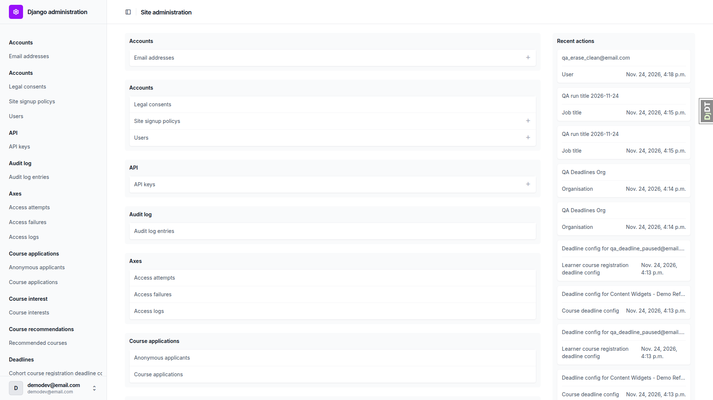 | clean |
| 3 | desktop | `/admin/freedom_ls_form_engine/formprogress/` | 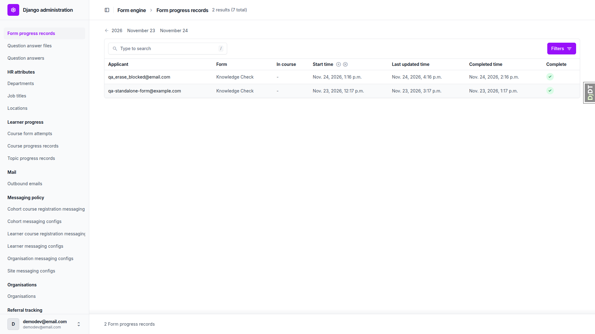 | clean |
| 3 | desktop | `/admin/freedom_ls_form_engine/formprogress/<pk>/change/` |  | clean |
| 4 | desktop | `/admin/freedom_ls_form_engine/questionanswerfile/` | 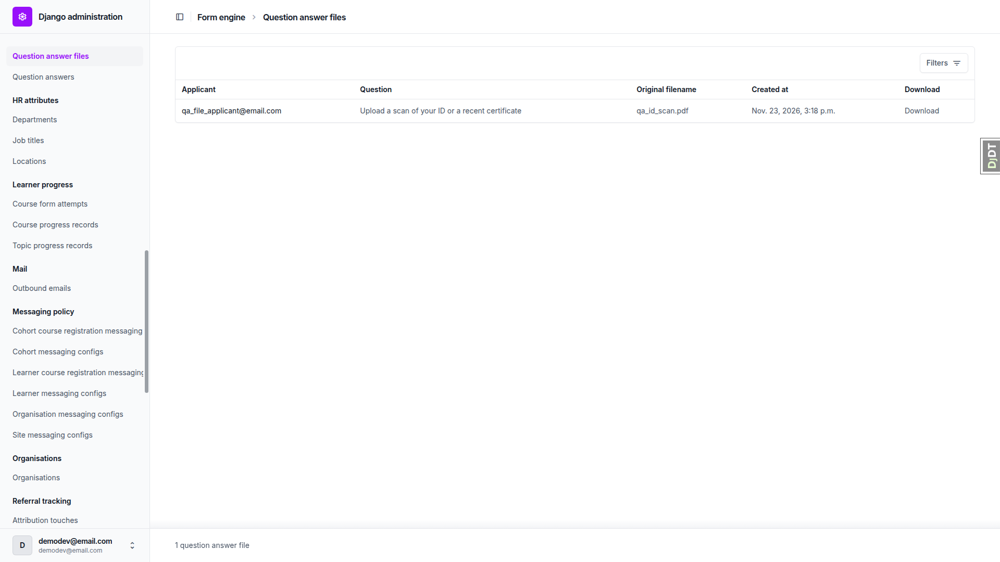 | clean |
| 5 | desktop | `/admin/freedom_ls_learner_progress/courseprogress/` | 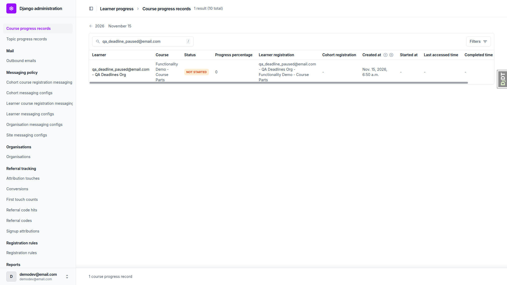 | clean |
| 5 | desktop | `/admin/freedom_ls_learner_progress/courseprogress/<pk>/change/` | 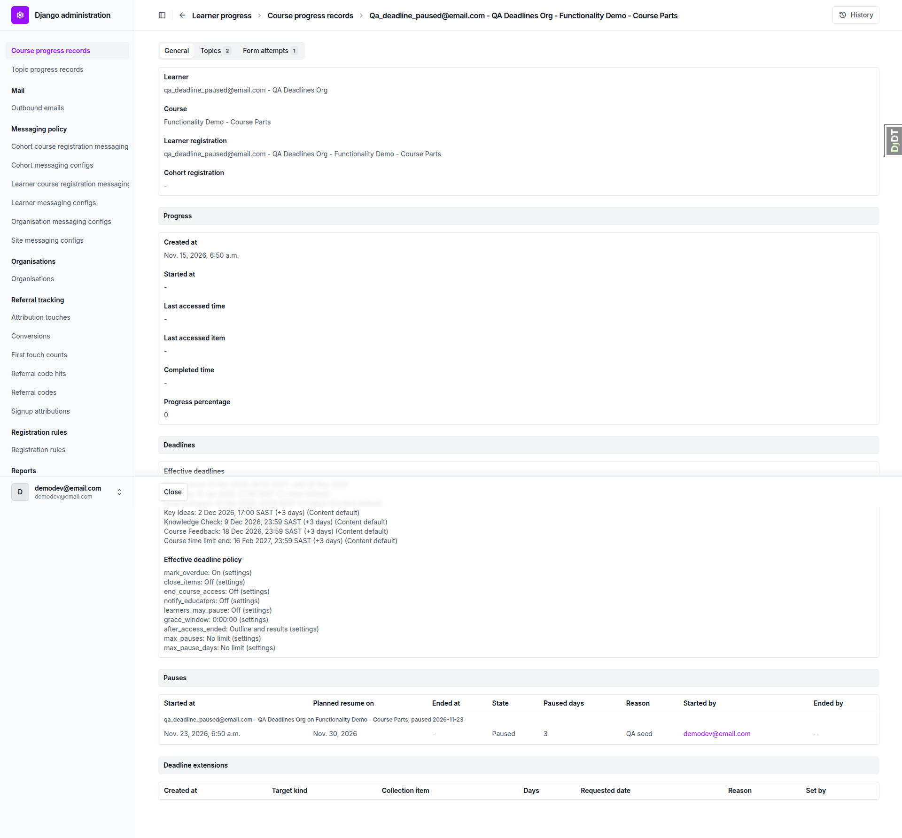 | clean |
| 7 | desktop | `/admin/freedom_ls_deadlines/learnercourseregistrationdeadlineconfig/add/` | 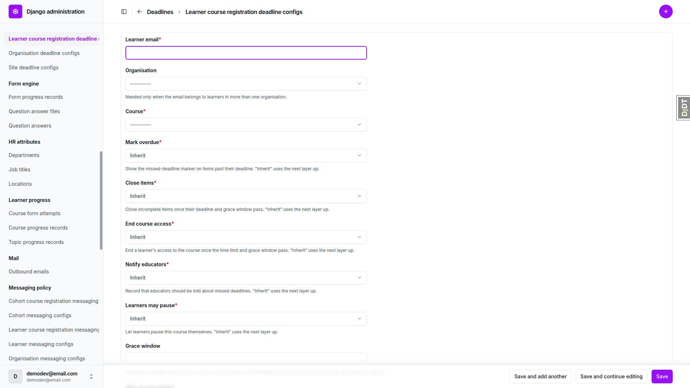 | clean |
| 8 | desktop | `/admin/freedom_ls_course_applications/courseapplication/<pk>/change/` |  | clean |
| 9 | desktop | `/admin/freedom_ls_organisations/organisation/<pk>/change/` | 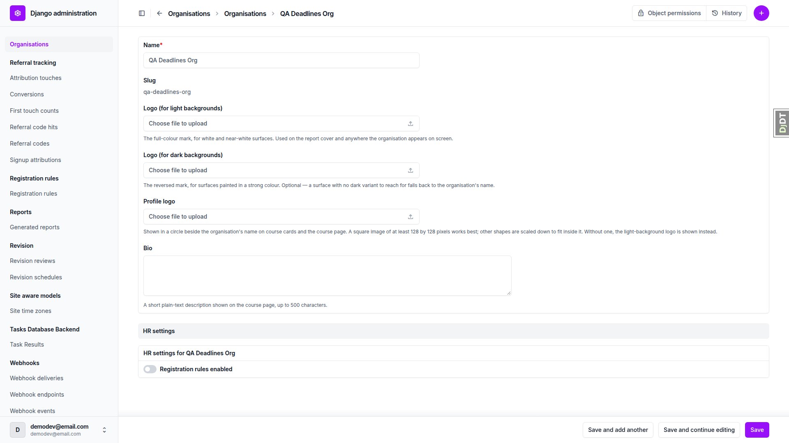 | clean |
| 9 | desktop | `/admin/freedom_ls_organisations/organisation/<pk>/permissions/` |  | clean |
| 10 | desktop | `/admin/freedom_ls_accounts/user/<pk>/delete/` | 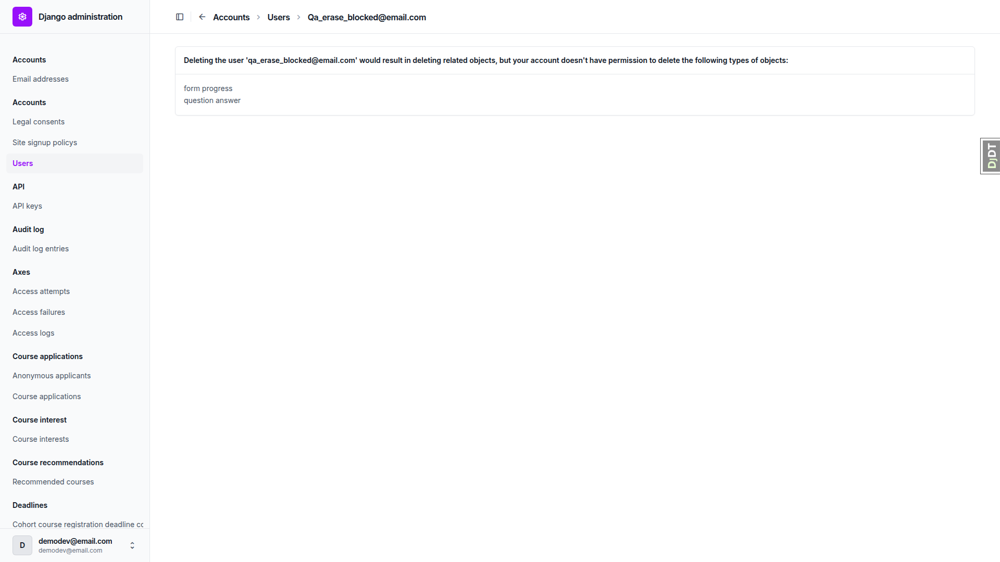 | clean |
| 11 | desktop | `/educator/organisations/qa-deadlines-org/cohorts/<pk>/__tabs/learners` | 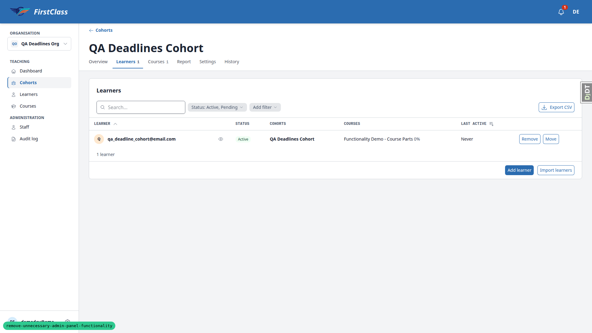 | clean |
| 11 | desktop | `/educator/organisations/qa-deadlines-org/learners` (Add learner dialog) |  | clean |
| 1-11 | mobile | 12 pages: admin index, formprogress list and change, questionanswerfile list, courseprogress list and change, topicprogress list, coursepause list, learner reg deadline config add, course application change, organisation change, educator cohort learners tab | 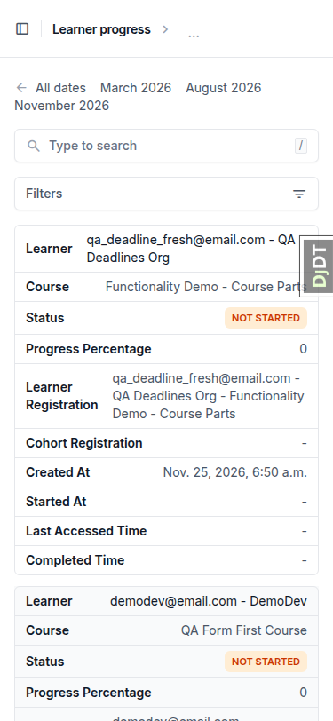 | clean |
| 1-11 | tablet | same 12 pages as mobile | 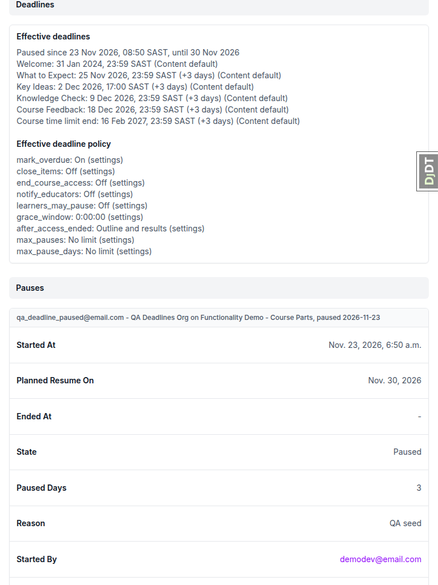 | clean |

Further screenshots from the test records:
- Test 3 mobile: 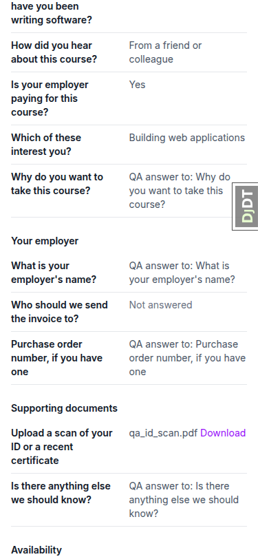
- Test 4 changelist: 
- Test 7 mobile: 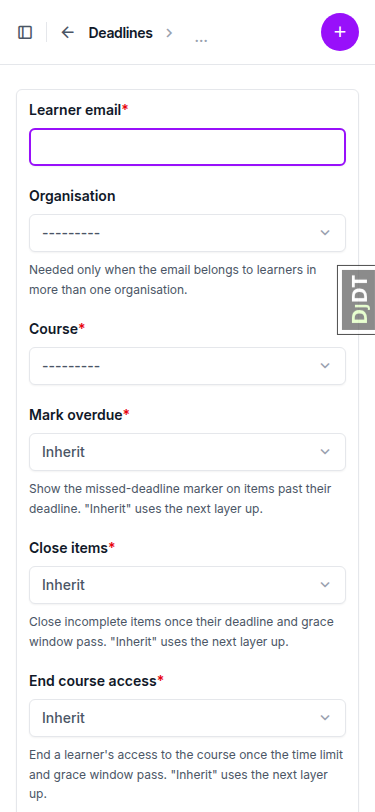
- Test 10 confirmation for the clean user: 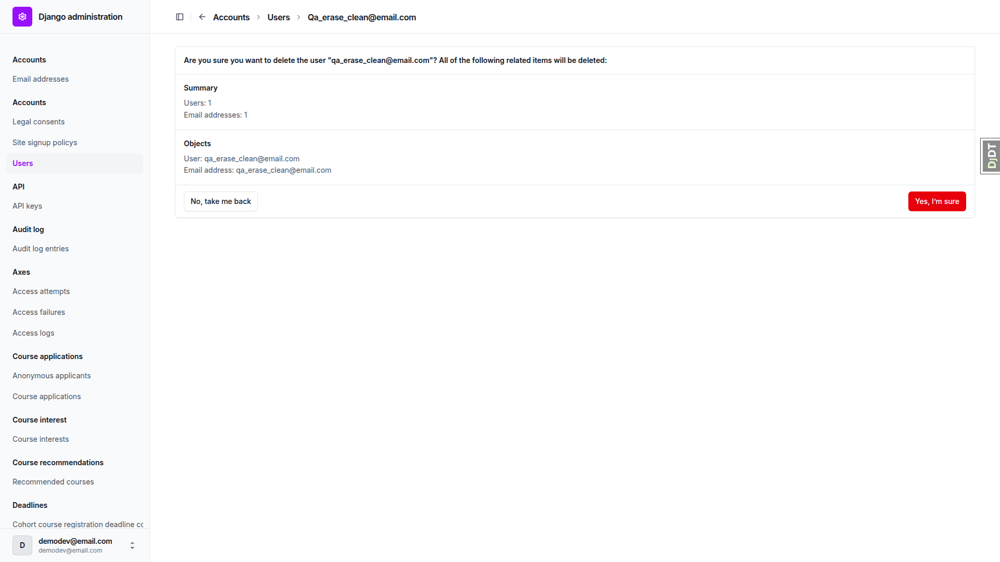

## Data changes

| What changed | Made by | Files written |
|---|---|---|
| Seed data: deadlines org, cohort, registrations, progress, pauses and extensions (idempotent) | `qa_create_deadlines_seed` | none |
| Seed data: a completed standalone form sitting (idempotent) | `qa_create_standalone_form_sitting` | none |
| Seed data: application review accounts, including `qa_reviewer` (idempotent) | `qa_create_application_review_accounts` | none |
| Seed data: users `qa_erase_blocked` and `qa_erase_clean` (idempotent) | `qa_create_erase_users` | none |
| Course deadline config (Content Widgets - Demo Reference) created, then deleted | Admin UI | none |
| Learner course registration deadline config (`qa_deadline_fresh`, Course Parts) created, then deleted | Admin UI | none |
| Job title (QA run title 2026-11-25) created, then deleted | Admin UI | none |
| QA Deadlines Org HR "registration rules enabled" toggled on, then off | Admin UI | none |
| User `qa_erase_clean@email.com` deleted, as Test 10 requires | Admin UI | none |

## Bug status

No `bug` records. Nothing went to the fix loop.

| Bug | Status |
|---|---|
| none | n/a |

## General notes

- Everything in the plan was tested. Nothing was skipped.
- Pre-existing observation, not from this branch: the Django debug toolbar's collapsed DJDT tab and the branch badge sit over page edges in the screenshots.
- Pre-existing observation, not from this branch: the course application change page title reads "CourseApplication(85, <uuid>)", which comes from the model `__str__`.
- In Test 5, picking Knowledge Check on course form attempts kept 2 of 2 rows. Both seeded attempts are that form, so the filter ran without error but could not show a narrowing. The same applies to Course Parts in Test 6 (3 of 3) and to the course filter in Test 8.

status: ok · reason: report rendered, 0 bugs documented
