# Frontend QA report: retry-sent-emails

The admin Outbound emails list, detail, resend confirmation and bulk resend work as specified, with 4 bugs found (newest-first ordering, raw JSON recipients, mobile clipping of Last error, housekeeping exit error). Mailpit was UP for this run, so the "Mailpit up" branches applied.

## Methodology

- Playwright MCP against a dev server on its own port, for branch `retry-sent-emails`.
- Users: superuser `demodev@email.com` and staff-only `staff-qa@example.test`.
- Screenshots are collected into `screenshots/` beside this report. Every referenced image exists there.
- Viewports: desktop 1920x1080, mobile 375x812, tablet 768x1024.
- Mailpit at http://localhost:8025 was used to confirm sends.

## Diff scoping

Class: **FULL**, because a `templates/` path changed (`freedom_ls/mail/templates/admin/mail/resend_confirm.html`). Other changed paths: `freedom_ls/mail/admin.py`, `freedom_ls/mail/*.py`, `freedom_ls/deployment/*.py`, `config/settings_dev.py`, `config/settings_prod.py`, `docs/product/*`, `test_organisation/import_contracts.toml`.

Skipped: nothing. Desktop, mobile and tablet all ran.

## Smoke gate

Pass. Pages checked: `/` and `/admin/freedom_ls_mail/outboundemail/`.

## Design check

No design states tested.

## Results by section

| Test | Viewport | Result | Note | Screenshot |
|---|---|---|---|---|
| 1.1 | desktop | pass | Admin index lists Mail > Outbound emails. Mailpit UP (320 messages at start). | 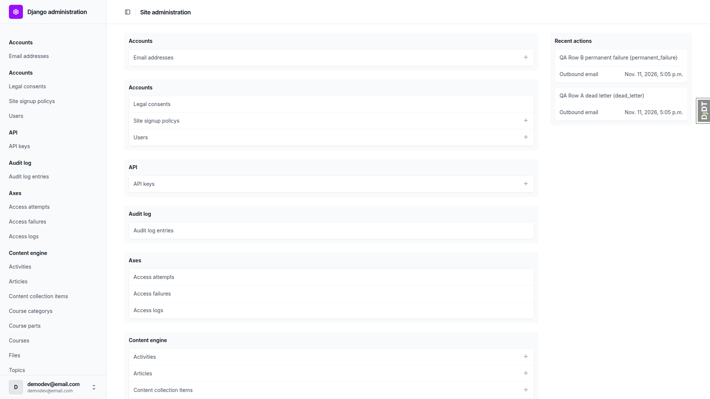 |
| 1.2 | desktop | pass | Rows A-H listed plus 2 older real rows. Columns as expected. | 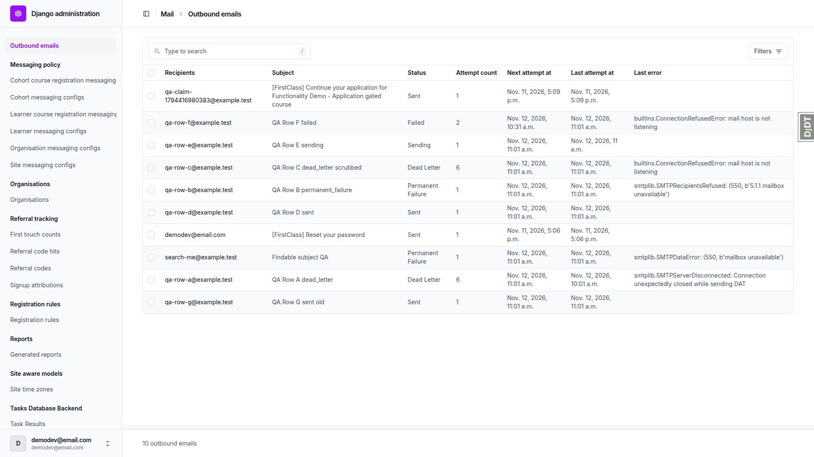 |
| 1.3 | desktop | pass | Row A's 347-char last_error shown as first 80 chars, cut mid-word, no ellipsis. |  |
| 1.4 | desktop | pass | No Add button or /add/ link. | |
| 1.5 | desktop | pass | Body token absent from changelist HTML. | |
| 1.6 | desktop | pass | Dead Letter filter shows rows A and C only. | |
| 1.7 | desktop | pass | Past 7 days drops row G. | |
| 1.8 | desktop | pass | Search by recipient, subject and message id each returns row H only. | |
| 2.1 | desktop | pass | Row A detail shows all fields read-only. | 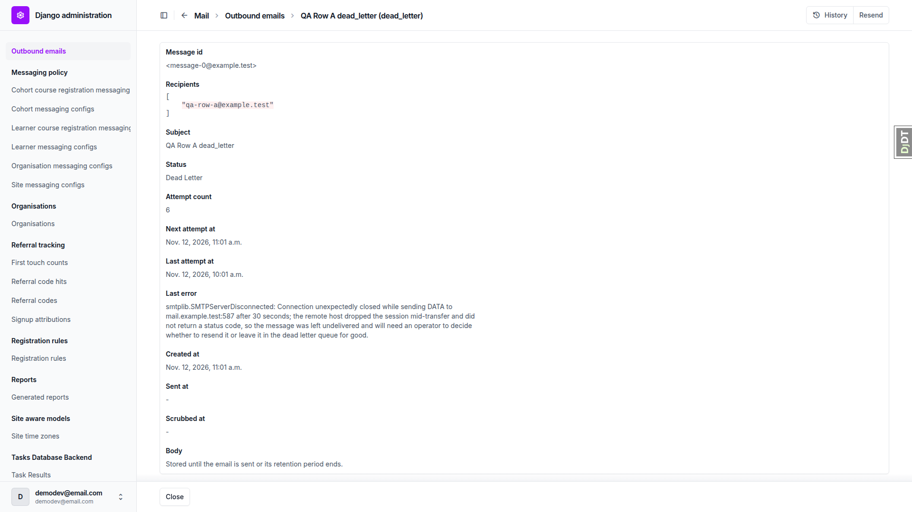 |
| 2.1-recipients | desktop | fail | Recipients rendered as raw JSON array (see B2). |  |
| 2.2 | desktop | pass | No Save or Delete; only History and Resend. |  |
| 2.3 | desktop | pass | Body token absent from text and source; "payload" appears nowhere. | |
| 2.4 | desktop | pass | Retention line present. |  |
| 2.5 | desktop | pass | Row C shows body-removed text, no Resend. | 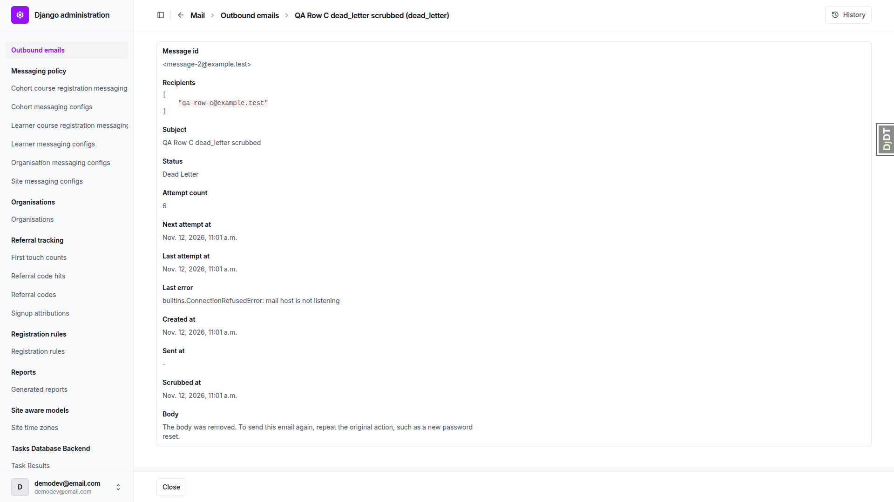 |
| 2.6 | desktop | pass | /add/ returns 403. | |
| 2.7 | desktop | pass | Row A /delete/ returns 403. | |
| 3.1 | desktop | pass | Row A shows Resend in header actions. |  |
| 3.2 | desktop | pass | Confirmation page names To and Subject, Resend and Cancel, no body. |  |
| 3.3 | desktop | pass | Row A unchanged after opening confirmation (Dead Letter, 6). | |
| 3.4 | desktop | pass | Cancel returns to row A detail, unchanged. | |
| 3.5 | desktop | pass | Resend redirects with "1 email queued to send again." | 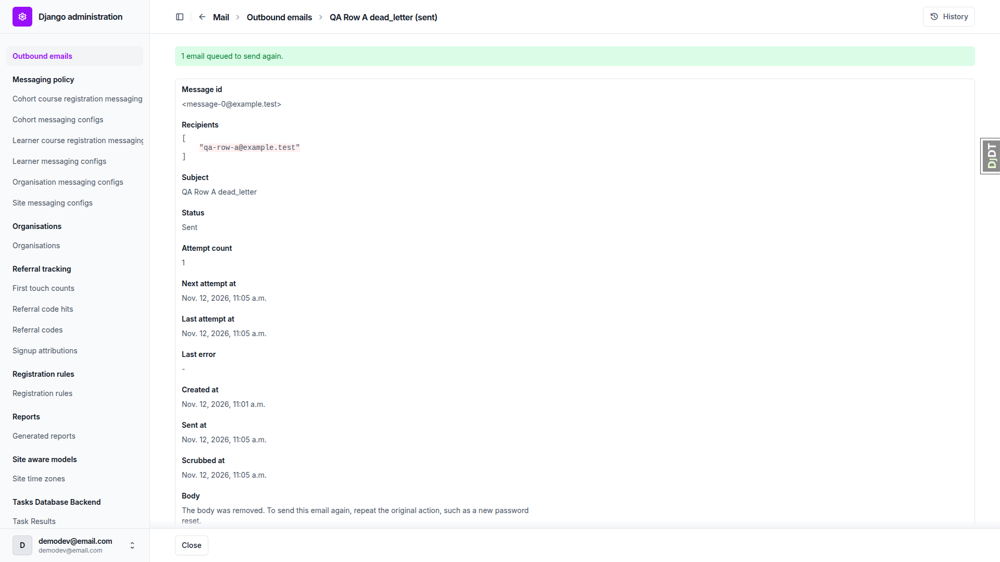 |
| 3.6 | desktop | pass | Row A Sent, attempt count 1, one Mailpit message. |  |
| 3.7 | desktop | pass | History has one entry: demodev@email.com "Resent." | |
| 3.8 | desktop | pass | Back shows "cannot be resent: already sent"; replayed stale POST gives warning "1 email skipped: 1 already sent." | 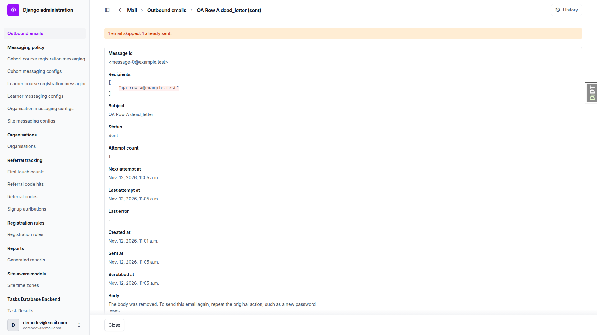 |
| 4.1 | desktop | pass | Row C (scrubbed): no Resend. |  |
| 4.2 | desktop | pass | Row D (sent): no Resend. | |
| 4.3 | desktop | pass | Row E (sending): no Resend. | |
| 4.4 | desktop | pass | Row D resend URL: "already sent", Back link, no form. | 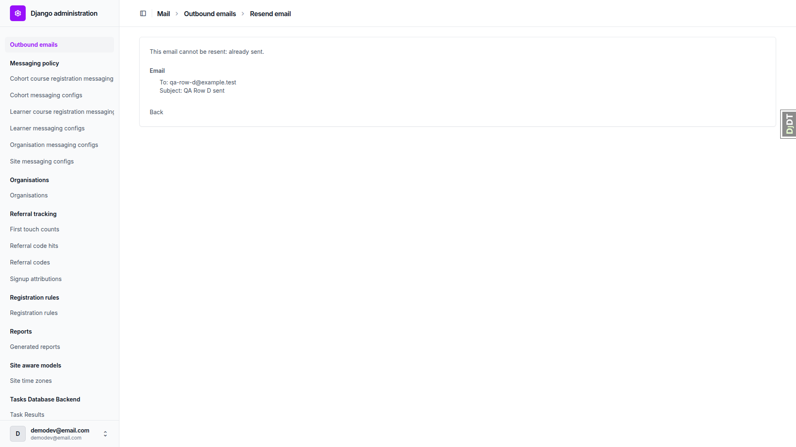 |
| 4.5 | desktop | pass | Row C resend URL: "body removed", Back link, no form. | |
| 4.6 | desktop | pass | Non-UUID resend URL returns 404. | |
| 4.7 | desktop | pass | Random UUID resend URL returns 404. | |
| 5.1-5.4 | desktop | pass | Bulk resend of B, C, D, E: 1 queued, 3 skipped (1 sent, 1 body removed, 1 in flight). | 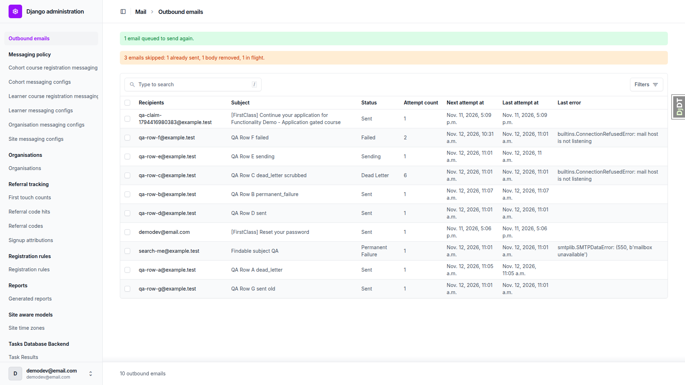 |
| 5.5 | desktop | pass | Row B Sent, attempt 1; one Mailpit message. |  |
| 5.6 | desktop | pass | Rows C, D, E unchanged. |  |
| 5.7 | desktop | pass | Only row D: skipped warning, no success message. | |
| 6.1-6.2 | desktop | pass | staff-qa sees no Mail section. | |
| 6.3 | desktop | pass | Changelist 403 for staff. | |
| 6.4 | desktop | pass | Row B detail 403. | |
| 6.5 | desktop | pass | Row H resend 403. | |
| 6.6 | desktop | pass | Logged out redirects to /admin/login/?next=... | |
| 6.7 | desktop | pass | Row H unchanged (Permanent Failure, 1 attempt). | |
| 7.1-7.2 | desktop | pass | Password reset: one Mailpit message (322->323), link opens Change Password form; new Sent row with body-removed notice. | |
| 7.2-ordering | desktop | fail | New row is not first; changelist in random order (see B1). |  |
| 7.4 | desktop | pass | New row's detail has no reset link or body text. | |
| 8.1-8.3 | desktop | pass | Housekeeping output includes "Requeued 1 outbound email(s) past due."; requeued task ran and succeeded. | |
| 8.3-exit | desktop | fail | Command exits non-zero with prune_db_task_results CommandError (see B4). | |
| 8.4 | desktop | pass | Row G pruned once its last_attempt_at was also 40 days old (see General notes b). | |
| 8.5 | desktop | pass | Row F Sent, attempt 3. | |
| 8.6 | desktop | pass | Row E (sending, ~9 min old) unchanged. | |
| 8.7 | desktop | pass | --help text describes requeue, re-send and delete. | |
| 10.1 | desktop | pass | Admin index lists every app section plus Mail. |  |
| 10.2 | desktop | pass | Webhook deliveries changelist loads with retry action. | |
| 10.3 | desktop | pass | API keys changelist and detail load; Revoke confirmation and Cancel work. | |
| 10.4 | desktop | pass | Application claim email sent: one Mailpit message, Sent row. | |
| 9.1-9.4 | desktop | pass | No horizontal scroll on changelist, detail, confirmation; Resend visible; buttons do not overlap; only favicon 404 in console. | 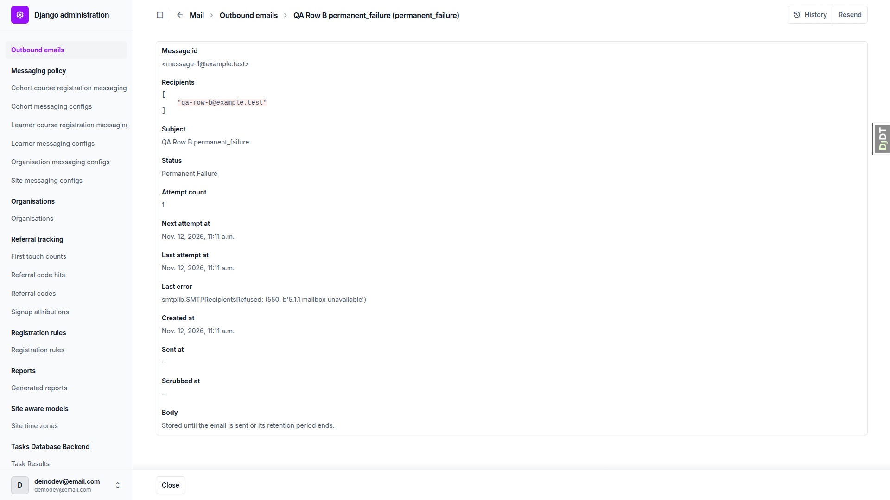 |
| 9.1-changelist | mobile | fail | Card cells clipped (see B3). | 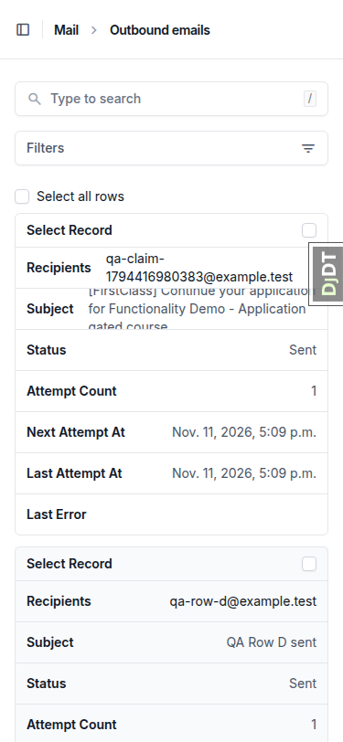 |
| 9.2 | mobile | pass | Row B detail: no horizontal scroll; Resend in more_horiz menu, full-width item, not covered. | 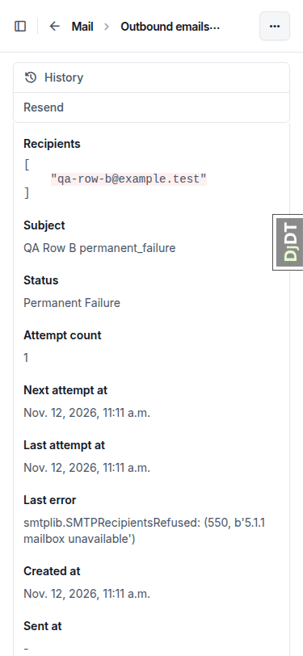 |
| 9.3-9.4 | mobile | pass | Confirmation: Resend and Cancel side by side, no overlap, no console errors. Cancel hit area 46x20. | 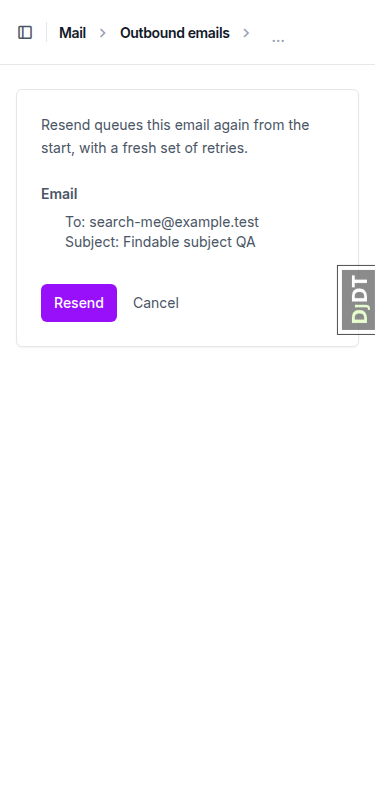 |
| 9.1-9.4 | tablet | pass | Stacked cards, no clipping, no horizontal scroll; Resend in menu; confirmation fine. | 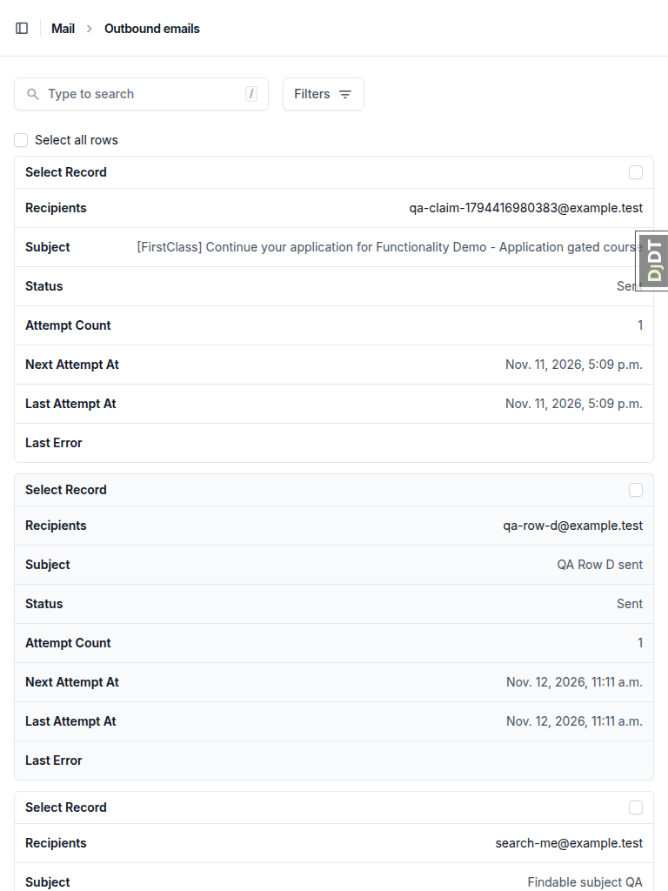 |

## Bugs

### B1: Outbound email changelist is in random order, newest rows not first

Manifestations:
- 7.2-ordering (desktop)

- Expected: the changelist lists the newest email first (QA plan 7.2: "a new newest row"), so an operator finds the latest sends at the top.
- Actual: neither `OutboundEmail.Meta` nor `OutboundEmailAdmin` sets ordering, so Django admin orders by `-pk`. The pk is a UUID4, so rows come out in random order. Today's password-reset row sorted below yesterday's, and row A (created today) sat below a row from yesterday.

### B2: Detail page shows recipients as a raw JSON array

Manifestations:
- 2.1-recipients (desktop)
- 9.2 (mobile)

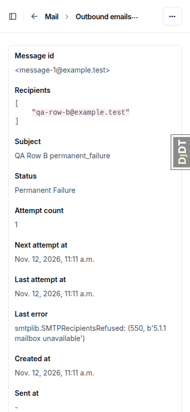

- Expected: recipients read as plain addresses, the way the changelist shows them (comma-joined via `recipients_display`).
- Actual: the detail page renders the JSONField as a pretty-printed JSON array in monospace code styling: `[ "qa-row-a@example.test" ]`.

### B3: Mobile changelist clips every multi-line value, including Last error

Manifestations:
- 9.1-changelist (mobile)

- Expected: at 375px each card shows the full value of each field, or at least the whole truncated last error, so an operator can read why an email failed.
- Actual: Unfold's mobile card cells are fixed at ~45px with overflow:hidden. Long recipients, subjects and every failed row's Last error (A, B, C, F, H) are cut off top and bottom.

### B4: fls_run_housekeeping always exits with an error in dev

Manifestations:
- 8.3-exit (desktop)

No screenshot (command-line output).

- Expected: housekeeping runs clean in the dev environment, as the QA plan expects (section 8 only expects the requeue note).
- Actual: every run ends `CommandError: Sweep failures: prune_db_task_results failed: Error: argument --backend: Backend 'default' is not a database backend`, because dev's TASKS backend is ImmediateBackend. Pre-existing on main. The mail sweeps still run, since each sweep has its own try/except.

## Layout probe

| Test | Viewport | URL | Screenshot | Result |
|---|---|---|---|---|
| 1.1 | desktop | /admin/ |  | clean |
| 1.2 | desktop | /admin/freedom_ls_mail/outboundemail/ |  | clean |
| 2.1 | desktop | /admin/freedom_ls_mail/outboundemail/<row A>/change/ |  | clean |
| 2.5 | desktop | /admin/freedom_ls_mail/outboundemail/<row C>/change/ |  | clean |
| 3.2 | desktop | /admin/freedom_ls_mail/outboundemail/<row A>/resend/ |  | clean |
| 4.4 | desktop | /admin/freedom_ls_mail/outboundemail/<row D>/resend/ |  | clean |
| 5.3 | desktop | /admin/freedom_ls_mail/outboundemail/ |  | clean |
| 9 | desktop | /admin/freedom_ls_mail/outboundemail/<row B>/change/ |  | clean |
| 9 | desktop | /admin/freedom_ls_mail/outboundemail/<row H>/resend/ | 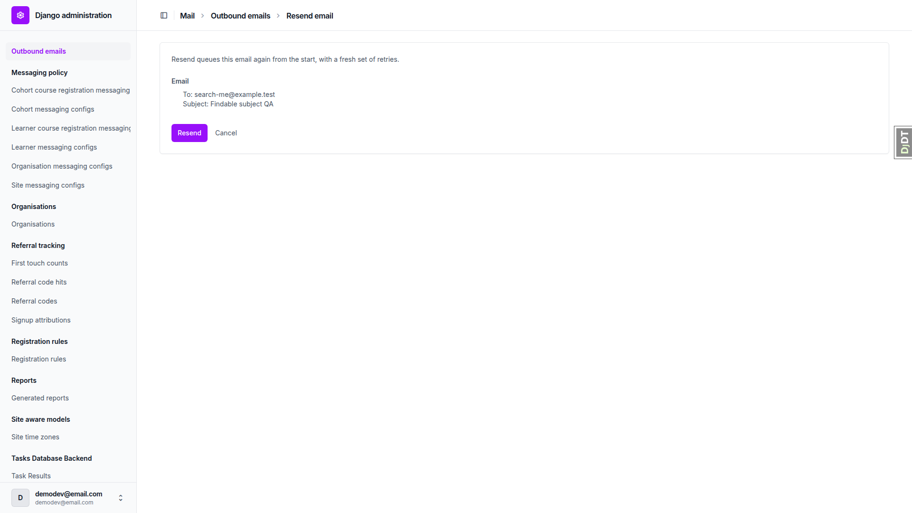 | clean |
| 9 | mobile | /admin/freedom_ls_mail/outboundemail/ |  | clean (but see B3) |
| 9 | mobile | /admin/freedom_ls_mail/outboundemail/<row B>/change/ |  | clean |
| 9 | mobile | /admin/freedom_ls_mail/outboundemail/<row H>/resend/ |  | clean |
| 9 | tablet | /admin/freedom_ls_mail/outboundemail/ |  | clean |
| 9 | tablet | /admin/freedom_ls_mail/outboundemail/<row B>/change/ | 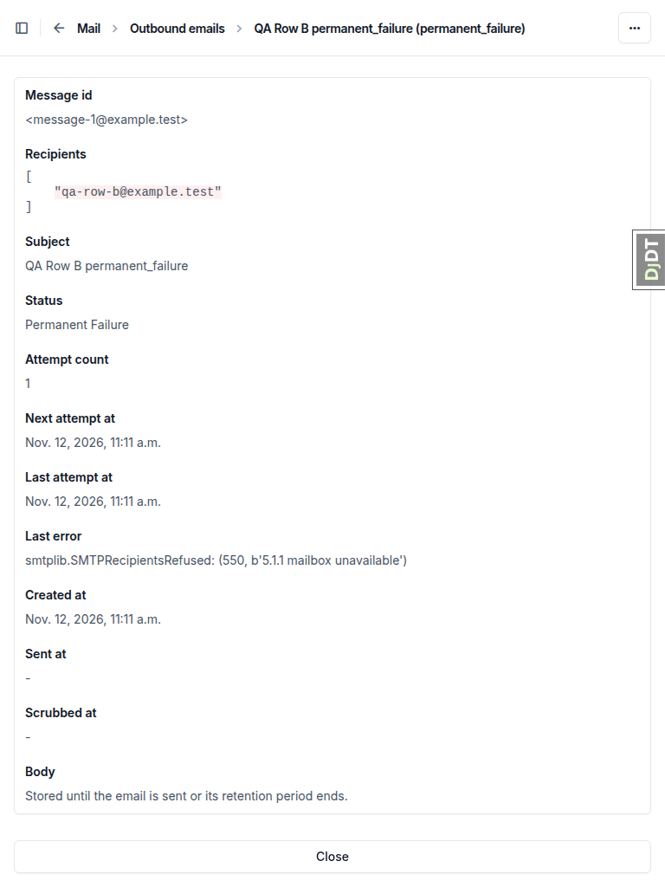 | clean |
| 9 | tablet | /admin/freedom_ls_mail/outboundemail/<row H>/resend/ | 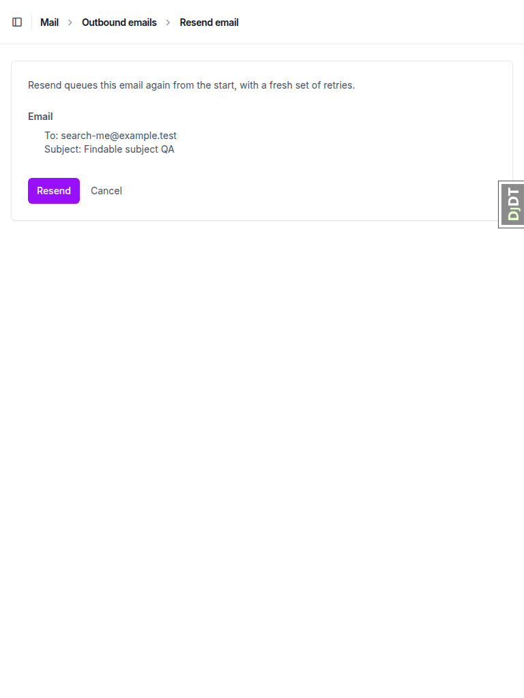 | clean |

Admin pages sit outside the FLS shell, so the configured header/content/sidebar regions are missing there by design and only the overflow check applies. The probe does not catch content clipped by an ancestor's overflow:hidden; B3 was found by eye.

## Data changes

| # | Via | What |
|---|---|---|
| 1 | sdd:qa-data-helper | Deleted 7 OutboundEmail rows left by an earlier QA run; created rows A-H (QA Row A..G subjects, H "Findable subject QA") via new command `qa_create_outbound_email_rows`; reset staff-qa@example.test password/flags (is_staff, not superuser); confirmed demodev superuser. |
| 2 | sdd:qa-data-helper | Row G (14ca9741...): last_attempt_at, sent_at, next_attempt_at, scrubbed_at set to its created_at (40 days ago). Prune measures from last_attempt_at per spec section 8, so the original seed left G inside retention. |
| 3 | sdd:qa-data-helper | Deleted the 7 QA OutboundEmail rows (A-F, H; several now sent by earlier tests) and recreated rows A-H fresh with the `qa_create_outbound_email_rows` row builders, so row B is resendable again for the section 9 viewport checks. Users untouched. |

## Bug status

| Bug | Status |
|---|---|
| B1 | **FIXED** (commit: a781fb3c5) — Outbound email changelist is in random order, newest rows not first. Re-verified: changelist and search now list newest first. |
| B2 | **FIXED** (commit: 98c8da7bd) — Detail page shows recipients as a raw JSON array. Re-verified: row A's detail page reads `qa-row-a@example.test` as plain text ([screenshot](screenshots/page-2026-11-12T12-14-58-739Z.png)). |
| B3 | **FIXED** (commit: 2010b6424) — Mobile changelist clips every multi-line value, including Last error. OutboundEmailAdmin now loads the shared FLS admin stylesheet that lets card cells grow; a Playwright test at 375px checks no cell clips. |
| — | **NOT RUN** — full test run after the fixes (reason: Claude Code stopped the run for low system memory before it finished; no results. The fixes passed `uv run pytest freedom_ls/mail` (217 passed). Re-run the full tier before pushing the rebased branch.) |
| B4 | **FIXED** (commit: 9fb6b8f87) — fls_run_housekeeping always exits with an error in dev. Housekeeping now skips prune_db_task_results with a note when the default task backend is not a database backend; the dev run exits 0. |

## General notes

- (a) The changelist's last_error is cut at 80 chars with no ellipsis, mid-word ("...while sending DAT"). This passes the spec ("truncated") but gives no visual cue.
- (b) The spec contradicts itself on row retention: the field table (`1. spec.md` line 85, created_at "Row retention measures from it") versus section 8 (line ~214, measured from last_attempt_at or created_at). The code follows section 8. The QA plan's row G seed (only created_at 40 days ago) therefore did not get pruned until its last_attempt_at was backdated too.
- (c) Browser Back to the confirmation page re-fetches it, so the human path shows the "cannot be resent: already sent" page. The stale-form resubmit was exercised by replaying the POST, and gave the expected warning.
- (d) The confirmation page's Cancel is a text link with a 46x20 hit area on mobile.
- (e) The admin changelist logs a /favicon.ico 404 (site-wide, unrelated).
- (f) One transient "Couldn't load your notifications" alert appeared on the learner dashboard right after login. It was gone on reload, with no console errors.
- (g) The data helper added a QA command `qa_create_outbound_email_rows` under `freedom_ls/qa_helpers` (with a dev_tooling test) to seed rows A-H.
- (h) The Resend header button links to `.../resend-email/`, which redirects to `.../resend/`.

status: ok · reason: 4 bugs — 2 fixed, 2 unresolved; report rendered, screenshots verified
