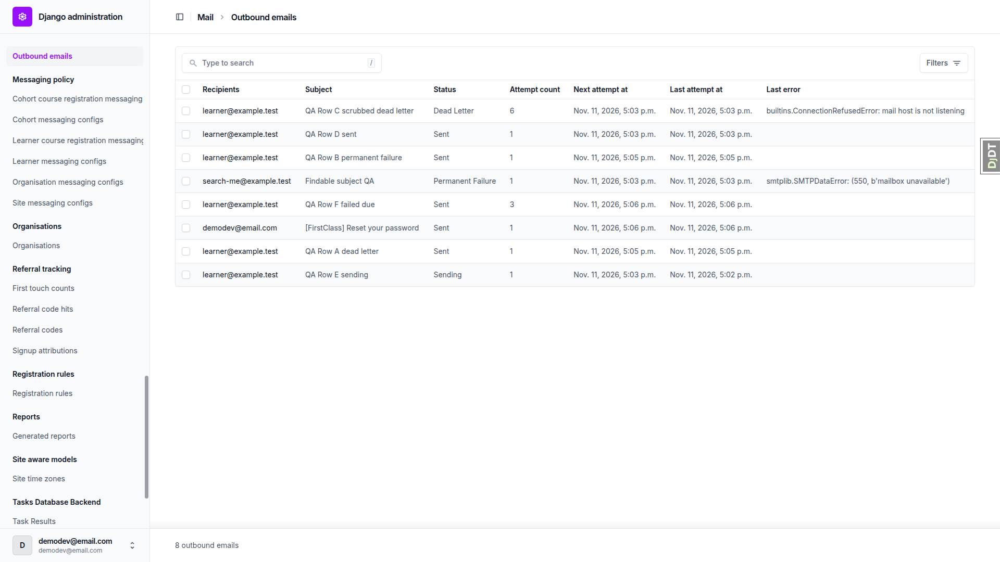
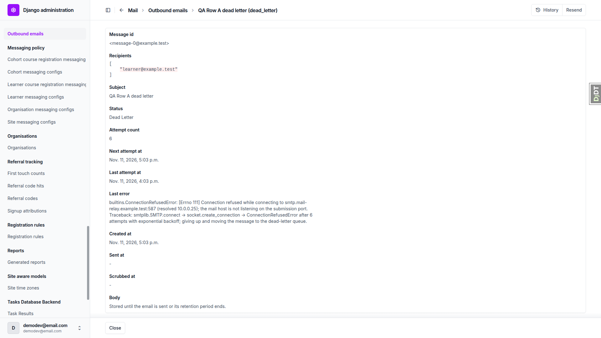
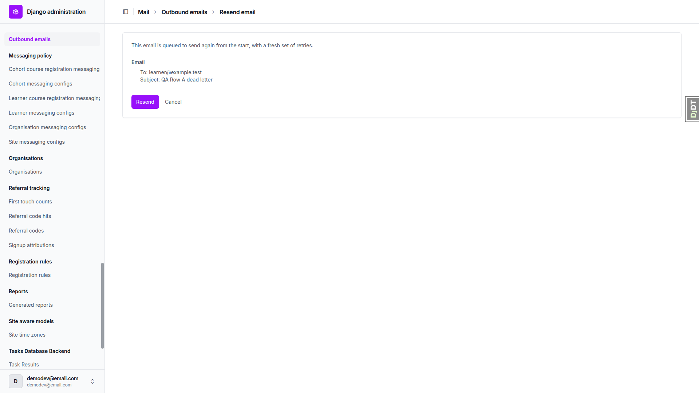
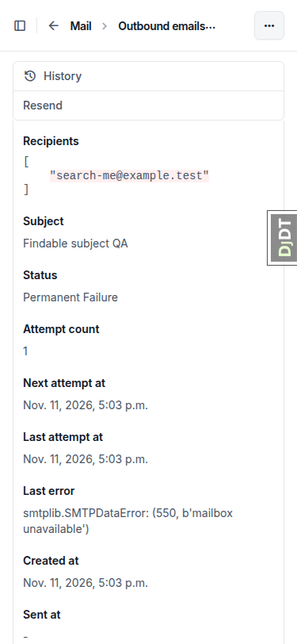
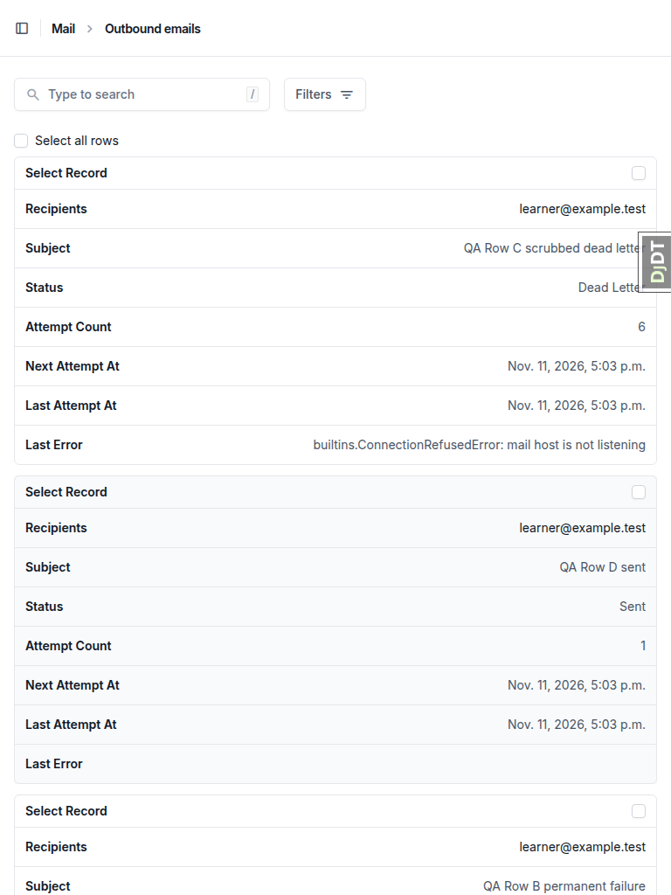
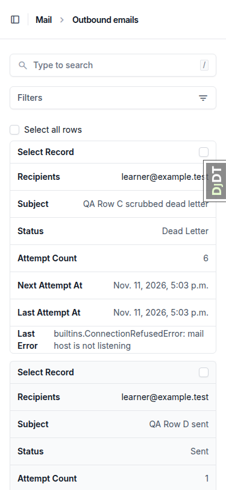
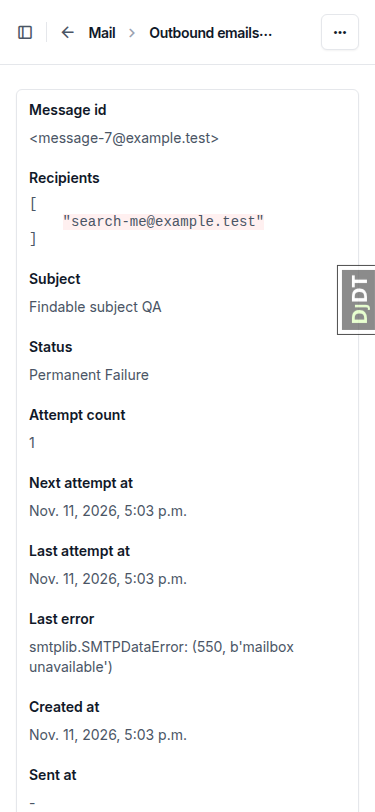
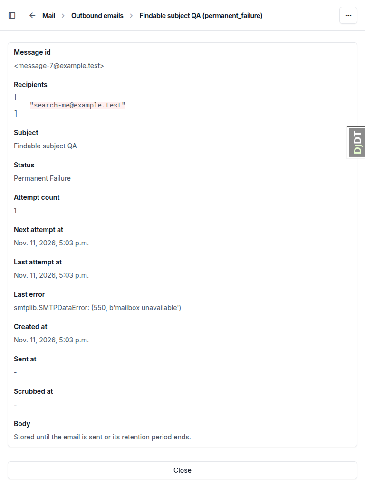
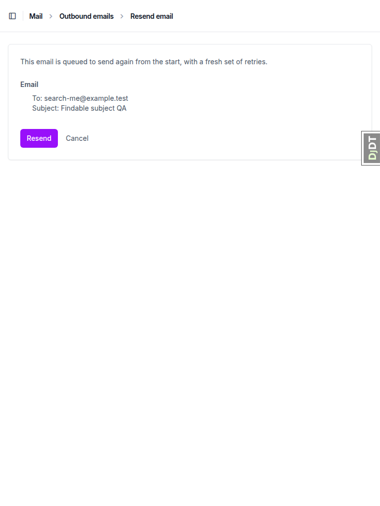

# QA report: retry-sent-emails

## Methodology

Driven by hand through Playwright MCP at three viewports: desktop 1920x1080, mobile 375x812 and tablet 768x1024. Mailpit was up for the whole run. Screenshots were collected into `screenshots/` beside this report, and every image referenced below exists there. The test plan is `3. frontend_qa.md`.

## Diff scoping

- Class: **FULL**
- Changed files: `freedom_ls/mail/templates/admin/mail/resend_confirm.html`, `freedom_ls/mail/*`, `freedom_ls/deployment/*`, `config/settings_dev.py`, `config/settings_prod.py`, `docs/app_structure.md`, `test_organisation/import_contracts.toml`
- Skipped: nothing

## Smoke gate

Outcome: **pass**. Pages checked: `/` and `/admin/freedom_ls_mail/outboundemail/`.

## Design check

no design states tested

## Test results

| Test | Viewport | Result | Note | Screenshot |
|---|---|---|---|---|
| 1 | desktop | pass | Mail section on admin index. Changelist lists rows A-H with recipients, subject, status, attempt count, next/last attempt and last error (truncated to 80 chars). No Add button, no body token in page. `dead_letter` filter gives A and C. Past 7 days drops G. Search by recipient, subject and message id each find H. Rows have no stable ordering. |  |
| 2 | desktop | pass | Row A detail is fully read-only with no Save/Delete, no token in page or source, no payload field. Row C shows the body-removed notice. `/add/` and `/delete/` return 403. Recipients render as a raw JSON array. |  |
| 3 | desktop | **fail** | Flow works end to end: Resend, confirmation page, GET changes nothing, Cancel returns, POST redirects, row becomes `sent` attempt 1 with body-removed notice, one Mailpit message, one "Resent." history entry, stale-form resubmit warns "1 email skipped: 1 already sent." and sends nothing. FAIL: confirmation says the email "is queued to send again" before confirming (see B1). |  |
| 4 | desktop | pass | No Resend button on C (scrubbed), D (sent), E (sending). `/resend/` for D says "cannot be resent: already sent."; for C "body removed."; invalid and random UUID both 404. | - |
| 5 | desktop | pass | Bulk B,C,D,E: "1 email queued to send again." and "3 emails skipped: 1 already sent, 1 body removed, 1 in flight." B sent attempt 1; C, D, E unchanged. Only D: warning only, no success message. | - |
| 6 | desktop | pass | Anonymous changelist redirects to login. Non-superuser staff: no Mail link; changelist, B detail, H resend GET and POST all 403; H unchanged. | - |
| 7 | desktop | pass | Password reset for demodev shows sent page; new row `sent`, attempt 1, body-removed notice, no reset link on detail page; exactly one Mailpit message whose link opens Change Password form. | - |
| 8 | desktop | **fail** | `fls_run_housekeeping`: "Requeued 1 outbound email(s) past due."; G pruned; F sent with attempt 3; E unchanged. FAIL: `--help` text has a stray "and" mid-list (see B2). Also see general notes on the `prune_db_task_results` failure. | - |
| 9 | mobile | pass | Changelist stacks into cards; detail actions (History, Resend) behind the more_horiz menu and open fine; confirmation Resend/Cancel visible and not overlapping; no console errors. |  |
| 9 | tablet | pass | Same as mobile: cards, actions in more_horiz menu, confirmation controls visible; no console errors. |  |
| 10 | desktop | pass | Regression: admin index lists every other section; webhook deliveries changelist loads with its retry action; API key Revoke opens confirmation and Cancel returns; new applicant on application-gated demo course gets "We've emailed a link to ..." and a `sent` OutboundEmail row. | - |

## Bugs

### B1: Resend confirmation page says the email is already queued before the admin confirms

Manifestations: test 3 (desktop), test 9 (mobile), test 9 (tablet).

- Expected: Before submitting, the page asks for confirmation (for example, that resending queues the email again from the start with a fresh set of retries), without stating it has already happened.
- Actual: The page reads "This email is queued to send again from the start, with a fresh set of retries." on the GET, before anything is queued (`freedom_ls/mail/templates/admin/mail/resend_confirm.html`).

### B2: fls_run_housekeeping help text has a stray "and" mid-list

Manifestations: test 8 (desktop). No screenshot (command-line output).

- Expected: One list of the command's jobs with a single "and" before the last item.
- Actual: "... and close any cohort report still rendering past its own window, requeue outgoing email that is past due, re-send email a dead worker left unfinished, and delete old outgoing email records." (`freedom_ls/deployment/management/commands/fls_run_housekeeping.py` help)

## Layout probe

| Test | Viewport | URL | Screenshot | Result |
|---|---|---|---|---|
| 2 | desktop | `/admin/freedom_ls_mail/outboundemail/<A>/change/` |  | clean |
| 3 | desktop | `/admin/freedom_ls_mail/outboundemail/<A>/resend/` |  | clean |
| 1 | desktop | `/admin/freedom_ls_mail/outboundemail/` |  | clean |
| 9 | mobile | `/admin/freedom_ls_mail/outboundemail/` |  | clean |
| 9 | mobile | `/admin/freedom_ls_mail/outboundemail/<H>/change/` |  | clean |
| 9 | mobile | `/admin/freedom_ls_mail/outboundemail/<H>/resend/` |  | clean |
| 9 | tablet | `/admin/freedom_ls_mail/outboundemail/` |  | clean |
| 9 | tablet | `/admin/freedom_ls_mail/outboundemail/<H>/change/` |  | clean |
| 9 | tablet | `/admin/freedom_ls_mail/outboundemail/<H>/resend/` |  | clean |

## Data changes

| Via | What |
|---|---|
| sdd:qa-data-helper | Created 8 OutboundEmail QA rows A-H (states per QA plan section 0) and staff non-superuser staff-qa@example.test (pk 75) |
| sdd:qa-data-helper | Created API key "QA regression key" (pk c1733cb5-74ac-4102-89a4-260452ec472b) on DemoDev |

## Bug status

| Bug | Status |
|---|---|
| B1 | **FIXED** (commit: 473dabc08) — Resend confirmation page says the email is already queued before the admin confirms |
| B2 | **FIXED** (commit: 3f8dc1bb5) — fls_run_housekeeping help text has a stray 'and' mid-list |

## General notes

- `fls_run_housekeeping` exits with `prune_db_task_results failed: Backend default is not a database backend` under dev settings (ImmediateBackend is not a database backend). This is pre-existing and not touched by this branch.
- Changelist rows have no stable ordering (not newest first).
- On the detail page `recipients` renders as a raw JSON array, while the list joins them with commas.
- On mobile and tablet the detail page's Resend sits behind Unfold's more_horiz menu, which works.
- Row B's seeded 550 error does not apply to Mailpit, so its resend went to `sent`.

status: ok · reason: 2 bugs — 2 fixed, 0 unresolved; report rendered, screenshots verified
