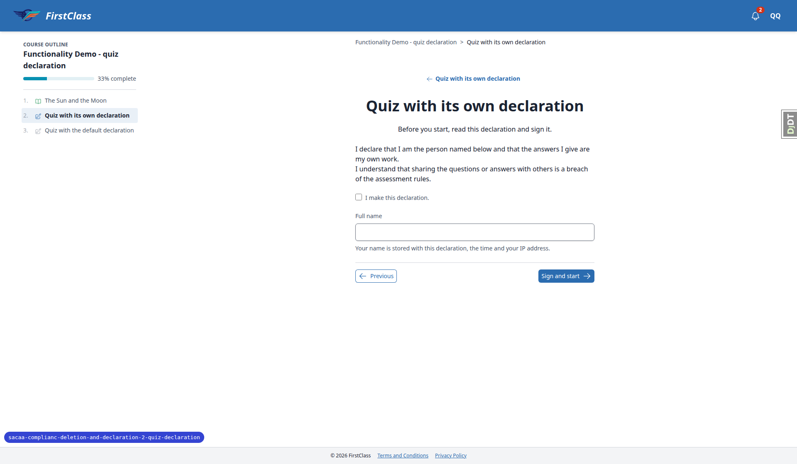
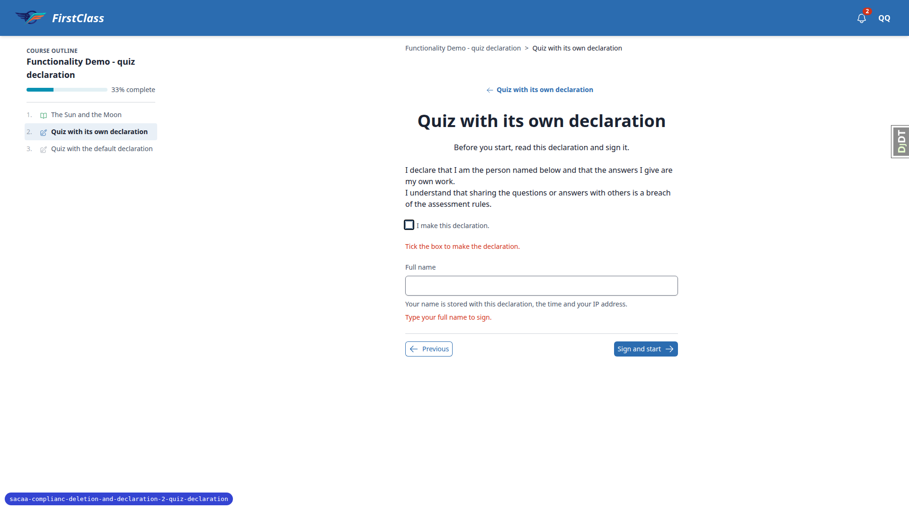
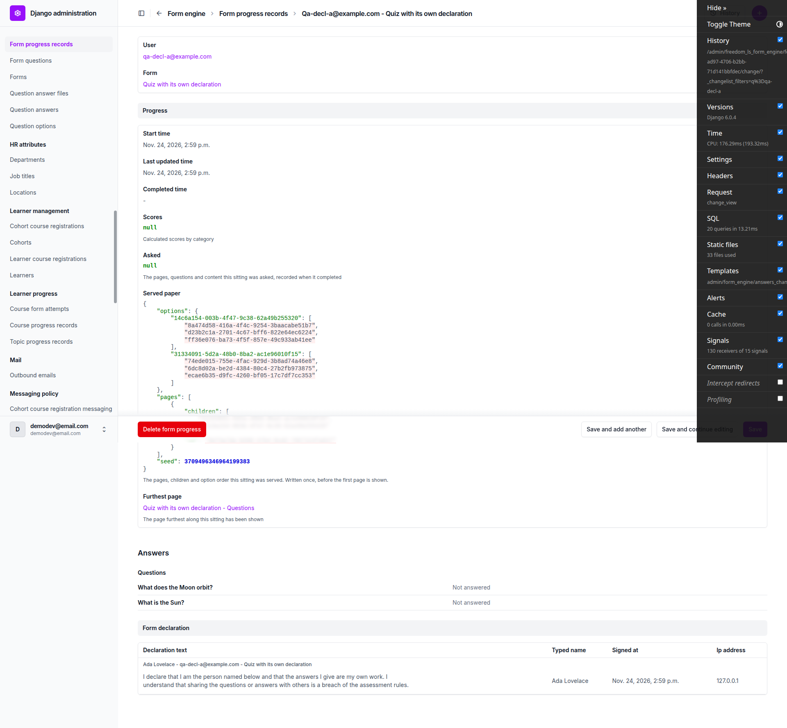
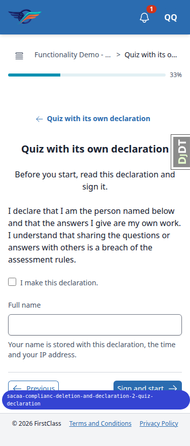
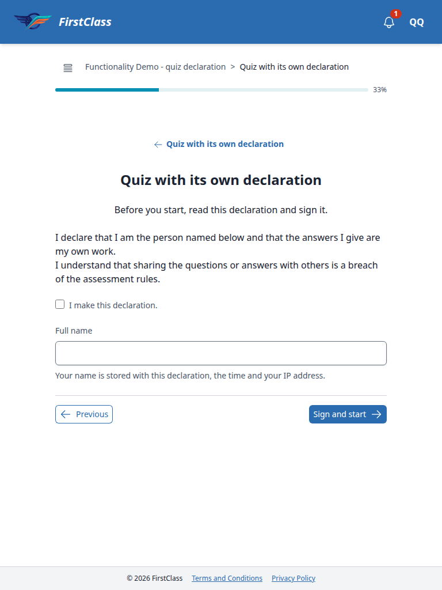
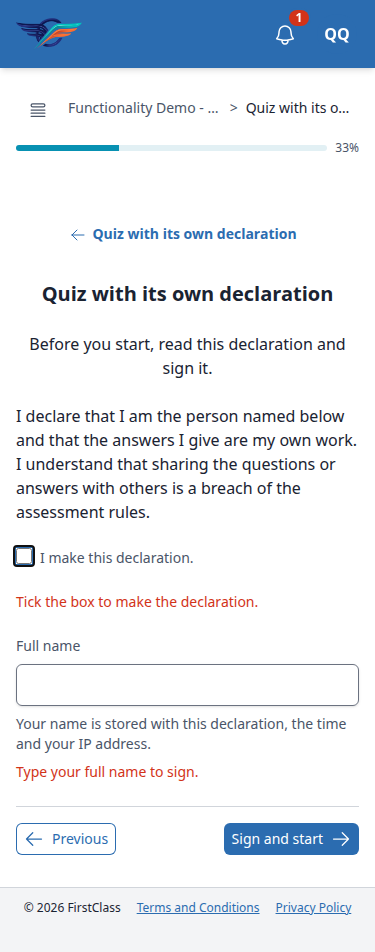
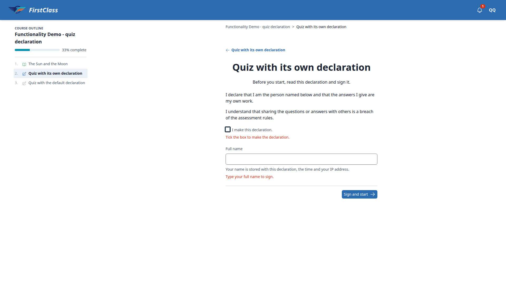
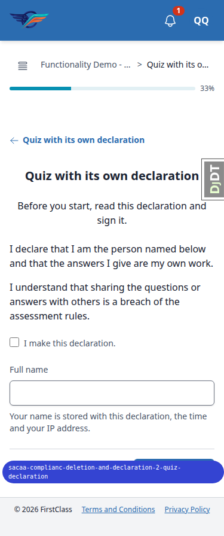

# QA report: learners sign a declaration before each quiz attempt

## Methodology

Screenshots were collected into `screenshots/` beside this report, and every image referenced below exists there. The desktop viewport (1920x1080) ran Tests 1-7. Mobile (375x812) and tablet (768x1024) checked the declaration page and its error state. Tests 3 to 7 had no screenshot of their own, except the admin screenshot for Test 3. Their results come from page and admin inspection, recorded in the notes below.

Results by test:

| Test | Viewport | Result | Notes |
|---|---|---|---|
| 1 | desktop | pass, with 3 visual defects (B1-B3) | Order, enabled button and page flow correct. No console errors. No FormProgress for learner A before signing. |
| 2 | desktop | pass, with 1 visual defect (B4) | Empty submit, spaces-only name and unticked box each gave the right errors, focus and 422. Keyboard-only worked. |
| 3 | desktop | pass | Signing " Ada Lovelace " landed on `/fill_form/1`. Admin showed one read-only declaration with both spaces kept and IP 127.0.0.1. |
| 4 | desktop | pass | Continue Form skipped the declaration. Try Again for learner C showed the default text and a second declaration on a new record. |
| 5 | desktop | pass | Continue Form and a typed `/fill_form/1` both reached the declaration. Signing kept the same record and start time. |
| 6 | desktop | pass | Shuffled quiz and Course Feedback Survey both went straight to a page with no declaration. |
| 7 | desktop | pass | Back link created no record. A double-click produced one POST and exactly one declaration. |
| 1 | mobile | pass, with B1-B3 | No horizontal scroll (scrollWidth 375). |
| 2 | mobile | pass, with B4 | 422, both errors, no horizontal scroll. |
| 1 | tablet | pass, with B1-B3 | No horizontal scroll. |

## Diff scoping

Class: **FULL**. The changed files that triggered it:

- `freedom_ls/learner_interface/templates/learner_interface/form_declaration.html`
- `freedom_ls/learner_interface/views.py`, `forms.py` and `urls.py`
- `freedom_ls/form_engine/admin.py`, `models.py` and `declarations.py`
- `freedom_ls/learner_progress/attempts.py`
- `demo_content/functionality_demo_quiz_declaration/*`
- tests, schema, validate, content_save and the spec docs

Nothing was skipped. Nothing was run at a reduced scope. The desktop pass covered all seven tests. Mobile and tablet covered the declaration page and its error state, as the plan asked for the declaration page only.

## Smoke gate

Outcome: **pass**. Pages loaded: `/` and `/courses/functionality-demo-quiz-declaration/2/`.

## Design check

No design states tested. The plan has no `-design` tests.

## Bug B1: Declaration text paragraphs have no space between them

Manifestations:

- `1-paragraphs`, desktop
- `1`, mobile
- `1`, tablet

Expected: the declaration text keeps its paragraph breaks, with a visible gap between paragraphs.

Actual: `linebreaks` renders two `
` elements with 0 margin. The second paragraph ("I understand...") reads as a plain line break after "my own work.".

## Bug B2: Declaration page back link is centred instead of at the top left

Manifestations:

- `1-backlink`, desktop
- `1`, mobile
- `1`, tablet

Expected: the back link sits at the top left, above the heading, as the brand visual checklist requires for a page opened from another page.

Actual: the back link inherits `text-center` from the column wrapper and sits centred above the heading.

## Bug B3: Declaration page footer has a Previous button that duplicates the back link

Manifestations:

- `1-previous`, desktop
- `1`, mobile
- `1`, tablet

Expected: no button on the page goes back (brand visual checklist). The back link is the only way back.

Actual: `c-player-footer` renders a Previous button that links to the quiz start screen, the same target as the back link. The start screen's own Previous goes to the previous course item. That is navigation and is not part of this bug.

## Bug B4: Tick-box error sits detached from the tick box

Manifestations:

- `2-error-placement`, desktop
- `2`, mobile

Expected: field errors sit beside each field (spec item 16). The tick-box error should be directly under its tick box, as the name error sits under its field.

Actual: the tick-box error is a separate child of the `space-y-6` form. A gap of about 24px opens between the tick box and its error, which puts the error halfway to the Full name label. Neither invalid field gets an error border.

## Layout probe

| Test id | Viewport | URL | Screenshot | Result |
|---|---|---|---|---|
| 1 | desktop | `/courses/functionality-demo-quiz-declaration/2/declaration` | [page-2026-11-24T14-57-31-165Z.png](screenshots/page-2026-11-24T14-57-31-165Z.png) | clean |
| 1 | mobile | `/courses/functionality-demo-quiz-declaration/2/declaration` | [page-2026-11-24T15-04-41-470Z.png](screenshots/page-2026-11-24T15-04-41-470Z.png) | clean |
| 1 | tablet | `/courses/functionality-demo-quiz-declaration/2/declaration` | [page-2026-11-24T15-05-04-360Z.png](screenshots/page-2026-11-24T15-05-04-360Z.png) | clean |

## Data changes

| What changed | Agent call or command | Files written |
|---|---|---|
| The dev DB was empty. Ran `create_demo_data` and `content_save demo_content DemoDev`. Created learners A, B and C (`qa-decl-{a,b,c}@example.com` / `testpass123`) with topic completions. B has an open unsigned sitting at quiz 2. C has a passed signed sitting at quiz 2 and a failed signed sitting at quiz 3. Added a reusable command `qa_create_quiz_declaration_scenario`. | `sdd:qa-data-helper` | `freedom_ls/qa_helpers/management/commands/qa_create_quiz_declaration_scenario.py`, `freedom_ls/qa_helpers/tests/management/commands/test_qa_create_quiz_declaration_scenario.py` |
| Reset learner B after the Test 5 signing. Deleted FormProgress 237a088c (with its declaration and CourseFormAttempt). Created a new open unsigned sitting 6cad69b4 at the quiz with its own declaration. | `sdd:qa-data-helper` | none |
| Registered learner A on functionality-demo-show-end-with-topic and completed topics 1-2, so the Course Feedback Survey (item 3) is reachable. This reset A's password to the same value and logged A out mid-run. | `sdd:qa-data-helper` | none |

## Bug status

- **FIXED** (commit: 85014c19a) — B1 Declaration text paragraphs have no space between them
- **FIXED** (commit: 0b221ab30) — B2 Declaration page back link is centred instead of at the top left
- **FIXED** (commit: e402ef1a9) — B3 Declaration page footer has a Previous button that duplicates the back link
- **FIXED** (commit: ef3a2aa02) — B4 Tick-box error sits detached from the tick box

Re-verified in the browser after the fixes: a 16px gap between the declaration paragraphs; the back link's left edge matches the text column (856px at 1920); no "Previous" on the declaration page, with "Sign and start" right-aligned and the start screen keeping its own "Previous"; the tick-box error 8px under its tick box, with focus still on the tick box after a 422. At 375 the page has no horizontal scroll and the layout probe raises no flags.

## General notes

- The admin inline column header reads "Ip address", which is the default verbose name. This is minor and has no action attached.
- In the admin screenshot the debug toolbar is open. That is a dev-tooling artefact.
- On mobile the branch badge overlaps the debug toolbar tab. This is dev tooling only.
- The Test 3 admin check found the declaration row read-only. It has no add row, no delete box and no editable inputs.
- Learner A's password was reset mid-run by the data helper, which logged A out. Testing continued after logging in again. B was re-created for Test 5, and Steps 1 and 2 were re-checked after the reset.
- Tests 4 to 7 recorded no screenshots, so their results rest on page and admin inspection.
- Mobile and tablet ran only the declaration page and its error state. Tests 3 to 7 were not repeated at those viewports.

status: ok · reason: 4 bugs — 4 fixed, 0 unresolved; report rendered, screenshots verified
