# QA report: learners sign a declaration before each quiz attempt

Result: all tests passed (7 desktop tests, plus mobile and tablet passes). No bugs found.

## Methodology

Screenshots were collected into `spec_dd/2. in progress/sacaa-complianc-deletion-and-declaration-2-quiz-declaration/screenshots/`. Every image linked in this report exists in that folder beside the report. Screenshot compression ran and found nothing over the size limit. The test plan is `3. frontend_qa.md`. Desktop was 1920x1080, mobile 375x812 and tablet 768x1024.

## Diff scoping

Class: FULL. The changed files that triggered it include `freedom_ls/learner_interface/templates/learner_interface/form_declaration.html`, `freedom_ls/learner_interface/views.py`, `freedom_ls/form_engine/admin.py`, `freedom_ls/form_engine/models.py`, `freedom_ls/form_engine/declarations.py` and `demo_content/functionality_demo_quiz_declaration/*` (42 non-spec files in total). Nothing was skipped: desktop, mobile and tablet passes all ran.

## Smoke gate

Pass. Pages loaded: `/` and `/courses/functionality-demo-quiz-declaration/2/`. The run was not aborted.

## Test results

| Test | Viewport | Result | Screenshot | Notes |
|---|---|---|---|---|
| 1 Declaration page opens | desktop | pass | 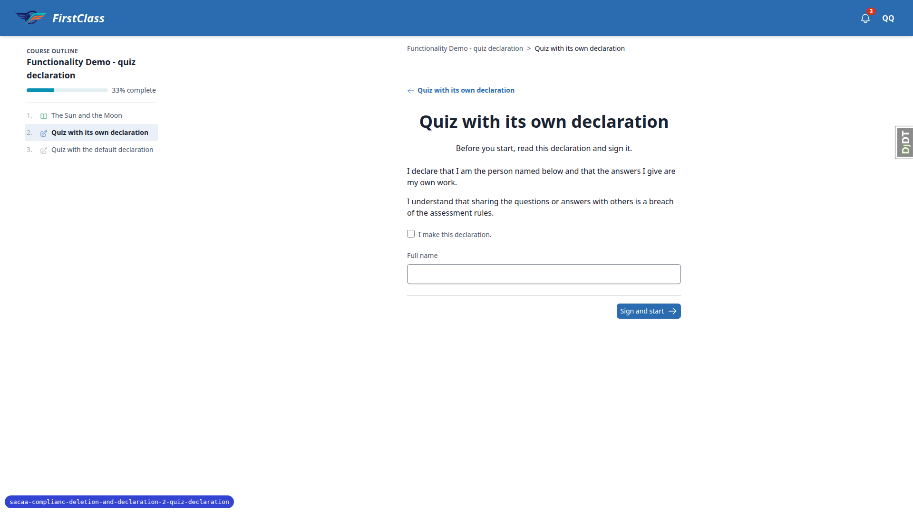 | Start Form opens `/declaration`. It shows the back link, title, lead line, own text with two paragraphs, tick box, empty "Full name" with no helper text, and an enabled "Sign and start". It says nothing about storing the name, time or IP address. There is no scroll box and no horizontal scroll. No FormProgress exists for learner A. No console errors. |
| 1 | mobile | pass | 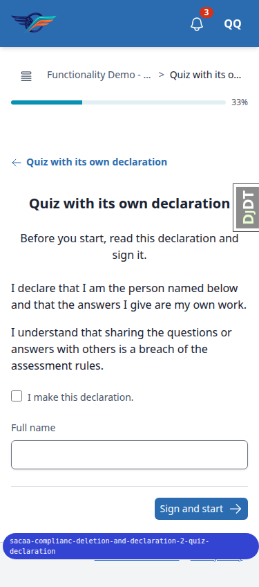 | At 375 the elements are in order and the text is in page flow. scrollWidth is 375. The label is clickable across 343px and the button is 135x32. |
| 2 Empty or partial signature refused | desktop | pass | 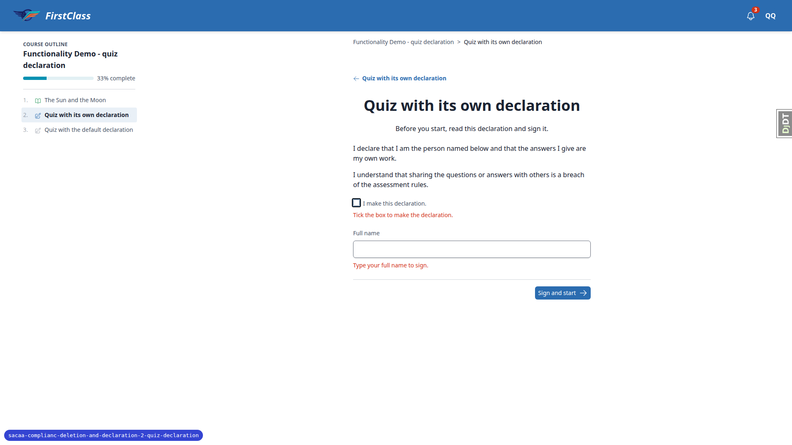 | An empty submit shows both errors beside their fields, with focus on the tick box and a 422. Keyboard-only works. Spaces-only name shows only the name error, with focus on the name and the box still ticked. Unticked with a name shows only the tick-box error and keeps the name. Every response is 422, the URL stays `/declaration` and no FormProgress is created. The only console error is the browser's own "Failed to load resource 422" line for the expected 422. |
| 2 | mobile | pass | 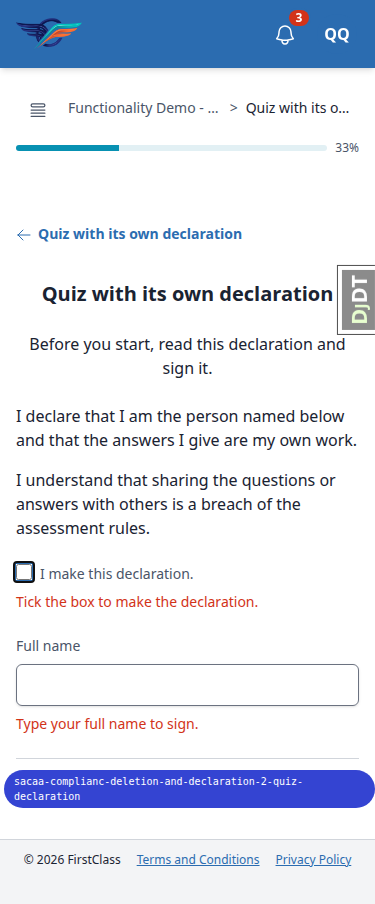 | Both errors sit under their fields, focus is on the tick box, 422, no horizontal scroll. The dev-only branch badge covers the button in the full-page shot; this is not a product issue. |
| 3 Signing starts the attempt | desktop | pass | 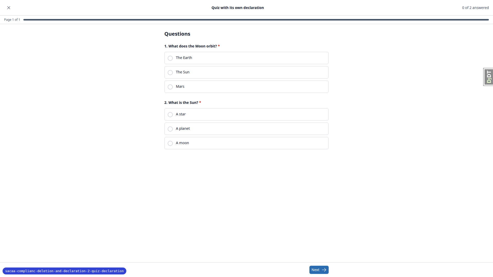, admin: 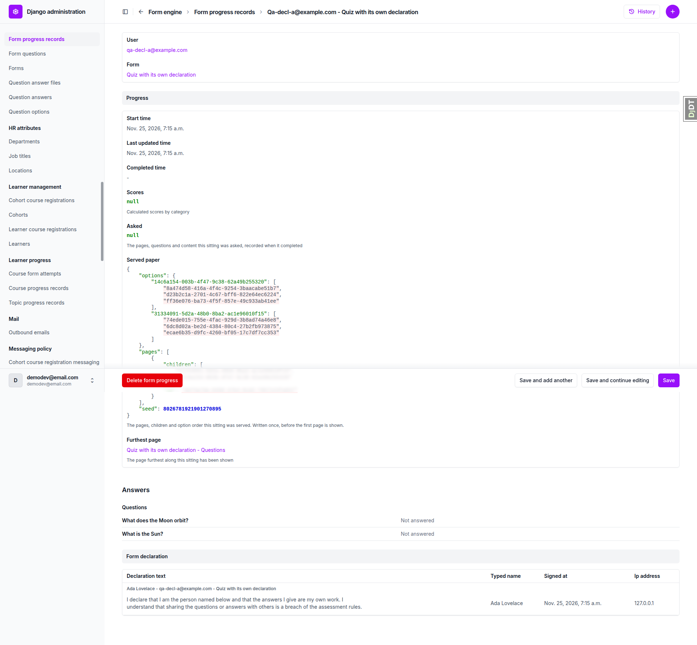 | Signing with " Ada Lovelace " lands on `/fill_form/1` with questions. The admin shows one Form declaration row with the own text, the typed name with its spaces kept in the DB and HTML (the browser collapses them visually), the signed-at time and 127.0.0.1. MAX_NUM_FORMS=1, no add row, no DELETE box and no editable inputs. |
| 3 | mobile | pass | 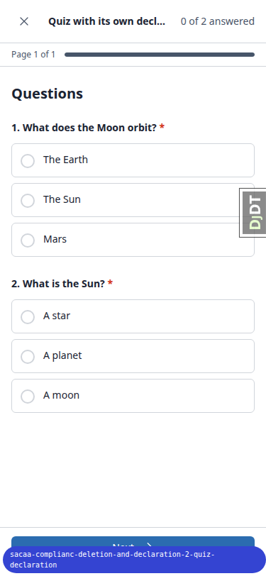 | Signing at 375 lands on `/fill_form/1` with no horizontal scroll. |
| 4 Once per attempt, again on each new attempt | desktop | pass | 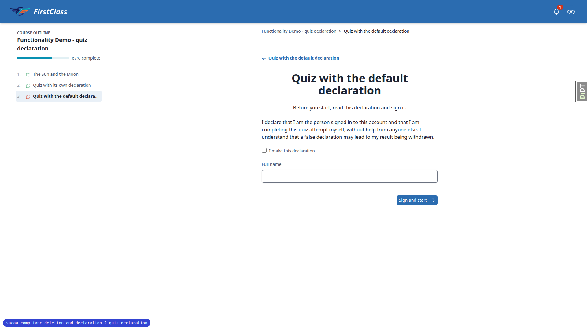 | Learner A answered, left via Exit test then "Leave and save", and Continue Form went straight to `/fill_form/1` with no declaration. After finishing (failed), "Retry quiz" opened `/declaration`. Signing opened page 1 and created a second FormProgress with its own declaration. Learner C's "Try Again" on the default-declaration quiz opened `/declaration` with `FORM_DECLARATION_DEFAULT_TEXT`. Signing opened page 1 with a new FormProgress and one declaration. |
| 2/4 | tablet | pass | 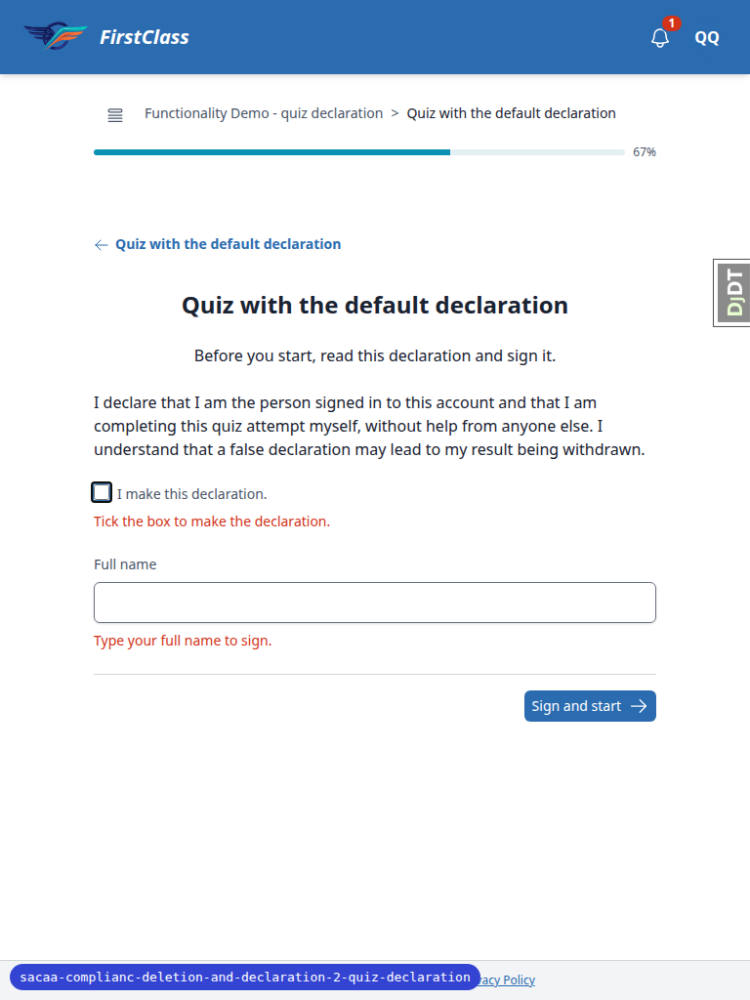 | Learner C's Try Again at 768 opens `/declaration` with the default text. An empty submit shows both errors (422). Signing lands on `/fill_form/1`. scrollWidth is 768. Header and content share left edge 96. |
| 5 Unsigned sitting cannot be continued | desktop | pass | none | Learner B's start screen offers Continue Form. Both it and a direct `/fill_form/1` land on `/declaration`. After signing the learner is on `/fill_form/1`. The DB shows the same FormProgress `fa1839f8` (start 07:13:23), now with a declaration. |
| 6 Other quizzes unchanged | desktop | pass | none | Start Form on the shuffled quiz goes to `/fill_form/1`. Start Form on "Course Feedback Survey" (show end with Topic) goes to `/fill_form/1`. No declaration page shows. To do this, learner A was registered on the survey course by re-running the scenario command with `--extra-course-slug functionality-demo-show-end-with-topic`. |
| 7 Back link and repeat submits | desktop | pass | none | Learner C's back link from `/declaration` returns to the `/3/` start screen with no new FormProgress. A double-click on "Sign and start" sent one POST and landed on `/fill_form/1` once. The DB shows one new FormProgress with exactly one declaration. |
| nav (course outline) | mobile | pass | 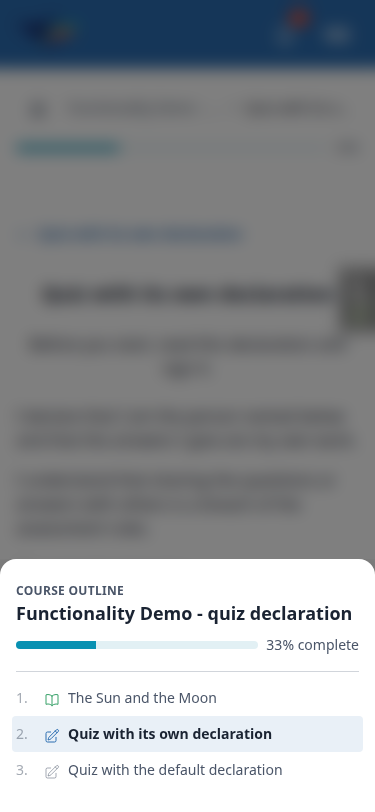 | "Open course outline" opens the outline as a bottom sheet over blurred content, and Escape closes it. See the layout probe flags below. |

## Design check

No design states tested. The plan names no design screenshots.

## Layout probe

| Test id | Viewport | URL | Screenshot | Result |
|---|---|---|---|---|
| smoke | desktop | `/courses/functionality-demo-quiz-declaration/2/` | 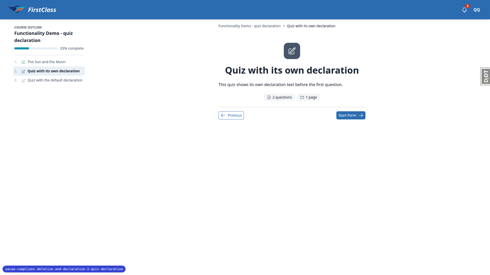 | clean |
| 1 | desktop | `/courses/functionality-demo-quiz-declaration/2/declaration` |  | clean |
| 3 | desktop | `/courses/functionality-demo-quiz-declaration/2/fill_form/1` |  | clean |
| 4 | desktop | `/courses/functionality-demo-quiz-declaration/3/declaration` |  | clean |
| 4 | desktop | `/courses/functionality-demo-quiz-declaration/3/` | 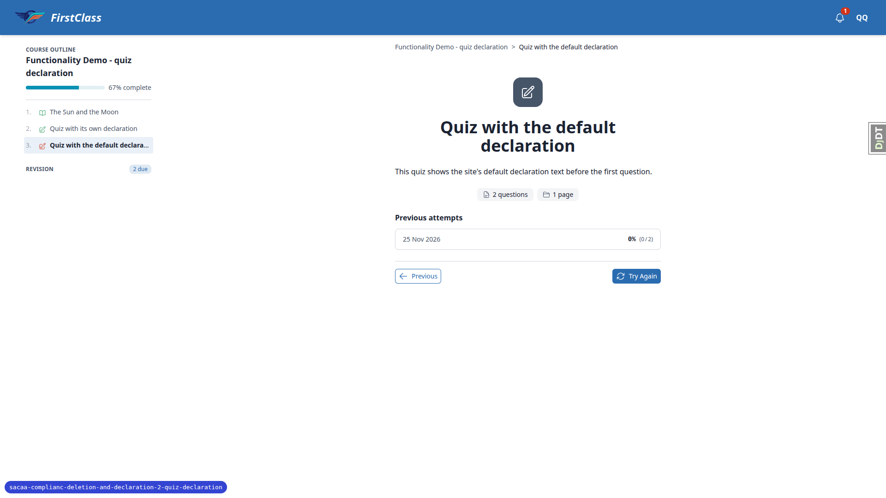 | clean |
| 1 | mobile | `/courses/functionality-demo-quiz-declaration/2/declaration` |  | clean |
| 2 | mobile | `/courses/functionality-demo-quiz-declaration/2/declaration` |  | clean |
| nav | mobile | `/courses/functionality-demo-quiz-declaration/2/declaration` |  | pass, with probe flags: "stacked: sidebar ink spans x=0..375 (open modal bottom sheet, intended)" and "overlap: content and sidebar ink intersect (modal sheet over blurred page, intended)". The screenshot was taken with the course-outline bottom sheet open. That sheet is a modal that covers the full width over blurred page content, so the probe's stacked and overlap measurements are expected for it. It is not a layout defect, so the record is pass. |
| 3 | mobile | `/courses/functionality-demo-quiz-declaration/2/fill_form/1` |  | clean |
| 2/4 | tablet | `/courses/functionality-demo-quiz-declaration/3/declaration` |  | clean |

## Data changes

| What changed | Command | Files written |
|---|---|---|
| Reloaded demo content and reset learners A/B/C (`qa-decl-a/b/c@example.com`, password `testpass123`) | `content_save demo_content DemoDev`, then `qa_create_quiz_declaration_scenario` | none |
| Re-ran the scenario with extra courses, registering learner A on the survey course and resetting A/B/C | `qa_create_quiz_declaration_scenario --extra-course-slug functionality-demo-shuffled-quiz --extra-course-slug functionality-demo-show-end-with-topic` | none |

## Bug status

No bug records. No bugs to track.

## General notes

- Observation, no bug: the Django admin renders the declaration text with its paragraph break collapsed into one line. The stored text and the learner-facing page keep the two paragraphs.
- Observation, pre-existing and not caused by this branch: an answer picked on a quiz page but not submitted is not kept when the learner leaves via Exit test then "Leave and save". Answers are saved only on page submit. The exit dialog says "Your progress is saved", and the player itself says "Answers on this page will be saved when you submit." Continue Form still resumes without a declaration, as expected.
- The dev-only branch badge overlaps the "Sign and start" button in the mobile full-page screenshot. It is a development overlay and not part of the product.
- Tests 5, 6 and 7 were verified by URL and database state and have no screenshots.
- Unreferenced files in `screenshots/` (accessibility snapshots and console logs) are working artefacts of the run.

status: ok · reason: report rendered, 0 bugs documented
