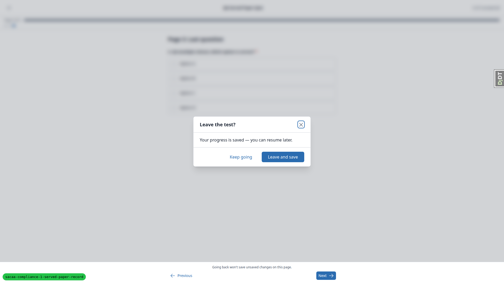

# QA report: served paper record

## Methodology

Screenshots were collected into `spec_dd/2. in progress/sacaa-compliance-1-served-paper-record/screenshots/`. Every image linked below was checked to exist there beside this report. The QA plan is `3. frontend_qa.md`. The smoke gate passed, so no steps were skipped because of it.

Run-order notes:

- Test 6 was run before Test 5, so that 6.6's premise ("a served paper with nothing missing") held. Test 5 deletes and moves served rows, which would have broken that premise.
- The option-order check in 4.3 used learner D, because learner B had already finished the quiz by then. This is recorded as 4.3b. The page-order half of 4.3 ran with learner B as planned. Test 4.4 ran later, after the data helper cleared learner D's sitting.
- 4.2's option reorder first failed to save: the question admin required "File path", and the QA scenario had created questions with it blank. This was a test-data gap, not a product bug, and was fixed through the data helper (see Data changes).

## Diff scoping

Class: FULL. Changed files that triggered it:

- `freedom_ls/form_engine/templates/form_engine/inputs/checkboxes.html`
- `freedom_ls/form_engine/templates/form_engine/inputs/dropdown.html`
- `freedom_ls/form_engine/templates/form_engine/inputs/multiple_choice.html`
- `freedom_ls/form_engine/*.py`
- `freedom_ls/learner_interface/views.py`
- `freedom_ls/course_applications/views.py`
- `freedom_ls/reports/indexes.py`

Nothing was skipped on scoping grounds. Everything ran, including the mobile and tablet passes.

## Smoke gate

Outcome: pass. Pages loaded: `/` and `/courses/qa-served-paper-course/1/`.

## Test results summary

| Test | Result |
|------|--------|
| 1.1 to 1.9 | pass |
| 2.1, 2.3 to 2.5 | pass |
| 2.2 | pass for the behaviour; visual review failed (B1, "2.2-cover") |
| 3.1, 3.2 | pass |
| 4.1 to 4.6 (including 4.3b) | pass |
| 5.1, 5.3, 5.5, 5.6 | pass |
| 6.1, 6.2, 6.4, 6.5, 6.6 | pass |
| 7.1, 7.2 | pass |
| 7.3 | pass for the behaviour; outline check failed (B2, "7.3-outline") |
| 8.1, 8.2 | pass |
| 9.1 to 9.6, 9.8 | pass |
| 9.7 | skip (applicant applied anonymously and has no verified account, which the plan says to skip) |
| 10.1 | pass |
| 11.1 | pass (on-screen report only) |
| watch: missing page, viewports (runner and results), two tabs | pass |
| watch: two tabs, double start | fail (B3) |

## Design check

No design states tested.

## Bug B1: Runner exit dialog backdrop does not cover the sticky footer

Manifestations:

- `2.2-cover`, desktop

- Expected: with the "Leave the test?" dialog open, the whole page behind it is dimmed under the backdrop. That includes the header, the content and the sticky Previous/Next footer.
- Actual: the sticky footer (Previous, Next and the "Going back won't save..." note) renders above the backdrop. It is undimmed and looks clickable.
- Note from the tester: likely pre-existing. This branch changed no runner shell template, only the option input templates.

## Bug B2: Course outline shows stale "In progress" on the request that finalises an abandoned submit-on-exit sitting

Manifestations:

- `7.3-outline`, desktop

No screenshot.

- Expected: when the quiz start screen finalises an abandoned submit-on-exit attempt, the outline on that same response shows the item's new state ("Needs retry").
- Actual: the outline still says "In progress" while the page body shows the finalised attempt. Only a reload shows "Needs retry".
- Note from the tester: pre-existing. This branch does not change `finalise_stale_incomplete` or the outline (introduced on main in f79587793).

## Bug B3: Two concurrent quiz starts create two sittings and score one as abandoned

Manifestations:

- `watch.two-tabs-double-start`, tablet

No screenshot.

- Expected: opening the submit-on-exit quiz start in two tabs at once yields one open sitting.
- Actual: two FormProgress rows are created. One is immediately finalised and scored as an abandoned attempt, and the other stays open.
- Note from the tester: pre-existing. Sitting creation (`get_or_create_incomplete`) and `finalise_stale_incomplete` are unchanged by this branch.

## Layout probe

| Test id | Viewport | URL | Screenshot | Result |
|---------|----------|-----|------------|--------|
| 1.1 | desktop | /courses/qa-served-paper-course/1/ | [shot](screenshots/page-2026-11-19T16-39-48-477Z.png) | clean |
| 1.3 | desktop | /courses/qa-served-paper-course/1/fill_form/1 | [shot](screenshots/page-2026-11-19T16-40-02-769Z.png) | clean |
| 1.5 | desktop | /courses/qa-served-paper-course/1/fill_form/2 | [shot](screenshots/page-2026-11-19T16-40-59-277Z.png) | clean |
| 3.1 | desktop | /courses/qa-served-paper-course/1/complete | [shot](screenshots/page-2026-11-19T16-42-24-171Z.png) | clean |
| watch.viewports-runner | mobile | /courses/qa-served-paper-course/1/fill_form/2 | [shot](screenshots/page-2026-11-19T16-59-33-928Z.png) | clean |
| watch.viewports-results | mobile | /courses/qa-served-paper-course/1/complete | [shot](screenshots/page-2026-11-19T16-59-53-795Z.png) | clean |
| watch.viewports-results | tablet | /courses/qa-served-paper-course/1/complete | [shot](screenshots/page-2026-11-19T17-00-01-203Z.png) | clean |
| watch.viewports-runner | tablet | /courses/qa-served-paper-course/1/fill_form/2 | [shot](screenshots/page-2026-11-19T17-00-17-711Z.png) | clean |

## Data changes

| What changed | Made by | Files written |
|--------------|---------|---------------|
| Seeded the empty branch DB with `create_demo_data` and `content_save demo_content DemoDev`, then built the served-paper scenario: quiz course with 3 forms, learners A to D, cohort, learner C's old sitting, and quiz and plain application courses | `sdd:qa-data-helper` | `freedom_ls/qa_helpers/management/commands/qa_create_served_paper_scenario.py` |
| Filled the blank `file_path` on the 33 QA scenario content rows (forms, pages, content, questions, courses, category) so the question admin validates. The command was updated to set it on create. Learner D's quiz sitting was cleared. | `sdd:qa-data-helper` | `freedom_ls/qa_helpers/management/commands/qa_create_served_paper_scenario.py` |

## Bug status

| Bug | Title | Status |
|-----|-------|--------|
| B1 | Runner exit dialog backdrop does not cover the sticky footer | **FIXED** (commit: 4a16fef0e). Re-verified: dialog covers the footer, footer stays pinned while content scrolls at 375px |
| B2 | Course outline shows stale "In progress" on the request that finalises an abandoned submit-on-exit sitting | **FIXED** (commit: 10a137049). Re-verified: outline shows "Needs retry" on the finalising response |
| B3 | Two concurrent quiz starts create two sittings and score one as abandoned | **FIXED** (commit: 6cbb6ee2b) — Two concurrent quiz starts create two sittings and score one as abandoned. Starts now lock the course progress row and reuse a sitting opened in the last 10 seconds; proven by unit tests (no on-screen change) |

## General notes

- **Cohort report PDF (11.1):** generated after QA from the gather and render path directly (no task worker) and saved as [qa_cohort_report.pdf](qa_cohort_report.pdf). Learner A's quiz section shows 3/4 with Q3 listed wrong; learner B's section lists no removed or moved question. Learner B's three 0% submit-on-exit attempts are abandoned sittings from QA (test 7.3 and the B3 double start, before the fix). Test 9.7 was skipped, as above.
- **Test 5 data changes:** the plan's Test 5 data changes (deleting Q4 Option A, moving Q4 to the survey's page 2) were made by the data helper. Only two `data_change` records were logged in the scratch file, so those two are not itemised in the table above. The test notes for 5.3, 5.5 and 10.1 describe them.
- **Legacy numbering (6.2):** learner C's results label the wrong question "QUESTION 4". C has no served paper, so numbering follows the current authored page order after Test 4's page reorder. This is the legacy fallback and not a defect.
- **Dev-only badge (tablet runner):** the dev-only branch badge covers the footer's Previous link at 768px. The link is present at x=64. This is dev tooling and not product.
- **Admin screenshot (1.4):** the admin shot was taken from a second browser context, with the debug toolbar open.
- **Additional screenshots:** these exist in the screenshots folder as evidence for the tests above.
  - [admin record for learner A](screenshots/page-admin-a-progress-1795106432765.png) (1.4)
  - [leave dialog](screenshots/page-2026-11-19T16-41-46-779Z.png) (2.2)
  - [B after page reorder](screenshots/page-2026-11-19T16-44-06-581Z.png) (4.3)
  - [B results](screenshots/page-2026-11-19T16-44-12-069Z.png) (4.5)
  - [D new order](screenshots/page-learner-d-new-order-1795106667913.png) and [D kept option order](screenshots/page-learner-d-kept-option-order-1795106933630.png) (4.3b)
  - [outdated notice, C](screenshots/page-2026-11-19T16-50-23-196Z.png) (6.4) and [outdated notice, A](screenshots/page-learner-a-outdated-notice-1795107038871.png) (6.6)
  - [fresh sitting in new order](screenshots/page-2026-11-19T16-51-27-899Z.png) (4.4)
  - [educator preview](screenshots/page-educator-preview-1795107176313.png), [page 1](screenshots/page-educator-preview-p1-1795107203630.png), [page 2](screenshots/page-educator-preview-p2-1795107205909.png) and [page 3](screenshots/page-educator-preview-p3-1795107208211.png) (10.1)
  - [apply start](screenshots/page-apply-start-1795107235437.png), [form page 1](screenshots/page-apply-form-p1-1795107245716.png), [check your answers](screenshots/page-apply-cya-1795107255731.png) and [status](screenshots/page-apply-status-1795107273350.png) (9.x)
  - [B results after move](screenshots/page-learner-b-results-after-move-1795107285511.png) and [admin B after removal](screenshots/page-admin-b-progress-after-removal-1795107292398.png) (5.5, 5.6)
  - [submit-on-exit abandoned](screenshots/page-submit-on-exit-abandoned-1795107443453.png) (7.3)
  - [survey page 2](screenshots/page-survey-p2-1795107493273.png) (8.1)
  - [cohort report](screenshots/page-cohort-report-1795107538562.png) (11.1)
- **Pre-existing bugs:** all three bugs were assessed by the tester as pre-existing and unrelated to the served-paper change. Triage should confirm this.

status: ok · reason: 3 bugs — 3 fixed, 0 unresolved; report rendered, screenshots verified
