# QA report: served paper record

Result: every test in the plan (Tests 1 to 11, the two-tab check and the viewport checks) passed. There are no fail records and no bugs were filed.

## Methodology

Screenshots were collected into `spec_dd/2. in progress/sacaa-compliance-1-served-paper-record/screenshots/`, beside this report, and every image linked below is taken from that folder by its recorded basename. The run followed `3. frontend_qa.md` at desktop width, with extra mobile (375px) and tablet (768px) passes for the runner and results pages.

Besides the screenshots, `screenshots/` also holds 14 accessibility-snapshot `.yml` files, 4 console `.log` files and the downloaded cohort report PDF. These were collected from the Playwright output dir.

Admin-side data edits in Tests 4 to 6 (reordering pages and options, deleting or recreating options, moving Q4, switching the correct option) were made through the Django shell, not the admin form.

## Diff scoping

Class: **FULL**.

Changed files that triggered it:
- `freedom_ls/form_engine/templates/form_engine/inputs/*.html`
- `freedom_ls/learner_interface/templates/learner_interface/course_form_page.html`
- `freedom_ls/form_engine/*.py`
- `freedom_ls/learner_interface/views.py`
- `freedom_ls/course_applications/views.py`
- `freedom_ls/learner_progress/attempts.py`
- `freedom_ls/reports/indexes.py`
- migration `0010_formprogress_served_paper`

Skipped: nothing. Every test, and the mobile and tablet passes, ran.

Rebase record: Step 0 rebased 26 commits onto origin/main (2 upstream commits, spec-only). There were no conflicts, the lost-change check passed, the tier was none and the branch was pushed. The front-end check was subsumed by this full QA run.

## Smoke gate

Status: **pass**. Pages loaded: `/` and `/courses/qa-served-paper-course/1/`. There was no failure and the run was not aborted.

## Design check

No design states tested (no design records exist for this run).

## Layout probe

| Test | Viewport | URL | Screenshot | Result |
|---|---|---|---|---|
| 1.1 | desktop | /courses/qa-served-paper-course/1/ | [page-2026-11-20T06-08-46-509Z.png](screenshots/page-2026-11-20T06-08-46-509Z.png) | clean |
| 1.1 | desktop | /courses/qa-served-paper-course/1/fill_form/1 | [page-2026-11-20T06-09-11-021Z.png](screenshots/page-2026-11-20T06-09-11-021Z.png) | clean |
| 1.5 | desktop | /courses/qa-served-paper-course/1/fill_form/2 | [page-2026-11-20T06-10-42-144Z.png](screenshots/page-2026-11-20T06-10-42-144Z.png) | clean |
| 3 | desktop | /courses/qa-served-paper-course/1/complete | [page-2026-11-20T06-12-09-786Z.png](screenshots/page-2026-11-20T06-12-09-786Z.png) | clean |
| 11 | desktop | /educator/organisations/demodev/cohorts/&lt;pk&gt;/__tabs/report | [page-2026-11-20T06-15-26-895Z.png](screenshots/page-2026-11-20T06-15-26-895Z.png) | clean |
| 7 | desktop | /courses/qa-served-paper-course/2/ | [page-2026-11-20T06-17-48-060Z.png](screenshots/page-2026-11-20T06-17-48-060Z.png) | clean |
| 9 | desktop | /applications/application/&lt;pk&gt;/page/1/ | [page-2026-11-20T06-19-11-301Z.png](screenshots/page-2026-11-20T06-19-11-301Z.png) | clean |
| 9 | desktop | /applications/application/&lt;pk&gt;/check-your-answers/ | [page-2026-11-20T06-19-28-020Z.png](screenshots/page-2026-11-20T06-19-28-020Z.png) | clean |
| 10 | desktop | /educator/organisations/demodev/courses/&lt;pk&gt; | [page-2026-11-20T06-21-33-378Z.png](screenshots/page-2026-11-20T06-21-33-378Z.png) | clean |
| viewport-runner | mobile | /courses/qa-served-paper-course/1/fill_form/2 | [page-2026-11-20T06-22-08-704Z.png](screenshots/page-2026-11-20T06-22-08-704Z.png) | clean |
| viewport-results | mobile | /courses/qa-served-paper-course/1/complete | [page-2026-11-20T06-22-19-485Z.png](screenshots/page-2026-11-20T06-22-19-485Z.png) | clean |
| viewport-results | tablet | /courses/qa-served-paper-course/1/complete | [page-2026-11-20T06-22-27-531Z.png](screenshots/page-2026-11-20T06-22-27-531Z.png) | clean |
| viewport-runner | tablet | /courses/qa-served-paper-course/1/fill_form/2 | [page-2026-11-20T06-22-37-074Z.png](screenshots/page-2026-11-20T06-22-37-074Z.png) | clean |

The probe recorded no flags. The mobile and tablet screenshots show the dev-only branch badge overlapping controls (see General notes). It is dev tooling, not product.

## Test results

| Test | Viewport | Result | Evidence |
|---|---|---|---|
| 1.1 | desktop | pass | Start opens fill_form/1, "Page 1 of 3", content block above Q1 numbered "1.", options A-D in authored order. No sitting before start, one after. 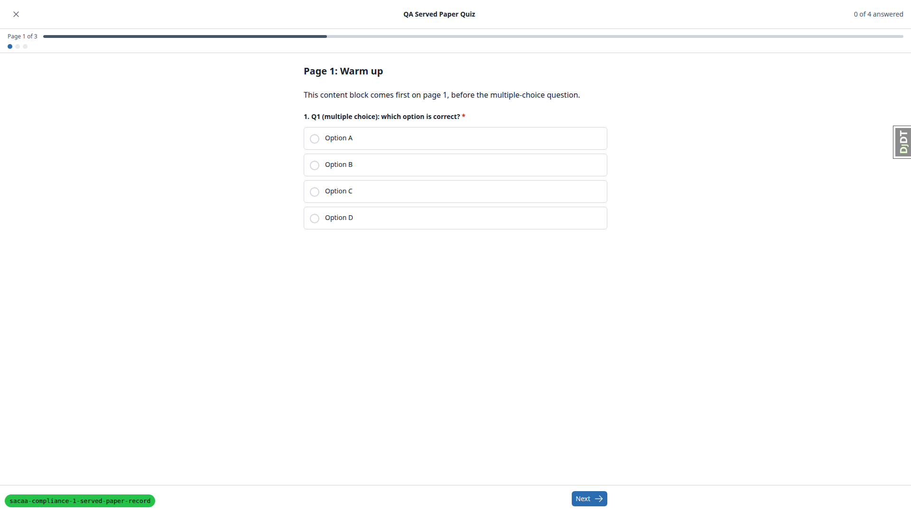 The first capture (`page-2026-11-20T06-08-46-509Z.png`) shows the debug toolbar expanded. It was hidden for every later shot. |
| 1.4 | desktop | pass | Admin FormProgress page shows "Served paper" read-only right after "Asked", holding seed, 3 pages and an options object. 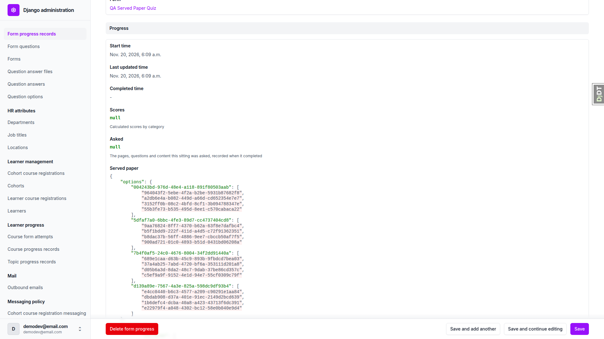 |
| 1.5-1.9 | desktop | pass | Page 2 of 3, Q2 and Q3 numbered, "Select all that apply.", dropdown blank first then A-D. Previous kept Q1=B. Page nav links pages 1 and 2, page 3 "not yet accessible". Two reloads were identical and the seed was unchanged (1337129218073893057). 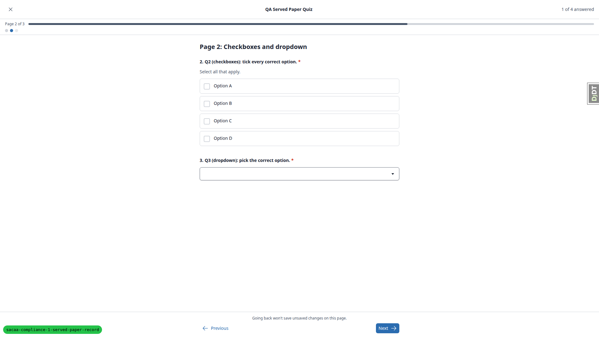 |
| 2 | desktop | pass | "Leave and save" returns to the start screen with "Continue Form" going to fill_form/3, "Page 3 of 3". Direct fill_form/1 shows saved answer B. fill_form/9 returns a 404 page. No screenshot. |
| 3 | desktop | pass | Quiz passed, 75%, 3/4. Review lists only Q3 (Option A given, Option D correct). No out-of-date notice. Record has completed_time, scores 3/4, asked filled, seed unchanged. 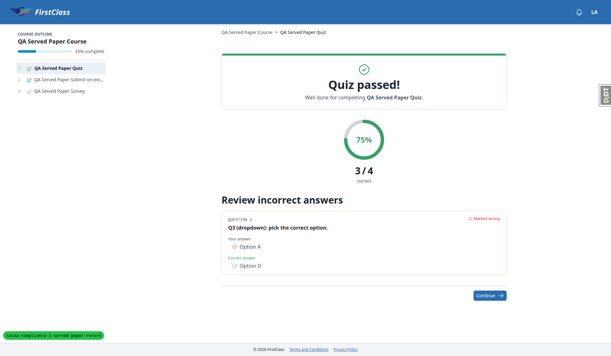 |
| 4 | desktop | pass | Learner B kept the original page and option order after the shell reorder. "Page N of 3" followed B's original order, answers were kept and there were no errors. A fresh learner D got the new order. B finished 4/4, 100%, no notice, and the order was restored afterwards. 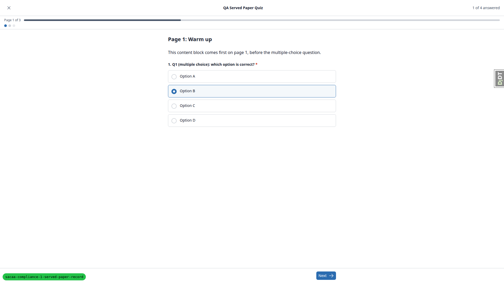 |
| 5 | desktop | pass | Deleted Q1 Option A, then moved Q4 to survey page 2. B's results page re-rendered both times with the stored 100% 4/4 and no notice. The admin record still lists the deleted option id and Q4's id, and the Answers section renders with Q4 under "Questions no longer on the form". 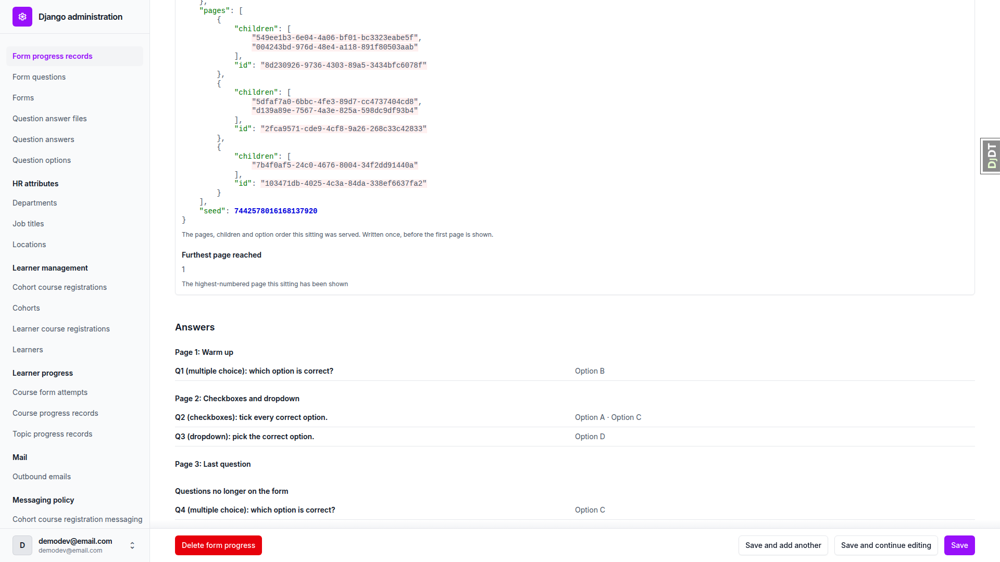 |
| 11 | desktop | pass | Run after Test 5's removals. The on-screen cohort report shows A 75%, B 100%, C 75%, with quiz confusions listing only Q3 (2 of 3 learners). The generated PDF shows A 75% 3/4 with Q3 listed and B 100% 4/4 with no incorrect, removed or moved question. Generation completed immediately. 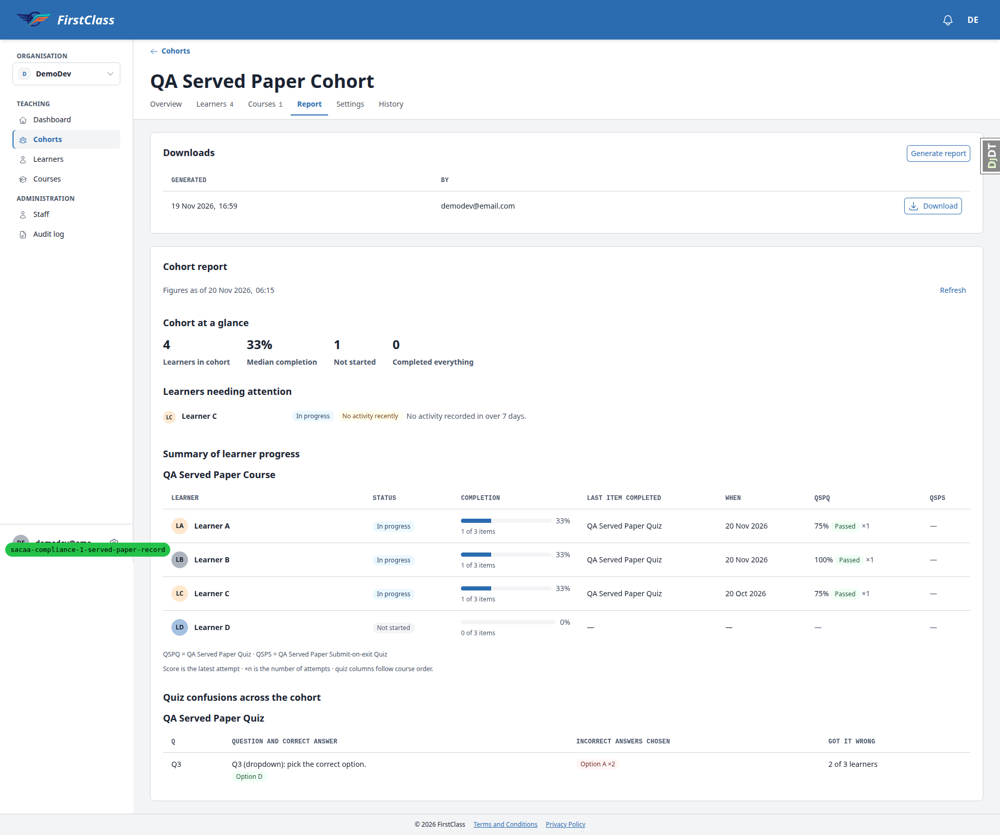 |
| 6 | desktop | pass | Learner C's old sitting (served_paper null) shows the stored 75% 3/4. Switching Q3's correct option D to A shows the "This quiz has changed since you sat it" notice for C. Learner A shows it too, but only once Q1 Option A was recreated under its original pk (see observations). Restoring D removed the notice for both. 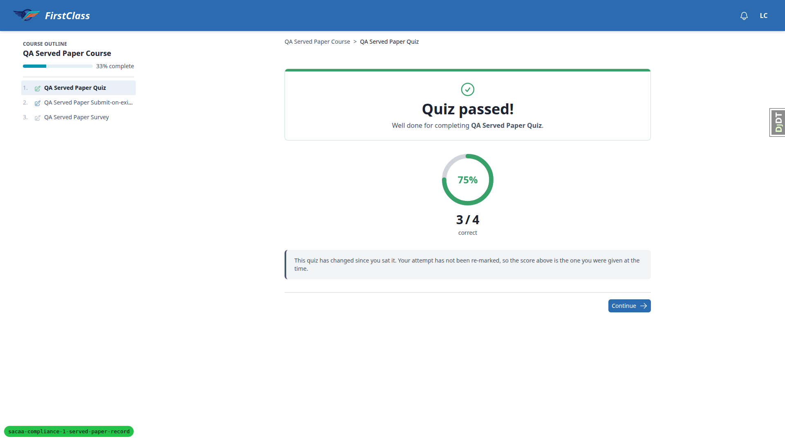 |
| 7 | desktop | pass | Learner A: "Leave and submit" gives results at 50% 1/2, passed, with served paper filled and completed. Learner B navigated away without the exit control. The start screen shows "Previous attempts 20 Nov 2026 0% (0 / 2)" with Try Again and no error, and the record is completed with a served paper. 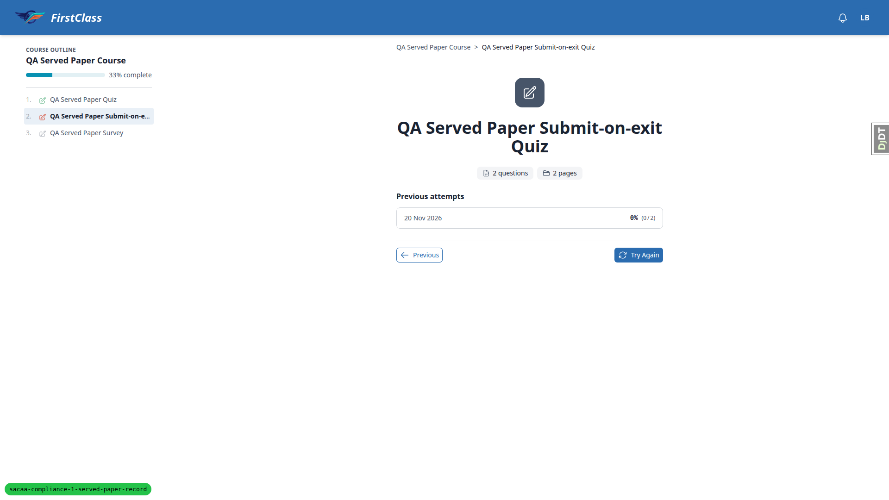 |
| 8 | desktop | pass | Survey navigation Page 1 of 2 to 2 of 2 and back, then Submit, reaches the complete page. Record: served_paper None, asked filled, completed. No screenshot. |
| 9 | desktop | pass | Anonymous applicant: Previous links correct on pages 1 and 2, check-your-answers has one card per page in order with Edit. Editing page 1 (`?return=check`), A to B, shows Option B on check-your-answers. Record served paper filled (2 pages). Submit reaches "Check your email". The anonymous owner gets 404 on page/1 after submit, so step 7 was run as signed-in learner D's own application. It rendered read-only with all radios disabled, Option B checked and options A-D in order. The non-quiz application walked two pages correctly with served_paper None. 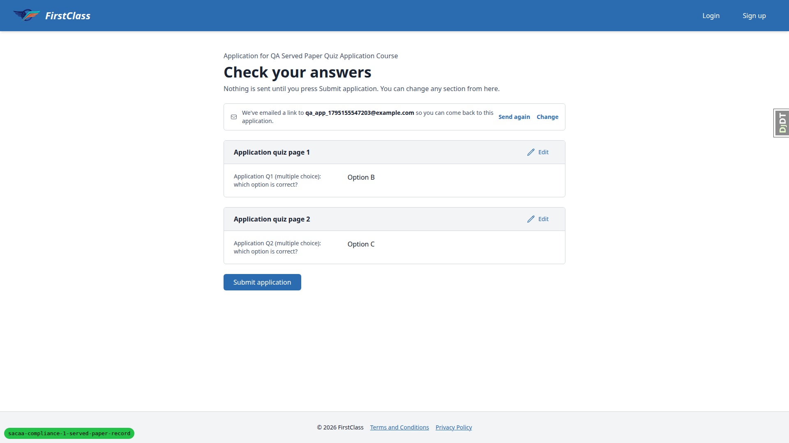 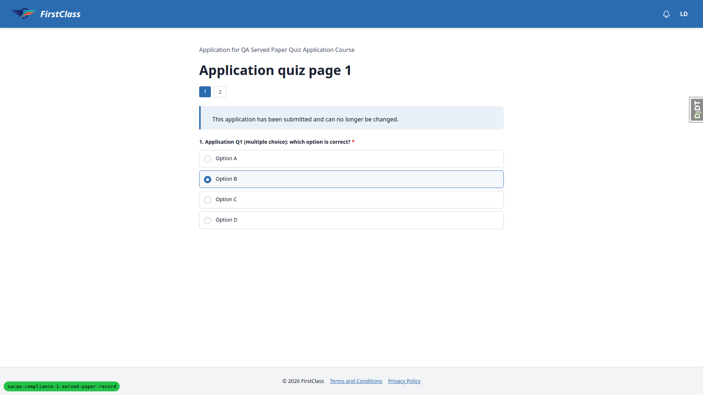 |
| 10 | desktop | pass | Educator page previews of the quiz show options A-D in authored order on all 3 pages. "Correct answer" marks show on Q1 B, Q2 A and C, Q3 under the dropdown (Option D) and Q4 C. FormProgress count was 12 before and after. The form-level preview shows only a summary. 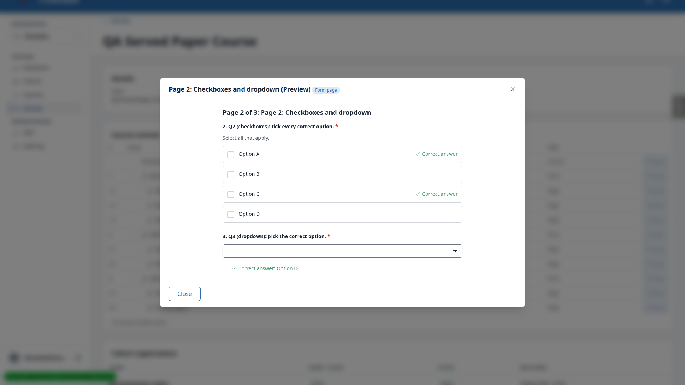 |
| extra-two-tab | desktop | pass | With learner D's sitting cleared, start_form opened concurrently in two tabs. Both landed on fill_form/1 "Page 1: Warm up" with options A-D. There was one FormProgress for D with one served paper (seed 2390554010477586617). No screenshot. |
| viewport-runner | mobile | pass | At 375px scrollWidth equals clientWidth, so no horizontal overflow. Option cards and dropdown are full width and Next/Previous stack. 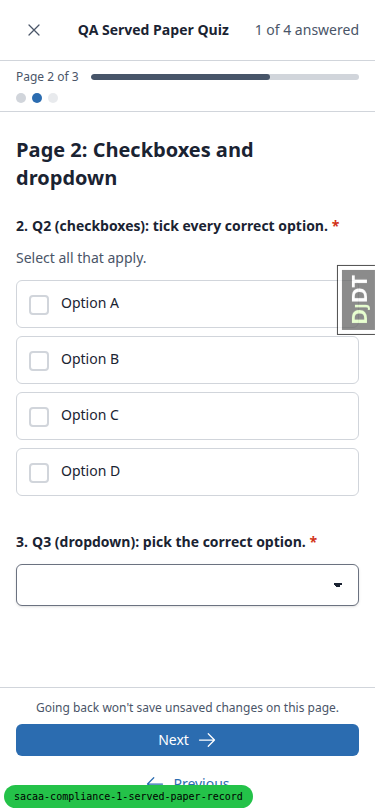 |
| viewport-results | mobile | pass | At 375px there is no overflow. The score ring, 3/4, incorrect-answer card and Continue fit. 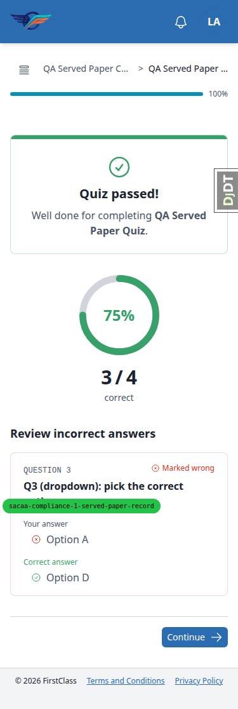 |
| viewport-results | tablet | pass | At 768px there is no overflow and the content aligns with the breadcrumb. 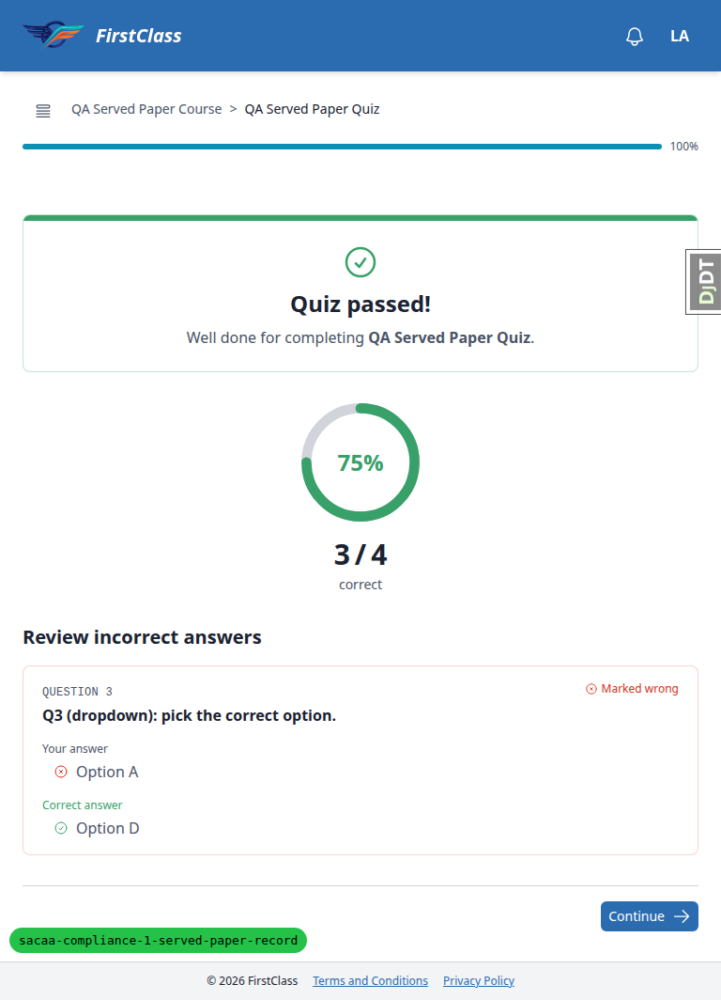 |
| viewport-runner | tablet | pass | At 768px there is no overflow and the header reads "Page 2 of 3". 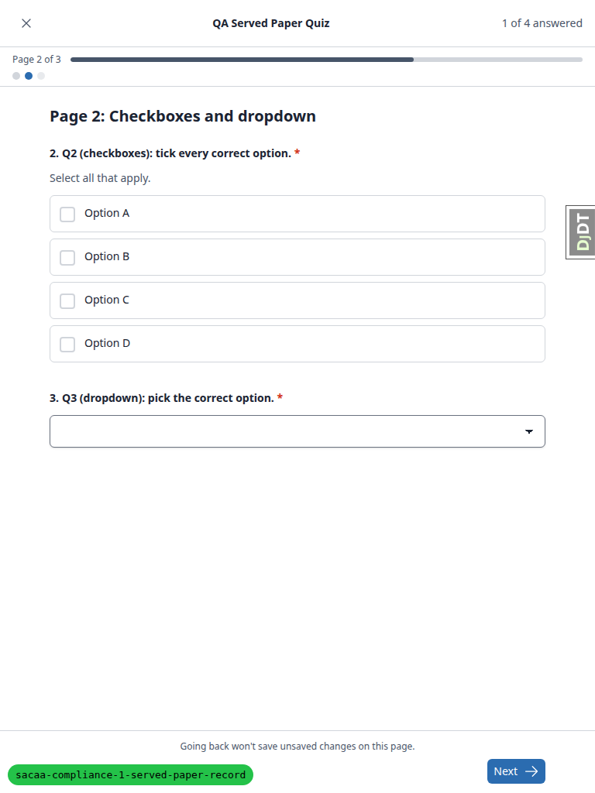 |

## Bugs

No bugs were filed this run.

## Data changes

| What changed | Made by | Files written |
|---|---|---|
| Restored residue from the previous QA run: moved Q4 (pk 7b4f0af5) back from survey page 2 to quiz page 3 and recreated its deleted Option A. Cleared learner A, B and D sittings on qa-served-paper-course with `qa_clear_form_sittings`, then re-ran `qa_create_served_paper_scenario`. | Django shell and management commands | none |
| Test 4/5 edits restored after use: page and Q1 option order put back, Q4 moved back to quiz page 3 and Q1 Option A recreated (new pk). Test 11 ran before Test 6 so Test 6's "learner A has nothing missing" holds. | Django shell | none |
| Recreated Q1 Option A and Q4 Option A under their original pks (964043f2..., 689e1caa...) so served papers recorded this run have nothing missing. Q3's correct option was switched D to A for Test 6, then restored. | Django shell | none |

## Bug status

No bugs filed.

## General notes

- **Furthest page reached.** Learner B's completed record shows "Furthest page reached: 1". The value is an authored page number, recorded while the reorder had "Last question" at authored position 1. This is by design (the `record_page_reached` docstring) and has no learner-visible effect on a completed sitting.
- **Notice suppressed when a served item is missing.** With Test 5's deleted option recreated under a new pk, learner A's served paper had a missing item. The results view then suppresses the "score is out of date" notice by design (`path.has_missing_served_items`). After the option was recreated under its original pk, the notice showed for A as the plan expects.
- **Dev branch badge.** At narrow widths the dev-only branch badge overlaps controls: the Previous link at 375px, the results card title at 375px and the Previous link at 768px. This is dev tooling, not product, and no action is attached.
- **Survey submit dialog copy.** The survey's submit dialog says "your answers will be scored" for an unscored form. This is pre-existing copy and this branch did not change it.
- **Test 9 step 7.** An anonymous owner gets 404 on page/1 after submit, so the read-only check used a signed-in learner's own application instead. The plan allows skipping this step for applicants without an account, and it was run anyway.
- **Test 4 URLs.** After the reorder, fill_form/2 resolves to authored page 2, shown as "Page 1 of 3". The URL carries the authored number, as the plan notes.
- **Not tested.** Nothing in the plan was skipped.

status: ok · reason: report rendered, 0 bugs documented
