# QA report: shuffled quiz pages, questions and answer options

Base URL: http://127.0.0.1:8266 · Test plan: `3. frontend_qa.md`

Summary: 2 bugs documented (B1 layout, pre-existing; B2 demo content). Tests 1, 2, 3, 4, 5 and 6 passed on their functional checks. Test 3 re-sit was skipped (not applicable).

## Methodology

Screenshots were collected into `screenshots/` beside this report, and every image referenced here exists there. Dev-server tooling overlays (Django debug toolbar tab, branch badge) are dev-only and were not treated as findings. Learner A and learner B were driven through the shuffled-quiz course and "Functionality Demo - show end with Quiz" in a browser at desktop (1920x1080), tablet (768x1024) and mobile (375x812) viewports.

## Diff scoping

Class: **FULL**. The changed files that triggered it include `freedom_ls/form_engine/` (models, paging, served_paper, schema, conditions, admin, migrations 0011 to 0013), `freedom_ls/content_engine/` (validate, content_save), `freedom_ls/learner_interface/templates/learner_interface/course_form_complete.html`, the new demo course `demo_content/functionality_demo_shuffled_quiz/`, the `fls-content` validator, the `qa_helpers` management commands, and the related tests and docs.

Nothing was skipped: all viewport passes (desktop, tablet, mobile) and all test sections ran, apart from the individual skips listed under General notes.

## Smoke gate

Outcome: **pass**. Pages loaded: `/` and `/courses/functionality-demo-shuffled-quiz/2/`. The run was not aborted.

## Design check

No design records exist for this run: no design states tested.

## Bug B1: Long form pages scroll the whole document as well as the player region

Manifestations:

- `1-group-layout`, desktop

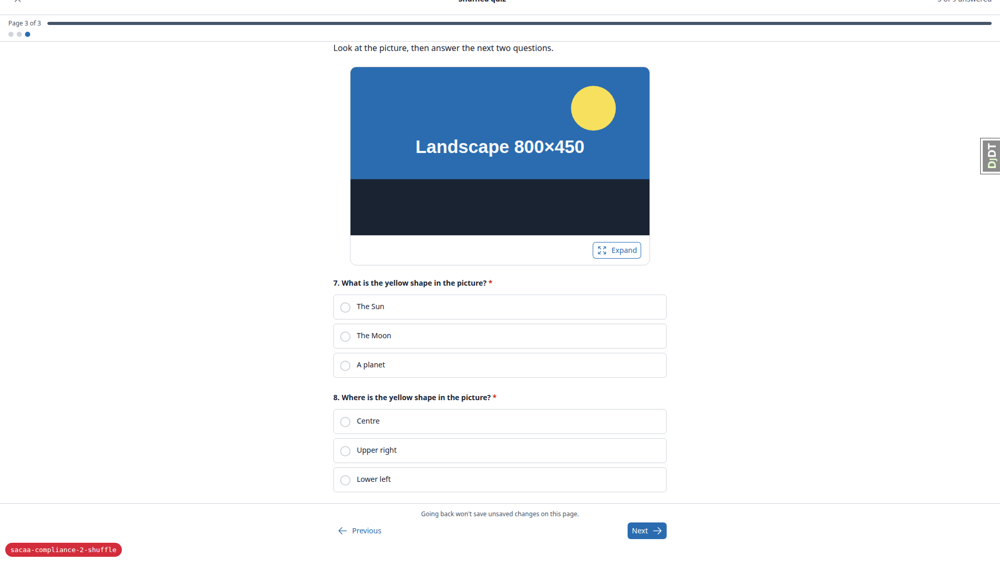

Expected: in the form player only the overflow-y-auto content region scrolls. The document is exactly the viewport height, so the player header and footer stay put.

Actual: on a form page taller than the viewport (shuffled quiz "The sky", 4 questions plus picture, 1920x1080) document scrollHeight is 1302. The sr-only "(required)" span in each question legend (`form_engine/templates/form_engine/question.html`) is absolutely positioned with no positioned ancestor inside the scroll region, so its containing block is BODY and the lowest one extends the document. Scrolling a question into view moves the player header 32px off the top. Pre-existing: `question.html` is unchanged on this branch.

## Bug B2: Shuffled-quiz demo picture is a placeholder with a "Landscape 800x450" caption

Manifestations:

- `demo-picture`, desktop

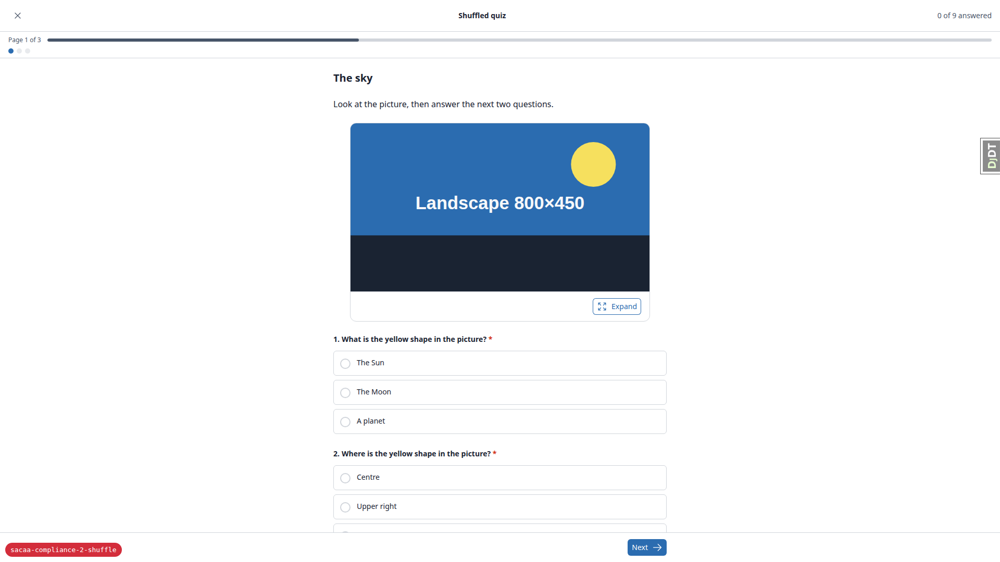

Expected: the demo picture is the sky scene the content block's alt text describes (blue sky, dark horizon, yellow sun upper right), with no placeholder caption, and an accessible label that describes it.

Actual: `demo_content/functionality_demo_shuffled_quiz/images/shuffled-quiz-picture.svg` (added on this branch) draws a large "Landscape 800x450" text across the sky and has aria-label "Landscape placeholder". The questions ask about the picture, so the caption reads as unfinished demo content.

## Test results

| Test | Viewport | Result | Screenshot | Notes |
|---|---|---|---|---|
| 1 | desktop | pass | 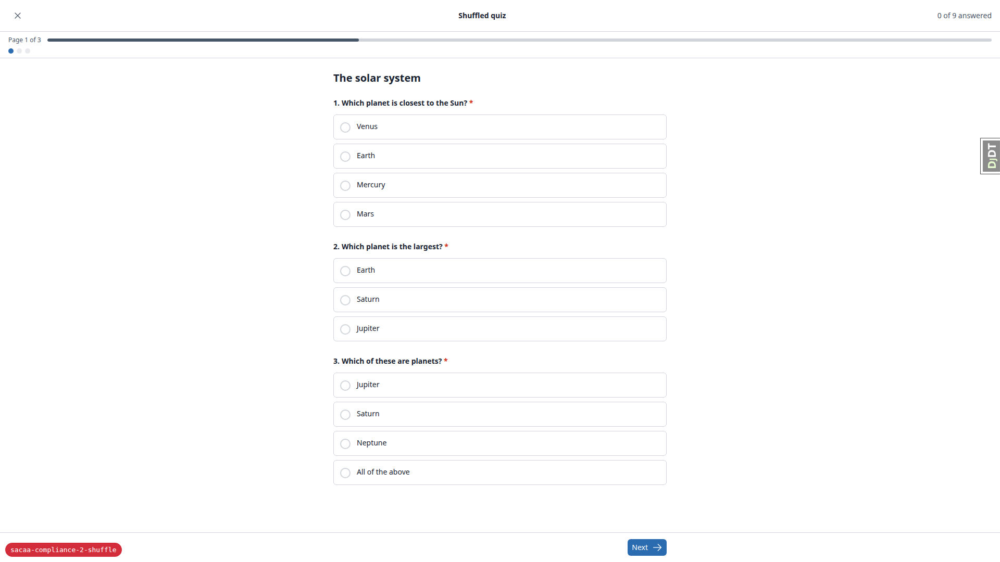 | Learner A page order authored 1, 3, 2; indicator counts Page 1/2/3 in shown order; children reordered on pages 1 and 3; questions numbered 1-9 with no gaps; group block with picture directly before its two questions; "All of the above" last; multiple-choice, checkboxes and dropdown options shuffled. |
| 1-dropdown | desktop | pass | 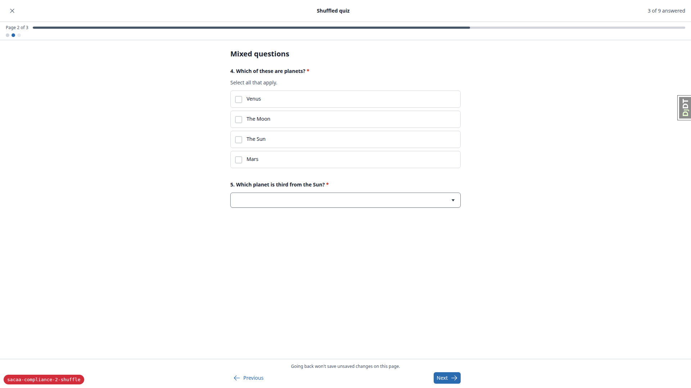 | Checkbox and dropdown options in shuffled order; dropdown list read from the select. |
| 1-group | desktop | pass |  | Content block with picture then Q7 and Q8, nothing between; picture fits the column (574px). The placeholder caption is logged as B2. |
| 1-group-layout | desktop | fail |  | See B1. |
| 2 | desktop | pass | none | Reload, Previous then Next, browser Back then Forward, page-jump links, and leave-and-resume all kept page, children, numbering and option order. Answers saved with Next were still selected on resume. An answer picked on page 3 and not saved was dropped on leaving; the page warns "Going back won't save unsaved changes" and a beforeunload prompt fires, so this is designed behaviour. No console errors. |
| 3 | mobile | pass | 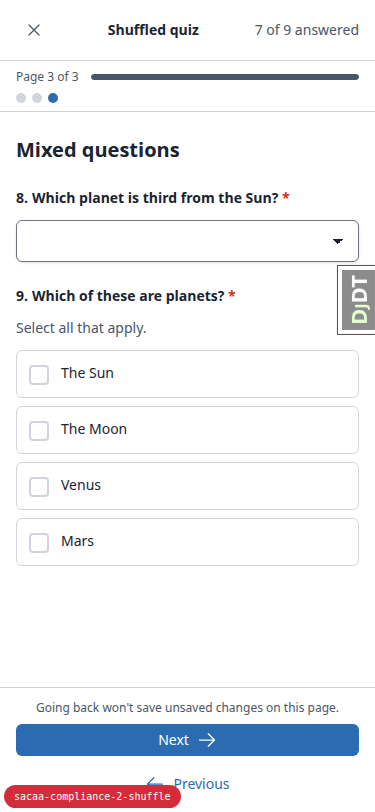 | Learner B's sitting differs from learner A's on page order (2, 1, 3 vs 1, 3, 2), children order and option order. Group stayed together and "All of the above" stayed last. |
| 3-resit | desktop | skip | none | Learner A passed (67% >= 50%); the quiz offers only "Previous attempts" and "Finish Course", so no retake. Learner B covers the new-order check. |
| 4 | desktop | pass | 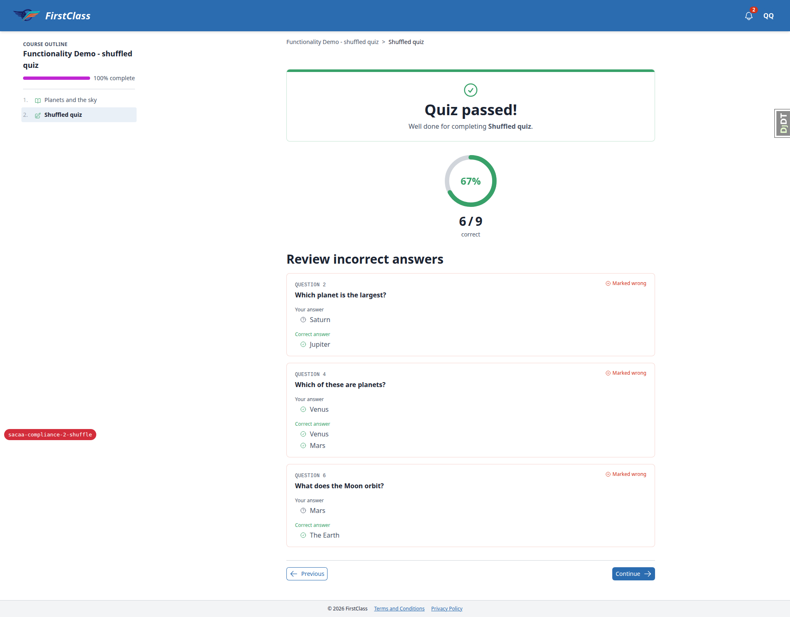 | Learner A cards "Question 2", "Question 4", "Question 6" show the sitting's numbers, in shown order. 3 wrong of 9: 6/9, 67%, matches. |
| 4-learnerB | mobile | pass | 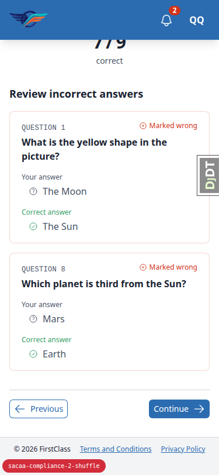 | "Question 1" (authored #5) and "Question 8" (authored #9). 2 wrong: 7/9, 78%, matches. |
| 5 | desktop | pass | 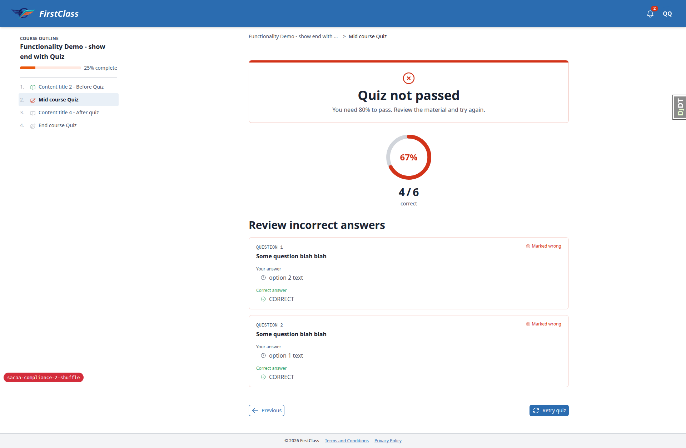 | "Mid course Quiz": both attempts served authored page, question and option order; results numbers match authored numbers; 4/6 = 67% (fail at 80%), retry offered; attempt 2 6/6. No console errors. |
| 6 | desktop | pass |  | Grouped page at 1920x1080: picture fits, no horizontal scroll. |
| 6 | tablet | pass | 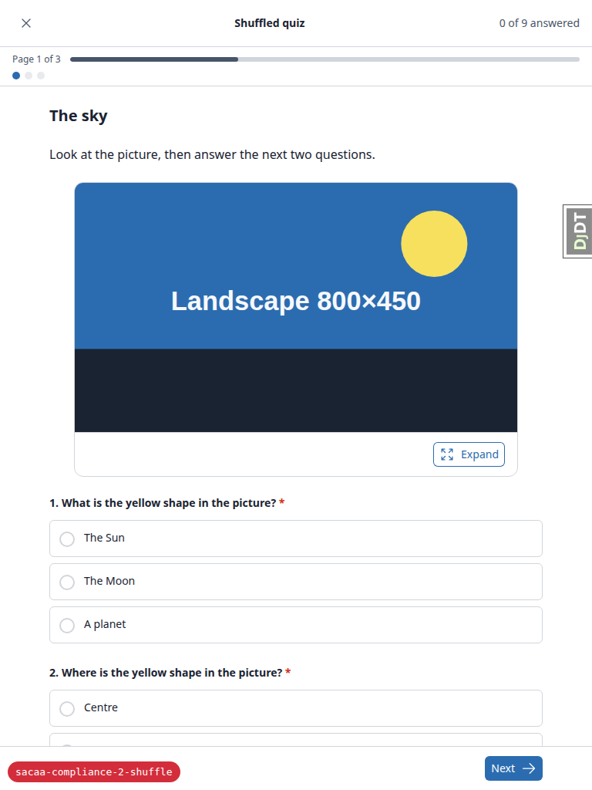 | Picture 97-671 inside the 64-704 column; no horizontal scroll. |
| 6 | mobile | pass | 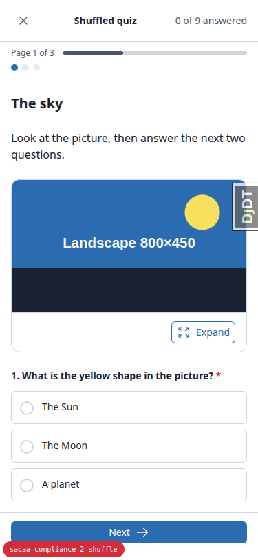 | Picture 17-358 inside the 16-359 column; scrollWidth 375. |
| 6-dropdown | mobile | pass |  | Dropdown full column width (42px tall) and usable; no horizontal scroll. |
| 6-results | mobile | pass |  | "QUESTION N" label top left, "Marked wrong" at right, as on desktop. |
| 6-results | tablet | pass | 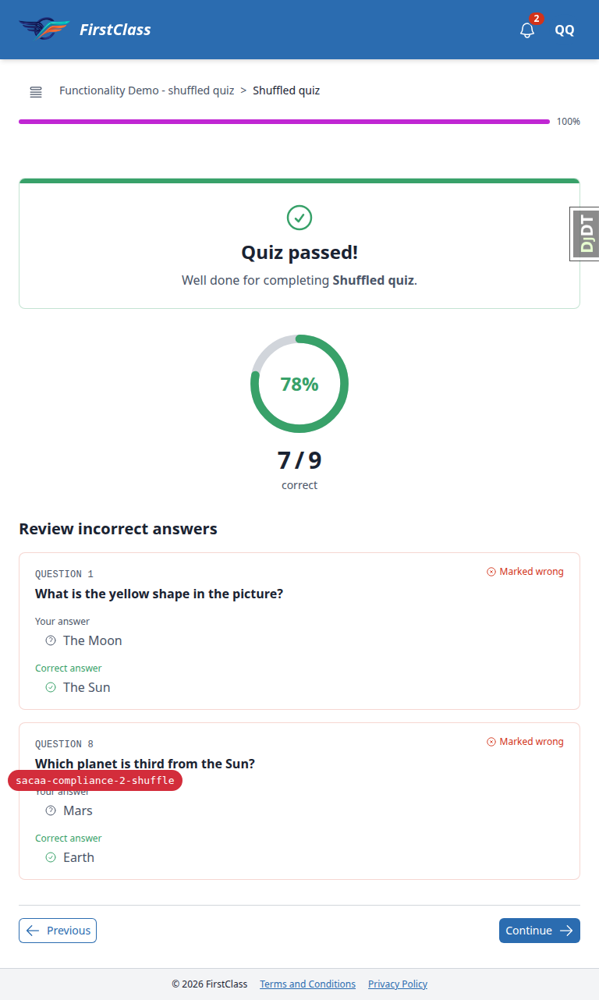 | Label placement unchanged; cards fit. |
| demo-picture | desktop | fail |  | See B2. |

## Layout probe

| Test id | Viewport | URL | Screenshot | Result |
|---|---|---|---|---|
| 1 | desktop | /courses/functionality-demo-shuffled-quiz/2/fill_form/1 |  | clean |
| 1-group | desktop | /courses/functionality-demo-shuffled-quiz/2/fill_form/2 |  | document scrolls vertically (scrollHeight 1302 at 1080 viewport) on a form page long enough to scroll inside the player's overflow-y-auto region: the sr-only "(required)" span in each question legend (`form_engine/templates/form_engine/question.html`) has no positioned ancestor inside the scroll region, so its containing block is BODY and it extends the document; scrolling to a question moves the player header 32px off the top. Pre-existing: `question.html` unchanged on this branch. See B1. |
| 4 | desktop | /courses/functionality-demo-shuffled-quiz/2/complete |  | clean |
| 6 | desktop | /courses/functionality-demo-shuffled-quiz/2/fill_form/2 |  | clean |
| 6 | tablet | /courses/functionality-demo-shuffled-quiz/2/fill_form/2 |  | clean |
| 6 | mobile | /courses/functionality-demo-shuffled-quiz/2/fill_form/2 |  | clean |
| 6-dropdown | mobile | /courses/functionality-demo-shuffled-quiz/2/fill_form/3 |  | clean |
| 6-results | mobile | /courses/functionality-demo-shuffled-quiz/2/complete |  | clean |
| 6-results | tablet | /courses/functionality-demo-shuffled-quiz/2/complete |  | clean |
| 5 | desktop | /courses/functionality-demo-show-end-with-quiz/2/complete |  | clean |

## Data changes

| What changed | Made by | Files written |
|---|---|---|
| `content_save demo_content DemoDev`; `qa_create_fresh_course_learners` reset qa-learner-a and qa-learner-b (pk 75 and 76, password testpass123) on the shuffled-quiz and show-end courses, deleting their earlier form sittings | `sdd:qa-data-helper` | none |
| `content_save demo_content DemoDev` re-run after the B2 fix so the stored shuffled-quiz picture matches the file on disk | `sdd:qa-data-helper` | none |

## Bug status

| Bug | Title | Status |
|---|---|---|
- **FIXED** (commit: 2a4686ac0) — Long form pages scroll the whole document as well as the player region. Re-verified at 1920x600 on the mid-course quiz: document scrollHeight 600 = viewport, only the player region scrolls.
- **FIXED** (commit: 0262e8d0b) — Shuffled-quiz demo picture is a placeholder with a "Landscape 800x450" caption. Re-verified after re-saving demo content: the served SVG has no caption and is labelled "A blue sky over a dark horizon with a yellow sun in the upper right".

## General notes

- Not run: Test 3 re-sit for learner A (passing blocks a retake; learner B covered the new-order check). "End course Quiz" in the show-end course was not taken: it sits behind "Content title 4" completion, and the mid-course quiz already covers the unshuffled path.
- An unsaved answer on a shuffled page is dropped when leaving the page; this is the documented unsaved-changes behaviour, not a finding.
- B1 is pre-existing and unrelated to the shuffle change; it only became visible on the long grouped page.
- Dev-server overlays (Django debug toolbar tab, branch badge) are dev-only and not findings.

status: ok · reason: 2 bugs — 2 fixed, 0 unresolved; report rendered, screenshots verified
