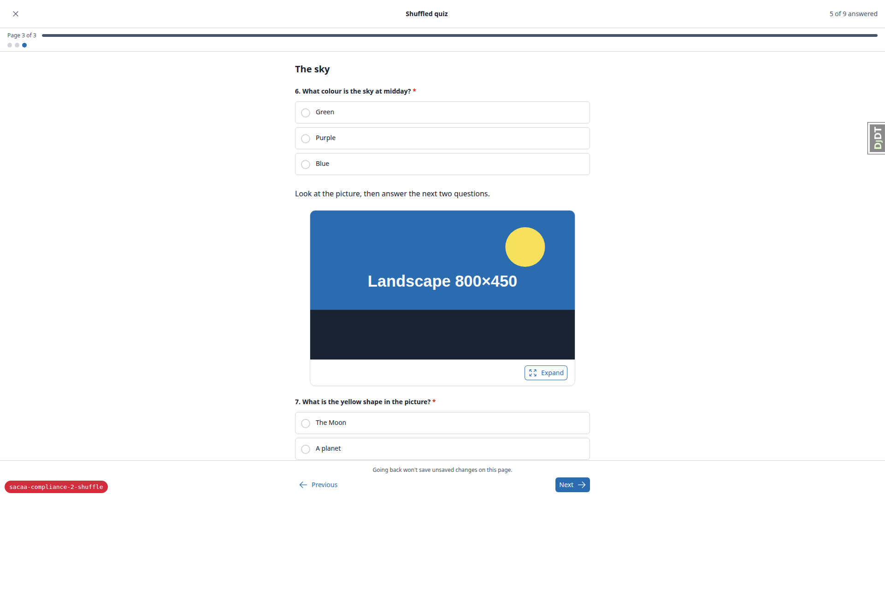
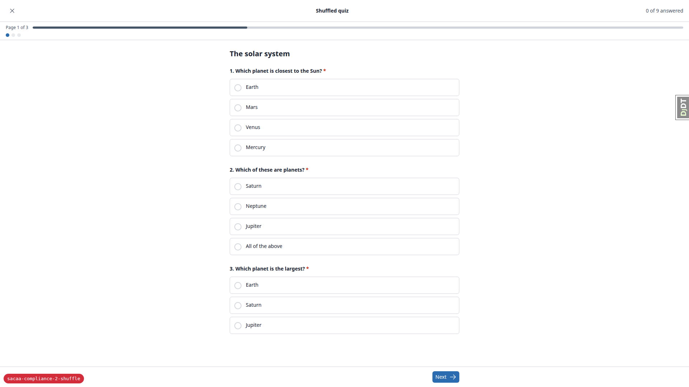
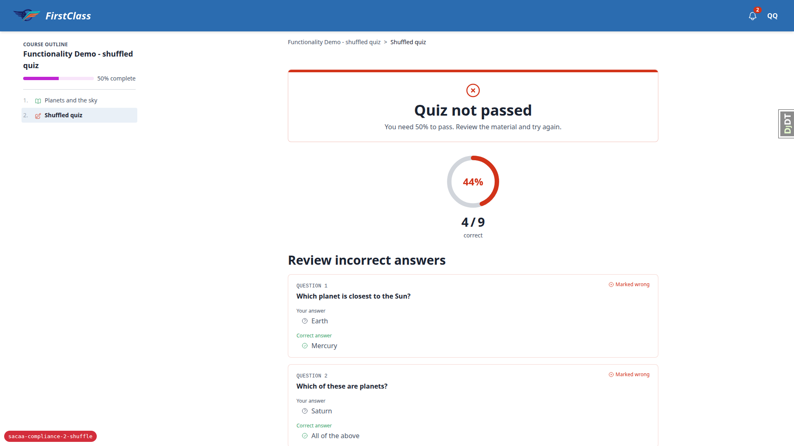
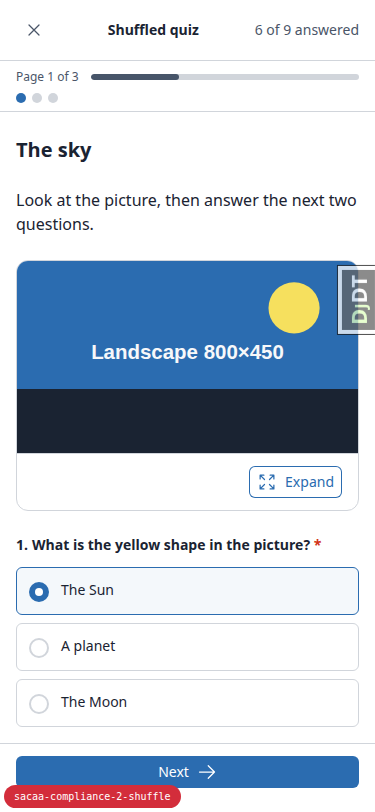
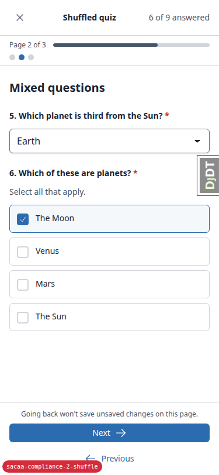
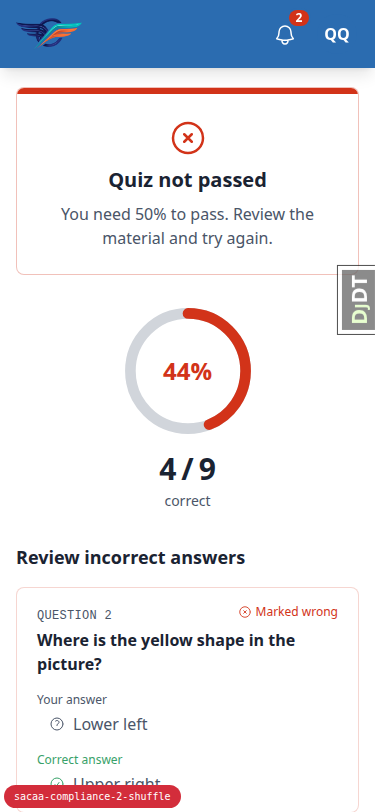
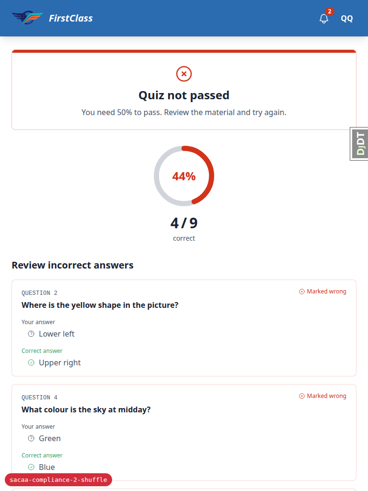

# Frontend QA report: shuffled quiz pages, questions and answer options

Branch `sacaa-compliance-2-shuffle`, dev server on port 8303, site DemoDev. Testers: learners `qa-learner-a@example.com` and `qa-learner-b@example.com`. Result: all 6 tests passed, no failing tests, no bugs.

## Methodology

Screenshots were collected into `spec_dd/2. in progress/sacaa-compliance-2-shuffle/screenshots/`. Every image referenced below exists beside this report. The smoke gate passed, so no steps were skipped.

## Diff scoping

Class: **FULL**. Changed files that triggered it:

- `freedom_ls/learner_interface/templates/learner_interface/course_form_complete.html`
- `freedom_ls/form_engine/*`
- `freedom_ls/content_engine/*`
- `demo_content/functionality_demo_shuffled_quiz/*`
- `claude_plugins/fls-content/validate/*`

Nothing was skipped. Desktop, tablet and mobile passes all ran.

## Smoke gate

Outcome: **pass**. Pages loaded: `/` and `/courses/functionality-demo-shuffled-quiz/1/`.

## Test results

| Test | Name | Viewport | Result | Notes |
|---|---|---|---|---|
| 1 | A sitting gets a shuffled order that stays put | desktop | pass | Learner A's served page order was authored [1,3,2] (URLs /1, /3, /2) with the indicator showing 1, 2, 3. Children on "Mixed questions" were swapped. Questions were numbered 1-9 in served order. Options were shuffled on multiple-choice, checkbox and dropdown questions. The locked "All of the above" stayed last. The group (picture block, Q7, Q8) stayed contiguous in authored order. No CSS order styles. |
| 2 | The order survives reload, back, page jumps and resume | desktop | pass | Page, child and option order and saved answers were the same after reload, Previous/Next, browser Back/Forward, page jumps to first and last page, and Leave and save + Continue Form. Jump links carry authored page numbers in served order. No console errors. See note 2 below. |
| 3 | A re-sit and a second learner get a new order | desktop | pass | Learner A's first sitting was [1,3,2]. Learner A's re-sit was [3,2,1] with different child and option orders. Learner B was [2,3,1]. The group stayed contiguous and "All of the above" stayed last in both new papers. |
| 4 | The results page shows the number the learner saw | desktop | pass | Cards were labelled Question 1, 2, 4, 6, 9 in served order. "Which planet is third from the Sun?" (authored 9) showed Question 4. Sky colour (authored 4) showed 6. Moon orbit (authored 7) showed 9. Score 4/9 (44%) matched the 5 wrong answers given. |
| 5 | Unshuffled quizzes are unchanged | desktop | pass | Learner B, "Functionality Demo - show end with Quiz": questions and options were in authored file order on the first attempt and the retry. Results cards were numbered by authored question number (1, 2, 4, 5, 6). |
| 6 | Layout at each viewport | mobile (375x812), tablet (768x1024), desktop (1920x1080) | pass | The picture fit the column and there was no horizontal scroll. The dropdown spanned the column and listed the served option order. The results "Question N" label sat at the top of each card as before. |

## Design check

No design states tested.

## Layout probe

| Test | Viewport | URL | Screenshot | Result |
|---|---|---|---|---|
| 1 | desktop | /courses/functionality-demo-shuffled-quiz/2/fill_form/2 |  | clean |
| 1 | desktop | /courses/functionality-demo-shuffled-quiz/2/fill_form/1 |  | clean |
| 4 | desktop | /courses/functionality-demo-shuffled-quiz/2/complete |  | clean |
| 6 | mobile | /courses/functionality-demo-shuffled-quiz/2/fill_form/2 |  | clean |
| 6 | mobile | /courses/functionality-demo-shuffled-quiz/2/fill_form/3 |  | clean |
| 6 | mobile | /courses/functionality-demo-shuffled-quiz/2/complete |  | clean |
| 6 | tablet | /courses/functionality-demo-shuffled-quiz/2/fill_form/2 |  | clean |
| 6 | tablet | /courses/functionality-demo-shuffled-quiz/2/complete |  | clean |

## Data changes

| What changed | Command / call | Files written |
|---|---|---|
| Seeded the empty dev DB with `create_demo_data`, loaded `demo_content` into DemoDev, and created learners qa-learner-a and qa-learner-b@example.com (password `testpass123`) registered on the shuffled-quiz and show-end-with-quiz courses | `create_demo_data`, `content_save` on `demo_content`, and the new `qa_create_fresh_course_learners` management command | `freedom_ls/qa_helpers/management/commands/qa_create_fresh_course_learners.py` |

## Bug status

No bugs recorded.

| Bug | Status |
|---|---|
| none | n/a |

## General notes

Observations, not bugs. No action is attached to either.

1. The shuffled demo quiz picture still shows its source image's "Landscape 800×450" label. This is cosmetic demo content.
2. "Leave and save" does not keep an answer chosen on the current page unless Next was pressed. This is existing runner behaviour, unrelated to shuffling. The page already warns "Going back won't save unsaved changes". Answers saved via Next persisted correctly.

Nothing was left untested.

status: ok · reason: report rendered, 0 bugs documented
