# Frontend QA report: question pools (sacaa-compliance-3-question-pools)

Result: 8 test groups passed; 1 test (1-copy) failed, documented as bug B1 (UNRESOLVED, product decision).

## Methodology

Screenshots were collected into `screenshots/` beside this report, and every image referenced below was checked to exist there. The server ran on port 8265 and the branch badge matched this branch. Tests followed `3. frontend_qa.md`. Learners A and B drove the learner flows, and the admin drove the educator preview.

Before QA, the branch was rebased onto main. There was 1 conflict, in `docs/product/learner-experience.md`, resolved by keeping both sides. The lost-change check passed, pre-commit was clean, and the branch was force-pushed. The upstream-change review found nothing that changes the spec. The post-rebase full test tier the selector chose has finished: PASS, 19895 collected, 19887 passed, 0 failed, 8 skipped (tested commit fd93fab95).

## Diff scoping

Class: **FULL**. The changed files that triggered it:

- `freedom_ls/educator_interface/templates/educator_interface/modal/content_preview.html`
- `freedom_ls/learner_interface/views.py`
- `freedom_ls/form_engine/*`
- `freedom_ls/educator_interface/panels/course/content_preview.py`
- `freedom_ls/content_engine/*`
- `demo_content/functionality_demo_question_pools/*`
- docs, spec and plugin files

Nothing was skipped; everything ran, including the tablet and mobile passes. The pre-step rebase's front-end check was folded into this run. Every page in the plan loaded without a 500, 404, traceback or console error at the viewports exercised.

## Smoke gate

Outcome: **pass**. Pages loaded:

- `/`
- `/educator/organisations/demodev/courses/befa506c-dc1a-4333-9e55-fabb5cebd1fc`

## Design check

No design states tested (no `design` records this run).

## Test results

| Test | Viewport | Result | Notes |
|---|---|---|---|
| 1 | desktop | pass | Start screen shows the question chip 7 (per-sitting count, not the pool total of 14) and page chip 2. No pool size appears.  |
| 1-copy | desktop | **fail** | The authored demo intro mentions the pool and the draw. See B1. |
| 2 | desktop | pass | Page 1 served exactly 3 questions, all from the file. Page 2 served exactly 2 whole groups (passage, then both questions). Numbering ran 1-3 then 4-7. Header read "0/3 of 7 answered". Indicator read "Page 1 of 2" and "Page 2 of 2". No console errors. 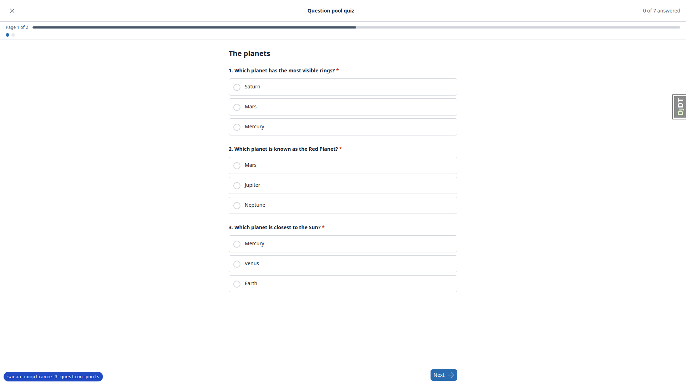 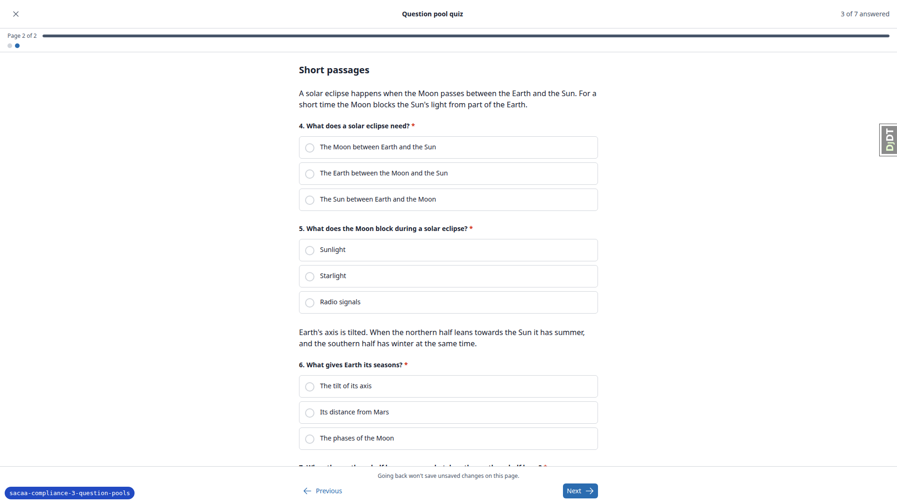 |
| 3 | desktop | pass | Reload, Previous/Next, browser Back/Forward, jump links and leave-and-resume all kept the same questions, passages and numbers. Saved answers stayed selected. An unsubmitted answer was not kept, and the browser warned about unsaved changes, matching the page's own note. |
| 4 | desktop | pass | Score 5 / 7 (71%), matching the 2 deliberate wrong answers. The wrong cards were Question 1 (rings) and Question 4 (solar eclipse), numbered as in the sitting. No outdated-score notice and no pool size. Submit dialog showed 7 answered of 7. 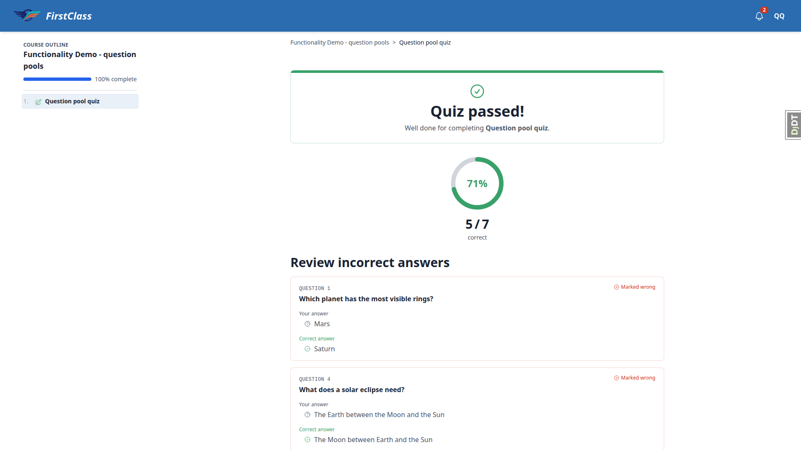 |
| 5 | desktop | pass | Learner B drew a different set from learner A on both pages. Both sittings had 3 questions on page 1 and 2 groups (4 questions) on page 2; the start screen, header and results showed 7 each time. The `served_paper` page children lists differ on both pages and have equal length (3 and 6). The retake part did not run: after a pass the course offers no new attempt, so the plan's "if the course allows a retake" condition was not met. 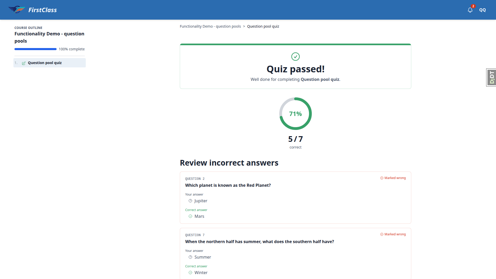 |
| 6 | desktop | pass | A forged hidden input for an undrawn question (1f413e93, "Which planet is farthest from the Sun?") was ignored. The page submitted normally and the header read "3 of 7 answered". The DB holds no answer for it, and the results do not list it. |
| 7 | desktop | pass | Educator preview of the quiz start showed 7 questions and 2 pages. Page 1 shows "Draws 3 of 6 questions per attempt" with all 6 questions and the answer key. Page 2 shows "Draws 2 of 4 groups (4 questions) per attempt" with all 4 groups. The modal opens and closes, with no console errors. |
| 8a | desktop | pass | Educator preview of the shuffled quiz: start chip 9 questions / 3 pages (3+4+2), no "Draws" line on any page, every question listed. |
| 8b | desktop | pass | Learner B, shuffled quiz: start screen 9 questions / 3 pages. Pages served 3, 4 and 2 questions (numbers 1-9), and the header read "of 9 answered". 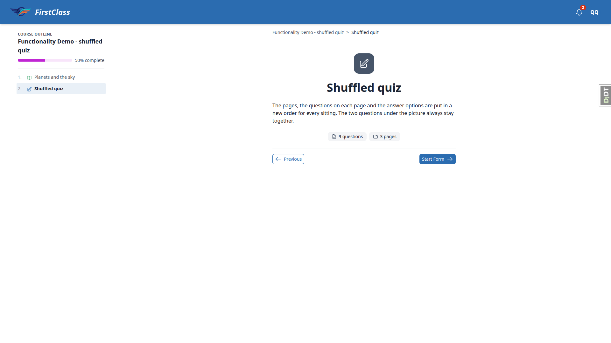 |
| 9 (educator preview) | tablet | pass | Dialog inside the viewport, "Draws" line on one line with a 16px gap to the first passage, no horizontal scroll. 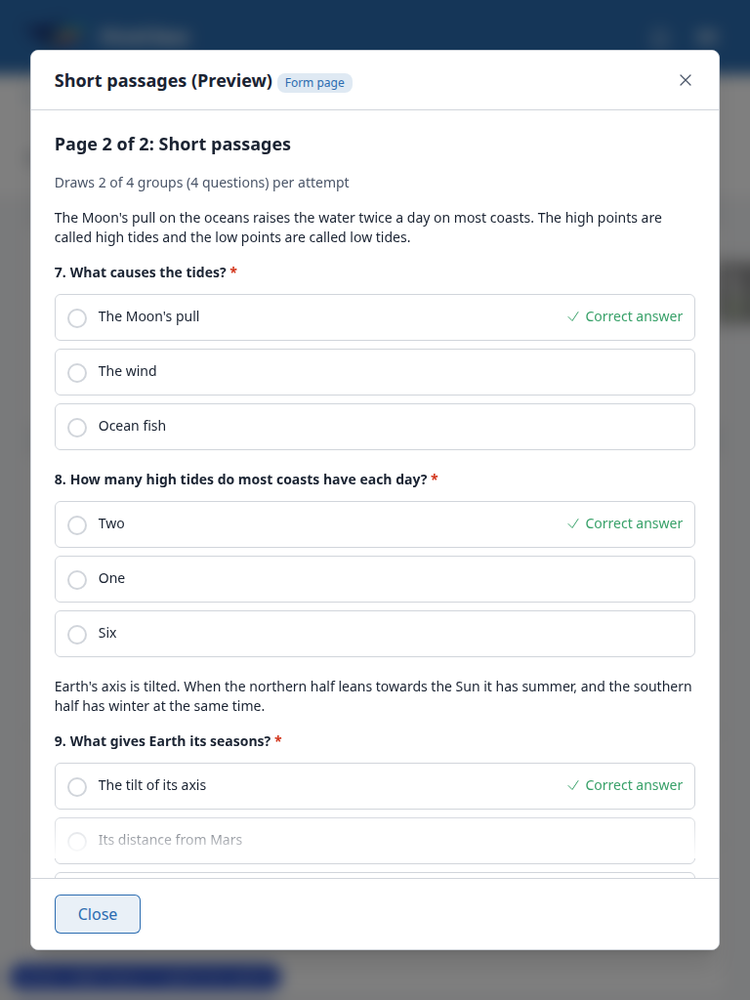 |
| 9 (educator preview) | mobile | pass | Bottom-sheet dialog full width, "Draws" line fits under the heading, no overlap, no horizontal scroll. 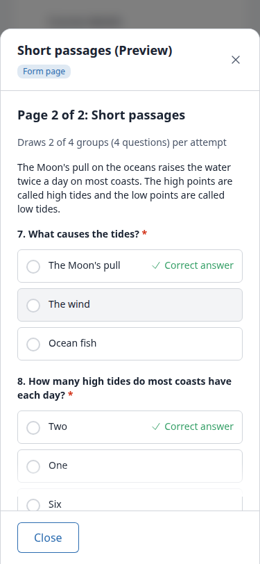 |
| 9 (page of groups) | tablet | pass | Fits the column, Previous/Next footer intact. The dev-only branch badge covered Previous in the first shot (`page-2026-11-24T07-32-43-720Z.png`); it was hidden as dev tooling and re-shot. 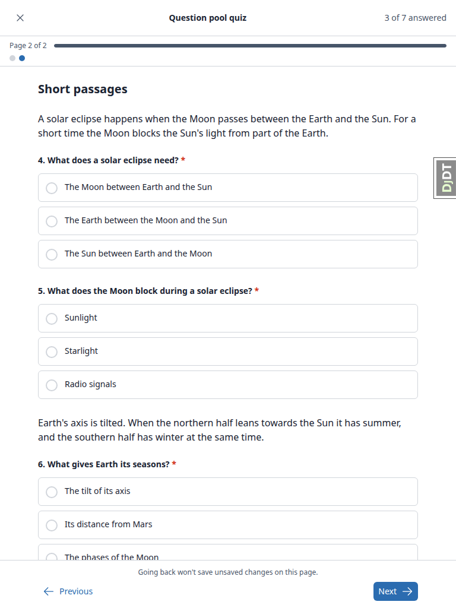 |
| 9 (page of groups) | mobile | pass | Passages wrap, options full width, Next/Previous stacked at 343px wide, no horizontal scroll. 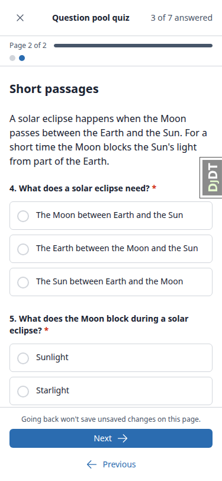 |
| 9 (results) | tablet | pass | Outline collapses to a menu button beside the breadcrumb, cards fit. 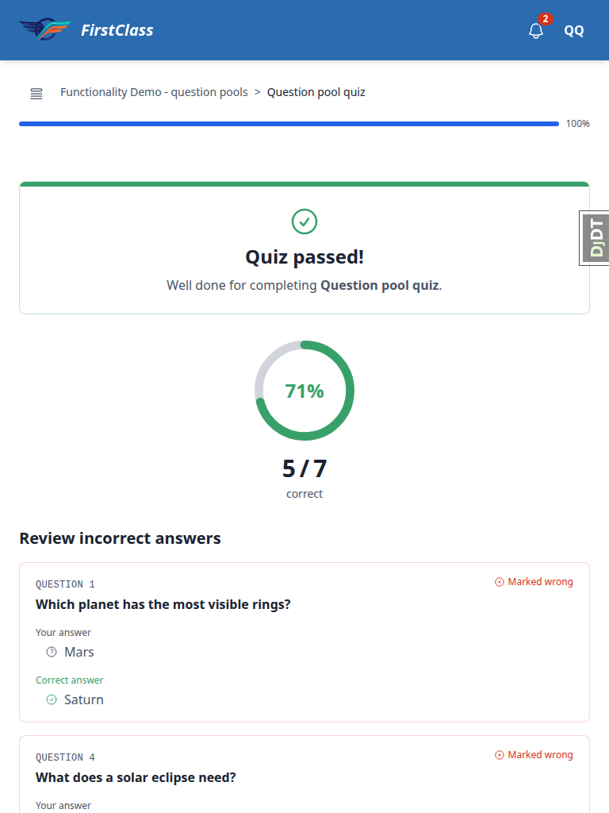 |
| 9 (results) | mobile | pass | Breadcrumb truncates with an ellipsis, score ring and cards fit. 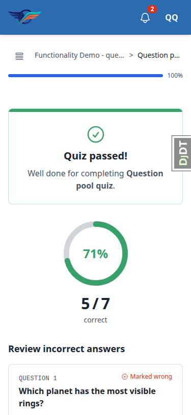 |
| rebase-frontend-check | desktop | pass | Folded into this run, as described under Diff scoping. |

## B1: Demo quiz intro mentions the pool and the draw on the learner start screen

Manifestations:

- test `1-copy`, desktop

Expected (Test 1): nothing on the start screen mentions a pool, a draw, or a larger number of questions.

Actual: the authored intro in `demo_content/functionality_demo_question_pools/01. quiz/form.md` reads "Each sitting draws some questions from the pool on every page. Sit the quiz again to get a different set." This is authored demo copy, not system text, and it reveals no count.

## Layout probe

| Test id | Viewport | URL | Screenshot | Result |
|---|---|---|---|---|
| 7 | desktop | /educator/organisations/demodev/courses/befa506c-dc1a-4333-9e55-fabb5cebd1fc | 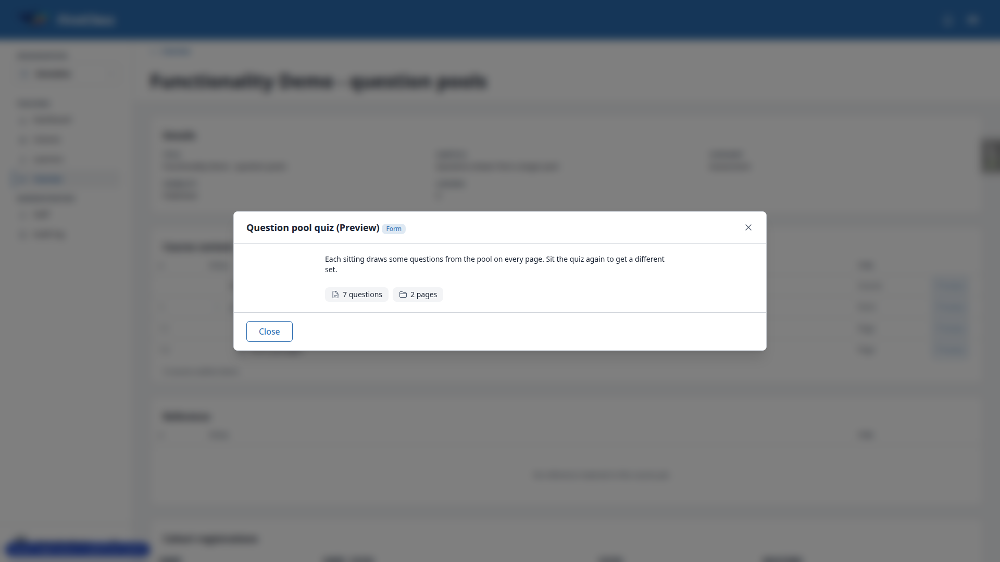 | clean |
| 7 | desktop | /educator/organisations/demodev/courses/befa506c-dc1a-4333-9e55-fabb5cebd1fc | 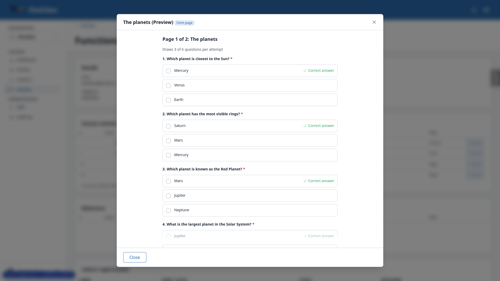 | clean |
| 9 | desktop | /educator/organisations/demodev/courses/befa506c-dc1a-4333-9e55-fabb5cebd1fc (preview of page of groups) | 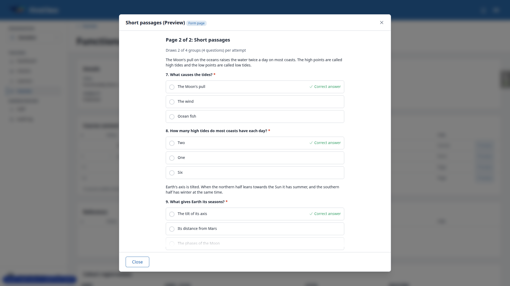 | clean |
| 9 | tablet | /educator/organisations/demodev/courses/befa506c-dc1a-4333-9e55-fabb5cebd1fc (preview) |  | clean |
| 9 | mobile | /educator/organisations/demodev/courses/befa506c-dc1a-4333-9e55-fabb5cebd1fc (preview) |  | clean |
| 1 | desktop | /courses/functionality-demo-question-pools/1/ |  | clean |
| 2 | desktop | /courses/functionality-demo-question-pools/1/fill_form/1 |  | clean |
| 9 | desktop | /courses/functionality-demo-question-pools/1/fill_form/2 |  | clean |
| 4 | desktop | /courses/functionality-demo-question-pools/1/complete |  | clean |
| 9 | tablet | /courses/functionality-demo-question-pools/1/fill_form/2 |  | clean |
| 9 | mobile | /courses/functionality-demo-question-pools/1/fill_form/2 |  | clean |
| 9 | tablet | /courses/functionality-demo-question-pools/1/complete |  | clean |
| 9 | mobile | /courses/functionality-demo-question-pools/1/complete |  | clean |
| 5 | desktop | /courses/functionality-demo-question-pools/1/complete |  | clean |
| 8 | desktop | /courses/functionality-demo-shuffled-quiz/2/ |  | clean |

## Data changes

| What changed | Made by | Files written |
|---|---|---|
| Loaded demo content onto DemoDev from a scratch copy whose UUIDs were remapped to the existing DemoDev rows (draw 3 and 2 stored), because stray example.com copies of the question-pools course and categories block a plain `content_save`. Created learners qa-pools-a@example.com and qa-pools-b@example.com (testpass123), registered on the question-pools and shuffled-quiz courses via `qa_create_fresh_course_learners`. | `sdd:qa-data-helper` | none |

## Bug status

| Bug | Status |
|---|---|
| B1 | **UNRESOLVED** — Demo quiz intro mentions the pool and the draw on the learner start screen (reason: product decision; the plan forbids any pool/draw mention but the demo intro explains the feature to a demo viewer and the spec only forbids revealing the pool size, so either reword the intro or relax the plan wording) |

## General notes

- **Dev DB clash.** A plain `content_save demo_content DemoDev` fails on this dev DB. Stray example.com copies of the question-pools course, its form and 4 categories have UUIDs that clash with the demo content. The data helper loaded a remapped scratch copy instead. Deleting those rows needs the user's approval, and the helper's delete was refused. The stray rows are still there.
- **Retake not exercised.** The retake half of Test 5 did not run, as noted in the results table. Learner B's separate sitting covered the "different draw" expectation.
- **Branch badge.** The dev-only branch badge overlapped the Previous button at tablet width. It is dev tooling, not a product defect, so no bug was raised.
- **Test 3.** An unsubmitted answer is not kept after leaving the page. This matches the page's own "won't save unsaved changes" note, so no bug was raised.

status: ok · reason: 1 bugs — 0 fixed, 1 unresolved; report rendered, screenshots verified
