# Frontend QA report: question pools (draw N per attempt)

Dev server: this branch's, port 8593, site DemoDev. Result: all 9 tests passed, no bugs, no design states.

## Methodology

Screenshots were collected into `spec_dd/2. in progress/sacaa-compliance-3-question-pools/screenshots/`, beside this report. Every image linked below is referenced by the `screenshot_path` in the scratch records. Tests 3, 6 and 8 recorded no screenshot (state checks, a forged-form submit and admin lookups). Learners qa-learner-a@example.com and qa-learner-b@example.com played the two sittings, and the admin checked the educator preview and `/admin/`.

## Diff scoping

Class: **FULL**. Changed files that triggered it:

- `freedom_ls/educator_interface/templates/educator_interface/modal/content_preview.html`
- `freedom_ls/learner_interface/views.py`
- `freedom_ls/form_engine/*`
- `freedom_ls/content_engine/*`
- `demo_content/functionality_demo_question_pools/*`
- `claude_plugins/fls-content/validate/*`

Nothing was skipped: the desktop, tablet and mobile passes all ran.

## Smoke gate

Outcome: **pass**. Pages loaded: `/` and `/courses/functionality-demo-question-pools/1/`.

## Test results

| Test | Viewport | Result | Notes |
|---|---|---|---|
| 1 Start screen count | desktop | pass | Chips read "7 questions" and "2 pages" (pool is 14). No count reveals the pool. |
| 2 Sitting serves drawn questions | desktop | pass | Page 1 had 3 questions. Page 2 had 2 whole groups, passage first. Numbered 1-7, "N of 7 answered", "Page 1 of 2" and "Page 2 of 2". No console errors. |
| 3 Survives reload/back/jumps/resume | desktop | pass | Reload, Previous/Next, browser Back/Forward, page jumps and leaving then Continue Form all showed the same questions, passages and numbers. Saved answers stayed selected. |
| 4 Results show drawn only | desktop | pass | Score 5 / 7 (71%) matched the 2 deliberate wrong answers. Cards for Question 2 and Question 4 used the sitting's numbers. No outdated-score notice, no pool size. |
| 5 Retake / other learner draws afresh | desktop | pass | A passed quiz offers no retake, so that half did not apply. Learner B's sitting differed from A's on both pages. Start screen, submit dialog and results all showed 7. In `/admin/` the two `served_paper` lists differ on both pages with equal lengths (3 and 6). |
| 6 Forged answer not stored | desktop | pass | A hidden input for the undrawn Red Planet question was submitted as learner B. The header stayed "3 of 7 answered". No `QuestionAnswer` was stored for learner B, and the results did not list the question. |
| 7 Educator preview | desktop | pass | Start page showed "7 questions" and "2 pages". The page of single questions showed "Draws 3 of 6 questions per attempt" with all 6 questions and the answer key. The page of groups showed "Draws 2 of 4 groups (4 questions) per attempt" with all 4 passages and 8 questions numbered 7-14. Opens and closes with Escape. No console errors. |
| 8 No-draw quiz unchanged | desktop | pass | Shuffled quiz preview showed "9 questions" and "3 pages", with no "Draws" line. Learner B's start screen showed 9 questions and the sitting showed "0 of 9 answered". |
| 9 Layout | desktop | pass | No horizontal scroll. The Draws line sits under the page heading above the first passage. |
| 9 Layout | tablet | pass | 768x1024: scrollWidth 768 on all three pages. The Draws line sits inside the dialog, 16px above the first passage, with no overlap. |
| 9 Layout | mobile | pass | 375x812: scrollWidth 375 on all three pages. The preview is a full-width sheet and the Draws line wraps cleanly, 16px above the first passage. |

Screenshots:

- Test 1: 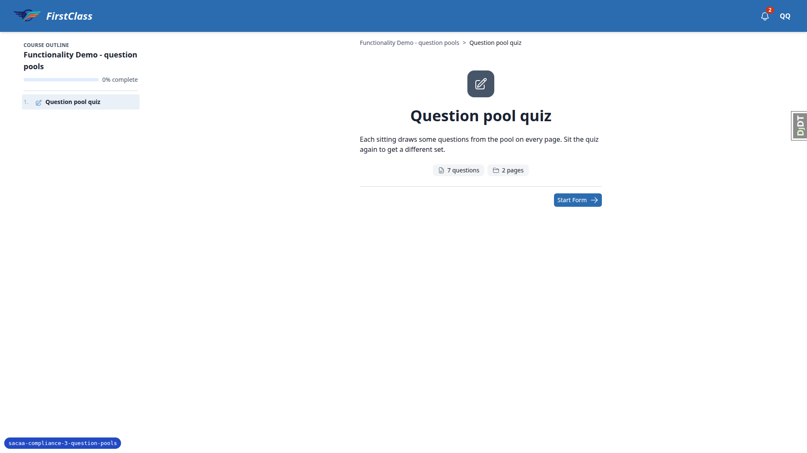
- Test 2: 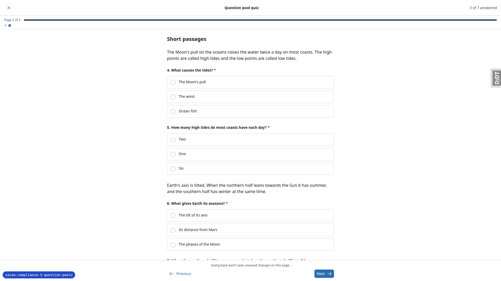
- Test 4: 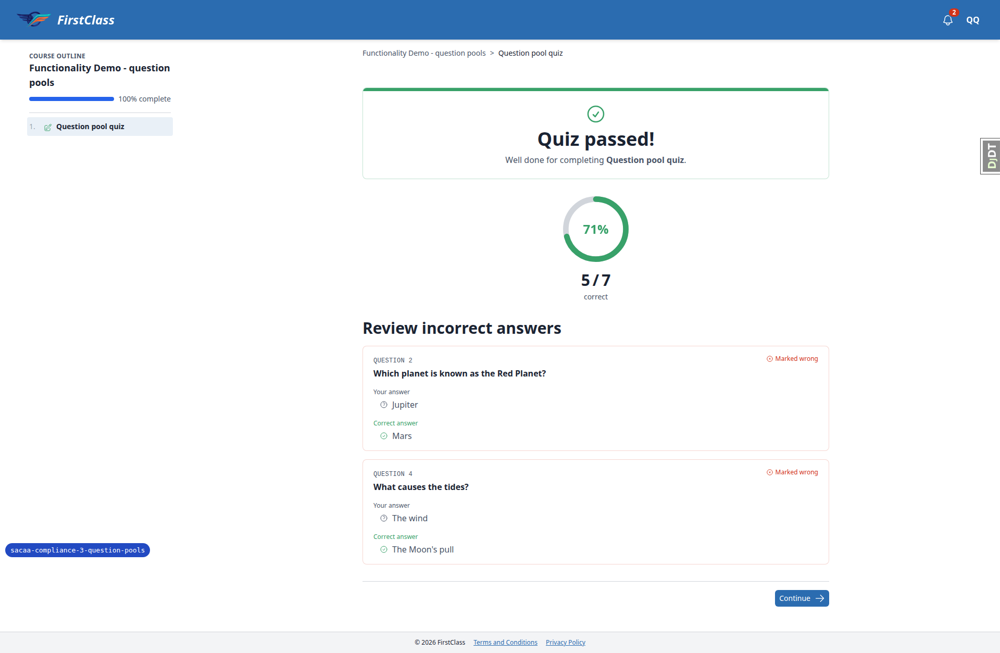
- Test 5: 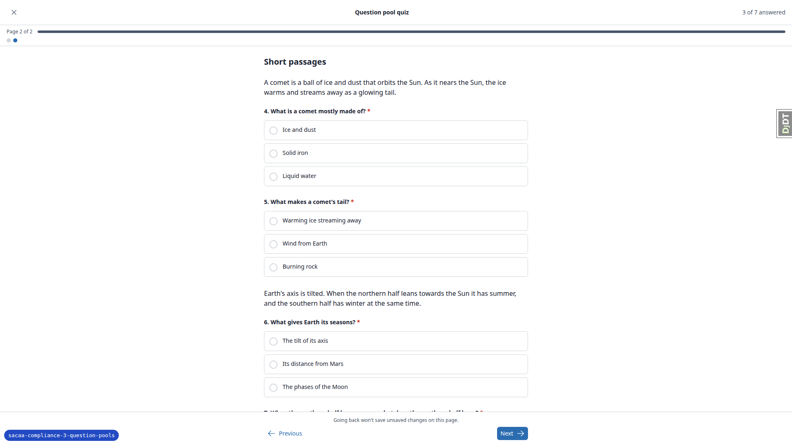
- Test 7: 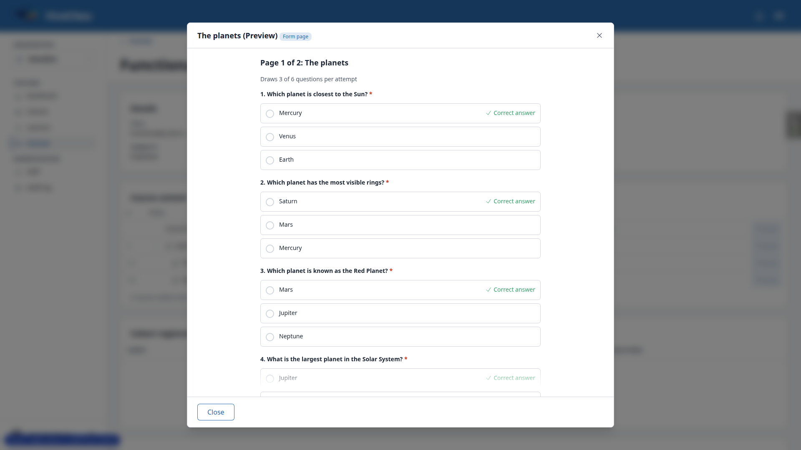

## Design check

No design states tested.

## Per-bug sections

No bugs were recorded.

## Layout probe

| Test | Viewport | URL | Screenshot | Result |
|---|---|---|---|---|
| 1 | desktop | /courses/functionality-demo-question-pools/1/ |  | clean |
| 2 | desktop | /courses/functionality-demo-question-pools/1/fill_form/2 |  | clean |
| 4 | desktop | /courses/functionality-demo-question-pools/1/complete |  | clean |
| 7 | desktop | /educator/organisations/demodev/courses/befa506c-dc1a-4333-9e55-fabb5cebd1fc | 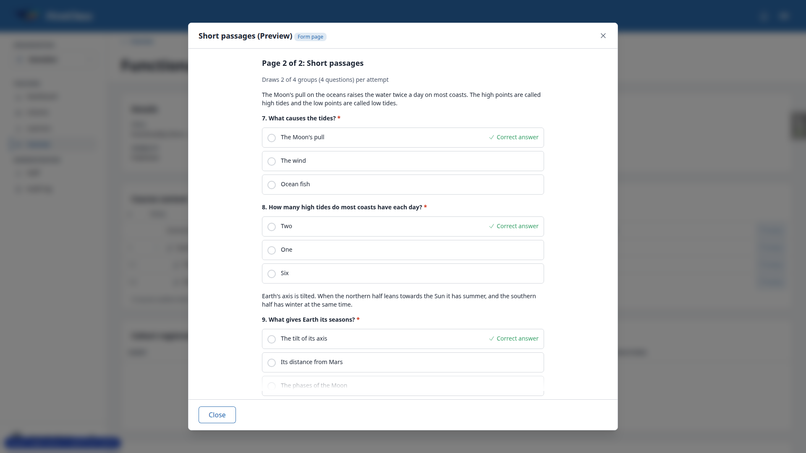 | clean |
| 9 | tablet | /courses/functionality-demo-question-pools/1/fill_form/2 | 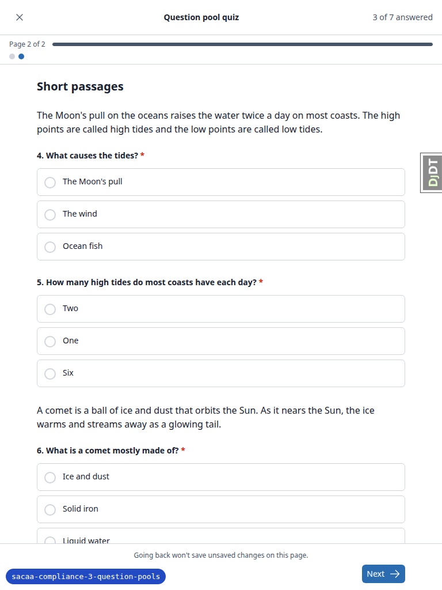 | clean |
| 9 | tablet | /courses/functionality-demo-question-pools/1/complete | 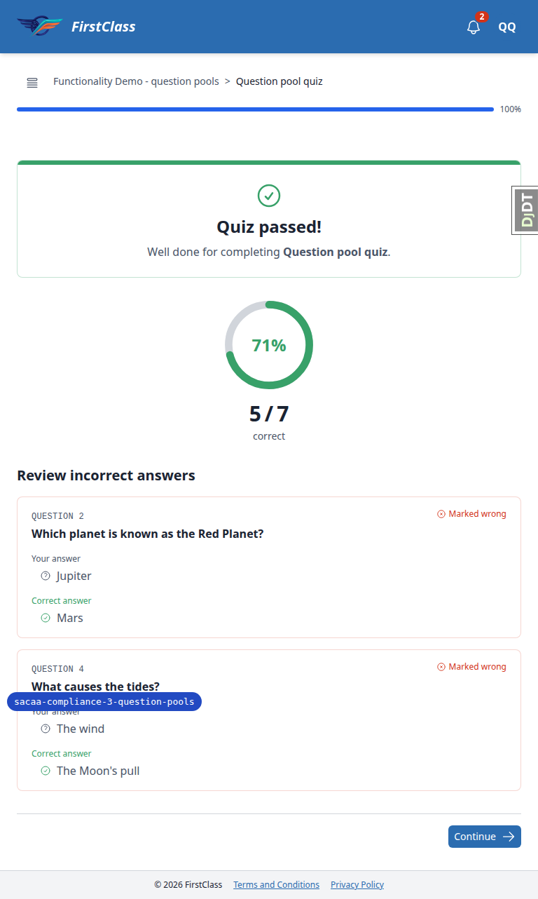 | clean |
| 9 | tablet | /educator/organisations/demodev/courses/befa506c-dc1a-4333-9e55-fabb5cebd1fc | 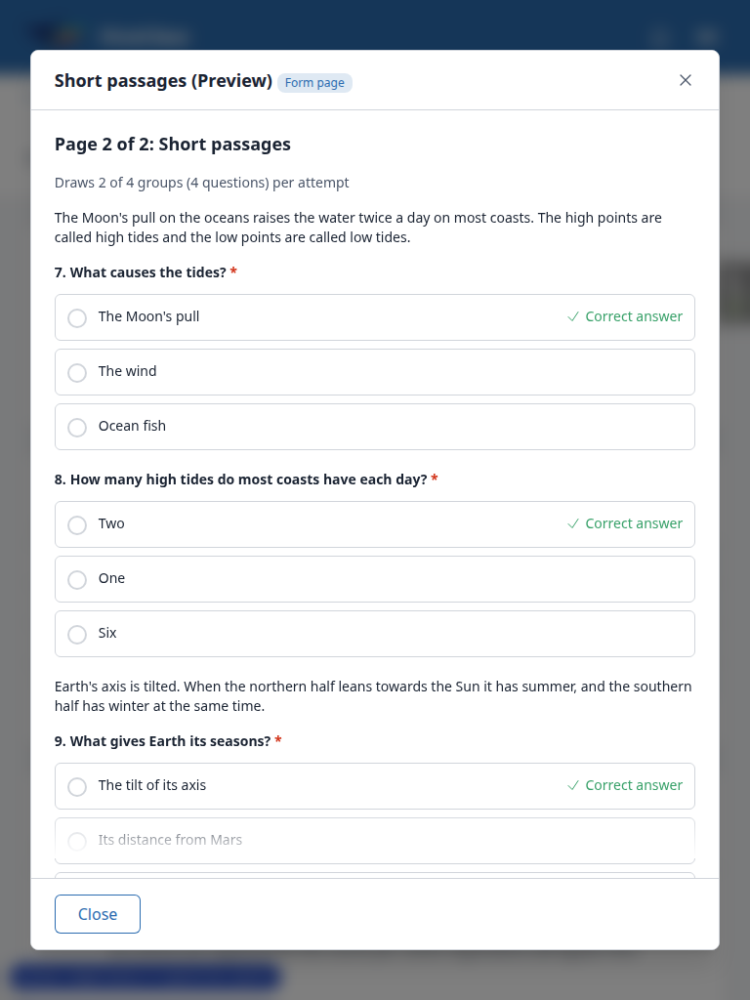 | clean |
| 9 | mobile | /courses/functionality-demo-question-pools/1/fill_form/2 | 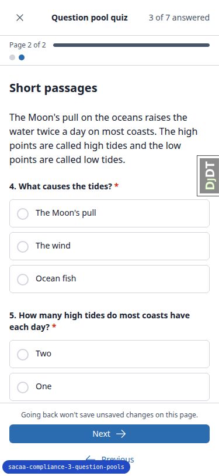 | clean |
| 9 | mobile | /courses/functionality-demo-question-pools/1/complete | 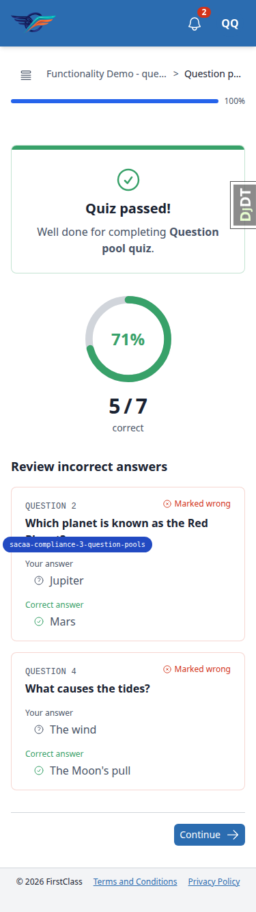 | clean |
| 9 | mobile | /educator/organisations/demodev/courses/befa506c-dc1a-4333-9e55-fabb5cebd1fc | 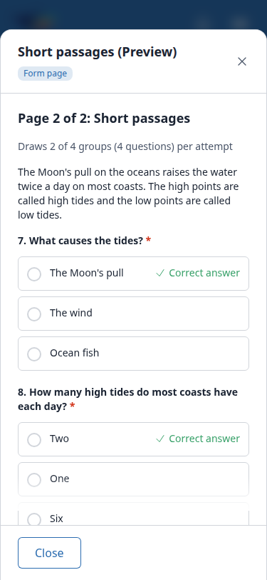 | clean |

## Data changes

| What changed | Via | Files written |
|---|---|---|
| `create_demo_data --yes`. `content_save` of a scratch copy (fresh uuids) of the course_categories, question-pools and shuffled-quiz courses to DemoDev. Learners qa-learner-a@example.com and qa-learner-b@example.com registered on both courses. | sdd:qa-data-helper | none |
| `qa_reset_learner_progress` for qa-learner-b@example.com on the question-pools course: removed their completed FormProgress and reset CourseProgress to 0%, so Test 9 had a live sitting. | sdd:qa-data-helper | none |

## Bug status

No bug records, so there are no rows. Every bug would be `UNRESOLVED` at render time.

## General notes

- The quiz's own authored description says each sitting draws from "the pool". This is author-written demo text with no number, so it does not reveal the pool size. It is worth a look if authors should avoid mentioning pools.
- Test 5: a passed quiz offers no retake (only Finish Course), so the retake half was not exercised. Learner B's sitting stood in as the second draw, and the comparison passed.
- Test 7: the page-of-groups preview numbers its questions 7-14, continuing the whole form's numbering, as planned.
- Tests 3, 6 and 8 have no screenshots because they were state, forged-form and admin checks.

status: ok · reason: report rendered, 0 bugs documented
