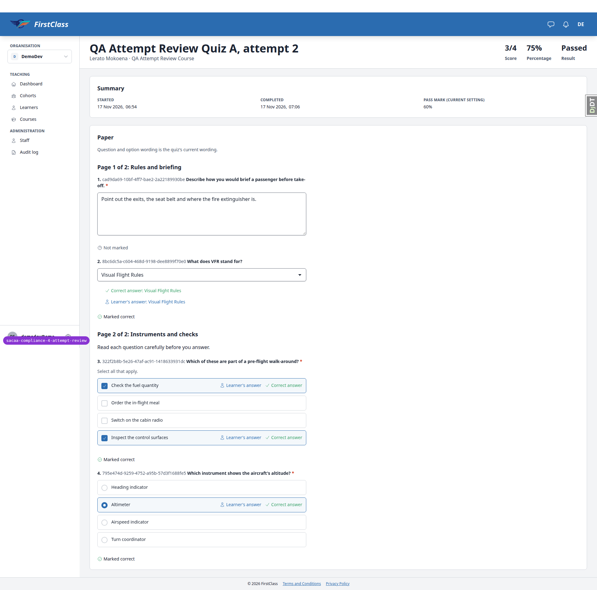
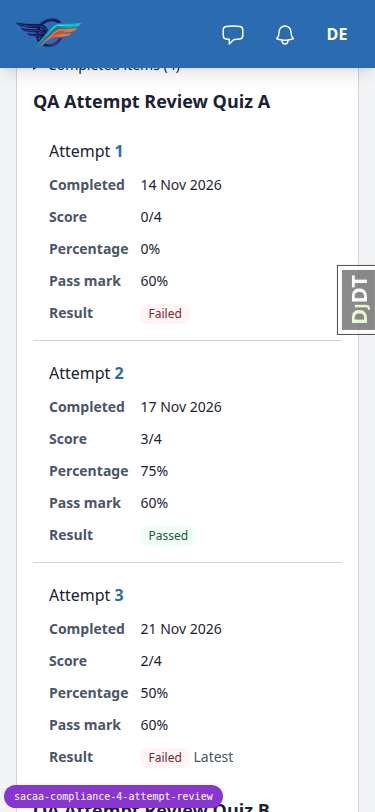
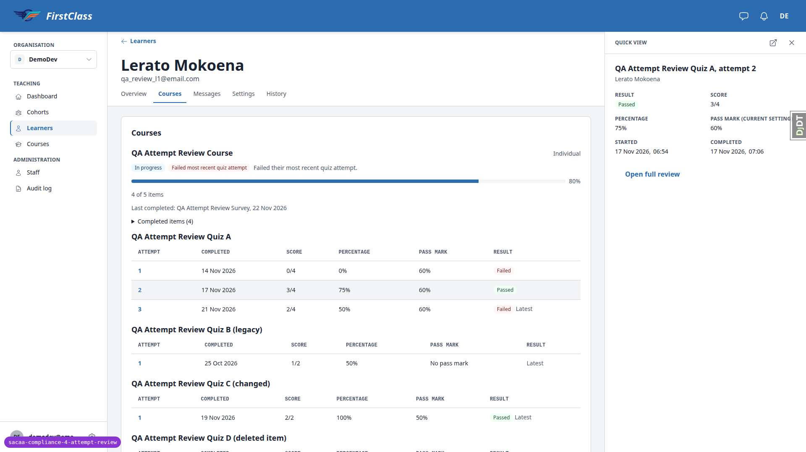
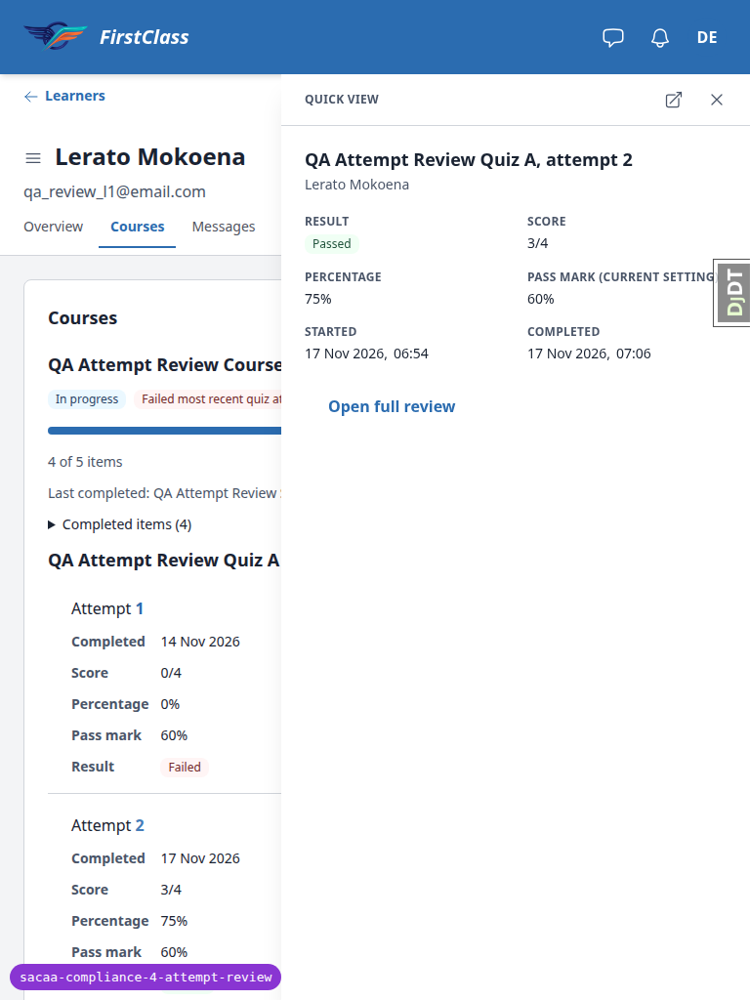
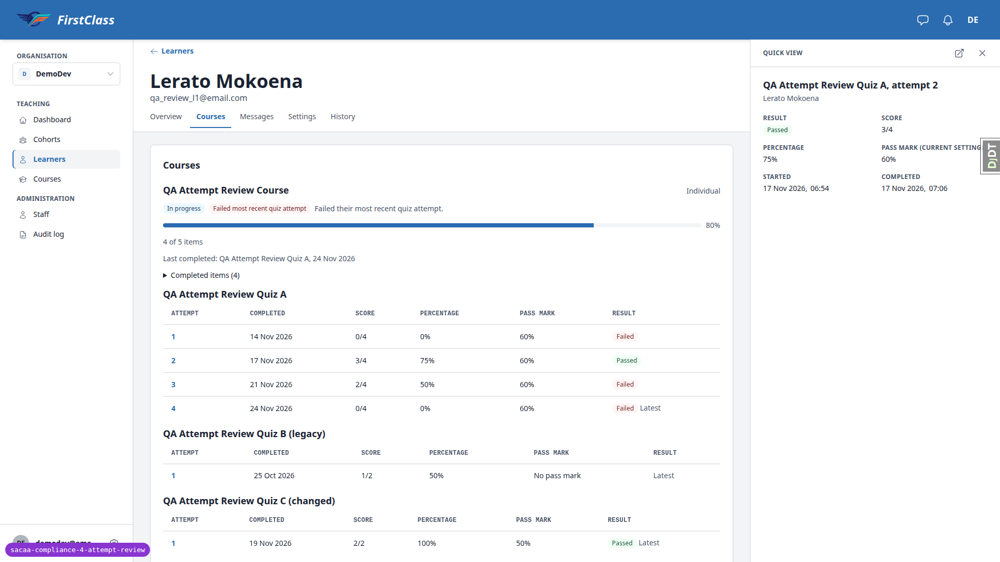

# Frontend QA report: Educators review one learner's quiz attempt

## Methodology

Screenshots were collected into `spec_dd/2. in progress/sacaa-compliance-4-attempt-review/screenshots/`. Every image linked in this report exists beside the report. Tests followed `3. frontend_qa.md` at desktop, tablet and mobile (375px) widths where the plan asks for it. Some screenshots in that folder are not linked because no record refers to them.

## Diff scoping

Class: **FULL**. Changed files that triggered it:

- `educator_interface/templates/educator_interface/panels/learner_courses.html`
- `educator_interface/templates/educator_interface/panels/quiz_attempt_paper.html`
- `educator_interface/templates/educator_interface/partials/quiz_attempt_verdict.html`
- `educator_interface/templates/educator_interface/quick_views/quiz_attempt.html`
- `form_engine/templates/cotton/learner-answer-mark.html`
- `form_engine/templates/form_engine/inputs/*.html`
- `form_engine/templates/form_engine/partials/page_children.html`
- `form_engine/templates/form_engine/question.html`
- `panel_framework/templates/panel_framework/panels/_details_value.html`
- Python in educator_interface, form_engine, learner_interface, panel_framework and reports

Nothing was skipped. Everything ran, including the mobile and tablet passes.

## Smoke gate

**Pass.** Pages loaded: `/` and `/educator/organisations/demodev/learners/<L1>/__tabs/courses`.

## Design check

No design states tested.

## Bug B1: Open full review nests the page inside #main-content

Manifestations:

- `4.open-full-review`, desktop

- Expected: clicking "Open full review" in the quiz attempt quick view replaces `#main-content` with the attempt review page, as the sidebar links and back links do. The back link shows at the top and only one `#main-content` exists.
- Actual: the link carries `hx-get`, `hx-target=#main-content` and `hx-push-url` but no `hx-swap=outerHTML`. The response is swapped inside `#main-content`, which leaves two `#main-content` elements. The page lands scrolled 40px with a white band above the top bar, and the back link is hidden.

## Bug B2: Attempt-number quick-view trigger is below the touch target size

Manifestations:

- `1.touch-target`, mobile

- Expected: the attempt-number link on the Courses tab (table cell and card) meets the 44px touch target at 375px, like the other quick-view triggers in the educator interface (44x44).
- Actual: the link is an inline text link around the digit, 9x22px at 375px. `test_touch_targets.py` does not reach it.

## Bug B3: Quick view's Open full review link is indented from the drawer content

Manifestations:

- `2.link-alignment`, desktop
- `1-2`, tablet

- Expected: the "Open full review" link's text shares the left edge of the definition list above it in the quiz attempt quick view.
- Actual: the link is `<c-button variant=link>` (`btn btn-link`). Its horizontal padding draws the text about 24px right of the rows' left edge.

## Bug B4: Quick view offers two links to the attempt review page

Manifestations:

- `2.duplicate-link`, desktop

- Expected: the spec and QA plan say the quick view has one link, "Open full review".
- Actual: the quick-view chrome's standard "Open full page" icon link also points at the attempt review page, so there are two links to one page. This needs a decision.

## Layout probe

| Test id | Viewport | URL | Screenshot | Result |
|---|---|---|---|---|
| 1 | desktop | /educator/organisations/demodev/learners/<L1>/__tabs/courses | [shot](screenshots/page-2026-11-24T06-57-28-182Z.png) | clean |
| 2 | desktop | .../learners/<L1>/__tabs/courses (quick view open) | [shot](screenshots/page-2026-11-24T06-57-48-277Z.png) | clean |
| 4 | desktop | /educator/organisations/demodev/quiz-attempts/<attempt 2> | [shot](screenshots/page-2026-11-24T06-58-43-955Z.png) | clean |
| 5 | desktop | .../quiz-attempts/<attempt 3> | [shot](screenshots/page-2026-11-24T06-59-16-165Z.png) | clean |
| 7 | desktop | .../quiz-attempts/<Quiz B legacy> | [shot](screenshots/page-2026-11-24T06-59-30-387Z.png) | clean |
| 8 | desktop | .../quiz-attempts/<Quiz C> | [shot](screenshots/page-2026-11-24T06-59-38-678Z.png) | clean |
| 9 | desktop | .../quiz-attempts/<Quiz D> | [shot](screenshots/page-2026-11-24T06-59-45-139Z.png) | clean |
| 1 | mobile | .../learners/<L1>/__tabs/courses | [shot](screenshots/page-2026-11-24T07-01-09-373Z.png) | clean |
| 2 | mobile | .../learners/<L1>/__tabs/courses (quick view open) | [shot](screenshots/page-2026-11-24T07-01-32-630Z.png) | clean |
| 4 | mobile | .../quiz-attempts/<attempt 2> | [shot](screenshots/page-2026-11-24T07-01-40-647Z.png) | clean |
| 2 | tablet | .../learners/<L1>/__tabs/courses (quick view open) | [shot](screenshots/page-2026-11-24T07-01-49-560Z.png) | clean |
| 4 | tablet | .../quiz-attempts/<attempt 2> | [shot](screenshots/page-2026-11-24T07-01-57-404Z.png) | clean |

The layout probe raised no flags. B2 and B3 were found by the per-test checks, not the probe.

## Data changes

| What changed | Made by | Files written |
|---|---|---|
| Seeded base dev data (`create_demo_data --yes`) and built the attempt-review scenario: Quizzes A-D, survey, L1/L2/L3/C1 learner/E, cohorts C1 and C2, 11 sittings | `sdd:qa-data-helper` | `freedom_ls/qa_helpers/management/commands/qa_create_attempt_review_scenario.py` |

## Bug status

- **FIXED** (commit: 16d7b6b27) — B1: Open full review nests the page inside #main-content
- **FIXED** (commit: 4dcd1ebb8) — B2: Attempt-number quick-view trigger is below the touch target size
- **FIXED** (commit: adcb6a00b) — B3: Quick view's Open full review link is indented from the drawer content
- **FIXED** (commit: ed9ba1d7b) — B4: Quick view offers two links to the attempt review page (decision: drop the body link; the header's "Open full page" icon is the one link) — after the fix: 
- **FIXED** (commit: bfd6f96d4) — B5: Opening the full review from the quick view lands the page scrolled under the header (found while re-verifying B1: with one #main-content the page still landed at scrollY 40 because the dialog's focus restore scrolled the page; re-verified at scrollY 0 with the back link visible, and focus still returns to the trigger on the Courses tab and the learners list)

## General notes

Passing tests (desktop unless noted):

- **Test 1** (mobile as well): the Quiz A table has rows 1-3 with no row for the in-progress sitting. Each attempt number is a link, and the other columns are unchanged. At 375px the tables become cards with no sideways scroll.
- **Test 2** (mobile and tablet as well): the drawer opens with the URL unchanged, and the title, subtitle and six rows are right. Close returns focus to the attempt link. Clicking attempt 1 with the drawer open shows attempt 1's values. On mobile it is a bottom sheet and the page behind does not scroll sideways.
- **Test 3:** Ctrl-click opens the attempt in a new tab and leaves the drawer closed.
- **Test 4** (mobile and tablet as well): loaded directly, the page has the right URL, browser title, back link, heading, subtitle and stats. Summary shows no repeated values, and the sidebar has no Quiz attempts entry. It has no sideways scroll.
- **Test 5:** the paper matches the served order. Learner's answer and Correct answer marks are readable, and the dropdown lists both. Verdicts are correct, and words carry every mark. The unanswered dropdown on attempt 3 reads "Did not answer" and "Marked incorrect".
- **Test 6:** the back link opens the Courses tab, and browser Back returns to the review.
- **Test 7:** the predates note, authored order and "No pass mark" wording are all right.
- **Test 8:** the stale-score note shows, with the stored score 2/2. Question 7700 is the Correct answer and 7600 the Learner's answer, marked incorrect.
- **Test 9:** the missing-items note shows and the stale-score note does not. The two remaining questions are numbered 1 and 2.
- **Test 10:** every URL that must not open returns 404. They are: in-progress, survey, not-a-uuid, random uuid, another organisation's sitting, the bare section and `__actions`. Both the page and `__quick-view` were checked, and no quiz title or learner name leaked.
- **Test 11:** as cohort educator E, L3's page and quick view are 404 and L3 is not in the list. The C1 learner's page and quick view return 200.
- **Test 12:** switching organisation lands on Harbour College's dashboard.
- **Test 13:** the shared-partial pages still look right.
  - 13.1, the learner's course player: [screenshot](screenshots/page-2026-11-24T07-02-55-281Z.png).
  - 13.2, the course content preview: [screenshot](screenshots/page-2026-11-24T07-00-23-881Z.png).
  - 13.3, the results pages: [screenshot](screenshots/page-2026-11-24T07-03-41-498Z.png). The Quiz C results page shows the changed note.
  - 13.4: the C1 cohort report renders, and the PDF download is a valid `application/pdf` (200, 202855 bytes).
- **Test 14:** keyboard flow works. Tab reaches "Attempt 1 of QA Attempt Review Quiz A", and Enter opens the quick view with focus on its heading. Escape returns focus to the link. On the review page the back link is the only focusable element, and option accessible names include "Learner's answer" and "Correct answer".

Notes:

- B2 holds because the learners table's own quick-view triggers are 44x44, while the new attempt link is a bare inline digit.
- B4 needs a product decision, not only a code fix. Either the body link or the chrome icon link would have to go.
- A capture check confirmed that screenshots with default names land in `qa-screenshots` and that no image bytes are returned.
- Nothing was left untested.

status: ok · reason: 5 bugs — 5 fixed, 0 unresolved; report rendered, screenshots verified
