# Frontend QA report: Educators review one learner's quiz attempt

## Methodology

Screenshots were collected into `spec_dd/2. in progress/sacaa-compliance-4-attempt-review/screenshots/` and every image referenced below exists beside this report. The collector also swept the run's accessibility-snapshot `.yml` and console `.log` files into `screenshots/`. They were deleted, leaving only PNGs. Compression found nothing over 1MB.

The smoke gate passed, so no steps were skipped. Tests ran at desktop, mobile (375px) and tablet (768px). Tests 3, 6, 10, 12, 14.1 and 14.2 have no screenshot (behaviour or accessibility-tree checks).

## Diff scoping

Class: **FULL**. Triggered by changed templates and static files, and Python in the same apps, in `educator_interface`, `form_engine`, `panel_framework` and `learner_interface`. Nothing was skipped: all viewports and all tests were in scope.

Tests 2 and 4 ran at all three viewports. Test 1 ran at desktop and mobile. Test 5 ran at desktop and mobile. The remaining tests ran at desktop only. Those tests are server-side or state checks (404s, access, org switch, shared pages, keyboard), and the tablet pass was limited to the review page and the quick view.

## Smoke gate

**Pass.** Pages loaded: `/` and `/educator/organisations/demodev/learners/<L1>/__tabs/courses`. No failure.

## Design check

No design states tested.

## Test results

| Test | Viewport | Result | Notes |
|---|---|---|---|
| 1 | desktop | pass | 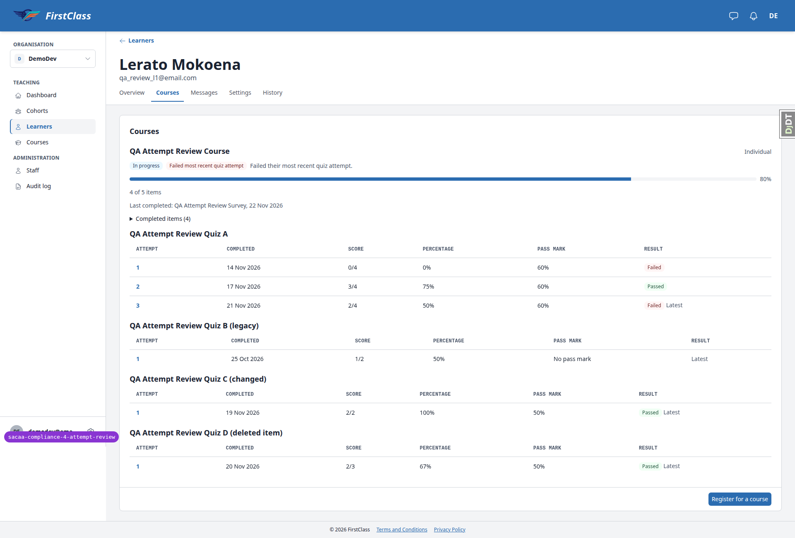 Quiz A table: 3 rows numbered 1-3, each number a link with an aria-label, and "Latest" on the last row. |
| 1 | mobile | pass | 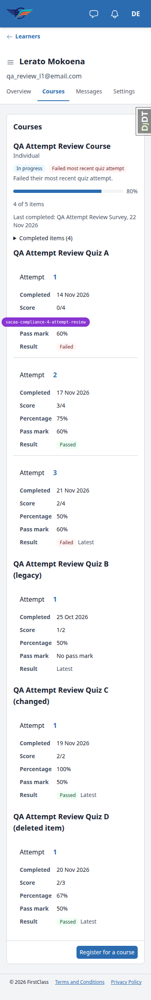 Cards, 44x44px links, no sideways scroll. |
| 2 | desktop | pass | 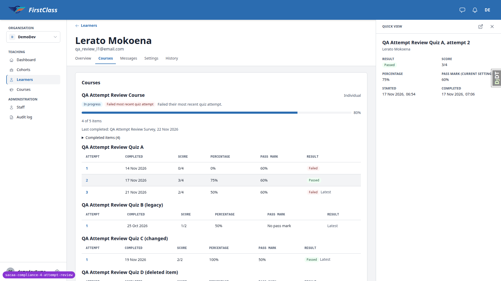 Six rows, one link ("Open full page"), swaps to attempt 1, focus returns on close. |
| 2 | mobile | pass | 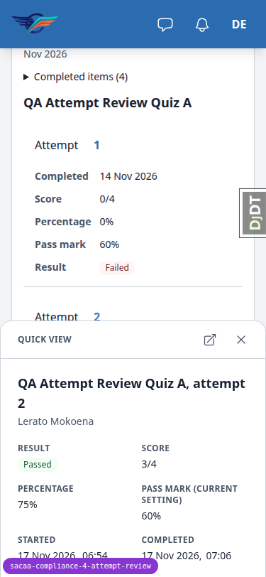 Bottom sheet, readable. |
| 2 | tablet | pass | 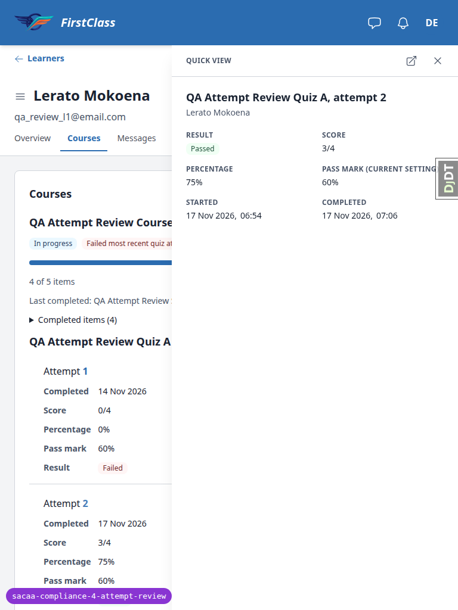 |
| 3 | desktop | pass | Ctrl-click opened a new tab, no drawer in the original. |
| 4 | desktop | pass | 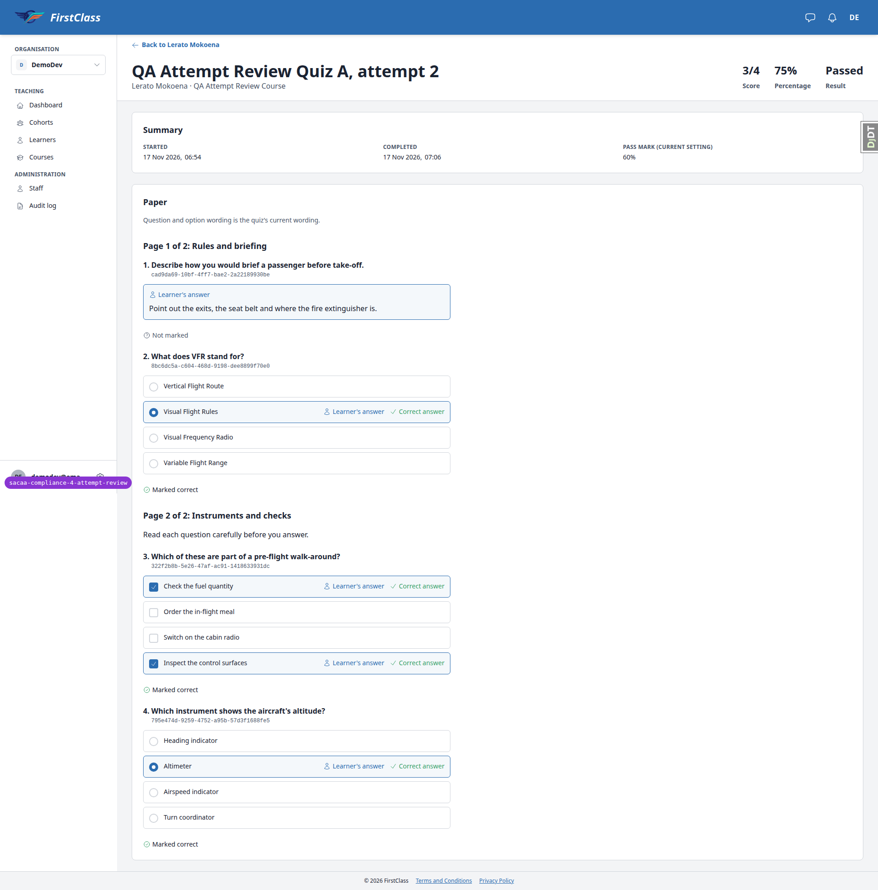 Header, back link, stats and Summary all match. |
| 4 | mobile | pass | 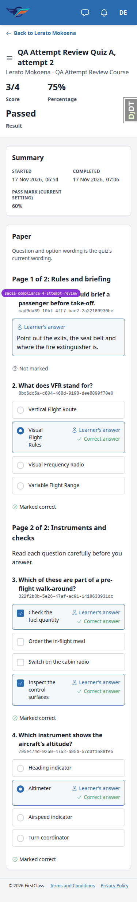 No sideways scroll on attempts 2, 3, legacy, Quiz C and Quiz D. |
| 4 | tablet | pass | 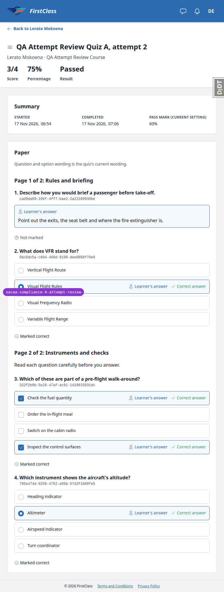 |
| 5 | desktop | pass | 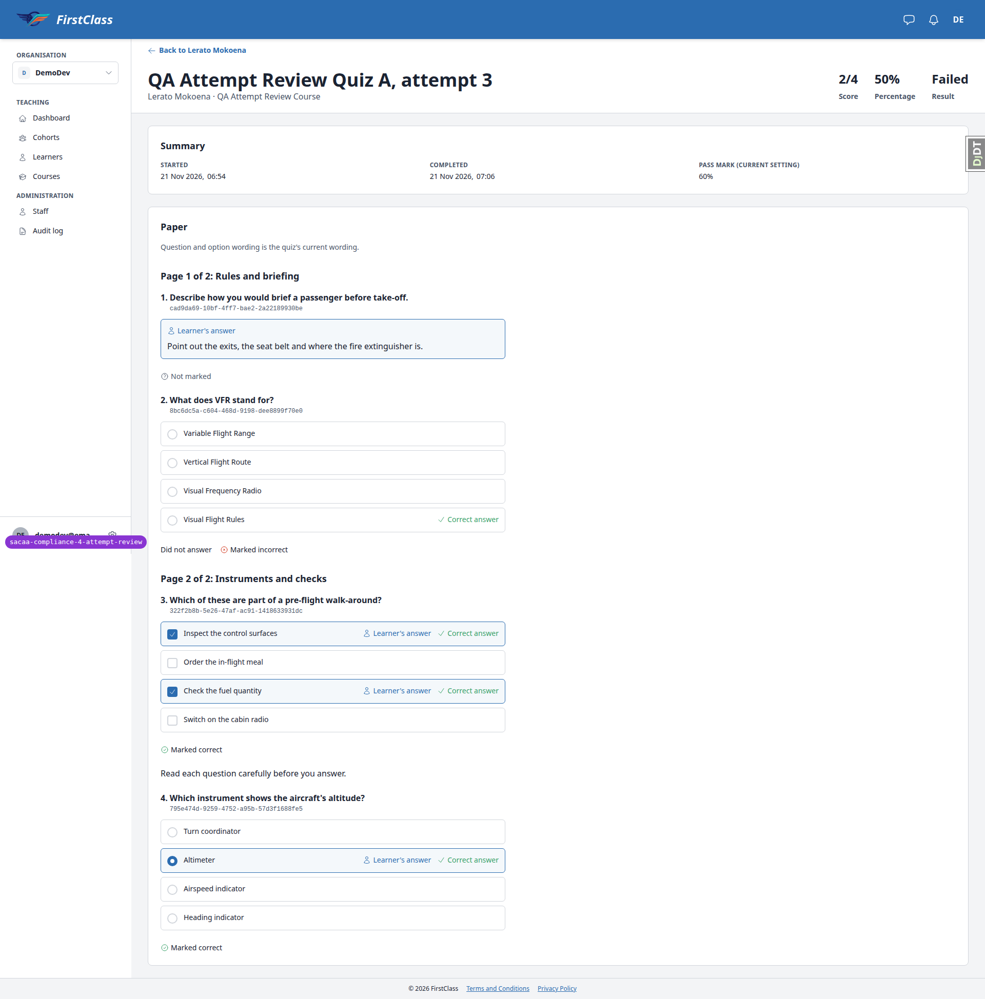 Served order matches `served_paper`, no form controls, marks carry words. Unanswered dropdown reads "Did not answer" and "Marked incorrect". |
| 5 | mobile | **fail** | See bug B1. |
| 6 | desktop | pass | Back link opens the Courses tab and browser Back returns. |
| 7 | desktop | pass | 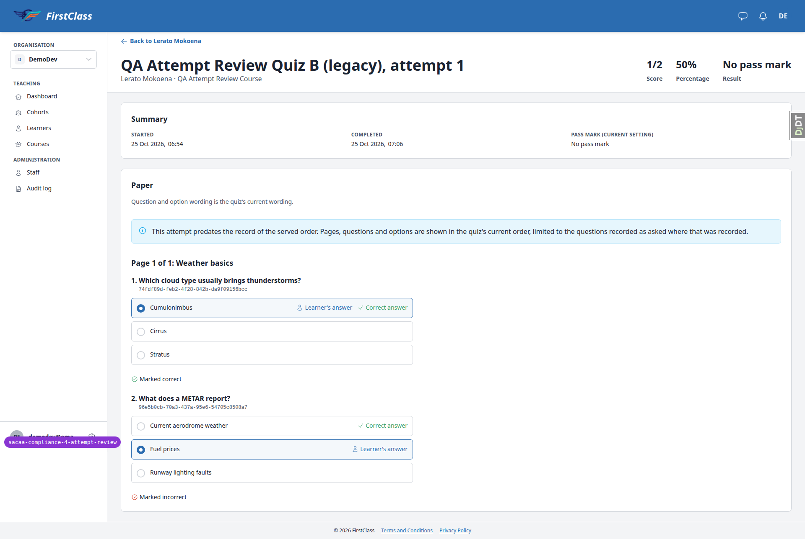 Quick view:  |
| 8 | desktop | pass | 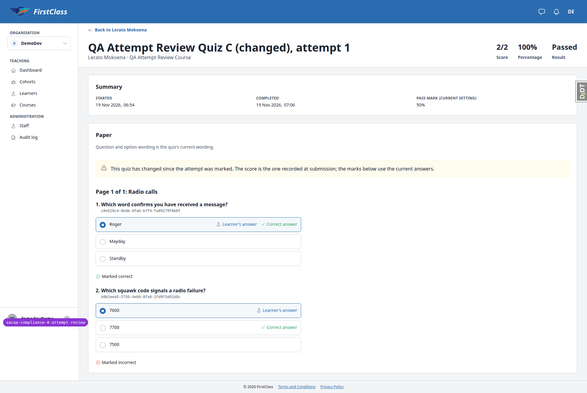 |
| 9 | desktop | pass | 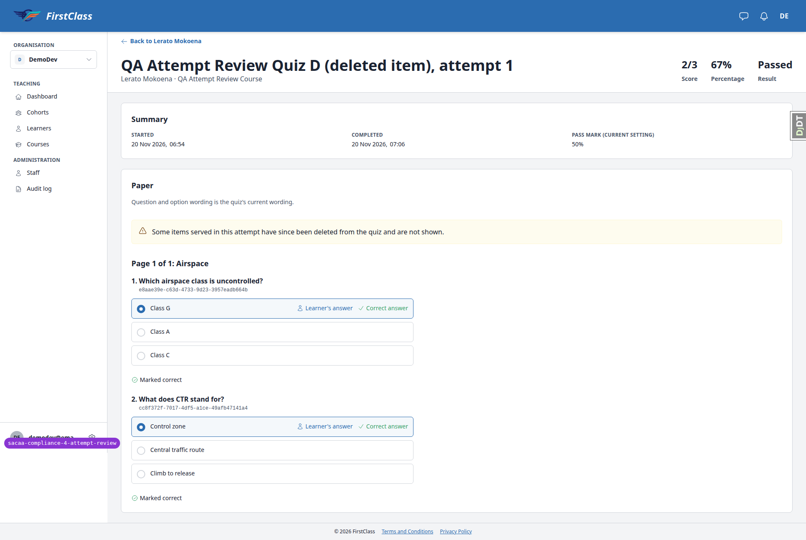 Remaining questions renumbered 1 and 2 with no gap. |
| 10 | desktop | pass | All 12 URLs return 404, with no traceback and no title or name leaked. |
| 11 | desktop | pass | 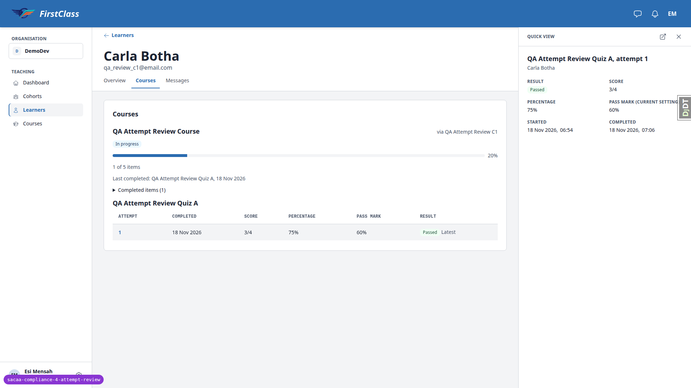 |
| 12 | desktop | pass | Switching to Harbour College lands on its dashboard. |
| 13.1 | desktop | pass | 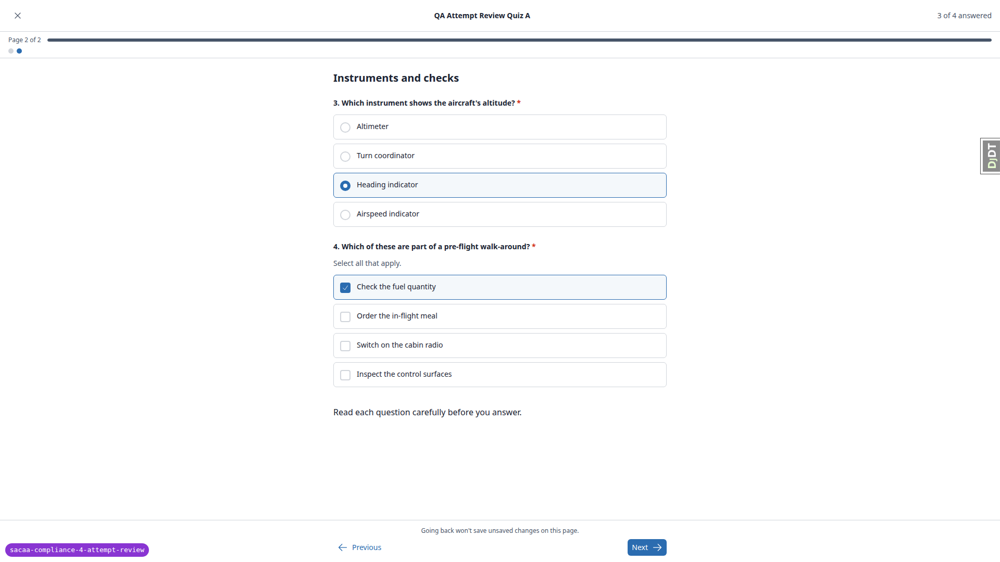 |
| 13.2 | desktop | pass | 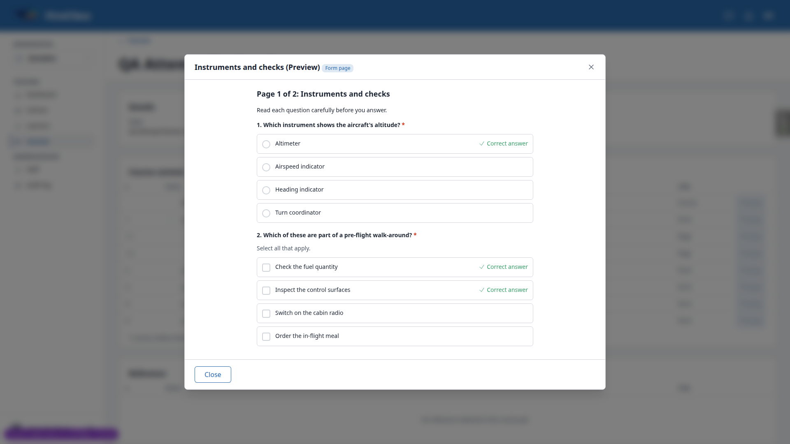 |
| 13.3 | desktop | pass | 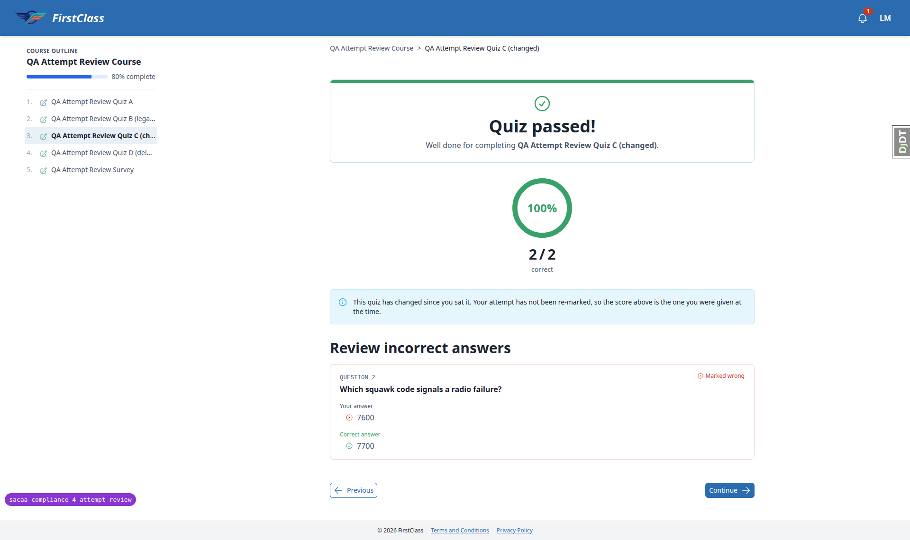 |
| 13.4 | desktop | pass | 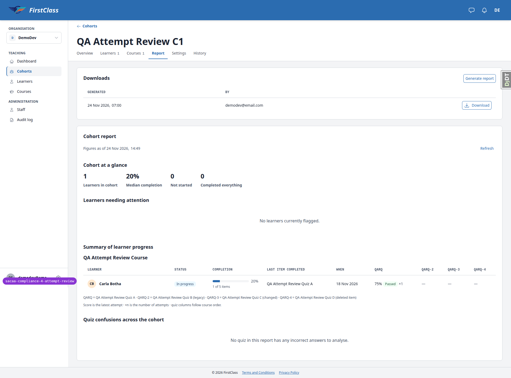 The new PDF is 200 `application/pdf` and shows 75% and x1. |
| 14.1 | desktop | pass | Focus moves into the quick view, Escape returns it, accessible name "Attempt 2 of QA Attempt Review Quiz A". |
| 14.2 | desktop | pass | Only the back link is focusable, and the mark words are in the accessibility tree. |

## B1: Attempt review option rows squeeze option text beside the marks at 375px

Manifestations: test 5, mobile (375px).

- **Expected:** At phone width, an option row that carries "Learner's answer" and "Correct answer" keeps its option text readable across the row's width. The marks wrap under the text, so a short option reads on one line.
- **Actual:** The marks keep a fixed right column and the option text wraps into about 110px. "Visual Flight Rules" and "Inspect the control surfaces" each take three lines, while the mark column has spare height.

## Layout probe

| Test | Viewport | URL | Screenshot | Result |
|---|---|---|---|---|
| smoke | desktop | `/` | [page-2026-11-24T14-46-46-878Z.png](screenshots/page-2026-11-24T14-46-46-878Z.png) | clean |
| 1 | desktop | `/educator/organisations/demodev/learners/<L1>/__tabs/courses` | [page-2026-11-24T14-47-38-969Z.png](screenshots/page-2026-11-24T14-47-38-969Z.png) | clean |
| 4 | desktop | `/educator/organisations/demodev/quiz-attempts/7373004a-...` | [page-2026-11-24T14-46-59-520Z.png](screenshots/page-2026-11-24T14-46-59-520Z.png) | clean |
| 1 | mobile | `/educator/organisations/demodev/learners/<L1>/__tabs/courses` | [page-2026-11-24T14-52-11-821Z.png](screenshots/page-2026-11-24T14-52-11-821Z.png) | clean |
| 2 | mobile | `/educator/organisations/demodev/learners/<L1>/__tabs/courses` (quick view open) | [page-2026-11-24T14-52-19-848Z.png](screenshots/page-2026-11-24T14-52-19-848Z.png) | clean |
| 5 | mobile | `/educator/organisations/demodev/quiz-attempts/7373004a-...` | [page-2026-11-24T14-52-29-513Z.png](screenshots/page-2026-11-24T14-52-29-513Z.png) | clean (the probe raised no flags; the squeezed option text is recorded as B1) |
| 4 | tablet | `/educator/organisations/demodev/quiz-attempts/7373004a-...` | [page-2026-11-24T14-52-53-280Z.png](screenshots/page-2026-11-24T14-52-53-280Z.png) | clean |
| 2 | tablet | `/educator/organisations/demodev/learners/<L1>/__tabs/courses` (quick view open) | [page-2026-11-24T14-53-02-842Z.png](screenshots/page-2026-11-24T14-53-02-842Z.png) | clean |

## Data changes

| What changed | Made by | Files |
|---|---|---|
| Reset L1 Quiz A sitting ef5d90a3 (completed by an earlier QA run) back to in progress: completed_time, scores and asked cleared, served_paper kept | `sdd:qa-data-helper` | none |
| L1's in-progress Quiz A sitting ef5d90a3 now also holds a dropdown answer "Visual Flight Rules" and is still in progress. A new C1 cohort report was generated. | course player (Test 13.1), cohort report PDF (Test 13.4) | none |

## Bug status

- **FIXED** (commit: b12e19b85) — Attempt review option rows squeeze option text beside the marks at 375px (B1)

  Re-verified at 375: option text spans the row and the marks wrap under it (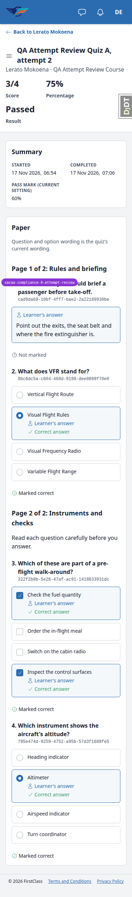). The course-content quiz preview uses a different partial and is unchanged (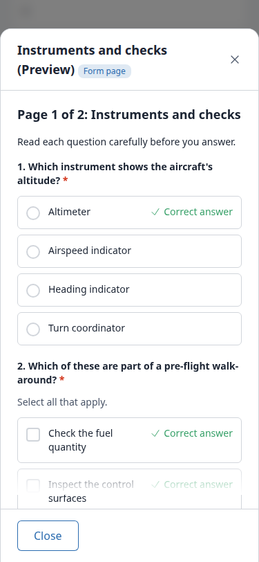).

## General notes

- Screenshots `page-2026-11-24T14-46-38-368Z.png`, `page-2026-11-24T14-50-55-960Z.png` and `page-2026-11-24T14-51-21-340Z.png` are in the folder but no record names them, so they are not linked.
- B1 is a mobile-only layout issue. At tablet width the marks sit on one line beside the option text.
- The Test 9 renumbering (remaining questions 1 and 2, no gap) is as the plan allows and was recorded as shown.

status: ok · reason: 1 bug — 1 fixed, 0 unresolved; report rendered, screenshots verified
