# QA report: test time limit

## Methodology

Frontend QA was run in a browser at desktop, tablet (768px) and mobile (375px) viewports. Screenshots were collected into `spec_dd/2. in progress/sacaa-compliance-assessment-controls-3-test-time-limit/screenshots/`. Every image referenced below was checked and exists beside this report. The smoke gate passed, so no steps were skipped because of it.

Results: 47 test records passed and 1 failed (`13-wrong-answers-table`, which is bug B1). Details are in the sections below.

## Diff scoping

Class: **FULL**. Nothing was skipped, and all viewports and areas ran.

Changed files that triggered the class (the scoping record lists these, plus about 90 backend, test, demo content, docs and spec files):

- `freedom_ls/learner_interface/templates/learner_interface/course_form.html`
- `freedom_ls/learner_interface/templates/learner_interface/course_form_page.html`
- `freedom_ls/learner_interface/templates/learner_interface/course_form_complete.html`
- `freedom_ls/learner_interface/static/learner_interface/js/alpine-components.js`
- `freedom_ls/form_engine/templates/form_engine/partials/form_facts.html`
- `freedom_ls/reports/templates/reports/partials/learner_detail.html`
- `freedom_ls/reports/static/reports/print.css`

## Smoke gate

Status: **pass**. Pages loaded: `/` and `/courses/functionality-demo-timed-quiz/2/`. No failure URL or reason.

## Test results summary

| Test | Viewport | Result | Screenshot | Notes |
|---|---|---|---|---|
| 1.1-1.3 | desktop | pass | 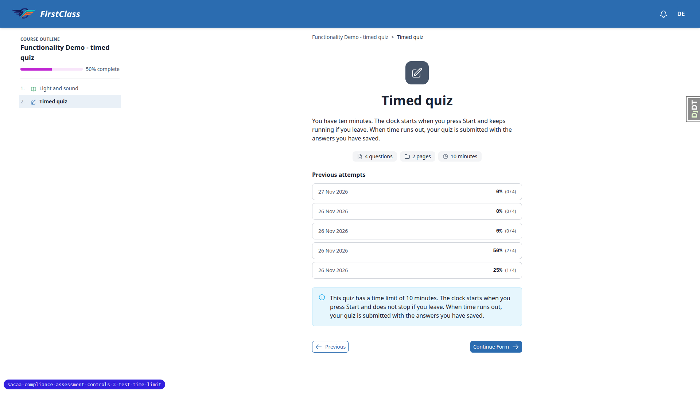 | Timed quiz start page shows a "10 minutes" chip and the notice with the expected copy. The button read "Continue Form" because a sitting was open. |
| 1.4 | desktop | pass | 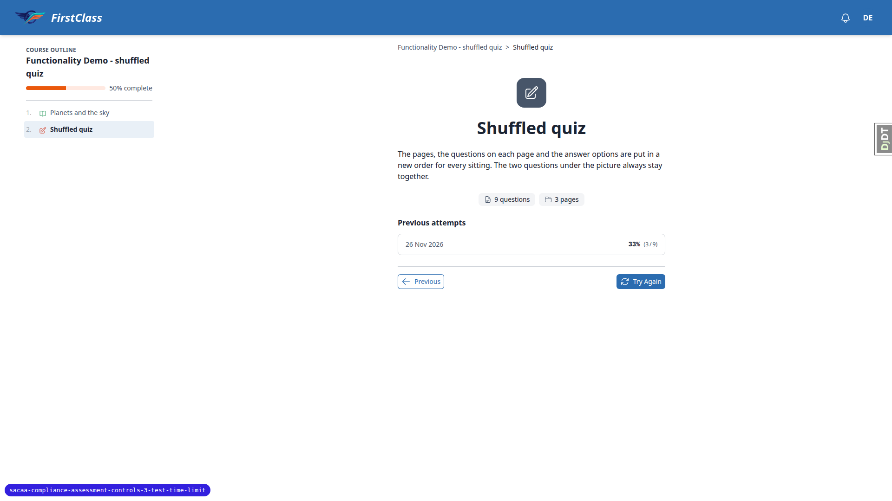 | Untimed quiz start page has no time chip and no notice. |
| 2.1-2.2 | desktop | pass | 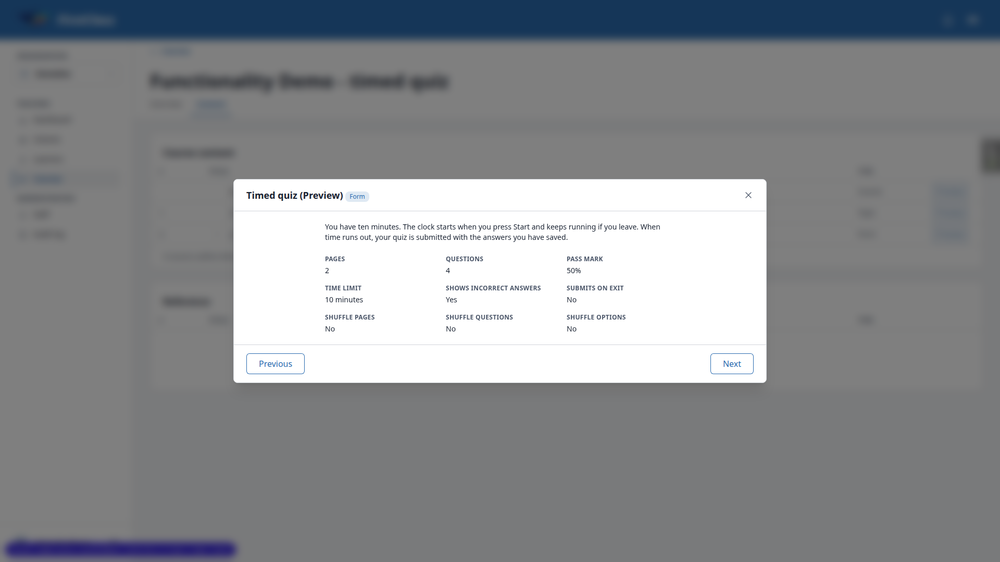 | Educator preview of the timed quiz lists "Time limit: 10 minutes". |
| 2.3 | desktop | pass | 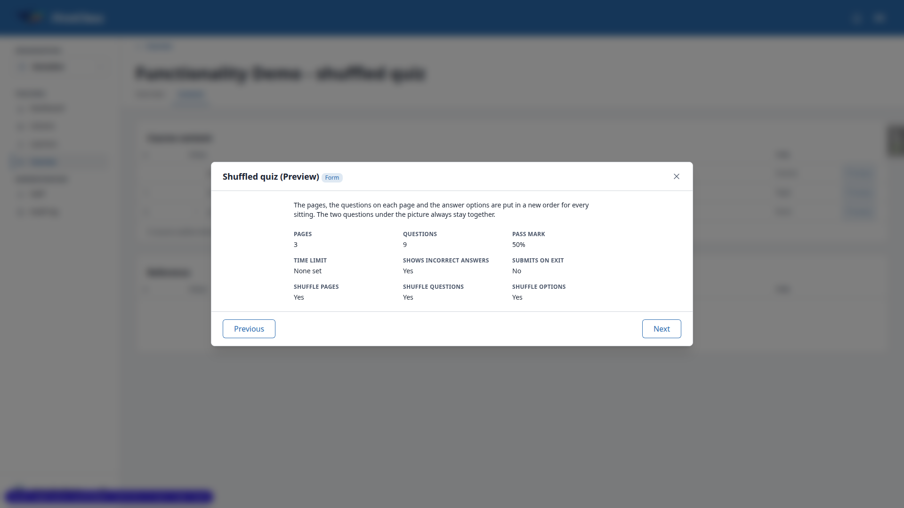 | Untimed quiz preview reads "Time limit: None set". |
| 3.1-3.4 | desktop | pass | 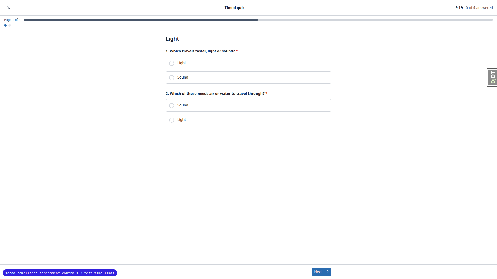 | Countdown in the top bar starts at 9:58 and counts down one second at a time. It has `role=timer` and aria-label "Time left", and no layout shift. |
| 3.5 | desktop | pass | none | The countdown carries on across Next and Previous and never restarts. |
| 3.7 | desktop | pass | none | Browser console shows 0 errors and 0 warnings. |
| 10.1 | desktop | pass | 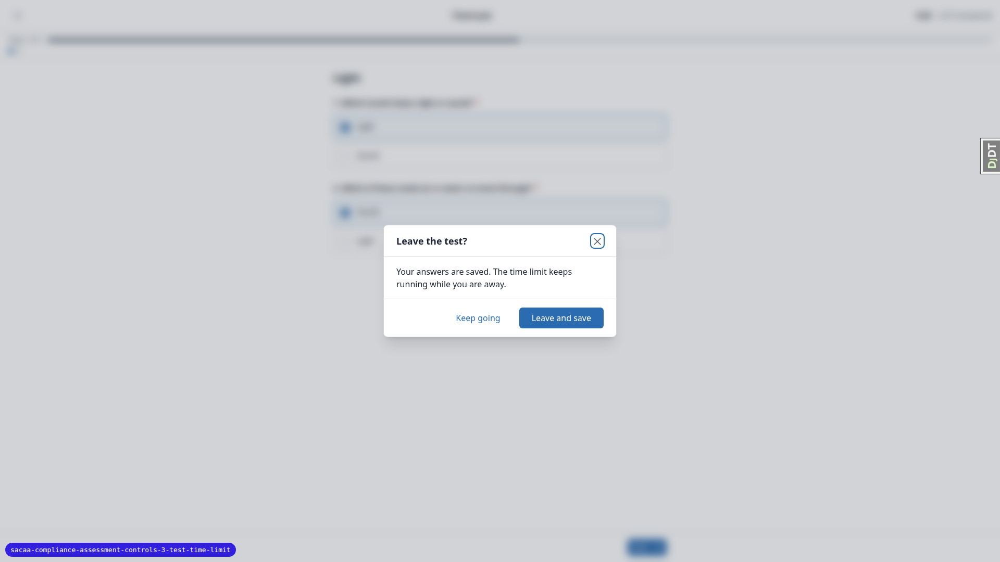 | Timed exit dialog "Leave the test?" has the time-limit copy. |
| 4.1-4.2 | desktop | pass |  | The 5-minute warning appears in a polite live region and focus is kept. No warning after a reload at 5:01. |
| 4.3 | desktop | pass | none | Reloading with 1:54 left shows the 5-minute callout at once, outside any live region. |
| 4.4 | desktop | pass |  | The 1-minute callout appears with an `aria-live=assertive` region holding the same text. |
| 4.5 | desktop | pass | none | Reloading at 0:52 shows the 1-minute callout at once. |
| 5 | desktop | pass | 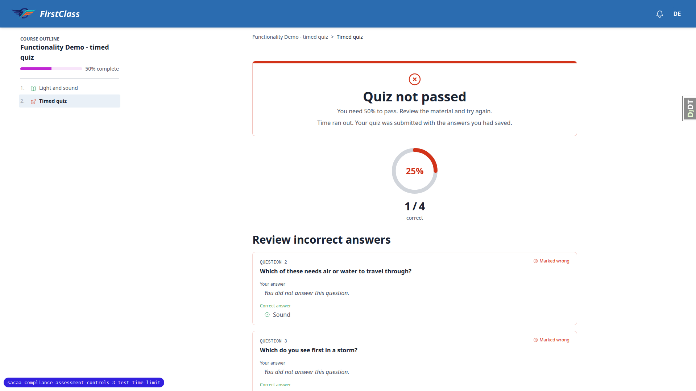 | At 0:00 the page submitted itself with no dialog and no validation message. The results page shows "Time ran out" and 25% (1 / 4), so the unsaved answer was counted. |
| 6.1-6.2 | desktop | pass |  | Exit dialog on page 2 has the time-limit copy. "Leave and save" returns to the start page. |
| 6.3-6.5 | desktop | pass | none | After the time limit has passed, opening the start URL redirects to the results page. "Try Again" opens a new sitting at 9:58. The results page showed the Test 5 sitting because of the clock rewind; see General notes. |
| 6.6 | desktop | pass | 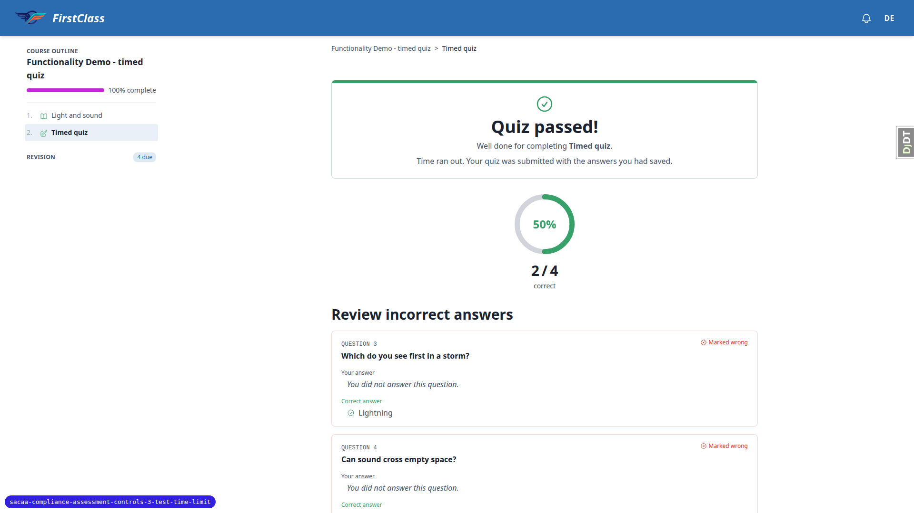 | After the time limit has passed, opening the runner URL redirects to results with "Time ran out" and 50% (2 / 4). |
| 7 | desktop | pass | none | Next pressed within the grace window saved page 1. Results show 50% (2 / 4). |
| 8 | desktop | pass | none | Next pressed 2 minutes past expiry did not save the late page. Results show 0% (0 / 4). |
| 9 | desktop | pass | none | A time-up post sent before expiry returns to the runner with the countdown still running and the sitting not completed. |
| 11 | desktop | pass | 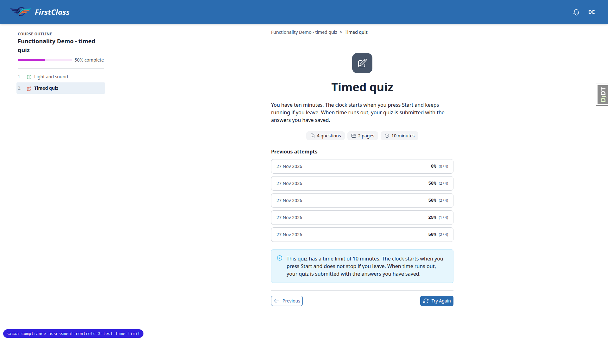 | `fls_run_housekeeping` completed 1 expired sitting, and a second run completed none. The start page then offered "Try Again". |
| 12.1-12.3 | desktop | pass | 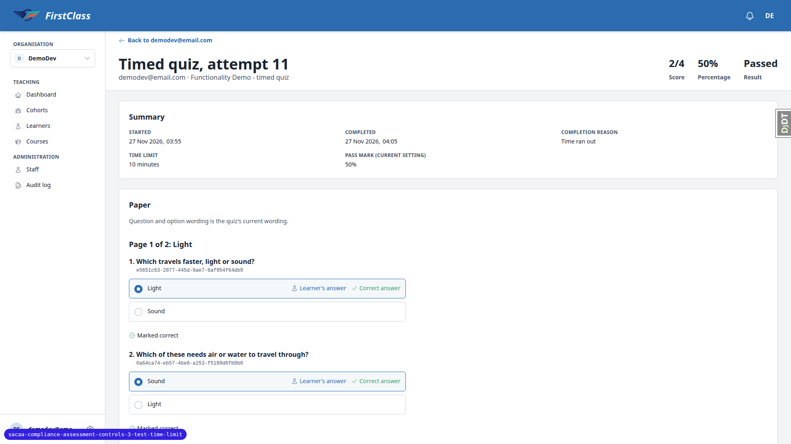 | Attempt review shows "Completion reason: Time ran out" and "Time limit: 10 minutes". Started and completed are exactly ten minutes apart. |
| 12-quick-view | desktop | pass | 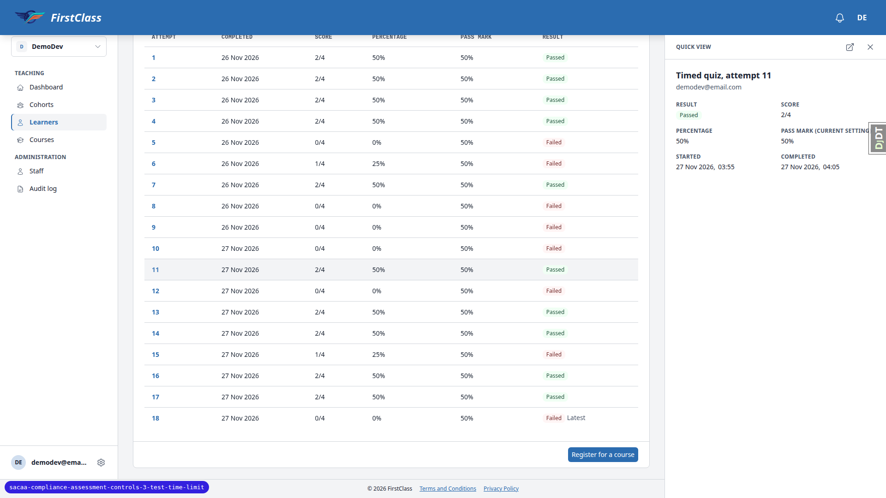 | Quick view has no layout fault. The debug toolbar tab overlaps a label, which is dev tooling only. |
| 12.4 | desktop | pass | none | Submitted untimed quiz shows "Completion reason: Learner submitted" and no "Time limit" row. |
| 13.1-13.2 | desktop | pass | 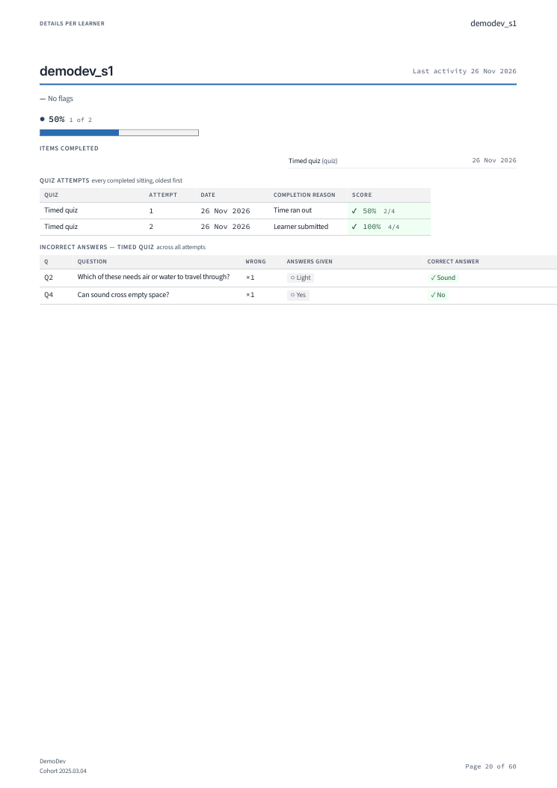 | The report PDF has a COMPLETION REASON column in the quiz attempts table. |
| 13.3 | desktop | pass |  | Every column in the attempts table is readable and nothing is clipped. |
| 13-wrong-answers-table | desktop | **fail** |  | See bug B1. |
| 14 | desktop | pass | none | Changing or removing the time limit in the demo content and running `content_save` took effect. The demo file was restored with git checkout. |
| 3.8 | desktop | pass | none | Untimed runner has no `role=timer` element. |
| 10.2 | desktop | pass | 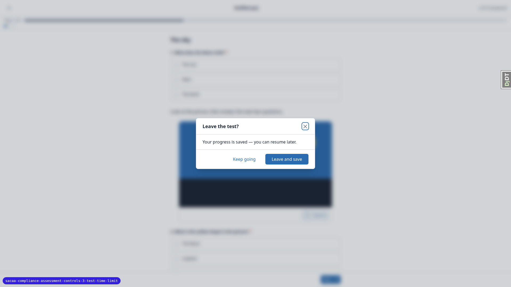 | Untimed exit dialog copy is unchanged. |
| 15 | desktop | pass | 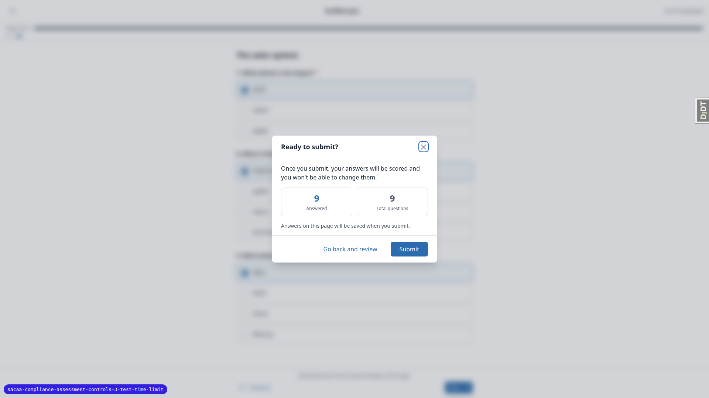 | Untimed quiz completed start to finish with no countdown or warnings, and 0 console errors. |
| 3.6 / 4.6 | mobile | pass | 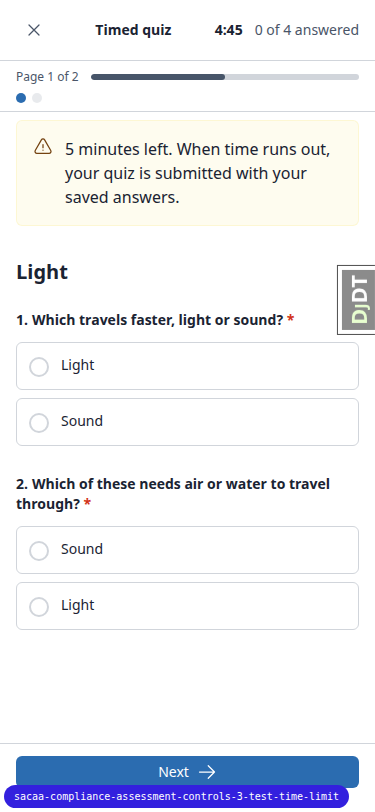 | The top bar fits on one row with no horizontal scroll. The callout wraps inside the viewport. |
| 10.1 | mobile | pass | 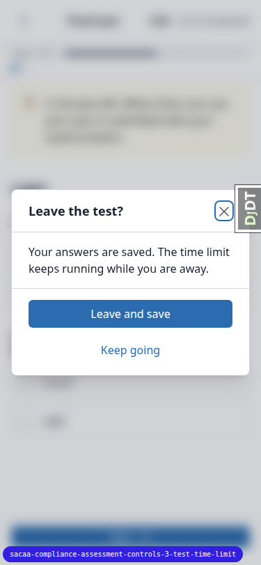 | Timed exit dialog fits the 375px viewport. |
| 1.1-1.3 | mobile | pass | 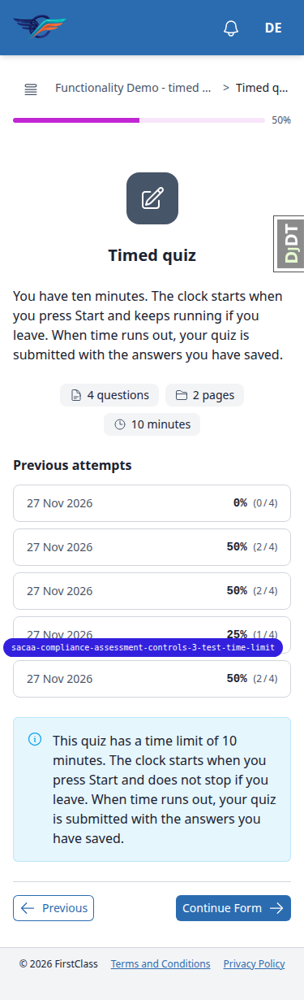 | Fact chips wrap to two rows and the notice wraps inside its box. |
| 5 (results page) | mobile | pass | 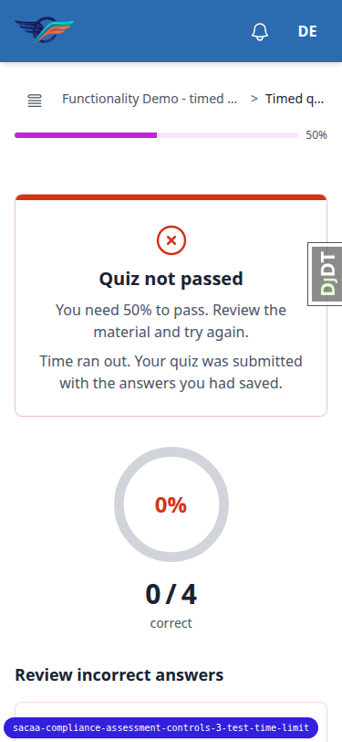 | The "Time ran out" line wraps inside the result card. |
| 2.1-2.2 | mobile | pass | 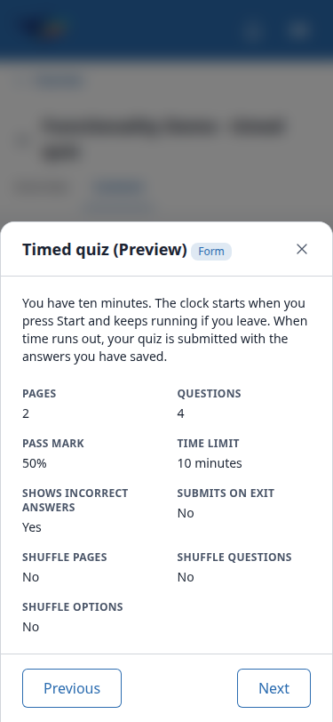 | Content preview opens as a bottom sheet and the time limit is readable. |
| 12.1-12.2 | mobile | pass | 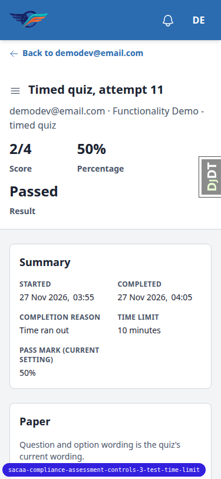 | Attempt review summary falls to two columns and stays readable. |
| 3.6 / 4.6 | tablet | pass | 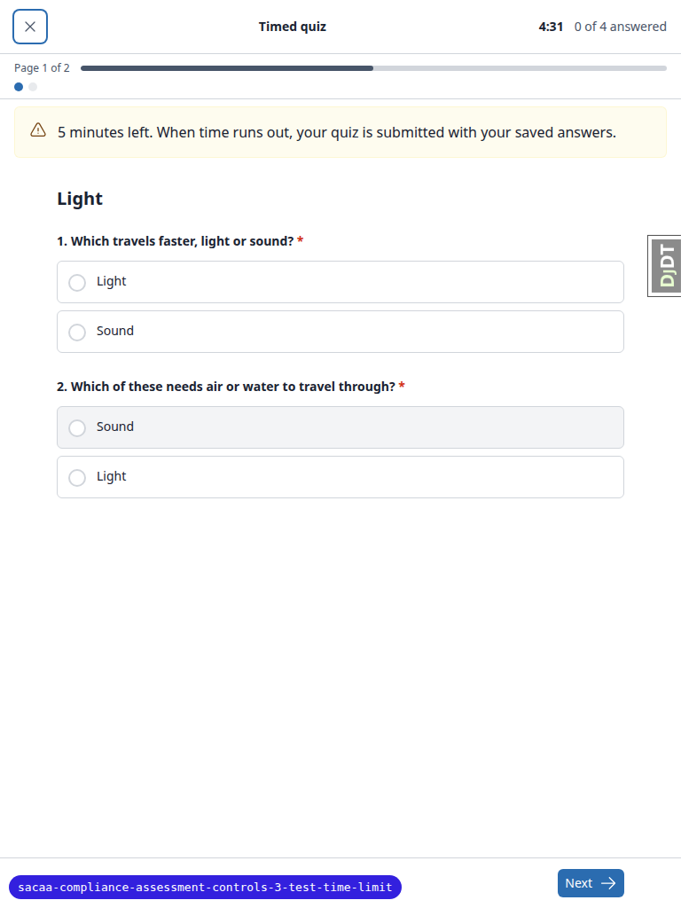 | Top bar on one row, callout on one line. |
| 1.1-1.3 | tablet | pass | 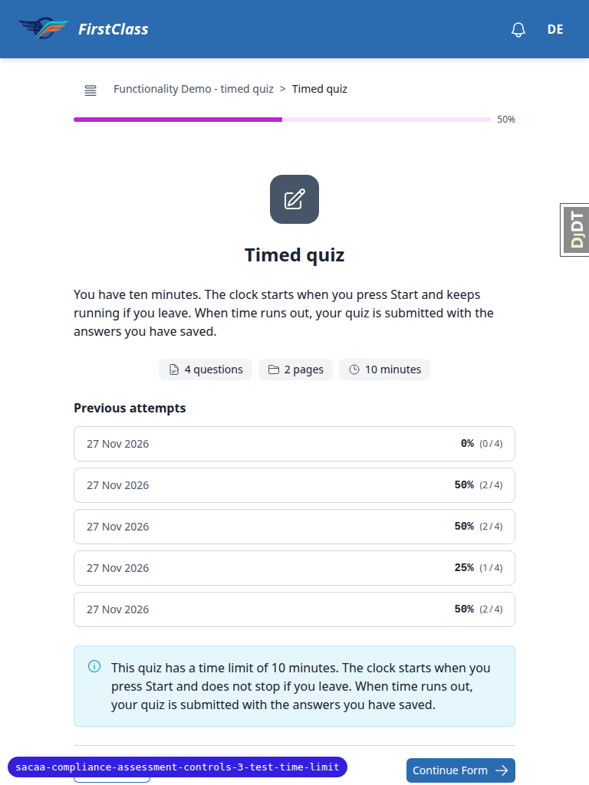 | Chips on one row and notice above the action buttons. |
| 12.1-12.2 | tablet | pass | 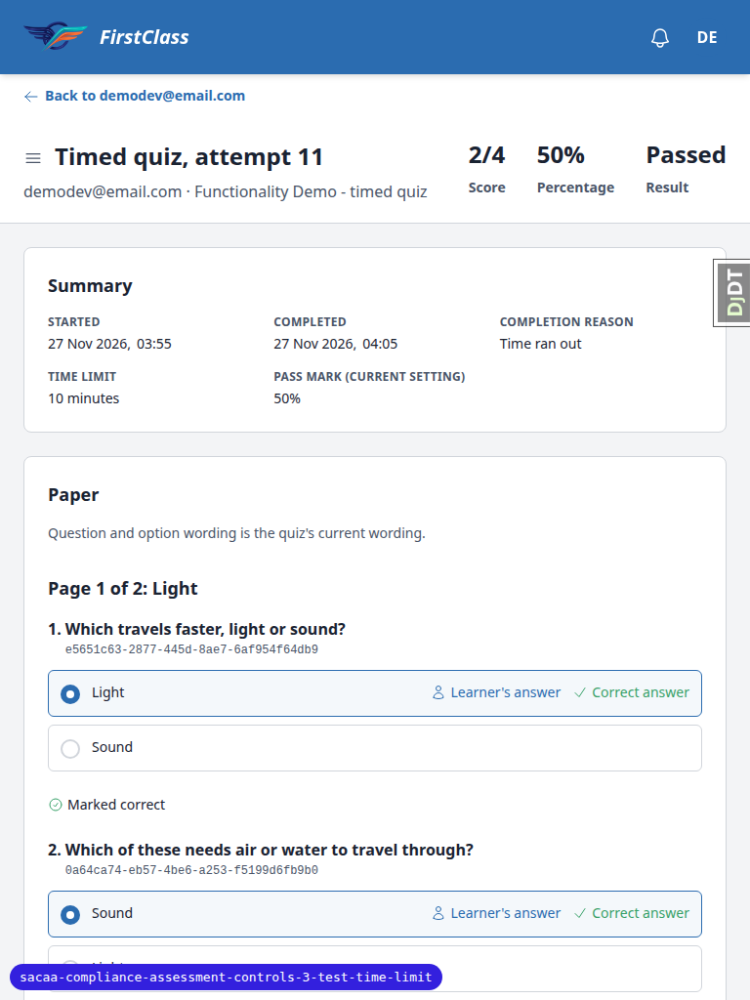 | Summary in three columns and readable. |
| 2.1-2.2 | tablet | pass | 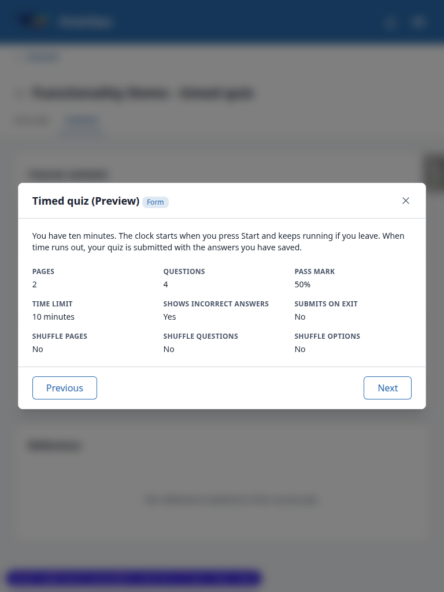 | Preview dialog sits inside the viewport. |
| 5 (results page) | tablet | pass | 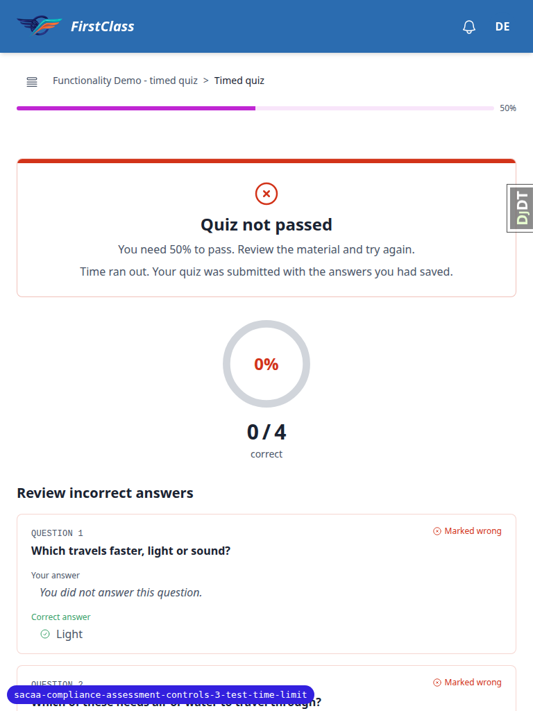 | "Time ran out" line on one row. |

## Design check

No design states tested. There are no design-comparison tests and no `design` records in this run.

## Bug B1: Cohort report PDF: incorrect-answers table overruns the right page margin

Manifestations:

- `13-wrong-answers-table`, desktop

Expected: the per-learner INCORRECT ANSWERS table in the cohort report PDF is 180mm wide, the page width less the side margins, as the comment above `.learner-section .wrong-answers-table` in `freedom_ls/reports/static/reports/print.css` says.

Actual: the table renders about 15mm wider and runs to the edge of the A4 sheet. Its header band and row rules pass the 15mm right margin that every other element on the page keeps. The page content ends at 552.8pt, but the table reaches the 595pt page edge. The column widths (9+60+12+49.5+49.5mm) already add up to 180mm, the table has no width of its own, and the cell padding is added on top. Short answers still read, but the last column sits partly in the margin. This bug is pre-existing: this branch did not change these rules.

## Layout probe

All 22 layout records came back clean, with no flags.

| Test id | Viewport | URL | Screenshot | Result |
|---|---|---|---|---|
| 1.1-1.3 | desktop | `/courses/functionality-demo-timed-quiz/2/` |  | clean |
| 1.4 | desktop | `/courses/functionality-demo-shuffled-quiz/2/` |  | clean |
| 2.1-2.2 | desktop | `/educator/organisations/demodev/courses/<timed>/__tabs/content` |  | clean |
| 2.3 | desktop | `/educator/organisations/demodev/courses/<shuffled>/__tabs/content` |  | clean |
| 3.1-3.4 | desktop | `/courses/functionality-demo-timed-quiz/2/fill_form/1` |  | clean |
| 10.1 | desktop | `/courses/functionality-demo-timed-quiz/2/fill_form/1` |  | clean |
| 4.1-4.2 | desktop | `/courses/functionality-demo-timed-quiz/2/fill_form/1` |  | clean |
| 4.4 | desktop | `/courses/functionality-demo-timed-quiz/2/fill_form/1` |  | clean |
| 5 | desktop | `/courses/functionality-demo-timed-quiz/2/complete` |  | clean |
| 6.6 | desktop | `/courses/functionality-demo-timed-quiz/2/complete` |  | clean |
| 11 | desktop | `/courses/functionality-demo-timed-quiz/2/` |  | clean |
| 12.1-12.3 | desktop | `/educator/organisations/demodev/quiz-attempts/<id>` |  | clean |
| 12-quick-view | desktop | `/educator/organisations/demodev/learners/<id>/__tabs/courses` |  | clean |
| 10.2 | desktop | `/courses/functionality-demo-shuffled-quiz/2/fill_form/2` |  | clean |
| 15 | desktop | `/courses/functionality-demo-shuffled-quiz/2/fill_form/1` |  | clean |
| 3.6 / 4.6 | mobile | `/courses/functionality-demo-timed-quiz/2/fill_form/1` |  | clean |
| 10.1 | mobile | `/courses/functionality-demo-timed-quiz/2/fill_form/1` |  | clean |
| 1.1-1.3 | mobile | `/courses/functionality-demo-timed-quiz/2/` |  | clean |
| 5 (results page) | mobile | `/courses/functionality-demo-timed-quiz/2/complete` |  | clean |
| 2.1-2.2 | mobile | `/educator/organisations/demodev/courses/<timed>/__tabs/content` |  | clean |
| 12.1-12.2 | mobile | `/educator/organisations/demodev/quiz-attempts/<id>` |  | clean |
| 3.6 / 4.6 | tablet | `/courses/functionality-demo-timed-quiz/2/fill_form/1` |  | clean |
| 1.1-1.3 | tablet | `/courses/functionality-demo-timed-quiz/2/` |  | clean |
| 12.1-12.2 | tablet | `/educator/organisations/demodev/quiz-attempts/<id>` |  | clean |
| 2.1-2.2 | tablet | `/educator/organisations/demodev/courses/<timed>/__tabs/content` |  | clean |
| 5 (results page) | tablet | `/courses/functionality-demo-timed-quiz/2/complete` |  | clean |

The PDF page for test 13 was not probed for layout, since PDFs are not a browser page. Its overrun is documented as bug B1.

## Data changes

No data changes. There are no `data_change` records in this run. The run did change data through steps the plan prescribes; see General notes.

## Bug status

- **FIXED** (commit: 02d13fdaa) — Cohort report PDF: incorrect-answers table overruns the right page margin. Re-verified on a regenerated PDF: the table now ends at the right margin. 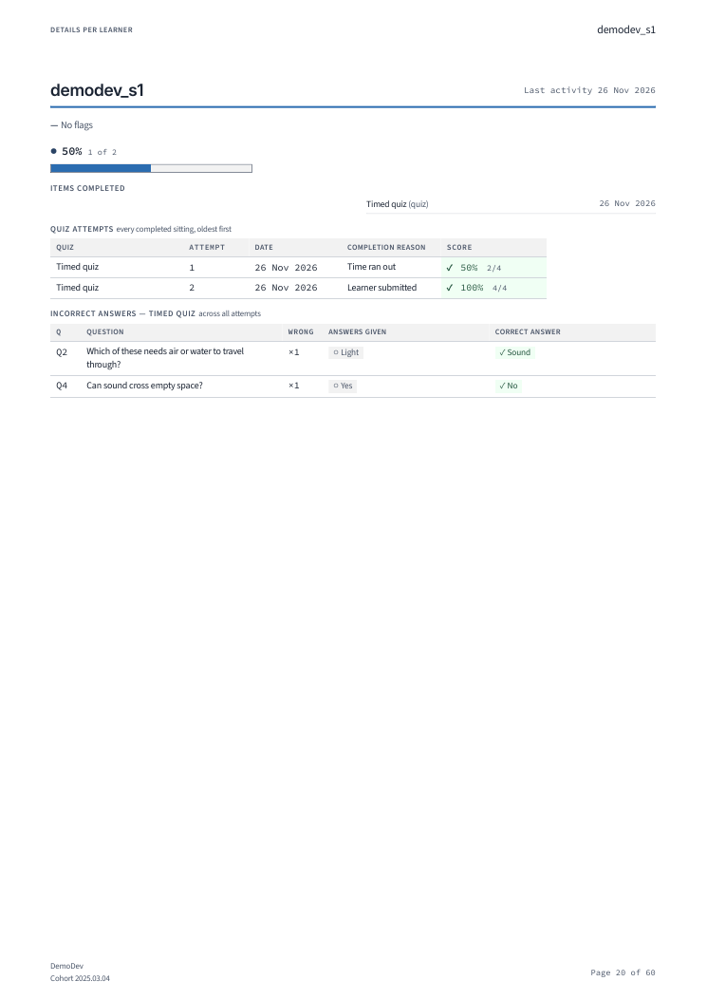
- Test run after the fix: 3112 passed, 0 failed (targeted, commits 57270b77d..HEAD). The fixer also ran the reports app with the WeasyPrint tests included: 592 passed.

## General notes

Content of the `note` record:

- Clock rewinds (the plan's "Moving the clock" shell snippet), `fls_run_housekeeping` and the Test 14 `content_save` runs were test steps the plan prescribes, not data set-up.
- No data helper was needed. The seeded cohort learner `demodev_s1` already had one `time_expired` and one `learner_submitted` sitting.
- The run left about ten extra completed sittings on demodev@email.com's timed quiz and one on the shuffled quiz.
- Pre-step rebase: the branch was rebased onto main (24 commits, no conflicts, lost-change check pass, 2925 targeted tests passed, pre-commit clean) and force-pushed. Main had only regrouped the roadmap.
- The rebase helper's separate front-end smoke pass was not run on its own, because this full QA run covers the same pages at all three viewports.

Observations from individual tests:

- Test 5: the plan's 8s rewind is shorter than the rewind command takes to run, so it was done at about 25s. A `beforeunload` prompt fired on the manual reload, which is the normal unsaved-changes guard.
- Tests 6.3-6.5: the results page shows the sitting with the latest completed time. The -300 rewind backdated this sitting's completion to before Test 5's, so the page showed Test 5's 25% rather than this sitting's 50%. This is a test artefact, not a product fault, because sittings cannot overlap outside a rewound clock. The 50% sitting is in the previous attempts list.
- Test 11: the start page lists only the five attempts with the latest completion time, and the -600 rewind backdated this sitting behind five others. It was confirmed as attempt 11 (2/4, 03:55 to 04:05, "Time ran out") in the educator attempt review.
- Test 12: the quick view that opens first carries no completion reason. The spec names only the attempt review.
- Test 13: the on-screen Report tab is a cohort summary with no per-learner attempts table (unchanged by this branch). The "Quiz attempts" table exists only in the generated report. The screenshot is PDF page 20 rendered to an image. On that page (demodev_s1), attempt 1 shows "Time ran out" and attempt 2 shows "Learner submitted".
- Test 14: after the demo content file was restored, the countdown was back on the 10-minute limit (9:19, with the time already spent taken off).
- Test 12-quick-view: the collapsed debug toolbar tab sits over the end of the "Pass mark (current setting)" label. This is dev tooling only.

status: ok · reason: 1 bug — 1 fixed, 0 unresolved; report rendered, screenshots verified
