# QA report: Quiz time limit

- Branch: `sacaa-compliance-assessment-controls-3-test-time-limit`
- Dev server port: 8622
- Run date: 2026-11-26
- Scoping class: FULL
- Result: all 15 tests passed; no bugs found.

## Methodology

Tests were run in a browser against the dev server following `3. frontend_qa.md`. Screenshots were collected into `screenshots/` beside this report, and every image referenced below exists there. Tests run at desktop, mobile (375px) and tablet (768px) where the plan asked for it. Time was moved by rewinding the open sitting's `start_time`, as the plan describes.

## Diff scoping

Class FULL. The changed files that triggered it include `freedom_ls/learner_interface/templates/learner_interface/course_form_page.html`, `freedom_ls/learner_interface/static/learner_interface/js/alpine-components.js`, `freedom_ls/reports/static/reports/print.css`, and others (53 files in total). Nothing was skipped: all tests and all viewport passes ran.

## Smoke gate

Pass. Pages loaded: `/` and `/courses/functionality-demo-timed-quiz/2/`.

## Test results

| Test | Viewport | Result | Notes |
|---|---|---|---|
| 1 Start page shows the limit | desktop, tablet | pass | The "10 minutes" chip with a clock icon sits beside the question and page chips. The exact notice is above Start. The untimed quiz shows no chip and no notice. At 768px there is no overflow. The dev-only branch badge covers the corner of the Previous button (dev tooling, not product). |
| 2 Educator content preview | desktop | pass | The timed quiz shows "Time limit: 10 minutes". The untimed quiz shows "Time limit: None set". |
| 3 Countdown | desktop, mobile | pass | It starts at 9:58 in m:ss. It ticks one second at a time with no movement or animation. It has `role=timer` and the name "Time left". It carries on across Next (9:26) and Previous (9:21). At 375px nothing overlaps and scrollWidth is 375. No console errors. |
| 4 Warnings | desktop, mobile, tablet | pass | The 5-minute callout appears when the countdown passes 5:00. Loading with under 5 minutes left shows it at once. Crossing 1:00 swaps it to the 1-minute callout, and the assertive region holds its text. Reloading under a minute shows the 1-minute callout at once. Focus never moves. At 375px the callout wraps to two lines and the first question stays on screen. At 768px the callout is on one line. The page's toast container also has polite and assertive regions (pre-existing, separate). |
| 5 Time runs out on the page | desktop | pass | At 0:00 the page posted itself with no beforeunload dialog and no validation message. Results show "Time ran out. Your quiz was submitted with the answers you had saved." and 1/4 (25%). In the database: `completion_reason=time_expired`, `time_limit_minutes=10`, completed time exactly start+10:00, Q1 answer stored. |
| 6 Leave and return after time is up | desktop | pass | The exit dialog reads "Your answers are saved. The time limit keeps running while you are away." After rewinding to -300, the start URL redirected to results with "Time ran out". Both previous attempts were listed and Try Again started a new sitting at 9:58. Opening `fill_form/1` directly also landed on results (50%, page 1 counted). |
| 7 Next just after expiry | desktop | pass | Rewound to -2s, Next pressed about 2.7s later. Results show "Time ran out" and score 2/4 (page 1 saved). |
| 8 Next long after expiry | desktop | pass | Rewound to -120s. Results show "Time ran out" and score 0/4 (page not saved). |
| 9 Early time-up claim ignored | desktop | pass | The scripted `time_up` post with about 10 minutes left redirected back to `fill_form/1` with the countdown running. The sitting stayed open. |
| 10 Exit dialog copy | desktop | pass | The timed quiz shows the "time limit keeps running" copy. The untimed save-on-exit quiz keeps "Your progress is saved — you can resume later." |
| 11 Housekeeping | desktop | pass | `fls_run_housekeeping` printed "Completed 1 sitting(s) whose quiz time limit had run out." The second run completed none. The sitting is `time_expired`, 2/4, completed at start+10:00. The start page lists it among previous attempts with no resume. |
| 12 Attempt review | desktop, mobile | pass | The Summary shows "Completion reason: Time ran out" and "Time limit: 10 minutes". Started 14:18, Completed 14:28 (exactly ten minutes). The learner-submitted untimed attempt shows "Completion reason: Learner submitted" and no Time limit row. At 375px the rows sit in the two-column grid and nothing is clipped. |
| 13 Cohort report | desktop | pass | In the PDF (page 20, demodev_s1) the QUIZ ATTEMPTS table has a COMPLETION REASON column after DATE. It shows "Time ran out" on attempt 1 and "Learner submitted" on attempt 2. Every column is readable and nothing is clipped. |
| 14 Changing the limit mid-sitting | desktop | pass | With the limit set to 30 the runner showed 29:48. With the key removed there was no countdown, and the start page showed no chip or notice. After `git checkout` and `content_save` the runner showed 9:23. No console errors. The demo file is restored. |
| 15 Untimed quiz unchanged | desktop | pass | No countdown or `data-remaining-seconds` on any page. The quiz was taken start to finish (3 pages) and submitted. Results show no "Time ran out". No console errors. The runner shows no submit confirmation dialog on main either, so behaviour is unchanged. |

Screenshots:

- Test 1 desktop: 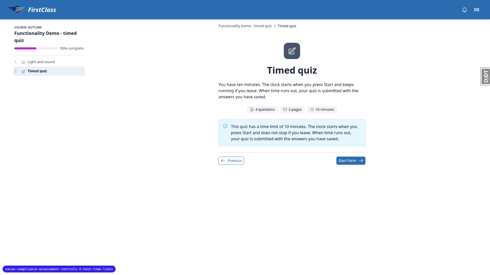
- Test 1 tablet: 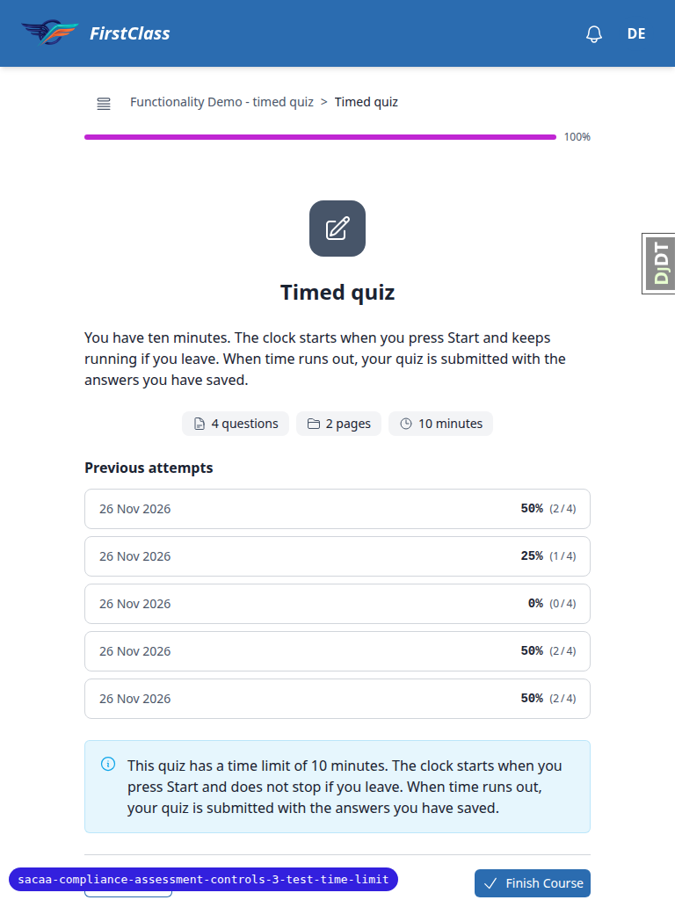
- Test 2: 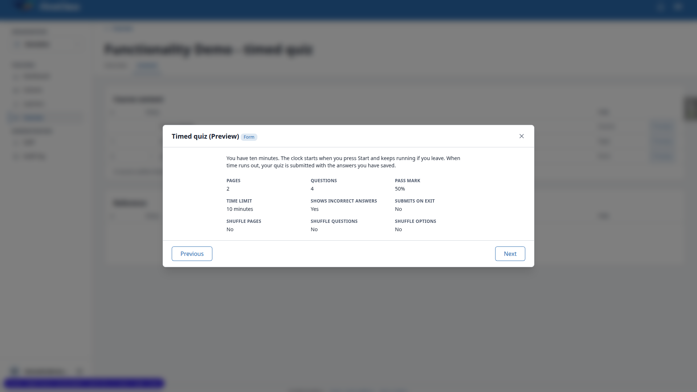
- Test 3 desktop: 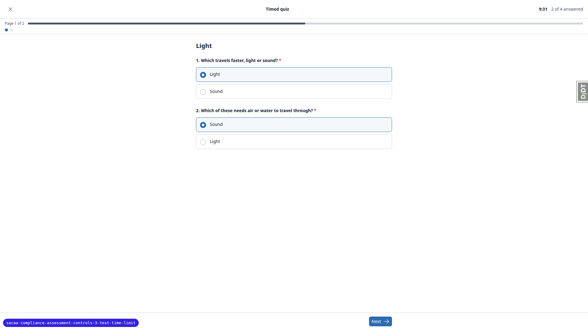
- Test 3 mobile: 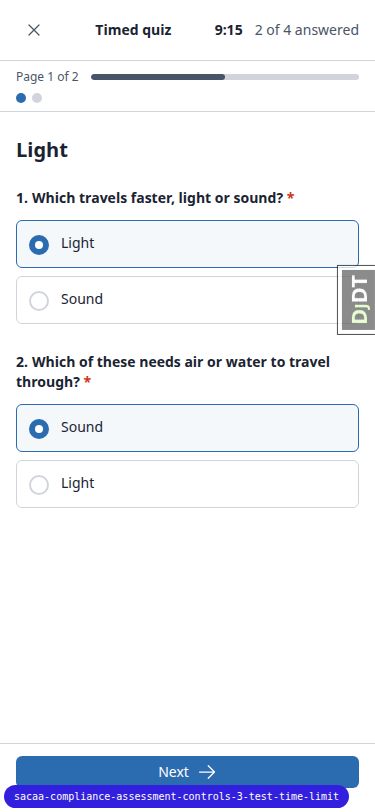
- Test 4 desktop: 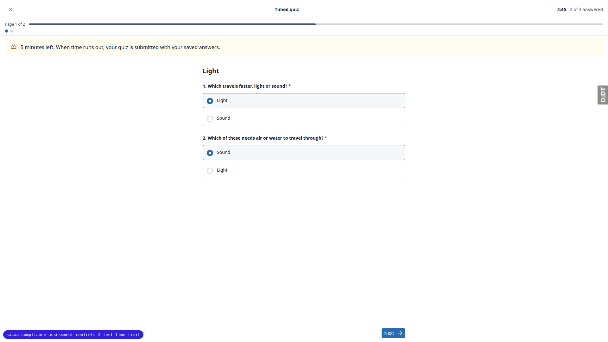
- Test 4 mobile: 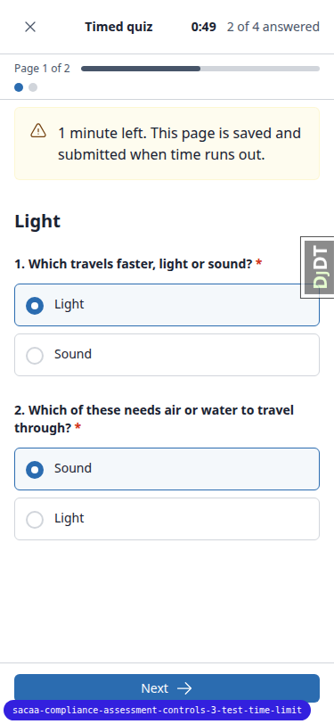
- Test 4 tablet: 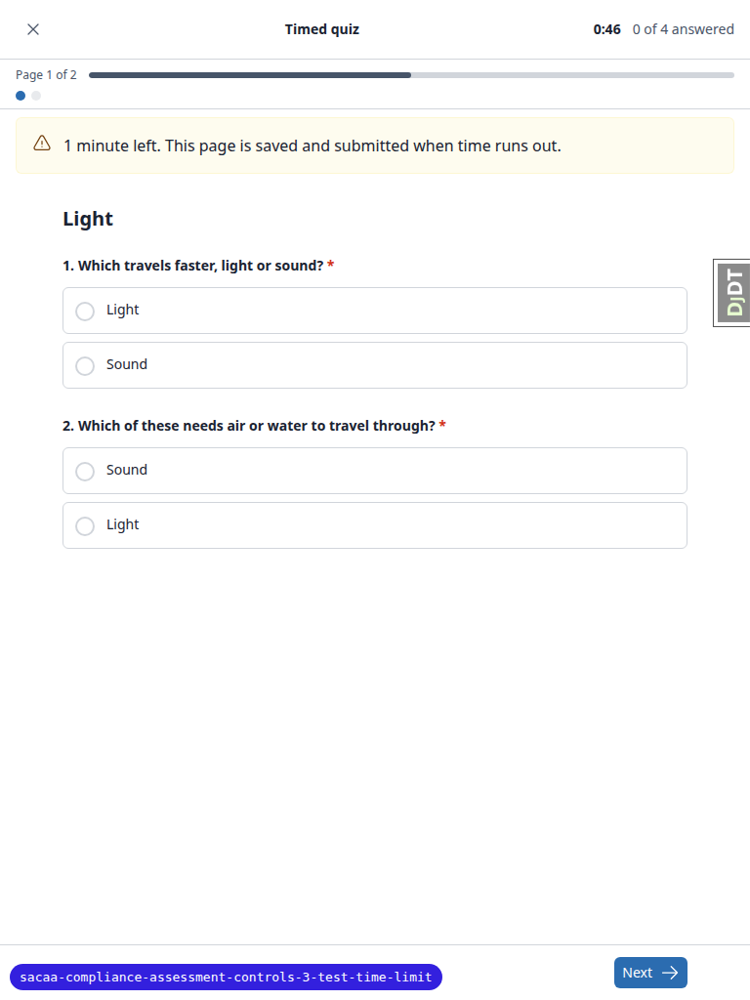
- Test 5: 
- Tests 6 and 10: 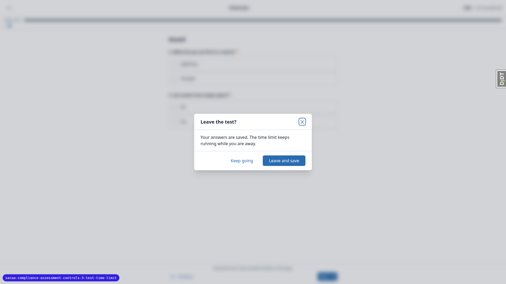
- Test 8: 
- Test 11: 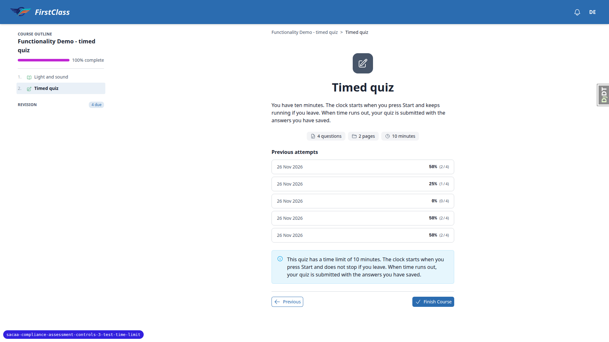
- Test 12 desktop: 
- Test 12 mobile: 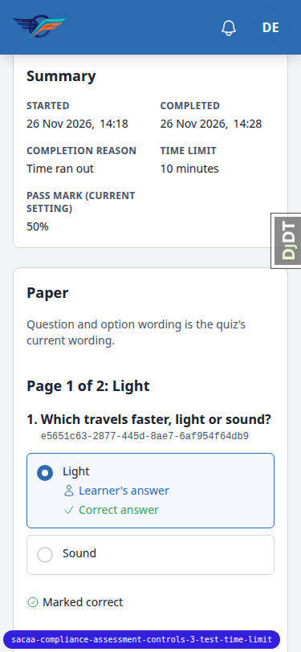
- Test 15: 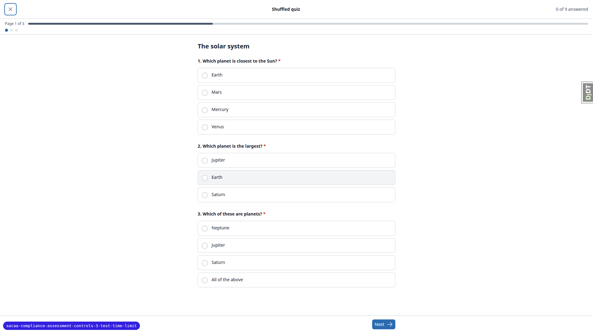

## Design check

No design states tested.

## Layout probe

| Test | Viewport | URL | Screenshot | Result |
|---|---|---|---|---|
| 1 | desktop | /courses/functionality-demo-timed-quiz/2/ |  | clean |
| 2 | desktop | /educator/organisations/demodev/courses/<timed>/__tabs/content |  | clean |
| 3 | desktop | /courses/functionality-demo-timed-quiz/2/fill_form/1 |  | clean |
| 3 | mobile | /courses/functionality-demo-timed-quiz/2/fill_form/1 |  | clean |
| 4 | desktop | /courses/functionality-demo-timed-quiz/2/fill_form/1 |  | clean |
| 4 | mobile | /courses/functionality-demo-timed-quiz/2/fill_form/1 |  | clean |
| 5 | desktop | /courses/functionality-demo-timed-quiz/2/complete |  | clean |
| 6 | desktop | /courses/functionality-demo-timed-quiz/2/fill_form/2 |  | clean |
| 8 | desktop | /courses/functionality-demo-timed-quiz/2/complete |  | clean |
| 11 | desktop | /courses/functionality-demo-timed-quiz/2/ |  | clean |
| 15 | desktop | /courses/functionality-demo-shuffled-quiz/2/fill_form/1 |  | clean |
| 12 | desktop | /educator/organisations/demodev/quiz-attempts/<time-expired> |  | clean |
| 12 | mobile | /educator/organisations/demodev/quiz-attempts/<time-expired> |  | clean |
| 1 | tablet | /courses/functionality-demo-timed-quiz/2/ |  | clean |
| 4 | tablet | /courses/functionality-demo-timed-quiz/2/fill_form/1 |  | clean |

## Data changes

| What changed | Made by | Files written |
|---|---|---|
| Registered DemoDev "Cohort 2025.03.04" (50 members) on functionality-demo-timed-quiz. demodev_s1@email.com was given one `time_expired` (2/4) and one `learner_submitted` (4/4) completed sitting on the timed quiz. | `sdd:qa-data-helper` | `freedom_ls/qa_helpers/management/commands/qa_create_timed_quiz_sittings.py` |

Test runs also created sittings for `demodev@email.com` through normal use of the quizzes. Test 14 changed the demo content temporarily and restored it with `git checkout`.

## Bug status

No bug records: all tests passed.

## General notes

- Test 11: the start page lists the five most recent attempts by completion time. A backdated time-expired sitting sorts by its expiry time, not by when it was closed. This is an observation only, not a failure.
- Test 13: the per-learner attempts table exists only in the generated report document (`reports/report.html` via `learner_details.html`). The on-screen Report tab is a cohort summary without per-learner attempt tables, as on main. The check was therefore done on the PDF.
- Test 15: the untimed runner shows no submit confirmation dialog on main either, so the plan's "usual submit confirmation" matched existing behaviour.
- Test 4: the page's toast container has its own polite and assertive live regions. These are pre-existing and separate from the countdown regions.
- The dev-only branch badge overlaps the corner of the Previous button on the tablet start page. It is dev tooling, not product.
- `screenshots/page-2026-11-26T14-28-30-144Z.png` and `page-2026-11-26T14-30-22-155Z.png` exist in the folder but are not referenced by any record.

status: ok · reason: report rendered, 0 bugs documented
