# Frontend QA report: retire content that is removed from the source

Dev server on port 8482, branch `sacaa-compliance-content-versions-and-access-2-retire-removed-content`.

## Methodology

Screenshots were collected into `<spec-dir>/screenshots/` and every image referenced below exists beside this report. Tests followed `3. frontend_qa.md` against a copy of the demo content. Desktop (1920x1080) ran every test; mobile (375x812) and tablet (768x1024) ran the tests that have a layout dimension (Tests 1, 6.1, 6.2, 6.3, 7.1). The smoke gate passed, so no steps were skipped by an abort.

## Diff scoping

Class: **FULL**. Triggered by changes to templates under content_engine, educator_interface, form_engine and reports; `content_save.py`; and models plus migrations. Nothing was skipped: the desktop, mobile and tablet passes all ran.

## Smoke gate

Outcome: **pass**. Pages loaded: `/` and `/courses/functionality-demo-course-parts/1/`.

## Design check

No design states tested.

## Bug B1: Retired course page still offers Register actions that always fail

Manifestations: `6.2-register` (desktop).

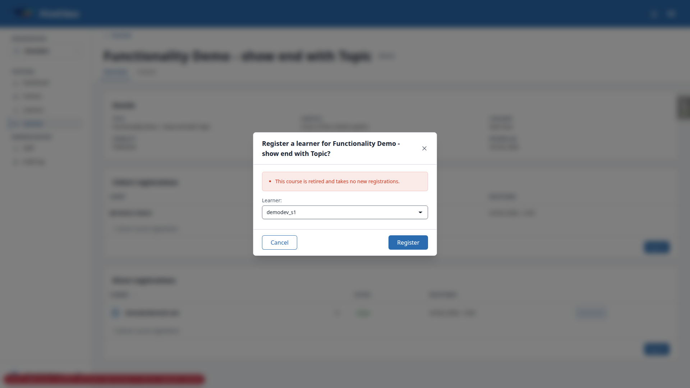

- Expected: a retired course takes no new registrations, and every other picker leaves it out. The retired course's own page should not offer a Register trigger in the Cohort registrations and Direct registrations panels.
- Actual: both panels show a primary "Register" button. The dialog lists every learner, and submitting returns 422 "This course is retired and takes no new registrations." plus a console error.

## Bug B2: Cohort report hides progress recorded on a retired topic and leaves the last-item name unmarked

Manifestations: `7-retired-topic` (desktop).

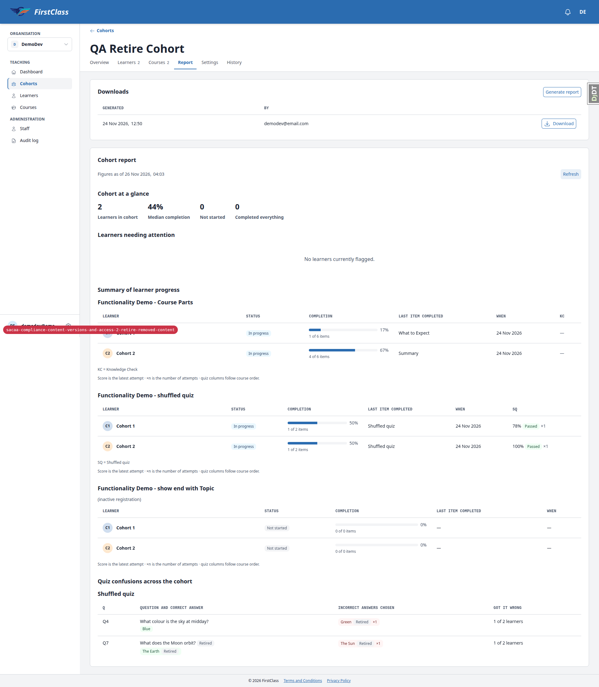

- Expected: a retired Topic or Form stays in the report carrying the Retired badge and the recorded progress, outside completion denominators, and the PDF matches the screen. A learner who completed "What to Expect" before it retired should still see it listed (marked Retired) in their completed items, and a retired item named as LAST ITEM COMPLETED should carry the Retired mark.
- Actual: `reports/gather.py` `_completed_items` filters retired items (via `_live_items`), so the PDF "Details per learner" ITEMS COMPLETED drops "What to Expect" for Cohort 1 and Cohort 2. The summary's LAST ITEM COMPLETED for Cohort 1 reads "What to Expect" with no Retired mark, on screen and in the PDF.

## Bug B3: Courses list cards show a bare "Status" label for every live course

Manifestations: `6.1-empty-status` (mobile).

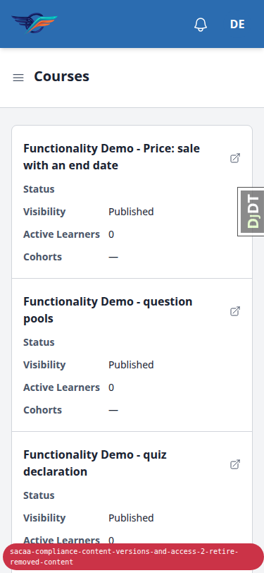

- Expected: in card mode an empty field reads like the card's other empty fields (Cohorts shows an em dash), or is left out. No label stands alone with nothing beside it.
- Actual: at 375 every live course card shows "Status" with an empty value; only the retired course has a value (the Retired chip).

## Bug B4: Retired answer chips wrap inside the cohort report's sideways-scrolling quiz table

Manifestations: `7.1` (mobile).

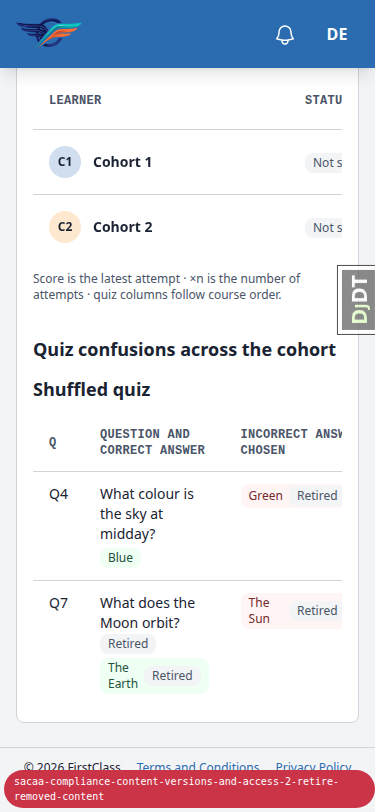

- Expected: in a table that scrolls sideways in its own region, no badge wraps (panel-framework checklist). Option chips with a Retired mark stay on one line.
- Actual: at 375 the Quiz confusions chips "The Sun | Retired x1" and "The Earth | Retired" break the option text onto two lines inside the chip.

## Layout probe

| Test id | Viewport | URL | Screenshot | Result |
|---|---|---|---|---|
| 1.1 | desktop | /courses/functionality-demo-course-parts/1/ | 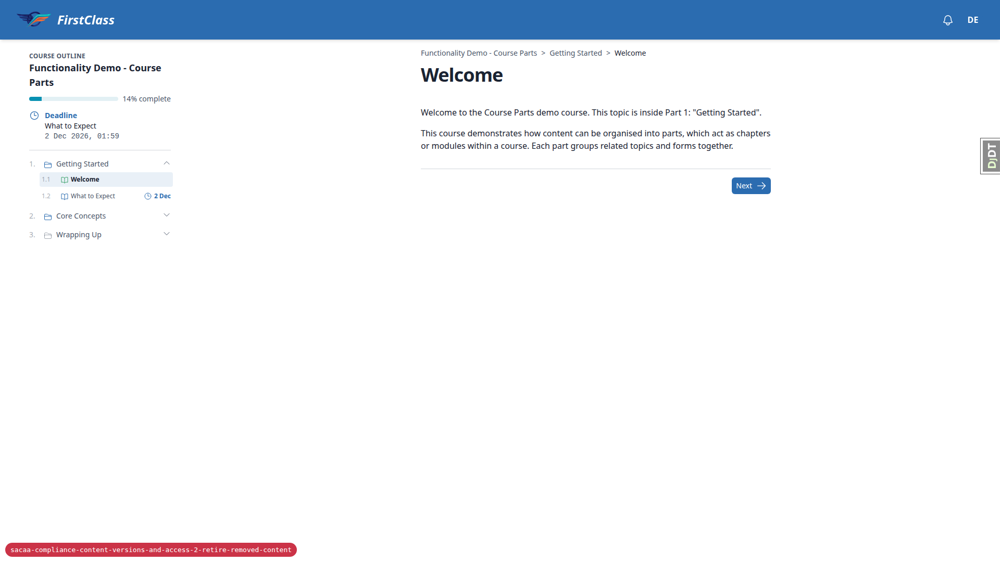 | clean |
| 1 | desktop | /courses/functionality-demo-course-parts/1/ | 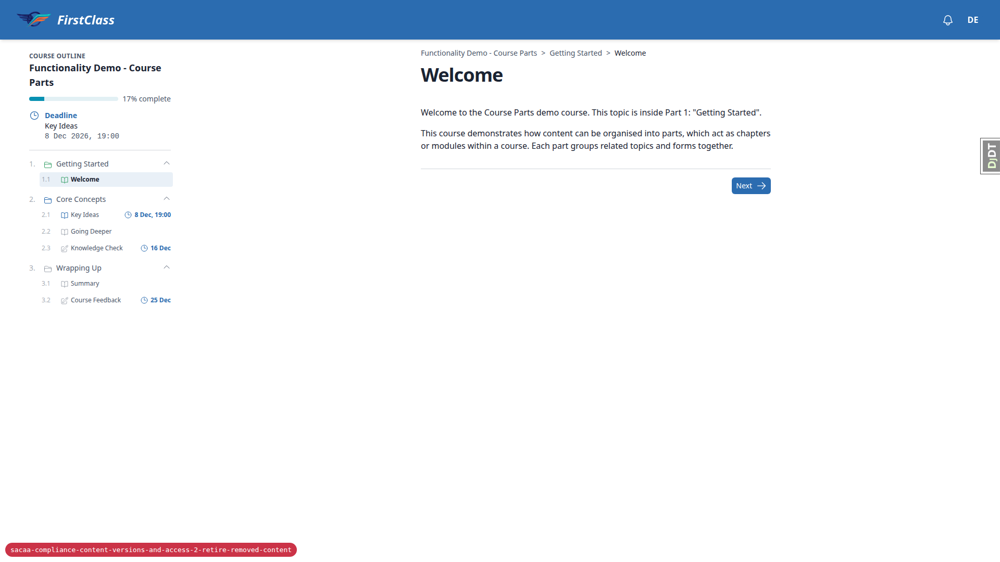 | clean |
| 3 | desktop | / | 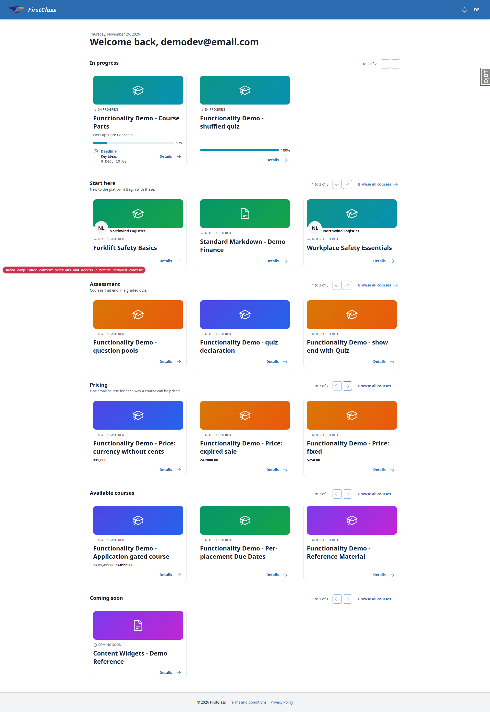 | clean |
| 5 | desktop | /courses/functionality-demo-shuffled-quiz/2/complete | 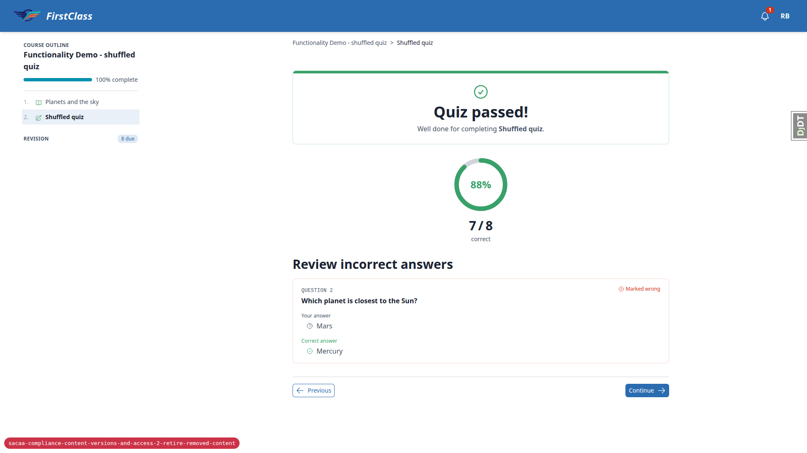 | clean |
| 6.1 | desktop | /educator/organisations/demodev/courses?courses-page=2 | 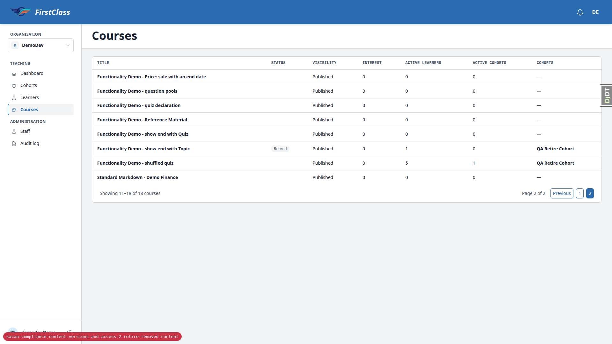 | clean |
| 6.3 | desktop | /educator/organisations/demodev/courses/531adc02-.../__tabs/content | 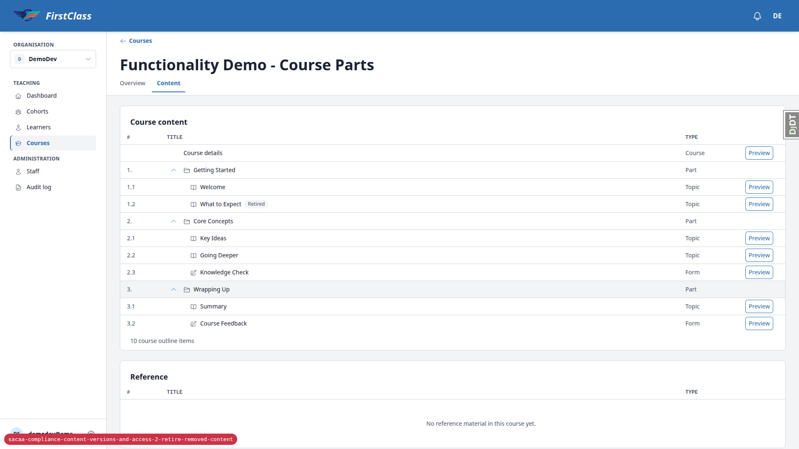 | clean |
| 6.1 | mobile | /educator/organisations/demodev/courses?courses-page=2 | 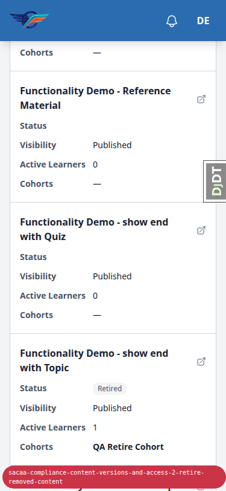 | clean |
| 7.1 | mobile | /educator/organisations/demodev/cohorts/7d1f92a3-.../__tabs/report |  | clean |
| 6.1 | tablet | /educator/organisations/demodev/courses?courses-page=2 | 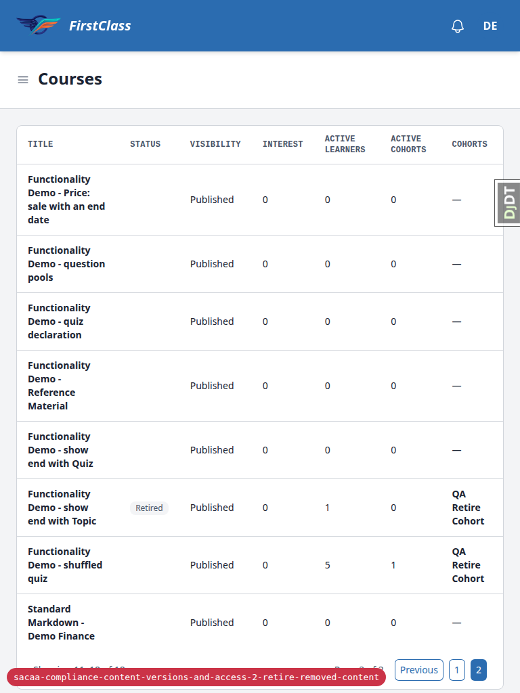 | clean |
| 1 | tablet | /courses/functionality-demo-course-parts/2/ | 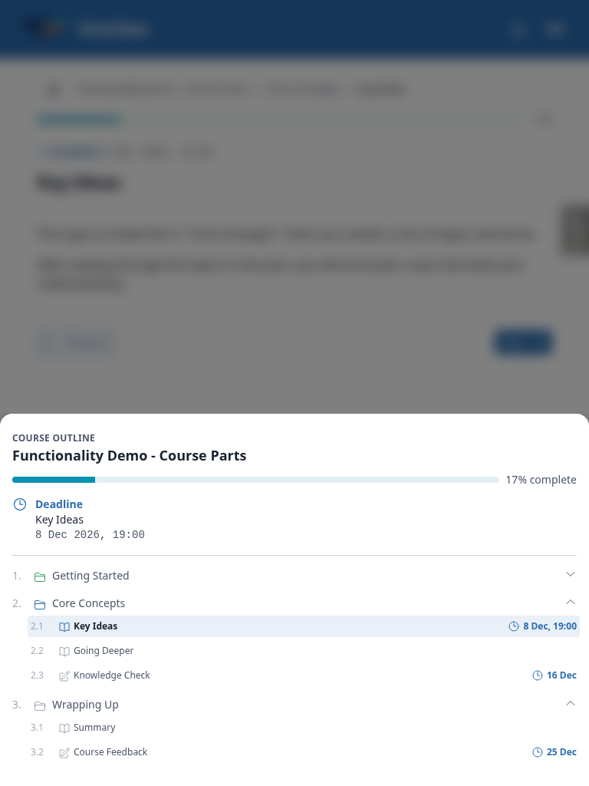 | clean |

The probe is clean everywhere; B3 and B4 were found by inspection, not by probe flags. On tablet, test 1 raised "stacked" flags only while the modal outline sheet was open, which is the intended look.

## Data changes

| What changed | Made by | Files written |
|---|---|---|
| Ran `qa_create_retire_walkthrough_scenario` (idempotent) for qa-retire-a, qa-retire-b and QA Retire Cohort. Retired extra quiz content in the QA content copy for Test 7: "What does the Moon orbit?" and option "Green". qa-retire-a and qa-retire-b each now have one completed Shuffled quiz sitting. Clean-up `content_save` restores the content. | QA data helper and `content_save` runs against the QA copy | none |

## Bug status

| Bug | Title | Status |
|---|---|---|
| B1 | Retired course page still offers Register actions that always fail | **FIXED** (commit: 71b8bdbfc) |
| B2 | Cohort report hides progress recorded on a retired topic and leaves the last-item name unmarked | **FIXED** (commit: 3d514cbb8) |
| B3 | Courses list cards show a bare "Status" label for every live course | **FIXED** (commit: 5d5cc26dc) |
| B4 | Retired answer chips wrap inside the cohort report's sideways-scrolling quiz table | **FIXED** (commit: f76298c0e) |
| — | **UNRESOLVED** — test run after the fixes left tests failing (reason: `form_engine/tests/test_models.py::test_not_retired_returns_the_live_form_rows_and_leaves_out_a_retired_one` [4 params] and `educator_interface/tests/playwright/test_course_preview_flow.py::test_course_outline_shows_a_retired_badge_beside_a_retired_topic_at_every_viewport`) | UNRESOLVED |

The full tier run over `bdf1b7175..HEAD` (local fallback): 21207 passed, 5 failed, 3 skipped. Neither failure comes from the QA fixes. The form_engine test has no `@pytest.mark.django_db` mark at `bdf1b7175`, so it raises "Database access not allowed" whatever the code does. The B2 fixer saw the Playwright outline-badge test fail both with and without its change.

How each fix was checked in the browser, after the course, the topic, the Moon question and the Green option were briefly retired again in the database (cleared afterwards):

- B1: the retired course page shows no Register button in either panel, and Deactivate is still there. The same page with the course live still shows both.
- B2: on screen and in the PDF, Cohort 1's LAST ITEM COMPLETED reads "What to Expect Retired". The PDF's ITEMS COMPLETED lists "What to Expect Retired" for both learners, and the counts are unchanged (1 of 6, 4 of 6).
- B3: at 375 the live course cards no longer show a "Status" label, and the retired card keeps its chip. The learners and cohort-courses cards still show their Status fields.
- B4: at 375 every report chip is `white-space: nowrap`, one line high, and the quiz table scrolls inside its region. On the learners, cohorts, learner, course, catalogue and dashboard pages at 375 the document is no wider than the viewport.

## General notes

Test results (desktop unless stated):

- Test 1 passed at all three widths. Removing "What to Expect" printed `Retired: 1 (Topic 1). Un-retired: 0.`. The outline is gap-free, progress goes 14% to 17%, the old index 7 is the same 404 as /99/, and a second run changed nothing.
- Test 2 passed: the refusal names the course and `--allow-course-retire`. With the flag it retired 30 rows including Course 1.
- Test 3 passed: the retired course is absent from the catalogue and dashboard, and detail, player, reference and bare URLs give the standard 404. Step 5 is n/a because `OVERRIDE_COURSE_VISIBILITY_TO_VISIBLE=False` in dev settings.
- Test 4 passed: `Un-retired: 31`, progress is back to 14%, and the registration still works.
- Test 5 passed. The open sitting kept its paper (9/9), and a new sitting got 8 questions with a gap-free numbering and scored 7/8.
- Tests 6.1 to 6.6 passed on desktop except B1. The learners-list filter labels the retired course "(Retired)" and both registration pickers leave it out.
- Test 7.1 and 7.2 passed except B2 (desktop) and B4 (mobile). The PDF matches the screen. The "○" on Green and The Sun is the existing author-never-marked legend, not caused by retirement.
- Test 8 passed. The only console error is Django admin's vendor `unload` permissions-policy notice, which is known.
- Test 9.1 to 9.4 passed. 9.1 used `getting-started-with-articles.md`, because deleting a referenced article is refused by existing "Broken widget reference" validation.

Notes and difficulties:

- Test 9.2: the linked-topic variant could not run because `content_save` validation refuses a source with a broken content link before anything is retired (existing behaviour).
- Test 9.3: removing a category still used by courses is refused by the existing "Unknown category" validation, so it was also dropped from the 4 courses.
- Test 9.4: deleting the application form while the course's `access_config` still names it makes `content_save` stop with a raw `ValueError` traceback. That check comes from main commit `0b7e5ced4`, not this branch. It is an observation with no action attached.
- The retired course's LESSONS count reads 0 because `lesson_count` counts live items only, as the spec documents.
- Mobile and tablet passes covered only the tests with a layout dimension; the data-only tests (2, 4, 5, 8, 9) ran at desktop.

status: ok · reason: 4 bugs — 4 fixed, 0 unresolved; 5 tests failing that predate the fixes; report rendered, screenshots verified
