# Frontend QA report: retire content that is removed from the source

## Methodology

Screenshots were collected into `spec_dd/2. in progress/sacaa-compliance-content-versions-and-access-2-retire-removed-content/screenshots/`. Every image linked below exists beside this report. The plan is `3. frontend_qa.md`. The run did not abort at the smoke gate, so every step was attempted. Steps that could not be exercised are listed under General notes.

## Diff scoping

Class: **FULL**. Skipped: nothing, so all viewports and all tests ran.

The changed files that triggered it span the whole stack. They cover the content_engine models, migration and `content_save` command, the form_engine models, migration and served paper, learner_interface views and utils, course_access visibility, course_applications, the educator_interface panels, templates and tags, reports gather and templates, the blog views, the Django admin and the sitemaps. There are about 110 files. The full list is in the `scoping` record in `.sdd-work/qa_scratch.jsonl`.

## Smoke gate

Outcome: **pass**. Pages loaded: `/` and `/courses/functionality-demo-course-parts/1/`. No failure.

## Design check

no design states tested

## Test results

| Test | Viewport | Result | Screenshot | Notes |
|---|---|---|---|---|
| 1 | desktop | pass | 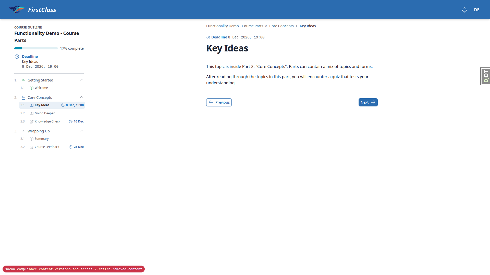 | `content_save` printed `Retired: 1 (Topic 1). Un-retired: 0.`. The re-run printed `Retired: 0. Un-retired: 0.`. The outline dropped What to Expect and numbering has no gap (1.1 / 2.1-2.3 / 3.1-3.2). Key Ideas moved from /3/ to /2/ and Previous links to /1/. Progress rose from 14% to 17% with no learner action. The old last index /7/ gives the same 404 as /99/. The breadcrumb names Core Concepts. |
| 1 | mobile | pass | 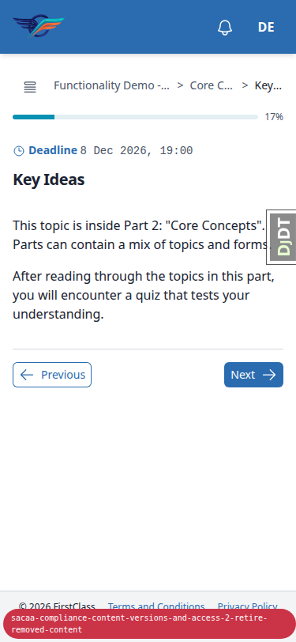 | Outline renumbered without a gap, no horizontal overflow, no console errors. |
| 1 | tablet | pass | 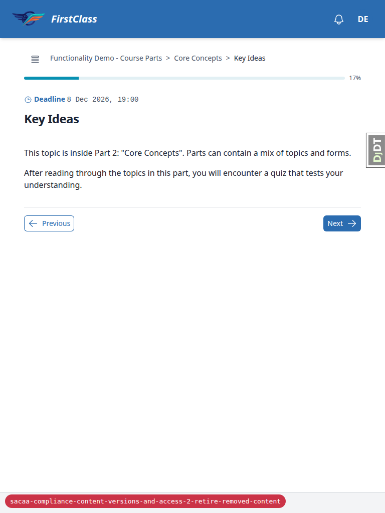 | Breadcrumb, 17% bar and Previous/Next present. No overflow, no console errors. |
| 2 | desktop | pass | none | `content_save` exited 1 with "content_save would retire 1 course... Functionality Demo - show end with Topic (3ff21a03-...)... run again with --allow-course-retire". No Retired line was printed, and the course stayed in the catalogue with its detail page returning 200. With `--allow-course-retire` it printed `Retired: 30 (Course 1, Topic 6, Form 1, FormPage 1, FormQuestion 8, QuestionOption 11, File 2). Un-retired: 0.` |
| 3 | desktop | pass | 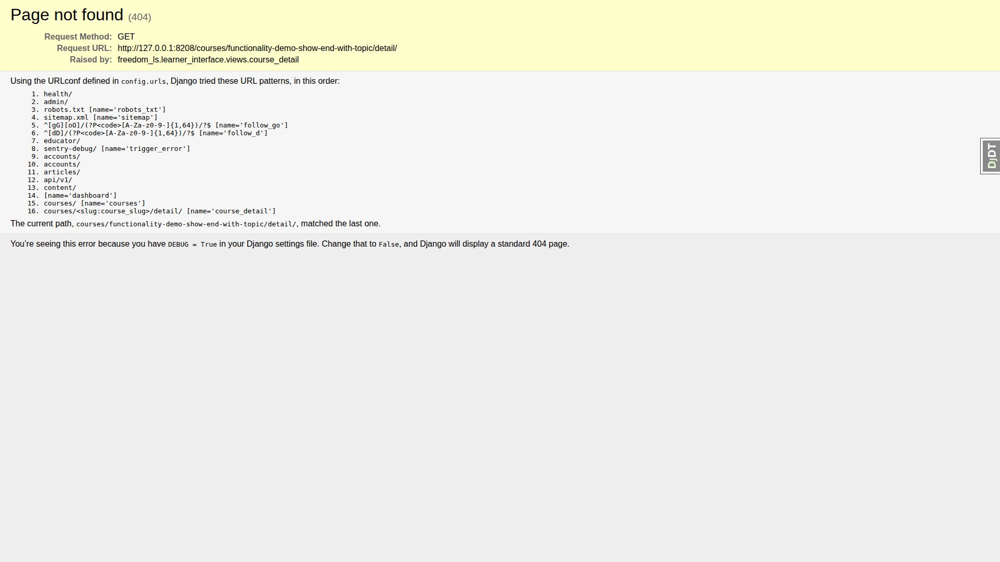 | The retired course is absent from the catalogue, catalogue search and dashboard. Detail, player /1/, reference and home give the standard 404 for the registered learner and for an anonymous visitor. No page mentions "retired". Step 5 was skipped (see General notes). |
| 4 | desktop | pass | none | Revert plus `content_save` printed `Retired: 0. Un-retired: 31 (Course 1, Topic 7, Form 1, FormPage 1, FormQuestion 8, QuestionOption 11, File 2).` What to Expect is back at 1.2 (/2/) and Welcome is still Completed. The retired course is back in the catalogue and its player /1/ opens on the existing registration. |
| 5 | desktop | pass | 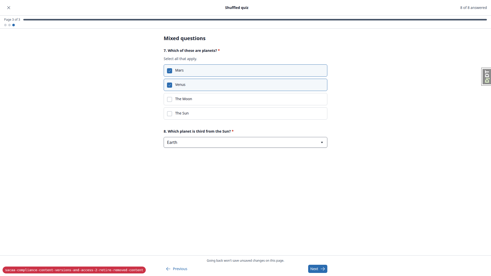 | Before: 9 questions on 3 pages. Removing one question (The sky page, not yet reached) and one option printed `Retired: 5 (FormQuestion 1, QuestionOption 4). Un-retired: 0.`. The open sitting still served the retired question with all its options and the retired dropdown option, with no Retired text shown to the learner, and submitted 9/9. The quiz page then said 8 questions and the previous attempt kept 9/9. A new sitting had the retired question absent, a 3-option dropdown, numbering 1-8 without a gap, and a result of 8/8. Wrong-answer review was not exercised. |
| 6.1 | desktop | pass | 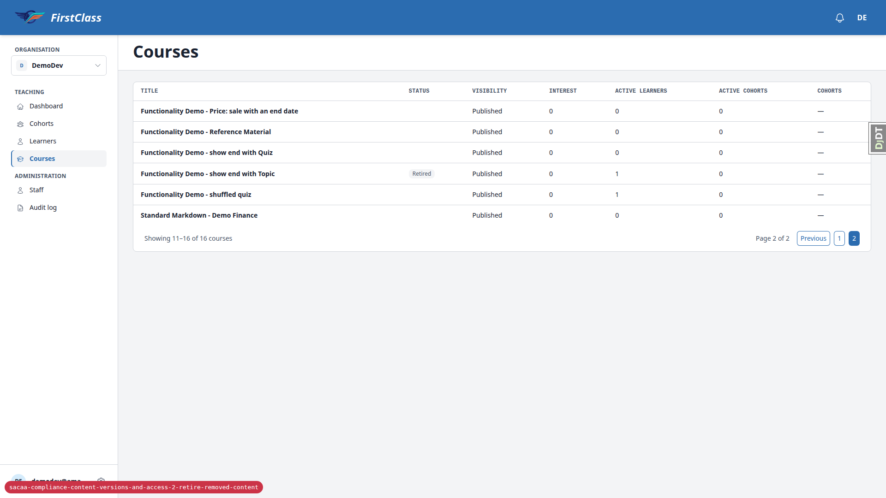 | The educator Courses list (page 2) still lists "show end with Topic" with a muted Retired badge in the Status column. Live courses are blank. The learners course filter labels it "Functionality Demo - show end with Topic (Retired)". |
| 6.1 | mobile | pass | 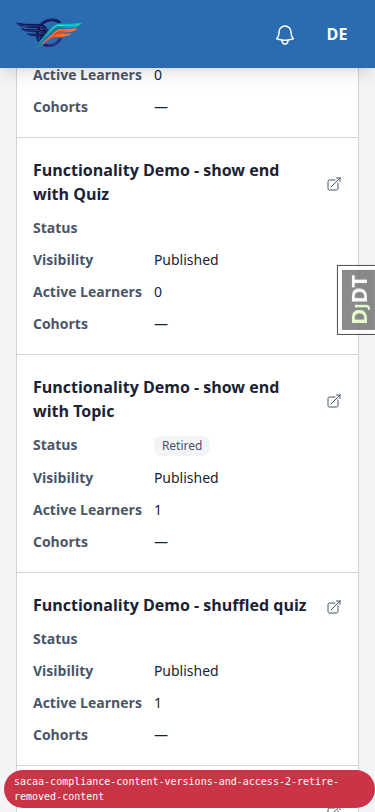 | The table shows as cards. The Retired badge is on one line (57x20px) with no horizontal overflow. |
| 6.1 | tablet | pass | 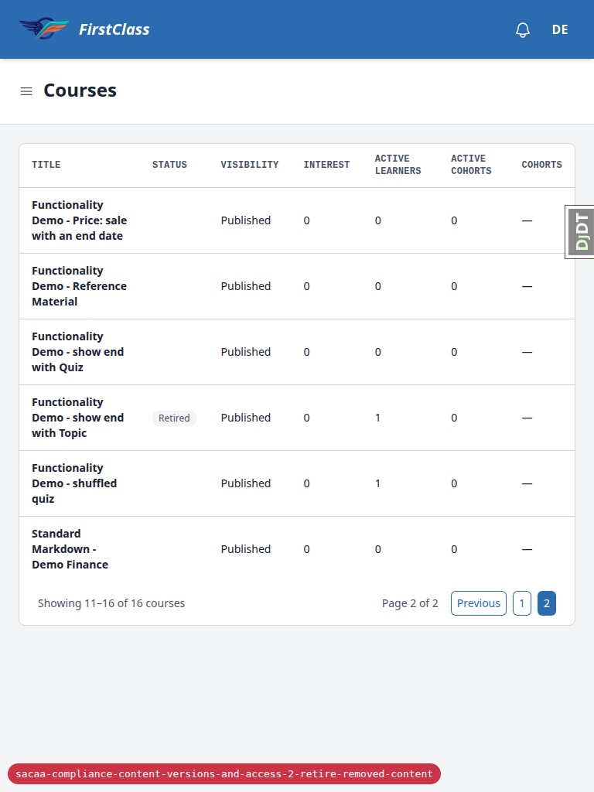 | No overflow, no console errors. |
| 6.2 | desktop | pass | 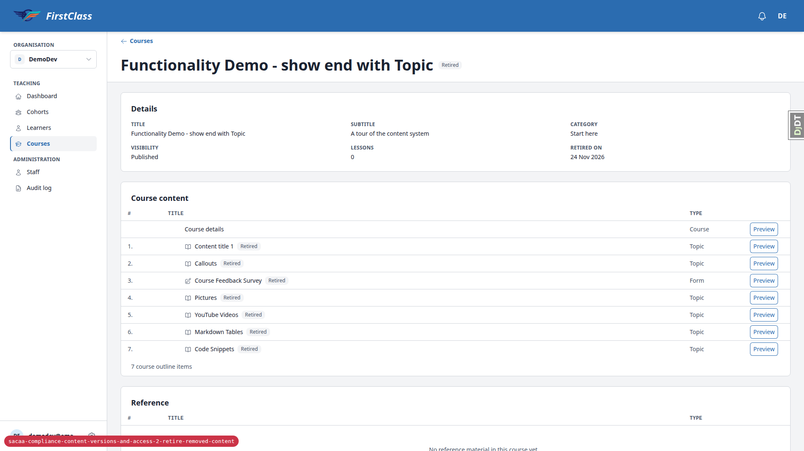 | The retired course page opens. The header shows a Retired badge beside the title and Details has "Retired on 24 Nov 2026". Every outline row is marked Retired. The live course page has neither. |
| 6.3 | desktop | pass | 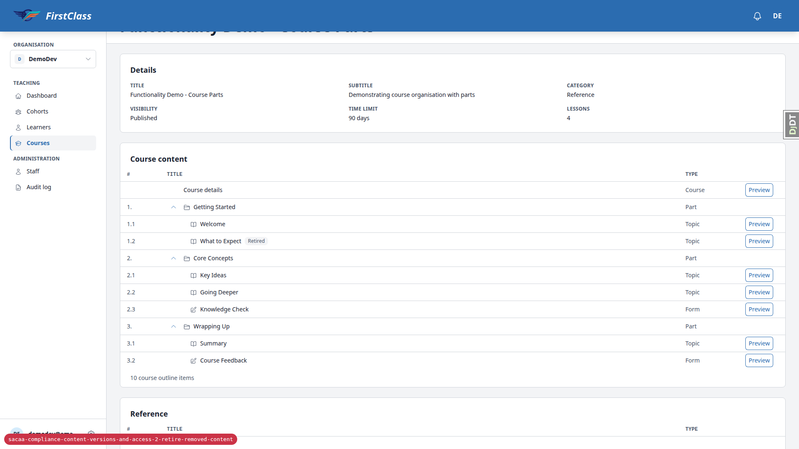 | The Course Parts outline keeps 1.2 What to Expect with a Retired badge on one line with the title. Siblings and the part have no badge. Its Preview opens. |
| 6.4 | desktop | pass | 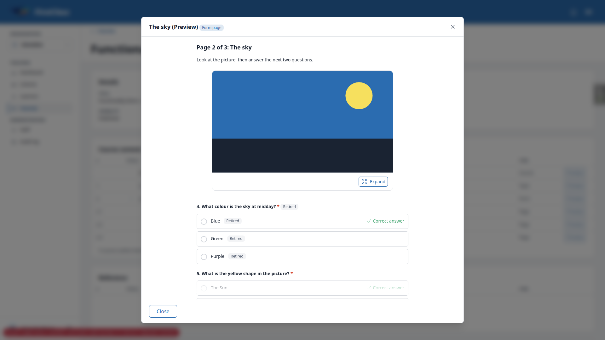 | On the sky page preview the retired question "What colour is the sky at midday?" carries a Retired badge, as do its options. The answer key is still shown and live questions are unmarked. The Mixed questions preview lists the dropdown option 'Jupiter (Retired)' and the answer key reads 'Correct answer: Earth'. |
| 6.5 | desktop | pass | 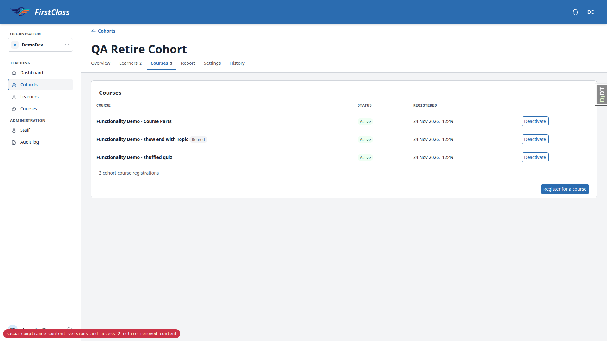 | The learner Overview "Registrations" list and the cohort Courses table both show the retired course title with a Retired badge and the registration still Active. |
| 6.6 | desktop | pass | none | Both the learner add-registration picker and the learners bulk "Register for a course" dialog leave the retired course out. |
| 7.1 | desktop | **fail** | 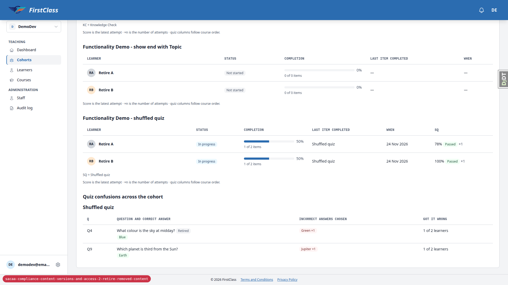 | These parts pass. Course Parts completion leaves the retired topic out (A 6 of 6 = 100%, B 1 of 6 = 17%). The quiz confusions list the retired question with a Retired badge and the wrong answer in full. A's score is 78% (7/9). The chosen retired option shows as plain "Jupiter x1" with no Retired mark, which is bug B1. Topics are not report columns (only quizzes are), so "retired topic column" does not apply. |
| 7.1 | mobile | pass | 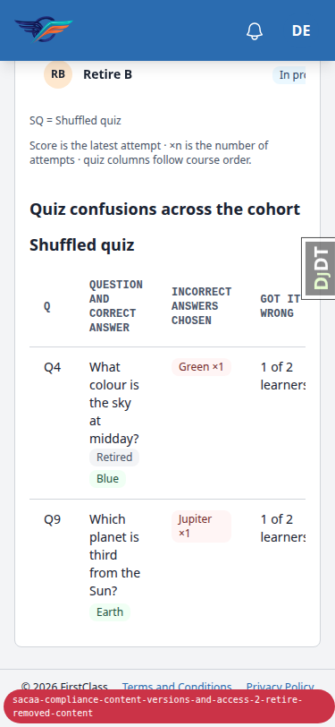 | Report at 375x812: page scrollWidth 375, no page-level horizontal scroll. |
| 7.1 | tablet | pass | 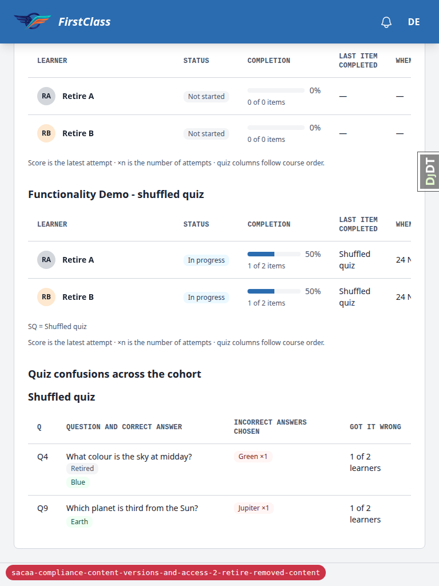 | Report at 768x1024: no page-level overflow, no console errors. |
| 7.2 | desktop | **fail** | none | The generated PDF (GeneratedReport df610b58...) has the same fractions as the screen (6 of 6, 1 of 6) and marks the retired question "Retired". The per-learner detail marks "Jupiter Retired" and "Green Retired". The PDF quiz-confusions table shows plain "Jupiter x1" with no Retired mark, which is bug B1. |
| 8.1-8.3 | desktop | pass | 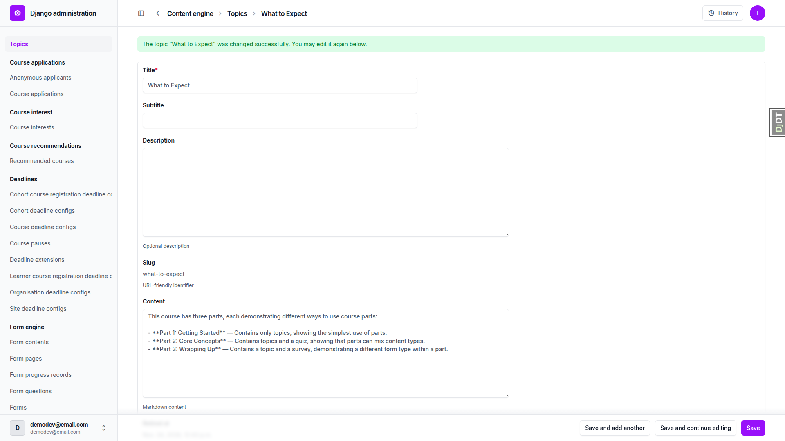 | The Topic changelist has a "Retired at" column and a Live/Retired filter. With no choice made, no choice lists the retired topic. "Retired" lists 7 (the topic plus the retired course's 6) and "Live" plus search excludes it. The retired topic form shows `retired_at` as read-only text, and Save and continue editing left it unchanged. Course, FormQuestion (9 retired), QuestionOption (15), File (2) and FormPage (1) all have the column and filter. Form page question and content inlines show "Retired at" read-only. The only console error is Django admin's own RelatedObjectLookups.js 'unload' permissions-policy warning, which is unrelated. |
| 8.4 | desktop | pass | 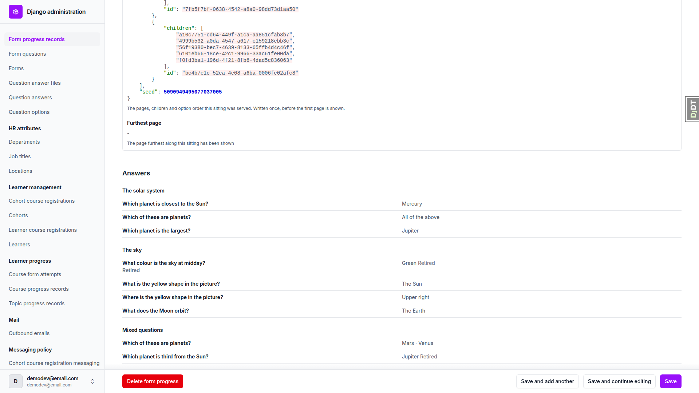 | The admin FormProgress answers page for learner A shows "What colour is the sky at midday? Retired" with the answer "Green Retired" in full. It shows "Which planet is third from the Sun?" with the answer "Jupiter Retired". |
| 9.1 | desktop | pass | none | Deleting getting-started-with-articles.md and saving retired it (count line `Article 1`). It is off /articles/, its URL is 404 and `/sitemap.xml` no longer lists it. |
| 9.2 | desktop | pass | 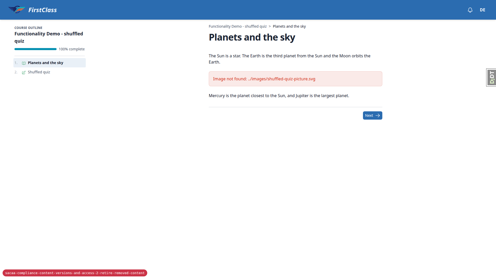 | Image half only. Deleting `functionality_demo_shuffled_quiz/images/shuffled-quiz-picture.svg` retired the File. "Planets and the sky" renders "Image not found: ../images/shuffled-quiz-picture.svg" (the existing missing-file rendering), with no traceback and no console errors. |
| 9.3 | desktop | pass | 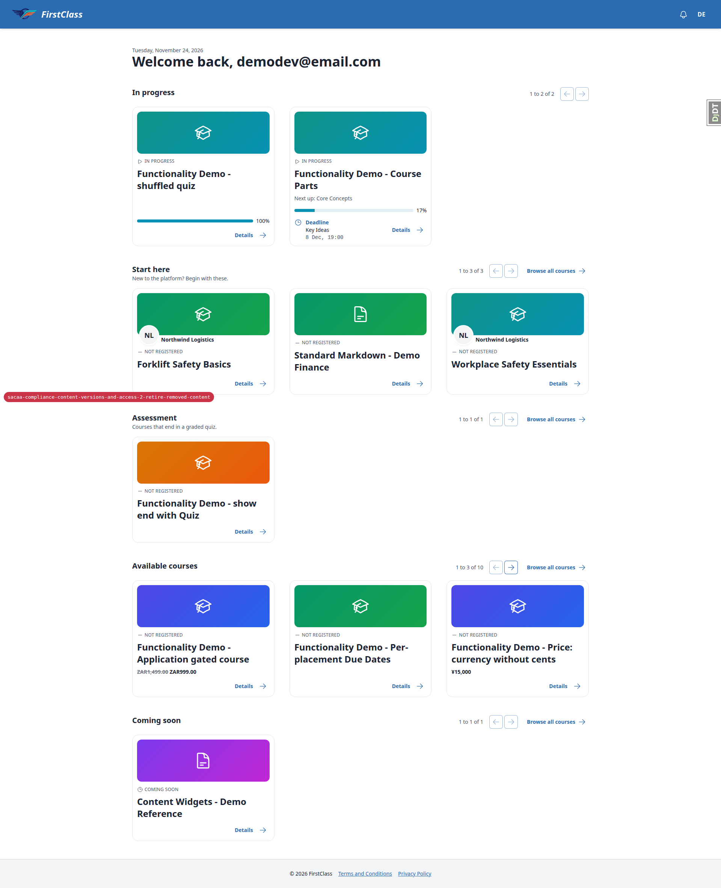 | Removing only the pricing-demo entry is refused by existing validation ("Unknown category" in the 7 price courses). Removing the category and its course references retired it (count line `CourseCategory 1`). The Pricing dashboard section is gone, and the price courses stay in the catalogue under "Available courses" (1 to 3 of 10). |
| 9.4 | desktop | skip | none | Deleting the application form while the gated course still names it is refused by existing validation ('names application_form ... which is not a loaded FORM'), so the scenario cannot be reached through `content_save`. The change was reverted. |

## Bug B1: Quiz confusions do not mark a chosen retired option

Manifestations:

- 7.1, desktop
- 7.2, desktop

**Expected:** In the cohort report's "Quiz confusions across the cohort" table (screen and PDF), an incorrect answer chosen that is a retired option is marked Retired, as the per-learner PDF detail already does ("Jupiter Retired").

**Actual:** The screen and PDF confusion tables show the retired option Jupiter (fd556808..., on question e4bb99f8 "Which planet is third from the Sun?") as plain "Jupiter x1" with no Retired mark. The retired question itself is marked.

## Layout probe

No `layout` records were written, so the layout probe did not run. Overflow and console checks were made by hand per viewport in the test rows above.

## Data changes

| What changed | Made by | Files written |
|---|---|---|
| The fresh per-branch dev DB had no DemoDev site. `create_demo_data` was run (confirm answered non-interactively), then `content_save` of a git copy of `demo_content`, as the QA plan's setup. | seed (`create_demo_data` + `content_save` of a `demo_content` copy) | none |
| Cohort "QA Retire Cohort" (7d1f92a3-...) with learners qa.retire.a/b@example.com and cohort registrations on Course Parts, the shuffled quiz and the retired "show end with Topic". Learner A completed every Course Parts item including the retired topic, and learner B completed Welcome only. Completed shuffled-quiz attempts with served papers holding the retired question: A wrong "Green" and the retired option "Jupiter", 7/9; B 9/9. | `sdd:qa-data-helper` | `freedom_ls/qa_helpers/management/commands/qa_create_retired_content_scenario.py` |

## Bug status

| Bug | Title | Status |
|---|---|---|
| B1 | Quiz confusions do not mark a chosen retired option | **FIXED** (commit: bdf82efed). Re-checked on screen: the confusions table now reads "Jupiter Retired ×1" and "Green Retired ×1" ([after fix](screenshots/page-2026-11-24T12-58-18-569Z.png)) |

## Observations (not bugs)

- The educator courses list ignores `?search=`. This is not part of this change.
- On mobile, live course cards show a "Status" label with an empty value, where other empty fields show an em dash.
- The retired course's Details "Lessons" reads 0 because `lesson_count` counts live children only.
- The form-level preview says 9 questions (the full form) while the learner page says 8.
- The progress summaries (cohort Overview courses list, learner Courses tab progress card) show the retired course without a badge, reading "0 of 0 items" / "0 of 2 completed". They are not registration tables.

## General notes

- Test 3 step 5 was skipped because `OVERRIDE_COURSE_VISIBILITY_TO_VISIBLE` is False in the dev settings. Unit tests cover it. The catalogue also has no category filter UI to check.
- Test 5 did not exercise the wrong-answer review, because all answers were correct.
- Test 9.2: the link half was not exercised, because no demo topic links to another topic. Unit tests cover it.
- Test 9.3: the plan step as written (removing only the category entry) cannot happen, because existing validation refuses it.
- Test 9.4 was skipped because existing validation refuses the scenario. `course_applications` unit tests cover it.
- Test 7: topics are not report columns, so the plan's "retired topic column" expectation does not apply. Retired topics are excluded from completion fractions.
- The `content_save` count lines in these records reflect the dev DB, which holds cascaded children (for example 30 rows in Test 2).

status: ok · reason: 1 bug — 1 fixed, 0 unresolved; report rendered, screenshots verified
