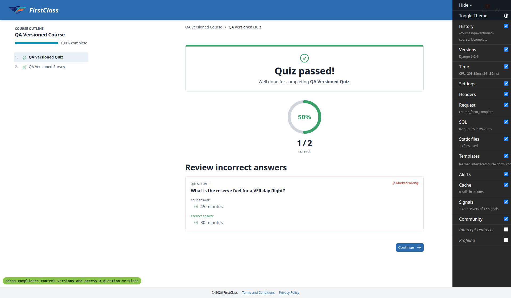
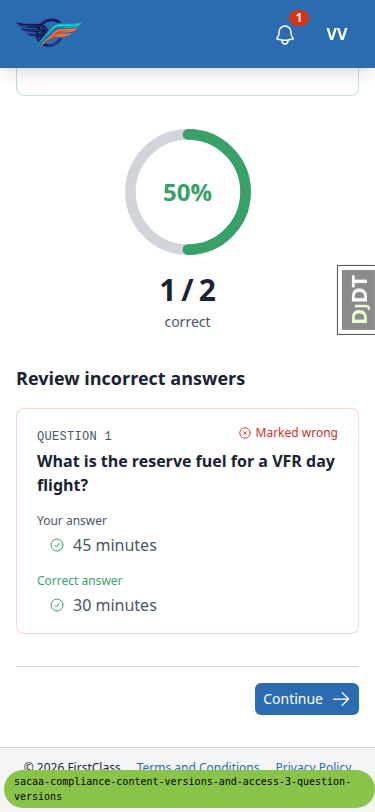
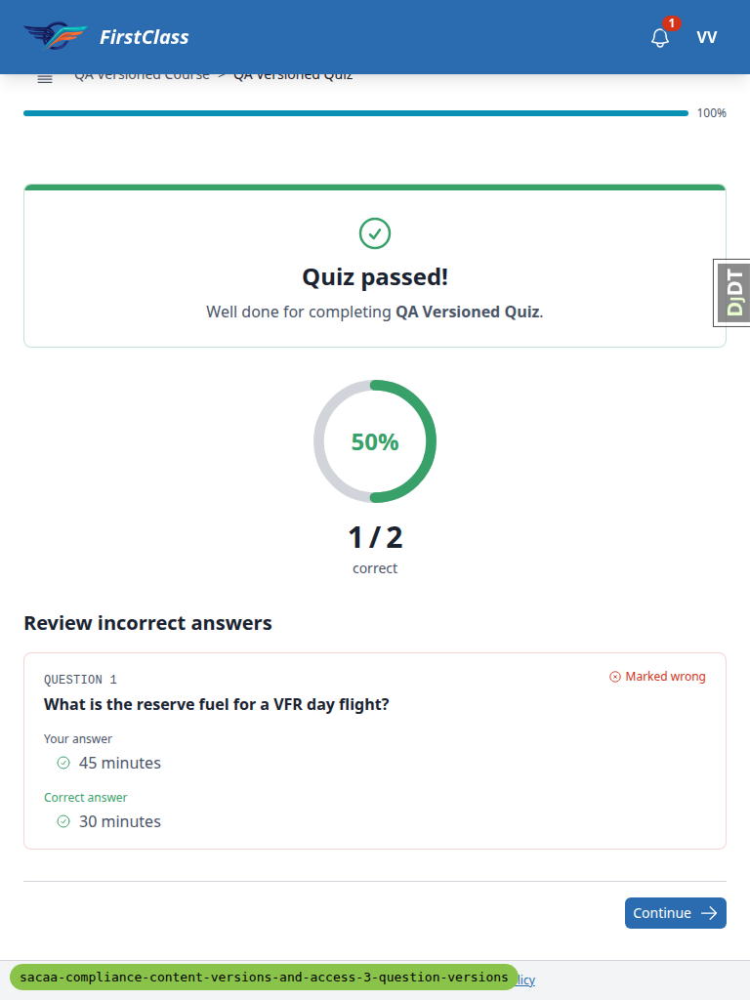
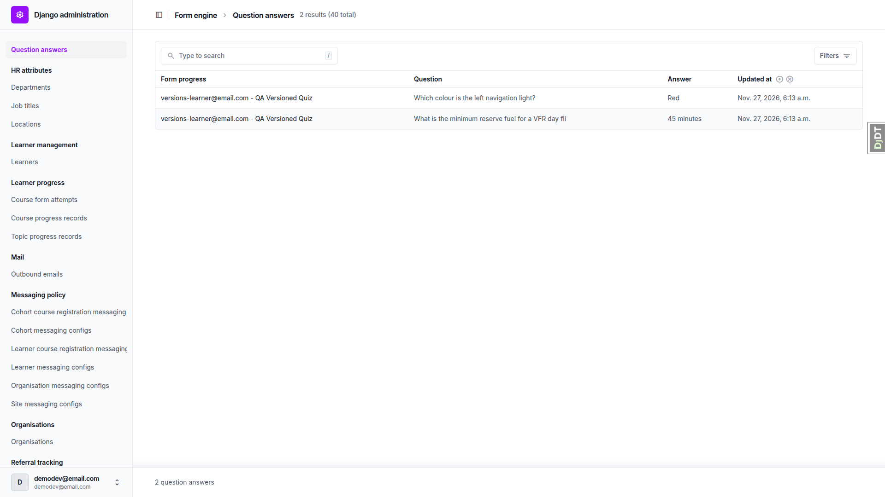

# QA report: immutable question versions, pinned per sitting

## Methodology

The run followed `3. frontend_qa.md` against this branch's dev server. Screenshots were collected into `screenshots/` beside this report, and every image referenced below exists there. Tests 1 to 6 were run in a browser. Test 7 was run in the terminal (it is a command, not a page).

## Diff scoping

Class: **FULL**. The change touched 50 files under `freedom_ls/`, including the templates `check_your_answers.html`, `quiz_attempt_paper.html` and the admin `_answers.html`. Nothing was skipped. Desktop, tablet and mobile passes were all in scope. Tablet and mobile were run only on the pages with layout risk (1.3, 1.6, 4.1, 6.1), not on every test.

## Smoke gate

Outcome: **pass**. Pages loaded: `/` and `/courses/qa-versioned-course/1/complete`.

## Design check

No design states tested.

## Bug B1: Results page ticks the learner's answer by the live option's correct flag, not the answered version's

Manifestations:
- 1.3, desktop
- 1.3, mobile
- 1.6, tablet

Expected: under "Your answer", "45 minutes" (wrong under version 1) shows the "Marked incorrect" icon, matching version 1 where "30 minutes" is correct.

Actual: it shows the green "Marked correct" icon. `FormProgress.get_incorrect_quiz_answers()` builds `learner_selected` from `answer.selected_options` (the live `QuestionOption` rows, where "45 minutes" became correct in version 2) instead of `answered_options(answer, question)` or the version-backed options. Layout is otherwise fine on mobile (no overflow, scrollWidth 375) and tablet.

## Bug B2: Question answers admin list shows the live question wording next to a version-pinned answer

Manifestation:
- 5.2, desktop

Expected: the `QuestionAnswerAdmin` changelist "Question" column shows the wording of the version the answer records (v1 "What is the reserve fuel for a VFR day flight?"), like the `answer_preview` column beside it.

Actual: the "Question" column (`list_display` "question", the FK's str) shows the live v2 wording "What is the minimum reserve fuel for a VFR day fli…".

## Layout probe

No layout records were produced, so the layout probe did not run. Mobile and tablet viewport checks were recorded as ordinary test records:

| Test | Viewport | Screenshot | Result |
|---|---|---|---|
| 1.3 | mobile | [shot](screenshots/page-2026-11-27T06-21-19-920Z.png) | fail (B1 tick), layout fine |
| 1.6 | mobile | [shot](screenshots/page-2026-11-27T06-21-19-920Z.png) | pass, no overflow, no console errors |
| 1.6 | tablet | [shot](screenshots/page-2026-11-27T06-21-26-087Z.png) | pass, no overflow (B1 tick present) |
| 4.1 | tablet | [shot](screenshots/page-2026-11-27T06-21-35-555Z.png) | pass |
| 4.1 | mobile | [shot](screenshots/page-2026-11-27T06-21-41-759Z.png) | pass, option labels wrap |

## Test results

| Test | Viewport | Status | Screenshot | Notes |
|---|---|---|---|---|
| 1.1 | desktop | pass | [shot](screenshots/page-2026-11-27T06-15-25-053Z.png) | Score 1/2, 50%, passed; no outdated-score notice |
| 1.2 | desktop | pass | [shot](screenshots/page-2026-11-27T06-15-25-053Z.png) | Incorrect list names Q1 with v1 wording; Q2 absent; correct answer "30 minutes" |
| 1.3 | desktop | fail | [shot](screenshots/page-2026-11-27T06-15-25-053Z.png) | B1 |
| 1.3 | mobile | fail | [shot](screenshots/page-2026-11-27T06-21-19-920Z.png) | B1 |
| 1.6 | mobile | pass | [shot](screenshots/page-2026-11-27T06-21-19-920Z.png) | Stacks cleanly; the full-page capture right after login caught the sign-in toast and outline drawer mid-animation, a reloaded viewport shot is clean |
| 1.6 | tablet | pass | [shot](screenshots/page-2026-11-27T06-21-26-087Z.png) | Fine at 768 |
| 2.1 | desktop | pass | [shot](screenshots/page-2026-11-27T06-17-12-239Z.png) | New sitting (versions-learner-3) shows v2 wording |
| 2.2 | desktop | pass | [shot](screenshots/page-2026-11-27T06-17-34-521Z.png) | 2/2, 100%, passed |
| 3.1 | desktop | pass | [shot](screenshots/page-2026-11-27T06-18-06-014Z.png) | S2 resumed with v1 wording |
| 3.2 | desktop | pass | [shot](screenshots/page-2026-11-27T06-18-19-753Z.png) | 2/2, marked on v1 |
| 3.3 | desktop | pass | none | Reload mid-sitting kept v1 wording |
| 3.4 | desktop | pass | none | Back after submit: quiz item page, one previous attempt, no error, no new sitting |
| 4.1 | desktop | pass | [shot](screenshots/page-2026-11-27T06-19-16-669Z.png) | S1 review: v1 wording, correct/learner's answers, marked incorrect, 1/2 passed |
| 4.1 | tablet | pass | [shot](screenshots/page-2026-11-27T06-21-35-555Z.png) | Fits 768 |
| 4.1 | mobile | pass | [shot](screenshots/page-2026-11-27T06-21-41-759Z.png) | Stacks at 375 |
| 4.2 | desktop | pass | [shot](screenshots/page-2026-11-27T06-19-16-669Z.png) | Caveat line, options-added list and outdated notice all absent |
| 4.3 | desktop | pass | [shot](screenshots/page-2026-11-27T06-19-26-079Z.png) | Test 2 attempt shows v2 wording |
| 4.4 | desktop | pass | [shot](screenshots/page-2026-11-27T06-19-39-964Z.png) | Unversioned L1 Quiz C still shows its outdated notice and live marks |
| 5.1 | desktop | pass | [shot](screenshots/page-2026-11-27T06-19-49-607Z.png) | Form progress admin shows v1 wording with "45 minutes" |
| 5.2 | desktop | fail | [shot](screenshots/page-2026-11-27T06-19-59-544Z.png) | B2 |
| 5.3 | desktop | pass | [shot](screenshots/page-2026-11-27T06-20-01-738Z.png) | Survey sitting admin shows v1 wording with "Friend" |
| 5.4 | desktop | pass | [shot](screenshots/page-2026-11-27T06-20-42-095Z.png) | New survey sitting shows v2 wording |
| 6.1 | desktop | pass | [shot](screenshots/page-2026-11-27T06-20-17-287Z.png) | Check-your-answers shows v1 "Your licence number" |
| 6.1 | mobile | skip | none | Application already submitted in 6.4, so the page was no longer reachable |
| 6.2 | desktop | pass | [shot](screenshots/page-2026-11-27T06-20-20-397Z.png) | Edit shows live v2 wording; same answer saved |
| 6.3 | desktop | pass | [shot](screenshots/page-2026-11-27T06-20-23-612Z.png) | Now shows "Your pilot licence number" (pinned to v2) |
| 6.4 | desktop | pass | none | Submitted; dashboard shows waiting for review |
| 6.5 | desktop | pass | none | Export via `CourseApplicationResource.export`: live header, value ZA-PPL-123456 |
| 6.6 | desktop | pass | none | "(version)" column right after the question column, holding 2 |
| 6.7 | desktop | skip | none | No unversioned application on DemoDev; blank cell covered by `course_applications/tests/test_resources.py` |
| 7.1 | desktop | pass | none | Second run: "0 new, 0 revised, 73 unchanged" |
| 7.2 | desktop | pass | none | "0 new, 1 revised, 72 unchanged" and `functionality_demo_shuffled_quiz/2. quiz/1. the solar system.yaml: v1 → v2 (question)` (no slug, so no brackets) |
| 7.3 | desktop | pass | none | `danger_content_delete --yes` left no content; re-running `content_save` gave 73 new |

## Data changes

| What changed | Command | Files written |
|---|---|---|
| Dev DB was empty (no DemoDev site). Built the QA plan §0 versioned scenario: 3 learner/applicant users, QA Versioned Course (quiz + survey), QA Versioned Application Course, 7 question versions, sittings S1 (completed 1/2), S2 (in progress, pinned v1), survey sitting, draft application | `uv run python manage.py create_demo_data --yes`; `uv run python manage.py content_save ./demo_content DemoDev`; `uv run python manage.py qa_create_attempt_review_scenario`; `uv run python manage.py qa_create_question_versions_scenario` | `freedom_ls/qa_helpers/management/commands/qa_create_question_versions_scenario.py`, `freedom_ls/qa_helpers/management/commands/qa_create_attempt_review_scenario.py` |
| The quiz has no retake after a pass, so Test 2 needed a learner with no sitting: added versions-learner-3@email.com registered on qa-versioned-course | `uv run python manage.py qa_create_question_versions_scenario` | `freedom_ls/qa_helpers/management/commands/qa_create_question_versions_scenario.py` |
| Test 7 wipes content by design; dev content and QA scenarios were rebuilt from scratch afterwards | `uv run python manage.py danger_content_delete --yes`; `uv run python manage.py content_save ./demo_content DemoDev`; `uv run python manage.py qa_create_attempt_review_scenario`; `uv run python manage.py qa_create_question_versions_scenario` | none |

## Bug status

| Bug | Title | Status |
|---|---|---|
| B1 | Results page ticks the learner's answer by the live option's correct flag, not the answered version's | **FIXED** (commit: 523324733). Re-verified: "45 minutes" now carries "Marked incorrect" ([screenshot](screenshots/page-2026-11-27T06-34-31-158Z.png)) |
| B2 | Question answers admin list shows the live question wording next to a version-pinned answer | **FIXED** (commit: 0bd9bcfec). Re-verified: the Question column reads v1 "What is the reserve fuel for a VFR day flight?" ([screenshot](screenshots/page-2026-11-27T06-39-50-979Z.png)) |
| — | Test run after the fixes | **FIXED** (commit: 0bd9bcfec). The run after the fixes (9c37e67c2..HEAD, targeted) passed: 21382 passed, 0 failed, 3 skipped |

## General notes

- Test 1's "45 minutes" check is the same defect as B1: the text is right but its marked-correct icon is wrong.
- Test 2 and the survey check in 5.4 used versions-learner-3, because versions-learner cannot retake after a pass.
- 6.5 and 6.6 ran the export through `CourseApplicationResource.export`, the resource the admin export action uses. The admin CSV download itself was not clicked through.
- 7.1 and 7.2 ran on a git copy of `demo_content`. The first `content_save` needed `--allow-course-retire` because the QA-created courses are not in `demo_content`.
- Not tested: 6.7 (no unversioned application on DemoDev) and 6.1 on mobile (the application was already submitted).
- A screenshot (`page-2026-11-27T06-21-11-391Z.png`) is present in `screenshots/` but is not referenced by any record. It is likely the transient post-login capture noted under 1.6.

status: ok · reason: 2 bugs — 2 fixed, 0 unresolved; report rendered, screenshots verified
