# Frontend QA report: question access

Result: all 14 tests passed at desktop; the tablet and mobile focus checks passed. No failures and no bugs.

## Methodology

Screenshots were collected into `screenshots/` beside this report. Every image linked below exists there. Before QA the branch was rebased onto main (3 new main commits, no conflicts). A targeted test run had one flaky failure (the educator_interface playwright `test_section_smoke` Dashboard case). It passed on re-run, and the branch was force-pushed.

## Diff scoping

Class: **FULL**. The diff touches 112 files, including educator_interface templates, reports templates and `print.css`. Nothing was skipped. The desktop, tablet and mobile passes all ran. Tablet and mobile covered the tests with responsive layout: Tests 1, 3, 8 and 11.

## Smoke gate

Passed. Pages loaded: `/` and `/educator/organisations/demodev/courses/0010389b-6138-4d43-96ef-b08b72df9002`.

## Test results

| Test | Viewport | Result | Summary |
|---|---|---|---|
| 1 | desktop | pass | The grant, role filter, badge, Audit log entries and deactivation all work. A staff member holding only Question bank viewer gets a 404 on the org's educator pages. |
| 1 | tablet, mobile | pass | The Add role dialog fits at 768 (centred, 512px) and at 375 (bottom sheet, scrolls, Cancel and Next visible). |
| 2 | desktop | pass | A cohort admin gets a 404 on Staff, and the role is not offered anywhere. |
| 3 | desktop | pass | Every quiz row shows one disabled "Needs permission" button. Clicking it opens no dialog and sends no request. Next and Previous skip quizzes. |
| 3 | tablet, mobile | pass | Cards show the "Type" label with no colon. The button sits 12px below the Type line. Nothing overflows (scrollWidth 768 and 375). |
| 4 | desktop | pass | A pasted URL gives a 404. `htmx.ajax` opens the "You can't use Preview here any more" dialog with no question text, and no audit entry is written. |
| 5 | desktop | pass | The holder sees enabled Previews. Exactly 4 "Question detail viewed" entries were written, with the right descriptions. The entry sits under OTHER in the What filter. |
| 6 | desktop | pass | The superuser's preview is logged. |
| 7 | desktop | pass | The non-holder sees one plain sentence with no box or icon. No question text appears, and scores and Downloads are present. |
| 8 | desktop | pass | The holder sees confusion cards, and the load and the refresh each write an entry. The cohort History tab lists them. A clean cohort writes no entry. The non-holder still sees only the sentence. |
| 8 | tablet, mobile | pass | Tables fit at 768. At 375 they sit in horizontal scroll regions and the page does not overflow. |
| 9 | desktop | pass | With JavaScript off, the holder sees the plain JS note, with no question text and no entry. |
| 10 | desktop | pass | The holder's and the non-holder's PDFs (21 pages each) have no confusions section and no question text. The layout is intact and no audit entry is written. |
| 11 | desktop | pass | The full paper loads, with all four notes, the learner History entry and the Audit log entry. A second open adds a second entry. The quick view adds none. |
| 11 | tablet, mobile | pass | The paper reads cleanly at 768. At 375 the options stack and nothing overflows. |
| 12 | desktop | pass | The non-holder and educator E see the plain sentence, with no paper and no entry. With JavaScript off the holder sees the JS note. |
| 13 | desktop | pass | The admin hides quiz answers. Survey and application answers and the file download are unchanged. A quiz answer's change URL redirects to /admin/ and there is no 500. |
| 14 | desktop | pass | The unchanged pages (Course content, previews, Report tab, Learner Courses tab, Staff section, Audit log) still render and work. |

Screenshots:

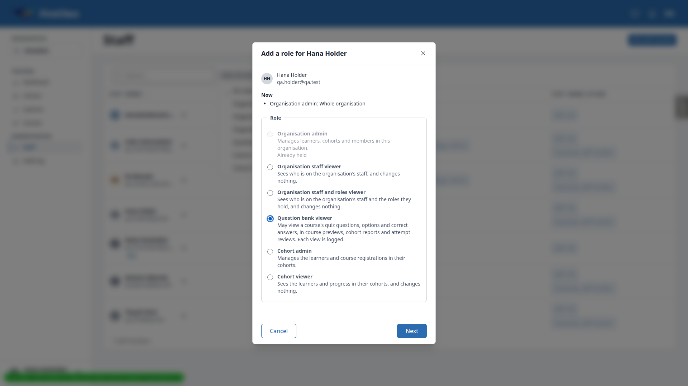
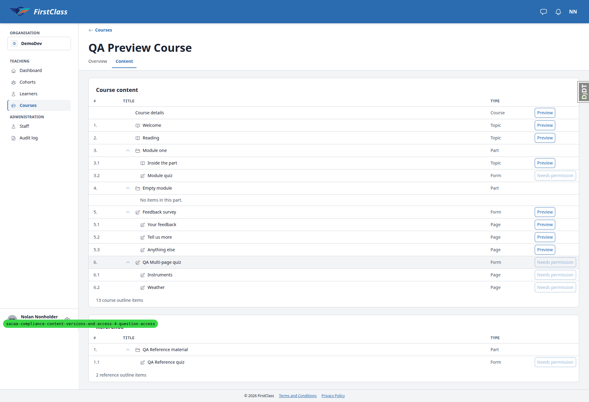
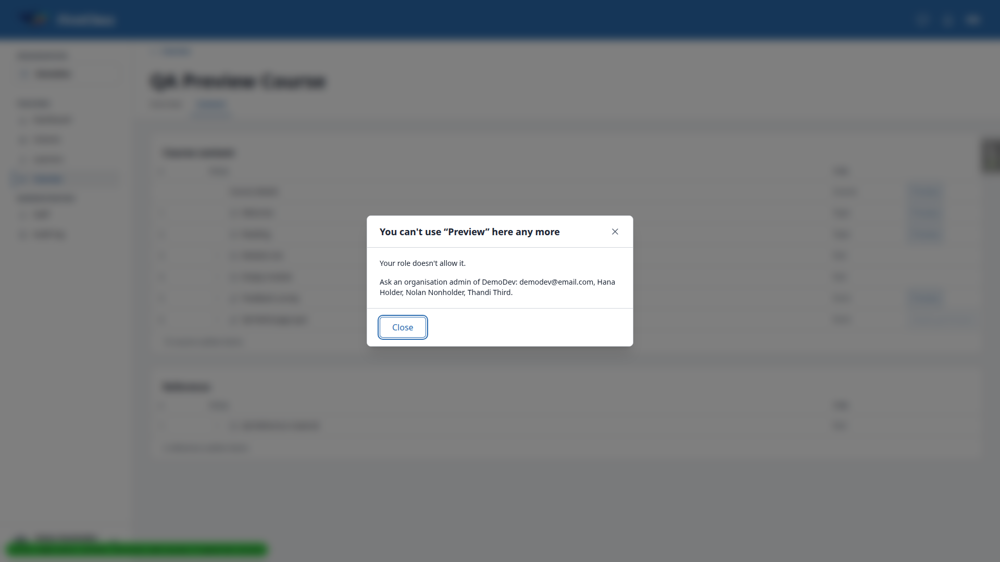
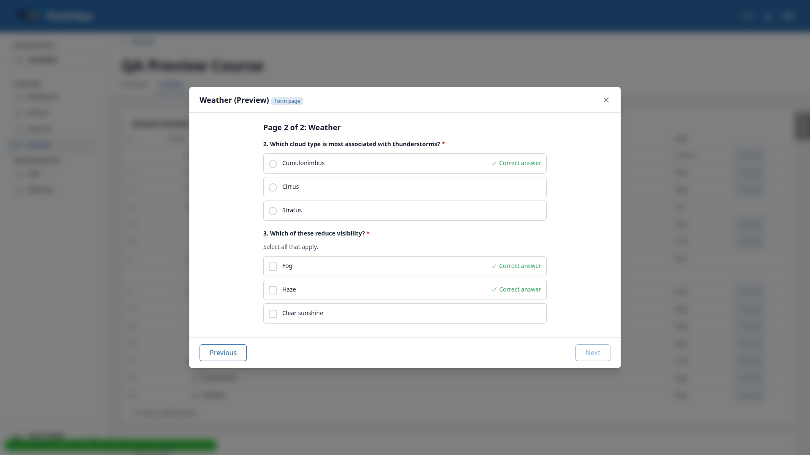
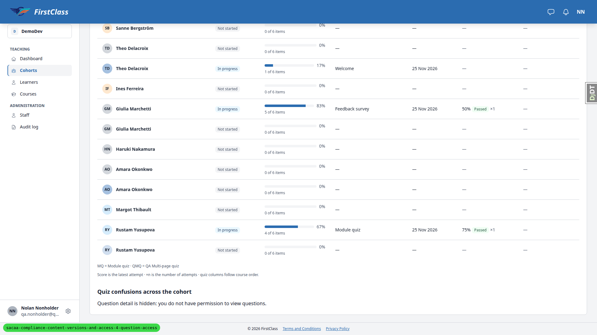
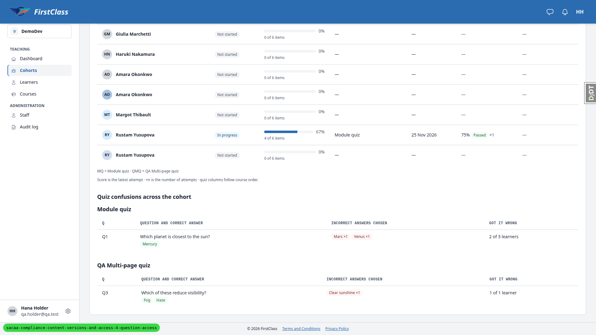
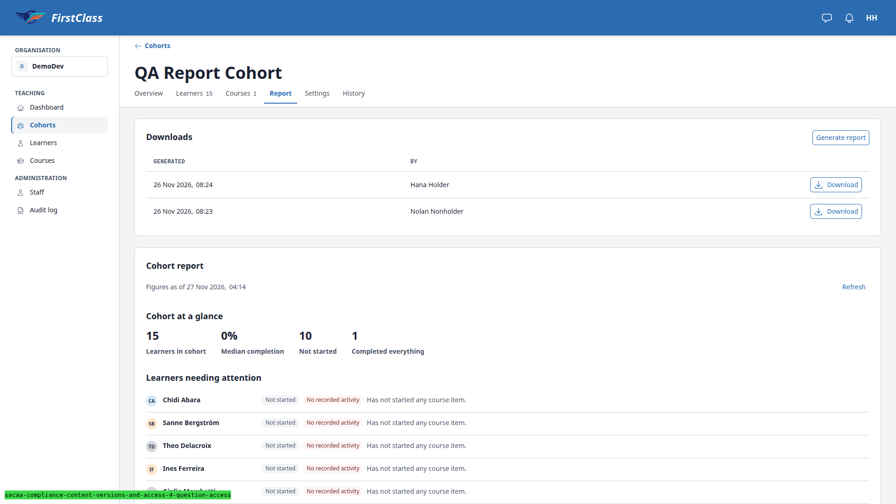
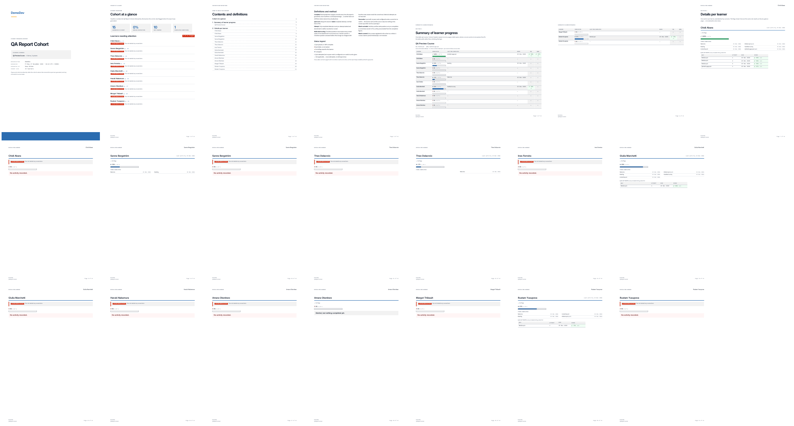
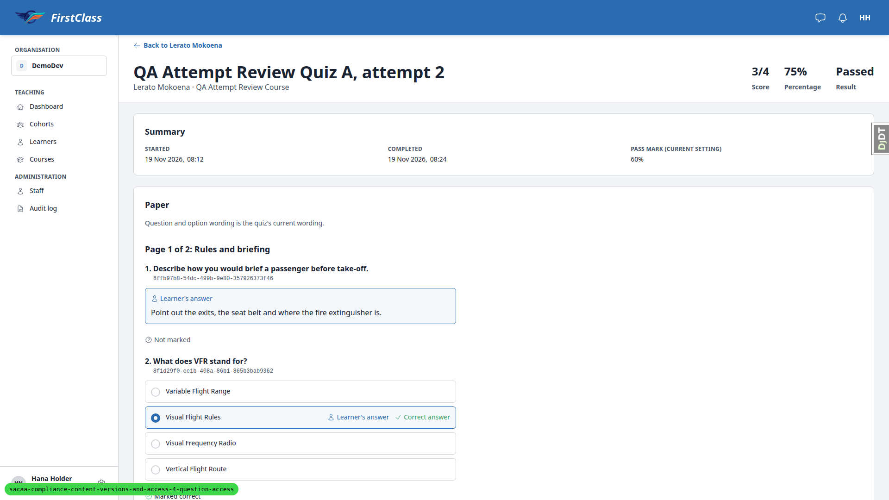
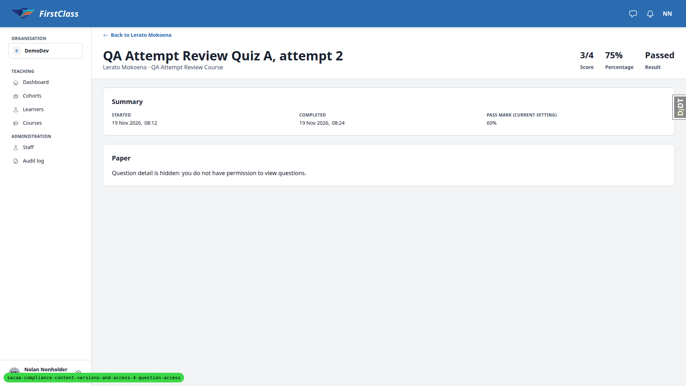
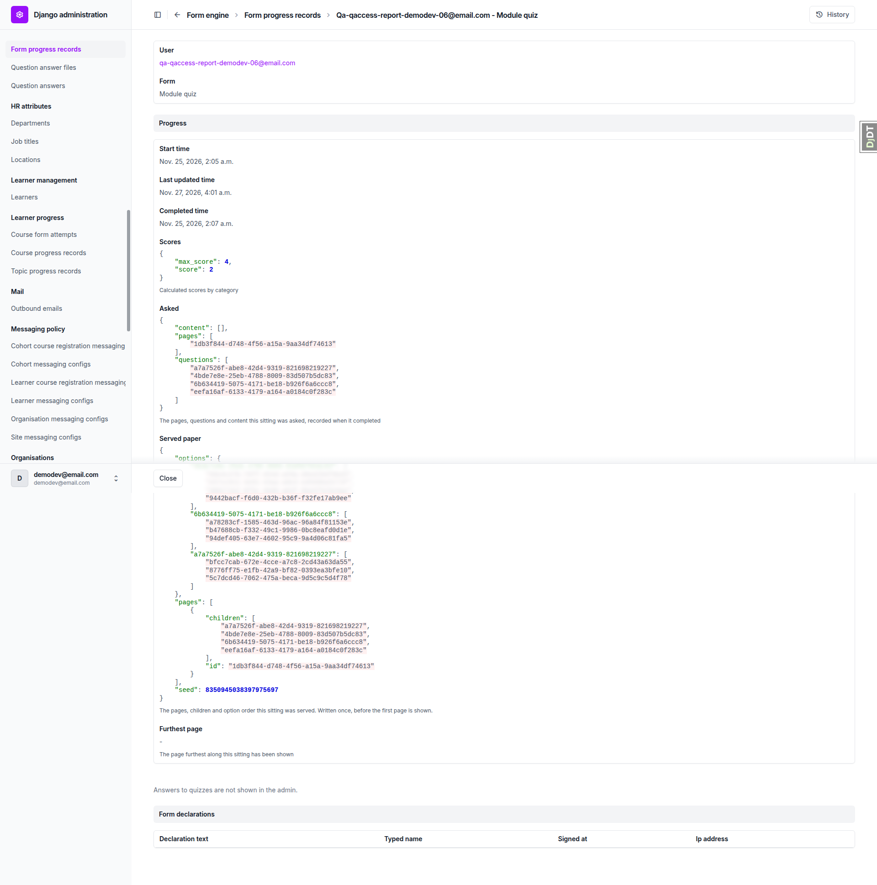
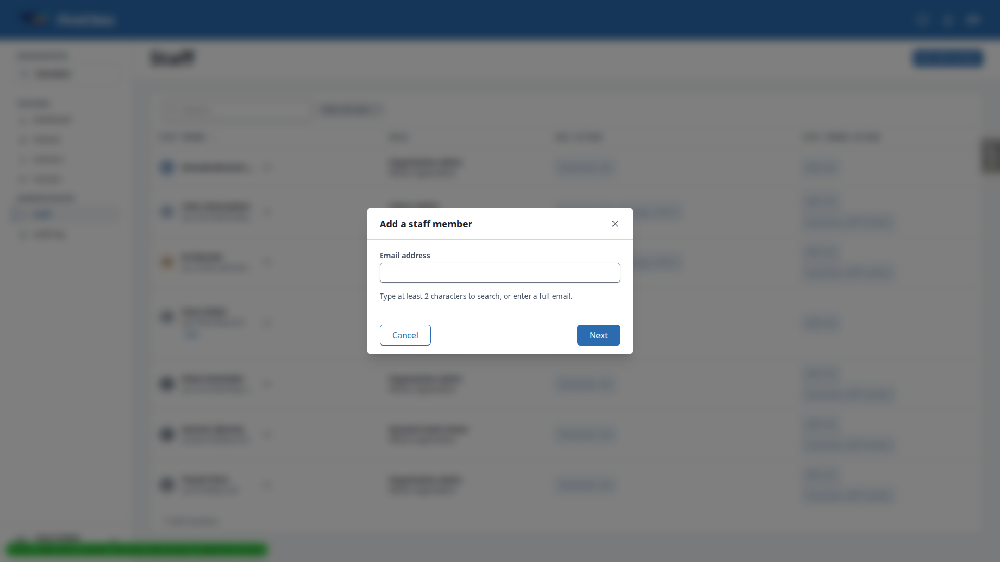
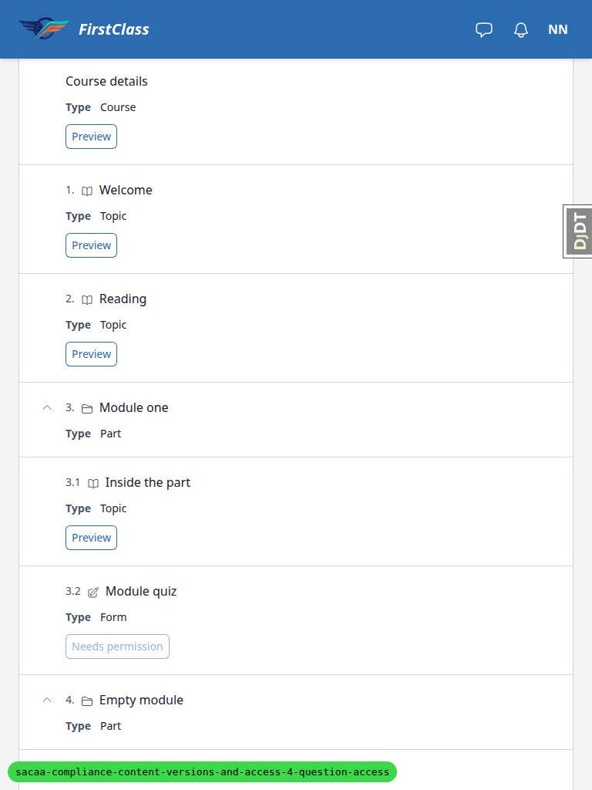
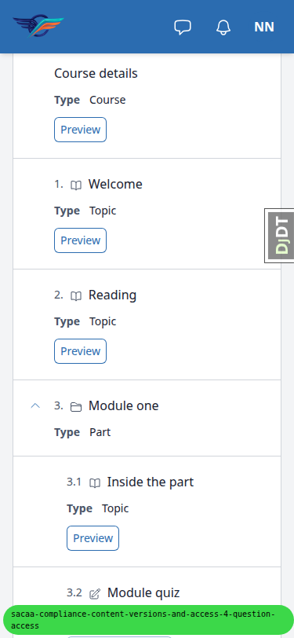
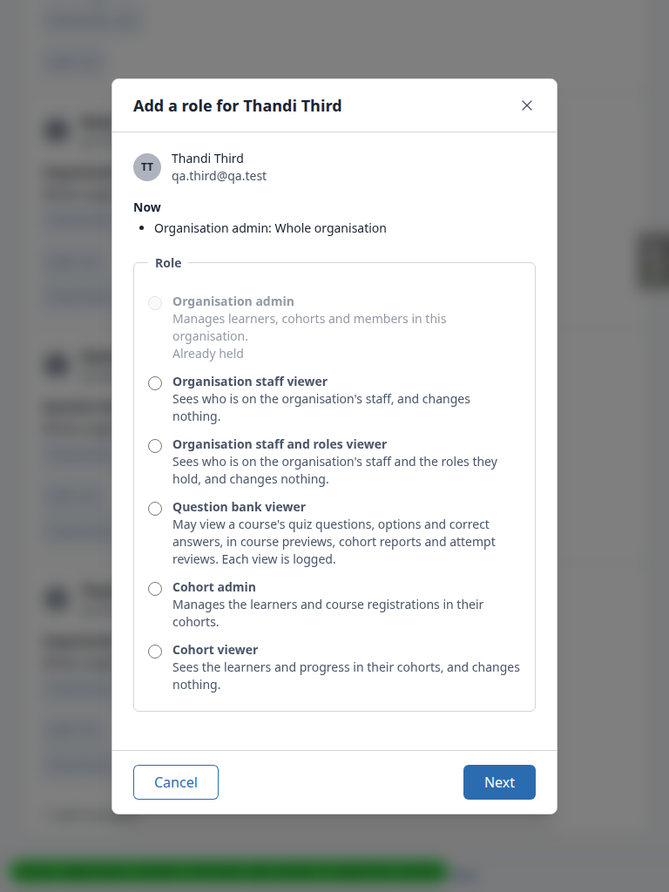
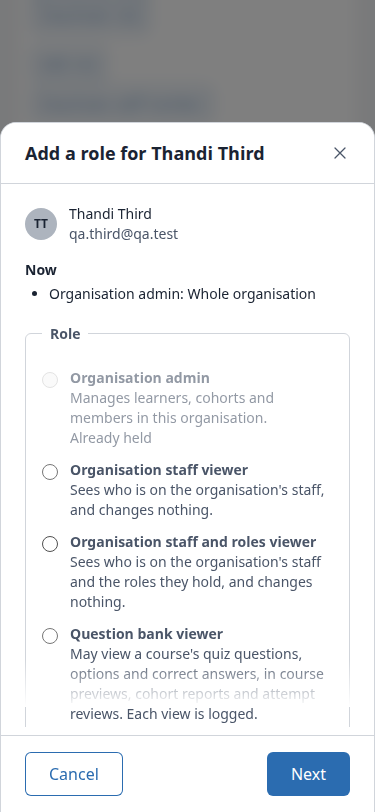

## Design check

No design records exist this run: no design states tested.

## Layout probe

All rows are clean. No flags.

| Test | Viewport | URL | Screenshot | Result |
|---|---|---|---|---|
| 1 | desktop | `/educator/organisations/demodev/staff?staff-role=question_bank_viewer` | [shot](screenshots/page-2026-11-27T04-03-30-572Z.png) | clean |
| 1 | desktop | `/educator/organisations/demodev/audit-log` | [shot](screenshots/page-2026-11-27T04-03-54-355Z.png) | clean |
| 1 | desktop | `/educator/organisations/demodev/staff` | [shot](screenshots/page-2026-11-27T04-02-49-404Z.png) | clean |
| 3 | desktop | `/educator/organisations/demodev/courses/0010389b-6138-4d43-96ef-b08b72df9002/__tabs/content` | [shot](screenshots/page-2026-11-27T04-08-54-959Z.png) | clean |
| 4 | desktop | same course content URL | [shot](screenshots/page-2026-11-27T04-10-37-503Z.png) | clean |
| 5 | desktop | `/educator/organisations/demodev/audit-log` | [shot](screenshots/page-2026-11-27T04-11-41-128Z.png) | clean |
| 7 | desktop | `/educator/organisations/demodev/cohorts/b72ad90d-5f00-46da-8801-81967e6dea05/__tabs/report` | [shot](screenshots/page-2026-11-27T04-13-56-667Z.png) | clean |
| 11 | desktop | `/educator/organisations/demodev/quiz-attempts/d731d434-8005-47f4-8936-3cac841dec69` | [shot](screenshots/page-2026-11-27T04-17-24-995Z.png) | clean |
| 12 | desktop | same quiz-attempts URL | [shot](screenshots/page-2026-11-27T04-19-00-000Z.png) | clean |
| 13 | desktop | `/admin/freedom_ls_form_engine/formprogress/17fd13ed-5877-4a65-87db-689543f36e6a/change/` | [shot](screenshots/page-2026-11-27T04-20-00-000Z.png) | clean |
| 3 | tablet | course content URL | [shot](screenshots/page-2026-11-27T04-26-00-000Z.png) | clean |
| 3 | mobile | course content URL | [shot](screenshots/page-2026-11-27T04-26-30-000Z.png) | clean |
| 8 | tablet | cohort report URL | [shot](screenshots/page-2026-11-27T04-27-00-000Z.png) | clean |
| 8 | mobile | cohort report URL | [shot](screenshots/page-2026-11-27T04-27-03-000Z.png) | clean |
| 11 | tablet | quiz-attempts URL | [shot](screenshots/page-2026-11-27T04-27-01-000Z.png) | clean |
| 11 | mobile | quiz-attempts URL | [shot](screenshots/page-2026-11-27T04-27-04-000Z.png) | clean |

## Data changes

No data_change records exist this run: no data changes.

## Bug status

No bug records exist this run: no bugs to track.

## General notes

Non-bug observations, with no action attached:

- The generic "You can't use Preview here any more" denial dialog (Test 4) lists the viewer themself (Nolan Nonholder) among the organisation admins to ask. This comes from the generic denial dialog, not from this spec.
- "QA Report Cohort" holds 15 learners with several duplicate names, left over from repeated seed runs. This is seed residue, not a display fault.
- The first desktop screenshot (`page-2026-11-27T04-02-49-404Z.png`) has the debug toolbar open over the right edge. Screenshot prep was applied afterwards, so later shots are clean.
- The full-page admin shot (Test 13) shows the admin's sticky Close bar mid-image. This is an artefact of full-page capture.
- An earlier tablet and mobile shot of Test 3 caught the navigation bottom sheet open, because the QA script clicked the nav toggle. They were re-shot with it closed and the probe was clean.
- The question id shown under each question text on the attempt paper is pre-existing design from the attempt-review spec.

status: ok · reason: report rendered, 0 bugs documented
