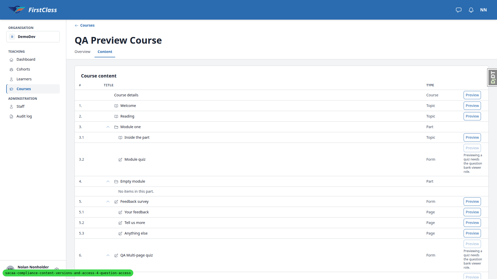
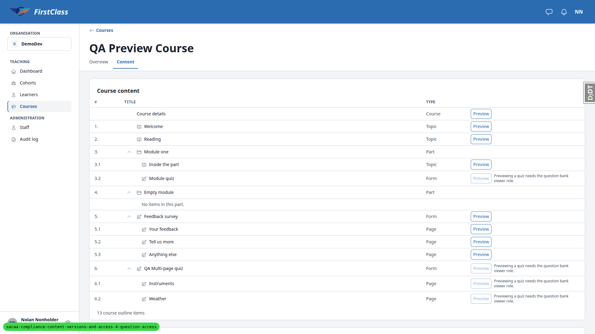

# QA report: question access

## Methodology

Screenshots were collected into `screenshots/` beside this report, and every image referenced below exists there. Tests ran against the rebuilt dev DB at desktop, mobile (375px) and tablet (768px) viewports. JavaScript-off checks were also run for tests 9 and 12.

## Diff scoping

Class: FULL. The change touched 57 files (templates, css, py). Nothing was skipped, so every plan section, viewport and role ran.

## Smoke gate

Outcome: pass. Pages loaded: `/` and `/educator/organisations/demodev/courses/2de9e8dd-3823-4c14-8800-9b1c2704e422`.

## Design check

No design states tested.

## Test results

| Test | Viewport | Status | Screenshot | Notes |
|---|---|---|---|---|
| 1 | desktop | pass | [shot](screenshots/page-2026-11-26T08-18-47-370Z.png), [filter](screenshots/page-2026-11-26T08-19-18-848Z.png), [audit](screenshots/page-2026-11-26T08-19-59-586Z.png) | Question bank viewer role offered with its description. Grant and deactivate both work. Audit log shows Role assigned x2 and Role deactivated. |
| 1-side-effect | desktop | pass | none | A user with only the question bank viewer role gets 404 for Cohorts, Learners and Courses. |
| 2 | desktop | pass | [shot](screenshots/page-2026-11-26T08-22-12-928Z.png) | A cohort admin is not offered the role anywhere. The Staff section returns 404. |
| 3 | desktop | FAIL (B1) | [shot](screenshots/page-2026-11-26T08-20-31-201Z.png) | Withheld Preview works correctly, but the layout is bloated. See B1. |
| 3-stepping | desktop | pass | none | Next skips the withheld quiz. No question text appears in any preview. |
| 3 | mobile | pass | [shot](screenshots/page-2026-11-26T08-30-11-749Z.png) | Rows render as cards with the full reason. No overflow. |
| 3 | tablet | pass | [shot](screenshots/page-tablet-outline-1795681851316.png) | Cards at 768px. No overflow. |
| 4 | desktop | pass | [shot](screenshots/page-2026-11-26T08-21-36-852Z.png) | A direct GET returns 404. An htmx request shows the "Your role doesn't allow it" dialog. No audit entry. |
| 5 | desktop | pass | [shot](screenshots/page-2026-11-26T08-22-55-363Z.png) | The holder sees all 13 Previews enabled. Exactly 4 "Question detail viewed" entries. |
| 6 | desktop | pass | none | A superuser sees questions. One audit entry. |
| 7 | desktop | pass | [shot](screenshots/page-2026-11-26T08-23-24-314Z.png) | A non-holder sees the hidden-detail callout. Scores are still present. |
| 7 | mobile | pass | [shot](screenshots/page-mobile-report-1795681827023.png) | The callout is full width and readable. |
| 7 | tablet | pass | [shot](screenshots/page-tablet-report-1795681862024.png) | Callout renders. |
| 8 | desktop | pass | none | A holder sees confusion cards. The load and refresh wrote 2 entries. The clean cohort wrote none. |
| 9 | desktop | pass | none | With JS off, the callout "loads only with JavaScript" shows. No entry written. |
| 10 | desktop | pass | none | The non-holder PDF and the holder PDF (11 pages each) contain no question text and no section 3. Neither wrote an entry. |
| 11 | desktop | pass | [shot](screenshots/page-2026-11-26T08-26-21-537Z.png) | The holder's attempt review loads the paper lazily. Entries are logged on the Learner History tab and the Audit log. The quick view adds none. |
| 12 | desktop | pass | [shot](screenshots/page-nonholder-paper-1795681649424.png) | A non-holder and a cohort viewer see the callout. A holder with JS off sees the JS message. No new entries. |
| 12 | mobile | pass | [shot](screenshots/page-mobile-paper-1795681830656.png) | The callout fits. |
| 12 | tablet | pass | [shot](screenshots/page-tablet-paper-1795681865872.png) | The callout renders. No overflow. |
| 13 | desktop | pass | [shot](screenshots/page-2026-11-26T08-28-47-519Z.png) | The Django admin shows no QUIZ answers. Survey answers are still shown. The quiz answer change URL redirects without a 500. |
| 14 | desktop | pass | none | Regression sweep as the holder. Everything renders as before. |
| 1 | mobile | pass | [shot](screenshots/page-mobile-addrole-1795681833851.png) | The Add role sheet fits 375px. |

## B1: Withheld quiz row's reason squeezed into the narrow Actions column on desktop

Manifestations:
- test 3, desktop

Expected: On the desktop course outline table, the reason "Previewing a quiz needs the question bank viewer role." sits beside (or neatly with) the disabled Preview button without bloating the row. The plan says to widen the Actions column in `CourseOutlineTable.get_columns` if the reason does not fit beside the button.

Actual: At 1920px the Actions cell is 112px wide. The reason wraps to five lines under the button, so every withheld quiz row is 129px tall against 41px for other rows. This affects the Course content and Reference panels.

## Layout probe

| Test | Viewport | URL | Screenshot | Result |
|---|---|---|---|---|
| 3 | desktop | `/educator/organisations/demodev/courses/2de9e8dd-3823-4c14-8800-9b1c2704e422/__tabs/content` | [shot](screenshots/page-2026-11-26T08-20-31-201Z.png) | clean (the probe raised no flags, but the row height problem in B1 was found by inspection) |
| 3 | mobile | `/educator/organisations/demodev/courses/2de9e8dd-3823-4c14-8800-9b1c2704e422/__tabs/content` | [shot](screenshots/page-2026-11-26T08-30-11-749Z.png) | clean |
| 7 | mobile | `/educator/organisations/demodev/cohorts/b72ad90d-5f00-46da-8801-81967e6dea05/__tabs/report` | [shot](screenshots/page-mobile-report-1795681827023.png) | clean |
| 12 | mobile | `/educator/organisations/demodev/quiz-attempts/631381b7-1e4b-4331-8659-2aee2911b479` | [shot](screenshots/page-mobile-paper-1795681830656.png) | clean |

## Data changes

| What changed | Made by | Files written |
|---|---|---|
| The dev DB had no DemoDev site. It was wiped and rebuilt, then `create_demo_data --yes` and the plan's seeds were run. | DB drop / DB create / Migrate | none |
| New command `qa_create_question_access_scenario`. It creates qa.nonholder, qa.holder and qa.third (org admins on demodev) and qa.cohortadmin (cohort_admin on QA Preview Cohort). It also creates the QA Multi-page quiz (2 pages), the QA Reference quiz in a Reference part, QA Report Cohort (wrong answers), QA Report Clean Cohort and a survey answer file. `qa_create_application_review_states` was run as well. | `sdd:qa-data-helper` | `freedom_ls/qa_helpers/management/commands/qa_create_question_access_scenario.py` |

## Bug status

| Bug | Title | Status |
|---|---|---|
| B1 | Withheld quiz row's reason squeezed into the narrow Actions column on desktop | **FIXED** (commit: cc8687bb1). Actions column widened, reason sits beside the button; re-verified at 1920 (withheld row 49px vs 41px topic row) and 375 (cards unchanged, no overflow). After the fix:  |

## General notes

- Each question on the attempt review paper shows its id in monospace under the text. This is a pre-existing deliberate feature (`form_engine/answers/question.html`, commit 6d019e2ad), so no bug was raised.
- The only console error seen was Django admin's own `RelatedObjectLookups.js` unload policy warning. It is pre-existing.
- The Layout probe reported no flags for the desktop outline page, yet B1 is a real layout problem. The probe is blind to row-height bloat.
- Everything in the plan ran. Nothing was left untested.

status: ok · reason: 1 bug — 1 fixed, 0 unresolved; report rendered, screenshots verified
