# Frontend QA report: user-communication-4-direct-messaging

## Methodology

- Tool: Playwright MCP, driving a dev server for this branch on port 8412.
- Viewports: desktop 1920x1080 (1280 and 1442 widths for the design comparisons), mobile 375x812, tablet 768x1024.
- Several browser contexts were logged in at once for the multi-person tests (educators, learners, and the superuser at the same time).
- Screenshots were collected into `screenshots/` beside this report. Every image referenced here exists there.
- Data was seeded per the plan's section 0 by the qa-data-helper. No role grants were seeded; roles were given through Members in section 1.
- Learner remove/restore went through a `qa_toggle_cohort_learner` command that calls the same services as the educator UI.
- The plan run is `3. frontend_qa.md` in this directory.

## Diff scoping

- Class: **FULL**.
- Changed files (first 15 of 341 listed in the scoping record):
  - `freedom_ls/base/templates/partials/header_bar.html`
  - `freedom_ls/comms/static/comms/js/alpine-components.js`
  - `freedom_ls/comms/templates/comms/inbox.html`
  - `freedom_ls/comms/templates/comms/partials/closed_note.html`
  - `freedom_ls/comms/templates/comms/partials/composer.html`
  - `freedom_ls/comms/templates/comms/partials/conversation_list.html`
  - `freedom_ls/comms/templates/comms/partials/conversation_row.html`
  - `freedom_ls/comms/templates/comms/partials/inbox_state.html`
  - `freedom_ls/comms/templates/comms/partials/message_box.html`
  - `freedom_ls/comms/templates/comms/partials/message_entry.html`
  - `freedom_ls/comms/templates/comms/partials/messages_button.html`
  - `freedom_ls/comms/templates/comms/partials/participant_avatar.html`
  - `freedom_ls/comms/templates/comms/partials/recipient_picker.html`
  - `freedom_ls/comms/templates/comms/partials/thread.html`
  - `freedom_ls/comms/templates/comms/partials/thread_cursor.html`
  - ... and 326 more files.
- Skipped: nothing. Desktop, mobile and tablet all ran.

## Smoke gate

Outcome: **pass**. Pages loaded: `http://127.0.0.1:8412/` and `http://127.0.0.1:8412/messages/`.

## Design check

| Test id | Viewport | This run's screenshot | Design screenshot | Result |
|---|---|---|---|---|
| 2.3-design | desktop | [page-2026-10-22T15-41-20-636Z.png](screenshots/page-2026-10-22T15-41-20-636Z.png) | [direct-messages__1280.png](design_screenshots/direct-messages__1280.png) | pass |
| 5.6-design | desktop | [page-2026-10-22T15-48-40-564Z.png](screenshots/page-2026-10-22T15-48-40-564Z.png) | [educator-messages__01-inbox-and-thread.png](design_screenshots/educator-messages__01-inbox-and-thread.png) | pass |
| 6.1-design | desktop | [page-2026-10-22T15-49-33-342Z.png](screenshots/page-2026-10-22T15-49-33-342Z.png) | [educator-messages__02-new-message.png](design_screenshots/educator-messages__02-new-message.png) | pass |
| 12.1-design | mobile | [page-2026-10-22T16-05-27-426Z.png](screenshots/page-2026-10-22T16-05-27-426Z.png) | [direct-messages__375.png](design_screenshots/direct-messages__375.png) | pass |
| 12.2-design-list | mobile | [page-2026-10-22T16-06-35-528Z.png](screenshots/page-2026-10-22T16-06-35-528Z.png) | [educator-messages__04-mobile.png](design_screenshots/educator-messages__04-mobile.png) | pass |
| 12.2-design-thread | mobile | [page-2026-10-22T16-06-50-370Z.png](screenshots/page-2026-10-22T16-06-50-370Z.png) | [educator-messages__04-mobile-2.png](design_screenshots/educator-messages__04-mobile-2.png) | pass |
| 12.2-design-new-message | mobile | [page-2026-10-22T16-07-07-746Z.png](screenshots/page-2026-10-22T16-07-07-746Z.png) | [educator-messages__04-mobile-3.png](design_screenshots/educator-messages__04-mobile-3.png) | pass |

Note: the design comparisons passed with no recorded misses, but B1 (header label) and B2 (breadcrumb) are disagreements between the plan/design and the spec/implementation. See the bug sections.

## Results by section

| Test id | Viewport | Status | Note |
|---|---|---|---|
| 1.1 | desktop | pass | Eve with no role gets 404 on educator pages; learner inbox rows are Read only; closed note shown for Luis. |
| 1.2 | desktop | pass | Add member flow for Organisation admin works; one setup email sent; Southside existing account added. |
| 1.3 | desktop | pass | Cohort admin and Cohort viewer grants work; Educators panel refreshes in place; Members sorted by name. |
| 1.4 | desktop | pass | Eve's inbox regains New message and composers; Oscar's picker grouped correctly; Oscar to Bea round trip works. |
| 2.1 | desktop | fail | Badge and accessible name correct, but the header button has no visible "Messages" label (B1). |
| 2.2 | desktop | pass | Button opens /messages/; Vic unread, Eve read; no Read only, no New message. |
| 2.3-design | desktop | pass | Matches direct-messages__1280 (see Design check). |
| 2.4 | desktop | pass | Empty state with icon and text, no New message. |
| 3.1-3.6 | desktop | pass | Layout, send via Ctrl+Enter, links, literal markup, counter and maxlength, empty send 422 all correct. |
| 3.7 | desktop | pass | Older messages load, reader's place kept, date separators each once. |
| 4.1-4.4 | desktop | pass | Poll appends new message, status announced, New messages button, draft and caret kept. |
| 4.5-4.6 | desktop | pass | Inbox poll marks Unread and updates badge; browser restarted once, step rerun and passed. |
| 5.1-5.3 | desktop | pass | Educator sidebar Messages entry with count; no extra unread-count requests while navigating. |
| 5.4 | desktop | pass | Per-organisation unread-count request on Southside pages. |
| 5.5 | desktop | fail | Thread renders and sends, but a "<- Messages" back link is shown instead of a breadcrumb (B2). |
| 5.6-design | desktop | pass | Matches educator-messages__01 (see Design check). |
| 5.7-5.9 | desktop | pass | Shared inbox from the header; Read only rows and closed notes for Gus and Deleted user. |
| 6.1 | desktop | pass | New message modal, search, no-match handling, send lands on the section conversation. |
| 6.1-design | desktop | pass | Matches educator-messages__02. |
| 6.2 | desktop | pass | learner_to_educator Open: learner picker grouped by role, no emails, send works; reverted. |
| 7.1-7.4 | desktop | pass | Removed learner: Send 422 with alert, text kept, closed note after clear, restore brings composer back. |
| 7.5 | desktop | pass | learner_to_cohort_peer Open/Closed behaves correctly for both learners. |
| 8.1-8.7 | desktop | pass | One notification row per conversation, bell count, open via notification, read state independent. |
| 9.1-9.3 | desktop | pass | Double-click sends once; offline Retry sends once; 2001 characters rejected with 422, 2000 accepted. |
| 9.4-9.9,9.11 | desktop | pass | Cross-person, cross-site and cross-organisation access all 404; bad cursor gives 400. |
| 9.10 | desktop | skip | Optional MESSAGING_ENABLED=False restart check not run. |
| 9.12 | desktop | pass | Stale recipient refused at selection (404 and "no longer available" dialog), not on send; nothing created. |
| 10.1-10.4 | desktop | pass | Quick view message box: last 3 messages, send keeps drawer open, Open conversation link. |
| 10.5 | desktop | pass | Removed learners limited by scope; no Messages box for a removed learner. |
| 10.6-10.8 | desktop | pass | Discard prompt, learnerChanged handling with and without a draft, offline Retry. |
| 11.1 | desktop | pass | Removing Cohort viewer closes the thread both ways; re-adding restores it. |
| 11.2 | desktop | pass | Changing Cohort admin cohorts closes and reopens threads, picker and counts as expected. |
| 11.3 | desktop | pass | Suspend, reactivate and multi-role removal behave correctly. |
| 11.4 | desktop | pass | Narrowing scope: send 422, no traceback, nothing delivered; restoring brings it back. |
| 11.5 | desktop | pass | Southside admin sees only Southside data. |
| 12.3 | desktop | pass | Keyboard focus, accessible names, roles, and grayscale distinguishability. |
| 12.1 | mobile | pass | Inbox and thread usable at 375, composer stays visible, back returns to /messages/. |
| 12.1-design | mobile | pass | Matches direct-messages__375. |
| 12.2 | mobile | pass | Educator cards list, thread, bottom-sheet New message and quick view. |
| 12.2-design-list | mobile | pass | Matches educator-messages__04-mobile. |
| 12.2-design-thread | mobile | pass | Matches educator-messages__04-mobile-2. |
| 12.2-design-new-message | mobile | pass | Matches educator-messages__04-mobile-3. |
| 12.2.4 | mobile | pass | Quick view is a full-width bottom sheet; send keeps it open. |
| 12-tablet | tablet | pass | Learner list and thread side by side; educator table list and 512px modal. |
| 12-tablet-educator | tablet | pass | Educator thread at 768 correct, no overflow. |

Key screenshots:

Header badge and button (2.1):

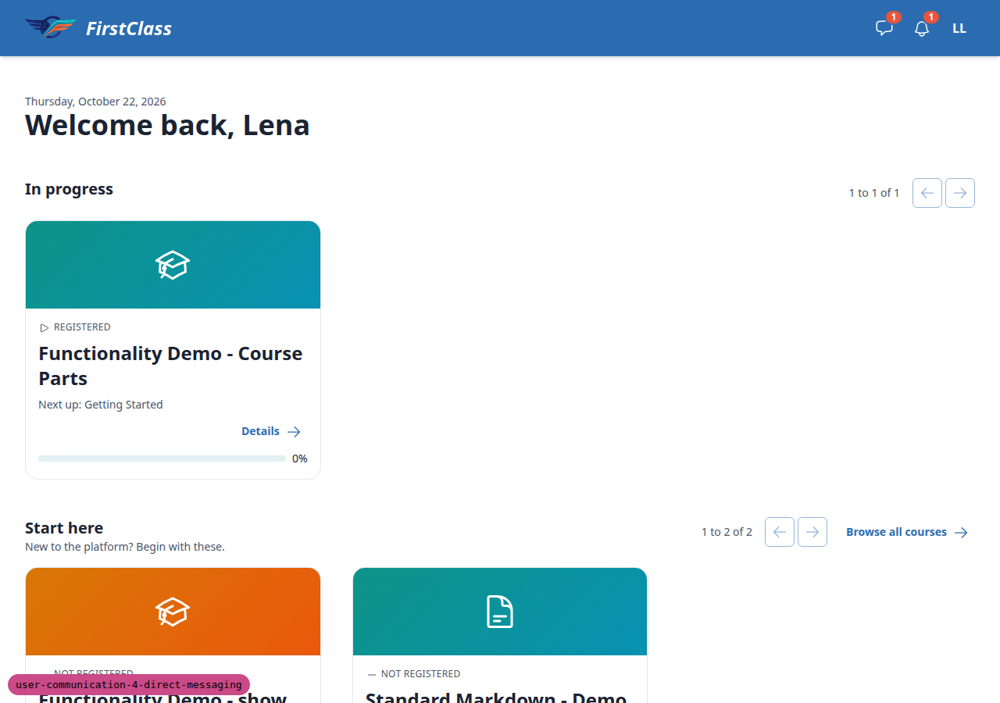

Learner thread with list and log (3.1-3.6):

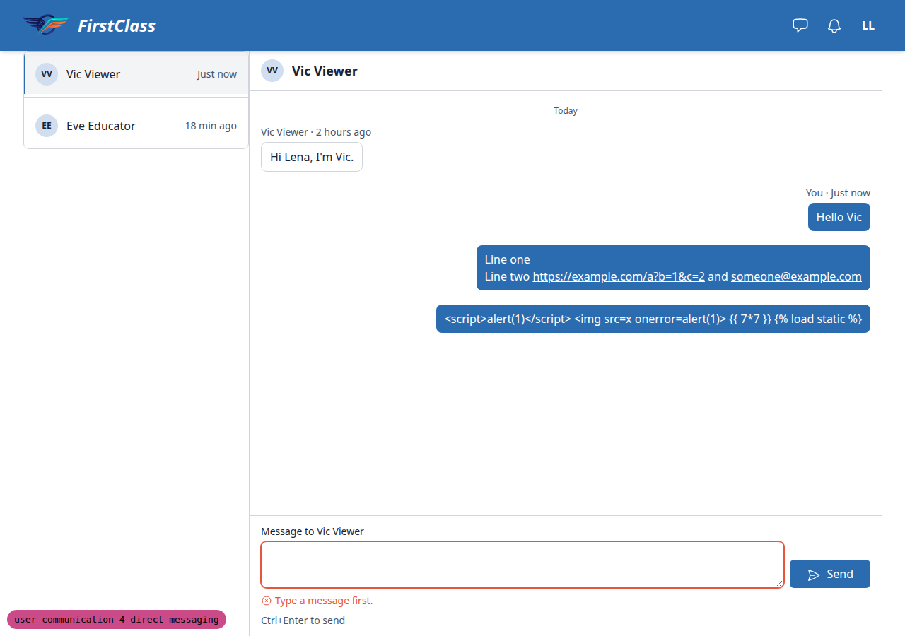

Load earlier messages (3.7):

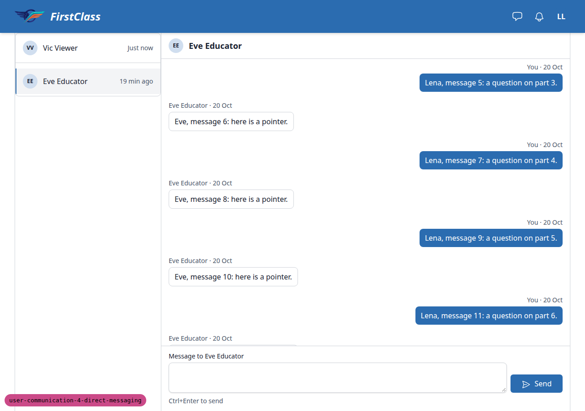

Educator thread in the panel (5.5):

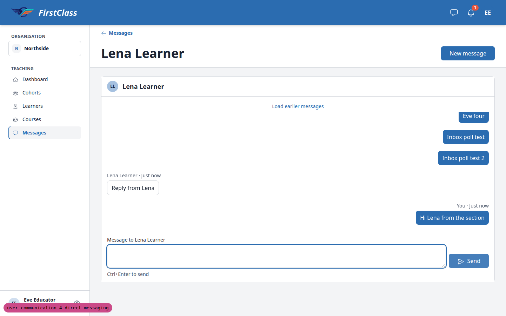

Read only rows and closed notes (5.7-5.9):

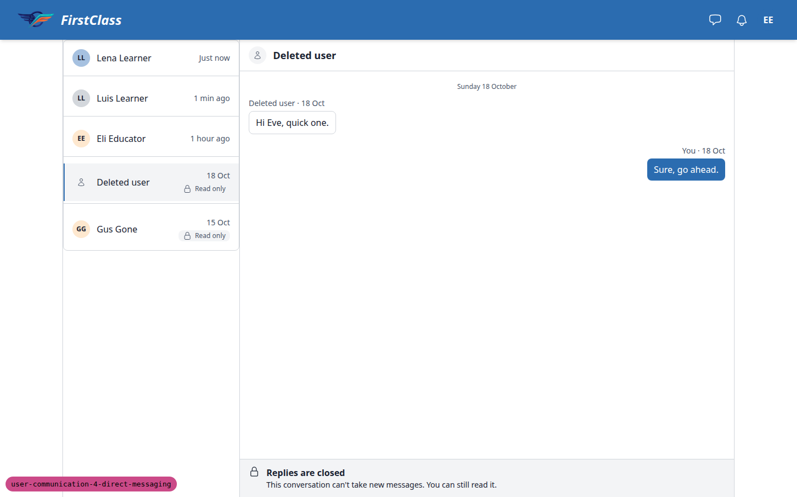

New message modal (6.1):

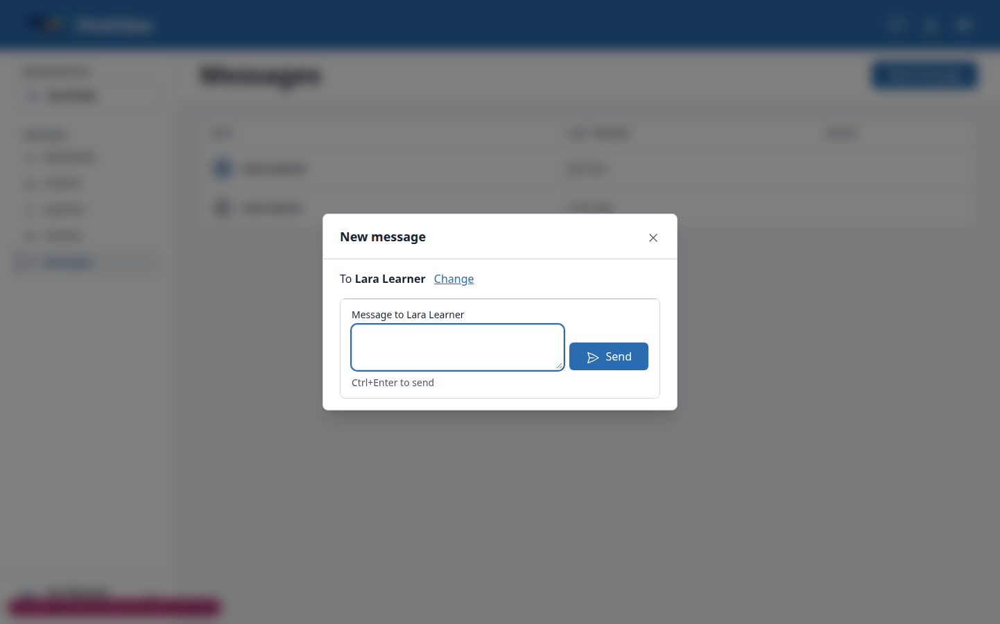

Removed learner closed state (7.1-7.4):

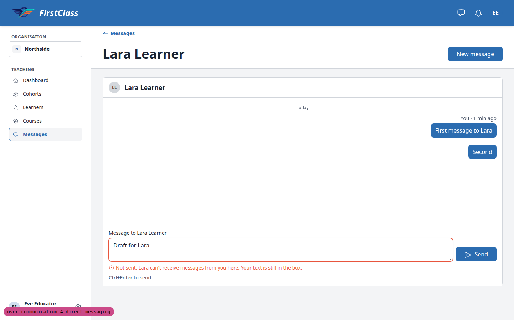

Notifications (8.1-8.7):

Offline retry (9.1-9.3):

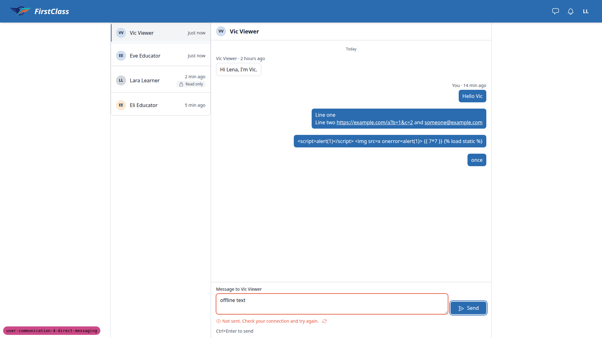

Stale recipient dialog (9.12):

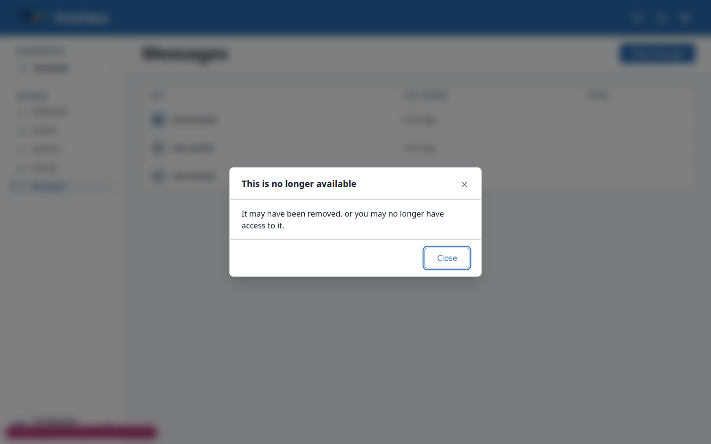

Quick view message box (10.1-10.4):

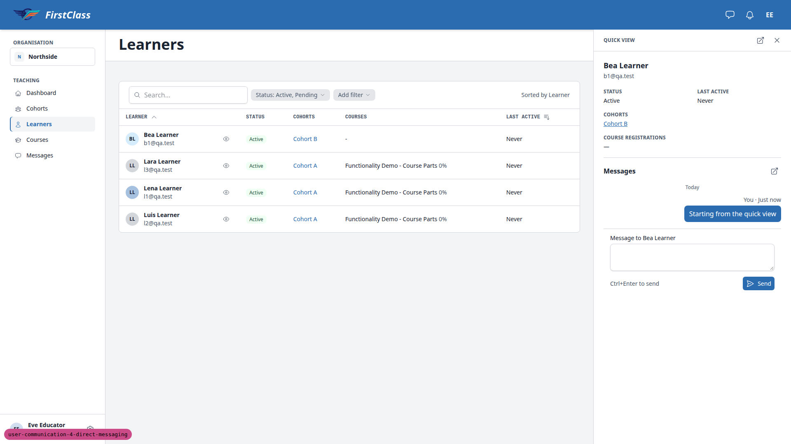

Mobile inbox (12.1):

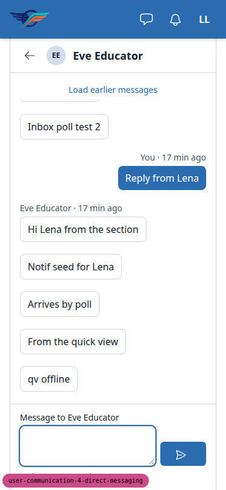

Mobile educator thread (12.2):

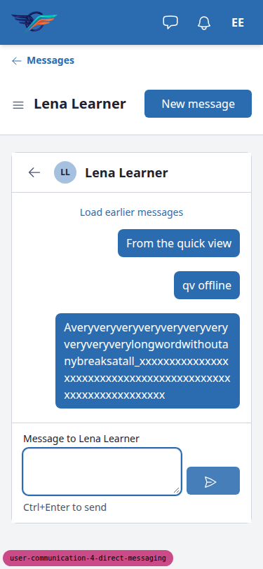

Tablet learner (12-tablet):

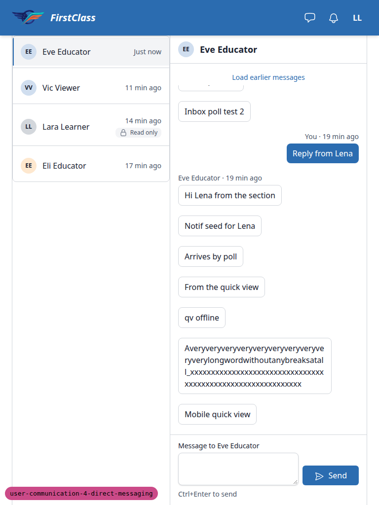

## B1: Header Messages button has no visible "Messages" label at desktop width

Manifestations: test 2.1 (desktop).

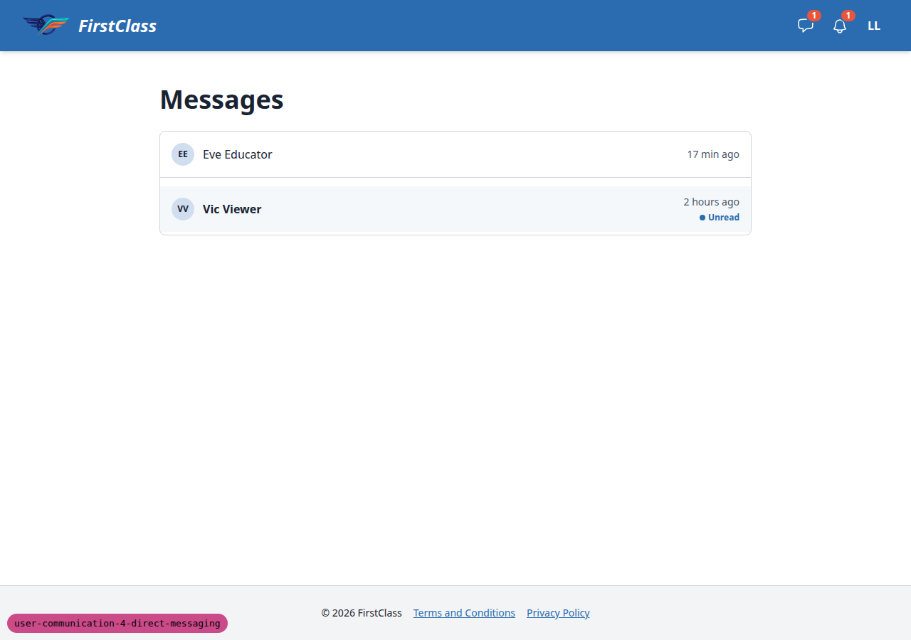

- Expected: test plan 2.1 and the design (direct-messages__1280) show the speech-bubble icon plus a visible "Messages" label beside the bell on desktop. Test 12.1 expects the label to drop only at 375px.
- Actual: the button is icon-only at every width (40x40 link, label only in an sr-only span). The spec's Header section asks only for an icon and an aria-label with the count, so the spec and the plan/design disagree.

## B2: Educator thread page has a back link, not the "Northside > Messages > Lena Learner" breadcrumb

Manifestations: test 5.5 (desktop).

- Expected: test plan 5.5 and plan design element 1 (educator-messages__01) name a breadcrumb "<Organisation> > Messages > <learner>".
- Actual: the instance page shows the educator interface's standard "<- Messages" back link above the heading "Lena Learner". There is no organisation name or breadcrumb trail. The design checklist itself does not list the breadcrumb.

## Bug status

- **UNRESOLVED** — B1: Header Messages button has no visible "Messages" label at desktop width (reason: the spec asks for an icon plus an aria-label, but the test plan and the design show a visible label; choosing between them is a product decision)
- **UNRESOLVED** — B2: Educator thread page has a back link, not a breadcrumb (reason: plan 2 and the test plan name a "<Organisation> › Messages › <learner>" breadcrumb, but every educator-interface instance page uses a "← Section" back link and the design checklist does not list the breadcrumb; keeping or changing the shared pattern is a product decision)

## General notes

Not tested:
- 9.10, the optional MESSAGING_ENABLED=False restart check, was skipped. It would need a settings edit and a restart of this run's server mid-run.

Difficulties:
- The Playwright browser restarted once during section 4.5 (the page went to about:blank mid-wait). The first attempt timed out because of that, not because of an app fault. The step was rerun and passed.

Observations with no action attached:
- The set-password email link uses the Site domain 127.0.0.1:8000, not the run's port 8412. Opening it on 8412 worked and the password was set.
- Test 9.12 refuses a stale recipient when it is chosen (the "no longer available" dialog, GET new_message?recipient=72 returns 404), not on send as the plan expected. Nothing is created, so it is safe.
- The recipient picker rows render names and emails as underlined links.
- A sender group shows only its first message's time (for example "17 min ago") even when later messages in the group came minutes after.
- At 375px the educator thread page repeats the back control and the learner's name: the page header has a "<- Messages" link and "Lena Learner", and the thread header has its own back arrow and "Lena Learner".
- Read cards in the mobile educator section list show an empty "Status" label.
- The superuser's /messages/ empty state reads "Your educators can message you, and you can reply." even though that user is not a learner.

status: ok
reason: 2 bugs — 0 fixed, 2 unresolved (both need a product decision); report rendered, screenshots verified
